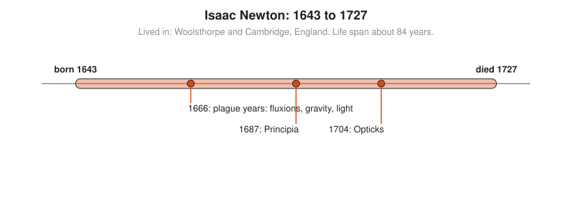
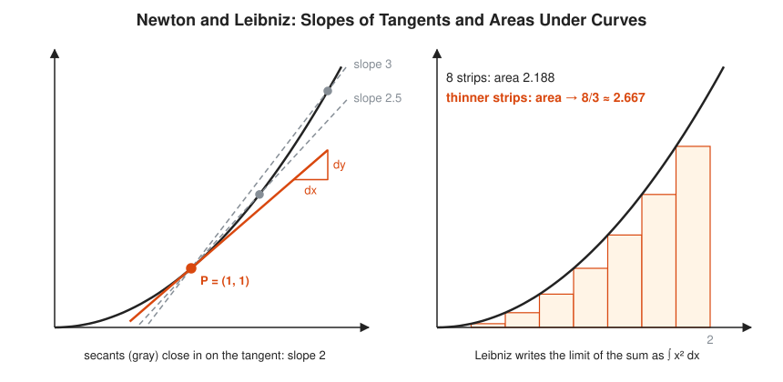

# Isaac Newton

**Lived:** 1643 to 1727 · **Where:** Woolsthorpe and Cambridge, England · **Era:** [Chapter 07: The Scientific Revolution and Calculus](../07-scientific-revolution-and-calculus/README.md)

Isaac Newton is the English mathematician and physicist who invents calculus (independently of Leibniz) and uses it to explain gravity, motion, and the orbits of the planets.

## Life at a Glance

<!-- diagram: type=life-timeline person=newton born=1643 died=1727 caption="Isaac Newton, 1643 to 1727" -->


He is born on a farm at Woolsthorpe. In 1665 and 1666 plague closes Cambridge, and at home he works out his method of **fluxions** (his name for calculus), early ideas on gravity, and the colors of light. In 1687 he publishes the *Principia*. In 1704 he publishes *Opticks*, with a treatise on his calculus added as an appendix.

## The World Around Them

Kepler has shown that planets move in ellipses, and Galileo has measured falling bodies. Nobody can explain why. Navigation at sea needs better astronomy, and the new Royal Society in London wants laws of nature backed by math and experiment.

## What They Did

* Invents fluxions: a way to find the rate of change of any quantity (the derivative) and to add up tiny pieces (the integral).
* Finds the **binomial series**, a way to expand $(1 + x)^n$ even for fractions like $n = \frac{1}{2}$.
* States three laws of motion and the law of universal gravitation in the *Principia*, and derives Kepler's ellipses from them.
* Splits white light into colors with a prism and builds the first working reflecting telescope.
* Gives **Newton's method**, still used by computers to find roots of equations.
* Joins the Royal Mint in 1696, runs it from 1699, and leads the Royal Society from 1703.

## Key Idea, Worked Small

**The slope of a curve from a tiny step.** Newton grows $x$ by a tiny amount he calls $o$ and watches how $x^2$ changes. Find the slope of $y = x^2$:

```txt
  (x + o)^2 = x^2 + 2xo + o^2        expand
  change in y = 2xo + o^2            subtract the old value x^2
  change in y / o = 2x + o           divide by the small step o
  let o shrink to nothing: 2x        the leftover o vanishes
  at x = 3 the slope is 2 x 3 = 6
  check: (3.001^2 - 3^2) / 0.001 = 6.001
```

This is the derivative. The same idea, run backwards, finds areas under curves.

<!-- diagram: type=concept ref=tangent-and-area -->


## A Human Detail

Newton tells the falling-apple story himself in old age, which makes it plausible but polished. The apple hitting his head is a later addition. In the priority fight with Leibniz, the Royal Society appoints a committee to judge, and the report is quietly written by its president: Newton.

## Connects To

* [Course 401: Calculus](../../course/401/README.md): derivatives, integrals, and the Fundamental Theorem.
* [Calculus track](../../tracks/calculus/README.md): from slopes to areas.
* [Differential equations track](../../tracks/differential-equations/README.md): laws of motion as equations of change.

## Go Deeper

* [MacTutor biography of Newton](https://mathshistory.st-andrews.ac.uk/Biographies/Newton/): the standard scholarly short life.
* [Chapter 07: The Scientific Revolution and Calculus](../07-scientific-revolution-and-calculus/README.md): the era in full.
