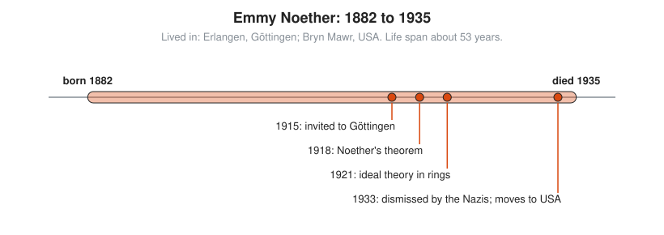

# Emmy Noether

**Lived:** 1882 to 1935 · **Where:** Erlangen, Göttingen; Bryn Mawr, USA · **Era:** [Chapter 09: 20th-Century Foundations and Computing](../09-20th-century-foundations-and-computing/README.md)

Emmy Noether is the German mathematician who links symmetry to conservation laws in physics and shapes modern abstract algebra.

## Life at a Glance

<!-- diagram: type=life-timeline person=noether born=1882 died=1935 caption="Emmy Noether, 1882 to 1935: Erlangen, Göttingen, Bryn Mawr" -->


Noether earns her doctorate in Erlangen and works there for years without pay. In 1915 Hilbert and Klein invite her to Göttingen, and in 1918 she proves Noether's theorem. Her 1921 paper on ideals in rings reshapes algebra. In 1933 the Nazis dismiss her for being Jewish, and she moves to Bryn Mawr College in the USA, where she dies after surgery in 1935.

## The World Around Them

Einstein publishes general relativity in 1915, and Hilbert and Klein are puzzled about how energy conservation works in it. They bring in Noether, an expert in invariants (quantities that stay fixed when you change your point of view). Universities in Germany still bar women from full posts.

## What They Did

* Proves Noether's theorem: every continuous symmetry of a physical system gives a conserved quantity.
* For example, physics the same today as tomorrow gives conservation of energy; the same here as there gives conservation of momentum.
* Recasts algebra around structures (rings, ideals, modules) instead of formulas.
* Leads a school of students in Göttingen, known as the Noether boys.
* Influences topology by pushing it to use groups instead of only counting holes.

## Key Idea, Worked Small

**An ideal.** An **ideal** in the whole numbers is a collection that stays closed under two moves: add two members, or multiply a member by any whole number. Build the ideal made from 4 and 6: every number of the form $4a + 6b$, with $a$ and $b$ whole numbers.

```txt
  4(1) + 6(0) = 4                 4 is in the ideal
  4(-1) + 6(1) = 2                2 is in the ideal
  4a + 6b = 2(2a + 3b)            every member is even
  2k = 4(-k) + 6(k)               every even number is a member: -4k + 6k = 2k
  ideal = all multiples of 2      one number generates it
  2 = gcd(4, 6)                   the generator is the greatest common divisor
```

Noether shows that thinking about ideals, not single numbers, is the clean way to organize algebra.

## A Human Detail

At Göttingen the faculty refuses to give her a post. From 1916 to 1919 her courses are listed under Hilbert's name, with her as his assistant. She is paid little, dresses plainly, lectures fast, and does not mind.

## Connects To

* [Abstract algebra track](../../tracks/abstract-algebra/README.md): rings and ideals.
* [Number theory track](../../tracks/number-theory/README.md): greatest common divisors.
* [Course 601: Proof and Higher Math](../../course/601/README.md): abstract algebra.
* [Differential equations track](../../tracks/differential-equations/README.md): conservation laws in physics.

## Go Deeper

* [MacTutor biography of Emmy Noether](https://mathshistory.st-andrews.ac.uk/Biographies/Noether_Emmy/): the standard scholarly short life.
* [Chapter 09: 20th-Century Foundations and Computing](../09-20th-century-foundations-and-computing/README.md): the era in full.
