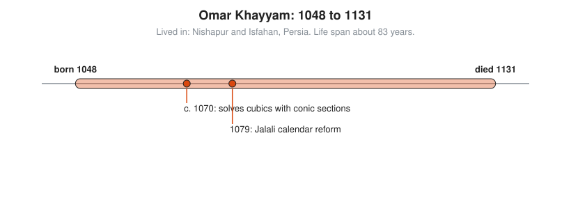

# Omar Khayyam

**Lived:** 1048 to 1131 · **Where:** Nishapur and Isfahan, Persia · **Era:** [Chapter 05: The Islamic Golden Age](../05-islamic-golden-age/README.md)

Omar Khayyam is the Persian mathematician and astronomer who solves cubic equations by intersecting curves and reforms the calendar, and who is better known in the West as a poet.

## Life at a Glance

<!-- diagram: type=life-timeline person=omar-khayyam born=1048 died=1131 caption="Omar Khayyam, 1048 to 1131" -->


He is born and dies in Nishapur. Around 1070, in Samarkand, he writes his *Treatise on Demonstration of Problems of Algebra*, which solves cubics with conic sections. In 1079, at the observatory in Isfahan, his team completes the Jalali calendar for Sultan Malik-Shah.

## The World Around Them

The Seljuk Turks rule Persia and much of the Middle East. Rulers fund observatories and scholars, but the funding depends on the patron, and patrons die. A good solar calendar matters for taxes and harvests, which follow the seasons, not the moon.

## What They Did

* Sorts equations up to the cubic (equations with $x^3$) into types with positive numbers only, and finds fourteen cubic types that do not reduce to simpler equations.
* Solves each type geometrically, as the meeting point of two **conic sections**: curves like circles, parabolas, and hyperbolas.
* Leads the calendar reform: eight leap days every 33 years, an average year of $365 + \frac{8}{33} = 365.2424$ days, close to the true 365.2422.
* Studies Euclid's parallel postulate and proves results that later belong to non-Euclidean geometry.
* Says he hopes later mathematicians find an algebraic formula for cubics. Cardano publishes one about 400 years later.

## Key Idea, Worked Small

**A cubic as the crossing of two curves.** Solve $x^3 + 4x = 16$. Khayyam draws the parabola $y = \frac{x^2}{2}$ and the circle with center $(2, 0)$ and radius 2. Where they cross, $x$ solves the cubic. Check by algebra:

```txt
  circle: (x - 2)^2 + y^2 = 4              center (2, 0), radius 2
  parabola: y = x^2 / 2                    substitute this y into the circle
  (x - 2)^2 + x^4 / 4 = 4
  x^2 - 4x + 4 + x^4 / 4 = 4               expand (x - 2)^2
  x^4 / 4 + x^2 - 4x = 0                   subtract 4 from both sides
  x^3 + 4x - 16 = 0                        multiply by 4 / x (x is not zero)
  x^3 + 4x = 16                            the cubic appears
  crossing point: (2, 2)                   read off the picture
  check: 2^3 + 4 x 2 = 8 + 8 = 16
```

<!-- diagram: type=construction ref=khayyam-cubic -->


## A Human Detail

Europe knows him mainly through Edward FitzGerald's 1859 English version of the *Rubaiyat*, a set of four-line poems. Scholars doubt that many of those poems are his. The calendar and the cubics, by contrast, are certainly his.

## Connects To

* [Course 301: Algebra II, Trig and Precalculus](../../course/301/README.md): polynomials and conic sections.
* [Algebra track](../../tracks/algebra/README.md): the long road to solving cubics.
* [Geometry track](../../tracks/geometry/README.md): curves as tools for solving equations.

## Go Deeper

* [MacTutor biography of Omar Khayyam](https://mathshistory.st-andrews.ac.uk/Biographies/Khayyam/): the standard scholarly short life.
* [Chapter 05: The Islamic Golden Age](../05-islamic-golden-age/README.md): the era in full.
