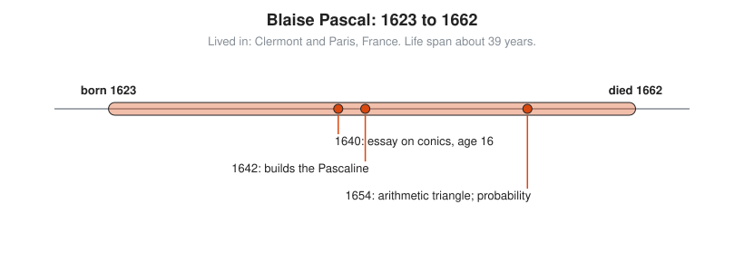
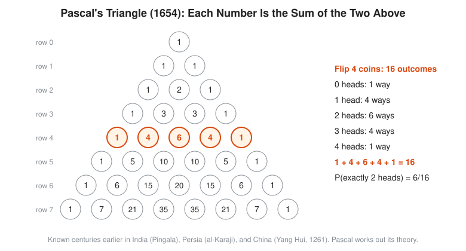

# Blaise Pascal

**Lived:** 1623 to 1662 · **Where:** Clermont and Paris, France · **Era:** [Chapter 07: The Scientific Revolution and Calculus](../07-scientific-revolution-and-calculus/README.md)

Blaise Pascal is the French prodigy who builds one of the first mechanical calculators and, with Fermat, founds the mathematics of probability.

## Life at a Glance

<!-- diagram: type=life-timeline person=pascal born=1623 died=1662 caption="Blaise Pascal, 1623 to 1662" -->


He is born in Clermont (now Clermont-Ferrand) and educated at home by his father. In 1640, at 16, he publishes an essay on conic sections. In 1642 he starts building the **Pascaline**, a gear-driven adding machine. In 1654 he writes his treatise on the arithmetic triangle and trades letters with Fermat on probability. He dies at 39 after years of illness.

## The World Around Them

His father is a tax official in Rouen, buried in long columns of sums by hand. Paris has a lively circle of mathematicians around Mersenne, which young Pascal joins. Gamblers ask how to split money fairly when a game stops early, and nobody has a method.

## What They Did

* States **Pascal's theorem** at 16: draw a six-sided figure with its corners on a conic, and the three crossing points of opposite sides lie on one straight line.
* Builds the Pascaline to help his father, and makes about 20 of them.
* Designs barometer experiments, including one his brother-in-law carries up the Puy de Dôme mountain in 1648. They show that air pressure falls with height. The unit of pressure, the pascal, honors him.
* Writes the *Treatise on the Arithmetic Triangle* (1654) and uses it to count outcomes.
* Solves the **problem of points** with Fermat in 1654, the start of probability theory.

## Key Idea, Worked Small

**The arithmetic triangle.** Each number is the sum of the two numbers above it. Row $n$ counts the ways to choose things. For example, the ways to get exactly two heads in four coin flips.

```txt
  row 0:         1                   start with a single 1
  row 1:       1   1                 edges are always 1
  row 2:     1   2   1               1 + 1 = 2
  row 3:   1   3   3   1             1 + 2 = 3, 2 + 1 = 3
  row 4: 1   4   6   4   1           1 + 3 = 4, 3 + 3 = 6, 3 + 1 = 4
  row 4 adds to 1 + 4 + 6 + 4 + 1 = 16 = 2^4     all outcomes of four flips
  two heads in four flips: 6 ways    the third entry of row 4
  chance of exactly two heads = 6 / 16 = 3/8
```

The triangle is much older than Pascal. Chinese, Indian, and Persian mathematicians know it centuries earlier. Pascal proves its properties and puts it to work on chance.

<!-- diagram: type=concept ref=pascal-triangle -->


## A Human Detail

On the night of 23 November 1654 he has an intense religious experience. He writes it down and sews the note into the lining of his coat, where a servant finds it after his death. He later turns from math to religious writing, including the *Pensées*. A programming language, Pascal, carries his name, which seems fair for a man who builds hardware at 19.

## Connects To

* [Course 501: Linear Algebra, Probability and Discrete Math](../../course/501/README.md): counting and probability.
* [Combinatorics track](../../tracks/combinatorics/README.md): choosing and the binomial coefficients.
* [Probability track](../../tracks/probability/README.md): fair games and expected value.

## Go Deeper

* [MacTutor biography of Pascal](https://mathshistory.st-andrews.ac.uk/Biographies/Pascal/): the standard scholarly short life.
* [Chapter 07: The Scientific Revolution and Calculus](../07-scientific-revolution-and-calculus/README.md): the era in full.
