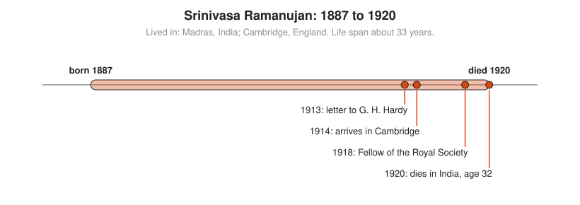

# Srinivasa Ramanujan

**Lived:** 1887 to 1920 · **Where:** Madras, India; Cambridge, England · **Era:** [Chapter 09: 20th-Century Foundations and Computing](../09-20th-century-foundations-and-computing/README.md)

Srinivasa Ramanujan is a largely self-taught Indian mathematician who produces thousands of startling formulas about numbers and infinite series.

## Life at a Glance

<!-- diagram: type=life-timeline person=ramanujan born=1887 died=1920 caption="Srinivasa Ramanujan, 1887 to 1920: Madras and Cambridge" -->


Ramanujan works as a clerk at the Madras Port Trust while doing mathematics in notebooks. In 1913 he writes to G. H. Hardy in Cambridge, who brings him to England in 1914. In 1918 he becomes a Fellow of the Royal Society. Ill for years, he returns to India and dies in 1920, age 32.

## The World Around Them

India is under British rule, and a poor Brahmin boy has few paths into research. Ramanujan fails college twice because he neglects every subject except mathematics. He learns from one old textbook of results by G. S. Carr, which lists theorems with little or no proof. He takes that style as normal and fills his notebooks the same way.

## What They Did

* Sends Hardy a letter with about 120 results. Hardy says some must be true because no one has the imagination to invent them.
* Works with Hardy on the partition function: the number of ways to write $n$ as a sum of whole numbers.
* Finds infinite series for $\pi$ that converge very fast, later used in computer programs.
* Leaves notebooks and a lost notebook that mathematicians are still proving results from today.

## Key Idea, Worked Small

**The taxicab number.** Hardy visits Ramanujan in the hospital and mentions that his taxi was number 1729, a dull number. Ramanujan answers that it is very interesting: the smallest number you can write as the sum of two cubes in two different ways. A **cube** is a number times itself times itself.

```txt
  12^3 = 12 × 12 × 12 = 1,728      cube of 12
  1^3 = 1                          cube of 1
  1,728 + 1 = 1,729                first way
  10^3 = 1,000                     cube of 10
  9^3 = 9 × 9 × 9 = 729            cube of 9
  1,000 + 729 = 1,729              second way
  no smaller number has two ways   checked by trying every pair below
```

Numbers like this now carry the name taxicab numbers. Hardy tells the story himself, and it is not a legend.

## A Human Detail

Ramanujan is a strict vegetarian in wartime England and struggles to get food he can eat. He says his family goddess, Namagiri, shows him formulas in dreams. Hardy, an atheist, takes the formulas and leaves the goddess out of it.

## Connects To

* [Number theory track](../../tracks/number-theory/README.md): partitions and sums of cubes.
* [Combinatorics track](../../tracks/combinatorics/README.md): counting partitions.
* [Course 301: Algebra II, Trig and Precalculus](../../course/301/README.md): exponents, sequences, and series.

## Go Deeper

* [MacTutor biography of Srinivasa Ramanujan](https://mathshistory.st-andrews.ac.uk/Biographies/Ramanujan/): the standard scholarly short life.
* [Chapter 09: 20th-Century Foundations and Computing](../09-20th-century-foundations-and-computing/README.md): the era in full.
