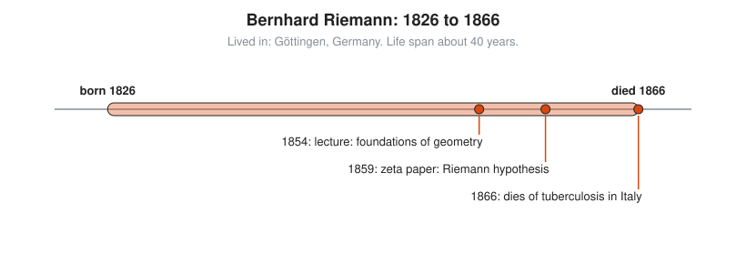
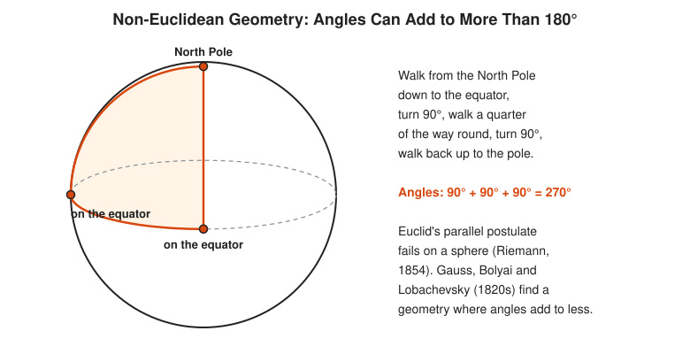

# Bernhard Riemann

**Lived:** 1826 to 1866 · **Where:** Göttingen, Germany · **Era:** [Chapter 08: The 18th and 19th Centuries: Rigor](../08-18th-and-19th-century-rigor/README.md)

Bernhard Riemann is a shy German mathematician whose short career reshapes geometry, calculus, and the study of prime numbers.

## Life at a Glance

<!-- diagram: type=life-timeline person=riemann born=1826 died=1866 caption="Bernhard Riemann, 1826 to 1866: Göttingen" -->


In 1854 Riemann gives a lecture on the foundations of geometry, on a topic chosen by Gauss. In 1859 he publishes his only paper on prime numbers, which contains the Riemann hypothesis. He dies of tuberculosis in Italy in 1866, age 39.

## The World Around Them

Calculus works, but its foundations are loose. Mathematicians need exact definitions of an integral and of a smooth surface. Physicists want a geometry for space that does not assume Euclid. Riemann supplies both, and 60 years later Einstein uses his geometry for general relativity.

## What They Did

* Gives the first careful definition of the integral as a limit of sums of thin rectangles, now called the Riemann integral.
* Describes curved spaces of any dimension and how to measure distance in them.
* Links the distribution of prime numbers to the zeros of one function, the zeta function.
* States the Riemann hypothesis, still unproved and worth a million-dollar prize.
* Introduces Riemann surfaces, a way to picture functions of complex numbers.

## Key Idea, Worked Small

**Geometry depends on the surface.** On a flat page, the angles of a triangle add to 180°. On a sphere they add to more. Walk a triangle on the Earth.

<!-- diagram: type=sphere ref=sphere-triangle -->


```txt
  start at the North Pole, walk south to the equator     side 1
  turn left 90°, walk a quarter of the way around        side 2
  turn left 90°, walk north back to the pole             side 3
  angle at the pole = 90°                                the two north-south lines are a quarter turn apart
  90° + 90° + 90° = 270°                                 three right angles
  270° - 180° = 90°                                      the extra over a flat triangle
  90° = π/2 radians                                      convert to radians
  area = (1/8) × 4πr^2 = πr^2/2                          the triangle covers one eighth of the sphere
  extra × r^2 = (π/2) × r^2 = πr^2/2                     the extra angle matches the area
```

The extra angle measures how curved the surface is. Riemann generalizes this to spaces of any dimension.

## A Human Detail

Riemann first enrolls at Göttingen to study theology, as his pastor father hopes. He asks permission to switch to mathematics, and his father agrees.

## Connects To

* [Course 401: Calculus](../../course/401/README.md): the Riemann integral as a sum of rectangles.
* [Geometry track](../../tracks/geometry/README.md): curved geometry beyond Euclid.
* [Number theory track](../../tracks/number-theory/README.md): primes and the zeta function.
* [Complex analysis track](../../tracks/complex-analysis/README.md): Riemann surfaces.

## Go Deeper

* [MacTutor biography of Bernhard Riemann](https://mathshistory.st-andrews.ac.uk/Biographies/Riemann/): the standard scholarly short life.
* [Chapter 08: The 18th and 19th Centuries: Rigor](../08-18th-and-19th-century-rigor/README.md): the era in full.
