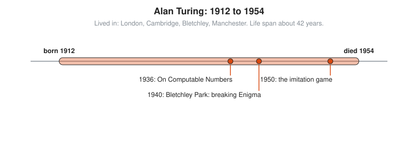
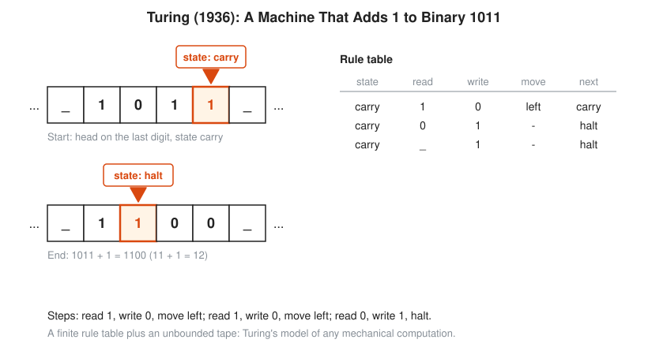

# Alan Turing

**Lived:** 1912 to 1954 · **Where:** London, Cambridge, Bletchley, Manchester · **Era:** [Chapter 09: 20th-Century Foundations and Computing](../09-20th-century-foundations-and-computing/README.md)

Alan Turing is the English mathematician who defines what it means to compute, helps break German codes in the Second World War, and asks whether machines can think.

## Life at a Glance

<!-- diagram: type=life-timeline person=turing born=1912 died=1954 caption="Alan Turing, 1912 to 1954: London, Cambridge, Bletchley, Manchester" -->


In 1936, at 24, Turing publishes *On Computable Numbers*, which describes the Turing machine. From 1939 he works at Bletchley Park, and from 1940 his bombe machines help read Enigma messages. In 1950 he proposes the imitation game, now called the Turing test. He dies in 1954, age 41.

## The World Around Them

Hilbert asks whether a mechanical procedure can decide the truth of any mathematical statement. Nobody has a precise meaning for mechanical procedure. A few years later, war makes fast code breaking a matter of survival for Britain, and the first electronic computers follow.

## What They Did

* Defines the Turing machine: a tape, a head that reads and writes one symbol, and a finite table of rules.
* Proves that no program can decide, for every program and input, whether it eventually stops. This is now called the halting problem.
* Designs the bombe, building on earlier Polish machines and later improved by Gordon Welchman, to find daily Enigma settings.
* Designs the ACE computer and writes early software at Manchester.
* Proposes the imitation game as a test of machine intelligence.

## Key Idea, Worked Small

**A Turing machine that adds 1 in binary.** Start with 1011 on the tape and the head on the last digit, in state carry.

<!-- diagram: type=turing-machine ref=turing-machine -->


```txt
  tape 1 0 1 1, head on last digit       state carry
  read 1: write 0, move left             tape 1 0 1 0
  read 1: write 0, move left             tape 1 0 0 0
  read 0: write 1, halt                  tape 1 1 0 0
  1011 = 8 + 0 + 2 + 1 = 11              check the input in decimal
  1100 = 8 + 4 + 0 + 0 = 12              check the output in decimal
  11 + 1 = 12                            correct
```

Three rules do the whole job. Turing argues that any step-by-step computation, however large, breaks into steps this small.

## A Human Detail

Turing is a serious runner who runs a marathon in 2 hours 46 minutes in 1947, about 11 minutes slower than the 1948 Olympic winner. In 1952 he is convicted for a relationship with a man and forced into hormone treatment. He dies of cyanide poisoning in 1954. The inquest rules suicide, and some historians question that verdict. Britain apologizes in 2009 and pardons him in 2013.

## Connects To

* [Discrete math track](../../tracks/discrete-math/README.md): machines, states, and what can be computed.
* [Logic and set theory track](../../tracks/logic-and-set-theory/README.md): the halting problem and undecidability.
* [Course 101: Foundations](../../course/101/README.md): place value and binary numbers.
* [Course 601: Proof and Higher Math](../../course/601/README.md): diagonal arguments, which the halting proof uses.

## Go Deeper

* [MacTutor biography of Alan Turing](https://mathshistory.st-andrews.ac.uk/Biographies/Turing/): the standard scholarly short life.
* [Chapter 09: 20th-Century Foundations and Computing](../09-20th-century-foundations-and-computing/README.md): the era in full.
