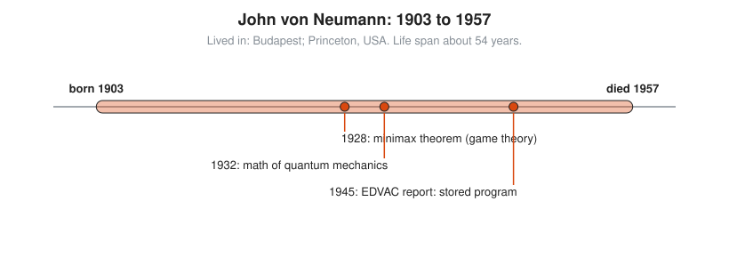

# John von Neumann

**Lived:** 1903 to 1957 · **Where:** Budapest; Princeton, USA · **Era:** [Chapter 09: 20th-Century Foundations and Computing](../09-20th-century-foundations-and-computing/README.md)

John von Neumann is a Hungarian-American mathematician who founds game theory, puts quantum mechanics on firm math, and describes the design that nearly every computer still follows.

## Life at a Glance

<!-- diagram: type=life-timeline person=von-neumann born=1903 died=1957 caption="John von Neumann, 1903 to 1957: Budapest and Princeton" -->


In 1928 von Neumann proves the minimax theorem, the base of game theory. In 1932 he publishes the mathematical foundations of quantum mechanics. In 1945 he writes the EDVAC report, which describes a computer that keeps its program in memory. He dies of cancer in 1957, age 53.

## The World Around Them

Von Neumann grows up in a wealthy Budapest family and leaves Europe as fascism rises. In the USA he joins the Institute for Advanced Study in Princeton. The Second World War needs fast calculation for bombs, shock waves, and weather. He works on the Manhattan Project and on the first electronic computers.

## What They Did

* Proves the minimax theorem: in a two-player game where one wins what the other loses, both sides have a best mixed strategy.
* Writes, with Oskar Morgenstern, *Theory of Games and Economic Behavior* in 1944.
* Gives quantum mechanics a clean mathematical form using Hilbert spaces.
* Describes the stored-program computer: one memory holds both data and instructions. The design is still called the von Neumann architecture, though J. Presper Eckert and John Mauchly had developed many of the ideas with him and objected to the credit.
* Helps start numerical weather forecasting and the Monte Carlo method, which uses random sampling to estimate answers.

## Key Idea, Worked Small

**Minimax with a mixed strategy.** In matching pennies, you and I each show heads (H) or tails (T). If they match, I win 1 point. If not, you win 1 point. Any fixed choice loses to a player who guesses it. Instead, I flip my coin: heads half the time, tails half the time.

```txt
  you show H:  (1/2)(+1) + (1/2)(-1) = 0     my average against your H
  you show T:  (1/2)(-1) + (1/2)(+1) = 0     my average against your T
  my guarantee = 0                           no choice of yours pushes me below 0
  you mix 1/2 and 1/2 too
  your cap on me = 0                         no choice of mine pushes me above 0
  my best guarantee = your best cap = 0      the minimax theorem: the two meet
```

The value of the game is 0, and mixing is the only safe way to get it. The same logic explains why a security patrol on a fixed schedule is easy to dodge.

## A Human Detail

Von Neumann is famous for fast mental arithmetic and a terrible driving record. By many accounts he wrecks about one car a year and keeps buying new ones.

## Connects To

* [Probability track](../../tracks/probability/README.md): expected values and mixed strategies.
* [Course 501: Linear Algebra, Probability and Discrete Math](../../course/501/README.md): probability and matrices.
* [Linear algebra track](../../tracks/linear-algebra/README.md): payoff matrices and Hilbert spaces.
* [Discrete math track](../../tracks/discrete-math/README.md): the stored-program model of computing.

## Go Deeper

* [MacTutor biography of John von Neumann](https://mathshistory.st-andrews.ac.uk/Biographies/Von_Neumann/): the standard scholarly short life.
* [Chapter 09: 20th-Century Foundations and Computing](../09-20th-century-foundations-and-computing/README.md): the era in full.
