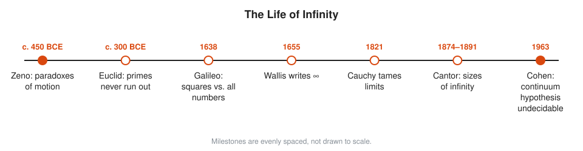
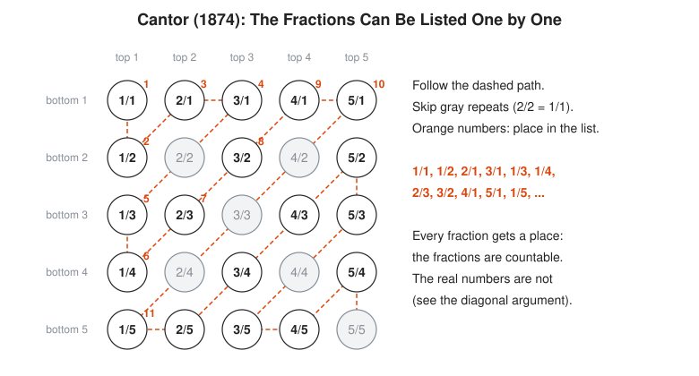
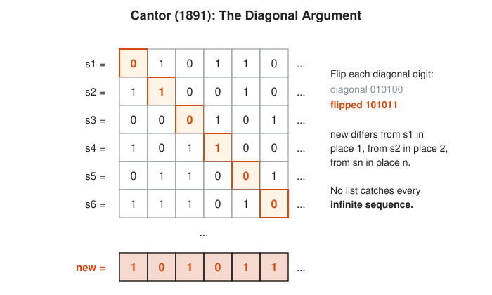

# The Story of Infinity

**Reading time:** about 12 minutes · **Part of:** [Story of an Idea](README.md) · **Previous essay:** [The Story of Pi](pi.md) · **Next essay:** [The Story of Algebraic Notation](notation.md)

For two thousand years mathematicians treat infinity like a live wire: useful, but not to be touched. Then, in the 1870s, Georg Cantor picks it up, measures it, and finds that some infinities are bigger than others.

## Picture It

<!-- diagram: type=idea-timeline idea=infinity items=7 caption="Milestones in the life of infinity, evenly spaced" -->


The strip has three acts. Act one: infinity causes paradoxes, and careful people avoid it. Act two: calculus uses infinitely small pieces and gets right answers for doubtful reasons. Act three: limits and sets make infinity precise.

## Stage 1: Zeno's Paradoxes

Around 450 BCE Zeno of Elea argues that motion is impossible. To walk to a wall you first walk half way, then half of what is left, then half again, forever. Infinitely many steps, he says, cannot be finished.

```txt
  |----------------|--------|----|--|-|
  0               1/2      3/4  7/8 ...   1 (the wall)

  1/2 + 1/4 + 1/8 + 1/16 + ...
  after 1 step:  1/2      = 0.5
  after 2 steps: 3/4      = 0.75
  after 3 steps: 7/8      = 0.875
  after n steps: 1 - 1/2^n          the gap halves every step
```

The modern answer: infinitely many pieces can add up to a finite total. The gap $1/2^n$ shrinks below any distance you name, and the sum is exactly 1. Nobody can say that cleanly until the 1800s. Meanwhile, people keep walking to walls.

Aristotle (c. 350 BCE) offers a truce. He allows a **potential infinity**, a process that can always continue, like counting. He rejects an **actual infinity**, a finished collection with infinitely many members. Most mathematicians accept the truce for about 2,000 years.

## Stage 2: Infinite, but Politely

Euclid never says there are infinitely many primes. Book IX, Proposition 20 says something more careful: for any finite list of primes, there is a prime not on the list.

```txt
  list: 2, 3, 5                      any finite list of primes
  N = 2 x 3 x 5 + 1 = 31             multiply them, add 1
  31 / 2, 31 / 3, 31 / 5             each leaves remainder 1
  no prime on the list divides 31    remainder 1 every time
  31 is prime, or has a prime factor not on the list
  either way: a new prime
```

That is potential infinity at work: the list can always grow. Archimedes uses the same caution when he traps $\pi$ between polygons ([The Story of Pi](pi.md)).

## Stage 3: Calculus Plays With Fire

In 1638 Galileo notices something strange. Pair each whole number with its square: 1 with 1, 2 with 4, 3 with 9, and so on. Every number gets a partner. Most numbers are not squares, yet there seem to be as many squares as numbers. Galileo concludes that "equal", "greater" and "less" do not apply to infinite collections. He is half right.

In 1655 John Wallis introduces the symbol $\infty$. Newton and Leibniz build calculus from **infinitesimals**, quantities smaller than any positive number but not zero. The answers are correct. The reasons are shaky. In 1734 Bishop George Berkeley mocks infinitesimals as "the ghosts of departed quantities". He has a point.

## Stage 4: Limits Tame the Small

Cauchy (1821) and later Weierstrass replace infinitesimals with **limits**. A limit is the value a process gets as close to as you like, given enough steps. No ghost is needed: "the sum of $1/2 + 1/4 + \cdots$ is 1" means the partial sums get within any tolerance of 1 and stay there. This is the same idea as an SLO: pick any error budget, and past some point the process stays inside it. See [Chapter 08](../08-18th-and-19th-century-rigor/README.md).

## Stage 5: Cantor Measures Infinity

Georg Cantor takes Galileo's pairing seriously. Two sets have the **same size** when their members can be paired off exactly, with nobody left over. Under that rule there are as many squares as whole numbers. More surprising, there are as many fractions as whole numbers. Walk the grid of fractions along its diagonals and every fraction gets a place in one list.

<!-- diagram: type=enumeration ref=cantor-rationals caption="Listing every fraction by walking diagonals" -->


A set that can be listed this way is **countable**. In 1874 Cantor proves the real numbers are not countable. In 1891 he gives the famous short proof: the diagonal argument. Suppose someone hands you a complete list of infinite sequences of 0s and 1s. Build a new sequence by flipping the first digit of the first sequence, the second digit of the second, and so on.

<!-- diagram: type=historical-method ref=cantor-diagonal caption="Cantor's diagonal argument" -->


The new sequence differs from row $n$ in place $n$, for every $n$. It is on no row. The list was not complete after all. No list ever is. The infinity of real numbers is strictly bigger than the infinity of whole numbers.

The same diagonal trick reappears in 1931 in Gödel's incompleteness theorems and in 1936 in Turing's proof that no program decides whether every program halts ([Chapter 09](../09-20th-century-foundations-and-computing/README.md)).

## Stage 6: A Question With No Answer

Is there an infinity strictly between the whole numbers and the real numbers? Cantor believes not. This guess is the **continuum hypothesis**. Gödel (1940) shows the standard axioms of set theory cannot disprove it. Paul Cohen (1963) shows they cannot prove it either. With the usual axioms, the question has no answer. Some mathematicians find that unsettling. Others find it restful.

## Worked Small: Hilbert's Hotel

David Hilbert likes this picture in his lectures in the 1920s. A hotel has rooms 1, 2, 3, and so on forever. Every room is full. A new guest arrives.

```txt
  guest in room n moves to room n + 1       every guest still has a room
  room 1 is now empty                        the new guest takes it
  full hotel + 1 guest = full hotel          adding 1 to a countable infinity changes nothing

  a bus with infinitely many guests arrives:
  guest in room n moves to room 2n           old guests fill the even rooms
  odd rooms 1, 3, 5, ... are empty           new guest k takes room 2k - 1
```

Do not try this with a real on-call rotation.

## Go Deeper

* [MacTutor: Infinity](https://mathshistory.st-andrews.ac.uk/HistTopics/Infinity/): the long history in one essay.
* [MacTutor: The Beginnings of Set Theory](https://mathshistory.st-andrews.ac.uk/HistTopics/Beginnings_of_set_theory/): Cantor and his critics.
* [Cantor biography](../biographies/cantor.md) and [Gödel biography](../biographies/godel.md).
* [Course 601: Proof and Higher Math](../../course/601/README.md): cardinality, countable and uncountable sets.
* [Logic and Set Theory track](../../tracks/logic-and-set-theory/README.md).
