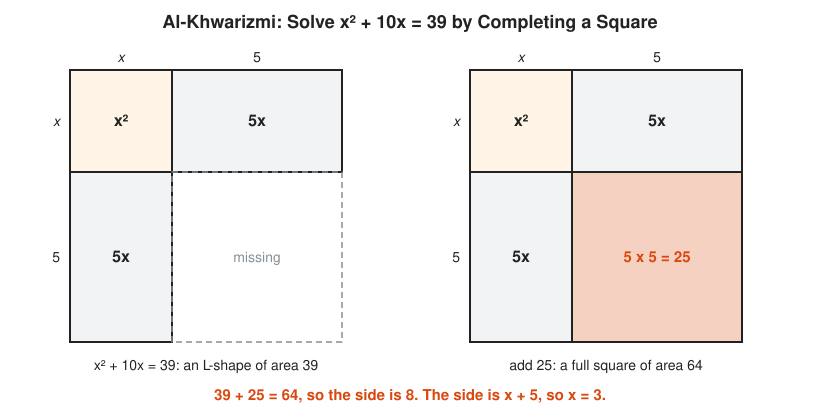

# The Story of Algebraic Notation

**Reading time:** about 11 minutes · **Part of:** [Story of an Idea](README.md) · **Previous essay:** [The Story of Infinity](infinity.md) · **Next essay:** [The Story of Proof](proof.md)

For most of history, algebra is written in full sentences. The symbols you learned in school, $+$, $-$, $=$, $x$, $x^2$, $f(x)$, arrive one at a time between about 1480 and 1750. Each one is a small piece of compression, and together they turn algebra from prose into something closer to code.

## Picture It

<!-- diagram: type=idea-timeline idea=notation items=7 caption="Milestones in the life of algebraic notation, evenly spaced" -->


Historians name three stages. **Rhetorical** algebra writes everything in words. **Syncopated** algebra uses abbreviations, like shorthand. **Symbolic** algebra uses signs that you manipulate by rules without reading them aloud.

## One Equation, Three Styles

Here is the same kind of problem written the way each stage writes it.

```txt
  RHETORICAL (al-Khwarizmi, c. 825, in words):
    "A square and ten roots of it equal thirty-nine."

  SYNCOPATED (Cardano, 1545, a cubic in abbreviated Latin):
    "cubus p: 6 rebus aequalis 20"
    cube plus 6 things equal 20

  SYMBOLIC (after Descartes, 1637):
    x^2 + 10x = 39
    x^3 + 6x  = 20
```

The symbolic line is shorter. More important, it is easier to transform. You can move a term across the $=$ sign without rereading a paragraph, the way a compiler rewrites an expression tree.

## Stage 1: Words and Pictures

Babylonian scribes (c. 1800 BCE) pose and solve quadratic problems in words, with worked numbers instead of general rules. Al-Khwarizmi in Baghdad (c. 825) gives general methods, still in words, and backs each one with a geometric picture.

<!-- diagram: type=historical-method ref=completing-the-square caption="Al-Khwarizmi's picture for x^2 + 10x = 39" -->


The picture does the work that symbols do later. It shows why adding 25 makes a perfect square. See [Chapter 05](../05-islamic-golden-age/README.md).

## Stage 2: Shorthand

Diophantus of Alexandria (c. 250) abbreviates. He has a sign for the unknown, signs for its powers, and a sign for "equals". He has only one unknown at a time, and he writes subtraction with a special mark. Brahmagupta (628) writes several unknowns, each named after a color. Italian abacus masters of the 1400s and 1500s write *p* for plus, *m* for minus, *co* (cosa, the thing) for the unknown.

## Stage 3: The Signs Arrive

```txt
  1489   +  and  -    Johannes Widmann, a German arithmetic book (for surpluses and shortfalls)
  1557   =            Robert Recorde, The Whetstone of Witte
  1591   letters      François Viète: vowels for unknowns, consonants for known numbers
  1631   x  (times)   William Oughtred
  1631   <  and  >    Thomas Harriot (published after his death)
  1637   x, y, z      René Descartes: last letters for unknowns, x^3 for powers
  1659   ÷            Johann Rahn
  1675   ∫  and  d    Gottfried Leibniz, in his notes (published 1684)
  1734   f(x)         Leonhard Euler
```

Recorde explains his choice of two parallel lines: "noe .2. thynges, can be moare equalle". His original sign is much longer than ours, about as long as a hyphenated word.

Viète's step is the big one. Before him, a book solves $x^2 + 10x = 39$ and then $x^2 + 6x = 16$ as separate examples. With letters for known numbers too, one line covers every case: $x^2 + bx = c$. That is the difference between running a command and writing a function with parameters.

Descartes settles the habit of using $x, y, z$ for unknowns and $a, b, c$ for known numbers. He still often writes $xx$ instead of $x^2$. Old habits last.

## Stage 4: Notation That Thinks for You

Leibniz cares about notation more than anyone. His $\frac{dy}{dx}$ looks like a fraction and often behaves like one, which makes rules like the chain rule easy to remember:

$$\frac{dy}{dx} = \frac{dy}{du} \cdot \frac{du}{dx}$$

Newton's dot notation ($\dot{x}$) is harder to extend. British mathematics sticks with Newton's dots for about a century and falls behind the Continent. A notation choice turns out to be an engineering decision with long-term costs.

Euler then standardizes much of what is in your textbook: $f(x)$ for functions, $e$ for the base of natural logarithms, $\pi$, $i$ for $\sqrt{-1}$, and $\Sigma$ for sums.

## Worked Small: Viète's Upgrade

Solve every equation of the form $x^2 + bx = c$ at once, the way Viète's letters allow:

```txt
  x^2 + bx = c
  x^2 + bx + (b/2)^2 = c + (b/2)^2         add the corner square (al-Khwarizmi's 25)
  (x + b/2)^2 = c + (b/2)^2                left side is a perfect square
  x + b/2 = sqrt(c + (b/2)^2)              take the positive root
  x = sqrt(c + (b/2)^2) - b/2              subtract b/2

  check b = 10, c = 39:
  x = sqrt(39 + 25) - 5 = 8 - 5 = 3        matches the picture
```

One formula replaces a whole chapter of worked examples.

## Go Deeper

* [MacTutor: Quadratic, Cubic and Quartic Equations](https://mathshistory.st-andrews.ac.uk/HistTopics/Quadratic_etc_equations/): how solutions and notation grow together.
* [MacTutor: Robert Recorde](https://mathshistory.st-andrews.ac.uk/Biographies/Recorde/): the man behind the equals sign.
* [MacTutor: François Viète](https://mathshistory.st-andrews.ac.uk/Biographies/Viete/): letters for numbers.
* [al-Khwarizmi biography](../biographies/al-khwarizmi.md), [Descartes biography](../biographies/descartes.md), [Euler biography](../biographies/euler.md).
* [Course 101: Foundations](../../course/101/README.md) (intro to variables) and [Algebra track](../../tracks/algebra/README.md).
