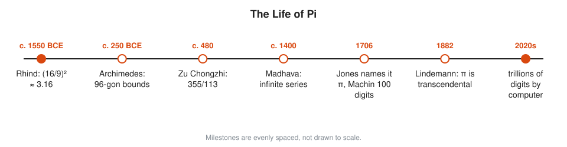
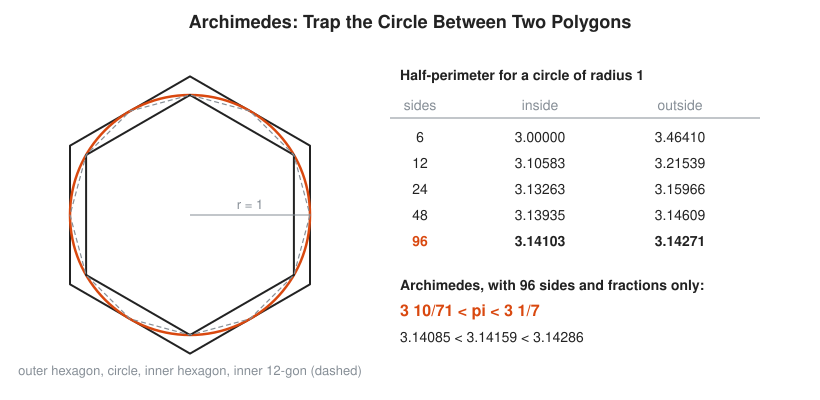
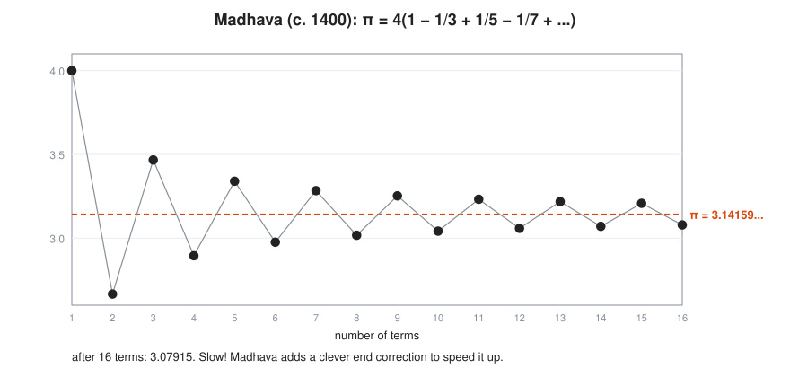

# The Story of Pi

**Reading time:** about 12 minutes · **Part of:** [Story of an Idea](README.md) · **Previous essay:** [The Story of Zero](zero.md) · **Next essay:** [The Story of Infinity](infinity.md)

Every circle has the same shape. Its distance around, divided by its distance across, is always the same number. That number is **pi**, written $\pi$. It is about 3.14159. The story of pi is the story of people squeezing that number from cruder guesses to trillions of digits, and then proving it never ends.

## Picture It

<!-- diagram: type=idea-timeline idea=pi items=7 caption="Milestones in the life of pi, evenly spaced" -->


Three methods carry the story. First, measure and guess. Second, trap the circle between polygons. Third, add up an infinite list of fractions. Computers run a faster version of the third method today.

## Stage 1: Good Enough for Builders

Ancient builders need the area of a round field or the volume of a round granary. They measure.

The Egyptian Rhind papyrus (c. 1550 BCE) finds the area of a circle by taking 8/9 of the diameter and squaring it. That rule hides a value of pi:

```txt
  area = (8/9 x d)^2               Rhind rule for a circle of diameter d
  area = pi x (d/2)^2              modern rule
  pi x d^2/4 = 64/81 x d^2         set them equal
  pi = 4 x 64/81 = 256/81          multiply both sides by 4/d^2
  pi = 3.1605...                   about 0.6% too big
```

Babylonian scribes often use 3, and sometimes 3 1/8 = 3.125. Both are fine for a granary. Neither is fine for a planet.

## Stage 2: Trap It Between Polygons

Around 250 BCE Archimedes of Syracuse stops measuring and starts proving. He draws a regular hexagon inside a circle and another outside it. The circle's perimeter lies between the two hexagon perimeters. Then he doubles the sides: 12, 24, 48, 96. Each doubling squeezes the gap.

<!-- diagram: type=historical-method ref=archimedes-pi caption="Inscribed and circumscribed polygons around a circle" -->


With 96 sides and only fractions, he proves

$$3\tfrac{10}{71} < \pi < 3\tfrac{1}{7}$$

That is 3.1408 < $\pi$ < 3.1429. The upper bound, 22/7, is still printed on school rulers.

The same idea travels east. Liu Hui in China (263) pushes polygons further and gets 3.1416. Around 480 Zu Chongzhi reaches 3.1415926 < $\pi$ < 3.1415927 and gives the fraction 355/113 = 3.14159292. No better fraction with a denominator under 16,000 exists. Europe does not match his accuracy for about a thousand years.

## Stage 3: Add Up Infinitely Many Pieces

Polygon work is slow. Each doubling needs a harder square root. Around 1400 Madhava of Sangamagrama, in Kerala, India, finds a completely different route: an infinite sum.

$$\frac{\pi}{4} = 1 - \frac{1}{3} + \frac{1}{5} - \frac{1}{7} + \frac{1}{9} - \cdots$$

<!-- diagram: type=series ref=madhava-series caption="Partial sums of Madhava's series zigzag around pi" -->


The picture shows the catch. The sums zigzag above and below $\pi$ and close in slowly. After 16 terms the answer is still wrong in the second decimal place. Madhava adds a correction term at the end of the sum, which speeds it up enormously. Europeans rediscover the series in the 1670s. It often carries the names of James Gregory and Leibniz.

```txt
  4 x 1                       = 4.0000      one term
  4 x (1 - 1/3)               = 2.6667      two terms
  4 x (1 - 1/3 + 1/5)         = 3.4667      three terms
  4 x (1 - 1/3 + 1/5 - 1/7)   = 2.8952      four terms: still far off
```

Faster series follow. In 1706 John Machin uses one to compute 100 digits. The same year William Jones first uses the Greek letter $\pi$ for the number. Euler adopts the symbol in the 1730s and everyone copies Euler.

## Stage 4: Proving It Never Ends

Digits keep coming, but do they ever repeat? In 1761 Johann Lambert proves $\pi$ is **irrational**: it is not a fraction of two whole numbers, and its decimal never settles into a repeating pattern. In 1882 Ferdinand von Lindemann proves more. Pi is **transcendental**: it is not the solution of any polynomial equation with whole-number coefficients. That settles a 2,000-year-old Greek puzzle. You cannot construct a square with the same area as a given circle using only a straightedge and compass. Many people kept trying anyway. Some still do.

## Stage 5: Pi as a Benchmark

In 1949 the ENIAC computer computes 2,037 digits in about 70 hours. By 2022 a cloud computation reaches 100 trillion digits, and later runs go further. Nobody needs those digits for engineering. NASA uses about 15 decimal places for interplanetary navigation. Long pi runs are stress tests: they check hardware, memory and storage, much like a burn-in job before a server joins the fleet.

## Worked Small: How Many Digits Do You Need

```txt
  Earth's circumference = pi x diameter
  diameter ~ 12,742 km
  with pi = 3.14          40,010 km
  with pi = 3.14159       40,030 km      difference: about 20 km
  with pi = 3.1415926     40,030.17 km   further digits move the answer by meters
```

Each extra correct digit cuts the error by about ten times. A few digits serve a builder. Fifteen serve a spacecraft. A hundred trillion serve a benchmark.

## Go Deeper

* [MacTutor: Pi Through the Ages](https://mathshistory.st-andrews.ac.uk/HistTopics/Pi_through_the_ages/): the full story.
* [MacTutor: A Chronology of Pi](https://mathshistory.st-andrews.ac.uk/HistTopics/Pi_chronology/): every milestone with dates and digits.
* [MacTutor: Squaring the Circle](https://mathshistory.st-andrews.ac.uk/HistTopics/Squaring_the_circle/): the puzzle Lindemann closes.
* [Archimedes biography](../biographies/archimedes.md) and [Liu Hui biography](../biographies/liu-hui.md).
* [Course 301: Algebra II, Trig and Precalculus](../../course/301/README.md): circles, radians and series.
