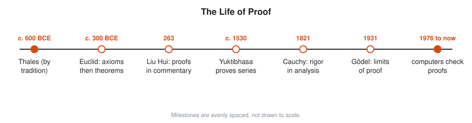
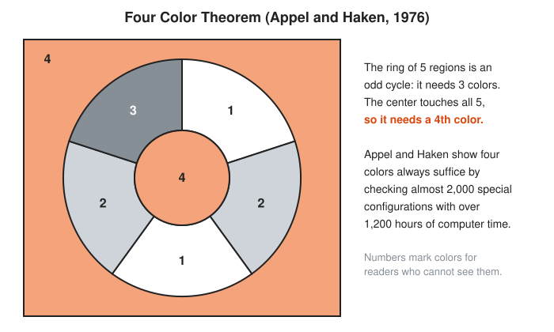

# The Story of Proof

**Reading time:** about 12 minutes · **Part of:** [Story of an Idea](README.md) · **Previous essay:** [The Story of Algebraic Notation](notation.md)

A **proof** is an argument that leaves no room for doubt: if you accept the starting assumptions, you must accept the conclusion. Measuring a hundred right triangles makes you confident. Proving the Pythagorean theorem makes you certain, for every right triangle, including the ones nobody has drawn yet. This essay follows how people learn to argue that way, and how they later learn the limits of it.

## Picture It

<!-- diagram: type=idea-timeline idea=proof items=7 caption="Milestones in the life of proof, evenly spaced" -->


Proof starts as a Greek habit, grows in several traditions, gets strict in the 1800s, hits a hard limit in 1931, and then gets help from machines.

## Stage 1: From Recipes to Reasons

Babylonian and Egyptian scribes know correct methods. Their tablets and papyri give worked examples: do this, then this, and here is the answer. They rarely say why. That is fine for running a granary. It is a runbook, not a design document.

Greek tradition credits Thales (c. 600 BCE) with the first proofs, for example that a diameter cuts a circle into two equal halves. Almost nothing about Thales is documented. The credit is a story told centuries later. By Plato's time, though, Greek mathematicians clearly prize the argument over the answer.

## Stage 2: Euclid's System

Around 300 BCE Euclid's *Elements* sets the pattern for the next 2,000 years. Start with a few definitions and **axioms**, statements accepted without proof. Prove each new result using only the axioms and results already proved. Never use a picture as evidence, only as an aid.

Proposition 1 of Book I shows the style in miniature.

<!-- diagram: type=construction ref=euclid-i-1 caption="Euclid I.1: an equilateral triangle on a given line" -->


```txt
  draw circle centered A through B        Postulate 3: a circle with any center and radius
  draw circle centered B through A        Postulate 3 again
  call a crossing point C                 the circles meet (Euclid assumes this; a gap Hilbert later fills)
  AC = AB                                 both are radii of the first circle
  BC = BA                                 both are radii of the second circle
  AC = BC                                 things equal to the same thing are equal (Common Notion 1)
  AB = BC = CA                            the triangle is equilateral
```

Notice the honest gap. Euclid never proves the two circles actually cross. Spotting gaps like that becomes a game for later mathematicians. David Hilbert closes them in 1899 with a fuller set of axioms.

A picture can also be a proof, if every step in it is justified.

<!-- diagram: type=proof ref=pythagoras-rearrangement caption="Pythagorean theorem by rearrangement" -->


## Stage 3: Many Traditions

Proof is not only Greek. Liu Hui's commentary on the *Nine Chapters* (263) explains why the Chinese methods work, often by cutting and rearranging shapes. Al-Khwarizmi (c. 825) justifies each algebra rule with a geometric figure. Al-Karaji (c. 1000) uses an early form of **induction**: show a rule holds for 1, then show that whenever it holds for one number it holds for the next. In Kerala, the *Yuktibhasa* (c. 1530) by Jyesthadeva gives derivations for Madhava's infinite series. Each tradition has its own standard of "convinced".

## Stage 4: Rigor

Calculus works brilliantly in the 1700s, but on shaky reasoning about infinitely small quantities ([The Story of Infinity](infinity.md)). Results sometimes break in edge cases nobody checked, like a service that passes every test except the one that matters. In 1821 Augustin-Louis Cauchy rebuilds calculus on limits. Weierstrass sharpens it further. Dedekind and Cantor define the real numbers themselves. In 1889 Giuseppe Peano writes axioms for the whole numbers. The goal is a complete chain from axioms to every theorem, with no gaps at all.

Whitehead and Russell's *Principia Mathematica* (1910 to 1913) pushes this to the extreme. It derives arithmetic from pure logic, so carefully that $1 + 1 = 2$ appears only after hundreds of pages.

## Stage 5: The Limit

In 1931 Kurt Gödel proves that the chain can never be fully complete. Any consistent set of axioms strong enough for ordinary arithmetic leaves some true statements unprovable. Such a system also cannot prove its own consistency. Proof stays the gold standard. It just has a ceiling. See [Chapter 09](../09-20th-century-foundations-and-computing/README.md).

## Stage 6: Machines Join In

In 1976 Kenneth Appel and Wolfgang Haken prove the four color theorem with computer help: no person checks every case by hand.

<!-- diagram: type=map ref=four-color-map caption="A map that needs four colors" -->


Many mathematicians are uneasy. A proof is supposed to be something a person can read. Later, **proof assistants** such as Coq and Lean check every logical step mechanically. Thomas Hales's 1998 proof of the Kepler conjecture on stacking spheres gets a full machine check in 2014. In 2022 a Lean community project checks a hard new result of Peter Scholze. The machine does not invent the proof. It refuses to let a gap through, the way a strict type checker refuses a sloppy cast.

## Worked Small: Proof by Contradiction

The most famous Greek proof shows $\sqrt{2}$ is not a fraction. Assume the opposite and follow it to an impossibility.

```txt
  suppose sqrt(2) = p/q                   assume the opposite, with p/q in lowest terms
  2 = p^2 / q^2                           square both sides
  p^2 = 2q^2                              multiply by q^2
  p^2 is even, hence p is even            an odd number squared is odd
  p = 2k                                  write the even number p as 2 times something
  4k^2 = 2q^2                             substitute
  q^2 = 2k^2, hence q is even             same argument as for p
  p and q both even                       but p/q was in lowest terms
  contradiction                           the assumption is false: sqrt(2) is irrational
```

Every line follows from the line before. No measurement shows this. Only an argument does.

## Go Deeper

* [MacTutor: Euclid's Definitions](https://mathshistory.st-andrews.ac.uk/HistTopics/Euclid_definitions/): how the *Elements* begins.
* [Euclid's Elements, Clark University edition](https://mathcs.clarku.edu/~djoyce/elements/): every proposition with diagrams.
* [MacTutor: The Four Colour Theorem](https://mathshistory.st-andrews.ac.uk/HistTopics/The_four_colour_theorem/): the first big computer proof.
* [Euclid biography](../biographies/euclid.md), [Hilbert biography](../biographies/hilbert.md), [Gödel biography](../biographies/godel.md).
* [Course 601: Proof and Higher Math](../../course/601/README.md) and [Logic and Set Theory track](../../tracks/logic-and-set-theory/README.md).
