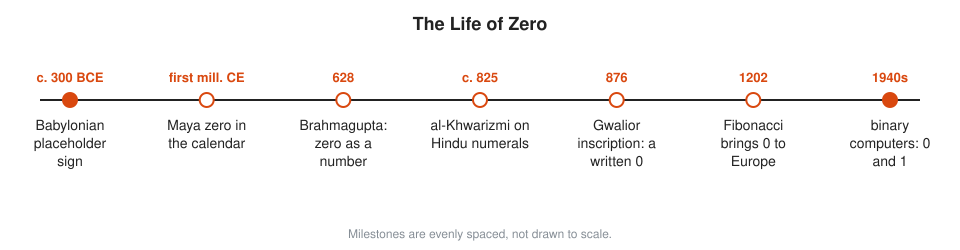
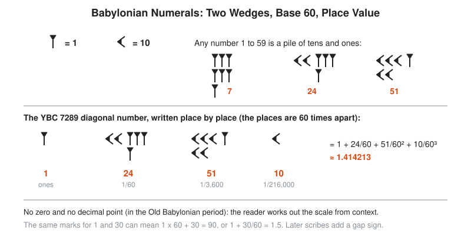
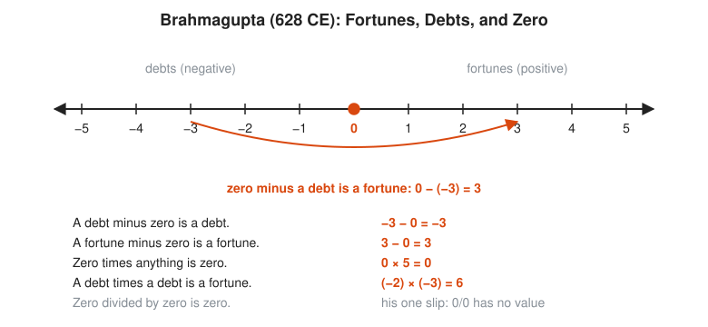
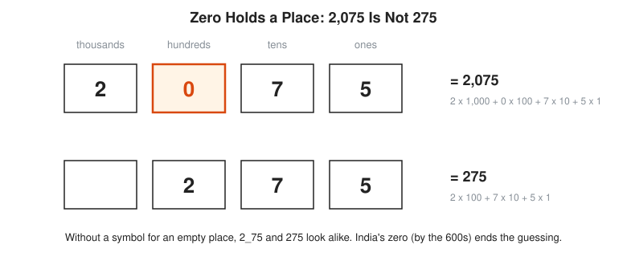

# The Story of Zero

**Reading time:** about 12 minutes · **Part of:** [Story of an Idea](README.md) · **Next essay:** [The Story of Pi](pi.md)

Zero starts life as a gap, becomes a placeholder, then a number, and ends up as half of every computer. It takes about 2,000 years to go from empty space to the digit you type without thinking.

## Picture It

<!-- diagram: type=idea-timeline idea=zero items=7 caption="Milestones in the life of zero, evenly spaced" -->


Read the strip left to right. The first dot is a mark that means nothing is here. The last dot is a machine built from nothing but 0 and 1. The milestones are evenly spaced. The real gaps between them are uneven: the long middle stretch hides centuries.

## Stage 1: A Gap That Causes Trouble

Babylonian scribes write numbers in base 60 with two wedge shapes. A **place-value system** gives a digit a different worth depending on its column, the way the 7 in 70 is worth ten times the 7 in 7. Place value needs a way to say this column is empty. For more than a thousand years the scribes have none.

<!-- diagram: type=historical-method ref=babylonian-numerals caption="Babylonian wedges and the ambiguity of an empty place" -->


The bottom line of the picture shows the problem. The same marks can mean 90 or 1.5. The reader guesses from context. By about 300 BCE scribes add a sign of two slanted wedges inside a number to mark an empty column. It is a placeholder, not a number. Nobody adds it to anything.

```txt
  1  _  20          a gap the reader has to notice
  1 x 3,600         first place (60 x 60)
  0 x 60            empty middle place
  20 x 1            last place
  = 3,620           with the gap
  = 80              if the reader misses the gap (1 x 60 + 20)
```

## Stage 2: Placeholders Elsewhere

Other cultures meet the same problem. Chinese counting boards leave a square empty (see [Chapter 04](../04-india-and-china/README.md)). The Maya use a shell-shaped sign for zero in their Long Count calendar during the first millennium CE. Ptolemy, around 150 CE, writes a small circle for an empty place in his base-60 astronomy tables. Each of these is a placeholder. None of them is yet a number you can calculate with.

## Stage 3: Zero Becomes a Number

India makes the jump. Indian scholars already write numbers with nine digits and place value. The word for the empty place is **shunya**, which means empty. In 628 Brahmagupta writes rules for calculating with zero as a number in its own right, alongside rules for negative numbers, which he calls debts.

<!-- diagram: type=number-line ref=brahmagupta-zero caption="Brahmagupta's rules for fortunes, debts, and zero" -->


His rules match the modern ones with one slip. He says zero divided by zero is zero. Modern math says 0/0 has no value. A fair score for a first attempt: about nine rules right out of ten.

```txt
  5 + 0 = 5         adding nothing changes nothing
  5 - 0 = 5         taking nothing away changes nothing
  0 - 5 = -5        Brahmagupta: zero minus a fortune is a debt
  5 x 0 = 0         five lots of nothing is nothing
  5 / 0             no value: no number times 0 gives 5
```

A temple inscription at Gwalior, dated 876, writes the number 270 with a small round 0. It is the oldest written zero in India that experts agree on. The Bakhshali manuscript uses a dot for zero. Some of its pages carbon-date to the 200s or 300s, but scholars still argue about what that means for the text.

<!-- diagram: type=place-value ref=place-value-zero caption="2,075 versus 275" -->


## Stage 4: The Road West

Around 825 al-Khwarizmi in Baghdad writes a book on Indian numerals. Its Latin translation begins with his name, Algoritmi, which becomes the word **algorithm**. The Arabic word for empty, **sifr**, gives Europe two words: cipher and zero.

In 1202 Fibonacci's *Liber Abaci* teaches Italian merchants the nine Indian digits plus the sign 0, which he calls zephirum. Europe does not switch overnight. In 1299 the money-changers of Florence ban the new digits in account books, because a 0 is easy to turn into a 6 or a 9. Fraud prevention, thirteenth-century style.

## Stage 5: Zero at Work

Once zero is a number, much follows quickly in historical terms:

* Algebra can set an equation to zero and solve it: $x^2 - 5x + 6 = 0$ means $(x - 2)(x - 3) = 0$, which forces $x = 2$ or $x = 3$.
* Coordinates need an origin, the point $(0, 0)$ ([Chapter 07](../07-scientific-revolution-and-calculus/README.md)).
* Calculus studies what happens as a change shrinks toward zero without reaching it.
* Leibniz writes about binary numbers in 1703. Electronic computers of the 1940s store everything as 0 and 1.

In Go, the first element of a slice is `s[0]`, and an unset `int` holds 0. Every SRE has also met a divide-by-zero panic at 3 a.m. Brahmagupta took a swing at division by zero too. He missed. Nobody hits it, because there is nothing to hit.

## Worked Small: Why 0 Makes Column Arithmetic Work

```txt
    2,075
  +   348
  -------
    2,423

  5 + 8 = 13           ones: write 3, carry 1
  7 + 4 + 1 = 12       tens: write 2, carry 1
  0 + 3 + 1 = 4        hundreds: the 0 holds the column, and the 3 lands in the right place
  2 + 0 = 2            thousands
```

Without the 0, the 3 in 348 has no column to line up with, and the sum goes wrong.

## Go Deeper

* [MacTutor: A History of Zero](https://mathshistory.st-andrews.ac.uk/HistTopics/Zero/): the standard scholarly account.
* [MacTutor: Indian Numerals](https://mathshistory.st-andrews.ac.uk/HistTopics/Indian_numerals/): how the nine digits and zero develop.
* [MacTutor: The Bakhshali Manuscript](https://mathshistory.st-andrews.ac.uk/HistTopics/Bakhshali_manuscript/): the dating debate.
* [Brahmagupta biography](../biographies/brahmagupta.md) and [al-Khwarizmi biography](../biographies/al-khwarizmi.md).
* [Course 101: Foundations](../../course/101/README.md): place value and negative numbers from scratch.
