# Abstract Algebra Track

**Track:** Abstract Algebra · **Span:** beginner to advanced · **Course levels:** [601 Proof and Higher Math](../../course/601/README.md) (abstract algebra), [501 Linear Algebra, Probability and Discrete Math](../../course/501/README.md) (matrices and permutations)
**Prerequisites:** ordinary arithmetic and the habit of checking rules. The [Number Theory Track](../number-theory/README.md) covers remainders, which appear on the first rung.
**Files:** this README, [cards.tsv](cards.tsv) for Anki, [code/main.go](code/main.go), and the diagrams in [img/](img/).

## What the Field Studies

School algebra manipulates numbers. Abstract algebra steps back and studies the **rules** of manipulation themselves. Which operations can be undone? Does order matter? What do clock arithmetic, the moves of a Rubik's cube and the symmetries of a snowflake have in common?

The answer is **structure**. A **group** is any set with an operation that obeys four short rules. Prove a theorem about groups once, and it holds for every example at the same time: integers, rotations, permutations, codes. That is the payoff of abstraction. It is reuse, the same idea as writing a generic function instead of ten copies.

## Why It Matters

* **Cryptography:** Diffie-Hellman, RSA and elliptic-curve keys (the ones in your TLS certificates and SSH keys) are calculations in groups where one direction is easy and the reverse is hard.
* **Error-correcting codes:** Reed-Solomon codes in RAID 6, erasure-coded object storage, QR codes and deep-space links do arithmetic in **finite fields**.
* **Hashing and checksums:** CRC checksums are polynomial division over the field with two elements.
* **Distributed systems:** CRDTs (conflict-free replicated data types) merge replica states with operations that are associative, commutative and idempotent. Those are algebra words.
* **Physics and chemistry:** symmetry groups classify crystals and molecules and predict which spectral lines appear.

The workshop [Number Theory for Cryptography](../../workshops/number-theory-for-cryptography/README.md) builds on the group and field rungs of this track.

## Concept Map

<!-- diagram: type=concept-map tiers=beginner,intermediate,advanced nodes=11 caption="Abstract algebra concepts with prerequisite arrows" -->


Read the map top to bottom. An arrow from A to B means learn A first. Start at the orange box.

## Signature Diagram

<!-- diagram: type=symmetry-group shape=triangle elements=e,r,r2,s1,s2,s3 table=cayley caption="Symmetries of a triangle and their Cayley table" -->


An equilateral triangle has six symmetries: do nothing ($e$), rotate by 120° ($r$), rotate by 240° ($r^2$), and flip across one of three mirror lines ($s_1, s_2, s_3$). Do any two in a row and you get one of the six again. The table records every combination. It has an identity row, a way back from every move (an $e$ in every row), and one surprise: it is not symmetric across the diagonal. Rotate then flip differs from flip then rotate. Order matters. That table is a complete description of a group.

## The Concept Ladder

### Beginner

#### 1. Clock Arithmetic

On a 12-hour clock, 9 + 5 is 2. **Modular arithmetic** keeps only the remainder after dividing by $n$. It is ordinary arithmetic that wraps around. It is also the first example of a finite world with its own consistent rules.

$$a \equiv b \pmod{n} \iff n \text{ divides } a - b, \qquad 9 + 5 = 14 \equiv 2 \pmod{12}$$

<!-- diagram: type=clock n=12 start=9 add=5 caption="Clock arithmetic 9 + 5 = 2" -->
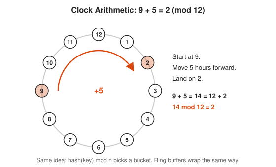

Course link: [601 Proof and Higher Math](../../course/601/README.md).

#### 2. Symmetry

A **symmetry** of a shape is a motion that leaves it looking the same. A square has eight: four rotations and four flips. Two symmetries done in a row give another symmetry, and every symmetry can be undone. Those two facts are most of what a group is.

<!-- diagram: type=symmetries shape=square count=8 caption="Eight symmetries of a square" -->
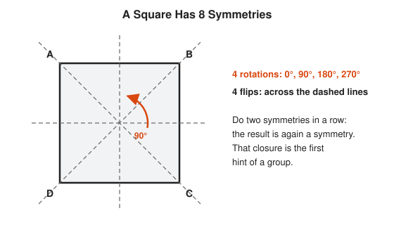

#### 3. Group Axioms

A **group** is a set $G$ with an operation $\cdot$ that obeys four rules. **Closure:** combining two elements gives an element. **Associativity:** grouping does not matter. **Identity:** some element $e$ changes nothing. **Inverses:** every element has an undo. Commutativity ($ab = ba$) is not required. Groups that have it are called **abelian**.

$$(ab)c = a(bc), \qquad ea = ae = a, \qquad aa^{-1} = a^{-1}a = e$$

<!-- diagram: type=cayley-table group=Z4 op=+ caption="Group axioms in the Z/4 addition table" -->
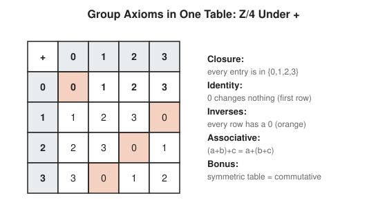

#### 4. Cyclic Groups and Order

A group is **cyclic** when one element, a **generator**, produces everything by repetition. The **order** of an element is how many steps it takes to get back to the identity. In $\mathbb{Z}/n$, the element $a$ generates everything exactly when $\gcd(a, n) = 1$.

$$\operatorname{ord}(a) = \frac{n}{\gcd(a, n)} \quad \text{in } \mathbb{Z}/n$$

<!-- diagram: type=clock-pair n=12 steps=5,4 caption="Generators of Z/12" -->
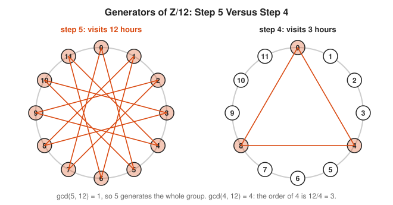

Round-robin load balancers and hash probing with a fixed stride rely on this. A stride that shares a factor with the table size visits only part of the table, and some buckets never get a turn.

### Intermediate

#### 5. Permutation Groups

A **permutation** rearranges a list. All permutations of $n$ items form the **symmetric group** $S_n$, with $n!$ elements. Cycle notation compresses a permutation: $(1\,3\,2)$ means 1 goes to 3, 3 goes to 2, 2 goes to 1. **Cayley's theorem** says every finite group is a group of permutations in disguise.

$$|S_n| = n!, \qquad (1\,3\,2)(4)$$

<!-- diagram: type=permutation-wires n=4 map=1->3,2->1,3->2,4->4 caption="A permutation as rewiring" -->
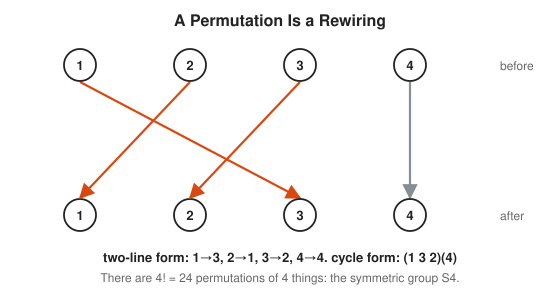

#### 6. Subgroups and Lagrange's Theorem

A **subgroup** is a group living inside a bigger group. Shift a subgroup by any element to get a **coset**. Cosets never overlap and all have the same size. They tile the group like floor tiles. That forces **Lagrange's theorem**: the size of a subgroup divides the size of the group.

$$|H| \text{ divides } |G|, \qquad \operatorname{ord}(a) \text{ divides } |G|$$

<!-- diagram: type=cosets group=Z12 subgroup=0,4,8 caption="Cosets of a subgroup tile Z/12" -->
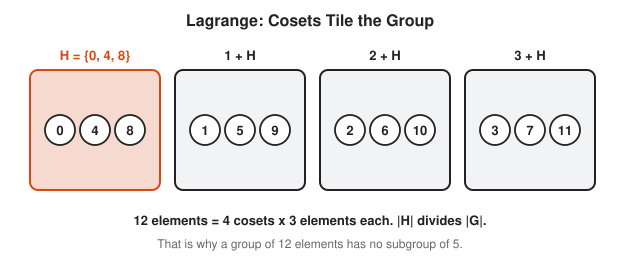

#### 7. Homomorphisms and Quotients

A **homomorphism** is a map between groups that respects the operation: combine then map equals map then combine. The elements sent to the identity form the **kernel**. Collapse the kernel to a point and you get a **quotient group**. Reducing integers mod $n$ is the classic example.

$$f(ab) = f(a)\,f(b), \qquad G / \ker f \cong \operatorname{im} f$$

<!-- diagram: type=map from=Z to=Z3 rule=mod3 caption="The homomorphism n mod 3" -->
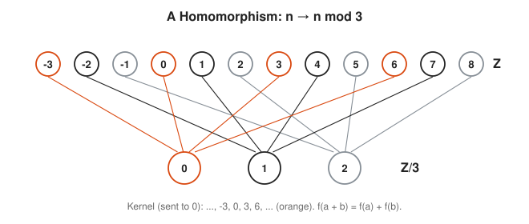

A checksum is a homomorphism in spirit: it turns a large object into a small one while keeping enough structure to catch changes.

#### 8. Rings and Fields

A **ring** has two operations, addition and multiplication, that behave like the integers. A **field** is a ring where every nonzero element has a multiplicative inverse, which allows division. The rationals, the reals and $\mathbb{Z}/p$ for a prime $p$ are fields. $\mathbb{Z}/6$ is not, because $2 \times 3 = 0$.

$$\mathbb{Z}/n \text{ is a field} \iff n \text{ is prime}$$

<!-- diagram: type=table-pair op=multiply n=5,6 caption="Multiplication mod 5 versus mod 6" -->
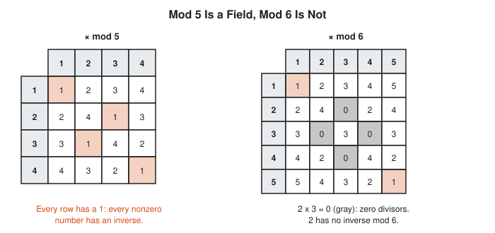

### Advanced

#### 9. Group Actions and Burnside's Lemma

A group **acts** on a set when each group element moves the set's items around, consistently. Counting objects "up to symmetry" becomes averaging: **Burnside's lemma** says the number of distinct objects equals the average number of items each symmetry leaves unchanged.

$$\#\text{orbits} = \frac{1}{|G|} \sum_{g \in G} |\operatorname{Fix}(g)|$$

<!-- diagram: type=necklaces beads=4 colors=2 group=rotations caption="Burnside count of necklaces" -->
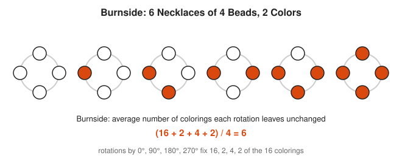

#### 10. Galois Theory

Galois connected two worlds: the fields you get by adjoining roots of a polynomial, and the symmetry group that shuffles those roots. Subfields match subgroups one to one. This explains why the quadratic formula has cousins for degrees 3 and 4 but none for degree 5.

$$\text{subfields of } K \;\longleftrightarrow\; \text{subgroups of } \operatorname{Gal}(K/\mathbb{Q})$$

<!-- diagram: type=field-lattice top="Q(sqrt2,sqrt3)" middle="Q(sqrt2),Q(sqrt6),Q(sqrt3)" bottom=Q caption="Field lattice and Galois group" -->
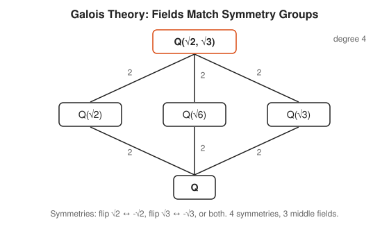

Galois wrote these ideas down at 20, the night before he died in a duel in 1832. Mathematicians took decades to catch up.

#### 11. Finite Fields

For every prime power $p^k$ there is exactly one field with $p^k$ elements, written $GF(p^k)$. Its nonzero elements always form a cyclic group: some element generates them all. Finite fields run AES encryption (in $GF(2^8)$), Reed-Solomon codes, CRCs and elliptic-curve cryptography.

$$|GF(p^k)| = p^k, \qquad GF(p)^{\times} \text{ is cyclic}$$

<!-- diagram: type=cycle field=GF7 generator=3 caption="Powers of 3 cycle through GF(7)" -->
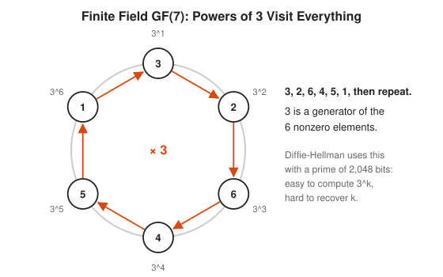

## Worked Examples

### Example 1: Check a Group

Is $\{1, 2, 3, 4\}$ under multiplication mod 5 a group?

```txt
  closure: products mod 5 stay in {1,2,3,4}     5 is prime, so no product is 0
  associativity: inherited from integers        multiplication is associative
  identity: 1                                   1·a = a
  inverses: 1·1=1, 2·3=6≡1, 4·4=16≡1            every element has one
  yes, it is a group (of order 4)               all four axioms hold
```

### Example 2: Order of an Element

Find the order of 4 in $\mathbb{Z}/10$.

```txt
  4, 8, 12≡2, 6, 10≡0                           add 4 repeatedly, reduce mod 10
  reached 0 after 5 steps                       order 5
  check: 10 / gcd(4, 10) = 10 / 2 = 5           formula agrees
  5 divides 10                                  Lagrange agrees
```

### Example 3: Count Necklaces with Burnside

Necklaces with 4 beads in 2 colors, up to rotation.

```txt
  rotate 0°:   fixes all 2^4 = 16 colorings      every coloring
  rotate 90°:  fixes 2 (all one color)           all beads must match
  rotate 180°: fixes 2^2 = 4                     opposite beads match
  rotate 270°: fixes 2                           same as 90°
  orbits = (16 + 2 + 4 + 2) / 4 = 6              Burnside average
```

## Big Theorems to Know

* **Lagrange Theorem:** the order of a subgroup divides the order of a finite group.
* **Cayley Theorem:** every group is isomorphic to a group of permutations.
* **First Isomorphism Theorem:** $G / \ker f \cong \operatorname{im} f$ for a homomorphism $f$.
* **Fermat Little Theorem:** $a^{p-1} \equiv 1 \pmod p$ when $p$ is prime and $p \nmid a$. It is Lagrange applied to $(\mathbb{Z}/p)^{\times}$.
* **Classification of Finite Abelian Groups:** every finite abelian group is a product of cyclic groups.
* **Sylow Theorems:** if $p^k$ divides $|G|$ exactly, $G$ has subgroups of order $p^k$, and they are tightly controlled.
* **Abel-Ruffini Theorem:** no formula in radicals solves every degree 5 polynomial.
* **Existence and Uniqueness of Finite Fields:** for each prime power $q$ there is exactly one field with $q$ elements, up to relabeling.

## Open Problems and Fun Facts

* **The enormous theorem:** the classification of finite simple groups, the "prime numbers" of group theory, took hundreds of mathematicians and tens of thousands of journal pages, finished around 2004.
* **The Monster:** the largest sporadic simple group has about $8 \times 10^{53}$ elements. Its strange link to modular functions, called "monstrous moonshine", earned Richard Borcherds a Fields Medal in 1998.
* **Rubik's cube:** its group has 43,252,003,274,489,856,000 positions. Every position is solvable in 20 moves or fewer, proved by computer in 2010.
* **Emmy Noether** founded much of modern algebra in the 1920s and proved that every symmetry of a physical law gives a conservation law.
* **Open problem:** the **inverse Galois problem** asks whether every finite group is the Galois group of some extension of the rationals. Nobody knows.

## Starter Problems

1. Compute $17 + 9 \pmod{12}$ and $7 \times 8 \pmod{5}$.
2. Is the set of integers under subtraction a group? Which axiom fails?
3. Find the order of 3 in $\mathbb{Z}/12$ and of 5 in $\mathbb{Z}/12$.
4. Which elements generate $\mathbb{Z}/8$?
5. Can a group with 15 elements have a subgroup with 4 elements?
6. Find the inverse of 3 in multiplication mod 7.
7. How many distinct ways are there to color the 3 beads of a triangular necklace with 2 colors, up to rotation?

<details>
<summary>Answers</summary>

1. $26 \bmod 12 = 2$. $56 \bmod 5 = 1$.
2. No. Associativity fails: $(5 - 3) - 1 = 1$ but $5 - (3 - 1) = 3$.
3. 3 has order 4 ($3, 6, 9, 0$). 5 has order 12, since $\gcd(5, 12) = 1$.
4. 1, 3, 5, 7: the numbers with $\gcd(a, 8) = 1$.
5. No. By Lagrange, a subgroup's size divides 15, and 4 does not.
6. 5, because $3 \times 5 = 15 \equiv 1 \pmod 7$.
7. 4. Burnside: the identity fixes $2^3 = 8$, each of the two rotations fixes 2. $(8 + 2 + 2)/3 = 4$: all white, all orange, one orange, two orange.

</details>

## Code Corner

[code/main.go](code/main.go) checks the group axioms by brute force, lists element orders and generators of $\mathbb{Z}/12$, composes triangle symmetries in both orders, counts necklaces with Burnside, and runs a toy Diffie-Hellman key exchange. Run it with `go run main.go` inside `code/`.

```txt
== Which structures are groups? ==
Z/12 under +       : true identity 0
{1..6} under x mod 7: true identity 1
{1..5} under x mod 6: false (2 x 3 = 0 escapes the set)

== Orders of elements in Z/12 ==
0:1 1:12 2:6 3:4 4:3 5:12 6:2 7:12 8:3 9:4 10:6 11:12
generators: [1 5 7 11]

== Symmetries of a triangle (vertices 0, 1, 2) ==
r after s: [1 0 2]
s after r: [2 1 0]
same? false -> the group is not commutative
order of r: 3

== Burnside: 4-bead necklaces, 2 colors, up to rotation ==
rotate by 0: fixes 16 colorings
rotate by 1: fixes 2 colorings
rotate by 2: fixes 4 colorings
rotate by 3: fixes 2 colorings
distinct necklaces = 24 / 4 = 6

== Toy Diffie-Hellman in the field mod p ==
public: p=23 g=5, Alice sends 8, Bob sends 19
shared secret: Alice computes 2, Bob computes 2
an eavesdropper brute-forces k=6 here, but not with a 2,048-bit p
```

Every order in the second block divides 12, exactly as Lagrange promised. The program never heard of Lagrange. It counted.

## Flashcards

[cards.tsv](cards.tsv) holds the key definitions and theorems for Anki import.

## Resources

* [Thomas Judson: Abstract Algebra, Theory and Applications](http://abstract.ups.edu/): a free textbook with applications to coding theory and cryptography.
* [MIT OCW 18.701 Algebra I](https://ocw.mit.edu/courses/18-701-algebra-i-fall-2010/): lectures following Artin's classic text.
* [Wolfram MathWorld: Group](https://mathworld.wolfram.com/Group.html): the definition with links to every named group.
* [MacTutor: Evariste Galois](https://mathshistory.st-andrews.ac.uk/Biographies/Galois/): the short, dramatic life of the field's founder.
* [MacTutor: Emmy Noether](https://mathshistory.st-andrews.ac.uk/Biographies/Noether_Emmy/): the mathematician who made algebra abstract.

## Where to Go Next

* [Number Theory Track](../number-theory/README.md) for the modular arithmetic underneath every rung.
* [Information Theory Track](../information-theory/README.md) for the error-correcting codes built on finite fields.
* [Topology Track](../topology/README.md) for the fundamental group, where algebra meets shape.
