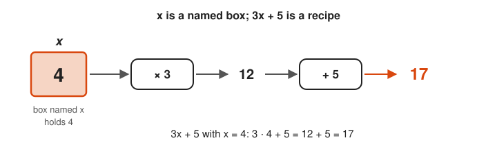
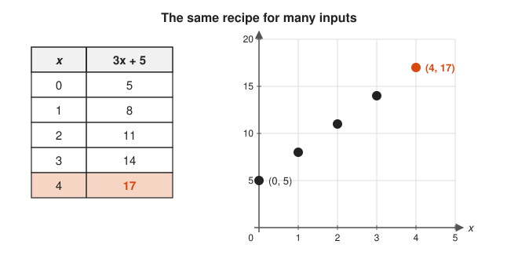
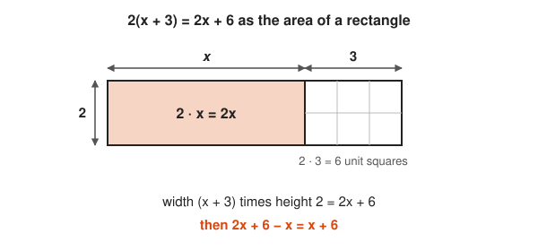
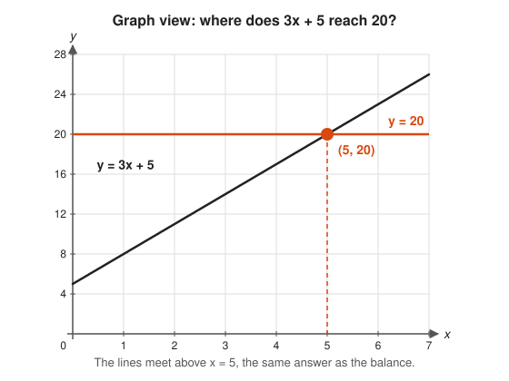
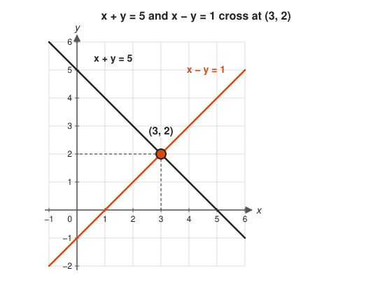
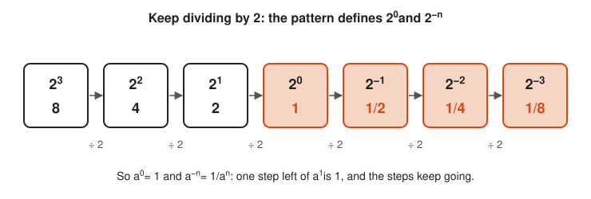

# Algebra

**Track:** Algebra · **Span:** first variable to groups and abstract structures · **Main course levels:** [201 Algebra I and Geometry](../../course/201/README.md), [301 Algebra II, Trig and Precalculus](../../course/301/README.md)

## What This Field Studies

Algebra is arithmetic with names. Instead of saying "some number that, tripled and plus 5, gives 20," you write $3x + 5 = 20$ and push symbols around with rules that never change the truth of the statement. Early algebra solves equations. Later algebra studies the rules themselves: which operations undo which, and what structures (groups, rings, fields) those rules create.

The word comes from the title of a 9th-century book by al-Khwarizmi, *al-jabr*, which means "restoring": moving a term to the other side of an equation. His name also gives us the word **algorithm**.

## Why It Matters

Every formula in a runbook is algebra. Solving $\text{replicas} \times 1{,}200 \text{ rps} \ge 50{,}000 \text{ rps}$ for the replica count is a linear inequality. Finding when exponential backoff passes a 10 s timeout is a logarithm. Configuration-as-code templates are expressions with variables. Algebra is the skill of turning a word problem into a symbol problem, then turning the symbols back into an answer you can act on.

## Concept Map

<!-- diagram: type=concept-map bands=beginner,intermediate,advanced nodes=variables,simplifying,linear-equations,inequalities,functions,systems,exponent-rules,polynomials,quadratics,exp-log,complex,matrices,fta,groups caption="Algebra concepts with prerequisite arrows" -->
![Concept map of algebra in three bands. Beginner: variables and expressions lead to simplifying expressions and linear equations. Intermediate: linear equations lead to inequalities, functions and graphs, and systems of equations. Simplifying leads to exponent rules and to polynomials and factoring, which with functions lead to quadratic equations. Advanced: exponent rules and functions lead to exponentials and logs. Quadratics lead to complex numbers. Systems lead to matrices. Complex numbers and polynomials lead to the fundamental theorem of algebra, and matrices and complex numbers lead to groups and abstract structures. Linear equations and the fundamental theorem of algebra are highlighted as milestones.](img/concept-map.svg)

An arrow from A to B means learn A before B. The milestones are linear equations (the first real superpower) and the fundamental theorem of algebra (the reason polynomials always have roots once you allow complex numbers).

## Signature Diagram

<!-- diagram: type=function-plot f="x^2-2x-3" x=-3..5 y=-5..5 marks=roots:-1,3;vertex:1,-4;intercept:0,-3 caption="Parabola y = x^2 - 2x - 3 with roots, vertex and axis of symmetry" -->


This one picture holds the central trick of algebra: an equation and a graph are the same object. Solving $x^2 - 2x - 3 = 0$ by factoring gives $x = -1$ and $x = 3$. On the graph, those are exactly the points where the curve meets the $x$-axis. The completed square form $(x - 1)^2 - 4$ tells you the lowest point and the line of symmetry with no extra work.

## The Concept Ladder

### Beginner

#### 1. Variables and Expressions

A **variable** is a named box that holds a number, exactly like a variable in Go or Python. An **expression** such as $3x + 5$ is a recipe: give it $x$, and it returns a number. Evaluating an expression means substituting a value and doing the arithmetic.

**Key idea:** if $x = 4$, then $3x + 5 = 3 \cdot 4 + 5 = 17$.

<!-- diagram: type=pipeline var=x value=4 steps="*3,+5" caption="Evaluating 3x + 5 at x = 4 as a two-step pipeline" -->


Follow the arrows left to right: the box supplies the value and each machine applies one step of the recipe.

<!-- diagram: type=table+dot-plot f="3x+5" x=0..4 caption="Inputs 0 to 4 and their outputs for 3x + 5" -->


Match each table row to one dot: every input of the recipe becomes one point, and the points climb by 3 at each step.

**In the course:** [101 Foundations](../../course/101/README.md)

#### 2. Simplifying Expressions

**Like terms** have the same variable part and combine by adding their coefficients: $3x + 2x = 5x$. The distributive law opens parentheses. Simplifying is refactoring: the expression looks different but returns the same value for every input.

**Key idea:** $2(x + 3) - x = 2x + 6 - x = x + 6$

<!-- diagram: type=algebra-tiles exprs="3x+2x;2(x+3)-x" caption="Like terms and the distributive law shown with tiles" -->


Count tiles of the same shape together: x-tiles only combine with x-tiles, and unit tiles only with unit tiles.

<!-- diagram: type=area-model width="x+3" height=2 caption="2(x + 3) as a rectangle split into 2x and 6" -->


See how the height 2 multiplies both parts of the width: that is the distributive law.

**In the course:** [201 Algebra I and Geometry](../../course/201/README.md)

#### 3. Linear Equations

An equation is a balance. Whatever you do to one side, do to the other, and the balance holds. Undo operations in reverse order until the variable stands alone.

**Key idea:**

```txt
  3x + 5 = 20
  3x     = 15      subtract 5 from both sides
   x     = 5       divide both sides by 3
```

<!-- diagram: type=balance steps="3x+5=20;3x=15;x=5" caption="Solving 3x + 5 = 20 by keeping a balance level" -->


Check that every scale stays level: each step removes or splits the same amount on both sides.

<!-- diagram: type=function-plot f="3x+5" g=20 x=0..7 y=0..28 marks=5,20 caption="The line y = 3x + 5 meets y = 20 at x = 5" -->


Find where the slanted line crosses the orange line, then read straight down: the x value there solves the equation.

**In the course:** [201 Algebra I and Geometry](../../course/201/README.md)

### Intermediate

#### 4. Inequalities

An inequality such as $2x - 1 < 7$ has a whole range of answers, drawn as a ray on the number line. Solve it like an equation, with one twist: multiplying or dividing by a negative number flips the direction of the sign. SLO thresholds and capacity limits are inequalities.

**Key idea:** $-2x < 6 \Rightarrow x > -3$

<!-- diagram: type=number-line range=-6..6 ray=-3:right open=true caption="The solution x > -3 drawn as a ray with an open circle" -->


The open circle marks the boundary that does not count, and the ray covers every value that does.

<!-- diagram: type=mapping-lines map="x->-2x" points=-3,-1,1,3 caption="Multiplying by -2 sends points across zero and reverses their order" -->


Watch the orange arrows cross: the smaller input lands on the larger output, so the inequality sign has to turn around.

**In the course:** [201 Algebra I and Geometry](../../course/201/README.md)

#### 5. Functions and Graphs

A **function** takes each input to exactly one output, like a pure function in code. Its graph plots every input-output pair as a point. A straight-line graph comes from $y = mx + b$, where $m$ is the slope (rise over run) and $b$ is where the line crosses the $y$-axis.

**Key idea:** $m = \dfrac{y_2 - y_1}{x_2 - x_1}$

<!-- diagram: type=function-plot f="2x+1" x=-1..5 y=-1..10 marks=1,3;3,7 intercept=0,1 caption="Slope triangle between (1, 3) and (3, 7) on y = 2x + 1" -->


Read the orange triangle: rise over run is 4 over 2, which is the slope 2, and the orange dot on the y-axis is the intercept.

<!-- diagram: type=mapping f="2x+1" inputs=1..4 counter="2->5,2->6,3->7" caption="A function sends each input to exactly one output" -->


Count the arrows leaving each input: a function has exactly one, which is why the right picture fails.

**In the course:** [201 Algebra I and Geometry](../../course/201/README.md)

#### 6. Systems of Equations

Two equations with two unknowns describe two lines. The solution is the point where the lines cross. Solve by substitution (solve one equation for a variable and plug it into the other) or elimination (add the equations to cancel a variable).

**Key idea:** $x + y = 5$ and $x - y = 1$ add to $2x = 6$, so $x = 3, y = 2$.

<!-- diagram: type=function-plot f="5-x" g="x-1" x=-1..6 y=-2..6 mark=3,2 caption="The lines x + y = 5 and x - y = 1 cross at (3, 2)" -->


The crossing point is the only point on both lines, so its coordinates satisfy both equations at once.

<!-- diagram: type=equation-stack eqs="x+y=5;x-y=1" op=add caption="Adding x + y = 5 and x - y = 1 cancels y" -->


Look down the boxed column: the y terms have opposite signs, so adding the equations wipes them out and leaves one unknown.

**In the course:** [201 Algebra I and Geometry](../../course/201/README.md)

#### 7. Exponent Rules

Exponents follow a short list of rules that all come from counting factors. Negative exponents mean reciprocals, and fractional exponents mean roots. These rules are what make logarithms possible.

**Key idea:** $a^m a^n = a^{m+n}$, $(a^m)^n = a^{mn}$, $a^{-n} = \frac{1}{a^n}$, $a^0 = 1$

<!-- diagram: type=factor-boxes rules="a^3*a^2;(a^2)^3;a^5/a^2" caption="Three exponent rules shown by counting factors of a" -->


Count the boxes in each row: multiplying joins rows of factors, powering repeats a group, and dividing crosses out matching pairs.

<!-- diagram: type=sequence values=2^3..2^-3 step="/2" caption="Powers of 2 from 2^3 down to 2^-3, each step dividing by 2" -->


Walk left to right and divide by 2 each time: the orange boxes show that a zero exponent gives 1 and a negative exponent gives a reciprocal.

**In the course:** [301 Algebra II, Trig and Precalculus](../../course/301/README.md)

#### 8. Polynomials and Factoring

A **polynomial** is a sum of terms like $5x^3 - 2x + 7$. Multiplying polynomials is the area model from arithmetic. Factoring runs the area model backward: find the side lengths of a rectangle whose area is the polynomial.

**Key idea:** $x^2 + 5x + 6 = (x + 2)(x + 3)$

<!-- diagram: type=algebra-tiles width="x+3" height="x+2" caption="(x + 2)(x + 3) as one x-squared tile, five x strips and six unit squares" -->


Factoring runs this picture backward: given the tiles x squared, 5x and 6, find the side lengths x plus 2 and x plus 3 that make a full rectangle.

<!-- diagram: type=function-plot f="x^2+5x+6" x=-6..1 y=-1..7 marks=-3,-2 caption="The parabola y = (x + 2)(x + 3) crosses zero at -3 and -2" -->


Each factor of the polynomial produces one orange crossing on the x-axis.

**In the course:** [301 Algebra II, Trig and Precalculus](../../course/301/README.md)

#### 9. Quadratic Equations

A quadratic equation $ax^2 + bx + c = 0$ always yields to one formula, found by completing the square. The quantity $b^2 - 4ac$, called the **discriminant**, tells you in advance how many real roots there are: two, one, or none.

**Key idea:** $x = \dfrac{-b \pm \sqrt{b^2 - 4ac}}{2a}$

<!-- diagram: type=function-plot-panels fs="x^2-2x-3;x^2-2x+1;x^2-2x+3" x=-2..4 y=-5..6 caption="Two, one and zero real roots matched to the sign of the discriminant" -->


Compare where each bowl sits against the x-axis: the sign of b squared minus 4ac tells you which picture you get before you draw it.

<!-- diagram: type=area-model expr="x^2+6x" add=9 caption="Completing the square: two strips of 3x and a missing 3 by 3 corner" -->


Fill the dashed orange corner and the L shape becomes a perfect square, which is where the quadratic formula comes from.

**In the course:** [301 Algebra II, Trig and Precalculus](../../course/301/README.md)

### Advanced

#### 10. Exponentials and Logarithms

An exponential function $y = a \cdot b^x$ multiplies by the same factor at every step: compound interest, doubling traffic, retries with backoff. The logarithm is its inverse: $\log_b y$ answers "what power of $b$ gives $y$?" Logs turn multiplication into addition, which is why log-scale charts make exponential growth look like a straight line.

**Key idea:** $b^x = y \iff x = \log_b y$, and $\log(ab) = \log a + \log b$

<!-- diagram: type=function-plot f="2^x" g="log2(x)" mirror="y=x" x=-2..6 y=-2..6 caption="2^x and log base 2 of x reflect across y = x" -->


Fold the picture along the dashed diagonal: every point of the exponential lands on the logarithm with its coordinates swapped.

<!-- diagram: type=function-plot-panels f="2^x" x=0..10 axes=linear,log2 caption="The same exponential on a linear axis and on a log axis" -->


Compare the two panels: the log axis turns every doubling into one equal step, so steady exponential growth draws as a straight line.

**In the course:** [301 Algebra II, Trig and Precalculus](../../course/301/README.md)

#### 11. Complex Numbers

The equation $x^2 = -1$ has no real solution, so mathematicians invented one and called it $i$. A **complex number** $a + bi$ is a point in a plane, and multiplying by $i$ rotates that point by 90°. With complex numbers, every quadratic has roots.

**Key idea:** $i^2 = -1$ and $(a + bi)(c + di) = (ac - bd) + (ad + bc)i$

<!-- diagram: type=complex-plane points="2+i,-1+2i,-2-i,1-2i" op="*i" caption="Multiplying 2 + i by i again and again rotates it a quarter turn each time" -->


Follow the orange arcs: the distance from 0 stays the same and only the direction turns by 90 degrees.

<!-- diagram: type=unit-circle points=1,i,-1,-i turns=2 caption="Two quarter turns from 1 land on -1, so i^2 = -1" -->


Count the orange arrows from 1: two quarter turns face the opposite way, which is why i squared is minus 1.

**In the course:** [301 Algebra II, Trig and Precalculus](../../course/301/README.md) · **Go further:** [Complex Analysis track](../complex-analysis/README.md)

#### 12. Matrices

A **matrix** is a grid of numbers that packs a whole system of linear equations into one object: $A\mathbf{x} = \mathbf{b}$. Matrix multiplication composes transformations, the same way piping commands composes programs. This is the doorway to linear algebra.

**Key idea:** $\begin{pmatrix} 1 & 1 \\ 1 & -1 \end{pmatrix} \begin{pmatrix} x \\ y \end{pmatrix} = \begin{pmatrix} 5 \\ 1 \end{pmatrix}$

<!-- diagram: type=linear-map matrix="1,1;1,-1" shape=unit-square point=3,2 caption="The matrix (1 1; 1 -1) turns the unit square into a tilted square and sends (3, 2) to (5, 1)" -->


Watch where the two orange arrows go: once you know where the matrix sends (1, 0) and (0, 1), you know where it sends every point.

<!-- diagram: type=matrix-product A="1,1;1,-1" x="x,y" b="5,1" caption="Each row of the matrix times the column (x, y) gives one equation" -->


Slide the highlighted row across the column (x, y), multiplying pairs and adding: that produces the first equation of the system.

**In the course:** [501 Linear Algebra, Probability and Discrete Math](../../course/501/README.md) · **Go further:** [Linear Algebra track](../linear-algebra/README.md)

#### 13. The Fundamental Theorem of Algebra

Every polynomial of degree $n \ge 1$ with complex coefficients has exactly $n$ complex roots, counted with repetition. That means every polynomial factors completely into linear pieces once you allow complex numbers. It closes the loop that started with $x^2 = -1$.

**Key idea:** $p(x) = a(x - r_1)(x - r_2)\cdots(x - r_n)$

<!-- diagram: type=function-plot f="(x+2)(x-1)(x-3)" x=-3..4 y=-6..10 marks=-2,1,3 caption="A degree-3 polynomial crossing the x-axis at its three roots" -->


Count the orange crossings and the factors: each root r matches one factor x minus r.

<!-- diagram: type=function-plot+complex-plane f="x^2+1" roots=i,-i caption="x^2 + 1 has no real crossing but has roots i and -i in the complex plane" -->


The left picture shows no real root, and the right picture shows where the two promised roots actually live.

**In the course:** [301 Algebra II, Trig and Precalculus](../../course/301/README.md)

#### 14. Groups and Abstract Structures

Step back from numbers and look only at the rules. A **group** is any set with one operation that is associative, has an identity, and has inverses. Integers under addition, rotations of a square, and the moves of a Rubik's Cube are all groups, and one theorem about groups is a theorem about all of them at once.

**Key idea:** a group $(G, \cdot)$ has $(ab)c = a(bc)$, an $e$ with $ae = ea = a$, and an $a^{-1}$ with $aa^{-1} = e$.

<!-- diagram: type=symmetry-states shape=square ops=r0,r90,r180,r270 caption="The four rotations of a square tracked by its labeled corners" -->


Track the orange corner A: each arrow moves it one corner counterclockwise, and four moves bring it home.

<!-- diagram: type=cayley-table elements=r0,r90,r180,r270 op=compose caption="Cayley table of the four rotations of a square" -->


Find the orange r0 in each row: the column above it names the inverse of that row.

**In the course:** [601 Proof and Higher Math](../../course/601/README.md) · **Go further:** [Abstract Algebra track](../abstract-algebra/README.md)

## Big Theorems You Should Know

* **Quadratic formula:** the roots of $ax^2 + bx + c = 0$ are $\frac{-b \pm \sqrt{b^2 - 4ac}}{2a}$.
* **Factor theorem:** $p(r) = 0$ exactly when $(x - r)$ is a factor of $p(x)$.
* **Remainder theorem:** dividing $p(x)$ by $(x - r)$ leaves remainder $p(r)$.
* **Rational root theorem:** any fraction root $\frac{p}{q}$ (in lowest terms) of a polynomial with integer coefficients has $p$ dividing the constant term and $q$ dividing the leading coefficient.
* **Binomial theorem:** $(a + b)^n = \sum_{k=0}^{n} \binom{n}{k} a^{n-k} b^k$.
* **Fundamental theorem of algebra:** a degree $n$ polynomial has exactly $n$ complex roots, counted with repetition.
* **Abel–Ruffini theorem:** there is no general formula using only $+, -, \times, \div$ and roots for the solutions of degree 5 and higher.

## Open Problems and Fun Facts

* **Formulas stop at degree four:** the quadratic formula has big siblings for cubics (Cardano, 1545) and quartics (Ferrari). For quintics, Abel and Galois proved no such formula exists. Galois wrote his ideas down before he died in a duel at age 20.
* **$x$ for the unknown:** Descartes popularized using letters late in the alphabet ($x, y, z$) for unknowns and early letters ($a, b, c$) for known constants.
* **Logarithms were a time saver:** Napier published log tables in 1614 so astronomers could replace long multiplication with addition. Slide rules ran on the same idea until pocket calculators arrived.
* **Open problem (Inverse Galois problem):** is every finite group the symmetry group of the roots of some polynomial with rational coefficients? This question is still open after more than a century.
* **Open problem (Jacobian conjecture):** a short statement about polynomial maps with a constant Jacobian determinant, open since 1939 and famous for its many published wrong proofs.

## Starter Problem Set

1. Solve $5x - 7 = 3x + 9$.
2. Solve the system $2x + y = 7$ and $x - y = 2$.
3. Factor $x^2 + 5x + 6$.
4. Solve $x^2 - 4x - 5 = 0$.
5. A client retries with backoff $100 \cdot 2^n$ ms on attempt $n$. Find the smallest $n$ where the wait reaches at least 10 s.

<details>
<summary>Answers</summary>

1. $x = 8$. Subtract $3x$: $2x - 7 = 9$. Add 7: $2x = 16$. Divide by 2.
2. $x = 3, y = 1$. Add the equations: $3x = 9$. Then $y = 7 - 2 \cdot 3 = 1$.
3. $(x + 2)(x + 3)$, because $2 + 3 = 5$ and $2 \cdot 3 = 6$.
4. $x = 5$ or $x = -1$, because $x^2 - 4x - 5 = (x - 5)(x + 1)$.
5. $n = 7$. Solve $100 \cdot 2^n \ge 10{,}000$, so $2^n \ge 100$. $2^6 = 64$ is too small and $2^7 = 128$ is enough. With logs: $n \ge \log_2 100 \approx 6.64$.

</details>

## Go Deeper

* [Paul's Online Notes: Algebra](https://tutorial.math.lamar.edu/Classes/Alg/Alg.aspx): clear, complete notes with many worked examples.
* [Math Is Fun: Algebra](https://www.mathsisfun.com/algebra/index.html): short illustrated pages, ideal for a quick refresher.
* [OpenStax College Algebra 2e](https://openstax.org/details/books/college-algebra-2e): a free full textbook.
* [Khan Academy: Algebra](https://www.khanacademy.org/math/algebra): videos and practice for every rung up to quadratics.
* [MacTutor: al-Khwarizmi](https://mathshistory.st-andrews.ac.uk/Biographies/Al-Khwarizmi/): the person behind the words algebra and algorithm.

## Related Tracks and Workshops

* Before: [Arithmetic and Number Sense track](../arithmetic-and-number-sense/README.md).
* Next: [Trigonometry track](../trigonometry/README.md), [Calculus track](../calculus/README.md), [Linear Algebra track](../linear-algebra/README.md), [Abstract Algebra track](../abstract-algebra/README.md).
* Applied: [Exponential Growth in Interest, Epidemics and Load](../../workshops/exponential-growth-in-interest-epidemics-and-load/README.md).
