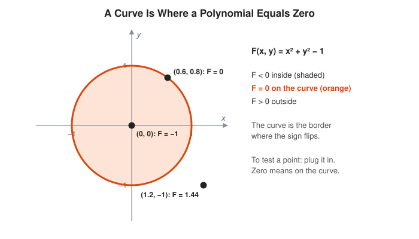
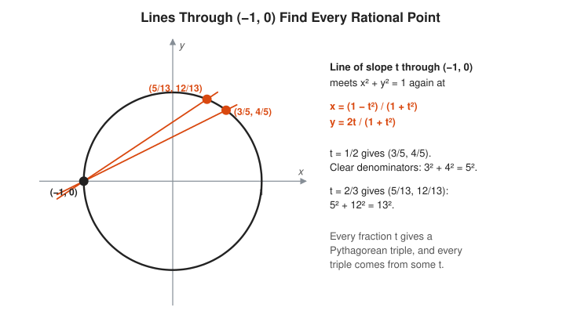
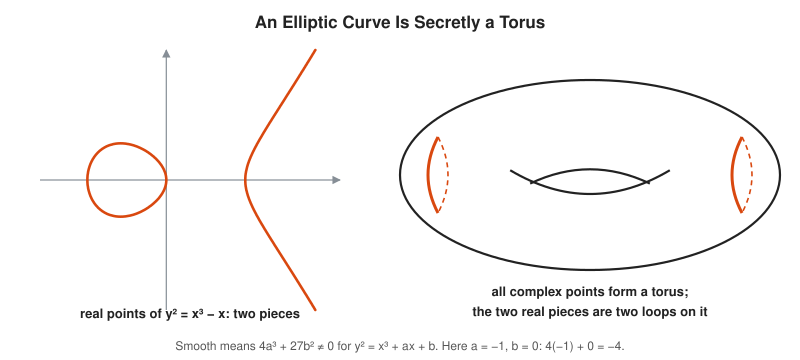
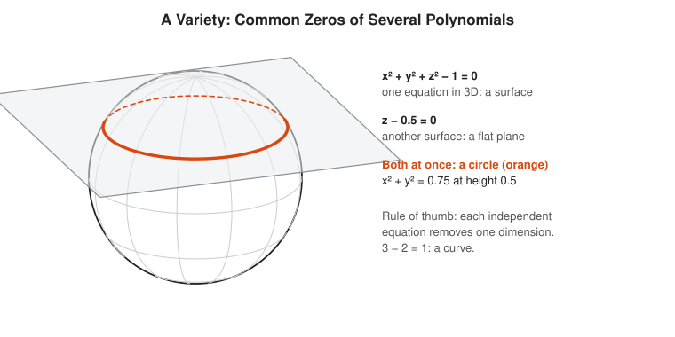

# Algebraic Geometry Track

**Track:** Algebraic Geometry · **Span:** beginner to advanced · **Course levels:** [201 Algebra I and Geometry](../../course/201/README.md) (coordinate plane), [301 Algebra II, Trig and Precalculus](../../course/301/README.md) (polynomials, conic sections), [601 Proof and Higher Math](../../course/601/README.md) (fields, modular arithmetic)
**Prerequisites:** graphing equations on the coordinate plane and factoring polynomials. The [Algebra Track](../algebra/README.md) covers both. Complex numbers from the [Complex Analysis Track](../complex-analysis/README.md) help from rung 6 on. Modular arithmetic from the [Number Theory Track](../number-theory/README.md) is needed for rung 11.
**Files:** this README, [cards.tsv](cards.tsv) for Anki, [code/main.go](code/main.go), and the diagrams in [img/](img/).

## What the Field Studies

Algebraic geometry studies shapes cut out by polynomial equations. The circle is the set of points where $x^2 + y^2 - 1 = 0$. A parabola, an ellipse, a figure eight, a sphere: each is the zero set of some polynomial.

The field runs in both directions. Algebra answers geometric questions (how many points do two curves share?), and geometry answers algebraic ones (which whole numbers solve this equation?). It is one of the oldest and deepest parts of mathematics, and one of its simplest objects, the elliptic curve, secures most of the TLS connections you make every day.

## Why It Matters

Polynomial shapes run quietly through computing:

* **Cryptography:** elliptic curve Diffie-Hellman (ECDHE) and ECDSA signatures protect TLS, SSH, Signal and Bitcoin. Curve25519 and P-256 are elliptic curves over finite fields.
* **Computer graphics and CAD:** Bezier curves and NURBS are polynomial curves. Ray tracing a curved surface means intersecting a line with a polynomial surface.
* **Robotics:** the positions a robot arm reaches are solutions of polynomial equations in the joint angles.
* **Number theory:** Fermat's Last Theorem was proved by studying elliptic curves.
* **Coding theory:** algebraic geometry codes generalize Reed-Solomon codes using points on curves over finite fields.

## Concept Map

<!-- diagram: type=concept-map tiers=beginner,intermediate,advanced nodes=11 caption="Algebraic geometry concepts with prerequisite arrows" -->


Read the map top to bottom. An arrow from A to B means learn A first. Orange boxes mark the milestones.

## Signature Diagram

<!-- diagram: type=elliptic-curve-addition curve="y^2=x^3-x+1" P=0,1 Q=1,1 caption="Adding points on an elliptic curve" -->


Draw a line through two points on a cubic curve. It hits the curve at exactly one more point. Flip that point across the x-axis and call the result $P + Q$. This chord rule turns the points of the curve into a group: you can add them, there is a zero, and every point has a negative. The rule comes from Bezout's theorem (a line meets a cubic in 3 points), it gave number theorists a way to build new rational solutions from old ones, and it runs inside every ECDHE handshake.

## The Concept Ladder

### Beginner

#### 1. Curves From Equations

The **zero set** of a polynomial $F(x, y)$ is the set of points where $F = 0$. That set is a **plane algebraic curve**. The **degree** of the curve is the degree of $F$: a line has degree 1, a circle degree 2.

$$C = \{(x, y) : F(x, y) = 0\}, \qquad \text{circle: } F(x, y) = x^2 + y^2 - 1$$

<!-- diagram: type=zero-set F="x^2+y^2-1" points=(0.6,0.8),(0,0),(1.2,-1) caption="A curve is where a polynomial equals zero" -->


To test a point, plug it in. Zero means on the curve. The sign tells you which side you are on, which is exactly how a ray tracer decides whether a ray has entered a sphere.

In the course: [201 Coordinate Plane and Functions](../../course/201/03-coordinate-plane-and-functions/README.md).

#### 2. Conics

Degree-2 curves are **conics**: $Ax^2 + Bxy + Cy^2 + Dx + Ey + F = 0$. Up to moving and rotating, there are only a few kinds: ellipse (a circle is a special ellipse), parabola, hyperbola, and degenerate cases such as two crossing lines. The **discriminant** $B^2 - 4AC$ tells them apart.

$$B^2 - 4AC < 0: \text{ ellipse}, \qquad = 0: \text{ parabola}, \qquad > 0: \text{ hyperbola}$$

<!-- diagram: type=curve-row curves=ellipse,parabola,hyperbola,two-lines caption="The four kinds of degree-2 curves" -->


<!-- diagram: type=cone-slices view=side caption="Conics are slices of a cone" -->


The Greeks found all four as slices of a cone, two thousand years before anyone wrote $x$ and $y$. The equations and the slices describe the same curves.

In the course: [301 Conic Sections](../../course/301/10-conic-sections/README.md).

#### 3. Rational Points on the Circle

A **rational point** has fraction coordinates. Draw a line of slope $t$ through $(-1, 0)$. It meets the circle at exactly one more point, and when $t$ is a fraction, so is that point. Every rational point arises this way, and clearing denominators gives every Pythagorean triple.

$$\left(\frac{1 - t^2}{1 + t^2},\ \frac{2t}{1 + t^2}\right), \qquad t = \tfrac{1}{2} \to \left(\tfrac{3}{5}, \tfrac{4}{5}\right) \to 3^2 + 4^2 = 5^2$$

<!-- diagram: type=secant-lines curve=unit-circle through=(-1,0) slopes=1/2,2/3 caption="Lines through (-1, 0) find every rational point" -->


Why exactly one more point? Substituting the line into the circle gives a quadratic in $x$. One root is $x = -1$, already known and rational, and the two roots add up to a rational number. The other root has to be rational too. This trick, "use a known point to find new ones", returns in rung 10 with cubics.

In the course: [201 Pythagorean Theorem](../../course/201/10-pythagorean-theorem/README.md).

#### 4. Cubics and Singular Points

Degree-3 curves are far richer. The family $y^2 = (\text{a cubic in } x)$ already shows the main behaviors: one piece, two pieces, a self-crossing (**node**) or a sharp point (**cusp**). A **singular point** is where both partial derivatives of $F$ vanish along with $F$: the curve has no well-defined tangent line there.

$$\text{singular: } F = \frac{\partial F}{\partial x} = \frac{\partial F}{\partial y} = 0$$

<!-- diagram: type=curve-row curves="y^2=x^3-x","y^2=x^3-x+1","y^2=x^3+x^2","y^2=x^3" caption="Four cubic curves" -->


For $y^2 = x^3$, set $F = y^2 - x^3$. Then $F_x = -3x^2$ and $F_y = 2y$, both zero at the origin, along with $F$. The cusp is singular. Smooth cubics, the ones with no singular point, are the elliptic curves of rung 9.

In the course: [301 Polynomials and Complex Numbers](../../course/301/02-polynomials-and-complex-numbers/README.md).

### Intermediate

#### 5. Intersections

A line meets a circle in 2, 1 or 0 real points. Substituting the line into the circle gives a quadratic, and a quadratic always has 2 roots if you count complex roots and count a double root twice. Counted that way, the answer is always 2.

$$x^2 + y^2 = 1,\ y = c \implies x^2 = 1 - c^2$$

<!-- diagram: type=line-circle lines=y=0.5,y=1,y=1.5 caption="A line meets a circle in 2 points, counted properly" -->


The tangent line touches once but counts twice: the quadratic $x^2 = 0$ has a double root. Nudge the line down a hair and the double point splits into two. Algebraic geometry prefers rules without exceptions, and it gets them by counting complex points and multiplicities.

Related track: [Complex Analysis Track](../complex-analysis/README.md).

#### 6. The Projective Plane

Two parallel lines do not meet in the ordinary plane. Railway tracks seem to meet at the horizon. The **projective plane** adds those horizon points, the **points at infinity**, one for each direction. With **homogeneous coordinates** $[x : y : z]$, a point is a line through the origin in 3D. Ordinary points have $z = 1$. Points at infinity have $z = 0$.

$$(x, y) \mapsto [x : y : 1], \qquad [x : y : z] = [\lambda x : \lambda y : \lambda z] \text{ for } \lambda \ne 0$$

<!-- diagram: type=projective panels=railway,lines-through-origin caption="The projective plane adds points at infinity" -->


In the projective plane any two distinct lines meet in exactly one point. Parallel lines meet at infinity. No exceptions. Every 3D graphics pipeline uses homogeneous coordinates: the 4 by 4 matrices in OpenGL and Vulkan work in projective space, and the divide by $w$ is the move from $[x : y : z : w]$ back to ordinary coordinates.

In the course: [501 Matrices as Transformations](../../course/501/10-matrices-as-transformations/README.md).

#### 7. Bezout's Theorem

Two plane curves of degrees $m$ and $n$ with no common piece meet in exactly $m \cdot n$ points, when you count in the projective plane, allow complex points and count tangencies with multiplicity. Rungs 5 and 6 supplied the fine print. This is the payoff.

$$\#(C_1 \cap C_2) = \deg C_1 \cdot \deg C_2$$

<!-- diagram: type=intersections panels=two-ellipses,cubic-and-line caption="Bezout: degree times degree intersections" -->


A line and a cubic meet in 3 points. Two of them pin down the third, and that is the chord rule from the signature diagram. Two circles meet in at most 2 real points, not 4: the other 2 are the complex points at infinity $[1 : \pm i : 0]$, which every circle passes through.

Related track: [Linear Algebra Track](../linear-algebra/README.md): two lines (degree 1 times degree 1) meet in one point, the familiar 2 by 2 linear system.

#### 8. Elliptic Curves

An **elliptic curve** is a smooth cubic curve with a chosen point. Every one can be written in **Weierstrass form**. It is smooth exactly when the discriminant is not zero. Over the complex numbers its points form a torus, a donut with one hole.

$$y^2 = x^3 + ax + b, \qquad 4a^3 + 27b^2 \ne 0$$

<!-- diagram: type=curve-and-torus curve="y^2=x^3-x" caption="An elliptic curve is secretly a torus" -->


The name comes from computing the arc length of an ellipse, which leads to integrals that these curves parametrize. A smooth plane curve of degree $d$ has $(d-1)(d-2)/2$ holes over the complex numbers: a conic has 0 (a sphere) and a cubic has 1 (a torus). Here algebra meets the [Algebraic Topology Track](../algebraic-topology/README.md).

### Advanced

#### 9. The Group Law

Define addition on an elliptic curve: for $P + Q$, draw the line through $P$ and $Q$, find the third intersection $R$, and reflect it across the x-axis. To double a point, use the tangent line, which touches twice. The point at infinity $O$ (straight up the y-axis) is the zero. The rule is associative, which is a real theorem and not obvious from the picture.

$$\lambda = \frac{y_Q - y_P}{x_Q - x_P}\ \ \left(\text{or } \frac{3x_P^2 + a}{2y_P} \text{ to double}\right), \qquad x_{P+Q} = \lambda^2 - x_P - x_Q, \qquad y_{P+Q} = \lambda(x_P - x_{P+Q}) - y_P$$

<!-- diagram: type=elliptic-curve-doubling curve="y^2=x^3-x+1" P=1,1 caption="Doubling a point with the tangent line" -->


Start from $P = (0, 1)$ on $y^2 = x^3 - x + 1$ and keep adding $P$. The Code Corner gets $2P = (1/4, -7/8)$, $3P = (56, 419)$, and by $6P$ the fractions have 11-digit numerators. Mordell proved in 1922 that all rational points come from finitely many starting points this way.

#### 10. Finite Fields and Cryptography

Replace real numbers by integers mod a prime $p$. The curve becomes a finite set of dots, but the same formulas still add points: divide by multiplying by an inverse mod $p$. Computing $kP$ is fast with double-and-add, about $\log_2 k$ steps. Recovering $k$ from $kP$, the **elliptic curve discrete logarithm problem**, has no known fast method.

$$|E(\mathbb{F}_p)| = p + 1 - t, \qquad |t| \le 2\sqrt{p} \quad \text{(Hasse)}$$

<!-- diagram: type=finite-field-curve curve="y^2=x^3-x+1" p=29 highlight=G..6G caption="The curve mod 29" -->


The same curve as the signature diagram, now mod 29. It has 37 points, a prime count, and $G = (0, 1)$ reaches all of them. In **ECDH**, Alice picks a secret $a$ and publishes $aG$. Bob picks $b$ and publishes $bG$. Both compute $abG$, and an eavesdropper sees only $aG$ and $bG$. Real curves use primes near $2^{255}$, where the discrete log takes longer than the age of the universe.

Related workshop: [Number Theory for Cryptography](../../workshops/number-theory-for-cryptography/README.md).

#### 11. Varieties

A **variety** is the common zero set of several polynomials in any number of variables. One equation in 3D usually cuts out a surface. Two equations usually cut out a curve. Hilbert's **Nullstellensatz** makes the dictionary exact: varieties correspond to certain sets of polynomials called radical ideals.

$$V(f_1, \dots, f_k) = \{x \in \mathbb{C}^n : f_1(x) = \cdots = f_k(x) = 0\}$$

<!-- diagram: type=variety surfaces=sphere,plane z=0.5 caption="A sphere meets a plane in a circle" -->


Each independent equation removes one dimension: $3 - 2 = 1$, a curve. Modern algebraic geometry (Grothendieck's schemes) generalizes this until a single framework covers curves over the reals, over finite fields and over the integers at once. Wiles used that framework to prove Fermat's Last Theorem in 1995.

In the course: [601 Groups, Rings and Fields](../../course/601/11-groups-rings-and-fields/README.md).

## Worked Examples

### Example 1: A Pythagorean Triple From a Slope

Use $t = 2/3$ in the circle parametrization.

```txt
  t^2 = 4/9                                square the slope
  x = (1 - 4/9) / (1 + 4/9)                x = (1 - t^2) / (1 + t^2)
    = (5/9) / (13/9) = 5/13
  y = (2 * 2/3) / (13/9)                   y = 2t / (1 + t^2)
    = (4/3) * (9/13) = 12/13
  check: 25/169 + 144/169 = 169/169 = 1    the point is on the circle
  triple: 5^2 + 12^2 = 13^2                multiply through by 13^2
```

### Example 2: Add Two Points on an Elliptic Curve

Add $P = (0, 1)$ and $Q = (1, 1)$ on $y^2 = x^3 - x + 1$.

```txt
  lambda = (1 - 1) / (1 - 0) = 0           slope of the chord
  x_R = 0^2 - 0 - 1 = -1                   x = lambda^2 - x_P - x_Q
  y   = 0 * (0 - (-1)) - 1 = -1            y = lambda(x_P - x) - y_P
  P + Q = (-1, -1)                         the formula already includes the flip
  check: (-1)^3 - (-1) + 1 = 1 = (-1)^2    the point is on the curve
```

### Example 3: Count Intersections With Bezout

How many points do the circle $x^2 + y^2 = 4$ and the hyperbola $xy = 1$ share?

```txt
  degrees: 2 and 2                         both conics
  Bezout bound: 2 * 2 = 4                  at most 4, exactly 4 counted fully
  y = 1/x into the circle:
  x^2 + 1/x^2 = 4                          substitute
  x^4 - 4x^2 + 1 = 0                       multiply by x^2
  x^2 = 2 +- sqrt(3)                       quadratic formula in x^2
  x^2 = 3.732 or 0.268, both positive      4 real values of x: +-1.932, +-0.518
  4 real intersection points               all of Bezout's count is visible
```

## Big Theorems to Know

* **Bezout (1779):** two projective plane curves of degrees $m$ and $n$ with no common component meet in $mn$ points, counted with multiplicity over the complex numbers.
* **Genus-Degree Formula:** a smooth plane curve of degree $d$ has genus $(d-1)(d-2)/2$.
* **Hasse (1933):** an elliptic curve over $\mathbb{F}_p$ has $p + 1 - t$ points with $|t| \le 2\sqrt{p}$.
* **Mordell (1922):** the rational points of an elliptic curve form a finitely generated group.
* **Faltings (1983):** a curve of genus at least 2 has only finitely many rational points.
* **Hilbert Nullstellensatz (1893):** over the complex numbers, varieties correspond exactly to radical ideals of polynomials.
* **Wiles (1995):** every semistable elliptic curve over the rationals is modular, which proves Fermat's Last Theorem: $x^n + y^n = z^n$ has no positive whole-number solutions for $n \ge 3$.

## Open Problems and Fun Facts

* **Birch and Swinnerton-Dyer conjecture:** predicts the number of independent rational points on an elliptic curve from counts of its points mod every prime. It is a Millennium Prize problem worth one million dollars.
* **Congruent numbers:** is $n$ the area of a right triangle with rational sides? The answer reduces to rational points on $y^2 = x^3 - n^2 x$. The full answer depends on Birch and Swinnerton-Dyer.
* **The 27 lines:** every smooth cubic surface in 3D contains exactly 27 straight lines (Cayley and Salmon, 1849).
* **Your browser right now:** most TLS 1.3 handshakes use X25519, Diffie-Hellman on an elliptic curve over the integers mod $2^{255} - 19$, often paired with a post-quantum scheme.
* **Satoshi's curve:** Bitcoin uses secp256k1, the curve $y^2 = x^3 + 7$ over a 256-bit prime field.

## Starter Problems

1. Is the point $(0.8, -0.6)$ on the circle $x^2 + y^2 = 1$?
2. Classify the conic $x^2 + 4xy + y^2 = 1$ with the discriminant.
3. Which Pythagorean triple comes from slope $t = 1/4$ in the circle parametrization?
4. How many points do a circle and a cubic curve share, counted with Bezout's rule?
5. Is $y^2 = x^3 - 3x + 2$ smooth? Use $4a^3 + 27b^2$.
6. On $y^2 = x^3 - x + 1$, what is $P + (-P)$ for any point $P$?
7. Write the point $(3, 5)$ in homogeneous coordinates, and name a point at infinity on the lines of slope 2.

<details>
<summary>Answers</summary>

1. Yes. $0.64 + 0.36 = 1$.
2. $B^2 - 4AC = 16 - 4 = 12 > 0$: a hyperbola.
3. $x = 15/17$, $y = 8/17$, which gives $8, 15, 17$.
4. $2 \times 3 = 6$.
5. No. $4(-27) + 27(4) = -108 + 108 = 0$. The cubic factors as $(x-1)^2(x+2)$ and the curve has a node at $(1, 0)$.
6. $O$, the point at infinity. The line through $P$ and $-P$ is vertical and meets the curve only at infinity.
7. $[3 : 5 : 1]$, or any multiple such as $[6 : 10 : 2]$. Lines of slope 2 head in direction $(1, 2)$ and meet at $[1 : 2 : 0]$.

</details>

## Code Corner

[code/main.go](code/main.go) generates Pythagorean triples from slopes, classifies conics, checks the Bezout examples, adds points on $y^2 = x^3 - x + 1$ with exact fractions (`math/big`), then counts the same curve mod 29 and runs a toy elliptic curve Diffie-Hellman exchange. Run it with `go run main.go` inside `code/`.

```txt
== Rational points on x^2 + y^2 = 1 from slopes t = m/n ==
t = 1/2 -> (3/5, 4/5) -> 3^2 + 4^2 = 5^2 (25 = 25)
t = 2/3 -> (5/13, 12/13) -> 5^2 + 12^2 = 13^2 (169 = 169)
t = 1/4 -> (15/17, 8/17) -> 15^2 + 8^2 = 17^2 (289 = 289)
t = 3/4 -> (7/25, 24/25) -> 7^2 + 24^2 = 25^2 (625 = 625)
t = 4/5 -> (9/41, 40/41) -> 9^2 + 40^2 = 41^2 (1681 = 1681)

== Conic type from B^2 - 4AC ==
x^2/4 + y^2 = 1  B^2 - 4AC = -1.00 -> ellipse
y = x^2          B^2 - 4AC =  0.00 -> parabola
x^2 - y^2 = 1    B^2 - 4AC =  4.00 -> hyperbola
xy = 1           B^2 - 4AC =  1.00 -> hyperbola

== Bezout checks ==
x^2/4 + y^2 = 1 and x^2 + y^2/4 = 1: 4 common points at (+-0.894, +-0.894)
y = x^3 - x and y = 0.3x: x = 0 and x = +-1.140, so 3 points
x^2 + y^2 = 1 and y = 0.5: x^2 = +0.75
x^2 + y^2 = 1 and y = 1.0: x^2 = +0.00
x^2 + y^2 = 1 and y = 1.5: x^2 = -1.25

== y^2 = x^3 - x + 1 over the rationals ==
P = (0, 1)  Q = (1, 1)
P + Q = (-1, -1)
2Q    = (-1, 1)
P + (-P) = O (infinity)
2P = (1/4, -7/8)
3P = (56, 419)
4P = (-223/784, 24655/21952)
5P = (23464/49729, -8824453/11089567)
6P = (9840321/702244, 30795303833/588480472)

== The same curve mod 29 ==
points: 37, Hasse bound: |37 - 30| = 7 <= 2 sqrt(29) = 10.77
multiples of G = (0, 1): (0, 1) (22, 10) (27, 13) (9, 24) (14, 18) (11, 25)
order of G: 37 (37G = O)
toy ECDH: Alice sends 7G = (23, 20), Bob sends 11G = (3, 24)
Alice computes 7 * (3, 24) = (27, 13)
Bob computes   11 * (23, 20) = (27, 13)
```

Over the rationals the coordinates of $kP$ explode in size. Mod 29 they never grow past 28, which is why cryptography works mod $p$. Both sides of the toy exchange land on $(27, 13) = 77G = 3G$, since $77 = 2 \cdot 37 + 3$. With $p = 29$ an attacker tries all 37 multiples in microseconds. With a 255-bit prime, no computer on Earth finishes.

## Flashcards

[cards.tsv](cards.tsv) holds the key definitions and theorems for Anki import.

## Resources

* [Wolfram MathWorld: Elliptic Curve](https://mathworld.wolfram.com/EllipticCurve.html): definitions, the group law and many examples.
* [Wolfram MathWorld: Bezout's Theorem](https://mathworld.wolfram.com/BezoutsTheorem.html): the statement with its fine print.
* [MacTutor: Etienne Bezout](https://mathshistory.st-andrews.ac.uk/Biographies/Bezout/): the life of the man behind the intersection count.
* [Cloudflare: A Relatively Easy to Understand Primer on Elliptic Curve Cryptography](https://blog.cloudflare.com/a-relatively-easy-to-understand-primer-on-elliptic-curve-cryptography/): the group law and ECDH explained for engineers.
* [MIT OCW 18.783 Elliptic Curves](https://ocw.mit.edu/courses/18-783-elliptic-curves-spring-2021/): full lecture notes by Andrew Sutherland, from the group law to point counting.
* [Ravi Vakil: The Rising Sea](https://math.stanford.edu/~vakil/216blog/): a free modern textbook for the scheme-theoretic top of the field.

## Where to Go Next

* [Number Theory for Cryptography](../../workshops/number-theory-for-cryptography/README.md) for the modular arithmetic under every elliptic curve system.
* [Abstract Algebra Track](../abstract-algebra/README.md) for groups, rings, fields and ideals.
* [Algebraic Topology Track](../algebraic-topology/README.md) for the torus hiding inside every elliptic curve.
* [Differential Geometry Track](../differential-geometry/README.md) for curves and surfaces studied with calculus instead of polynomials.
