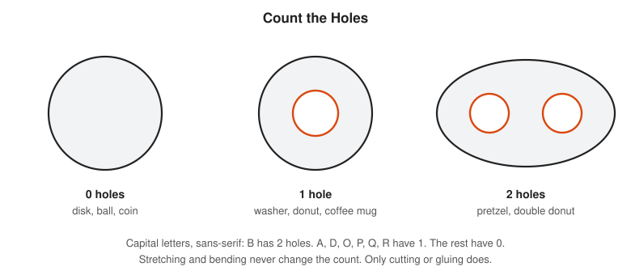
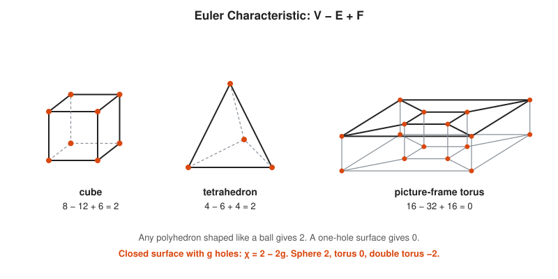
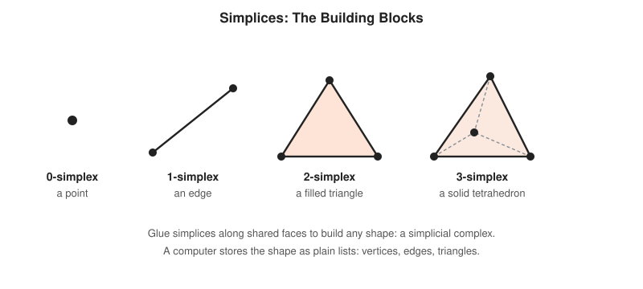
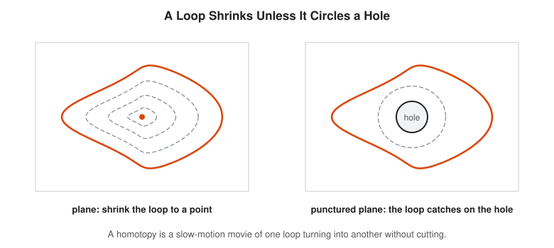
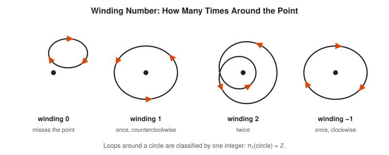
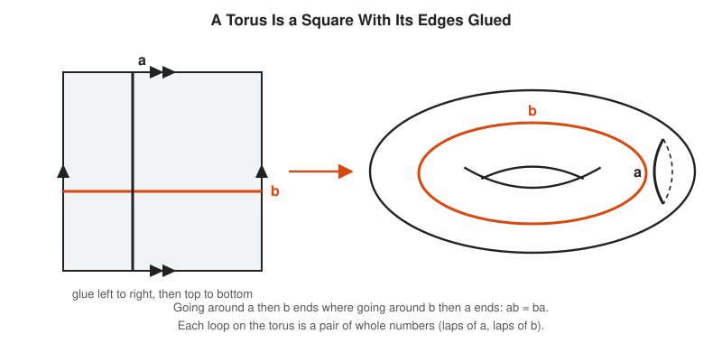
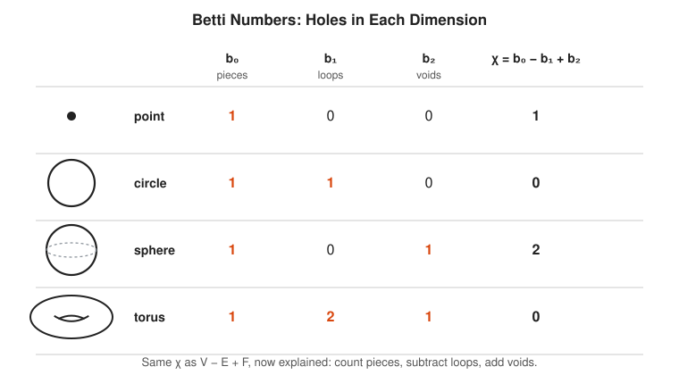
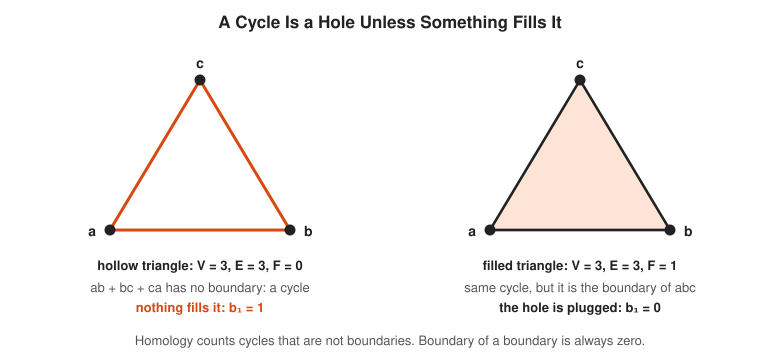
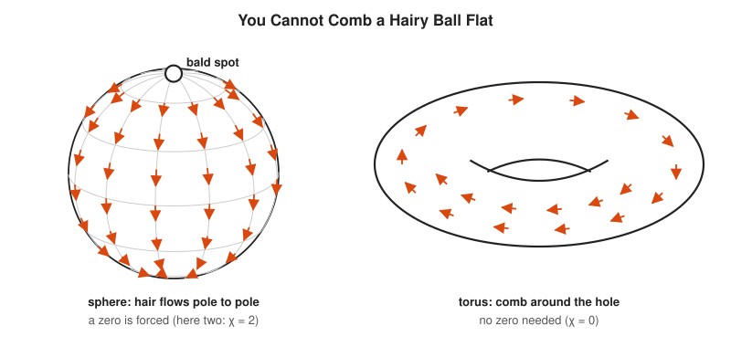

# Algebraic Topology Track

**Track:** Algebraic Topology · **Span:** beginner to advanced · **Course levels:** [501 Linear Algebra, Probability and Discrete Math](../../course/501/README.md) (matrices, graphs), [601 Proof and Higher Math](../../course/601/README.md) (groups, topology taster)
**Prerequisites:** counting and patience. The [Topology Track](../topology/README.md) gives the idea of continuous deformation. Groups from the [Abstract Algebra Track](../abstract-algebra/README.md) help from rung 5 on. Rank of a matrix from the [Linear Algebra Track](../linear-algebra/README.md) helps from rung 8 on. Euler's formula from the [Graph Theory Track](../graph-theory/README.md) is the seed of the whole field.
**Files:** this README, [cards.tsv](cards.tsv) for Anki, [code/main.go](code/main.go), and the diagrams in [img/](img/).

## What the Field Studies

Topology treats shapes as if made of rubber: you stretch and bend, but never cut or glue. Under those rules a coffee mug and a donut are the same shape. Both have one hole.

Algebraic topology turns "how many holes, of what kind" into numbers and groups that a person, or a program, can compute. Two shapes with different numbers cannot be stretched into each other. That is the main use: proving that two things differ by finding one number they disagree on.

## Why It Matters

Holes show up in places that have nothing to do with donuts:

* **Topological data analysis** finds loops and voids in point clouds: sensor coverage gaps, cycles in gene expression, structure in high-dimensional embeddings.
* **Sensor networks** use homology to prove coverage: if the right group is zero, no hole exists where an intruder hides.
* **Robot motion planning** studies the shape of the space of configurations. A hole in that space means two routes that cannot be deformed into each other.
* **Fixed point theorems** guarantee that equilibria exist in economics (Nash used Brouwer and Kakutani) and in iterative algorithms.
* **Weather:** the hairy ball theorem says that at any instant, the horizontal wind is zero somewhere on Earth.

## Concept Map

<!-- diagram: type=concept-map tiers=beginner,intermediate,advanced nodes=11 caption="Algebraic topology concepts with prerequisite arrows" -->


Read the map top to bottom. An arrow from A to B means learn A first. Orange boxes mark the milestones.

## Signature Diagram

<!-- diagram: type=loops-on-surfaces surfaces=sphere,torus loops=shrinking,a,b caption="Loops on a sphere shrink, loops on a torus get stuck" -->


Tie a rubber band around an orange. It slides off. Tie it around the handle of a mug and it stays. That one experiment separates a sphere from a torus, and the rest of the track builds tools to run the experiment in every dimension and to count the results.

## The Concept Ladder

### Beginner

#### 1. Counting Holes

Topology keeps only what survives stretching. Length, angle and area are gone. Connectedness and holes remain. A disk has no hole. A washer has one. A pretzel has two.

$$\text{donut} \simeq \text{coffee mug} \qquad \text{disk} \not\simeq \text{washer}$$

<!-- diagram: type=shape-row shapes=disk,annulus,two-holed caption="Zero, one and two holes" -->


The symbol $\simeq$ means "the same up to stretching". The fun puzzle: sort the alphabet by holes. The serious puzzle: what exactly is a hole in a solid ball with a bubble inside? Rung 7 answers it.

In the course: [601 Topology Taster](../../course/601/12-topology-taster/README.md).

#### 2. Euler Characteristic Revisited

Count the corners $V$, edges $E$ and faces $F$ of any polyhedron shaped like a ball and compute $V - E + F$. You always get 2. A polyhedron shaped like a donut gives 0. The number depends only on the holes, not on the polyhedron. It is the **Euler characteristic** $\chi$ (chi).

$$\chi = V - E + F, \qquad \chi(\text{closed surface with } g \text{ holes}) = 2 - 2g$$

<!-- diagram: type=polyhedra items=cube,tetrahedron,frame-torus caption="V - E + F for three solids" -->


You met $V - E + F = 2$ for planar graphs in the [Graph Theory Track](../graph-theory/README.md). It is the same number. A planar graph drawn on a sphere has $\chi = 2$, and that is why the formula holds.

#### 3. Simplicial Complexes

To compute with shapes, build them from simple pieces. A **0-simplex** is a point, a **1-simplex** an edge, a **2-simplex** a filled triangle, a **3-simplex** a solid tetrahedron. Glue them along shared faces and you get a **simplicial complex**: a shape stored as plain lists.

$$\chi = (\#\text{vertices}) - (\#\text{edges}) + (\#\text{triangles}) - (\#\text{tetrahedra}) + \cdots$$

<!-- diagram: type=simplices dims=0,1,2,3 caption="The four smallest simplices" -->


A 3D mesh in a game engine is a simplicial complex: a vertex list and a triangle list. So is a Delaunay triangulation of map points. Topology gets computable the moment the shape becomes a data structure.

In the course: [501 Graph Theory Basics](../../course/501/08-graph-theory-basics/README.md): a graph is a simplicial complex with no triangles.

#### 4. Homotopy: Deforming Loops

A **loop** is a path that ends where it starts. A **homotopy** between two loops is a continuous deformation of one into the other: a slow-motion movie with no cuts. In the plane every loop shrinks to a point. Punch a hole in the plane and a loop around the hole cannot shrink.

$$H(s, t): \quad H(s, 0) = \text{loop}_0(s), \quad H(s, 1) = \text{loop}_1(s)$$

<!-- diagram: type=homotopy panels=plane,punctured-plane caption="A loop shrinks unless it circles a hole" -->


The variable $t$ is the frame number of the movie, and $s$ runs along the loop. If every frame is a continuous loop and frames change smoothly, the two loops are **homotopic**.

### Intermediate

#### 5. The Fundamental Group of the Circle

Loops on a space, counted up to homotopy, form a group called the **fundamental group** $\pi_1$. You combine two loops by running one, then the other. For a circle (or the punctured plane) a loop is classified by one integer: its **winding number**, the net number of times it goes around counterclockwise.

$$\pi_1(\text{circle}) = \mathbb{Z}, \qquad \text{winding number} = \frac{1}{2\pi}\,(\text{total change in angle})$$

<!-- diagram: type=winding-numbers values=0,1,2,-1 caption="Loops with winding numbers 0, 1, 2 and -1" -->


Combining loops adds winding numbers: going around once and then twice is going around three times. That is the group $\mathbb{Z}$ under addition. A cable wrapped around a pole is the physical version, and anyone who has untangled a vacuum cleaner cord has computed one.

In the course: [601 Groups, Rings and Fields](../../course/601/11-groups-rings-and-fields/README.md).

#### 6. Torus Versus Sphere

On a sphere every loop shrinks: $\pi_1 = 0$, the trivial group. A torus has two independent loops, $a$ around the tube and $b$ around the hole. Any loop is "$m$ laps of $a$ and $n$ laps of $b$". The order does not matter: $ab = ba$.

$$\pi_1(\text{sphere}) = 0, \qquad \pi_1(\text{torus}) = \mathbb{Z} \times \mathbb{Z}$$

<!-- diagram: type=identification-square glue=aa,bb loops=a,b caption="A torus is a square with opposite edges glued" -->


Glue the left edge of a square to the right edge and you get a tube. Glue the ends of the tube and you get a torus. The video game Asteroids happens on this square: fly off the right edge, reappear on the left. Its players live on a torus.

#### 7. Homology and Betti Numbers

**Homology** counts holes by dimension. The **Betti numbers** are the counts: $b_0$ is the number of connected pieces, $b_1$ the number of independent loops that bound nothing, $b_2$ the number of enclosed voids. The Euler characteristic is their alternating sum.

$$\chi = b_0 - b_1 + b_2$$

<!-- diagram: type=table rows=point,circle,sphere,torus cols=b0,b1,b2,chi caption="Betti numbers of four spaces" -->


A hollow ball has $b_2 = 1$: it encloses one void. A solid ball has $b_2 = 0$. A torus has two independent loops ($b_1 = 2$) and one void, the air inside the tube. The answer to the bubble puzzle from rung 1: a ball with a bubble has $b_2 = 1$.

Related track: [Topology Track](../topology/README.md).

#### 8. Chains and Boundaries

Homology is computed with linear algebra. A **chain** is a formal sum of simplices. The **boundary** $\partial$ maps each simplex to the sum of its faces: $\partial(\text{edge } ab) = b - a$, $\partial(\text{triangle } abc) = bc - ac + ab$. A **cycle** is a chain with zero boundary. A hole is a cycle that is not itself the boundary of something.

$$\partial \circ \partial = 0, \qquad H_k = \frac{\text{cycles}}{\text{boundaries}}, \qquad b_k = \dim\ker\partial_k - \operatorname{rank}\partial_{k+1}$$

<!-- diagram: type=complex-pair left=hollow-triangle right=filled-triangle caption="A cycle is a hole unless something fills it" -->


The boundary of a boundary is always zero. A filled triangle has three edges for its boundary, and those edges form a closed loop with no endpoints. Computing $b_k$ is two matrix ranks. The Code Corner does it for a torus made of 18 triangles.

In the course: [501 Solving Systems: Gaussian Elimination](../../course/501/11-solving-systems-gaussian-elimination/README.md) for rank.

### Advanced

#### 9. Brouwer Fixed Point Theorem

Every continuous map from a disk to itself leaves at least one point where it started: a **fixed point**. In one dimension this is the intermediate value theorem: the graph of $f: [0, 1] \to [0, 1]$ must cross the line $y = x$. In two dimensions the proof uses $\pi_1$: if no fixed point existed, you could retract the disk onto its boundary circle, and that would force $\mathbb{Z} = 0$.

$$f: D^n \to D^n \text{ continuous} \implies \exists\, x: f(x) = x$$

<!-- diagram: type=fixed-point panels=graph,map-in-room caption="Brouwer in one and two dimensions" -->


Drop a map of a room anywhere in that room, crumpled or rotated. Some point on the map lies exactly above the spot it represents. Stir a cup of coffee gently: when it settles, some point of the liquid sits where it began. In an SRE setting: a continuous config transform that maps a bounded convex set of settings into itself has a setting it leaves alone.

#### 10. The Hairy Ball Theorem

You cannot comb a hairy ball flat: any continuous field of arrows tangent to a sphere has a zero somewhere, a cowlick or bald spot. A torus combs flat with no trouble. The **Poincare-Hopf theorem** explains why: the zeros, counted with an index, add up to $\chi$.

$$\sum_{\text{zeros}} \text{index} = \chi, \qquad \chi(\text{sphere}) = 2 \ne 0$$

<!-- diagram: type=vector-fields surfaces=sphere,torus caption="A sphere needs a bald spot, a torus does not" -->


At any instant, the horizontal wind on Earth is zero at some point. Combing toward the south pole leaves zeros at both poles, each of index $+1$, total 2. On a torus, $\chi = 0$, and arrows chase each other around the hole forever with no zero needed.

#### 11. Topological Data Analysis

Real data is a cloud of points, not a shape. **Persistent homology** grows a ball of radius $\varepsilon/2$ around each point, connects points closer than $\varepsilon$, and tracks how the Betti numbers change as $\varepsilon$ grows. Features that persist across a long range of $\varepsilon$ are real. Short-lived ones are noise.

$$\text{Vietoris-Rips complex at scale } \varepsilon: \text{ a simplex for every set of points pairwise within } \varepsilon$$

<!-- diagram: type=persistence points=12-noisy-ring eps=0.3,1.0,1.9 caption="Grow balls, watch the loop appear and disappear" -->


The barcode reads like a timeline of alerts. Short bars are flapping noise. The long orange bar is the incident: the data has a loop, and it lasts from scale 0.65 to 1.75. Researchers use this to find cycles in gene expression, gaps in sensor coverage and shape in neural network activations.

Related tracks: [Statistics Track](../statistics/README.md) and [Linear Algebra Track](../linear-algebra/README.md).

## Worked Examples

### Example 1: Euler Characteristic of a Soccer Ball

A classic soccer ball has 12 pentagons and 20 hexagons. Check that $\chi = 2$.

```txt
  F = 12 + 20 = 32                      count the faces
  edges: (12 * 5 + 20 * 6) / 2          each edge borders two faces
       = (60 + 120) / 2 = 90
  vertices: (12 * 5 + 20 * 6) / 3       each corner touches three faces
          = 180 / 3 = 60
  V - E + F = 60 - 90 + 32 = 2          a sphere, as expected
```

### Example 2: Betti Numbers of a Hollow Triangle

Vertices $a, b, c$. Edges $ab$, $bc$, $ca$. No faces.

```txt
  b0: one connected piece            -> b0 = 1
  boundary map d1 has 3 columns (edges), rank 2
                                        the three images b-a, c-b, a-c add to 0
  cycles in dimension 1: 3 - 2 = 1     dim ker d1 = edges - rank d1
  boundaries from faces: 0             no triangles
  b1 = 1 - 0 = 1                       one loop that bounds nothing
  chi = 1 - 1 = 0, and V - E = 3 - 3 = 0   both counts agree
```

Fill in the triangle and $\operatorname{rank}\partial_2 = 1$, which gives $b_1 = 1 - 1 = 0$.

### Example 3: Genus From the Euler Characteristic

A closed surface is triangulated with 7 vertices, 21 edges and 14 triangles. How many holes does it have?

```txt
  chi = V - E + F = 7 - 21 + 14 = 0     count
  chi = 2 - 2g                          closed orientable surface
  0   = 2 - 2g                          substitute
  g   = 1                               one hole: a torus
```

This is the famous 7-vertex torus of Mobius, the smallest triangulation of a torus.

## Big Theorems to Know

* **Euler Formula (1758):** $V - E + F = 2$ for every convex polyhedron.
* **Classification of Surfaces:** every closed orientable surface is a sphere with $g$ handles, and $\chi = 2 - 2g$ tells you $g$.
* **Fundamental Group of the Circle:** $\pi_1(S^1) = \mathbb{Z}$, measured by winding number.
* **Brouwer Fixed Point Theorem (1911):** every continuous map of a closed disk (or ball) to itself has a fixed point.
* **Hairy Ball Theorem (Poincare 1885, Brouwer 1912):** every continuous tangent vector field on a sphere vanishes somewhere.
* **Poincare-Hopf:** the indices of the zeros of a vector field add up to $\chi$.
* **Borsuk-Ulam (1933):** at any moment, two opposite points on Earth have the same temperature and the same pressure.
* **Invariance of Dimension:** $\mathbb{R}^m$ and $\mathbb{R}^n$ are not homeomorphic when $m \ne n$. Homology proves it.

## Open Problems and Fun Facts

* **Poincare conjecture:** every simply connected closed 3-manifold is a 3-sphere. Poincare asked in 1904. Perelman proved it in 2003, using geometry, not algebra. It is the only Millennium Prize problem solved so far.
* **Homotopy groups of spheres:** $\pi_k(S^n)$ counts ways to wrap a $k$-sphere around an $n$-sphere. Nobody knows them all. Even $\pi_3(S^2) = \mathbb{Z}$ was a shock in 1931 (the Hopf fibration).
* **Ham sandwich theorem:** one straight cut divides the bread, the ham and the cheese each exactly in half. Another consequence of Borsuk-Ulam.
* **The standard joke:** a topologist is someone who cannot tell a coffee mug from a donut. The mug handle is the hole.
* **TDA in the wild:** persistent homology identified a previously unknown subgroup of breast cancers with excellent survival (Nicolau, Levine and Carlsson, 2011).

## Starter Problems

1. How many holes does the capital letter B have? The digit 8? The letter W?
2. An octahedron has 6 vertices and 12 edges. How many faces must it have?
3. A closed surface has $\chi = -4$. How many holes does it have?
4. What is the winding number around the origin of the loop $(\cos 3t, \sin 3t)$ for $0 \le t \le 2\pi$?
5. A complex has 4 vertices, 6 edges (every pair) and no triangles. Find $b_0$ and $b_1$.
6. Does every continuous map from a circle to itself have a fixed point?
7. Can you comb a hairy donut flat? A hairy ball? Why the difference?

<details>
<summary>Answers</summary>

1. B has 2 holes, 8 has 2, W has 0.
2. 8 faces. $V - E + F = 2$ gives $6 - 12 + F = 2$.
3. 3 holes. $2 - 2g = -4$ gives $g = 3$.
4. 3. The loop goes around three times counterclockwise.
5. $b_0 = 1$. $\operatorname{rank}\partial_1 = 3$, which gives $b_1 = 6 - 3 = 3$. A complete graph on 4 vertices has 3 independent cycles.
6. No. Rotating the circle by 90 degrees moves every point. Brouwer needs a filled disk, not its boundary.
7. A donut yes ($\chi = 0$), a ball no ($\chi = 2$). Poincare-Hopf says the zeros must add up to $\chi$.

</details>

## Code Corner

[code/main.go](code/main.go) computes Euler characteristics, finds Betti numbers from boundary matrices by Gaussian elimination mod 2, counts winding numbers, finds a Brouwer fixed point by bisection, and runs a small persistent-homology scan on the noisy ring from the TDA diagram. Run it with `go run main.go` inside `code/`.

```txt
== Euler characteristic V - E + F ==
tetrahedron           4 -  6 +  4 = 2
cube                  8 - 12 +  6 = 2
octahedron            6 - 12 +  8 = 2
icosahedron          12 - 30 + 20 = 2
picture-frame torus  16 - 32 + 16 = 0

== Betti numbers (b0, b1, b2) ==
hollow triangle     V=3 E= 3 F= 0  b=(1, 1, 0)  chi=0
filled triangle     V=3 E= 3 F= 1  b=(1, 0, 0)  chi=1
hollow tetrahedron  V=4 E= 6 F= 4  b=(1, 0, 1)  chi=2
3x3 torus           V=9 E=27 F=18  b=(1, 2, 1)  chi=0

== Winding numbers around the origin ==
small loop off to the side   0
unit circle                  1
double loop                  2
clockwise circle            -1

== Brouwer in one dimension ==
f(x) = 0.9 - 0.75x + 0.15 sin 6x has fixed point x = 0.5174, f(x) = 0.5174

== Persistent homology of a noisy ring of 12 points ==
eps 0.3: b0 = 12, b1 = 0
eps 0.5: b0 =  7, b1 = 0
eps 1.0: b0 =  1, b1 = 1
eps 1.5: b0 =  1, b1 = 1
eps 1.9: b0 =  1, b1 = 0
the loop is born at eps = 0.652 and dies at eps = 1.746
```

The hollow tetrahedron is a sphere made of four triangles, and the program finds its void: $b_2 = 1$. The 3 by 3 torus finds two loops and one void. No picture was drawn. The holes came out of matrix ranks.

## Flashcards

[cards.tsv](cards.tsv) holds the key definitions and theorems for Anki import.

## Resources

* [Allen Hatcher: Algebraic Topology](https://pi.math.cornell.edu/~hatcher/AT/ATpage.html): the standard textbook, free to download from the author.
* [MIT OCW 18.905 Algebraic Topology I](https://ocw.mit.edu/courses/18-905-algebraic-topology-i-fall-2016/): graduate lecture notes on homology.
* [MacTutor: Henri Poincare](https://mathshistory.st-andrews.ac.uk/Biographies/Poincare/): the founder of the field and author of its most famous conjecture.
* [Wolfram MathWorld: Euler Characteristic](https://mathworld.wolfram.com/EulerCharacteristic.html): values for many surfaces and polyhedra.
* [Wolfram MathWorld: Hairy Ball Theorem](https://mathworld.wolfram.com/HairyBallTheorem.html): statement and links to related results.
* [Wolfram MathWorld: Brouwer Fixed Point Theorem](https://mathworld.wolfram.com/BrouwerFixedPointTheorem.html): statement and history.

## Where to Go Next

* [Differential Geometry Track](../differential-geometry/README.md) for Gauss-Bonnet, where curvature adds up to $2\pi\chi$.
* [Knot Theory Track](../knot-theory/README.md) for loops in 3D space and the invariants that tell them apart.
* [Algebraic Geometry Track](../algebraic-geometry/README.md), where a smooth cubic curve turns out to be a torus.
* [Abstract Algebra Track](../abstract-algebra/README.md) for the groups that homology produces.
