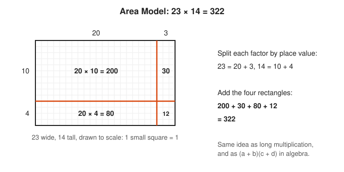
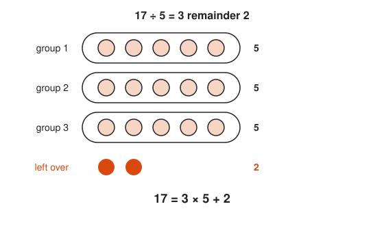
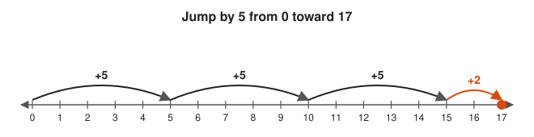
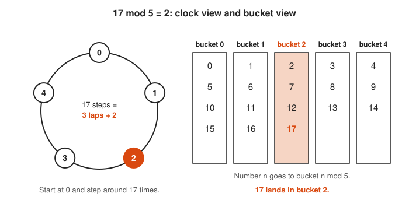
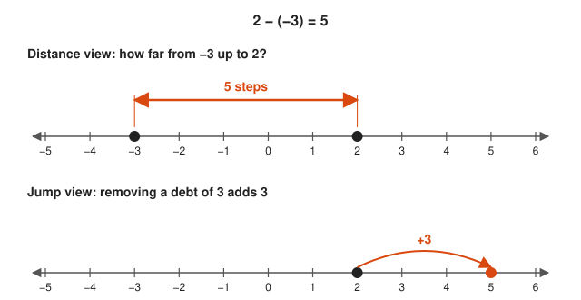
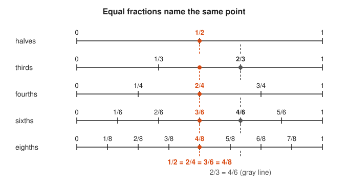
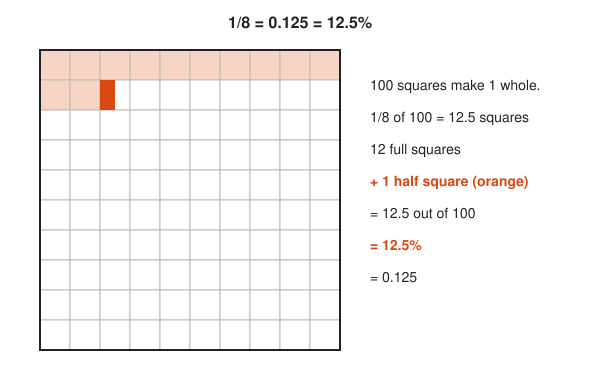
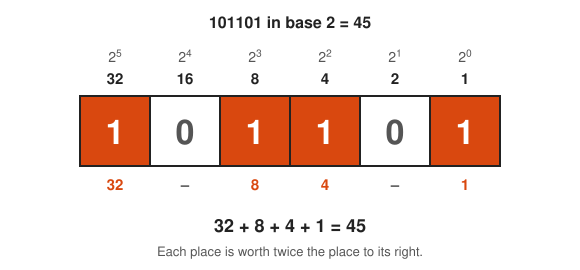

# Arithmetic and Number Sense

**Track:** Arithmetic and Number Sense · **Span:** first counting to the real number line · **Main course level:** [101 Foundations](../../course/101/README.md)

## What This Field Studies

Arithmetic studies numbers and the four basic operations on them: add, subtract, multiply, divide. **Number sense** is the feel that sits on top of the rules: knowing that 49 × 21 is close to 1,000, that 0.1% of a million is 1,000, and that a fraction with a big denominator is a small number.

Every other track in this repository runs on arithmetic. Algebra is arithmetic with unknowns. Calculus is arithmetic with limits. Statistics is arithmetic on a pile of measurements.

## Why It Matters

Number sense is what lets you look at a dashboard and know a value is wrong before you can say why. A p99 latency of 40 s on a service that usually answers in 40 ms is a factor of 1,000, which is three orders of magnitude, which is a different failure mode than a factor of two. A disk at 92% of 2 TB has about 160 GB left. Fast, rough, correct estimates come from the ideas in this track.

## Concept Map

<!-- diagram: type=concept-map bands=beginner,intermediate,advanced nodes=place-value,add,multiply,negatives,order-of-operations,factors,fractions,exponents,ratios,decimals,bases,estimation,real-line caption="Arithmetic and number sense concepts with prerequisite arrows" -->
![Concept map of arithmetic in three bands. Beginner: counting and place value leads to add and subtract, which leads to negative numbers and to multiply and divide. Intermediate: multiply and divide leads to order of operations, factors and primes, and fractions. Fractions lead to ratios and to decimals and percents. Order of operations leads to exponents and roots. Advanced: exponents lead to number bases and to estimation and scientific notation, decimals lead to estimation, and both bases and estimation lead to the real number line. Fractions and the real number line are highlighted as milestones.](img/concept-map.svg)

Read the map top to bottom. An arrow from A to B means learn A before B. The two highlighted boxes are the milestones: fractions (where most adults first got lost) and the real number line (where every kind of number finally fits in one picture).

## Signature Diagram

<!-- diagram: type=area-model a=23 b=14 split=20+3,10+4 caption="Area model of 23 x 14 = 200 + 30 + 80 + 12 = 322" -->

The **area model** is the single most useful picture in arithmetic. A product is the area of a rectangle. Split each side by place value, find the four smaller areas, and add them. Long multiplication on paper is this picture with the rectangles erased. The same picture returns in algebra as $(a + b)(c + d) = ac + ad + bc + bd$.

## The Concept Ladder

### Beginner

#### 1. Counting and Place Value

Our number system uses ten digits, and the position of a digit sets its value. In 3,047, the 3 means three thousands, the 0 means zero hundreds, the 4 means four tens, and the 7 means seven ones. Zero is a placeholder that keeps the other digits in the right column.

**Key idea:** $3047 = 3 \cdot 1000 + 0 \cdot 100 + 4 \cdot 10 + 7 \cdot 1$

<!-- diagram: type=place-value number=3047 columns=thousands,hundreds,tens,ones caption="3,047 split into place-value columns" -->

Read each column top to bottom: the column name sets the worth, and the digit says how many of that worth you have.

<!-- diagram: type=base-ten-blocks number=3047 caption="3,047 as cubes, flats, rods and units" -->

Compare the sizes: one cube is ten flats, one flat is ten rods, and one rod is ten units.

**In the course:** [101 Foundations](../../course/101/README.md)

#### 2. Add and Subtract

Addition combines two amounts. Subtraction finds the gap between them. On a number line, adding $b$ is a jump of $b$ to the right and subtracting $b$ is a jump of $b$ to the left. Carrying and borrowing are place value in action: ten ones become one ten.

**Key idea:** $a - b$ is the distance you jump from $b$ to reach $a$.

<!-- diagram: type=number-line range=0..15 jumps=5:+8,13:-8 gap=8..13 caption="Adding and subtracting as jumps on a number line" -->

Look at the second and third lines: subtraction is both a jump to the left and the size of the gap between two numbers.

<!-- diagram: type=base-ten-blocks sum=27+15 carry=1 caption="Ten ones become one ten when adding 27 and 15" -->

Follow the dashed box: ten loose units trade for one orange rod, and that trade is the carry.

**In the course:** [101 Foundations](../../course/101/README.md)

#### 3. Multiply and Divide

Multiplication is repeated addition and also the area of a rectangle. Division asks how many equal groups fit, or how big each group is. Division leaves a remainder when the groups do not come out even, and the remainder is the seed of modular arithmetic (the math behind hash buckets and clock time).

**Key idea:** $17 = 3 \cdot 5 + 2$, so $17 \div 5 = 3$ remainder $2$.

<!-- diagram: type=groups total=17 size=5 groups=3 remainder=2 caption="17 dots in three groups of 5 with 2 left over" -->

Count the full groups to get the quotient 3, then count the orange dots to get the remainder 2.

<!-- diagram: type=number-line range=0..17 jumps=5,5,5,2 caption="Three jumps of 5 and a short jump of 2 reach 17" -->

The three full jumps are the quotient, and the short orange jump that does not reach another 5 is the remainder.

<!-- diagram: type=modular-clock modulus=5 n=17 buckets=0..4 caption="17 mod 5 as a five-hour clock and as hash buckets" -->

Both pictures throw away the full laps of 5 and keep only the remainder, which is exactly what a hash table does with a key.

**In the course:** [101 Foundations](../../course/101/README.md)

#### 4. Negative Numbers

Negative numbers extend the number line to the left of zero. They measure debt, temperature below freezing, or a clock offset behind the reference. Subtracting a negative is the same as adding a positive, and a negative times a negative is positive because it reverses a reversal.

**Key idea:** $a - (-b) = a + b$ and $(-a)(-b) = ab$

<!-- diagram: type=number-line range=-6..6 mirror=0 maps=4:-4;-3:-6:6 caption="Multiplying by -1 flips a number across zero" -->

Watch the orange arcs: each factor of minus 1 is one flip across zero, and two flips put you back on the positive side.

<!-- diagram: type=number-line range=-5..6 gap=-3..2 jump=2:+3 caption="2 - (-3) = 5 as a distance and as a jump" -->

Both lines land on 5: the gap from minus 3 to 2 is 5, and taking away a minus 3 is the same move as adding 3.

**In the course:** [101 Foundations](../../course/101/README.md)

### Intermediate

#### 5. Order of Operations

When an expression mixes operations, everyone agrees to do them in one order: parentheses, then exponents, then multiplication and division from left to right, then addition and subtraction from left to right. Without that agreement, $2 + 3 \times 4$ has two answers. It is the same reason a programming language defines operator precedence.

**Key idea:** $2 + 3 \times 4 = 2 + 12 = 14$, not $20$.

<!-- diagram: type=expression-tree expr="2+3*4" compare="(2+3)*4" caption="Two expression trees: 2 + 3 x 4 = 14 and (2 + 3) x 4 = 20" -->

Evaluate each tree from the bottom up: the lower node runs first, and the order of operations decides which node sits lower.

<!-- diagram: type=step-list expr="2+3*4" order=P,E,MD,AS caption="The order of operations applied to 2 + 3 x 4" -->

Match the orange box on the right to the highlighted rung on the left: multiplication sits higher on the ladder, so it goes first.

**In the course:** [101 Foundations](../../course/101/README.md)

#### 6. Factors and Primes

A **factor** of $n$ divides $n$ with no remainder. A **prime** has exactly two factors, 1 and itself. Every whole number above 1 breaks into primes in exactly one way, the way every chemical compound breaks into elements.

**Key idea:** $360 = 2^3 \cdot 3^2 \cdot 5$

<!-- diagram: type=factor-tree n=360 split=36x10 caption="Factor tree of 360 starting from 36 x 10" -->

Collect only the orange circles at the ends of the branches: those primes multiply back to 360.

<!-- diagram: type=factor-tree n=360 split=2x180 caption="Factor tree of 360 peeling off one prime at a time" -->

Compare the orange leaves with the first tree: the route differs, but the list of primes is identical, which is the uniqueness of prime factorization.

**In the course:** [101 Foundations](../../course/101/README.md) · **Go further:** [Number Theory track](../number-theory/README.md)

#### 7. Fractions

A fraction $\frac{a}{b}$ means cut a whole into $b$ equal parts and take $a$ of them. Two fractions are equal when they name the same point on the number line, which is why you can multiply top and bottom by the same number. To add fractions, first cut both into the same size of piece (a common denominator).

**Key idea:** $\frac{a}{b} + \frac{c}{d} = \frac{ad + bc}{bd}$ and $\frac{a}{b} \cdot \frac{c}{d} = \frac{ac}{bd}$

<!-- diagram: type=fraction-bars sum=3/4+5/6 common=12 caption="Adding 3/4 and 5/6 by recutting both bars into twelfths" -->

Compare each bar with the twelfths bar under it: the shaded length stays the same, only the cuts get finer, and then the pieces can be counted together.

<!-- diagram: type=number-line-stack range=0..1 denominators=2,3,4,6,8 marks=1/2,2/3 caption="Equivalent fractions line up at the same point" -->

Follow each dashed line straight down: every fraction it touches is the same number with a different size of piece.

<!-- diagram: type=area-model a=2/3 b=3/4 grid=3x4 caption="2/3 x 3/4 as 6 of 12 cells in a unit square" -->

Count the cells inside the orange box and the cells in the whole square: 6 over 12 is the product.

**In the course:** [101 Foundations](../../course/101/README.md)

#### 8. Decimals and Percents

A decimal is a fraction whose denominator is a power of ten: $0.375 = \frac{375}{1000}$. A percent is a fraction out of 100. Every fraction becomes a decimal that either stops or repeats forever, because long division only has finitely many possible remainders.

**Key idea:** $\frac{1}{8} = 0.125 = 12.5\%$ and $\frac{1}{3} = 0.333\ldots$

<!-- diagram: type=hundred-grid shaded=12.5 caption="1/8 shown as 12.5 squares of a 10 by 10 grid" -->

Count the shaded squares: percent means out of 100, and 1/8 of the grid is 12 and a half squares.

<!-- diagram: type=number-line-zoom target=0.125 levels=0..1,0.1..0.2,0.12..0.13 caption="Zooming into 0.125 one decimal place at a time" -->

Each decimal digit picks one of ten slots on the line above, so the digits 1, 2 and 5 are three zoom steps.

<!-- diagram: type=cycle n=1/7 remainders=1,3,2,6,4,5 digits=1,4,2,8,5,7 caption="Long division remainders of 1/7 run in a cycle" -->

Walk around the ring once and read the orange digits: after six steps the remainder returns to 1, so the same six digits start over.

**In the course:** [101 Foundations](../../course/101/README.md)

#### 9. Ratios and Proportion

A ratio compares two amounts: 3 errors per 1,000 requests. A proportion says two ratios are equal, which lets you scale: if 3 errors happen per 1,000 requests, then 30 happen per 10,000. Unit rates (per second, per request, per GB) are ratios with a denominator of 1.

**Key idea:** $\frac{a}{b} = \frac{c}{d} \iff ad = bc$

<!-- diagram: type=double-number-line top=errors:0..30:3 bottom=requests:0..10000:1000 marks=1,10 caption="Errors and requests stay in step on a double number line" -->

Read straight down from any tick: the pair above and below always has the same ratio of 3 to 1,000.

<!-- diagram: type=cross-multiply a=3 b=1000 c=30 d=10000 caption="Cross products of 3/1000 and 30/10000 are both 30,000" -->

Follow each arrow and multiply its two ends: when both products match, the two ratios are equal.

**In the course:** [101 Foundations](../../course/101/README.md)

#### 10. Exponents and Roots

An exponent counts repeated multiplication: $2^{10} = 1024$. A root undoes it: $\sqrt{49} = 7$ because $7^2 = 49$. Exponents explain why doubling grows so fast and why $2^{10} \approx 10^3$ makes KiB and KB almost the same.

**Key idea:** $a^m \cdot a^n = a^{m+n}$ and $\sqrt[n]{a} = a^{1/n}$

<!-- diagram: type=square-numbers n=1..7 highlight=49 caption="Square numbers as areas and the square root as the side" -->

Look at the big square from both ends: squaring counts its cells, and the square root reads off its side.

<!-- diagram: type=bar-chart values=2^0..2^10 ref=1000 caption="Powers of two from 1 to 1024 against a line at 1000" -->

Notice how the first bars barely leave the floor and the last one towers over them: that is what repeated doubling looks like.

<!-- diagram: type=factor-boxes a=2 m=3 n=2 caption="2^3 x 2^2 = 2^5 shown as boxes of factors" -->

Count the boxes on each side of the equals sign: multiplying powers just joins two rows of factors into one longer row.

**In the course:** [101 Foundations](../../course/101/README.md) and [301 Algebra II, Trig and Precalculus](../../course/301/README.md)

### Advanced

#### 11. Estimation and Scientific Notation

Scientific notation writes a number as a value between 1 and 10 times a power of ten: $86{,}400 = 8.64 \times 10^4$. Multiply the front parts, add the exponents, and you can estimate almost anything in your head. This is **Fermi estimation**, and it is the core of capacity planning.

**Key idea:** $(a \times 10^m)(b \times 10^n) = ab \times 10^{m+n}$

<!-- diagram: type=log-axis range=10^0..10^8 marks=1,60,3600,86400,604800,3.16e7 caption="Common time spans placed on a log scale of seconds" -->

Read the exponent under each point: the exponent is the order of magnitude, and a day sits between 10 to the 4 and 10 to the 5.

<!-- diagram: type=flow inputs="5e2,8.64e4" result=4.32e7 caption="500 requests per second times 86,400 seconds per day" -->

Split the work in two: multiply the front numbers, add the exponents, then tidy the front back to between 1 and 10.

**In the course:** [101 Foundations](../../course/101/README.md)

#### 12. Number Bases

Base ten is a choice, not a law. Base 2 (binary) uses only 0 and 1, and each place is worth a power of 2. Base 16 (hex) packs four binary digits into one symbol, which is why a byte is two hex digits and why IPv6 addresses and memory dumps look the way they do.

**Key idea:** $101101_2 = 32 + 8 + 4 + 1 = 45$ and $\text{FF}_{16} = 255$

<!-- diagram: type=place-value base=2 digits=101101 value=45 caption="Binary place values for 101101 = 45" -->

Add only the place values under the orange boxes: a 1 bit switches its place on and a 0 bit switches it off.

<!-- diagram: type=bit-groups values=45,255 groups=4 caption="Bytes split into two nibbles that become two hex digits" -->

Cover one group of four bits with your hand: each group becomes one orange hex digit worth 0 to 15.

**In the course:** [101 Foundations](../../course/101/README.md)

#### 13. The Real Number Line

The **rational numbers** are all fractions. They are dense (between any two there is another), yet they still leave holes: $\sqrt{2}$ and $\pi$ are not fractions. Filling every hole gives the **real numbers**, one point for every possible length. This is the stage where arithmetic hands off to algebra and analysis.

**Key idea:** $\mathbb{N} \subset \mathbb{Z} \subset \mathbb{Q} \subset \mathbb{R}$

<!-- diagram: type=nested-sets sets=N,Z,Q,R caption="Natural numbers inside integers inside rationals inside reals" -->

Move outward one box at a time: each larger set keeps every number from the box inside and adds new kinds.

<!-- diagram: type=number-line range=-0.4..2.3 construct=unit-square-diagonal mark=sqrt2 caption="The diagonal of a unit square swung onto the number line" -->

Follow the dashed arc: it carries a length you can draw onto a point that no fraction names.

**In the course:** [101 Foundations](../../course/101/README.md) · **Go further:** [Real Analysis track](../real-analysis/README.md)

## Big Theorems You Should Know

* **Commutative, associative and distributive laws:** $a + b = b + a$, $(ab)c = a(bc)$, and $a(b + c) = ab + ac$. The area model is a picture of the distributive law.
* **Division algorithm:** for whole numbers $a$ and $b > 0$, there is exactly one pair $q, r$ with $a = qb + r$ and $0 \le r < b$.
* **Fundamental theorem of arithmetic:** every whole number above 1 is a product of primes in exactly one way, up to order.
* **Decimal expansions:** a number is rational exactly when its decimal expansion stops or repeats.
* **$\sqrt{2}$ is irrational:** no fraction squares to 2. The Pythagoreans knew this about 2,500 years ago.
* **Density:** between any two different real numbers there is a rational number.

## Open Problems and Fun Facts

* **$0.999\ldots = 1$:** the two strings name the same point on the number line. If they were different, some number would fit between them, and none does.
* **Cyclic numbers:** $\frac{1}{7} = 0.\overline{142857}$, and $2 \times 142857 = 285714$ uses the same digits rotated.
* **A year is about $\pi \times 10^7$ seconds:** $365 \times 86{,}400 = 31{,}536{,}000 \approx 3.15 \times 10^7$. A handy rule for uptime math.
* **Benford's law:** in many real data sets (populations, invoice totals, file sizes) the leading digit is 1 about 30% of the time, not 11%. Auditors use this to spot invented numbers.
* **Open problem:** nobody knows whether $\pi$ is **normal**, that is, whether every digit (and every block of digits) appears equally often in its decimal expansion. Trillions of digits look normal, but no proof exists.

## Starter Problem Set

1. Compute $3 + 4 \times (6 - 2)^2 \div 8$.
2. Add $\frac{3}{4} + \frac{5}{6}$ and write the result as a mixed number.
3. A volume of 250 GB holds 80 GB of data. What percent is used?
4. Write 45 in binary.
5. Estimate the number of seconds in a year using scientific notation, then compare with the exact value.

Answers

1. $11$. Parentheses: $4$. Exponent: $16$. Then $4 \times 16 = 64$, $64 \div 8 = 8$, and $3 + 8 = 11$.
2. $\frac{19}{12} = 1\frac{7}{12}$. Common denominator 12: $\frac{9}{12} + \frac{10}{12} = \frac{19}{12}$.
3. $32\%$, because $\frac{80}{250} = 0.32$.
4. $101101_2$, because $45 = 32 + 8 + 4 + 1$.
5. $(8.64 \times 10^4)(3.65 \times 10^2) \approx 31.5 \times 10^6 \approx 3.2 \times 10^7$. The exact value for 365 days is $31{,}536{,}000$.

## Go Deeper

* [Math Is Fun: Numbers](https://www.mathsisfun.com/numbers/index.html): short, friendly pages with pictures for every topic on this ladder.
* [Khan Academy: Arithmetic](https://www.khanacademy.org/math/arithmetic): videos and practice for whole numbers, fractions and decimals.
* [OpenStax Prealgebra 2e](https://openstax.org/details/books/prealgebra-2e): a free, complete textbook with worked examples.
* [Better Explained](https://betterexplained.com/): intuition-first articles on exponents, percentages and number systems.
* [MacTutor: Fibonacci](https://mathshistory.st-andrews.ac.uk/Biographies/Fibonacci/): the merchant who brought place-value numerals to Europe.

## Related Tracks and Workshops

* Next: [Algebra track](../algebra/README.md) and [Number Theory track](../number-theory/README.md).
* Applied: [Exponential Growth in Interest, Epidemics and Load](../../workshops/exponential-growth-in-interest-epidemics-and-load/README.md).
