# Calculus

**Track:** Calculus · **Span:** rates of change to differential equations and real analysis · **Main course level:** [401 Calculus](../../course/401/README.md)

## What This Field Studies

Calculus is the math of change and accumulation. It answers two questions. First: how fast is something changing right now? That is the **derivative**. Second: how much has piled up over time? That is the **integral**. The surprise at the center of the subject, the **fundamental theorem of calculus**, says these two questions are inverses of each other, the same way multiplication undoes division.

Both ideas rest on one tool, the **limit**: what value does a quantity approach as you zoom in closer and closer?

## Why It Matters

You already think in calculus. A request rate is a derivative: the slope of the total-requests counter. Total bytes sent is an integral: the area under the throughput graph. In Prometheus, `rate()` takes a derivative of a counter and `increase()` takes an integral of a rate. Queue growth, CPU throttling, autoscaler control loops, cooling curves and compound interest are all described by equations about rates, which is what calculus was built for.

## Concept Map

<!-- diagram: type=concept-map bands=beginner,intermediate,advanced nodes=functions,average-rate,limits,derivative,riemann,rules,optimization,ftc,taylor,partial,techniques,analysis,ode caption="Calculus concepts with prerequisite arrows" -->
![Concept map of calculus in three bands. Beginner: functions and graphs and average rate of change lead to limits. Intermediate: limits lead to the derivative and to Riemann sums. The derivative leads to derivative rules, to optimization and related rates, and with Riemann sums to the fundamental theorem. Advanced: derivative rules lead to Taylor series, partial derivatives, and differential equations. The fundamental theorem leads to integration techniques, which lead to differential equations. Taylor series lead to real analysis. Limits and the fundamental theorem are highlighted as milestones.](img/concept-map.svg)

An arrow from A to B means learn A before B. The milestones are limits (the one new idea calculus adds to algebra) and the fundamental theorem (the link that makes derivatives and integrals one subject).

## Signature Diagram

<!-- diagram: type=function-plot f="x^2" panels=tangent:x=1,secant:1..2;riemann:0..2,n=8,left caption="Derivative as tangent slope and integral as area under y = x^2" -->

The two panels are the two big ideas. On the left, the dashed **secant** line measures the average slope between two points. Slide the second point toward the first and the secant turns into the orange **tangent**, whose slope is the derivative. On the right, thin rectangles approximate the area under the curve. Make the rectangles thinner and the total approaches the exact area, $\frac{8}{3}$, which is the integral. Both panels are the same move: approximate with something straight, then take a limit.

## The Concept Ladder

### Beginner

#### 1. Functions and Graphs

A **function** turns each input into one output, and its graph shows the whole input-output table as a curve. Calculus asks questions about the shape of that curve: where it rises, where it falls, how steep it is, and how much area it encloses. Review linear, quadratic, exponential and trig functions before starting.

**Key idea:** $f(x) = x^2$ means $f(3) = 9$.

<!-- diagram: type=function-machine f=x^2 input=3 output=9 caption="A function as an input-output machine" -->
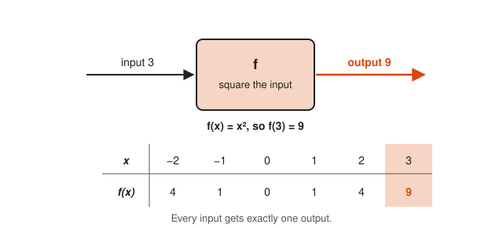

Read the table one column at a time: each x goes into the box and exactly one f(x) comes out.

<!-- diagram: type=function-graph f=x^2 range=-3..3 mark=3,9 caption="The table drawn as a graph" -->
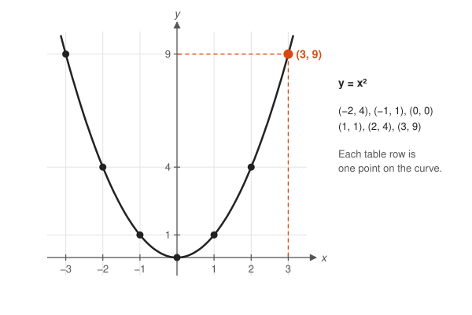

Match each dot to a column of the table: the graph is the whole table drawn at once.

**In the course:** [201 Algebra I and Geometry](../../course/201/README.md) and [301 Algebra II, Trig and Precalculus](../../course/301/README.md)

#### 2. Average Rate of Change

The average rate of change between two points is the slope of the straight line joining them: change in output over change in input. If a counter goes from 1,000 to 7,000 requests in 60 s, the average rate is 100 requests per second. This is the secant slope in the signature diagram.

**Key idea:** $\dfrac{f(b) - f(a)}{b - a}$

<!-- diagram: type=secant f=counter t=0..60 values=1000..7000 slope=100 caption="Average rate as a secant slope" -->
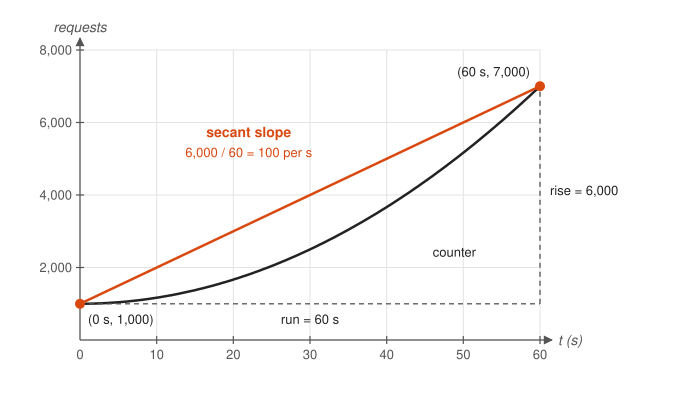

Ignore the bend in the black curve: the orange line uses only the two end points, and its slope is the average rate.

**In the course:** [201 Algebra I and Geometry](../../course/201/README.md)

#### 3. Limits

A **limit** asks what value $f(x)$ approaches as $x$ gets close to a target, without caring what happens at the target itself. Limits let you talk about an instant even though a rate needs two points. They are also how calculus handles infinity without breaking arithmetic.

**Key idea:** $\lim_{x \to 2} \dfrac{x^2 - 4}{x - 2} = \lim_{x \to 2} (x + 2) = 4$

<!-- diagram: type=limit-hole f=(x^2-4)/(x-2) a=2 L=4 caption="A limit at a hole" -->
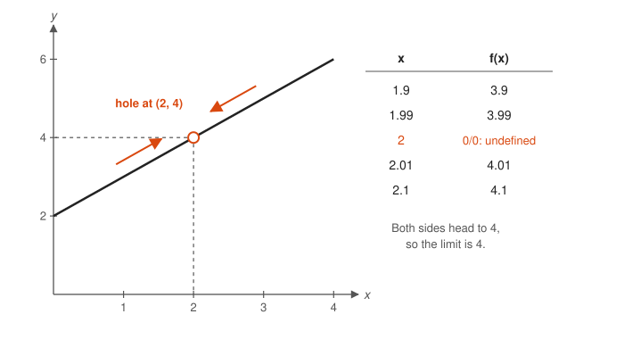

Look at the hollow circle: the function has no value at x = 2, yet both sides of the line head straight to height 4.

<!-- diagram: type=number-lines map=x+2 near=2 caption="Inputs near 2 send outputs near 4" -->
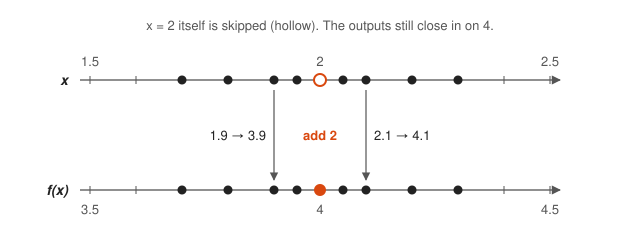

Squeeze the inputs toward the hollow 2 on the top line and watch the outputs squeeze toward 4 on the bottom line.

**In the course:** [401 Calculus](../../course/401/README.md)

### Intermediate

#### 4. The Derivative

The **derivative** is the limit of average rates of change as the interval shrinks to zero. Geometrically, it is the slope of the tangent line. Physically, it is instantaneous speed when $f$ is position, or instantaneous request rate when $f$ is a counter.

**Key idea:** $f'(x) = \lim_{h \to 0} \dfrac{f(x + h) - f(x)}{h}$

<!-- diagram: type=secants-to-tangent f=x^2 x=1 h=1,0.5,0.25 caption="Secants closing in on the tangent" -->

Follow the gray lines as h shrinks: they swing down toward the orange tangent, and their slopes 3, 2.5, 2.25 head to 2.

<!-- diagram: type=zoom f=x^2 x=1 windows=1,0.25,0.05 caption="Zooming in makes a smooth curve look straight" -->

Move from left to right: each zoom makes the curve look straighter, until it matches its tangent line.

**In the course:** [401 Calculus](../../course/401/README.md)

#### 5. Riemann Sums

To find the area under a curve, slice it into thin rectangles, add their areas, and take the limit as the slices get thinner. That limit is the **definite integral**. It is how you turn a rate graph into a total: bytes per second, summed over time, gives bytes.

**Key idea:** $\int_a^b f(x)\,dx = \lim_{n \to \infty} \sum_{i=1}^{n} f(x_i)\,\Delta x$

<!-- diagram: type=riemann f=x^2 range=0..2 n=4,8,16 rule=left caption="Left Riemann sums with 4, 8 and 16 rectangles" -->

Look at the gaps between the rectangles and the curve: they shrink as the slices get thinner.

<!-- diagram: type=bar-convergence n=4,8,16,32,64 target=8/3 caption="Riemann sums approach the integral" -->
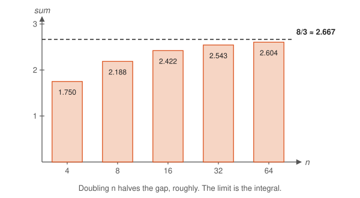

Watch the bar tops climb toward the dashed line: the limit of the sums is the integral.

**In the course:** [401 Calculus](../../course/401/README.md)

#### 6. Derivative Rules

Nobody computes limits by hand every time. A handful of rules cover nearly every function: the power rule, the product rule, the quotient rule, and the **chain rule** for functions inside functions. The chain rule is also the engine of backpropagation in neural networks.

**Key idea:** $(x^n)' = nx^{n-1}$, $(fg)' = f'g + fg'$, $(f(g(x)))' = f'(g(x))\,g'(x)$

<!-- diagram: type=chain-boxes inner=3x+1 outer=u^2 x=1 caption="The chain rule as two machines in a row" -->
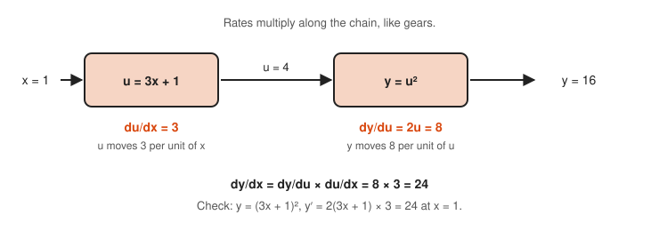

Multiply the two orange rates: a change in x passes through both boxes, so the rates multiply.

<!-- diagram: type=product-area f=4 g=3 df=0.5 dg=0.5 caption="The product rule as a growing rectangle" -->

Look at the two orange strips: they are the product rule, and the gray corner is too small to matter.

**In the course:** [401 Calculus](../../course/401/README.md)

#### 7. Optimization and Related Rates

At the top of a hill or the bottom of a valley, the tangent line is flat, so the derivative is zero. Set $f'(x) = 0$ to find the best value of anything you can write as a function: least material, most area, lowest cost. Related rates use the chain rule to link how fast connected quantities change, like the water level and the volume in a filling tank.

**Key idea:** at a smooth maximum or minimum, $f'(x) = 0$.

<!-- diagram: type=optimization f=w(20-w) max=10,100 caption="The best rectangle sits where the slope is zero" -->

Find the flat orange line at the top: the best rectangle sits where the slope is zero, and it is a square.

<!-- diagram: type=derivative-sign f=20-2w zero=10 caption="The sign of the derivative around the maximum" -->
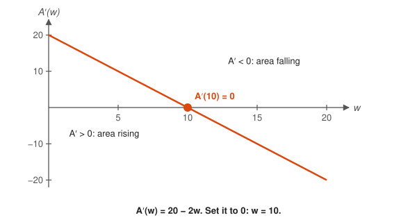

Watch where the line crosses zero: the area rises before w = 10 and falls after it, so w = 10 is the top.

**In the course:** [401 Calculus](../../course/401/README.md)

#### 8. The Fundamental Theorem of Calculus

Integration and differentiation undo each other. To find the area under $f$ from $a$ to $b$, find any function $F$ whose derivative is $f$, then subtract. This turns a sum of infinitely many rectangles into one subtraction.

**Key idea:** if $F' = f$, then $\int_a^b f(x)\,dx = F(b) - F(a)$

<!-- diagram: type=ftc f=t^2 F=x^3/3 a=1 b=2 caption="Area equals a difference of the antiderivative" -->
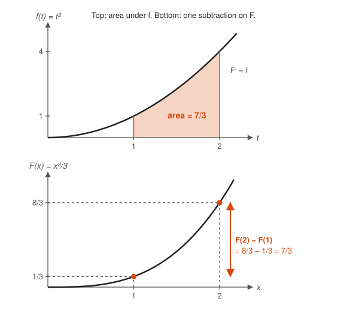

Compare the two panels: the shaded area on top equals the height difference on the bottom.

<!-- diagram: type=accumulation f=1+0.3t^2 x=1.8 h=0.3 caption="The area-so-far function grows at rate f" -->

Focus on the orange strip: the new area is about height times width, so the area grows at rate f(x).

**In the course:** [401 Calculus](../../course/401/README.md)

### Advanced

#### 9. Taylor Series

Near a point, any smooth function looks like a polynomial. A **Taylor series** builds that polynomial from the derivatives at the point, one term per derivative. Your computer evaluates $\sin x$ and $e^x$ with short polynomial approximations of exactly this kind.

**Key idea:** $e^x = 1 + x + \dfrac{x^2}{2!} + \dfrac{x^3}{3!} + \cdots$

<!-- diagram: type=taylor f=e^x degrees=1,2,3 range=-2..2 caption="Taylor polynomials of e to the x" -->

Start at the orange dot at (0, 1) and move outward: each extra term keeps the polynomial on the curve for longer.

<!-- diagram: type=partial-sums series=e x=1 terms=5 caption="Partial sums of the series for e" -->
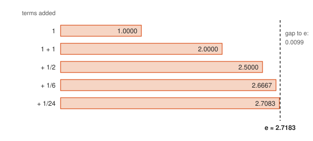

Watch the bars approach the dashed line: each new term adds less, and the sum closes in on e.

**In the course:** [401 Calculus](../../course/401/README.md)

#### 10. Partial Derivatives

When a function depends on several inputs, a **partial derivative** measures change in one input while holding the others fixed. Collect all the partials into a vector and you get the **gradient**, which points uphill. Gradient descent, the training loop of machine learning, walks the other way.

**Key idea:** $\nabla f = \left(\dfrac{\partial f}{\partial x}, \dfrac{\partial f}{\partial y}\right)$

<!-- diagram: type=contour f=x^2+2y^2 levels=1..6 point=1,1 caption="Contours and the gradient" -->

Look at the arrow at the orange dot: it points straight across the ovals toward higher values, never along them.

<!-- diagram: type=partial-slices f=x^2+2y^2 point=1,1 caption="Partial derivatives as slopes of slices" -->
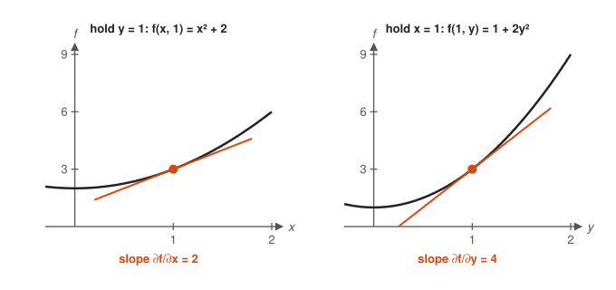

Compare the orange tangents: each partial derivative is an ordinary slope once the other input is frozen.

**In the course:** [401 Calculus](../../course/401/README.md)

#### 11. Integration Techniques

Finding an antiderivative is harder than finding a derivative, the way factoring is harder than multiplying. Substitution reverses the chain rule and integration by parts reverses the product rule. When no formula exists, numerical methods (like the rectangles in the diagram, refined) give the answer to any precision.

**Key idea:** $\int u\,dv = uv - \int v\,du$

<!-- diagram: type=by-parts-area u=1..2 v=u^2 caption="Integration by parts as an area picture" -->

Add the orange and gray regions: together they make the big rectangle minus the small corner, which is the formula.

**In the course:** [401 Calculus](../../course/401/README.md)

#### 12. Differential Equations

A **differential equation** describes a quantity by its rate of change. The simplest one, "the growth rate is proportional to the size," has exponential solutions and models compound interest, unchecked load growth, and radioactive decay. Most laws of physics are differential equations.

**Key idea:** $y' = ky \Rightarrow y = y_0 e^{kt}$

<!-- diagram: type=slope-field f=0.5y range=t:0..4,y:-3..5 solutions=2,1,0.5,0,-0.5,-1 caption="Slope field for y prime = 0.5 y" -->

Trace any orange curve with a finger: it always runs parallel to the gray dashes it crosses.

<!-- diagram: type=exponential-doubling k=0.5 doubling=1.386 caption="Exponential growth doubles at a fixed pace" -->
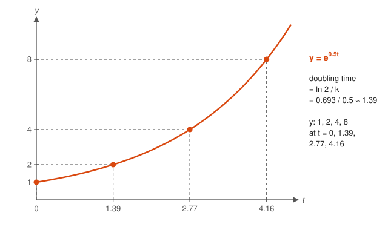

Check the dashed guides: equal steps in time double the value each time, which is the mark of exponential growth.

**In the course:** [401 Calculus](../../course/401/README.md) · **Go further:** [Differential Equations track](../differential-equations/README.md)

#### 13. Real Analysis

Calculus was used for 150 years before anyone defined a limit precisely. **Real analysis** rebuilds calculus on exact definitions, such as the epsilon-delta definition of a limit, and proves why the rules work. It is where you learn which functions and series behave, and which ones only look like they do.

**Key idea:** $\lim_{x \to a} f(x) = L$ means for every $\varepsilon > 0$ there is a $\delta > 0$ with $0 < |x - a| < \delta \Rightarrow |f(x) - L| < \varepsilon$.

<!-- diagram: type=epsilon-delta f=x^2 a=2 L=4 eps=1 delta=0.236 caption="The epsilon-delta picture" -->

Check the overlap box: every point of the curve inside the gray band also sits inside the orange band.

<!-- diagram: type=epsilon-delta f=x^2 a=2 L=4 eps=1,0.5 delta=0.236,0.121 caption="Smaller epsilon needs smaller delta" -->
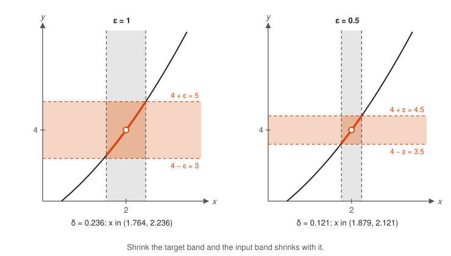

Compare the two panels: a stricter target for the output forces a narrower window for the input.

**In the course:** [601 Proof and Higher Math](../../course/601/README.md) · **Go further:** [Real Analysis track](../real-analysis/README.md)

## Big Theorems to Know

* **Fundamental theorem of calculus:** $\frac{d}{dx}\int_a^x f(t)\,dt = f(x)$, and $\int_a^b f(x)\,dx = F(b) - F(a)$ for any antiderivative $F$.
* **Intermediate value theorem:** a continuous function that starts below a value and ends above it crosses that value somewhere in between.
* **Extreme value theorem:** a continuous function on a closed interval has a highest and a lowest value.
* **Mean value theorem:** on a smooth stretch, some point has an instantaneous rate equal to the average rate. If your average speed was 60 km/h, at some instant you were going exactly 60 km/h.
* **Chain rule:** $(f \circ g)' = (f' \circ g) \cdot g'$.
* **Taylor's theorem:** a smooth function equals its Taylor polynomial plus a remainder you can bound.
* **L'Hôpital's rule:** for a $\frac{0}{0}$ limit, $\lim \frac{f}{g} = \lim \frac{f'}{g'}$ when the right side exists.

## Open Problems and Fun Facts

* **Two inventors:** Newton and Leibniz developed calculus independently in the late 1600s and spent years in a bitter priority dispute. We still use the notation of Leibniz ($\frac{dy}{dx}$ and $\int$) because it is better.
* **Gabriel's horn:** rotate $y = \frac{1}{x}$ for $x \ge 1$ around the $x$-axis. The horn has finite volume, $\pi$, but infinite surface area. You can fill it with paint but never paint its inside surface.
* **The Basel problem:** $1 + \frac{1}{4} + \frac{1}{9} + \frac{1}{16} + \cdots = \frac{\pi^2}{6}$. Euler solved it in 1734, and nobody expected $\pi$ to appear.
* **The harmonic series diverges:** $1 + \frac{1}{2} + \frac{1}{3} + \cdots$ grows without limit, though very slowly. You need more than 12,000 terms to pass 10.
* **Open problem:** is the Euler–Mascheroni constant $\gamma \approx 0.5772$, the limit of $\left(1 + \frac{1}{2} + \cdots + \frac{1}{n}\right) - \ln n$, a fraction? Nobody knows, though if it were, its denominator is known to be astronomically large.

## Starter Problem Set

1. Find $\lim_{x \to 3} \dfrac{x^2 - 9}{x - 3}$.
2. Differentiate $f(x) = 4x^3 - 2x + 7$.
3. Differentiate $g(x) = (3x + 1)^5$.
4. Compute $\int_0^2 x^2\,dx$.
5. You have 40 m of fence to enclose a rectangle. What dimensions give the largest area, and what is that area?

Answers

1. $6$. Factor: $\frac{(x - 3)(x + 3)}{x - 3} = x + 3$ for $x \ne 3$, which approaches $6$.
2. $f'(x) = 12x^2 - 2$, by the power rule term by term.
3. $g'(x) = 15(3x + 1)^4$, by the chain rule: $5(3x + 1)^4 \cdot 3$.
4. $\frac{8}{3}$, because $\left[\frac{x^3}{3}\right]_0^2 = \frac{8}{3} - 0$.
5. A 10 m by 10 m square with area 100 m². With width $w$, the length is $20 - w$, so $A = w(20 - w)$. Then $A' = 20 - 2w = 0$ gives $w = 10$.

## Go Deeper

* [Paul's Online Notes: Calculus I](https://tutorial.math.lamar.edu/Classes/CalcI/CalcI.aspx): the classic free notes, clear and full of worked examples.
* [Better Explained: A Gentle Introduction to Learning Calculus](https://betterexplained.com/articles/a-gentle-introduction-to-learning-calculus/): intuition before formulas.
* [OpenStax Calculus Volume 1](https://openstax.org/details/books/calculus-volume-1): a free full textbook (Volumes 2 and 3 continue the story).
* [MIT OpenCourseWare 18.01 Single Variable Calculus](https://ocw.mit.edu/courses/18-01sc-single-variable-calculus-fall-2010/): full lectures, notes and problem sets.
* [MacTutor: Newton](https://mathshistory.st-andrews.ac.uk/Biographies/Newton/): the life of one of the two inventors.

## Related Tracks and Workshops

* Before: [Algebra track](../algebra/README.md) and [Trigonometry track](../trigonometry/README.md).
* Next: [Differential Equations track](../differential-equations/README.md), [Real Analysis track](../real-analysis/README.md), [Linear Algebra track](../linear-algebra/README.md).
* Applied: [Calculus of Rates in Physics and Queues](../../workshops/calculus-of-rates-in-physics-and-queues/README.md) and [Exponential Growth in Interest, Epidemics and Load](../../workshops/exponential-growth-in-interest-epidemics-and-load/README.md).
