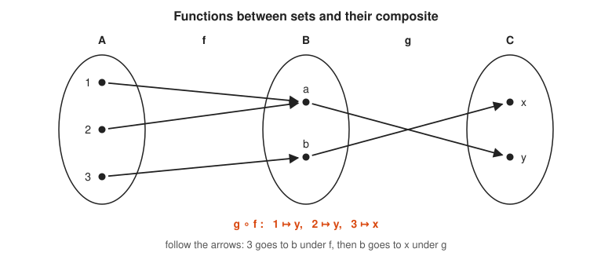

# Category Theory Track

**Track:** Category Theory · **Span:** beginner to advanced · **Course levels:** [501 Linear Algebra, Probability and Discrete Math](../../course/501/README.md) (sets and functions), [601 Proof and Higher Math](../../course/601/README.md) (abstract algebra)
**Prerequisites:** what a set is and what a function is. The [Logic and Set Theory Track](../logic-and-set-theory/README.md) covers both. Comfort with Go generics helps from rung 6 on. The [Abstract Algebra Track](../abstract-algebra/README.md) supplies extra examples, but nothing here depends on it.
**Files:** this README, [cards.tsv](cards.tsv) for Anki, [code/main.go](code/main.go), and the diagrams in [img/](img/).

## What the Field Studies

A **category** is a collection of dots and arrows with one rule: arrows that meet end to start combine into a new arrow. The dots are **objects**. The arrows are **morphisms**, or just arrows. Each arrow starts at one object, its **source**, and ends at one object, its **target**.

Category theory does not ask what is inside the objects. It asks how the arrows connect. That one shift turns out to describe sets and functions, Go types and funcs, Unix commands, groups, spaces, and logic with the same small vocabulary. Mathematicians call it the mathematics of mathematics. Programmers call it the reason `Map`, `(value, error)` and pipes all feel alike.

## Why It Matters

You already compose arrows for a living:

* **Unix pipes:** `cat app.log | grep ERROR | sort | uniq` is four arrows glued end to start. The pipe symbol is composition.
* **Go funcs:** a func from `int` to `string` is an arrow. Calling `g(f(x))` composes two arrows.
* **Generic containers:** `Map` over a slice, an option or a channel follows the same two laws every time. That shape is a **functor**.
* **Error handling:** the `if err != nil { return }` ladder is the bind of a **monad**, a pattern for chaining steps that can fail.
* **API design:** structs are **products**, tagged unions are **coproducts**. Knowing the universal property tells you what a good constructor or a good `switch` looks like.
* **Refactoring safety:** a **commuting diagram** states that two different code paths give the same answer. That is exactly what a refactor promises and what a property test checks.

## Concept Map

<!-- diagram: type=concept-map tiers=beginner,intermediate,advanced nodes=12 caption="Category theory concepts with prerequisite arrows" -->


Read the map top to bottom. An arrow from A to B means learn A first. Start at the orange box.

## Signature Diagram

<!-- diagram: type=commuting-square nodes=A,B,C,D arrows=f:A-B,g:B-D,h:A-C,k:C-D diagonal=A-D caption="A commuting square: two paths, one answer" -->


This square is the sentence category theory says most often. There are two roads from A to D. The diagram **commutes** when both roads give the same result for every input: $g \circ f = k \circ h$. Every law in this track, from functors to monads, is a picture like this one. A refactor that keeps behavior is a commuting square too, which is the most practical thing anyone ever said about abstract nonsense.

## The Concept Ladder

### Beginner

#### 1. Objects and Arrows

Picture a map of towns joined by one-way roads. The towns are objects. The roads are arrows. A road has a start town and an end town, and you travel it in one direction only. Two towns have any number of roads between them, including none.

Now the Go version. Types such as `int`, `string` and `bool` are objects. A func with one input, such as `strconv.Itoa` from `int` to `string`, is an arrow. We write $f : A \to B$ for an arrow $f$ with source $A$ and target $B$.

$$f : A \to B \qquad \text{read: } f \text{ goes from } A \text{ to } B$$

<!-- diagram: type=two-panel left=directed-graph nodes=A,B,C,D right=type-graph nodes=int,string,bool caption="Objects and arrows: towns and roads, Go types and funcs" -->


Nothing here asks what an `int` holds. Only the arrows matter. That is the whole point of view of the field.

Related: [Graph Theory Track](../graph-theory/README.md), since the picture so far is a directed graph.

#### 2. Composition

If $f : A \to B$ and $g : B \to C$, the arrows meet at $B$. Then there is an arrow $g \circ f : A \to C$, read "g after f". In Go it is `g(f(x))`. The order looks backward at first: $g \circ f$ runs $f$ first. It matches how the code nests.

$$(g \circ f)(x) = g(f(x))$$

<!-- diagram: type=composition-triangle nodes=int,int,string arrows=inc,strconv.Itoa extra=pipe:cat,grep,sort,uniq caption="Composition: g after f, and a Unix pipe" -->


A Unix pipe is composition written left to right. `cat | grep | sort` means sort after grep after cat. Arrows only compose when the end of one matches the start of the next. Pipes enforce this by passing bytes everywhere, which is why they compose so freely.

In the course: [501 Linear Algebra, Probability and Discrete Math](../../course/501/README.md) for function composition.

#### 3. Identity and the Laws

Every object $A$ has an **identity arrow** $\mathrm{id}_A$ that does nothing. In Go it is `func(x A) A { return x }`. In a shell it is `cat` with no file, which passes its input through. A category needs exactly two laws:

$$f \circ \mathrm{id}_A = f = \mathrm{id}_B \circ f \qquad h \circ (g \circ f) = (h \circ g) \circ f$$

<!-- diagram: type=two-panel left=identity-loops right=associativity-chain nodes=A,B,C,D caption="Identity arrows and associativity" -->


The first law says doing nothing changes nothing, like adding 0. The second, **associativity**, says brackets do not matter. Grouping `(a | b) | c` or `a | (b | c)` gives the same pipe.

That is the full definition. A **category** is objects, arrows with a source and a target, composition of matching arrows, and an identity on each object, obeying these two laws.

#### 4. Sets and Functions: The Main Example

The category **Set** has every set as an object and every function between sets as an arrow. Composition is ordinary function composition. The identity sends each element to itself. Most intuition in this track comes from Set, because you draw it with dots and arrows.

$$\mathbf{Set}: \quad \text{objects} = \text{sets}, \quad \text{arrows} = \text{functions}$$

<!-- diagram: type=set-functions sets=A:{1,2,3},B:{a,b},C:{x,y} f=1:a,2:a,3:b g=a:y,b:x caption="Functions between sets and their composite" -->


Go types and funcs look like Set, with honest caveats. A real Go func can panic, loop forever, read the clock or change a global. Go also cannot test two funcs for equality. If you stick to pure funcs that always return, Go types behave like a category. Haskell programmers make the same polite assumption about their own language and call the result Hask.

In the course: [Logic and Set Theory Track](../logic-and-set-theory/README.md) for sets and functions.

### Intermediate

#### 5. Isomorphisms

An arrow $f : A \to B$ is an **isomorphism** when some arrow $g : B \to A$ undoes it in both directions. Then $A$ and $B$ are **isomorphic**: the same shape with different labels. In Set, an isomorphism is a **bijection**, a perfect one-to-one pairing.

$$g \circ f = \mathrm{id}_A \quad \text{and} \quad f \circ g = \mathrm{id}_B$$

<!-- diagram: type=two-panel left=bijection A=bool B={0,1} right=non-injective A={1,2,3} B={a,b} caption="An isomorphism and a non-isomorphism" -->


Category theory treats isomorphic objects as interchangeable. A `bool` and a one-bit field carry the same information. Three things cannot pair perfectly with two. No function from a 3-element set to a 2-element set is an isomorphism.

Related: [Abstract Algebra Track](../abstract-algebra/README.md), where isomorphic groups are "the same group".

#### 6. Functors

A **functor** $F$ maps one category into another. It sends each object $A$ to an object $F(A)$ and each arrow $f : A \to B$ to an arrow $F(f) : F(A) \to F(B)$. It must keep identities and composition intact:

$$F(\mathrm{id}_A) = \mathrm{id}_{F(A)} \qquad F(g \circ f) = F(g) \circ F(f)$$

<!-- diagram: type=functor objects=int,string images=[]int,[]string arrows=dbl,itoa caption="A functor maps types to slice types and funcs to Map" -->


In Go, "slice of" is a functor. It sends type `T` to `[]T` and func `f` to `Map(·, f)`, which applies `f` to every element. The laws say: mapping the do-nothing func does nothing, and mapping twice equals mapping once with the composed func. An option type, a channel, and a tree with values in its leaves are functors in the same way.

Related: [Topology Track](../topology/README.md), where functors from spaces to groups first earned their keep.

#### 7. Natural Transformations

Two functors $F$ and $G$ wrap the same types differently. A **natural transformation** $\alpha$ converts one wrapping into the other, with one component $\alpha_T : F(T) \to G(T)$ for every type $T$. It must not care what the values are. Formally, for every $f : A \to B$ the square commutes:

$$G(f) \circ \alpha_A = \alpha_B \circ F(f)$$

<!-- diagram: type=commuting-square nodes=[]int,[]string,Option[int],Option[string] top=Map(itoa) bottom=MapOpt(itoa) sides=First values=[7 8 9] caption="Naturality square for First" -->


The Go func `First[T any]([]T) Option[T]` is natural. Converting then taking the first element equals taking the first element then converting. Generic code that never inspects its values is natural automatically, a result called **parametricity**. Go breaks this with type switches: a generic func that peeks at `any(xs).([]int)` acts differently for `int`, and its square fails. The Code Corner shows one.

Eilenberg and Mac Lane invented categories in 1945 to define exactly this idea. Categories came first in the logic, but natural transformations came first in the motive.

#### 8. Products

The **product** of $A$ and $B$ is an object $A \times B$ with two arrows out, $\pi_1 : A \times B \to A$ and $\pi_2 : A \times B \to B$, called **projections**. Its defining property: for any $X$ with arrows $f : X \to A$ and $g : X \to B$, there is **exactly one** arrow $\langle f, g \rangle : X \to A \times B$ that makes both triangles commute.

$$\pi_1 \circ \langle f, g \rangle = f \qquad \pi_2 \circ \langle f, g \rangle = g$$

<!-- diagram: type=product-cone apex=X product=AxB legs=A,B arrows=f,g,pi1,pi2 unique=<f,g> caption="Product: the pair type and its projections" -->


In Set, the product is the set of ordered pairs, with $|A \times B| = |A| \cdot |B|$. In Go it is a struct with two fields. The projections are field access. The unique arrow is the obvious constructor: `func(x X) Pair[A, B] { return Pair[A, B]{f(x), g(x)} }`.

#### 9. Coproducts

Flip every arrow in the product picture and you get the **coproduct** $A + B$. It has two arrows in, $\mathrm{inl} : A \to A + B$ and $\mathrm{inr} : B \to A + B$, called **injections**. For any $f : A \to X$ and $g : B \to X$ there is exactly one $[f, g] : A + B \to X$ with:

$$[f, g] \circ \mathrm{inl} = f \qquad [f, g] \circ \mathrm{inr} = g$$

<!-- diagram: type=coproduct-cocone base=X coproduct=A+B legs=A,B arrows=inl,inr,f,g unique=[f,g] caption="Coproduct: the tagged union and case analysis" -->


In Set, the coproduct is the **disjoint union**: every element of $A$ and every element of $B$, tagged with which side it came from, with $|A + B| = |A| + |B|$. In Go the closest tools are an interface with a type switch, or a small tagged struct. The `(value, error)` return is a coproduct by convention: exactly one side is meaningful. The compiler does not enforce that, which is why `nil, nil` returns still surprise people at 3 a.m.

### Advanced

#### 10. Universal Properties

Products and coproducts share a recipe: describe an object purely by the arrows into or out of it, and demand exactly one arrow that fits. That recipe is a **universal property**. The simplest cases: a **terminal object** $1$ has exactly one arrow into it from every object. An **initial object** $0$ has exactly one arrow out of it to every object.

$$\text{for every } X: \quad \text{exactly one } X \to 1, \qquad \text{exactly one } 0 \to X$$

<!-- diagram: type=two-panel left=terminal sources={a,b,c},{p,q},{x} target={*} right=initial source=empty targets={a,b,c},{p,q},{x} caption="Terminal and initial objects in sets" -->


In Set, any one-element set is terminal: every element must go to the single target. The empty set is initial: the function from it has nothing to send, and there is exactly one way to send nothing. In Go, `struct{}` plays terminal. Go has no type with zero values. It lacks a true initial object. A universal property pins an object down **up to a unique isomorphism**: any two terminal objects are isomorphic in exactly one way. That is how category theory defines things without ever looking inside them.

#### 11. Currying and Adjunctions

A func of two inputs is the same information as a func of one input that returns a func of the other. This is **currying**, named after Haskell Curry. In categorical terms, arrows $A \times B \to C$ match arrows $A \to C^B$ one to one, where $C^B$ is the object of arrows from $B$ to $C$:

$$\mathrm{Hom}(A \times B,\ C) \;\cong\; \mathrm{Hom}(A,\ C^B)$$

<!-- diagram: type=currying table=2x3 values=0,1,1/1,0,1 caption="Currying: a two-input function as a function that returns a function" -->


$\mathrm{Hom}(X, Y)$ means the collection of arrows from $X$ to $Y$. Counting functions between finite sets checks the match: $|C|^{|A| \cdot |B|} = (|C|^{|B|})^{|A|}$, the old exponent rule in disguise. A pair of functors with this kind of one-to-one match between arrows is an **adjunction**. Here "pair with $B$" is **left adjoint** to "functions from $B$". Mac Lane summed up the field in one line: adjoint functors arise everywhere.

Related: [Linear Algebra Track](../linear-algebra/README.md), where the transpose of a matrix satisfies a similar matching rule.

#### 12. A Taste of Monads

A **monad** is a functor $M$ with two extra pieces. **Unit** wraps a plain value: `Some(v)`, or `return v, nil`. **Bind** feeds a wrapped value into a step that itself returns a wrapped value, and skips the step when there is nothing to feed. Chaining with bind is called **Kleisli composition**: arrows $A \to M(B)$ and $B \to M(C)$ compose into $A \to M(C)$.

$$\text{unit}(a) \gg\!= f = f(a), \qquad m \gg\!= \text{unit} = m, \qquad (m \gg\!= f) \gg\!= g = m \gg\!= (x \mapsto f(x) \gg\!= g)$$

<!-- diagram: type=railway steps=parse,positive,half input="42" output=21 error-track=err caption="Monad taster: chaining steps that can fail" -->


The three laws above say unit does nothing, and grouping of chained steps does not matter. They are the identity and associativity laws of rung 3 again, for Kleisli arrows. Option and `(T, error)` both form monads in this sense. So do lists (each step returns many results), state (each step reads and updates a value), and IO. Every adjunction produces a monad. The currying adjunction of rung 11 produces the state monad. Monad tutorials have compared monads to burritos. This track declines to.

Related: [Abstract Algebra Track](../abstract-algebra/README.md). The famous one-line definition says a monad is a monoid in a category of functors, which explains everything once you no longer need the explanation.

## Worked Examples

### Example 1: Composition Order Matters

Let `inc(x) = x + 1` and `dbl(x) = 2x`. Compute both compositions at 3.

```txt
  (dbl o inc)(3) = dbl(inc(3))              definition: run inc first
                 = dbl(4)                   inc(3) = 3 + 1
                 = 8                        dbl(4) = 2 x 4
  (inc o dbl)(3) = inc(dbl(3))              definition: run dbl first
                 = inc(6)                   dbl(3) = 2 x 3
                 = 7                        inc(6) = 6 + 1
  8 != 7: dbl o inc != inc o dbl            composition is not commutative
```

Order matters for pipes too. `sort | uniq` removes duplicates. `uniq | sort` only removes neighbors that happen to match.

### Example 2: Check the Functor Law on a Slice

Check $\mathrm{Map}(\mathrm{dbl} \circ \mathrm{inc}) = \mathrm{Map}(\mathrm{dbl}) \circ \mathrm{Map}(\mathrm{inc})$ on `[1 2 3]`.

```txt
  left side:
  (dbl o inc)(1) = dbl(2) = 4                    compose, then apply
  (dbl o inc)(2) = dbl(3) = 6
  (dbl o inc)(3) = dbl(4) = 8
  Map(dbl o inc)([1 2 3]) = [4 6 8]              one pass
  right side:
  Map(inc)([1 2 3]) = [2 3 4]                    first pass
  Map(dbl)([2 3 4]) = [4 6 8]                    second pass
  [4 6 8] = [4 6 8]                              the law holds here
```

Compilers and query planners use this law to fuse two passes over data into one, called loop fusion.

### Example 3: Walk the Naturality Square for First

Use the square in rung 7 with `xs = [7 8 9]` and `f = strconv.Itoa`.

```txt
  right then down:
  Map(xs, itoa) = ["7" "8" "9"]                  convert every element
  First(["7" "8" "9"]) = Some("7")               take the first
  down then right:
  First([7 8 9]) = Some(7)                       take the first
  MapOpt(Some(7), itoa) = Some("7")              convert the one value
  both paths give Some("7")                      the square commutes
  empty case: First([]) = None, MapOpt(None) = None   commutes too
```

### Example 4: Count Arrows into a Product

Take sets with $|X| = 2$, $|A| = 2$, $|B| = 3$. The universal property says arrows $X \to A \times B$ match pairs of arrows $(X \to A,\ X \to B)$ one to one.

```txt
  |A x B| = 2 x 3 = 6                            pairs (a, b)
  arrows X -> A x B = 6^2 = 36                   each of 2 inputs picks 1 of 6
  arrows X -> A = 2^2 = 4                        each input picks 1 of 2
  arrows X -> B = 3^2 = 9                        each input picks 1 of 3
  pairs of arrows = 4 x 9 = 36                   multiply the choices
  36 = 36                                        the counts match
```

The Code Corner builds all 36 pairs and confirms they give 36 different arrows, not merely the same count.

## Big Theorems to Know

* **Identities Are Unique:** if $e$ and $e'$ both act as identities on $A$, then $e = e \circ e' = e'$.
* **Inverses Are Unique:** an isomorphism has exactly one inverse.
* **Functors Keep Isomorphisms:** if $f$ is an isomorphism, then $F(f)$ is one too, with inverse $F(f^{-1})$.
* **Uniqueness of Universal Objects:** two products of $A$ and $B$, or two terminal objects, are isomorphic by exactly one isomorphism that respects the structure.
* **Duality:** reverse every arrow in a true statement and you get another true statement. Products become coproducts. Terminal becomes initial. Every theorem comes with a free twin.
* **Yoneda Lemma:** an object is determined, up to isomorphism, by the arrows into it. You know a thing by how everything else connects to it.
* **Parametricity (Wadler, 1989, "Theorems for Free"):** in a language without type inspection, every generic function between functors is a natural transformation.
* **Adjunctions Give Monads:** every adjunction produces a monad, and every monad arises from some adjunction.
* **Right Adjoints Keep Limits:** a right adjoint carries products to products. The function-object functor $(-)^B$ does this: $(A \times C)^B \cong A^B \times C^B$.

## Open Problems and Fun Facts

* **Origin:** Samuel Eilenberg and Saunders Mac Lane introduced categories, functors and natural transformations in a 1945 paper. Mac Lane said he took "category" from Aristotle and Kant and "functor" from the philosopher Rudolf Carnap.
* **Abstract nonsense:** the field was nicknamed "general abstract nonsense", a phrase often credited to Norman Steenrod. Mathematicians now use it with affection, mostly.
* **Monads in programming:** Eugenio Moggi used monads to model side effects around 1989 to 1991. Philip Wadler brought them to Haskell, where they became the standard way to do IO in a pure language.
* **A one-object category is a monoid:** take a single object and let the arrows be strings, with concatenation as composition and the empty string as identity. Unix filters on byte streams form such a category, with `cat` as the identity.
* **Applied category theory** is a growing research area. It uses string diagrams and composition to describe circuits, databases, chemistry and machine learning.
* **Open problem:** many competing definitions of higher categories exist, where arrows have arrows between them, and arrows between those. Proving that the definitions agree is active research.

## Starter Problems

1. Let $f(x) = x + 1$ and $g(x) = 3x$. Find $(g \circ f)(2)$ and $(f \circ g)(2)$.
2. How many functions are there from a 3-element set to a 2-element set?
3. Is `func(s string) int { return len(s) }` an isomorphism from `string` to `int`? Why or why not?
4. Let $A = \{a, b\}$ and $B = \{0, 1, 2\}$. How many elements are in $A \times B$? In $A + B$?
5. Is `Last[T any]([]T) Option[T]`, which returns the last element, a natural transformation? Check the square on `[1 2 3]` with `dbl`.
6. How many functions go from $\{a, b\}$ to a one-element set? From the empty set to $\{a, b\}$? From $\{a, b\}$ to the empty set?
7. Using `Then(Then(parse, positive), half)` from the Code Corner, what comes out for `"10"`, `"0"` and `"9"`?

<details>
<summary>Answers</summary>

1. $(g \circ f)(2) = g(3) = 9$ and $(f \circ g)(2) = f(6) = 7$. Different orders give different arrows.
2. 8. Each of 3 inputs picks one of 2 outputs: $2^3 = 8$.
3. No. `"ab"` and `"cd"` both map to 2. No inverse can recover the string. Also no string has length $-1$.
4. $|A \times B| = 2 \cdot 3 = 6$ and $|A + B| = 2 + 3 = 5$.
5. Yes. `Last(Map([1 2 3], dbl)) = Last([2 4 6]) = Some(6)` and `MapOpt(Last([1 2 3]), dbl) = MapOpt(Some(3), dbl) = Some(6)`. It never inspects the values. The square commutes for every input.
6. One, since every element must go to the single target. One, the empty function. Zero, since $a$ has nowhere to go.
7. `"10"` gives 5. `"0"` gives the error `not positive`. `"9"` gives the error `9 is odd`.

</details>

## Code Corner

[code/main.go](code/main.go) composes funcs and checks the identity and associativity laws, builds a pipe of `grep`, `sort` and `uniq`, checks the functor laws for slices and options, walks the naturality square for `First` (and catches a generic func that breaks it), builds products and coproducts, counts arrows between small finite sets by brute force, and chains steps that fail with a monad. Run it with `go run main.go` inside `code/`.

```txt
== Composition ==
dbl after inc, at 3: 8
inc after dbl, at 3: 7
identity laws hold on -5..5: true
associativity holds on -5..5: true

== Pipes are composition ==
grep ERROR | sort | uniq -> ["ERROR disk full" "ERROR timeout"]
(a|b)|c equals a|(b|c): true

== Functors ==
Map(dbl) over [1 2 3] -> [2 4 6]
Map(dbl after inc) = [4 6 8]  Map(dbl) after Map(inc) = [4 6 8]
Map(id) leaves [1 2 3] as [1 2 3]
MapOpt(dbl) on Some(5): Some(10)  on None: None

== Natural transformation First: []T -> Option[T] ==
[7 8 9]  First(Map) = Some("7")  Map(First) = Some("7")  square commutes: true
[42]     First(Map) = Some("42") Map(First) = Some("42") square commutes: true
[]       First(Map) = None       Map(First) = None       square commutes: true
Sneaky on [7 8 9]: Sneaky(Map) = Some("7"), Map(Sneaky) = None -> not natural

== Product and coproduct ==
Fanout(itoa, isEven)(6) = {"6" true}; Fst = "6", Snd = true
number 42
error: timeout

== Counting arrows between finite sets ==
functions 2 -> 3: 9  functions 3 -> 2: 8
functions to a 1-element set from a 4-element set: 1
functions from the empty set to a 5-element set: 1
product:   36 pairs (f, g) -> 36 distinct X -> AxB, of 36 total
coproduct: 32 pairs (f, g) -> 32 distinct A+B -> X, of 32 total
currying:  functions AxB -> C = 64, functions A -> (B -> C) = 64

== Monad taster ==
"42"  -> 21
"7"   -> error: 7 is odd
"-4"  -> error: not positive
"abc" -> error: strconv.Atoi: parsing "abc": invalid syntax
Some(40) >>= half >>= half >>= half: Some(5)
one more half on 5: None
monad laws on samples: left identity true right identity true associativity true
```

Note the `Sneaky` line. It has the same type signature as `First`, compiles fine, and still fails the square, because it peeks at the type. The type checker does not test naturality. The diagram does.

## Flashcards

[cards.tsv](cards.tsv) holds the key definitions and laws for Anki import.

## Resources

* [Bartosz Milewski: Category Theory for Programmers](https://bartoszmilewski.com/2014/10/28/category-theory-for-programmers-the-preface/): a free blog-book for working programmers, from composition to monads.
* [Tom Leinster: Basic Category Theory](https://arxiv.org/abs/1612.09375): a short, clear, free textbook for the advanced rungs.
* [Brendan Fong and David Spivak: Seven Sketches in Compositionality](https://arxiv.org/abs/1803.05316): a free applied introduction with databases, circuits and pictures.
* [MIT OCW 18.S097 Applied Category Theory](https://ocw.mit.edu/courses/18-s097-applied-category-theory-january-iap-2019/): lecture videos that follow Seven Sketches.
* [Wolfram MathWorld: Category](https://mathworld.wolfram.com/Category.html): the compact formal definition with related links.
* [MacTutor: Saunders Mac Lane](https://mathshistory.st-andrews.ac.uk/Biographies/MacLane/): the life of one of the two founders.

## Where to Go Next

* [Abstract Algebra Track](../abstract-algebra/README.md) for groups and rings, the categories where the theory was born.
* [Topology Track](../topology/README.md) for the spaces and continuous maps that first needed functors.
* [Logic and Set Theory Track](../logic-and-set-theory/README.md) for the sets and functions under the main example.
* [Graph Theory Track](../graph-theory/README.md) for directed graphs, which become categories once you add composition.
* [Graph Theory for Networks and Dependencies](../../workshops/graph-theory-for-networks-and-dependencies/README.md) to see composition of dependencies in real systems.
