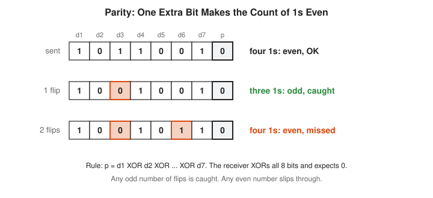
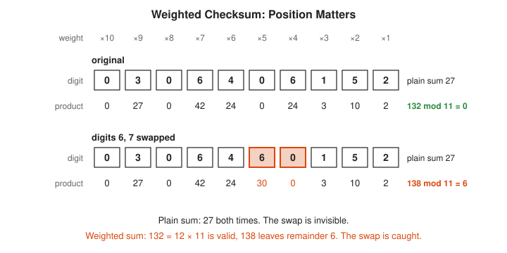
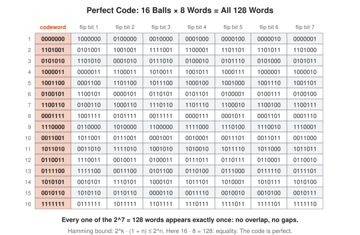
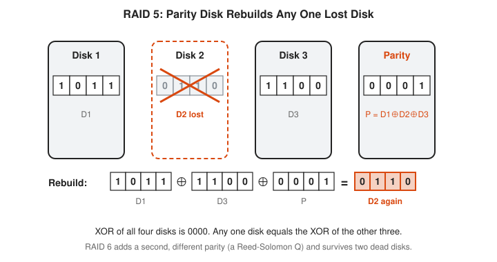

# Coding Theory Track

**Track:** Coding Theory · **Span:** beginner to advanced · **Course levels:** [501 Linear Algebra, Probability and Discrete Math](../../course/501/README.md) (probability, matrices), [601 Proof and Higher Math](../../course/601/README.md) (modular arithmetic, fields)
**Prerequisites:** binary numbers and the XOR operation. XOR compares two bits and returns 1 when they differ: $0 \oplus 0 = 0$, $0 \oplus 1 = 1$, $1 \oplus 1 = 0$. That is enough to start. Later rungs borrow from the [Information Theory Track](../information-theory/README.md), the [Probability Track](../probability/README.md), the [Number Theory Track](../number-theory/README.md) and the finite fields of the [Abstract Algebra Track](../abstract-algebra/README.md#11-finite-fields).
**Files:** this README, [cards.tsv](cards.tsv) for Anki, [code/main.go](code/main.go), and the diagrams in [img/](img/).

## What the Field Studies

Data gets damaged. A cosmic ray flips a bit in RAM. A scratch removes part of a disc. A disk dies. A packet arrives with noise in it.

Coding theory adds **redundancy**, extra symbols computed from the data, in a careful way. The receiver uses the extra symbols to **detect** damage (notice that something is wrong) or to **correct** it (put the right data back). The field asks one question: how do you get the most protection for the fewest extra bits?

The [Information Theory Track](../information-theory/README.md) proves that good codes exist. This track builds them.

## Why It Matters

You lean on this track every day, mostly without noticing:

* **Checksums and CRCs:** every Ethernet frame, ZIP file, PNG image and gzip stream carries a CRC-32. A mismatch means the bytes changed in transit or at rest.
* **ECC memory:** server RAM stores extra check bits per word and repairs single-bit flips silently. The code is a close relative of Hamming (7,4).
* **RAID:** RAID 5 keeps one parity disk and rebuilds any one dead disk. RAID 6 keeps two and survives two.
* **Object storage:** large stores split each object into data and parity fragments with Reed-Solomon codes. Backblaze, for example, stores 17 data shards and 3 parity shards, and any 17 of the 20 rebuild the file.
* **Radio and links:** Wi-Fi, 5G, satellite TV and SSD controllers use LDPC codes. QR codes and CDs use Reed-Solomon codes.
* **Durability math:** the probability of losing data under a storage scheme is a binomial tail, the same calculation as an error budget.

## Concept Map

<!-- diagram: type=concept-map tiers=beginner,intermediate,advanced nodes=12 caption="Coding theory concepts with prerequisite arrows" -->


Read the map top to bottom. An arrow from A to B means learn A first. Start at the orange box.

## Signature Diagram

<!-- diagram: type=packing-balls codewords=6 radius=t caption="Codewords spread apart with decoding balls of radius t" -->


This picture is the whole field. A **codeword** is one of the legal messages a code allows. Pick codewords that sit far apart. Noise nudges a sent codeword a little. If every codeword owns a private ball of radius $t$, a nudged word still sits inside the right ball, and the receiver snaps it back to the center. Bigger balls mean more errors corrected. Fewer, larger balls mean fewer messages fit. Every code is a trade between those two.

## The Concept Ladder

### Beginner

#### 1. Redundancy and Repetition Codes

The simplest code: send each bit three times. The receiver takes a **majority vote**. One flipped copy gets outvoted. Two flipped copies win the vote and the bit comes out wrong.

The cost is the **rate**, the share of sent bits that carry data. Repeating 3 times gives rate $1/3$. With each bit flipped with probability $p$, the vote fails when 2 or 3 copies flip:

$$P(\text{wrong}) = 3p^2(1 - p) + p^3, \qquad p = 0.1 \implies 0.028$$

<!-- diagram: type=bit-rows code=repeat3 cases=0,1,2 chart=log-bars n=1,3,5,7 caption="Repetition code majority vote and its error rate" -->


Repetition works, but it is expensive. Seven copies cut errors by a factor of about 37 and cost seven times the bandwidth. The rest of the track finds cheaper ways to buy the same safety.

In the course: [501 Common Distributions](../../course/501/07-common-distributions/README.md) for the binomial count of flips.

#### 2. Parity Bits

A **parity bit** is one extra bit chosen to make the number of 1s even. The receiver XORs every bit it got. A result of 0 means "looks fine". A result of 1 means "something flipped".

$$p = d_1 \oplus d_2 \oplus \cdots \oplus d_k$$

<!-- diagram: type=bit-rows data=1011001 parity=0 flips=3;3,6 caption="Even parity catches one flip and misses two" -->


One parity bit detects any odd number of flips and misses any even number. It cannot say *which* bit flipped. Still, it costs only one bit, and it is the seed of almost everything that follows. RAID 5 is a parity bit stretched across disks.

#### 3. Checksums

A **checksum** is a short number computed from a block of data and sent along with it. The receiver recomputes it. A mismatch means damage. A plain sum misses a whole class of errors: swapping two digits leaves the sum unchanged. A **weighted** sum fixes that, because each position gets a different multiplier.

The ISBN-10 on old books uses weights 10 down to 1 and requires

$$\sum_{i=1}^{10} (11 - i)\, d_i \equiv 0 \pmod{11}$$

<!-- diagram: type=digit-table isbn=0306406152 swap=6,7 weights=10..1 caption="Weighted checksum catches a swap a plain sum misses" -->


The prime 11 matters. Because 11 is prime, the weighted check catches every single wrong digit and every swap of two neighbors. A CRC (rung 8) is the industrial version of the same idea.

In the course: [601 Modular Arithmetic and Fermat](../../course/601/08-modular-arithmetic-and-fermat/README.md).

#### 4. Hamming Distance

The **Hamming distance** $d(a, b)$ between two words of equal length is the number of positions where they differ. It counts the fewest bit flips that turn one word into the other. The **minimum distance** $d$ of a code is the smallest distance between two different codewords.

$$\text{detects up to } d - 1 \text{ errors}, \qquad \text{corrects up to } \left\lfloor \frac{d - 1}{2} \right\rfloor \text{ errors}$$

<!-- diagram: type=hypercube dim=3 codewords=000,111 compare=10110,11100 caption="Hamming distance on the 3-bit cube" -->


Why these rules? To turn one codeword into another takes $d$ flips. Fewer than $d$ flips cannot land on a legal word, which means the receiver notices. For correction, picture the signature diagram: balls of radius $t$ around codewords stay apart when $d \ge 2t + 1$.

### Intermediate

#### 5. Linear Codes and the Generator Matrix

Treat bits as numbers where $1 + 1 = 0$. This tiny number system is called $GF(2)$: addition is XOR and multiplication is AND. A **linear code** is a code where the XOR of any two codewords is again a codeword. Every linear code has a **generator matrix** $G$: the codeword for data $\mathbf{d}$ is $\mathbf{d}G$, which means "XOR together the rows of $G$ picked by the 1s in the data".

$$\mathbf{c} = \mathbf{d}\,G, \qquad G = \begin{pmatrix} 1&1&1&0&0&0&0 \\ 1&0&0&1&1&0&0 \\ 0&1&0&1&0&1&0 \\ 1&1&0&1&0&0&1 \end{pmatrix}$$

<!-- diagram: type=matrix-encode G=hamming74 data=1101 result=1010101 caption="Encoding 1101 by XORing generator rows" -->


Linearity buys a shortcut. The distance between two codewords equals the number of 1s in their XOR, which is itself a codeword. The minimum distance is therefore the fewest 1s in any nonzero codeword. For Hamming (7,4) that is 3, and the code program checks all 16 codewords to confirm it.

In the course: [501 Matrices as Transformations](../../course/501/10-matrices-as-transformations/README.md). See also the [Linear Algebra Track](../linear-algebra/README.md).

#### 6. Hamming (7,4) and Syndrome Decoding

The [Information Theory Track](../information-theory/README.md#9-error-correcting-codes) draws Hamming (7,4) as three circles. Here is the matrix view, which scales. The **parity-check matrix** $H$ has a 0 product with every codeword: $H\mathbf{c} = \mathbf{0}$. For Hamming (7,4), column $j$ of $H$ is simply the number $j$ written in binary.

If one bit at position $j$ flips, the receiver computes the **syndrome** $\mathbf{s} = H\mathbf{r}$ and gets column $j$. The syndrome spells out the bad position in binary.

$$\mathbf{s} = H\mathbf{r} = H(\mathbf{c} + \mathbf{e}_j) = H\mathbf{e}_j = \text{column } j$$

<!-- diagram: type=matrix-syndrome H=hamming74 received=1010111 error=6 caption="Syndrome names the bad position" -->


A handy shortcut falls out: the syndrome equals the XOR of the position numbers of all the 1 bits. Syndrome 0 means no error. ECC memory uses the same trick on 64-bit words with 8 check bits: 7 for the syndrome and 1 overall parity bit that detects double errors.

In the course: [501 Solving Systems: Gaussian Elimination](../../course/501/11-solving-systems-gaussian-elimination/README.md).

#### 7. Perfect Codes and the Limits

How good can a code be? Count. Each codeword of length $n$ that corrects $t$ errors owns a ball of words. For $t = 1$ the ball holds the codeword plus its $n$ one-flip neighbors. The balls cannot overlap, and they all fit in the $2^n$ possible words. This is the **Hamming bound**. A code that meets it with equality wastes nothing and is called **perfect**.

$$2^k \cdot (1 + n) \le 2^n \qquad \text{Hamming (7,4): } 16 \cdot 8 = 128 = 2^7$$

<!-- diagram: type=grid rows=16 cols=8 code=hamming74 caption="All 128 seven-bit words split into 16 balls of 8" -->


A second limit, the **Singleton bound**, says $d \le n - k + 1$: to survive many errors you must pay in check symbols. Codes that meet it exactly are called **MDS** (maximum distance separable). Reed-Solomon codes in rung 10 are MDS, which is why storage systems love them.

In the course: [501 Counting](../../course/501/03-counting/README.md). See also the [Combinatorics Track](../combinatorics/README.md).

#### 8. CRC: Polynomial Division

A **cyclic redundancy check** treats a bit string as a polynomial with 0 or 1 coefficients: `1011` means $x^3 + x + 1$. Pick a fixed **generator polynomial** $g(x)$ of degree $r$. Append $r$ zeros to the message, divide by $g(x)$ using XOR instead of subtraction, and send the $r$-bit remainder along with the message. The receiver divides the whole thing and expects remainder 0.

$$\text{sent}(x) = m(x)\,x^r + \big(m(x)\,x^r \bmod g(x)\big)$$

<!-- diagram: type=long-division dividend=110101000 divisor=1011 remainder=111 caption="CRC long division over GF(2)" -->


A CRC with $r$ check bits catches every burst of errors no longer than $r$ bits, which is the common failure on real wires. CRC-32 runs in Ethernet, gzip, PNG and the Go package `hash/crc32`. It is a detector only. It tells you to resend, not what to fix. It is also not a security check: anyone can forge data with a matching CRC. Use a cryptographic hash for that.

In the course: [301 Polynomials and Complex Numbers](../../course/301/02-polynomials-and-complex-numbers/README.md).

### Advanced

#### 9. Finite Fields

Stronger codes need arithmetic on symbols bigger than one bit, where you can add, subtract, multiply and *divide* without fractions. A **finite field** is a finite set of numbers with all four operations. The integers mod a prime $p$ form one, written $GF(p)$. Mod 7 works. Mod 8 fails, because $2 \cdot 4 = 0$ and 2 has no inverse.

$$a \cdot a^{-1} \equiv 1 \pmod 7: \quad 1 \cdot 1,\ 2 \cdot 4,\ 3 \cdot 5,\ 6 \cdot 6$$

<!-- diagram: type=mult-table mod=7 highlight=1 caption="Multiplication table mod 7 with inverse pairs" -->


Computers want 256 symbols, one per byte, and 256 is not prime. The fix is $GF(2^8)$: treat a byte as a polynomial with bit coefficients, add with XOR, and multiply modulo a fixed polynomial of degree 8 that does not factor. Every nonzero byte then has an inverse. AES encryption, RAID 6 and QR codes all compute in this field.

In the course: [601 Groups, Rings and Fields](../../course/601/11-groups-rings-and-fields/README.md). See also the [Abstract Algebra Track](../abstract-algebra/README.md#11-finite-fields).

#### 10. Reed-Solomon Codes

Two points fix a line. Three points fix a parabola. In general, $k$ points fix a polynomial of degree less than $k$. **Reed-Solomon** codes turn that fact into a code: treat the $k$ data symbols as the coefficients of a polynomial $f$, then send its values at $n$ different points. Any $k$ surviving values rebuild $f$ and with it the data.

$$f(x) = d_0 + d_1 x + \cdots + d_{k-1}x^{k-1}, \qquad \text{send } f(0), f(1), \ldots, f(n - 1)$$

<!-- diagram: type=function-plot f="3+2x" points=0..5 kept=2,5 table=gf7 caption="Reed-Solomon: data defines a polynomial, shares are its points" -->


An **erasure** is a lost symbol whose position you know, such as a dead disk. Reed-Solomon survives any $n - k$ erasures, which is the most any code allows (the Singleton bound). It also corrects up to $(n - k)/2$ errors at unknown positions. Real codes work in $GF(2^8)$ instead of the real numbers, which keeps every share exactly one byte.

#### 11. Erasure Coding in Storage

Storage systems lose whole pieces, not random bits: a disk, a node, a rack. That makes storage an erasure problem. **RAID 5** XORs the data disks into one parity disk. **RAID 6** adds a second parity computed in $GF(2^8)$ and survives two failures. Large object stores use Reed-Solomon $k + m$: $k$ data fragments plus $m$ parity fragments, any $k$ of which rebuild the object.

$$\text{overhead} = \frac{k + m}{k}, \qquad P(\text{loss}) = \sum_{j = m + 1}^{k + m} \binom{k + m}{j} q^j (1 - q)^{k + m - j}$$

<!-- diagram: type=disk-stripe disks=D1,D2,D3,P bits=1011,0110,1100,0001 lost=D2 caption="RAID 5 rebuild with XOR" -->


<!-- diagram: type=scatter x=overhead y=losses-survived points=6 table=p-loss caption="Storage schemes: cost versus losses survived" -->


The scatter plot is the sales pitch. RS 10+4 stores less than half the bytes of triple replication and is about five times less likely to lose data under this simple model. The price is repair traffic: rebuilding one lost fragment reads $k$ others. The model assumes independent losses. Real failures cluster by rack, batch and firmware, which is why placement across failure domains matters as much as the code.

In the course: [501 Probability Basics](../../course/501/04-probability-basics/README.md). See also the workshop [Probability for On-Call Error Budgets and SLOs](../../workshops/probability-for-on-call-error-budgets-and-slos/README.md).

#### 12. LDPC and Fountain Codes

Reed-Solomon decoding gets slow for very long blocks. **LDPC** (low-density parity-check) codes take the opposite approach: thousands of bits, each parity check touching only a few of them. Draw the bits and checks as a **Tanner graph**, a two-row picture with an edge wherever a check uses a bit. Decoding passes messages along the edges. For erasures it reduces to **peeling**: find a check with only one unknown bit, solve it, repeat.

A **fountain code** sends an endless stream of symbols, each the XOR of a random handful of source blocks. The receiver collects any $k$ plus a few, in any order, and peels. No resend requests needed. That suits broadcast, where a sender cannot listen to every receiver.

$$\text{random linear fountain: } P(\text{stuck after } k + E \text{ symbols}) \le 2^{-E}$$

<!-- diagram: type=tanner-graph sources=4 checks=5 peel-order=1,2,4,3 caption="Peeling decoder on a Tanner graph" -->


<!-- diagram: type=bar-chart x=extra-symbols y=percent trials=2000 k=32 caption="Extra symbols a random linear fountain needs" -->


Robert Gallager invented LDPC codes in his 1960 thesis. Computers of the day were too slow to decode them, and the idea slept for 30 years until David MacKay and others rediscovered it. LDPC codes now come close to the Shannon limit and run in Wi-Fi, 5G and satellite TV. Practical fountain codes such as LT and Raptor codes use sparse random XORs to keep peeling fast.

## Worked Examples

### Example 1: Encode and Repair with Hamming (7,4)

Positions 1 to 7 hold `p1 p2 d1 p3 d2 d3 d4`. Send data `1101`. Noise flips bit 6.

```txt
  d1 d2 d3 d4 = 1 1 0 1                                 data
  c = row1 xor row2 xor row4 of G                       pick rows where data bit is 1
    = 1110000 xor 1001100 xor 1101001                   rows of G
    = 1010101                                           XOR column by column
  check: ones at positions 1, 3, 5, 7                   read the codeword
         1 xor 3 xor 5 xor 7 = 0                        valid codewords give syndrome 0
  r = 1010111                                           bit 6 flipped in transit
  ones at positions 1, 3, 5, 6, 7                       read the received word
  s = 1 xor 3 xor 5 xor 6 xor 7                         syndrome shortcut
    = 2 xor 5 xor 6 xor 7 = 7 xor 6 xor 7 = 6           XOR left to right
  flip bit 6 -> 1010101                                 repaired, data 1101 again
```

### Example 2: Compute a CRC by Hand

Message `110101`, generator `1011` ($x^3 + x + 1$, degree 3).

```txt
  110101000                                             append 3 zeros (degree 3)
  1011                                                  XOR at column 0
  011001000                                             result
   1011                                                 XOR at column 1
  001111000                                             result
    1011                                                XOR at column 2
  000100000                                             result
     1011                                               XOR at column 3
  000001100                                             result
       1011                                             XOR at column 5 (column 4 is 0)
  000000111                                             remainder = last 3 bits = 111
  send 110101 111                                       message + remainder
  divide 110101111 by 1011 -> remainder 000             receiver check passes
```

### Example 3: Rebuild a Dead RAID 5 Disk

Three data disks and one parity disk store one 4-bit stripe each. Disk 2 dies.

```txt
  D1 = 1011, D2 = 0110, D3 = 1100                       data stripes
  P  = D1 xor D2 xor D3                                 parity rule
     = 1101 xor 1100 = 0001                             1011 xor 0110 = 1101 first
  D1 xor D2 xor D3 xor P = 0000                         every column has an even count of 1s
  D2 = D1 xor D3 xor P                                  XOR both sides with D1, D3, P
     = 1011 xor 1100 xor 0001                           surviving disks
     = 0111 xor 0001 = 0110                             matches the lost disk
```

### Example 4: Recover Reed-Solomon Data from Two Shares

Data $(3, 2)$ is the polynomial $f(x) = 3 + 2x$ over $GF(7)$. Six shares $f(0), \ldots, f(5)$ go to six disks. Only the shares at $x = 2$ and $x = 5$ survive, with values 0 and 6.

```txt
  shares: f(0..5) = 3, 5, 0, 2, 4, 6                    3 + 2x mod 7
  kept: (2, 0) and (5, 6)                               four disks lost
  slope = (6 - 0) / (5 - 2) = 6 / 3                     rise over run
  3^-1 mod 7 = 5                                        because 3 x 5 = 15 = 1 mod 7
  slope = 6 x 5 = 30 = 2 mod 7                          divide = multiply by inverse
  intercept = 0 - 2 x 2 = -4 = 3 mod 7                  f(2) = intercept + slope x 2
  f(x) = 3 + 2x -> data (3, 2)                          recovered
```

## Big Theorems to Know

* **Distance Theorem:** a code with minimum distance $d$ detects up to $d - 1$ errors and corrects up to $\lfloor (d - 1)/2 \rfloor$.
* **Hamming Bound (1950):** a binary code correcting $t$ errors satisfies $2^k \sum_{i=0}^{t} \binom{n}{i} \le 2^n$. Codes meeting it are perfect.
* **Classification of Perfect Codes (Tietavainen and van Lint, 1973):** the only nontrivial perfect binary codes are the Hamming codes, the binary Golay code of length 23, and odd-length repetition codes.
* **Singleton Bound:** $d \le n - k + 1$. Reed-Solomon codes meet it, which makes them MDS.
* **Gilbert-Varshamov Bound:** good codes exist with rate at least $1 - H(d/n)$, where $H$ is the binary entropy function.
* **Polynomial Interpolation:** over any field, $k$ points with different $x$ values determine exactly one polynomial of degree less than $k$. Reed-Solomon codes and Shamir secret sharing rest on this.
* **CRC Burst Detection:** a CRC whose generator has degree $r$ and a nonzero constant term detects every burst error of length at most $r$.
* **Channel Coding Theorem (Shannon, 1948):** every rate below channel capacity is achievable with vanishing error. See the [Information Theory Track](../information-theory/README.md#10-the-channel-coding-theorem).

## Open Problems and Fun Facts

* **Born of irritation:** Richard Hamming ran jobs on a Bell Labs relay computer over weekends. When it detected an error it simply stopped, and he came back Monday to nothing. He asked why the machine did not fix the error itself, and published the answer in 1950.
* **Voyager:** the Voyager probes sent color images of Jupiter and Saturn protected by the extended binary Golay code, which corrects 3 errors in every 24-bit block.
* **Scratched discs:** the CD format layers two Reed-Solomon codes with interleaving and corrects bursts of about 3,500 bits, roughly 2.4 mm of track.
* **QR codes:** at the highest error-correction level, a QR code still scans with about 30% of it damaged or covered.
* **Open problem:** the MDS conjecture says an MDS code over a field with $q$ elements has length at most $q + 1$, apart from known exceptions. Simeon Ball proved it for prime $q$ in 2012. Other field sizes remain open.
* **Open problem:** nobody knows whether long binary codes can beat the Gilbert-Varshamov bound. A 1950s lower bound, still unbeaten for binary codes after 70 years, is either a deep truth or a long embarrassment.

## Starter Problems

1. A code repeats each bit 5 times and decodes by majority vote. How many flips per bit does it correct?
2. Find the even parity bit for `1100111`.
3. Find the Hamming distance between `1011101` and `1001001`.
4. A Hamming (7,4) receiver gets `0110111`. Which position flipped?
5. Compute the CRC remainder of message `1001` with generator `11` ($x + 1$). Which simpler code is this CRC?
6. Find $3^{-1} \bmod 7$, then compute $4 / 3$ in $GF(7)$.
7. A store uses Reed-Solomon 8+3. Find its storage overhead and how many lost fragments it survives. Compare with 3x replication.

<details>
<summary>Answers</summary>

1. 2 flips. With 5 copies the vote needs 3 matching, which means up to 2 bad copies get outvoted. The minimum distance is 5 and $\lfloor 4/2 \rfloor = 2$.
2. 1. The word has five 1s. One more makes the count even.
3. 2. They differ at positions 3 and 5.
4. Position 5. The 1s sit at positions 2, 3, 5, 6, 7, and $2 \oplus 3 \oplus 5 \oplus 6 \oplus 7 = 5$.
5. Remainder 0. Append one zero to get `10010`, then XOR `11` under the leftmost 1 three times: `10010` becomes `01010`, then `00110`, then `00000`. A CRC with generator $x + 1$ is the even parity bit, and `1001` already has an even number of 1s.
6. $3^{-1} = 5$, because $3 \cdot 5 = 15 \equiv 1$. Then $4 / 3 = 4 \cdot 5 = 20 \equiv 6 \pmod 7$. Check: $6 \cdot 3 = 18 \equiv 4$.
7. Overhead $11/8 = 1.375$, and it survives any 3 lost fragments. Triple replication costs 3x and survives only 2.

</details>

## Code Corner

[code/main.go](code/main.go) runs the whole track: repetition error rates, parity, ISBN and CRC-32 checksums, Hamming distance, the Hamming (7,4) matrices with an exhaustive single-error test, CRC long division, finite field arithmetic, Reed-Solomon erasure recovery over $GF(7)$, a RAID 5 rebuild, storage durability, a peeling decoder and a random fountain experiment. Run it with `go run main.go` inside `code/`.

```txt
== Repetition codes on a link that flips 1 bit in 10 ==
repeat 1 times: rate 1/1, wrong after majority vote 0.10000
repeat 3 times: rate 1/3, wrong after majority vote 0.02800
repeat 5 times: rate 1/5, wrong after majority vote 0.00856
repeat 7 times: rate 1/7, wrong after majority vote 0.00273

== Parity bit ==
data 1011001 parity 0 -> sent 10110010
1 flip  10010010 check 1 (odd: error caught)
2 flips 10010110 check 0 (even: error missed)

== Checksums ==
ISBN 0306406152: plain sum mod 10 = 7, weighted sum mod 11 = 0
ISBN 0306460152: plain sum mod 10 = 7, weighted sum mod 11 = 6
CRC-32 of "123456789" = CBF43926
CRC-32 of "123456798" = A5E838F1

== Hamming distance ==
d(10110, 11100) = 2
min distance 2: detects up to 1, corrects up to 0
min distance 3: detects up to 2, corrects up to 1
min distance 5: detects up to 4, corrects up to 2
min distance 7: detects up to 6, corrects up to 3

== Hamming (7,4) ==
generator rows (encodings of 1000, 0100, 0010, 0001):
  1110000
  1001100
  0101010
  1101001
parity-check H (column j is j in binary, low bit on top):
  1010101
  0110011
  0001111
16 codewords, smallest nonzero weight = 3 = minimum distance
single-error tests repaired: 112 of 112
sphere packing: 16 codewords x (1 + 7) words each = 128 = 2^7
data 1101 -> codeword 1010101
received  1010111 syndrome 110 = 6
repaired  1010101

== CRC by long division over GF(2) ==
dividend 110101000 (message + 3 zeros), divisor 1011
  XOR at column 0 -> 011001000
  XOR at column 1 -> 001111000
  XOR at column 2 -> 000100000
  XOR at column 3 -> 000001100
  XOR at column 5 -> 000000111
remainder 111 -> transmit 110101111
check: remainder of 110101111 is 000

== Finite fields ==
inverses mod 7: 1->1 2->4 3->5 4->2 5->3 6->6
GF(256): 0x53 * 0xCA = 0x01
GF(256): 0x57 * 0x83 = 0xC1

== Reed-Solomon over GF(7): k = 2, n = 6 ==
f(x) = 3 + 2x, shares at x = 0..5: [3 5 0 2 4 6]
keep only x=2 (0) and x=5 (6) -> recovered f(x) = 3 + 2x
k = 3: f(x) = 2 + 5x + x^2, shares [2 1 2 5 3 3], from x=1,3,4 -> [2 5 1]

== RAID 5 parity ==
D1 1011  D2 0110  D3 1100  P = D1^D2^D3 = 0001
disk 2 dies: D1^D3^P = 0110 (was 0110)

== Storage schemes, each piece lost with probability 0.01 ==
3x replication  overhead 3.00x  tolerates 2 lost  P(data loss) 1.00e-06
RAID 5 (4+1)    overhead 1.25x  tolerates 1 lost  P(data loss) 9.80e-04
RAID 6 (4+2)    overhead 1.50x  tolerates 2 lost  P(data loss) 1.96e-05
RS 6+3          overhead 1.50x  tolerates 3 lost  P(data loss) 1.21e-06
RS 10+4         overhead 1.40x  tolerates 4 lost  P(data loss) 1.86e-07
RS 17+3         overhead 1.18x  tolerates 3 lost  P(data loss) 4.26e-05

== Peeling decoder (erasure LDPC / LT style) ==
symbol over [0] has one unknown -> s1 = 1010
symbol over [0 1] has one unknown -> s2 = 0111
symbol over [1 3] has one unknown -> s4 = 0001
symbol over [1 2 3] has one unknown -> s3 = 1100
recovered 4 of 4 sources

== Random linear fountain, k = 32 source blocks ==
average extra symbols needed: 1.63
  needed k+0   28.2%
  needed k+1   27.8%
  needed k+2   21.2%
  needed k+3   10.6%
  needed k+4    6.2%
  needed k+5+   6.2%
```

Two lines deserve a second look. The CRC-32 of `123456789` is `CBF43926`, the standard check value every CRC-32 implementation must reproduce. Swapping the last two digits changes all 32 bits of the result. And the fountain experiment matches theory: a random square matrix over $GF(2)$ has full rank about 29% of the time, and each extra symbol roughly halves the chance of still being stuck.

## Flashcards

[cards.tsv](cards.tsv) holds the key definitions and theorems for Anki import.

## Resources

* [MacTutor: Richard Hamming](https://mathshistory.st-andrews.ac.uk/Biographies/Hamming/): the life of the man who started the field, including the 1950 paper.
* [Guruswami, Rudra and Sudan: Essential Coding Theory](https://cse.buffalo.edu/faculty/atri/courses/coding-theory/book/): a free university textbook from Hamming distance to Reed-Solomon and beyond.
* [David MacKay: Information Theory, Inference, and Learning Algorithms](https://www.inference.org.uk/mackay/itila/): a free classic with clear chapters on Hamming codes, LDPC codes and fountain codes.
* [Wolfram MathWorld: Hamming Code](https://mathworld.wolfram.com/HammingCode.html): the formal definition with related links.
* [MIT OCW 6.02 Digital Communication Systems](https://ocw.mit.edu/courses/6-02-introduction-to-eecs-ii-digital-communication-systems-fall-2012/): lecture notes on error detection and correction for real links.
* [Backblaze: Reed-Solomon Erasure Coding](https://www.backblaze.com/blog/reed-solomon/): a plain-language account of the 17+3 scheme a real storage company runs.

## Where to Go Next

* [Information Theory Track](../information-theory/README.md) for channel capacity, the speed limit every code here chases.
* [Abstract Algebra Track](../abstract-algebra/README.md) for groups, rings and the finite fields inside Reed-Solomon and RAID 6.
* [Number Theory Track](../number-theory/README.md) for modular arithmetic and inverses mod a prime.
* [Probability Track](../probability/README.md) for the binomial tails behind durability numbers.
* [Number Theory for Cryptography](../../workshops/number-theory-for-cryptography/README.md) for where error correction ends and authentication begins.
