# Combinatorics

**Track:** Combinatorics · **Span:** the product rule to Ramsey theory · **Main course level:** [501 Linear Algebra, Probability and Discrete Math](../../course/501/README.md)

## What This Field Studies

Combinatorics is the art of counting without listing. How many ways can you order a deck of cards? How many 3-person on-call rotations can a team of 10 form? How many paths cross a grid? The answers are often far too large to enumerate, so combinatorics finds clever ways to count them: multiply independent choices, divide out what you counted twice, and subtract what you should not have counted at all.

It also asks a second kind of question: does a structure with some property have to exist? The pigeonhole principle and Ramsey theory say that in any large enough system, some order is unavoidable.

## Why It Matters

Counting is how you size things before you build or break them. A keyspace of $62^{12}$ passwords, a test matrix of $3 \times 4 \times 5$ OS, browser and region combinations, a canary rollout that picks 5 of 200 hosts, the chance that two of 10,000 request IDs collide: each is a counting problem. Probability, which runs error budgets and A/B tests, is counting divided by counting.

## Concept Map

<!-- diagram: type=concept-map bands=beginner,intermediate,advanced nodes=sum-product,permutations,pigeonhole,combinations,stars-bars,inclusion-exclusion,pascal,binomial,derangements,catalan,generating-functions,ramsey,polya caption="Combinatorics concepts with prerequisite arrows" -->
![Concept map of combinatorics in three bands. Beginner: the sum and product rules lead to permutations and factorials, to the pigeonhole principle, and to inclusion-exclusion. Intermediate: permutations lead to combinations, which lead to stars and bars and to Pascal's triangle. Pascal's triangle leads to the binomial theorem. Inclusion-exclusion leads to derangements. Advanced: Pascal's triangle leads to recurrences and Catalan numbers. The binomial theorem and stars and bars lead to generating functions, which lead to counting with symmetry. Pigeonhole leads to Ramsey theory. Combinations and generating functions are highlighted as milestones.](img/concept-map.svg)

An arrow from A to B means learn A before B. The milestones are combinations (the workhorse formula of the whole field) and generating functions (the power tool that turns counting into algebra).

## Signature Diagram

<!-- diagram: type=pascal rows=0..7 highlight=4:1,4:2->5:2 rowsums=true caption="Pascal's triangle rows 0 to 7 with 4 + 6 = 10 highlighted and row sums 2^n" -->

**Pascal's triangle** is the map of the whole field. Row $n$, position $k$ (both counted from 0) is $\binom{n}{k}$, the number of ways to choose $k$ things from $n$. Each entry is the sum of the two above it, because a choice of $k$ items from $n$ either includes the last item or does not. The rows are the coefficients of $(a + b)^n$. Each row sums to $2^n$, the number of subsets of an $n$-element set. Shallow diagonals sum to Fibonacci numbers. Almost every idea on the ladder below is hiding somewhere in this triangle.

## The Concept Ladder

### Beginner

#### 1. Sum and Product Rules

If a task is one choice from $m$ options **or** one from $n$ different options, there are $m + n$ ways. If it is a choice from $m$ options **and then** a choice from $n$ options, there are $m \cdot n$ ways. Draw the choices as a tree: the product rule counts the leaves.

**Key idea:** 3 shirts and 4 pants give $3 \cdot 4 = 12$ outfits.

<!-- diagram: type=tree levels=3,4 caption="Outfit tree: 3 shirts times 4 pants" -->
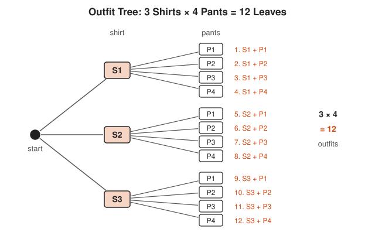

Each shirt branch grows the same 4 pants leaves, so the leaf count is 3 copies of 4.

<!-- diagram: type=grid rows=3 cols=4 caption="AND multiplies, OR adds" -->
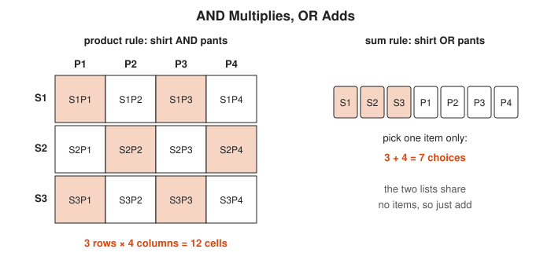

The grid answers shirt AND pants with 12 cells, and the row answers shirt OR pants with 7 items.

**In the course:** [501 Linear Algebra, Probability and Discrete Math](../../course/501/README.md)

#### 2. Permutations and Factorials

A **permutation** is an ordering. Line up $n$ different items: $n$ choices for first place, $n - 1$ for second, and so on. That product is $n!$ (read "$n$ factorial"). Ordering only $k$ of the $n$ items stops the product early.

**Key idea:** $n! = n(n-1)\cdots 1$ and $P(n, k) = \dfrac{n!}{(n-k)!}$

<!-- diagram: type=slots n=5 k=5,3 caption="Filling slots: 5! and P(5, 3)" -->
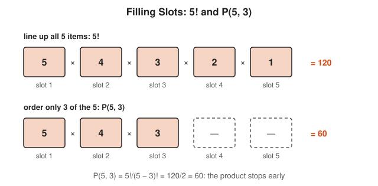

Each slot has one fewer choice than the slot before it, and $P(5, 3)$ simply stops after three slots.

<!-- diagram: type=tree levels=3,2,1 caption="All 6 orderings of A, B, C" -->
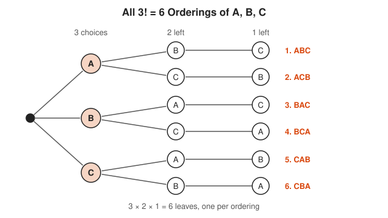

The branching shrinks from 3 to 2 to 1, which is $3! = 3 \cdot 2 \cdot 1 = 6$.

**In the course:** [501 Linear Algebra, Probability and Discrete Math](../../course/501/README.md)

#### 3. The Pigeonhole Principle

Put $n + 1$ pigeons in $n$ holes, and some hole gets two. This is the reason every hash table needs a collision strategy: there are more possible keys than buckets. Simple as it is, it proves existence without finding the example.

**Key idea:** $N$ items in $k$ boxes force some box to hold at least $\lceil N/k \rceil$.

<!-- diagram: type=hash keys=5 buckets=4 caption="5 keys, 4 buckets: a collision is forced" -->
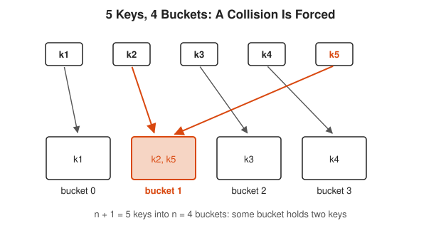

However the arrows go, 5 keys into 4 buckets always put two keys in one bucket.

<!-- diagram: type=pigeonhole items=9 boxes=4 caption="9 keys in 4 buckets force a bucket with 3" -->
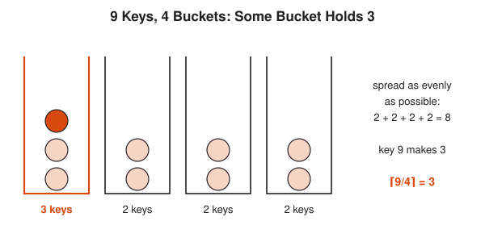

Even the most even spread leaves one bucket with $\lceil 9/4 \rceil = 3$ keys.

**In the course:** [501 Linear Algebra, Probability and Discrete Math](../../course/501/README.md)

### Intermediate

#### 4. Combinations

A **combination** is a choice where order does not matter. Count the ordered choices, then divide by the $k!$ orderings of each chosen group, since each group was counted $k!$ times. Read $\binom{n}{k}$ as "$n$ choose $k$."

**Key idea:** $\dbinom{n}{k} = \dfrac{n!}{k!\,(n-k)!}$, so $\dbinom{10}{3} = \dfrac{10 \cdot 9 \cdot 8}{3 \cdot 2 \cdot 1} = 120$.

<!-- diagram: type=grouping ordered=6 group=ABC caption="Six orderings collapse to one group" -->
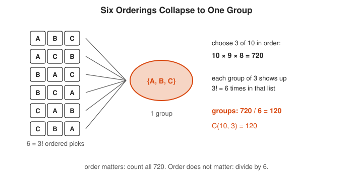

Six ordered lists become one unordered group, so dividing the 720 ordered picks by 6 counts the groups.

**In the course:** [501 Linear Algebra, Probability and Discrete Math](../../course/501/README.md)

#### 5. Stars and Bars

How many ways can you split 10 identical requests among 3 servers? Write the requests as 10 stars and separate them with 2 bars. Every arrangement of 12 symbols is one split. Choose the 2 bar positions out of 12.

**Key idea:** $n$ identical items into $k$ bins: $\dbinom{n + k - 1}{k - 1}$. Here $\dbinom{12}{2} = 66$.

<!-- diagram: type=stars-bars n=10 k=3 examples=3-5-2,0-10-0,4-0-6 caption="Stars and bars for 10 requests and 3 servers" -->
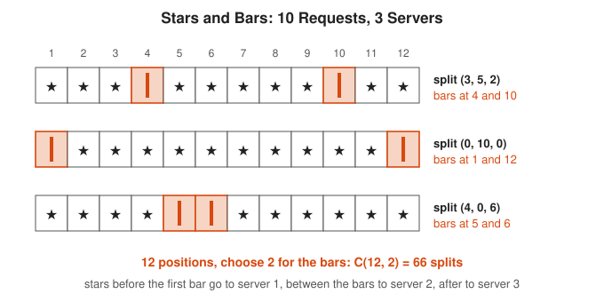

Pick any 2 of the 12 positions for the bars and the stars fall into place, so each split is one choice of 2 positions.

<!-- diagram: type=bars x=0..10 values=11..1 caption="Counting the 66 splits by server 1 load" -->
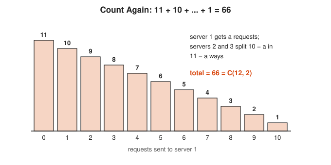

Adding the bar heights gives 66 again, a second route to the same answer.

**In the course:** [501 Linear Algebra, Probability and Discrete Math](../../course/501/README.md)

#### 6. Inclusion-Exclusion

To count things in $A$ or $B$, add both counts, then subtract the overlap you counted twice. With three sets, add the three, subtract the three pairwise overlaps, then add back the triple overlap. The signs alternate as the overlaps get deeper.

**Key idea:** $|A \cup B| = |A| + |B| - |A \cap B|$

<!-- diagram: type=venn universe=1..100 A=div2:50 B=div5:20 AB=10 caption="Inclusion-exclusion for 1 to 100" -->

The 10 in the shaded overlap sits inside both circles, so adding 50 and 20 counts it twice.

<!-- diagram: type=grid n=1..100 cols=10 marks=div2,div5 caption="1 to 100 on a 10 by 10 grid" -->

Column 10 is both even and a multiple of 5, which is the overlap that inclusion-exclusion subtracts once.

**In the course:** [501 Linear Algebra, Probability and Discrete Math](../../course/501/README.md) · **See also:** [Logic and Set Theory track](../logic-and-set-theory/README.md)

#### 7. Pascal's Triangle

Each entry is the sum of the two above it. This is **Pascal's rule**, and it gives a way to compute $\binom{n}{k}$ with only additions, which is exactly the dynamic-programming table you would write in Go. The triangle is symmetric because choosing $k$ to keep is the same as choosing $n - k$ to leave out.

**Key idea:** $\dbinom{n}{k} = \dbinom{n-1}{k-1} + \dbinom{n-1}{k}$ and $\dbinom{n}{k} = \dbinom{n}{n-k}$

<!-- diagram: type=pascal-rule n=5 k=2 caption="C(5, 2) = C(4, 1) + C(4, 2)" -->

Ask each team one question, whether it contains 5, and the two answers split the count into the two numbers above it in the triangle.

<!-- diagram: type=pascal-row n=6 caption="Row 6 reads the same both ways" -->
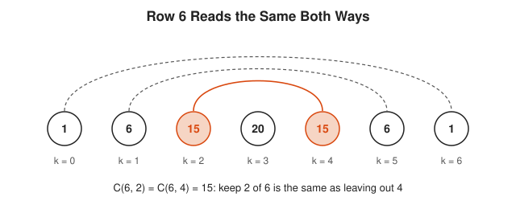

Each arc joins $k$ and $6 - k$, and the numbers at both ends always match.

**In the course:** [501 Linear Algebra, Probability and Discrete Math](../../course/501/README.md)

#### 8. The Binomial Theorem

Expand $(a + b)^n$ by choosing $a$ or $b$ from each of the $n$ factors. The terms with $k$ copies of $b$ number $\binom{n}{k}$, which is where the name binomial coefficient comes from. Set $a = b = 1$ and you get the row sum $2^n$.

**Key idea:** $(a + b)^n = \displaystyle\sum_{k=0}^{n} \binom{n}{k} a^{n-k} b^k$

<!-- diagram: type=area-model terms=a,b power=2 caption="(a + b)^2 as an area" -->
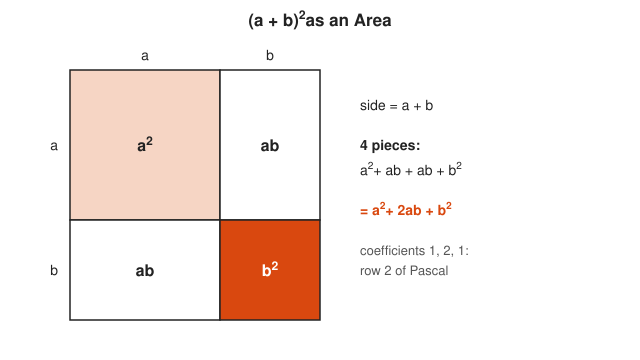

The two white rectangles are the same size, which is where the 2 in $2ab$ comes from.

<!-- diagram: type=words alphabet=a,b length=3 caption="(a + b)^3 by choices" -->
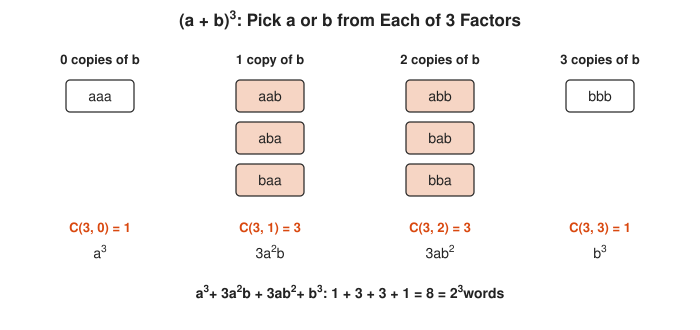

Each word records which letter comes from each of the 3 factors, so each column count is a binomial coefficient.

**In the course:** [301 Algebra II, Trig and Precalculus](../../course/301/README.md) and [501 Linear Algebra, Probability and Discrete Math](../../course/501/README.md)

#### 9. Derangements

A **derangement** is a shuffle where nothing stays in its place: a secret-gift exchange where nobody draws their own name. Inclusion-exclusion counts them. As $n$ grows, the fraction of shuffles that are derangements approaches $\frac{1}{e} \approx 0.368$, a surprise appearance of $e$.

**Key idea:** $D_n = n! \displaystyle\sum_{i=0}^{n} \frac{(-1)^i}{i!}$, so $D_4 = 9$ out of $4! = 24$.

<!-- diagram: type=derangements n=4 caption="All 9 derangements of 4" -->
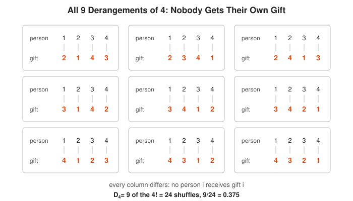

Scan each card column by column: the top and bottom numbers never match.

<!-- diagram: type=plot n=1..8 values=D(n)/n! ref=1/e caption="D(n) / n! settles at 1/e" -->
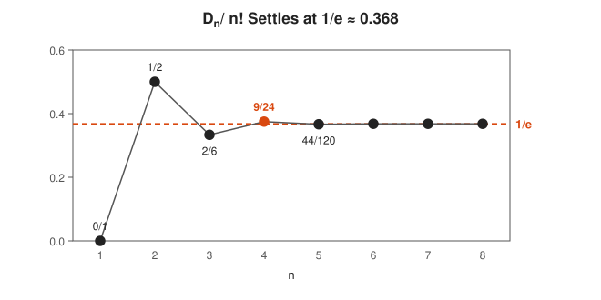

By $n = 6$ the dots sit on the $1/e$ line, so in any large gift exchange about 37% of draws leave nobody with their own name.

**In the course:** [501 Linear Algebra, Probability and Discrete Math](../../course/501/README.md)

### Advanced

#### 10. Recurrences and Catalan Numbers

Many counts are easiest to describe by a recurrence: break a structure at its first piece and count the rest. The **Catalan numbers** 1, 1, 2, 5, 14, 42, ... count balanced strings of parentheses, binary tree shapes, and ways to triangulate a polygon. They appear so often that combinatorialists collect new places they show up.

**Key idea:** $C_n = \dfrac{1}{n+1}\dbinom{2n}{n}$, so $C_3 = \frac{1}{4}\binom{6}{3} = 5$: `((()))`, `(()())`, `(())()`, `()(())`, `()()()`.

<!-- diagram: type=dyck-paths n=3 caption="The 5 Dyck paths for n = 3" -->

Each path starts and ends on the ground and never dips below it, which is exactly what balanced means.

<!-- diagram: type=binary-trees nodes=3 caption="The 5 binary trees with 3 nodes" -->
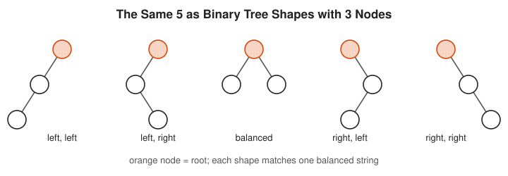

Five shapes again: the same Catalan number counts trees and parentheses.

**In the course:** [501 Linear Algebra, Probability and Discrete Math](../../course/501/README.md)

#### 11. Generating Functions

Store a sequence as the coefficients of a power series. Multiplying series then combines counting problems, because the coefficient of $x^n$ in a product counts the ways to split $n$ between the two parts. Many hard sums collapse to one line of algebra.

**Key idea:** $(1 + x)^n = \displaystyle\sum_k \binom{n}{k}x^k$, and the coefficient of $x^n$ in $\dfrac{1}{(1-x)^k}$ is the stars and bars count $\dbinom{n + k - 1}{k - 1}$.

<!-- diagram: type=gf-table a=1+x+x^2+x^3 b=1+x+x^2+x^3 caption="Multiplying two generating functions" -->

Every anti-diagonal collects one power of $x$, and the orange one counts the splits of 3.

<!-- diagram: type=gf-table a=1+x b=1+2x+x^2 caption="(1 + x)(1 + 2x + x^2) = (1 + x)^3" -->
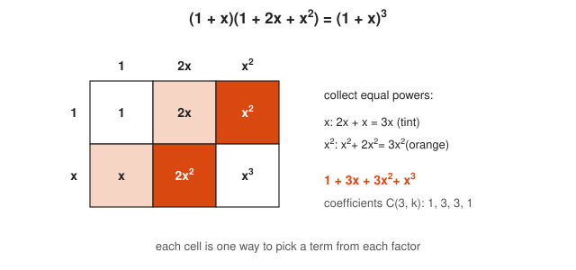

Add the cells of the same color to collect like powers.

**In the course:** [501 Linear Algebra, Probability and Discrete Math](../../course/501/README.md)

#### 12. Ramsey Theory

Complete disorder is impossible. Among any 6 people, either 3 all know each other or 3 are all strangers, and 5 people are not enough to guarantee it. **Ramsey numbers** $R(s, t)$ give the threshold where order becomes unavoidable, and they are famously hard to compute.

**Key idea:** $R(3, 3) = 6$

<!-- diagram: type=ramsey graph=K5 coloring=pentagon,pentagram caption="5 people with no 3 mutual friends or strangers" -->
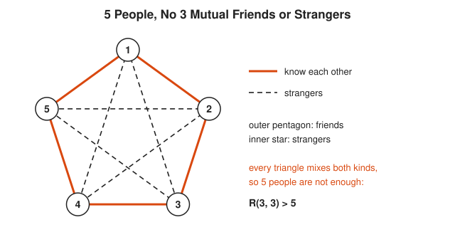

Try any three corners: there is always at least one solid edge and one dashed edge among them.

<!-- diagram: type=ramsey graph=K6 vertex=v caption="Why 6 people always give a one-color triangle" -->

Pigeonhole picks out a, b and c, and the three dotted edges among them have no way to avoid a one-color triangle.

**In the course:** [501 Linear Algebra, Probability and Discrete Math](../../course/501/README.md) · **Go further:** [Graph Theory track](../graph-theory/README.md)

#### 13. Counting with Symmetry

How many different necklaces can you make with 4 beads in 2 colors, if rotations count as the same necklace? Plain counting gives $2^4 = 16$ but overcounts. **Burnside's lemma** averages the number of colorings each symmetry leaves unchanged. Pólya extended the idea into a full theory used in chemistry to count molecules.

**Key idea:** distinct objects $= \dfrac{1}{|G|}\displaystyle\sum_{g \in G} |\text{Fix}(g)|$. For the necklace: $\frac{16 + 2 + 4 + 2}{4} = 6$.

<!-- diagram: type=necklaces beads=4 colors=2 caption="16 colorings fall into 6 necklaces" -->

Each box is one necklace, and the circles inside it are the colorings that turn into each other.

<!-- diagram: type=bars x=0,90,180,270 values=16,2,4,2 caption="Burnside: average the fixed colorings" -->
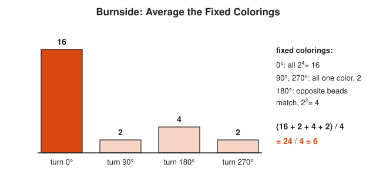

The average bar height, 6, matches the six boxes in the previous picture.

**In the course:** [601 Proof and Higher Math](../../course/601/README.md) · **Go further:** [Abstract Algebra track](../abstract-algebra/README.md)

## Big Theorems You Should Know

* **Product and sum rules:** independent stages multiply, disjoint options add.
* **Combinations formula:** $\binom{n}{k} = \frac{n!}{k!(n-k)!}$.
* **Pascal's rule:** $\binom{n}{k} = \binom{n-1}{k-1} + \binom{n-1}{k}$.
* **Binomial theorem:** $(a + b)^n = \sum_k \binom{n}{k}a^{n-k}b^k$, so $\sum_k \binom{n}{k} = 2^n$.
* **Inclusion-exclusion:** $|A_1 \cup \cdots \cup A_n| = \sum |A_i| - \sum |A_i \cap A_j| + \cdots$ with alternating signs.
* **Pigeonhole principle:** $N$ items in $k$ boxes force a box with at least $\lceil N/k \rceil$ items.
* **Cayley's formula:** there are $n^{n-2}$ labeled trees on $n$ vertices.
* **Ramsey's theorem:** for any $s, t$, a large enough complete graph colored red and blue contains a red $K_s$ or a blue $K_t$.
* **Burnside's lemma:** the number of distinct objects up to symmetry is the average number of fixed points.

## Open Problems and Fun Facts

* **A shuffled deck is new:** $52! \approx 8.07 \times 10^{67}$. A well-shuffled deck is almost certainly in an order that has never existed before.
* **The birthday problem:** with 23 people, the chance two share a birthday is about 50.7%. The same math says a 64-bit random ID space hits a 50% collision chance after only about 5 billion IDs, not $2^{64}$.
* **Erdős and the aliens:** Paul Erdős said that if aliens demanded $R(5, 5)$ or they destroy Earth, we should put every computer to work. If they asked for $R(6, 6)$, we should attack.
* **Open problem:** $R(5, 5)$ is still unknown. As of 2024, it is known to lie between 43 and 46.
* **Pascal was late:** the triangle appears in the work of Yang Hui (13th-century China) and earlier in Persia and India. Pascal wrote his treatise on it in 1654.

## Starter Problem Set

1. A plate has 3 letters followed by 3 digits. How many plates are possible?
2. How many distinct arrangements of the letters of LEVEL are there?
3. A team of 10 engineers picks 3 for an on-call group. How many groups are possible? How many if the 3 get ordered roles (primary, secondary, tertiary)?
4. Find the coefficient of $x^3$ in $(1 + x)^6$.
5. How many integers from 1 to 100 are divisible by 2 or 5?

Answers

1. $26^3 \cdot 10^3 = 17{,}576{,}000$, by the product rule.
2. $30$. $5! = 120$ orderings, divided by $2!$ for the two L's and $2!$ for the two E's: $\frac{120}{4} = 30$.
3. $\binom{10}{3} = 120$ groups. Ordered roles: $10 \cdot 9 \cdot 8 = 720$.
4. $\binom{6}{3} = 20$.
5. $60$. Divisible by 2: 50. By 5: 20. By both (by 10): 10. Inclusion-exclusion: $50 + 20 - 10 = 60$.

## Go Deeper

* [Better Explained: Easy Permutations and Combinations](https://betterexplained.com/articles/easy-permutations-and-combinations/): the clearest intuition for when to divide by $k!$.
* [Math Is Fun: Combinations and Permutations](https://www.mathsisfun.com/combinatorics/combinations-permutations.html): illustrated, with every case of repetition and order.
* [Math Is Fun: Pascal's Triangle](https://www.mathsisfun.com/pascals-triangle.html): the patterns hiding in the triangle, with pictures.
* [Wolfram MathWorld: Pascal's Triangle](https://mathworld.wolfram.com/PascalsTriangle.html): a dense reference on identities and history.
* [MIT OpenCourseWare 6.042J Mathematics for Computer Science](https://ocw.mit.edu/courses/6-042j-mathematics-for-computer-science-fall-2010/): the counting unit covers bijections, inclusion-exclusion and generating functions.
* [MacTutor: Pascal](https://mathshistory.st-andrews.ac.uk/Biographies/Pascal/): the life of Blaise Pascal, who also founded probability with Fermat.

## Related Tracks and Workshops

* Before: [Discrete Math track](../discrete-math/README.md).
* Next: [Probability track](../probability/README.md) and [Graph Theory track](../graph-theory/README.md).
* Applied: [Probability for On-Call Error Budgets and SLOs](../../workshops/probability-for-on-call-error-budgets-and-slos/README.md).
