# Complex Analysis Track

**Track:** Complex Analysis · **Span:** beginner to advanced · **Course levels:** [301 Algebra II, Trig and Precalculus](../../course/301/README.md) (trigonometry), [401 Calculus](../../course/401/README.md) (derivatives, series), [601 Proof and Higher Math](../../course/601/README.md) (for the advanced rungs)
**Prerequisites:** the coordinate plane, sine and cosine, and the exponential function. The [Trigonometry Track](../trigonometry/README.md) covers the first two.
**Files:** this README, [cards.tsv](cards.tsv) for Anki, [code/main.go](code/main.go), and the diagrams in [img/](img/).

## What the Field Studies

Complex analysis is calculus done with **complex numbers**: numbers of the form $a + bi$, where $i$ is a number whose square is $-1$.

The name "imaginary" was an insult, coined by Descartes, and it stuck. The numbers are no less real than negative numbers, which also sounded absurd once. The honest picture: a complex number is a point in a plane, and multiplying complex numbers rotates and stretches that plane. Once you see it that way, the rest of the field is about smooth rotations and stretches, and it turns out to be the most elegant part of analysis.

## Why It Matters

* **Signals and waves:** sound, radio, AC power and vibration all use $e^{i\omega t}$ to describe oscillation. The Fourier transform, and the FFT behind every audio codec and spectrum analyzer, lives here.
* **Control loops:** whether a feedback system is stable depends on where the roots of a polynomial sit in the complex plane. Autoscalers and PID controllers are designed with this picture.
* **Graphics:** a 2D rotation is one complex multiplication. Quaternions, the 4D cousins of complex numbers, rotate 3D cameras without gimbal lock.
* **Quantum computing:** quantum states are vectors of complex numbers.
* **Number theory:** the Riemann zeta function, a complex function, holds the deepest known information about the primes.

## Concept Map

<!-- diagram: type=concept-map tiers=beginner,intermediate,advanced nodes=12 caption="Complex analysis concepts with prerequisite arrows" -->


Read the map top to bottom. An arrow from A to B means learn A first. Start at the orange box.

## Signature Diagram

<!-- diagram: type=complex-plane points=2+i,-1+2i,-2-i,1-2i circle=sqrt5 caption="Multiplying by i rotates 90 degrees" -->
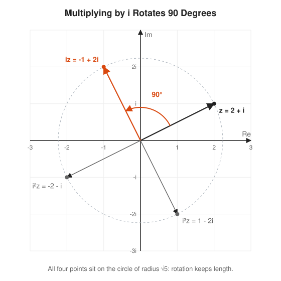

This one picture holds the key idea. Multiplying by $i$ does not "make a number imaginary". It turns the point a quarter turn counterclockwise around 0 and leaves its distance alone. Four quarter turns bring you home: $i^4 = 1$. Two quarter turns face you backward: $i^2 = -1$. That is all $i$ is.

## The Concept Ladder

### Beginner

#### 1. The Number i

The equation $x^2 = -1$ has no solution on the number line. Invent a number $i$ that solves it, and treat it with ordinary algebra. Multiplying by $-1$ is a half turn on the number line. Multiplying by $i$ is half of that: a quarter turn, into a new direction off the line.

$$i^2 = -1, \qquad i^3 = -i, \qquad i^4 = 1$$

<!-- diagram: type=rotation-cycle points=1,i,-1,-i caption="i as a quarter turn" -->
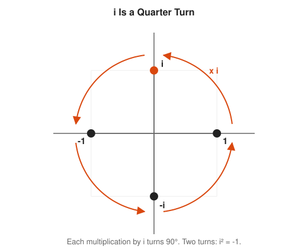

Course link: [301 Algebra II, Trig and Precalculus](../../course/301/README.md).

#### 2. The Complex Plane

Plot $a + bi$ as the point $(a, b)$. The horizontal axis holds the real numbers, the vertical axis the imaginary ones. Addition is vector addition. The **modulus** $|z|$ is the distance from 0. The **conjugate** $\bar{z}$ flips the point across the real axis.

$$z = a + bi, \qquad |z| = \sqrt{a^2 + b^2}, \qquad \bar{z} = a - bi, \qquad z\bar{z} = |z|^2$$

<!-- diagram: type=complex-point z=3+2i show=conjugate,modulus caption="The point 3 + 2i" -->
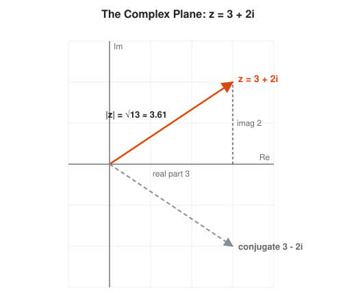

#### 3. Polar Form: Rotate and Scale

Describe a point by its length $r$ and its angle $\theta$ instead of $(a, b)$. In this form, multiplication becomes simple: **multiply the lengths, add the angles**. That rule is the reason complex numbers describe rotation so well.

$$z = r(\cos\theta + i\sin\theta), \qquad z_1 z_2 = r_1 r_2 \big(\cos(\theta_1 + \theta_2) + i\sin(\theta_1 + \theta_2)\big)$$

<!-- diagram: type=complex-product z1=1+i z2=1+sqrt3i caption="Lengths multiply, angles add" -->
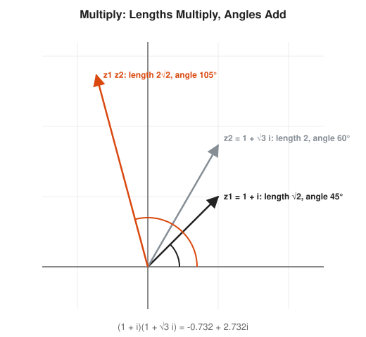

#### 4. Euler Formula

The exponential function, fed an imaginary number, walks around the unit circle. $e^{i\theta}$ is the point at angle $\theta$ (in radians) on the circle of radius 1. Every complex number is then $z = re^{i\theta}$, and the polar rule is the exponent rule $e^a e^b = e^{a+b}$.

$$e^{i\theta} = \cos\theta + i\sin\theta, \qquad e^{i\pi} + 1 = 0$$

<!-- diagram: type=unit-circle theta=50deg marks=pi,pi/2 caption="Euler formula on the unit circle" -->
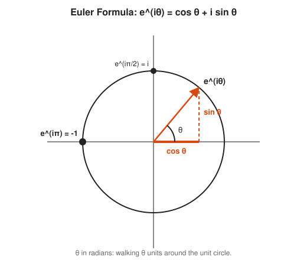

The identity $e^{i\pi} + 1 = 0$ ties together five famous constants with one plus sign and one equals sign. It shows up on T-shirts more than any other equation, which is a strange honor for a math fact.

### Intermediate

#### 5. Roots of Unity

The equation $z^n = 1$ has exactly $n$ solutions, the **$n$-th roots of unity**. They sit evenly around the unit circle like the corners of a regular polygon. They add up to zero. The Fast Fourier Transform runs on them.

$$z^n = 1 \iff z = e^{2\pi i k / n}, \quad k = 0, 1, \ldots, n - 1$$

<!-- diagram: type=roots-of-unity n=6 caption="Sixth roots of unity" -->
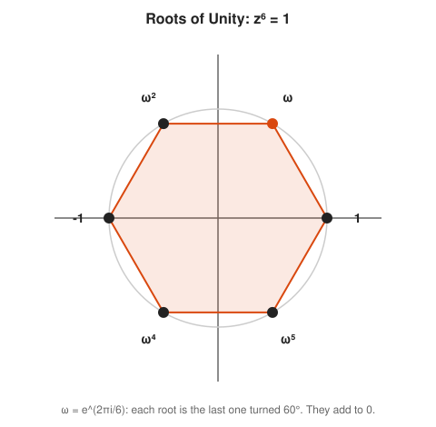

#### 6. Functions as Maps

A complex function takes a point in one plane to a point in another. You cannot draw its graph (that needs four dimensions), but you can draw what it does to shapes. The squaring map doubles every angle and squares every length.

$$f(z) = z^2: \quad re^{i\theta} \mapsto r^2 e^{2i\theta}$$

<!-- diagram: type=domain-image f=z^2 domain=quarter-disk caption="z squared maps a quarter disk to a half disk" -->
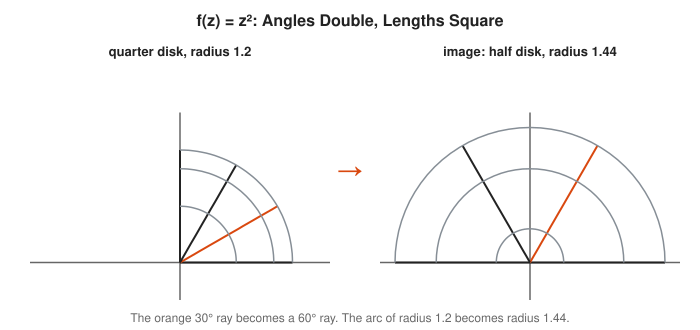

#### 7. The Complex Derivative and Cauchy-Riemann

A complex function is **analytic** when it has a derivative in the complex sense. Up close, an analytic function acts like multiplication by one complex number $f'(z_0)$: it rotates and scales tiny shapes without skewing them. That is a much stronger demand than real differentiability. The **Cauchy-Riemann equations** state it in terms of $u$ and $v$, the real and imaginary parts.

$$f = u + iv \text{ analytic} \iff \frac{\partial u}{\partial x} = \frac{\partial v}{\partial y}, \quad \frac{\partial u}{\partial y} = -\frac{\partial v}{\partial x}$$

<!-- diagram: type=local-linear f=z^2 z0=1+i caption="The derivative rotates and scales" -->
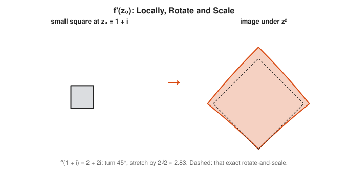

The payoff for this strictness is enormous. An analytic function, once differentiable, is differentiable forever and equals its own power series. Real functions make no such promise.

#### 8. Power Series

Analytic functions are polynomials of infinite degree. The exponential, sine and cosine series work the same with complex inputs. Plug $i\theta$ into the series for $e^x$, split real and imaginary parts, and Euler's formula falls out.

$$e^z = \sum_{k=0}^{\infty} \frac{z^k}{k!} = 1 + z + \frac{z^2}{2!} + \frac{z^3}{3!} + \cdots$$

<!-- diagram: type=series-path z=i*pi terms=16 caption="Partial sums of e^(i pi) spiral to -1" -->
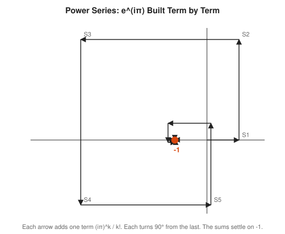

### Advanced

#### 9. Conformal Maps

Because an analytic function rotates and scales locally, it preserves angles wherever $f'(z) \ne 0$. Such maps are **conformal**. Two curves that cross at a right angle still cross at a right angle after the map. Engineers use this to turn a hard shape, such as airflow around a wing, into an easy one.

<!-- diagram: type=grid-image f=z^2 lines=x=0.5,1,1.5;y=0.5,1,1.5 caption="z squared keeps right angles" -->
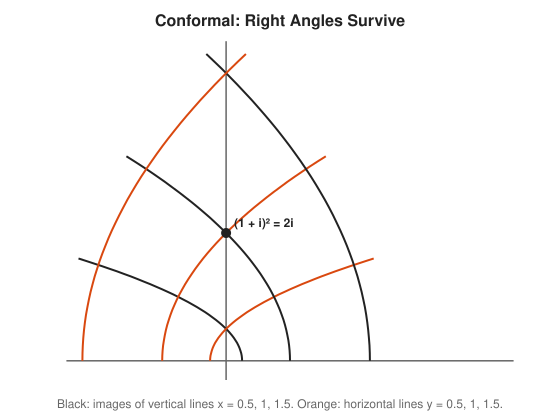

#### 10. Contour Integrals and Cauchy Theorem

Integrate a complex function along a path, a **contour**. **Cauchy's theorem** says the integral around a closed loop is zero when the function is analytic everywhere inside. Only the trouble spots inside the loop, the **singularities**, contribute. The simplest example: $1/z$ around 0 gives $2\pi i$.

$$\oint_C f(z)\,dz = 0 \quad (f \text{ analytic inside } C), \qquad \oint_{|z|=1} \frac{dz}{z} = 2\pi i$$

<!-- diagram: type=contours f=1/z circles=around-0,away caption="Contour integrals of 1/z" -->
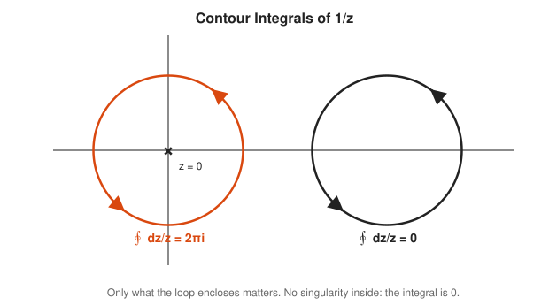

#### 11. Residues

Near a singularity, a function behaves like $c/(z - z_0)$ plus harmless terms. The coefficient $c$ is the **residue**. The **residue theorem** says a loop integral is $2\pi i$ times the sum of the enclosed residues. This turns many hard real integrals into arithmetic.

$$\oint_C f(z)\,dz = 2\pi i \sum \operatorname{Res}(f, z_k), \qquad \int_{-\infty}^{\infty} \frac{dx}{1 + x^2} = \pi$$

<!-- diagram: type=semicircle-contour f=1/(1+z^2) poles=i,-i caption="Residue calculation of a real integral" -->
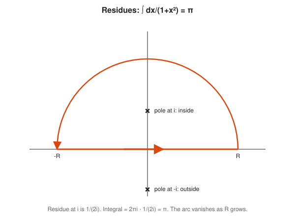

#### 12. Analytic Continuation and the Zeta Function

An analytic function is so rigid that its values on any small patch decide its values everywhere it extends. The **Riemann zeta function** starts as a sum that only makes sense for $\operatorname{Re}(s) > 1$. Analytic continuation extends it to the whole plane except $s = 1$. Its zeros control how the primes are spread out.

$$\zeta(s) = \sum_{n=1}^{\infty} \frac{1}{n^s} \quad (\operatorname{Re}(s) > 1)$$

<!-- diagram: type=critical-strip zeros=14.135,21.022,25.011,30.425,32.935 caption="Zeros of zeta in the critical strip" -->
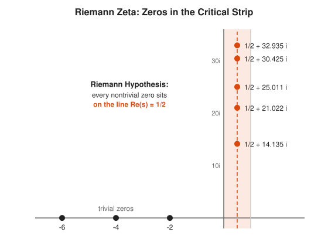

## Worked Examples

### Example 1: Multiply in Rectangular Form

```txt
  (2 + i)(1 + 3i)                        multiply like binomials
  = 2 + 6i + i + 3i²                     distribute
  = 2 + 7i + 3(-1)                       i² = -1
  = -1 + 7i                              collect
  check |.|: √5 · √10 = √50              lengths multiply
            |-1 + 7i| = √(1 + 49) = √50  matches
```

### Example 2: Divide Using the Conjugate

```txt
  (1 + 2i) / (3 - i)                     want a real denominator
  = (1 + 2i)(3 + i) / ((3 - i)(3 + i))   multiply top and bottom by conjugate
  = (3 + i + 6i + 2i²) / (9 + 1)         expand; (3-i)(3+i) = 9 - i² = 10
  = (1 + 7i) / 10                        2i² = -2
  = 0.1 + 0.7i                           divide
```

### Example 3: Cube Roots of 1

```txt
  z³ = 1                                 equation
  z = e^(2πik/3), k = 0, 1, 2            roots of unity
  k=0: 1                                 angle 0
  k=1: cos 120° + i sin 120° = -1/2 + (√3/2)i
  k=2: cos 240° + i sin 240° = -1/2 - (√3/2)i
  sum: 1 - 1/2 - 1/2 + 0i = 0            roots of unity add to 0
```

## Big Theorems to Know

* **Fundamental Theorem of Algebra:** every non-constant polynomial has a complex root. A degree $n$ polynomial has exactly $n$ roots, counted with multiplicity.
* **Euler Formula:** $e^{i\theta} = \cos\theta + i\sin\theta$.
* **De Moivre Formula:** $(\cos\theta + i\sin\theta)^n = \cos n\theta + i\sin n\theta$.
* **Cauchy Theorem:** the integral of an analytic function around a closed loop is zero.
* **Cauchy Integral Formula:** the values inside a loop are fixed by the values on the loop.
* **Liouville Theorem:** a bounded function that is analytic on the whole plane is constant.
* **Residue Theorem:** a loop integral equals $2\pi i$ times the sum of enclosed residues.
* **Riemann Mapping Theorem:** any simply connected region of the plane (other than the whole plane) maps conformally onto the unit disk.

## Open Problems and Fun Facts

* **Riemann Hypothesis (1859):** every nontrivial zero of $\zeta(s)$ has real part $1/2$. More than ten trillion zeros have been checked by computer, all on the line. It is a one-million-dollar Millennium Prize problem and probably the most famous open problem in mathematics.
* **Imaginary began as a slur:** Descartes used "imaginary" dismissively in 1637. Cardano had met square roots of negative numbers a century earlier while solving cubic equations, and called them "as subtle as they are useless".
* **The Mandelbrot set** is the set of complex numbers $c$ for which $z \to z^2 + c$, starting from 0, stays bounded. A one-line rule draws an endlessly detailed boundary. The [Code Corner](#code-corner) prints a small one.
* **Liouville, in practice:** because a bounded entire function is constant, $\sin z$ must be unbounded on the complex plane. Indeed $\sin(10i) \approx 11,013i$.

## Starter Problems

1. Compute $(3 + 2i) + (1 - 5i)$ and $(3 + 2i)(1 - 5i)$.
2. Find $|4 - 3i|$ and the conjugate of $4 - 3i$.
3. Compute $i^{10}$.
4. Write $-2$ in polar form $re^{i\theta}$.
5. A number has length 2 and angle 30°. Another has length 3 and angle 60°. Give the length and angle of their product, and write it as $a + bi$.
6. Find all solutions of $z^4 = 1$.
7. Compute $(1 + i)^8$ using polar form.

<details>
<summary>Answers</summary>

1. Sum: $4 - 3i$. Product: $3 - 15i + 2i - 10i^2 = 3 - 13i + 10 = 13 - 13i$.
2. $|4 - 3i| = \sqrt{16 + 9} = 5$. The conjugate is $4 + 3i$.
3. $-1$. $i^{10} = i^8 \cdot i^2 = 1 \cdot (-1)$.
4. $2e^{i\pi}$. Length 2, pointing in the negative direction (angle $\pi$).
5. Length 6 and angle 90°. That is $6i$.
6. $1, i, -1, -i$. The fourth roots of unity.
7. $16$. $1 + i = \sqrt{2}\,e^{i\pi/4}$, and $(\sqrt{2})^8 e^{i \cdot 2\pi} = 16 \cdot 1$.

</details>

## Code Corner

[code/main.go](code/main.go) uses Go's built-in `complex128` type and `math/cmplx` to rotate by $i$, check the polar rule and Euler's formula, list roots of unity, sum the power series, compute contour integrals numerically, and print a small Mandelbrot set. Run it with `go run main.go` inside `code/`.

```txt
== Multiplying by i turns 90 degrees ==
i^0 z = +2.000 +1.000i   |.| = 2.236
i^1 z = -1.000 +2.000i   |.| = 2.236
i^2 z = -2.000 -1.000i   |.| = 2.236
i^3 z = +1.000 -2.000i   |.| = 2.236

== Polar form: lengths multiply, angles add ==
+1.000 +1.000i  length 1.4142  angle   45.0 deg
+1.000 +1.732i  length 2.0000  angle   60.0 deg
-0.732 +2.732i  length 2.8284  angle  105.0 deg

== Euler formula ==
e^(i pi)   = -1.000 +0.000i
e^(i pi/2) = +0.000 +1.000i

== Sixth roots of unity ==
k=0 +1.000 +0.000i   w^6 = +1.000 +0.000i
k=1 +0.500 +0.866i   w^6 = +1.000 -0.000i
k=2 -0.500 +0.866i   w^6 = +1.000 -0.000i
k=3 -1.000 +0.000i   w^6 = +1.000 -0.000i
k=4 -0.500 -0.866i   w^6 = +1.000 -0.000i
k=5 +0.500 -0.866i   w^6 = +1.000 +0.000i
sum of roots = -0.000 +0.000i

== Power series for e^(i pi), partial sums ==
S1  = +1.000 +0.000i
S5  = +0.124 -2.026i
S9  = -0.976 -0.075i
S13 = -1.000 -0.000i
S17 = -1.000 -0.000i

== Contour integral of 1/z around circles (10,000 steps) ==
around 0:     -0.000 +6.283i  (2 pi i = +0.000 +6.283i)
around 3.8:   +0.000 -0.000i

== Residue check: integral of 1/(1+x^2) over [-1000, 1000] ==
numeric 3.139593, pi 3.141593 (the tails past 1000 hold the last 0.002)

== Mandelbrot set: c where z -> z^2 + c stays bounded ==
............................................................
............................................................
...........................................##...............
..........................................###...............
...................................###################......
...............................#########################....
....................#########.#########################.....
...#################################################........
....................#########.#########################.....
...............................#########################....
...................................###################......
..........................................###...............
...........................................##...............
............................................................
............................................................
```

The `-0.000` entries are floating-point dust: values like $-1 \times 10^{-16}$ rounded for display. The [Numerical Methods Track](../numerical-methods/README.md) explains where that dust comes from.

## Flashcards

[cards.tsv](cards.tsv) holds the key definitions and theorems for Anki import.

## Resources

* [Better Explained: A Visual, Intuitive Guide to Imaginary Numbers](https://betterexplained.com/articles/a-visual-intuitive-guide-to-imaginary-numbers/): $i$ as rotation, in plain words.
* [Better Explained: Intuitive Understanding of Euler's Formula](https://betterexplained.com/articles/intuitive-understanding-of-eulers-formula/): why $e^{i\theta}$ walks around a circle.
* [Paul's Online Notes: Complex Number Primer](https://tutorial.math.lamar.edu/Extras/ComplexPrimer/ComplexNumbers.aspx): arithmetic, polar form and roots with worked examples.
* [MIT OCW 18.04 Complex Variables with Applications](https://ocw.mit.edu/courses/18-04-complex-variables-with-applications-spring-2018/): full notes for the advanced rungs.
* [Wolfram MathWorld: Riemann Hypothesis](https://mathworld.wolfram.com/RiemannHypothesis.html): the statement, history and evidence.
* [MacTutor: Bernhard Riemann](https://mathshistory.st-andrews.ac.uk/Biographies/Riemann/): the life behind the hypothesis.

## Where to Go Next

* [Real Analysis Track](../real-analysis/README.md) for the careful limits underneath every rung here.
* [Differential Equations Track](../differential-equations/README.md) for oscillations driven by complex roots.
* [Number Theory Track](../number-theory/README.md) for the primes that the zeta function encodes.
