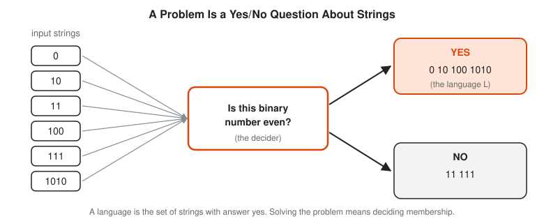
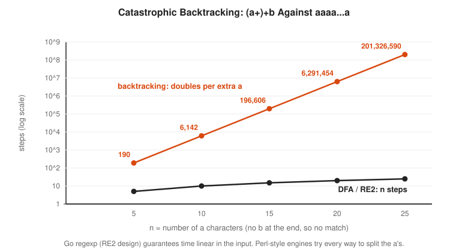
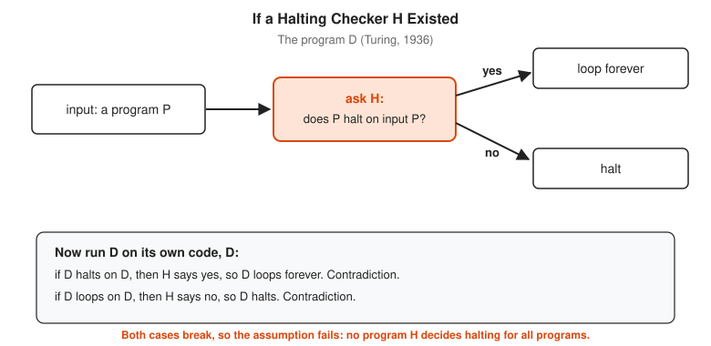
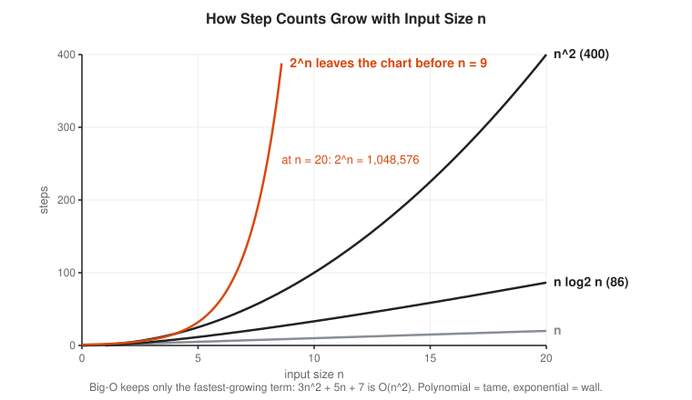
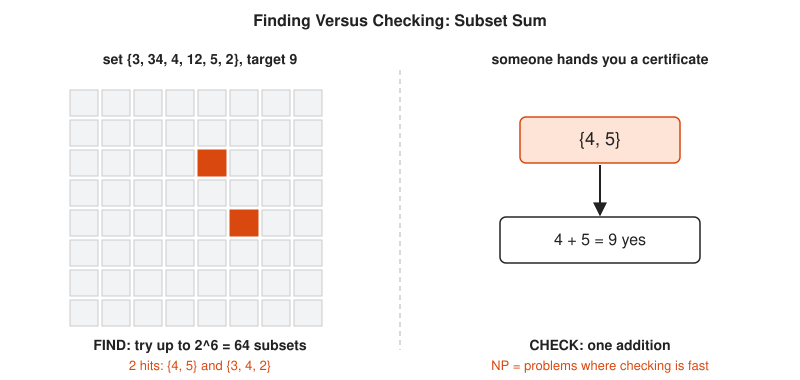
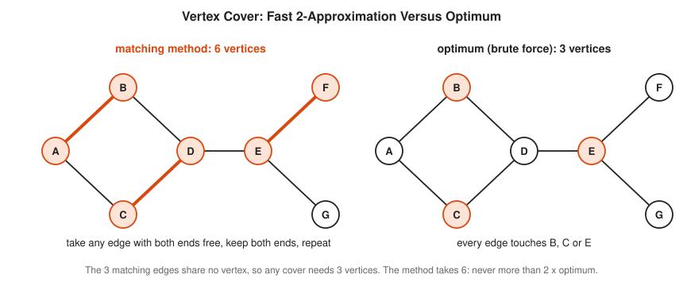

# Computability and Complexity Track

**Track:** Computability and Complexity · **Span:** beginner to advanced · **Course levels:** [501 Linear Algebra, Probability and Discrete Math](../../course/501/README.md) (logic, sets, graphs), [601 Proof and Higher Math](../../course/601/README.md) (proof by contradiction, cardinality)
**Prerequisites:** reading a short program, binary numbers, and the idea of a set. The [Logic and Set Theory Track](../logic-and-set-theory/README.md) and the [Discrete Math Track](../discrete-math/README.md) help, but every term here gets a plain definition first.
**Files:** this README, [cards.tsv](cards.tsv) for Anki, [code/main.go](code/main.go), and the diagrams in [img/](img/).

## What the Field Studies

This field asks two questions about problems, not about any one program:

* **Computability:** can any program at all solve this problem, for every input, and always stop with an answer?
* **Complexity:** if a program exists, how much time or memory does it need as the input grows?

The tools are toy machines. A **finite automaton** has a fixed, small memory. A **pushdown automaton** adds a stack. A **Turing machine** adds an endless tape and matches every real computer in what it can compute. Climbing that ladder shows what each kind of memory buys. At the top sit two hard walls: problems no program solves (the halting problem), and problems where every known program needs exponential time (the NP-complete problems).

## Why It Matters

You meet this track on call more often than the name suggests:

* **Regex engines and ReDoS:** a backtracking regex engine (Perl, PCRE, Python `re`, Java) runs some patterns in exponential time. In 2019 a single WAF rule containing `.*(?:.*=.*)` exhausted CPU across Cloudflare for 27 minutes. Go's `regexp` package follows the RE2 design and guarantees time linear in the input. Rung 3 shows why.
* **Config validation:** a perfect checker for "does this templated config ever deploy to prod?" cannot exist once the template language has loops or recursion. That is the halting problem in a hard hat. Bazel's Starlark forbids recursion and `while` loops partly to keep evaluation predictable.
* **Timeouts:** you cannot predict whether an arbitrary job finishes. You set a step budget or a deadline and accept "unknown" as an answer. Every `context.WithTimeout` is a quiet nod to Turing.
* **Scheduling and packing:** placing pods on nodes, jobs on machines, or shards on disks is NP-hard in general. Kubernetes and every batch scheduler use fast heuristics and settle for good answers, not perfect ones.
* **Parsers:** config formats, JSON and YAML parsers are pushdown automata with extra steps. Nesting needs a stack, and a stack without a depth limit is a memory exhaustion bug waiting to happen.

## Concept Map

<!-- diagram: type=concept-map tiers=beginner,intermediate,advanced nodes=12 caption="Computability and complexity concepts with prerequisite arrows" -->
![Concept map of computability and complexity. Beginner row: Problems as Yes/No Questions, Finite Automata, Nondeterminism and Regular Expressions, Limits of Finite Memory. Intermediate row: Stacks and Grammars, Turing Machines, The Halting Problem, Reductions and Rice's Theorem. Advanced row: Big-O and Running Time, P and NP, NP-Completeness and SAT, Approximation. Arrows run left to right in each row, Finite Automata and Limits of Finite Memory feed Stacks and Grammars, Turing Machines feeds Big-O, and Reductions feeds NP-Completeness.](img/concept-map.svg)

Read the map top to bottom. An arrow from A to B means learn A first. Start at the orange box.

## Signature Diagram

<!-- diagram: type=nested-sets layers=regular,context-free,P,NP,decidable,recognizable,all highlight=NP-complete caption="The map of problems" -->
![Nested rounded boxes. Innermost Regular (finite memory, for example divisible by 3), inside Context-free (one stack, balanced parentheses), inside P (polynomial time, sorting and shortest path, dashed edge marked P = NP unknown), inside NP (short checkable proof), which also holds an orange NP-complete band with SAT, subset sum, scheduling, vertex cover and traveling salesman. NP sits inside Decidable, which sits inside Recognizable, which holds HALT. The outer box, all yes/no problems, holds never-halts, which is not even recognizable.](img/map-of-problems.svg)

This one picture is the whole track. Every box sits inside the next, and each step outward costs more memory, more time, or both. The innermost box needs only a few states of memory. The outermost box holds problems no machine ever solves. The dashed line around P is the most famous unknown in computer science: nobody knows whether P and NP are the same box.

## The Concept Ladder

### Beginner

#### 1. Problems as Yes/No Questions

Start with a vending-machine view. A **decision problem** is a question with a yes or no answer about an input string, for example "is this binary number even?". The set of strings with answer yes is the **language** of the problem. To **decide** a language means to build a machine that reads any string and always answers correctly.

$$L = \{\, w : \text{the answer for } w \text{ is yes} \,\}$$

<!-- diagram: type=flow inputs=6 decider="Is this binary number even?" caption="A decision problem sorts strings into yes and no" -->


Why only yes/no? Because any question shrinks to a series of yes/no questions, and yes/no keeps the theory clean. "What is the shortest path?" becomes "is there a path of length at most k?".

In the course: [501 Sets and Functions](../../course/501/02-sets-and-functions/README.md). Related: [Logic and Set Theory Track](../logic-and-set-theory/README.md).

#### 2. Finite Automata

A **deterministic finite automaton (DFA)** is a set of states, a start state, some accepting states, and one arrow per symbol out of every state. It reads the input one symbol at a time, follows arrows, and accepts if it stops in an accepting state. Its whole memory is "which state am I in". A turnstile, a TCP connection and a circuit breaker are all DFAs.

The DFA below decides "is this binary number divisible by 3?". The state is the remainder so far. Reading bit $b$ doubles the value and adds $b$:

$$r \;\to\; (2r + b) \bmod 3$$

<!-- diagram: type=state-machine states=r0,r1,r2 start=r0 accept=r0 edges="r0-0->r0,r0-1->r1,r1-1->r0,r1-0->r2,r2-0->r1,r2-1->r2" trace=1101 caption="DFA for binary numbers divisible by 3" -->


Three states remember everything needed about a number of any length. That is the magic and the limit of finite memory.

In the course: [501 Graph Theory Basics](../../course/501/08-graph-theory-basics/README.md), since a DFA is a directed graph with labeled edges. Related: [Discrete Math Track](../discrete-math/README.md) (state machines), [Graph Theory Track](../graph-theory/README.md).

#### 3. Nondeterminism and Regular Expressions

A **nondeterministic finite automaton (NFA)** is allowed several arrows on the same symbol. Think of it as a machine that splits into copies and accepts if any copy accepts. To run it, track the **set** of states the copies occupy. That trick, the **subset construction**, turns every NFA into a DFA.

A **regular expression** describes a language with three operations: concatenation (`ab`), choice (`a|b`) and repetition (`a*`). **Kleene's theorem** says regular expressions, NFAs and DFAs describe exactly the same languages, called the **regular languages**.

$$\text{regex} \;\Longleftrightarrow\; \text{NFA} \;\Longleftrightarrow\; \text{DFA}$$

<!-- diagram: type=state-machine-pair regex="(a|b)*abb" nfa_states=4 dfa_states=4 caption="One regex, two machines" -->


Now the SRE part. There are two ways to run a regex:

* **Backtracking** (Perl, PCRE, Python, Java, JavaScript): try one choice, and on failure back up and try the next. Simple, supports backreferences, and exponential in the worst case.
* **Automaton simulation** (RE2, Go `regexp`, Rust `regex`): run the NFA with a set of states, one input character at a time. Time is linear in the input, always.

<!-- diagram: type=line-chart scale=log x=5,10,15,20,25 series="backtracking:190,6142,196606,6291454,201326590;dfa:5,10,15,20,25" caption="Catastrophic backtracking versus a DFA" -->


The pattern `(a+)+b` against a string of a's with no b gives the backtracker every possible way to split the a's between the inner and outer `+`, and there are about $2^n$ ways. This is **ReDoS**, regular expression denial of service. One crafted request pins a CPU. Go refuses backreferences precisely to keep its linear-time promise.

Related: [Combinatorics Track](../combinatorics/README.md) for counting the $2^{n-1}$ ways to split a run of letters.

#### 4. Limits of Finite Memory

Can a DFA decide $\{a^n b^n\}$: some a's followed by the same number of b's? No. Suppose a DFA with $p$ states decides it. While reading $a^p$ it visits $p + 1$ states, and only $p$ exist. Some state therefore repeats (the **pigeonhole principle**). The stretch between the repeats forms a loop. Going around the loop once more adds a's without changing the ending state. The machine therefore also accepts $a^{p+k} b^p$. Wrong answer. This is the **pumping lemma**.

$$w = xyz,\quad |xy| \le p,\quad |y| \ge 1 \;\implies\; xy^iz \in L \text{ for every } i \ge 0$$

<!-- diagram: type=tape-with-states input=aaaabbbb states=q0,q1,q2,q3,q1 loop=1..4 caption="A 4-state machine repeats a state while reading aaaa" -->


A finite machine cannot count without bound. Neither can a regex. That is why no regex correctly matches nested parentheses or HTML, a fact that has ended many code reviews.

In the course: [601 Proof by Contradiction](../../course/601/03-proof-by-contradiction/README.md). Related: [Discrete Math Track](../discrete-math/README.md) (the pigeonhole principle).

### Intermediate

#### 5. Stacks and Grammars

Give the finite machine one **stack**: push on the way in, pop on the way out. That is a **pushdown automaton (PDA)**. It now counts: push for each `(`, pop for each `)`, and accept if the stack ends empty and no pop failed.

A **context-free grammar** describes the same languages with rewrite rules. Balanced parentheses:

$$S \;\to\; (\,S\,)\,S \;\mid\; \varepsilon$$

where $\varepsilon$ means the empty string. PDAs and context-free grammars describe exactly the same languages, the **context-free languages**.

<!-- diagram: type=stack-snapshots input="(()())" caption="A stack checks balanced parentheses" -->


Every JSON, YAML and programming-language parser is a PDA at heart. One stack still has limits: $\{a^n b^n c^n\}$ is not context-free, because popping to compare the a's with the b's destroys the count needed for the c's.

Related: [Logic and Set Theory Track](../logic-and-set-theory/README.md) for sets of strings, [Discrete Math Track](../discrete-math/README.md) for recursion.

#### 6. Turing Machines

A **Turing machine** has a finite rule table, an endless tape of cells, and a head that reads a cell, writes a cell, and moves one step left or right. That is all. Alan Turing described it in 1936 to pin down what "computable" means.

The machine below adds 1 to a binary number. It starts on the last digit in state `carry`. Each rule says: in this state, reading this symbol, write this, move here, switch to that state.

<!-- diagram: type=tape-snapshots input=1011 steps=4 rules="carry,1->0,L,carry;carry,0|_->1,-,halt" caption="A Turing machine adds 1 to 1011" -->


The **Church-Turing thesis** says every step-by-step method, by person or computer, is a Turing machine in disguise. Go, Python and Ansible with loops all compute exactly the same set of functions. A **universal Turing machine** reads another machine's rules from its tape and runs them, which is the idea behind every interpreter and VM.

<!-- diagram: type=comparison columns=DFA,PDA,TM rows=memory,can,cannot,class caption="More memory, more power" -->


Related: [Logic and Set Theory Track](../logic-and-set-theory/README.md) (Gödel and computability).

#### 7. The Halting Problem

The **halting problem** asks: given a program $P$ and an input $x$, does $P$ eventually stop on $x$? Turing proved in 1936 that no program answers this correctly for every $P$ and $x$.

The proof is a **diagonal argument**, the same trick Cantor used to show the real numbers are uncountable. List every program as a row and every input as a column. Each cell says whether that program halts on that input. Build a program $D$ that does the opposite of the diagonal.

<!-- diagram: type=grid rows=P1..P5 cols=P1..P5 values=halts,loops diagonal=highlight extra_row=D caption="The diagonal: D disagrees with every program" -->


$D$ differs from every row in at least one cell. $D$ is therefore not on the list. Yet the list holds every program. The flowchart shows the same contradiction as code:

<!-- diagram: type=flowchart nodes="input P; ask H(P,P); yes->loop forever; no->halt" caption="If a halting checker H existed" -->


A problem like this is **undecidable**. Halting is still **recognizable**: run $P$ on $x$, and if it stops, say yes. The trouble is only the "no" answers, which never arrive. That is exactly the on-call experience of watching a stuck job.

In the course: [601 Sets and Cardinality](../../course/601/06-sets-and-cardinality/README.md). Related: [Logic and Set Theory Track](../logic-and-set-theory/README.md) (Cantor's diagonal argument).

#### 8. Reductions and Rice's Theorem

A **reduction** from problem A to problem B is a computable translation of every A question into a B question with the same answer. If B had a decider, A gets one for free. Read it backward: if A is undecidable, B is too.

**Rice's theorem** (1953) generalizes the halting result: every nontrivial question about what a program **does** (its behavior, not its text) is undecidable. "Does it ever write to `/etc`?", "does it ever deploy to prod?", "does it return the same answer as this other program?": all undecidable in general.

<!-- diagram: type=reduction from=HALT to=config-check caption="Halting hides inside config checks" -->


This is why config validation tools check syntax and schemas (text) but not general behavior. The practical escapes are three: restrict the language (Dhall and CUE avoid general recursion, and Starlark in Bazel bans recursion and `while`), approximate safely (a linter that sometimes says "maybe"), or run with a budget and accept "unknown".

Related: [Discrete Math Track](../discrete-math/README.md) (functions and composition).

### Advanced

#### 9. Big-O and Running Time

Complexity counts **steps** as a function of the input size $n$. **Big-O** keeps only the fastest-growing term and drops constant factors: $3n^2 + 5n + 7$ is $O(n^2)$. Formally, $f(n) = O(g(n))$ means $f(n) \le c \cdot g(n)$ for some constant $c$ once $n$ is large enough.

$$O(1) \subset O(\log n) \subset O(n) \subset O(n \log n) \subset O(n^2) \subset O(2^n)$$

<!-- diagram: type=function-plot f="n,n*log2(n),n^2,2^n" x=0..20 y=0..400 caption="How step counts grow with input size n" -->


The line that matters is between **polynomial** time ($n^k$ for a fixed $k$) and **exponential** time ($2^n$). At $10^9$ steps per second, $n^2$ for $n = 60$ takes 3.6 microseconds, while $2^{60}$ takes 36.6 years. Faster hardware moves an exponential wall by a few steps of $n$, not by a factor.

Related: [Discrete Math Track](../discrete-math/README.md) (Big-O growth), [Calculus Track](../calculus/README.md) for limits.

#### 10. P and NP

**P** is the class of yes/no problems solvable in polynomial time. Sorting, shortest paths, primality testing and 2-SAT live here.

**NP** is the class of problems where a yes answer comes with a short **certificate** (a proof) that is checkable in polynomial time. Finding a certificate seems hard. Checking one is easy. Sudoku, subset sum and scheduling with a deadline live here. Every problem in P is also in NP: when you solve it fast, you need no certificate.

<!-- diagram: type=grid-vs-box set=3,34,4,12,5,2 target=9 caption="Finding versus checking: subset sum" -->


The **P versus NP** question asks whether every problem with fast checking also has fast solving. Most researchers bet no. Nobody has a proof either way.

<!-- diagram: type=euler-pair worlds=P!=NP,P=NP caption="Two possible worlds" -->


In the course: [501 Counting](../../course/501/03-counting/README.md), for why $n$ items have $2^n$ subsets. Related: [Combinatorics Track](../combinatorics/README.md).

#### 11. NP-Completeness and SAT

A problem is **NP-hard** if every NP problem reduces to it in polynomial time. It is **NP-complete** if it is NP-hard and also in NP. NP-complete problems are the hardest problems in NP: a fast algorithm for any one of them gives a fast algorithm for all of NP.

**SAT** asks whether a Boolean formula has a true/false assignment that makes it true. The **Cook-Levin theorem** (1971) shows SAT is NP-complete by encoding any polynomial-time checker as a formula. After that, new NP-complete results come by reduction. Below, 3-SAT (every clause has three literals) reduces to **independent set** (pick $k$ vertices with no edge between any two).

<!-- diagram: type=graph-gadget formula="(x1|x2|!x3)&(!x1|!x2|x3)&(x1|!x2|x3)" caption="3-SAT becomes independent set" -->


The triangles force at most one pick per clause. The dashed arcs forbid picking both $x$ and $\neg x$. An independent set of size 3 therefore picks one true literal per clause, a satisfying assignment, and the reverse also holds. Karp listed 21 NP-complete problems in 1972. The list now runs to thousands, including scheduling, bin packing, graph coloring, and the traveling salesman decision problem.

In the course: [501 Logic and Truth Tables](../../course/501/01-logic-and-truth-tables/README.md). Related: [Graph Theory Track](../graph-theory/README.md) (coloring, independent sets), [Logic and Set Theory Track](../logic-and-set-theory/README.md) (Boolean algebra).

#### 12. Approximation

NP-hard does not mean hopeless. It means "no fast, exact, always-correct algorithm is known". Drop one of the three. An **approximation algorithm** runs fast and returns an answer provably within a factor of the best.

**Vertex cover** (pick vertices until every edge touches one) has a simple 2-approximation: take any edge with both ends free, keep both ends, repeat. The chosen edges share no vertex, and the optimum needs one end of each. The result is therefore at most twice the optimum.

$$\text{ALG} \le 2 \cdot \text{OPT}$$

<!-- diagram: type=graph-pair vertices=A..G method=matching caption="Vertex cover: matching 2-approximation versus optimum" -->


Scheduling works the same way. Assigning jobs to machines to minimize the finish time (the **makespan**) is NP-hard. Graham's **longest processing time first** rule, sort jobs biggest first and give each to the least loaded machine, is always within $\frac{4}{3}$ of optimal.

<!-- diagram: type=gantt-pair jobs=3,3,2,2,2 machines=2 caption="Greedy longest-first schedule versus optimal" -->


Some problems resist even approximation: the **PCP theorem** shows that for some problems, getting close is itself NP-hard. Beyond approximation sit heuristics, solvers and integer programming, which the [Optimization Track](../optimization/README.md) covers.

Related: [Graph Theory Track](../graph-theory/README.md), [Optimization Track](../optimization/README.md).

## Worked Examples

### Example 1: Run the Mod-3 DFA on 10010

Binary 10010 is 18. Run the DFA from rung 2, using $r \to (2r + b) \bmod 3$.

```txt
  r = 0                                start state
  read 1:  (2x0 + 1) mod 3 = 1         r = 1, value so far 1
  read 0:  (2x1 + 0) mod 3 = 2         r = 2, value so far 2
  read 0:  (2x2 + 0) mod 3 = 1         r = 1, value so far 4
  read 1:  (2x1 + 1) mod 3 = 0         r = 0, value so far 9
  read 0:  (2x0 + 0) mod 3 = 0         r = 0, value so far 18
  end in r0 -> accept                  18 = 3 x 6
```

### Example 2: Prove Matched Counts Are Not Regular

```txt
  assume a DFA M with p states decides L = {a^n b^n}      for contradiction
  feed M the string w = a^p b^p                            w is in L
  while reading a^p, M visits p + 1 states                 start plus one per letter
  some state repeats                                       pigeonhole: p + 1 visits, p states
  split w = x y z, y = the a's between the repeats         |y| >= 1, y holds only a's
  x y y z = a^(p+|y|) b^p ends in the same state as w      the loop returns to the same state
  M accepts x y y z                                        same final state as w
  but x y y z has more a's than b's, not in L              count the letters
  contradiction, so no such DFA exists                     L is not regular
```

### Example 3: Turn a 3-SAT Formula into Independent Set

Formula: $(x_1 \lor x_2 \lor \neg x_3) \land (\neg x_1 \lor \neg x_2 \lor x_3) \land (x_1 \lor \neg x_2 \lor x_3)$.

```txt
  one vertex per literal slot: 3 clauses x 3 = 9 vertices    the gadget
  triangle inside each clause: 3 x 3 = 9 edges               at most one pick per clause
  opposite literals across clauses: 6 edges                  x1/!x1 twice, x2/!x2 twice, x3/!x3 twice
  ask: independent set of size k = 3?                        k = number of clauses
  pick C1:x1, C2:!x2, C3:x1                                  no triangle edge, no clash edge
  read it back: x1 = true, x2 = false, x3 = anything         each pick is a true literal
  check C1: x1 true                                          satisfied
  check C2: !x2 true                                         satisfied
  check C3: x1 true                                          satisfied
```

### Example 4: Where Brute Force Hits the Wall

An algorithm takes $n^2$ steps, another takes $2^n$. The machine does $10^9$ steps per second. Compare them at $n = 50$.

```txt
  n^2 = 50^2 = 2,500 steps                          square
  2,500 / 10^9 = 0.0000025 s = 2.5 microseconds    divide by speed
  2^50 = 1,125,899,906,842,624 steps               double 50 times
  2^50 / 10^9 = 1,125,900 s                        divide by speed
  1,125,900 / 86,400 = 13.0 days                   seconds per day
  n = 60 instead: 2^60 / 10^9 s = 36.6 years       ten more items, 1,024 times longer
```

## Big Theorems to Know

* **Kleene's Theorem:** regular expressions, NFAs and DFAs describe the same languages.
* **Subset Construction (Rabin and Scott, 1959):** every NFA with $k$ states has an equivalent DFA with at most $2^k$ states.
* **Pumping Lemma:** every regular language has a pumping length $p$. Use it to prove a language is not regular.
* **PDA and Grammar Equivalence:** pushdown automata and context-free grammars describe the same languages.
* **Church-Turing Thesis:** everything effectively computable is computable by a Turing machine. A thesis, not a theorem, since "effectively computable" is informal.
* **Undecidability of Halting (Turing, 1936):** no Turing machine decides the halting problem.
* **Rice's Theorem (1953):** every nontrivial behavioral property of programs is undecidable.
* **Time Hierarchy Theorem:** more time solves strictly more problems. In particular P is not equal to EXP.
* **Cook-Levin Theorem (1971):** SAT is NP-complete.
* **Karp's 21 Problems (1972):** clique, vertex cover, Hamiltonian cycle, 3-coloring, knapsack and others are NP-complete.
* **Graham's Bounds (1966, 1969):** list scheduling is within $2 - \frac{1}{m}$ of optimal on $m$ machines, and longest-first within $\frac{4}{3} - \frac{1}{3m}$.
* **PCP Theorem (1990s):** for some NP-hard problems, even approximating the optimum within some constant factor is NP-hard.

## Open Problems and Fun Facts

* **P versus NP** is one of the seven Clay Millennium Prize Problems, worth USD 1,000,000. It has been open since 1971.
* **Open problem:** is factoring integers in P? RSA bets it is not. A quantum computer running Shor's algorithm factors in polynomial time, but factoring is not known to be NP-complete.
* **Open problem:** NP versus coNP. Can every "no" answer to SAT also have a short proof?
* **Primality is in P.** Agrawal, Kayal and Saxena proved it in 2002, and two of the three authors were undergraduates.
* **Busy Beaver:** the longest-running halting 5-state, 2-symbol Turing machine runs 47,176,870 steps. An online collaboration proved this in 2024 with a machine-checked proof. The value for 6 states is far beyond any number you can write down.
* **Accidentally Turing complete:** C++ templates, Magic: The Gathering, Conway's Game of Life and PowerPoint animations all simulate Turing machines. Each therefore inherits the halting problem.
* **Backreferences are expensive:** regex matching with backreferences, like `(a+)\1`, is NP-hard. That is the price of the feature Go declines to pay.

## Starter Problems

1. Run the mod-3 DFA on 111. Which state does it end in, and is 7 divisible by 3?
2. Write a regular expression for binary strings that end in 00. How many states does the smallest DFA need?
3. Is the language of palindromes over {a, b} regular? Is it context-free?
4. Which question is decidable: (a) does program P halt on input x within 1,000 steps, or (b) does program P ever print the word prod?
5. At $10^9$ steps per second, how long do $n^2$ steps and $2^n$ steps take for $n = 30$?
6. Check the certificate $x_1 = x_2 = x_3 = \text{true}$ against the formula from Example 3.
7. Schedule jobs 5, 4, 3, 3, 3 on two machines with longest-first. What makespan does it give, and what is the optimum?

<details>
<summary>Answers</summary>

1. States r0, r1, r0, r1. It ends in r1 and rejects. Correct: $7 = 3 \times 2 + 1$.
2. `(0|1)*00`. Three states: "last bit not 0", "seen one trailing 0", "seen 00 at the end".
3. Not regular: pump $a^p b a^p$ and the left side grows while the right does not. It is context-free: $S \to aSa \mid bSb \mid a \mid b \mid \varepsilon$.
4. (a) is decidable: simulate 1,000 steps and report. (b) is undecidable by Rice's theorem. The step budget is the whole difference.
5. $n^2 = 900$ steps, 0.9 microseconds. $2^{30} = 1,073,741,824$ steps, about 1.1 seconds.
6. C1: $x_1$ is true. C2: $x_3$ is true. C3: $x_1$ is true. Every clause holds, and the check took three lookups.
7. Longest-first: M1 gets 5, M2 gets 4, then 3 to M2 (7), 3 to M1 (8), 3 to M2 (10). Makespan 10. The optimum is 9: {5, 4} and {3, 3, 3}. The ratio $\frac{10}{9}$ is within $\frac{4}{3}$.

</details>

## Code Corner

[code/main.go](code/main.go) runs every machine on this page: the mod-3 DFA, the NFA as a set of states, a backtracking regex engine racing a DFA and Go's `regexp`, a stack, a Turing machine, a step-budgeted Collatz run, a growth table, and brute force next to certificates for subset sum, 3-SAT, vertex cover and scheduling. Run it with `go run main.go` inside `code/`.

```txt
== 1. DFA: is a binary number divisible by 3? ==
110    (= 6) states [0 1 0 0] -> end in 0, divisible: true
1101   (=13) states [0 1 0 0 1] -> end in 1, divisible: false
1111   (=15) states [0 1 0 1 0] -> end in 0, divisible: true
10010  (=18) states [0 1 2 1 0 0] -> end in 0, divisible: true

== 2. NFA for (a|b)*abb, tracking every live state ==
aabb  sets {0,1} {0,1} {0,2} {0,3} -> accept true (Go regexp agrees: true)
babb  sets {0} {0,1} {0,2} {0,3} -> accept true (Go regexp agrees: true)
abab  sets {0,1} {0,2} {0,1} {0,2} -> accept false (Go regexp agrees: true)

== 3. Catastrophic backtracking: (a+)+b on a string of n a's ==
n= 5  backtracking steps        190  match false | DFA steps  5 | Go regexp match false, under 1 ms true
n=10  backtracking steps       6142  match false | DFA steps 10 | Go regexp match false, under 1 ms true
n=15  backtracking steps     196606  match false | DFA steps 15 | Go regexp match false, under 1 ms true
n=20  backtracking steps    6291454  match false | DFA steps 20 | Go regexp match false, under 1 ms true
n=25  backtracking steps  201326590  match false | DFA steps 25 | Go regexp match false, under 1 ms true

== 4. Stack machine: balanced parentheses ==
(()())  balanced true  max stack depth 2
((()))  balanced true  max stack depth 3
(()     balanced false max stack depth 2
())(    balanced false max stack depth 1

== 5. Turing machine: binary increment ==
input 1011
  carry   _  1  0  1 [1] _
  carry   _  1  0 [1] 0  _
  carry   _  1 [0] 0  0  _
  halt    _  1 [1] 0  0  _
input 111
  carry   _  1  1 [1] _
  carry   _  1 [1] 0  _
  carry   _ [1] 0  0  _
  carry  [_] 0  0  0  _
  halt    _ [1] 0  0  0  _

== 6. Step budget for a program with no known bound (Collatz) ==
n=27 budget  100 -> budget spent, verdict unknown
n=27 budget 1000 -> halted after 111 steps
n=97 budget 1000 -> halted after 118 steps

== 7. Growth: steps for input size n, and time at 10^9 steps per second ==
   n          n   n log2 n        n^2                    2^n         2^n time
  10         10         33        100                   1024           1.0 us
  20         20         86        400                1048576           1.0 ms
  30         30        147        900             1073741824            1.1 s
  40         40        213       1600          1099511627776         18.3 min
  50         50        282       2500       1125899906842624        13.0 days
  60         60        354       3600    1152921504606846976       36.6 years

== 8. Subset sum: find versus check ==
set [3 34 4 12 5 2] target 9: brute force checked 64 subsets, found [[4 5] [3 4 2]]
checking the certificate [4 5]: 4 + 5 = 9, one addition

== 9. 3-SAT to independent set ==
formula: (x1 | x2 | !x3) & (!x1 | !x2 | x3) & (x1 | !x2 | x3)
satisfying assignments: 5 of 8
graph: 9 vertices, 9 triangle edges, 6 conflict edges
conflict edges: C1:x1-C2:!x1 C1:x2-C2:!x2 C1:x2-C3:!x2 C1:!x3-C2:x3 C1:!x3-C3:x3 C2:!x1-C3:x1
independent sets of size 3: 12, first: C1:x1 C2:!x2 C3:x1
satisfiable: true, independent set of size 3 exists: true

== 10. Vertex cover: matching 2-approximation versus optimum ==
matching edges [AB CD EF] -> cover ABCDEF, size 6, valid true
optimum by brute force: BCE, size 3 (checked 128 subsets)

== 11. Scheduling jobs 3,3,2,2,2 on 2 machines ==
greedy longest-first: machines [[3 2 2] [3 2]] -> makespan 7
optimum by brute force: makespan 6 (checked 32 splits)
```

Two sections carry the track. Section 3 shows the same question, "does `(a+)+b` match 25 a's?", costing 201,326,590 steps one way and 25 steps the other. Section 6 shows the honest answer to the halting problem in production: with a budget of 100 steps the verdict is unknown, with 1,000 it halts at step 111. Nobody has proved that every Collatz start reaches 1.

## Flashcards

[cards.tsv](cards.tsv) holds the key definitions and theorems for Anki import.

## Resources

* [MIT OCW 18.404J Theory of Computation](https://ocw.mit.edu/courses/18-404j-theory-of-computation-fall-2020/): Michael Sipser's full course with lecture videos, from automata to NP-completeness.
* [Jeff Erickson: Algorithms](https://jeffe.cs.illinois.edu/teaching/algorithms/): a free textbook with a clear NP-hardness chapter, plus separate free notes on automata and Turing machines.
* [Russ Cox: Regular Expression Matching Can Be Simple and Fast](https://swtch.com/~rsc/regexp/regexp1.html): the classic article on Thompson NFAs versus backtracking, by an author of Go's `regexp`.
* [Go regexp package documentation](https://pkg.go.dev/regexp): states the linear-time guarantee and the RE2 syntax.
* [Stanford Encyclopedia of Philosophy: Turing Machines](https://plato.stanford.edu/entries/turing-machine/): definitions, history and the halting problem in careful prose.
* [MacTutor: Alan Turing](https://mathshistory.st-andrews.ac.uk/Biographies/Turing/): the life of the founder of the field.

## Where to Go Next

* [Logic and Set Theory Track](../logic-and-set-theory/README.md) for Cantor's diagonal argument and Gödel's incompleteness, the cousins of the halting problem.
* [Discrete Math Track](../discrete-math/README.md) for induction, recurrences and Big-O.
* [Graph Theory Track](../graph-theory/README.md) for the graph problems at both ends of the P and NP line: shortest paths and coloring.
* [Combinatorics Track](../combinatorics/README.md) for counting the search spaces that make brute force hopeless.
* [Optimization Track](../optimization/README.md) for what to do in practice when the exact answer is NP-hard.
* [Information Theory Track](../information-theory/README.md) for Kolmogorov complexity, another quantity no program computes.
