# Differential Equations Track

**Track:** Differential Equations · **Span:** beginner to advanced · **Course levels:** [401 Calculus](../../course/401/README.md) (prerequisite), [501 Linear Algebra](../../course/501/README.md) (for systems)
**Prerequisites:** derivatives, integrals and the exponential function. See the [Calculus Track](../calculus/README.md). One reminder is enough to start: the derivative $dy/dt$ is the rate at which $y$ changes, the slope of its graph.
**Files:** this README, [cards.tsv](cards.tsv) for Anki, [code/main.go](code/main.go), and the diagrams in [img/](img/).

## What the Field Studies

Ordinary algebra solves for a number. A **differential equation** solves for a whole function, using a rule about how fast that function changes.

The rule usually reads like a sentence: "the population grows in proportion to its size", or "the coffee cools in proportion to how much hotter it is than the room". Write the sentence in math, solve it, and you predict the future. That is great power for one sentence, which is why physics, biology and economics are full of them.

## Why It Matters

Anything that changes over time and feeds back on itself is a differential equation:

* A queue fills at the arrival rate and drains at the service rate: $dQ/dt = \lambda - \mu$.
* An autoscaler is a feedback loop. Too much gain makes it oscillate, the same math as a bouncing spring.
* Traffic to a new feature, a viral post or an outbreak grows exponentially, then bends into an S-curve when it runs out of room.
* A server cools toward room temperature by Newton's law of cooling.
* Physics engines, weather models and circuit simulators all step differential equations forward in time.

The workshops [Calculus of Rates in Physics and Queues](../../workshops/calculus-of-rates-in-physics-and-queues/README.md) and [Exponential Growth in Interest, Epidemics and Load](../../workshops/exponential-growth-in-interest-epidemics-and-load/README.md) apply this track.

## Concept Map

<!-- diagram: type=concept-map tiers=beginner,intermediate,advanced nodes=11 caption="Differential equations concepts with prerequisite arrows" -->


Read the map top to bottom. An arrow from A to B means learn A first. Start at the orange box.

## Signature Diagram

<!-- diagram: type=slope-field f="y*(1-y)" t=0..8 y=-0.25..1.6 solutions=0.05,0.2,0.5,1.5 caption="Slope field of the logistic equation" -->


A **slope field** draws the differential equation itself. At each point $(t, y)$ the equation gives a slope, and a short segment shows it. A solution is a curve that follows the segments everywhere, like a leaf floating on a stream. Here $dy/dt = y(1 - y)$, the **logistic equation**. Every curve that starts above zero heads to $y = 1$, the carrying capacity. You see the long-term behavior without solving anything.

## The Concept Ladder

### Beginner

#### 1. Rate Equals Rule

A differential equation states the derivative of an unknown function in terms of the function itself and time. A **solution** is any function that makes the statement true. An **initial condition**, the starting value, picks one solution out of a whole family.

$$\frac{dy}{dt} = f(t, y), \qquad y(0) = y_0$$

<!-- diagram: type=function-plot f="exp(0.5t)" tangents=1,2.5,3.8 caption="Slopes equal half the height" -->
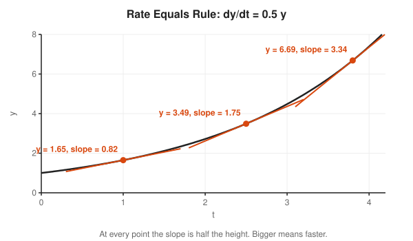

Course link: [401 Calculus](../../course/401/README.md).

#### 2. Slope Fields

Draw a grid of short segments, each with the slope the equation demands at that point. The picture shows every solution at once. Flat segments along a horizontal line mark an **equilibrium**, a value where nothing changes.

<!-- diagram: type=slope-field f="t-y" t=0..5 y=-2..4 solutions=4 caption="Slope field of dy/dt = t - y" -->
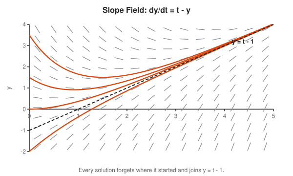

#### 3. The Euler Method

Stand at the starting point. Read the slope. Take a small step $h$ along it. Repeat. This turns a differential equation into a loop any computer runs, and every physics engine starts from this idea. Smaller steps give better answers and cost more steps.

$$y_{n+1} = y_n + h \cdot f(t_n, y_n)$$

<!-- diagram: type=euler-steps f="y" h=0.5 steps=2 caption="Euler steps versus the true curve" -->
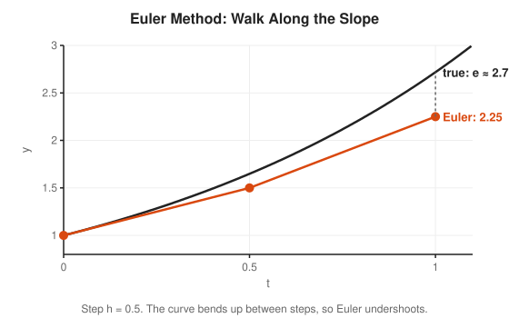

#### 4. Separable Equations and Exponential Growth

When the rate is proportional to the amount, the solution is an exponential. Separate the variables (all $y$ on one side, all $t$ on the other), integrate both sides, and exponentiate. Growth ($k > 0$) doubles in a fixed time. Decay ($k < 0$) halves in a fixed time.

$$\frac{dy}{dt} = ky \implies y(t) = y_0 e^{kt}, \qquad t_{\text{double}} = \frac{\ln 2}{k}$$

<!-- diagram: type=function-plot f="exp(0.5t),exp(-0.5t)" marks=doubling,half-life caption="Exponential growth and decay" -->
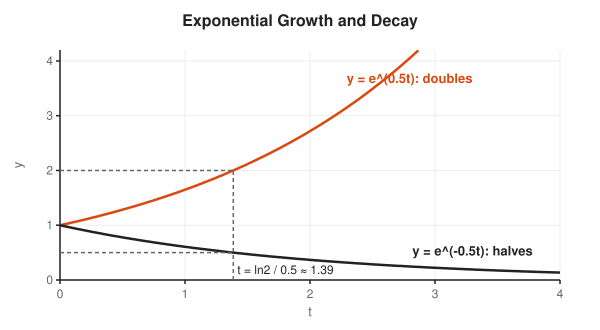

### Intermediate

#### 5. Equilibria and Logistic Growth

Real growth runs out of room. The logistic equation slows growth as $y$ nears a capacity $K$. An equilibrium is **stable** when nearby solutions come back to it and **unstable** when they run away. Read stability from the sign of the rate on each side: a **phase line** draws it with arrows.

$$\frac{dy}{dt} = r y \left(1 - \frac{y}{K}\right)$$

<!-- diagram: type=phase-line f="y*(1-y)" caption="Phase line for the logistic equation" -->
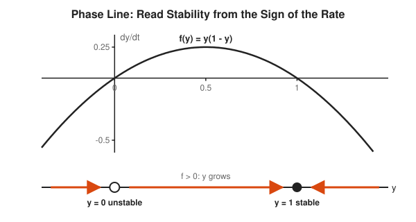

#### 6. First-Order Linear Equations

Equations of the form $y' + p(t)\,y = q(t)$ yield to an **integrating factor**, a multiplier that turns the left side into one derivative. Newton's law of cooling is the classic case: the temperature gap shrinks exponentially. The same shape describes a cache warming or a backlog draining.

$$\frac{dT}{dt} = -k(T - T_{\text{room}}) \implies T(t) = T_{\text{room}} + (T_0 - T_{\text{room}})e^{-kt}$$

<!-- diagram: type=function-plot f="20+70*exp(-0.1t)" asymptote=20 caption="Newton cooling" -->
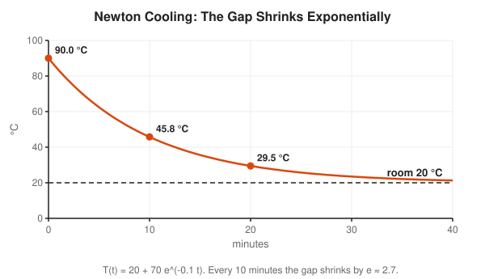

#### 7. Second-Order Oscillators

A mass on a spring obeys Newton's second law: force equals mass times acceleration, and acceleration is the second derivative. Guess $y = e^{rt}$ to get a quadratic called the **characteristic equation**. Real roots give smooth decay. Complex roots give oscillation, and the [Complex Analysis Track](../complex-analysis/README.md) explains why.

$$m y'' + c y' + k y = 0 \implies m r^2 + c r + k = 0$$

<!-- diagram: type=function-plot ode="y''+cy'+y=0" c=0.4,2,5 caption="Three kinds of damping" -->
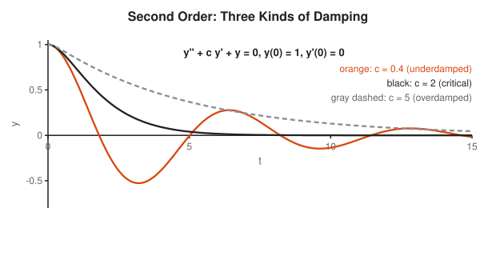

A good autoscaler is critically damped: it reaches the target fast and does not overshoot. Underdamped autoscalers flap. Overdamped autoscalers arrive after the incident is over.

#### 8. Systems and Phase Planes

Several quantities that drive each other form a **system**, for example predators and prey. Linear systems are $\mathbf{x}' = A\mathbf{x}$, and the eigenvalues of $A$ decide everything: negative real parts settle, positive real parts explode, imaginary parts spin. Plot $x_1$ against $x_2$ to get a **phase portrait**.

$$\mathbf{x}' = A\mathbf{x}, \qquad \mathbf{x}(t) = c_1 e^{\lambda_1 t}\mathbf{v}_1 + c_2 e^{\lambda_2 t}\mathbf{v}_2$$

<!-- diagram: type=phase-plane A=[[-1,-2],[2,-1]] start=(2,0.5) caption="A stable spiral" -->
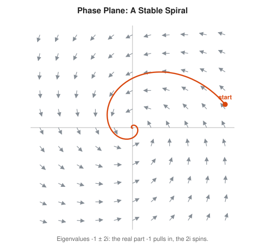

### Advanced

#### 9. The Laplace Transform

The **Laplace transform** turns derivatives into multiplication by a new variable $s$. A differential equation becomes an algebra problem, which you solve and transform back. Control engineers use it to design stable feedback loops, the same loops that sit inside autoscalers.

$$\mathcal{L}\{f\}(s) = \int_0^\infty e^{-st} f(t)\,dt, \qquad \mathcal{L}\{f'\} = s\,\mathcal{L}\{f\} - f(0)$$

<!-- diagram: type=flow steps=ode,transform,algebra,inverse caption="Laplace transform as a detour through algebra" -->
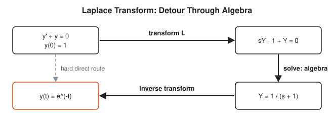

#### 10. PDEs and Fourier Series

When the unknown depends on space and time, the equation is a **partial differential equation** (PDE). The heat equation spreads temperature along a rod. Fourier's insight: split the starting shape into sine waves, and each wave decays on its own schedule. Wiggly waves die fastest.

$$\frac{\partial u}{\partial t} = \alpha \frac{\partial^2 u}{\partial x^2}$$

<!-- diagram: type=function-plot pde=heat times=0,0.02,0.1 caption="Heat equation profiles" -->
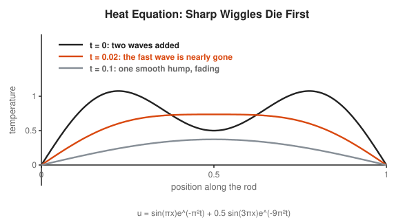

#### 11. Nonlinear Dynamics and Chaos

Nonlinear systems in three or more dimensions can be **chaotic**: fully deterministic, yet tiny changes in the start grow exponentially. The Lorenz system, a toy weather model, is the classic example and gave the world the **butterfly effect**.

$$x' = \sigma(y - x), \quad y' = x(\rho - z) - y, \quad z' = xy - \beta z$$

<!-- diagram: type=trajectory system=lorenz sigma=10 rho=28 beta=8/3 projection=x,z caption="Lorenz attractor" -->
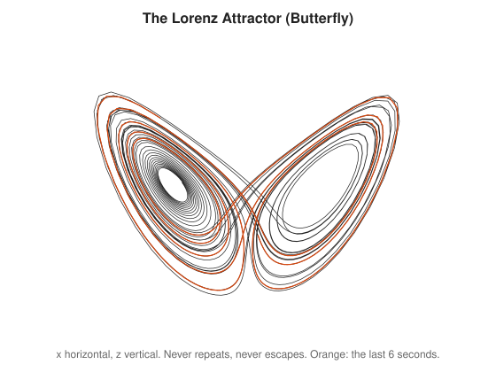

## Worked Examples

### Example 1: Solve a Separable Equation

Solve $dy/dt = -0.1y$ with $y(0) = 100$.

```txt
  dy / y = -0.1 dt                       separate the variables
  ln|y| = -0.1 t + C                     integrate both sides
  y = A e^(-0.1 t)                       exponentiate, A = e^C
  100 = A e^0 = A                        use y(0) = 100
  y = 100 e^(-0.1 t)                     solution
  y(10) = 100 e^(-1) ≈ 36.8              evaluate at t = 10
```

### Example 2: Two Euler Steps

Estimate $y(1)$ for $y' = y$, $y(0) = 1$ with $h = 0.5$.

```txt
  y0 = 1                                 start
  y1 = y0 + 0.5 · y0 = 1 + 0.5 = 1.5     one step along slope y0 = 1
  y2 = y1 + 0.5 · y1 = 1.5 + 0.75 = 2.25 one step along slope y1 = 1.5
  true y(1) = e ≈ 2.718                  exact solution e^t
  error ≈ 0.468                          Euler undershoots a curve that bends up
```

### Example 3: Classify a Spring

Classify $y'' + 0.4y' + y = 0$.

```txt
  r² + 0.4 r + 1 = 0                     characteristic equation
  discriminant = 0.4² - 4 = -3.84        b² - 4ac
  negative -> complex roots              square root of a negative
  r = -0.2 ± 0.98 i                      quadratic formula
  real part -0.2: decays                 e^(-0.2 t) envelope
  imaginary part 0.98: oscillates        period 2π / 0.98 ≈ 6.4
```

## Big Theorems to Know

* **Existence and Uniqueness (Picard-Lindelof):** if $f$ is smooth enough, exactly one solution passes through each starting point. Solution curves never cross.
* **Superposition Principle:** sums of solutions of a linear homogeneous equation are again solutions.
* **Stability by Eigenvalues:** the equilibrium of $\mathbf{x}' = A\mathbf{x}$ is stable when every eigenvalue has a negative real part.
* **Hartman-Grobman Theorem:** near a typical equilibrium, a nonlinear system behaves like its linear approximation.
* **Poincare-Bendixson Theorem:** in the plane, bounded solutions settle to an equilibrium or a cycle. Chaos needs at least three dimensions.
* **Fourier Theorem:** reasonable periodic functions are sums of sines and cosines.

## Open Problems and Fun Facts

* **Navier-Stokes:** nobody knows whether the equations of fluid flow in three dimensions always have smooth solutions. It is a Clay Millennium Prize problem worth one million dollars.
* **Hilbert 16th problem:** how many limit cycles a polynomial system in the plane has is still open, even for quadratic polynomials.
* **The butterfly effect:** in 1961 Edward Lorenz restarted a weather simulation from a printout rounded to three decimals instead of six. The forecast diverged completely.
* **Three-body problem:** two orbiting bodies have a clean formula. Three bodies have no general closed-form solution, and their motion is often chaotic.
* **Discovering Neptune:** in 1846, astronomers predicted where Neptune sat by solving the equations of motion for odd wobbles in the orbit of Uranus.

## Starter Problems

1. Check that $y = 3e^{2t}$ solves $y' = 2y$.
2. A backlog drains by $dy/dt = -0.1y$ with $y(0) = 100$ and $t$ in minutes. How big is it after 10 minutes?
3. Use the Euler method with step $h = 0.5$ on $y' = y$, $y(0) = 1$. Estimate $y(1)$ and compare with $e$.
4. Find the equilibria of $dy/dt = y(1 - y)$ and say which is stable.
5. Find the general solution of $y'' + 4y = 0$. What is the period of the oscillation?
6. Traffic grows by $dy/dt = 0.07y$ per month. How long until it doubles?
7. A queue holds 5,000 requests. Arrivals are 900 per second and service is 1,000 per second. How long until it drains?

<details>
<summary>Answers</summary>

1. $y' = 6e^{2t} = 2 \cdot 3e^{2t} = 2y$. It checks.
2. $y(10) = 100e^{-1} \approx 36.8$ items.
3. $y_1 = 1.5$ and $y_2 = 2.25$. The true value is $e \approx 2.718$. Euler undershoots because the curve bends up between steps.
4. $y = 0$ (unstable) and $y = 1$ (stable). Slightly above 0 the rate is positive and pushes away. Near 1 the rate pushes back toward 1 from both sides.
5. $y = A\cos 2t + B\sin 2t$. The characteristic equation $r^2 + 4 = 0$ gives $r = \pm 2i$. The period is $2\pi / 2 = \pi \approx 3.14$.
6. About 9.9 months. $t = \ln 2 / 0.07 \approx 0.693 / 0.07 \approx 9.9$. (The "rule of 70": divide 70 by the percent growth rate.)
7. 50 seconds. The queue shrinks at $1000 - 900 = 100$ per second, and $5000 / 100 = 50$.

</details>

## Code Corner

[code/main.go](code/main.go) compares the Euler method with the fourth-order Runge-Kutta method (RK4), checks the logistic solution, cools a server, drains a queue and classifies three springs. Run it with `go run main.go` inside `code/`.

```txt
== y' = y, y(0) = 1: estimate y(1) = e ==
h = 0.5   Euler 2.250000   RK4 2.7173461914
h = 0.1   Euler 2.593742   RK4 2.7182797441
h = 0.01  Euler 2.704814   RK4 2.7182818282
exact          2.7182818285

== Logistic y' = y(1 - y), y(0) = 0.1 ==
t = 0  y = 0.1000  exact 0.1000
t = 2  y = 0.4509  exact 0.4509
t = 4  y = 0.8585  exact 0.8585
t = 6  y = 0.9782  exact 0.9782
t = 8  y = 0.9970  exact 0.9970

== Newton cooling: server at 90 C in a 20 C room, k = 0.1/min ==
t =  0 min  T = 90.0 C
t = 10 min  T = 45.8 C
t = 20 min  T = 29.5 C
t = 30 min  T = 23.5 C
time to reach 30 C: 19.5 min

== Queue: backlog 5,000, arrivals 900/s, service 1,000/s ==
dQ/dt = 900 - 1000 = -100 per second, drains in 50 s

== Damped spring y'' + c y' + y = 0 ==
c = 0.4 c^2 - 4 = -3.84  underdamped (oscillates)  y(3) = -0.5151
c = 2   c^2 - 4 =  0.00  critically damped         y(3) = +0.1991
c = 5   c^2 - 4 = 21.00  overdamped                y(3) = +0.5590
```

Look at the first block. Euler with 100 steps is wrong in the second decimal. RK4 with 2 steps is already better than that. Clever beats brute force, and the [Numerical Methods Track](../numerical-methods/README.md) explains why.

## Flashcards

[cards.tsv](cards.tsv) holds the key definitions and theorems for Anki import.

## Resources

* [Paul's Online Notes: Differential Equations](https://tutorial.math.lamar.edu/Classes/DE/DE.aspx): every beginner and intermediate rung, with worked examples.
* [MIT OCW 18.03 Differential Equations](https://ocw.mit.edu/courses/18-03-differential-equations-spring-2010/): full lectures with a focus on oscillators and systems.
* [Jiri Lebl: Notes on Diffy Qs](https://www.jirka.org/diffyqs/): a free, plain textbook that covers the whole ladder.
* [Khan Academy: Differential Equations](https://www.khanacademy.org/math/differential-equations): short videos on slope fields and separable equations.
* [Wolfram MathWorld: Lorenz Attractor](https://mathworld.wolfram.com/LorenzAttractor.html): the equations and pictures behind the butterfly effect.

## Where to Go Next

* [Linear Algebra Track](../linear-algebra/README.md) for the eigenvalues that govern systems.
* [Numerical Methods Track](../numerical-methods/README.md) for better solvers than Euler, such as RK4.
* [Complex Analysis Track](../complex-analysis/README.md) for why oscillations come from complex roots.
