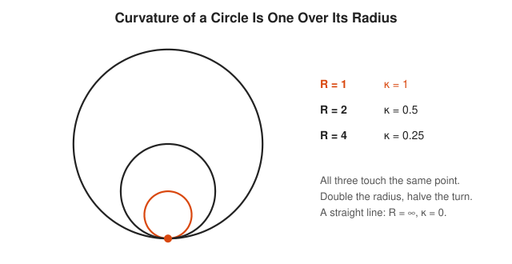
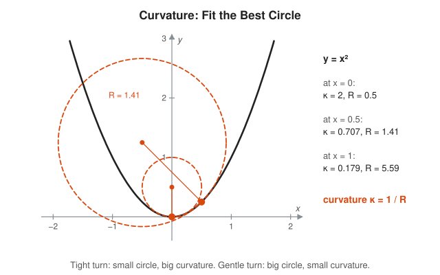
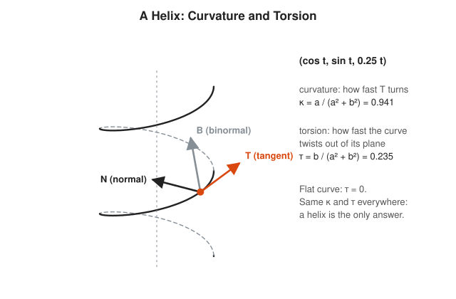
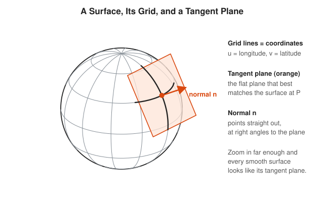
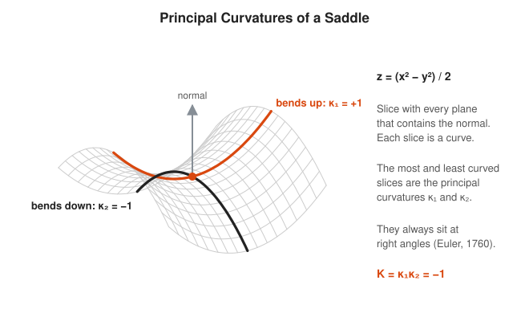
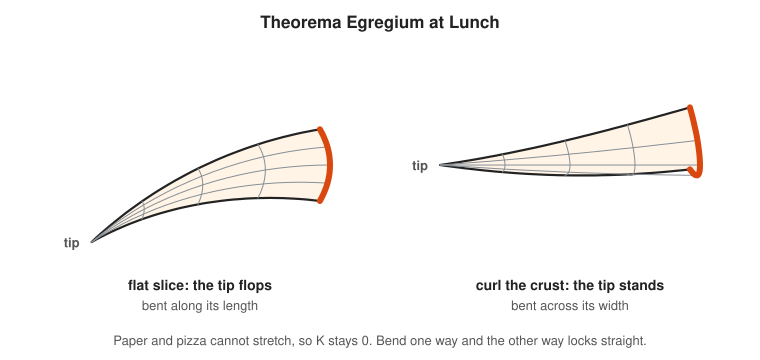
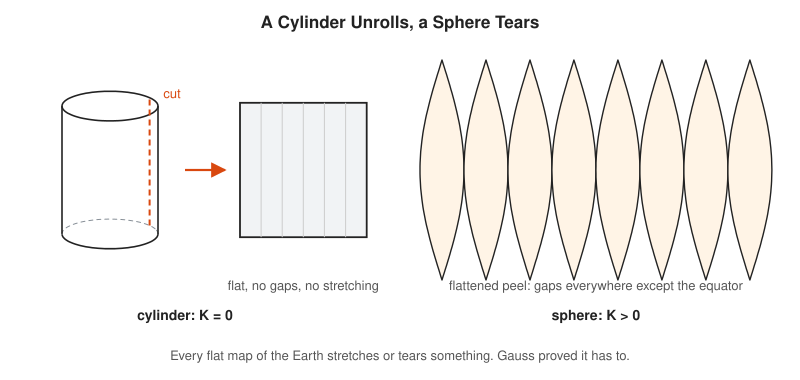
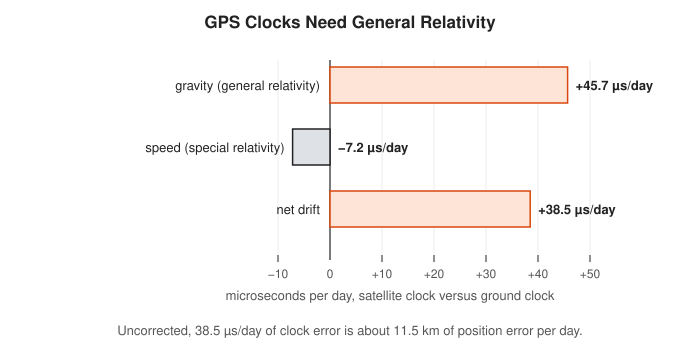

# Differential Geometry Track

**Track:** Differential Geometry · **Span:** beginner to advanced · **Course levels:** [401 Calculus](../../course/401/README.md) (derivatives), [501 Linear Algebra, Probability and Discrete Math](../../course/501/README.md) (vectors), [601 Proof and Higher Math](../../course/601/README.md)
**Prerequisites:** the [Geometry Track](../geometry/README.md) for circles and angles, and the first half of the [Calculus Track](../calculus/README.md) for derivatives. Vectors from the [Linear Algebra Track](../linear-algebra/README.md) help from rung 3 on. The [Topology Track](../topology/README.md) pairs well with the advanced rungs.
**Files:** this README, [cards.tsv](cards.tsv) for Anki, [code/main.go](code/main.go), and the diagrams in [img/](img/).

## What the Field Studies

Differential geometry measures bending. It asks how sharply a road turns, how a ball differs from a pipe, and what the shortest path looks like on a curved surface.

The tool is calculus. Zoom in close enough on any smooth curve and it looks straight. Zoom in on a smooth surface and it looks flat. Differential geometry studies the small difference between "almost flat" and "flat", and adds it up.

## Why It Matters

Curved space shows up wherever you look closely:

* Flight routes follow **great circles**, which look bent on a flat map. A geodesic is the cheapest route on a curved surface.
* Every flat map of the Earth stretches something. Gauss proved no map gets distances right everywhere. The [Maps and Projections](../../workshops/maps-and-projections/README.md) workshop puts this to work.
* GPS satellite clocks gain about 38 microseconds per day relative to the ground, because gravity curves spacetime. Without the correction, position fixes drift by about 11 km per day. Time sync engineers live in curved spacetime whether they like it or not.
* Computer graphics, 3D printing and robotics use curvature to smooth meshes, plan paths and bend sheet metal.
* Machine learning uses the same ideas on "manifolds" of data: a cloud of points that looks flat locally.

## Concept Map

<!-- diagram: type=concept-map tiers=beginner,intermediate,advanced nodes=12 caption="Differential geometry concepts with prerequisite arrows" -->
![Concept map of differential geometry. Curves and Velocity lead to Curvature of a Plane Curve, which leads to Space Curves and to Surfaces and Tangent Planes. Surfaces lead to Principal Curvatures and to The Metric. Principal Curvatures lead to Gaussian Curvature. The Metric and Gaussian Curvature both lead to Theorema Egregium. The Metric leads to Geodesics and to Manifolds. Gaussian Curvature leads to Gauss-Bonnet. Manifolds and Geodesics lead to the General Relativity Taster. Gaussian Curvature and Geodesics are the milestones.](img/concept-map.svg)

Read the map top to bottom. An arrow from A to B means learn A first. Orange boxes mark the milestones.

## Signature Diagram

<!-- diagram: type=surface-trio surfaces=sphere,cylinder,saddle highlight=principal-directions caption="Positive, zero and negative Gaussian curvature" -->


Stand on a surface and look in two directions at right angles. Measure how much the surface bends in each. Multiply the two numbers. That product is the **Gaussian curvature** $K$. On a ball both bends go the same way: $K > 0$. On a pipe one direction does not bend at all: $K = 0$. On a saddle or a potato chip the bends go opposite ways: $K < 0$. Three shapes, three signs, and the rest of the track grows out of this picture.

## The Concept Ladder

### Beginner

#### 1. Curves and Velocity

A **parametrized curve** is a moving point: a rule $r(t)$ that gives a position for each time $t$. Its derivative $r'(t)$ is the **velocity**: an arrow that points along the path. The length of that arrow is the **speed**.

$$r(t) = (2\cos t,\ 2\sin t), \qquad r'(t) = (-2\sin t,\ 2\cos t), \qquad |r'(t)| = 2$$

<!-- diagram: type=parametric-curve curve=circle r=2 marks=0,pi/3,2pi/3 vectors=velocity caption="Position and velocity on a circle" -->


Think of a log of GPS fixes from a delivery van. The fixes are $r(t)$. The difference between two fixes, divided by the time gap, approximates $r'(t)$. Velocity is always tangent to the path. Nothing in the definition is fancier than that.

In the course: [401 The Derivative](../../course/401/02-the-derivative/README.md).

#### 2. Curvature of a Plane Curve

**Curvature** $\kappa$ (the Greek letter kappa) measures how fast the direction turns as you move along a curve at unit speed. Fit the circle that hugs the curve best at a point, the **osculating circle** (osculating means kissing). Its radius $R$ is the **radius of curvature**, and $\kappa = 1/R$.

$$\kappa = \frac{1}{R}, \qquad \text{for } y = f(x): \quad \kappa = \frac{|f''(x)|}{\left(1 + f'(x)^2\right)^{3/2}}$$

<!-- diagram: type=circles-touching radii=1,2,4 caption="Curvature of a circle is one over its radius" -->


<!-- diagram: type=osculating-circles curve=y=x^2 points=0,0.5 caption="Best-fit circles on a parabola" -->


A highway engineer designs curves by radius. A tight exit ramp has a small radius and big curvature. The interstate has a huge radius and a curvature close to zero.

Related track: [Calculus Track](../calculus/README.md) for $f'$ and $f''$.

#### 3. Space Curves: Curvature and Torsion

A curve in 3D bends and also twists. At each point it carries three arrows at right angles: **T** (tangent, the direction of travel), **N** (normal, the direction it turns toward) and **B** (binormal, $T \times N$). Curvature $\kappa$ says how fast T turns. **Torsion** $\tau$ (tau) says how fast the curve leaves its own plane.

$$\text{helix } (a\cos t,\ a\sin t,\ bt): \qquad \kappa = \frac{a}{a^2 + b^2}, \qquad \tau = \frac{b}{a^2 + b^2}$$

<!-- diagram: type=space-curve curve=helix a=1 b=0.25 frame=T,N,B caption="A helix with its moving frame" -->


A flat curve has $\tau = 0$. A curve with the same $\kappa$ and $\tau$ at every point is a helix, and nothing else. Springs, DNA and spiral staircases all agree.

In the course: [501 Vectors and the Dot Product](../../course/501/09-vectors-and-dot-product/README.md).

#### 4. Surfaces and Tangent Planes

A **surface** is described by two coordinates $(u, v)$, the way longitude and latitude describe the Earth. Hold one coordinate fixed and vary the other: you trace a grid line. At each point, the two grid directions span the **tangent plane**, the flat plane that best matches the surface there. The **normal vector** $n$ sticks straight out of it.

$$n = \frac{r_u \times r_v}{|r_u \times r_v|}$$

<!-- diagram: type=surface-patch surface=sphere point=lat30,lon-60 show=grid,tangent-plane,normal caption="Grid, tangent plane and normal on a sphere" -->


This is why the Earth looked flat to people for a long time. Near any point, a smooth surface and its tangent plane agree to first order.

In the course: [401 Multivariable Intro](../../course/401/12-multivariable-intro/README.md).

### Intermediate

#### 5. Principal Curvatures

Slice a surface with every plane that contains the normal. Each slice is a curve with its own curvature (signed: positive if it bends toward the normal). The largest and smallest values are the **principal curvatures** $\kappa_1$ and $\kappa_2$. Euler proved in 1760 that their directions always sit at right angles.

$$z = \tfrac{1}{2}(x^2 - y^2): \qquad \kappa_1 = +1, \quad \kappa_2 = -1 \quad \text{at the origin}$$

<!-- diagram: type=surface surface=saddle z=(x^2-y^2)/2 highlight=principal-curves caption="Principal curvatures of a saddle" -->


A horse saddle bends up front to back and down side to side. That is the whole idea, and the saddle gave the shape its name.

#### 6. Gaussian Curvature

The **Gaussian curvature** is the product $K = \kappa_1 \kappa_2$. Its sign tells the local shape: dome ($K > 0$), flat or cylinder ($K = 0$), saddle ($K < 0$). A sphere of radius $R$ has $K = 1/R^2$ everywhere. For a graph $z = f(x, y)$ there is a formula with no slicing needed:

$$K = \frac{f_{xx} f_{yy} - f_{xy}^2}{\left(1 + f_x^2 + f_y^2\right)^2}$$

<!-- diagram: type=torus-curvature R=2 r=0.8 regions=positive,negative,zero caption="Gaussian curvature on a torus" -->


A torus (donut) has all three kinds. The outside is dome-like, the region around the hole is saddle-like, and the top and bottom circles are flat in one direction. Add $K$ over the whole torus and the plus and minus cancel to exactly zero. Rung 10 explains why that is no accident.

Related track: [Linear Algebra Track](../linear-algebra/README.md): $\kappa_1$ and $\kappa_2$ are the eigenvalues of a 2 by 2 matrix called the shape operator.

#### 7. Theorema Egregium

Gauss called this result his "remarkable theorem". $K$ depends only on distances measured inside the surface. Bending a surface without stretching it never changes $K$. A flat sheet has $K = 0$, and stays at $K = 0$ however you roll it.

$$\text{bend without stretching} \implies K \text{ stays the same}$$

<!-- diagram: type=pizza-slice panels=droop,curl caption="Theorema Egregium at lunch" -->


<!-- diagram: type=unroll panels=cylinder,sphere-gores caption="A cylinder unrolls flat, a sphere tears" -->


The pizza trick: a slice starts flat, $K = 0$. Fold the crust into a U and the slice now bends across its width. To keep $\kappa_1 \kappa_2 = 0$, the other direction must stay straight, and the tip stops flopping. The same theorem explains why corrugated cardboard is stiff and why every flat map of the Earth distorts something.

#### 8. The Metric

The **metric** (also called the first fundamental form) converts small changes in coordinates into real distances. On a sphere of radius $R$, with latitude $\varphi$ and longitude $\lambda$ in radians:

$$ds^2 = R^2\, d\varphi^2 + R^2 \cos^2\!\varphi\; d\lambda^2$$

<!-- diagram: type=sphere-metric cells=equator,60N size=10deg caption="Same coordinate step, different true size" -->


A 10 degree step east covers 1,112 km at the equator and only 556 km at 60 degrees north, because $\cos 60^\circ = 0.5$. The metric is the lookup table that turns coordinate deltas into kilometers. The Theorema Egregium says $K$ can be computed from this table alone.

In the course: [201 Pythagorean Theorem](../../course/201/10-pythagorean-theorem/README.md): $ds^2 = dx^2 + dy^2$ is the flat-plane metric.

### Advanced

#### 9. Geodesics

A **geodesic** is the straightest possible path on a surface: a walker who never turns left or right traces one. Short geodesics are also the shortest paths. On a sphere the geodesics are **great circles**, the circles whose center is the center of the sphere.

$$\text{great-circle distance} = R \cdot \arccos(p \cdot q) \quad \text{for unit vectors } p, q$$

<!-- diagram: type=great-circle from=60N,0E to=60N,90E panels=globe,flat-map caption="Great circle versus following the latitude" -->


Fly from 60 degrees north, 0 east to 60 degrees north, 90 east. Following the latitude costs 5,004 km. The great circle costs 4,605 km and passes closer to the pole. On a flat map the shortest path looks bent, and the straight-looking path is the long way round.

Related workshop: [Maps and Projections](../../workshops/maps-and-projections/README.md).

#### 10. Gauss-Bonnet

On a curved surface, the angles of a triangle made of geodesics do not add to $180^\circ$. The excess equals the total curvature inside. Integrate over a whole closed surface and you get a number fixed by topology alone: $2\pi$ times the **Euler characteristic** $\chi$.

$$\alpha + \beta + \gamma - \pi = \iint_T K\, dA, \qquad \iint_S K\, dA = 2\pi\chi(S)$$

<!-- diagram: type=spherical-triangle vertices=N,0E-equator,90E-equator caption="A triangle with three right angles" -->


Walk south from the North Pole to the equator, turn left 90 degrees, walk a quarter of the way around the Earth, turn left 90 degrees, walk north: you are home, after three right angles. For a whole sphere $\iint K\,dA = 4\pi = 2\pi \cdot 2$. For a torus it is $0 = 2\pi \cdot 0$, which is why the plus and minus in rung 6 cancel. Curvature (local, calculus) and holes (global, topology) turn out to be the same bookkeeping.

Related track: [Algebraic Topology Track](../algebraic-topology/README.md) for $\chi$.

#### 11. Manifolds and Charts

A **manifold** is a space that looks flat near every point, even if it is curved or knotted overall. You describe it with **charts**: flat maps of small pieces. A collection of charts that covers everything is an **atlas**, the same word as the book of maps. Where two charts overlap, they must agree.

$$\text{manifold of dimension } n: \text{ every point has a neighborhood that looks like } \mathbb{R}^n$$

<!-- diagram: type=charts space=circle charts=U,V caption="A circle needs two charts" -->


One flat chart cannot cover a whole circle without a seam, and one flat map cannot cover the whole Earth without tearing. An atlas uses several and stitches them on the overlaps. This is the same idea as a sharded map of keys: each shard is simple, and the system works because neighbors agree at the boundaries.

In the course: [601 Topology Taster](../../course/601/12-topology-taster/README.md).

#### 12. A Taste of General Relativity

Einstein's theory says spacetime is a 4-dimensional manifold with a metric, and mass curves it. Objects in free fall follow geodesics. Gravity is not a force pulling sideways. It is what straight lines look like in curved spacetime. Clocks deeper in a gravity well tick slower.

$$\frac{\Delta t_{\text{gravity}}}{t} \approx \frac{GM}{c^2}\left(\frac{1}{r_{\text{Earth}}} - \frac{1}{r_{\text{orbit}}}\right), \qquad \frac{\Delta t_{\text{speed}}}{t} \approx -\frac{v^2}{2c^2}$$

<!-- diagram: type=bar-chart-horizontal items=gravity,speed,net unit=us/day caption="GPS clock drift per day" -->


GPS satellites sit higher in Earth's gravity well, where clocks run faster, and they move fast, which slows them. The net is $+38.5$ microseconds per day. Light travels about 11.5 km in that time. The satellite clocks are deliberately tuned slow before launch to cancel it. Every phone location fix depends on differential geometry, applied to time.

Related track: [Differential Equations Track](../differential-equations/README.md): the geodesic rule is a system of differential equations.

## Worked Examples

### Example 1: Curvature of a Parabola

Find the curvature of $y = x^2$ at $x = 0.5$.

```txt
  f'(x)  = 2x            = 1           differentiate, then plug in x = 0.5
  f''(x) = 2                           differentiate again
  1 + f'^2 = 1 + 1       = 2           the term under the power
  2^(3/2)  = 2 sqrt 2    = 2.828       raise to the 3/2 power
  kappa  = 2 / 2.828     = 0.707       kappa = |f''| / (1 + f'^2)^(3/2)
  R      = 1 / 0.707     = 1.414       radius of curvature = 1 / kappa
```

The best-fit circle at $x = 0.5$ has radius $\sqrt{2}$, as drawn in the osculating circles diagram.

### Example 2: Gaussian Curvature of a Saddle

Find $K$ for $z = x^2 - y^2$ at the origin.

```txt
  f_x = 2x  = 0,  f_y = -2y = 0        first derivatives at (0, 0)
  f_xx = 2,  f_yy = -2,  f_xy = 0      second derivatives
  numerator   = (2)(-2) - 0^2 = -4     f_xx f_yy - f_xy^2
  denominator = (1 + 0 + 0)^2 = 1      (1 + f_x^2 + f_y^2)^2
  K = -4 / 1  = -4                     negative: a saddle
```

### Example 3: Angle Excess of a Large Triangle on Earth

A geodesic triangle on the Earth encloses 1,000,000 square kilometers. How far above $180^\circ$ is its angle sum?

```txt
  K = 1 / R^2,  R = 6,371 km           a sphere has constant curvature
  R^2 = 40,589,641 km^2                square the radius
  excess = K * area                    Gauss-Bonnet for a triangle
         = 1,000,000 / 40,589,641
         = 0.02464 rad                 divide
         = 0.02464 * 180 / pi
         = 1.41 degrees                convert radians to degrees
```

A triangle the size of Egypt has angles that add up to about $181.4^\circ$. Surveyors working at that scale correct for it.

## Big Theorems to Know

* **Euler (1760):** at each point of a surface, the directions of largest and smallest bending are at right angles.
* **Fundamental Theorem of Space Curves:** curvature and torsion, given as functions of arc length, determine a curve up to a rigid motion.
* **Theorema Egregium (Gauss, 1827):** Gaussian curvature depends only on the metric. Bending without stretching never changes it.
* **Local Gauss-Bonnet:** for a geodesic triangle, angle sum minus $\pi$ equals the total curvature inside.
* **Global Gauss-Bonnet:** for a closed surface, $\iint K\,dA = 2\pi\chi$.
* **Hopf-Rinow (1931):** on a complete surface or manifold, any two points are joined by a shortest geodesic.
* **Nash Embedding Theorem (1956):** every Riemannian manifold sits inside some flat $\mathbb{R}^n$ without distorting distances.
* **Uniformization (Poincare and Koebe, 1907):** every closed surface carries a metric of constant curvature $+1$, $0$ or $-1$.

## Open Problems and Fun Facts

* **Gauss surveyed real triangles:** around 1820, Gauss measured a triangle between three mountain peaks near Gottingen with sides up to 107 km. He found an angle sum consistent with $180^\circ$ within his error. Whether he was testing the flatness of space is still debated by historians.
* **Riemann's lecture:** in 1854 Bernhard Riemann gave a job-application lecture that defined curved spaces of any dimension. It became the language of general relativity 60 years later. Few job talks have aged that well.
* **Hopf conjecture:** does every even-dimensional closed manifold with positive sectional curvature have positive Euler characteristic? Open since the 1930s.
* **Poincare conjecture:** solved by Grigori Perelman in 2003 using Ricci flow, an equation that smooths a metric the way heat smooths temperature. He declined both the Fields Medal and a one-million-dollar prize.
* **Corrugation:** cardboard, roofing sheets and the ridges on a stiff pizza slice all use the Theorema Egregium to buy stiffness with no extra material.

## Starter Problems

1. What is the curvature of a circle of radius 5?
2. A road curve has curvature 0.02 per meter. What is its radius?
3. What is the Gaussian curvature of a sphere of radius 2?
4. A cylinder and a sheet of paper both have $K = 0$. Explain in one sentence why you can wrap paper around a cylinder without wrinkles, but not around a ball.
5. A triangle on the unit sphere has angles $90^\circ$, $90^\circ$ and $45^\circ$. What is its area?
6. Two cities sit on the equator, 90 degrees of longitude apart. What is the shortest path between them on a sphere of radius $R$, and how long is it?
7. Find $K$ at the origin for $z = x^2 + y^2$.

<details>
<summary>Answers</summary>

1. $\kappa = 1/5 = 0.2$.
2. $R = 1/0.02 = 50$ meters.
3. $K = 1/R^2 = 1/4$.
4. Paper and cylinder share $K = 0$, and bending preserves $K$. A ball has $K > 0$, and paper cannot reach it without stretching or creasing.
5. $\pi/4$. The angle sum is $225^\circ$ and the excess is $45^\circ = \pi/4$ radians. On the unit sphere $K = 1$, and the area equals the excess.
6. Along the equator, which is a great circle. Its length is a quarter of the circumference: $2\pi R/4 = \pi R/2$.
7. $K = 4$. Here $f_{xx} = 2$, $f_{yy} = 2$, $f_{xy} = 0$, and the first derivatives vanish at the origin: $K = (2 \cdot 2 - 0)/1 = 4$.

</details>

## Code Corner

[code/main.go](code/main.go) estimates curvature and torsion with finite differences, computes Gaussian curvature for five surfaces, checks the right-angle triangle on the sphere, compares the two flight paths, and works out the GPS clock correction. Run it with `go run main.go` inside `code/`.

```txt
== Curvature of y = x^2 ==
x = 0.0: kappa = 2.0000, radius = 0.5000
x = 0.5: kappa = 0.7071, radius = 1.4142
x = 1.0: kappa = 0.1789, radius = 5.5902

== Helix (cos t, sin t, 0.25 t) ==
kappa = 0.9412 (formula 0.9412), torsion = 0.2353 (formula 0.2353)

== Gaussian curvature at the origin ==
unit sphere cap      K = +1.0000
sphere of radius 2   K = +0.2500
cylinder             K = +0.0000
saddle (x^2-y^2)/2   K = -1.0000
saddle x^2-y^2       K = -4.0000

== A triangle on the unit sphere ==
angle sum = 270.0 degrees, excess = 1.5708 rad, area/R^2 = 1.5708

== From 60N 0E to 60N 90E on Earth (R = 6371 km) ==
along the latitude: 5004 km
great circle:       4605 km (saves 399 km)

== GPS clock drift per day ==
orbital speed 3874 m/s
gravity: +45.7 us, speed: -7.2 us, net: +38.5 us per day
uncorrected position error: 11.5 km per day
```

The numerical derivatives match the exact formulas to four decimal places. Finite differences are how a computer sees curvature: compare nearby samples, the same way you compute a rate from two log timestamps.

## Flashcards

[cards.tsv](cards.tsv) holds the key definitions and theorems for Anki import.

## Resources

* [MacTutor: Carl Friedrich Gauss](https://mathshistory.st-andrews.ac.uk/Biographies/Gauss/): the life of the man behind curvature, the Theorema Egregium and much else.
* [Wolfram MathWorld: Gaussian Curvature](https://mathworld.wolfram.com/GaussianCurvature.html): definitions and formulas for many surfaces.
* [Keenan Crane: Discrete Differential Geometry](https://www.cs.cmu.edu/~kmcrane/Projects/DDG/): free notes and lectures that teach the subject through triangle meshes and code.
* [MIT OCW 18.950 Differential Geometry](https://ocw.mit.edu/courses/18-950-differential-geometry-fall-2008/): lecture notes and problem sets for curves and surfaces.
* [Sean Carroll: Lecture Notes on General Relativity](https://arxiv.org/abs/gr-qc/9712019): a free, readable path from manifolds to Einstein.

## Where to Go Next

* [Algebraic Topology Track](../algebraic-topology/README.md) for the Euler characteristic that Gauss-Bonnet connects to.
* [Topology Track](../topology/README.md) for spaces where only nearness matters, not distance.
* [Algebraic Geometry Track](../algebraic-geometry/README.md) for curves and surfaces defined by polynomials instead of calculus.
* [Maps and Projections](../../workshops/maps-and-projections/README.md) to see the Theorema Egregium at work on every map.
