# Discrete Math

**Track:** Discrete Math · **Span:** sums and induction to computability · **Main course level:** [501 Linear Algebra, Probability and Discrete Math](../../course/501/README.md)

## What This Field Studies

**Discrete** means made of separate, countable pieces: whole numbers, bits, nodes, steps, strings. Discrete math is the math of things you count rather than measure. It has no single central object. It is a toolbox: logic and proof, induction and recursion, counting, graphs, modular arithmetic, and the study of what algorithms can and cannot do.

If calculus is the math of physics, discrete math is the math of computers. A computer has finite memory, runs in steps, and stores everything as integers. It never sees a real number, only a very convincing imitation.

## Why It Matters

This track is the theory behind your daily work:

* **Algorithms:** recurrences tell you why binary search takes 20 steps on a million items and why a naive recursive Fibonacci melts a CPU.
* **Correctness:** induction is how you prove a loop invariant holds on every iteration, and it is the reasoning behind every "this retry loop always terminates."
* **Infrastructure:** service dependency maps, network topologies and build DAGs are graphs. Topological sort decides deploy order.
* **Protocols:** state machines describe TCP connections, circuit breakers and Kubernetes pod phases.
* **Capacity:** Big-O growth separates "fine at 10x traffic" from "falls over at 2x."

## Concept Map

<!-- diagram: type=concept-map bands=beginner,intermediate,advanced nodes=logic-sets,integers,sequences,relations,induction,modular,graphs,recursion,counting,big-o,generating-functions,probability,state-machines,computability caption="Discrete math concepts with prerequisite arrows" -->
![Concept map of discrete math in three bands. Beginner: logic and sets lead to sequences and sums and to relations and functions. Integers and divisibility lead to relations and functions and to modular arithmetic. Intermediate: sequences lead to proof by induction and to counting. Relations lead to graphs and trees. Induction leads to recursion and recurrences. Recursion and graphs lead to Big-O growth. Advanced: recursion and counting lead to generating functions. Counting leads to discrete probability. Graphs lead to state machines. Big-O and state machines lead to computability and complexity. Proof by induction and computability and complexity are highlighted as milestones.](img/concept-map.svg)

An arrow from A to B means learn A before B. The milestones are proof by induction (the single most used proof technique in computer science) and computability and complexity (where you learn the hard limits of what any program can do).

## Signature Diagram

<!-- diagram: type=dominoes n=7 first=tipping labels=P(1)..P(7) caption="Induction as a row of dominoes: base case plus inductive step topples every domino" -->


**Mathematical induction** proves a statement $P(n)$ for every whole number $n$ with only two checks. The **base case**: $P(1)$ is true, so the first domino falls. The **inductive step**: if any $P(k)$ is true, then $P(k + 1)$ is true, so each domino knocks over the next. Together, every domino falls, even though there are infinitely many. Both parts matter. A row of dominoes with a gap never finishes, and a perfect row that nobody pushes never starts.

Recursion is the same picture run backward. A recursive function trusts the call on $n - 1$ and handles the base case directly. Induction is the proof that the trust is justified.

## The Concept Ladder

### Beginner

#### 1. Logic and Sets

Discrete math is written in the language of logic and sets: statements, AND, OR, NOT, implications, quantifiers, unions and intersections. This is the shared grammar for every rung below. If any of it feels rusty, take the first half of the logic track first.

**Key idea:** $\lnot \forall x\, P(x) \equiv \exists x\, \lnot P(x)$

<!-- diagram: type=quantifier-negation items=s1..s5 false=s4 caption="Not every server is up means some server is down" -->
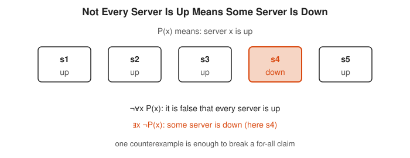

Look at s4: one down server is all it takes to make the for-all claim false.

<!-- diagram: type=venn panels=and,or,not caption="AND, OR and NOT as shaded regions" -->


Compare the shaded areas: AND keeps only the overlap, OR keeps both circles, and NOT keeps everything outside A.

**In the course:** [501 Linear Algebra, Probability and Discrete Math](../../course/501/README.md) · **Go further:** [Logic and Set Theory track](../logic-and-set-theory/README.md)

#### 2. Integers and Divisibility

The integers are the home ground of discrete math. Divisibility, primes, remainders and the division algorithm $a = qb + r$ appear everywhere, from hashing to loop bounds. Floor and ceiling functions convert real answers back to integers: $\lceil 10 / 3 \rceil = 4$ pages hold 10 items at 3 per page.

**Key idea:** $\lfloor x \rfloor$ rounds down, $\lceil x \rceil$ rounds up, and $a = b\lfloor a/b \rfloor + (a \bmod b)$.

<!-- diagram: type=number-line range=-4..5 marks=-2.5,10/3 caption="Floor and ceiling of 10/3 and of -2.5" -->


Follow the arrows: floor always moves left and ceiling always moves right, even for negative numbers.

<!-- diagram: type=pages items=10 per-page=3 caption="Ten items at three per page need four pages" -->
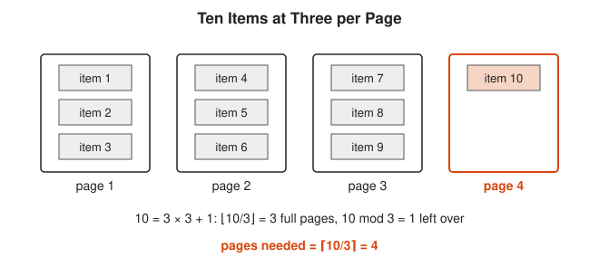

The leftover item on page 4 is the remainder, and it is the reason the ceiling is one more than the floor here.

**In the course:** [101 Foundations](../../course/101/README.md) · **Go further:** [Number Theory track](../number-theory/README.md)

#### 3. Sequences and Sums

A **sequence** is a list indexed by whole numbers: $a_1, a_2, a_3, \ldots$ **Sigma notation** $\sum$ is a `for` loop that adds. Two families matter most. An **arithmetic** sequence adds the same step each time. A **geometric** sequence multiplies by the same ratio each time, like retry backoff.

**Key idea:** $\sum_{i=1}^{n} i = \dfrac{n(n+1)}{2}$ and $\sum_{i=0}^{n-1} r^i = \dfrac{r^n - 1}{r - 1}$

```txt
  Gauss's trick for 1 + 2 + ... + 100:
  S = 1   + 2   + ... + 100
  S = 100 + 99  + ... + 1          write it backward
  2S = 101 + 101 + ... + 101       add column by column: 100 columns
  2S = 100 x 101 = 10,100
  S = 5,050
```

<!-- diagram: type=staircase n=5 caption="Two staircases of 1 + 2 + 3 + 4 + 5 form a 5 by 6 rectangle" -->


Each column holds one tint stack and one orange stack that always make 6 together, which is why the sum is half the rectangle.

<!-- diagram: type=bars values=1,2,4,8 total=16 caption="Backoff waits 1 + 2 + 4 + 8 equal 16 minus 1" -->
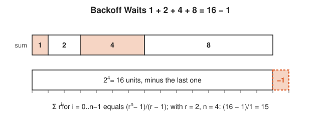

Line up the two rows: the four backoff waits fall exactly one unit short of the next power of 2.

**In the course:** [301 Algebra II, Trig and Precalculus](../../course/301/README.md)

#### 4. Relations and Functions

A **relation** is a set of pairs, like rows in a two-column table. A **function** gives each input exactly one output. Relations can be **reflexive**, **symmetric**, **transitive**, or **antisymmetric**, and the combinations name the two most useful kinds: **equivalence relations** (group things that are "the same") and **partial orders** (things that come "before" others, like task dependencies).

**Key idea:** a partial order is reflexive, antisymmetric and transitive. "Must deploy before" on services is one.

<!-- diagram: type=arrow-diagram left=1,2,3 right=a,b,c caption="A function versus a relation that is not a function" -->


Count the arrows leaving each input: a function has exactly one per input.

<!-- diagram: type=hasse nodes=db,auth,cache,api,web,worker caption="Deploy order as a Hasse diagram" -->


Read upward from db: any path of arrows means must deploy before, and the dashed arrow is the transitive shortcut that the diagram leaves out.

**In the course:** [501 Linear Algebra, Probability and Discrete Math](../../course/501/README.md)

### Intermediate

#### 5. Proof by Induction

To prove $P(n)$ for all $n \ge 1$: prove $P(1)$, then assume $P(k)$ (the **inductive hypothesis**) and use it to prove $P(k + 1)$. This turns an infinite number of checks into two finite ones.

**Key idea:** $P(1) \land \forall k\,(P(k) \to P(k+1)) \Rightarrow \forall n\, P(n)$

```txt
  Claim P(n): 1 + 2 + ... + n = n(n + 1)/2
  Base case n = 1:   left side 1, right side 1 x 2 / 2 = 1      equal
  Assume P(k):       1 + ... + k = k(k + 1)/2                   inductive hypothesis
  Then 1 + ... + k + (k + 1)
     = k(k + 1)/2 + (k + 1)                                     use the hypothesis
     = (k + 1)(k/2 + 1)                                         factor out (k + 1)
     = (k + 1)(k + 2)/2                                         this is P(k + 1)
  Base case and step both hold, so P(n) is true for every n ≥ 1.
```

<!-- diagram: type=ladder rungs=6 base=1 caption="Induction as climbing a ladder" -->


The orange bottom rung is the base case, and each curved arrow is one use of the inductive step.

<!-- diagram: type=staircase n=4 add=5 caption="The inductive step adds one column of height k + 1" -->
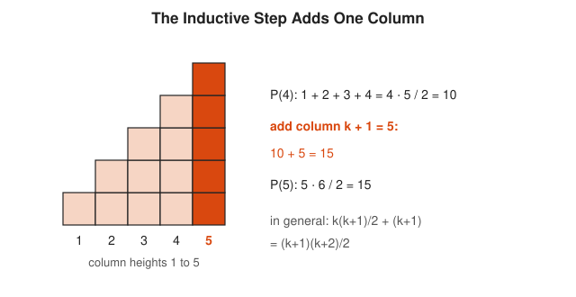

The orange column is the $k + 1$ that the inductive step adds to the known total.

**In the course:** [501 Linear Algebra, Probability and Discrete Math](../../course/501/README.md) and [601 Proof and Higher Math](../../course/601/README.md)

#### 6. Strong Induction and Well-Ordering

**Strong induction** lets the step assume all of $P(1), \ldots, P(k)$, not only $P(k)$. That is what you need when $n$ breaks into smaller pieces of any size, as in "every integer above 1 is a product of primes." The **well-ordering principle** says every nonempty set of positive integers has a smallest element. It is induction in disguise, and it powers proofs of the form "take the smallest counterexample and show a smaller one exists."

**Key idea:** if $P(1), \ldots, P(k)$ together imply $P(k + 1)$, and $P(1)$ holds, then $P(n)$ holds for all $n$.

<!-- diagram: type=induction-compare n=7 caption="Ordinary induction uses P(k), strong induction uses P(1) through P(k)" -->
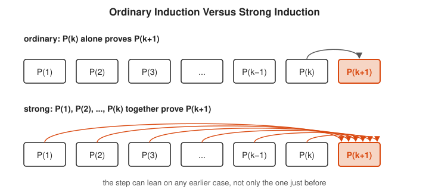

Count the arrows into $P(k+1)$: one for ordinary induction, all of them for strong induction.

<!-- diagram: type=factor-tree n=60 caption="Factor tree for 60" -->


Notice that 60 breaks into 6 and 10, not into 59, which is why the step needs every smaller case.

**In the course:** [601 Proof and Higher Math](../../course/601/README.md)

#### 7. Recursion and Recurrences

A **recurrence** defines each term from earlier terms. It is how you describe the cost of a recursive algorithm. Towers of Hanoi moves $n$ disks by moving $n - 1$ disks aside, moving the biggest, and moving the $n - 1$ back on top. Unroll the recurrence and a closed form appears.

**Key idea:** $T(n) = 2T(n-1) + 1$, $T(0) = 0$ gives $T(n) = 2^n - 1$.

```txt
  T(1) = 2(0)  + 1 = 1
  T(2) = 2(1)  + 1 = 3
  T(3) = 2(3)  + 1 = 7
  T(4) = 2(7)  + 1 = 15      pattern: one less than a power of 2
  Guess T(n) = 2^n - 1. Induction step: 2(2^k - 1) + 1 = 2^(k+1) - 1.
```

<!-- diagram: type=hanoi disks=3 moves=7 caption="Towers of Hanoi with 3 disks in 7 moves" -->


Moves 1 to 3 and moves 5 to 7 are each a full 2-disk solution, which is the $2T(n-1)$ in the recurrence, and move 4 is the $+1$.

<!-- diagram: type=bars n=1..5 values=1,3,7,15,31 outline=2,4,8,16,32 caption="T(n) = 2^n - 1" -->
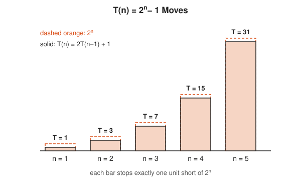

Each bar stops exactly one unit below its dashed outline, which is the $-1$ in $2^n - 1$.

**In the course:** [501 Linear Algebra, Probability and Discrete Math](../../course/501/README.md)

#### 8. Modular Arithmetic

Remainders form their own arithmetic: $a \equiv b \pmod n$ when $n$ divides $a - b$. Integer overflow in a 32-bit counter is arithmetic mod $2^{32}$. Hash rings, round-robin load balancing and day-of-week math all live here.

**Key idea:** $(a + b) \bmod n = ((a \bmod n) + (b \bmod n)) \bmod n$, and the same for $\times$.

<!-- diagram: type=clock n=12 start=9 add=5 caption="9 + 5 = 14, which is 2 mod 12" -->
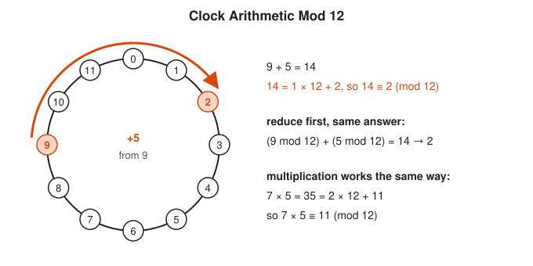

Follow the orange arc past 0: going around the clock throws away whole multiples of 12.

<!-- diagram: type=clock n=8 wrap=7..0 caption="A 3-bit counter wraps from 7 to 0" -->


The step from 7 back to 0 is the same wrap that a 32-bit counter makes after 4,294,967,295.

**In the course:** [501 Linear Algebra, Probability and Discrete Math](../../course/501/README.md) · **Go further:** [Number Theory track](../number-theory/README.md)

#### 9. Counting

The **product rule** says that $m$ choices followed by $n$ choices give $mn$ outcomes. The **sum rule** says that $m$ options or $n$ different options give $m + n$. From these come permutations $n!$ and combinations $\binom{n}{k}$. Counting is how you size a keyspace, a test matrix, or a brute-force search.

**Key idea:** $\binom{n}{k} = \dfrac{n!}{k!\,(n-k)!}$

<!-- diagram: type=tree levels=2,3 caption="Product rule tree: 2 regions times 3 sizes" -->


Count the leaves: 2 branches times 3 branches gives 6 complete choices.

<!-- diagram: type=grid items=A,B,C,D caption="12 ordered pairs, 6 unordered pairs" -->
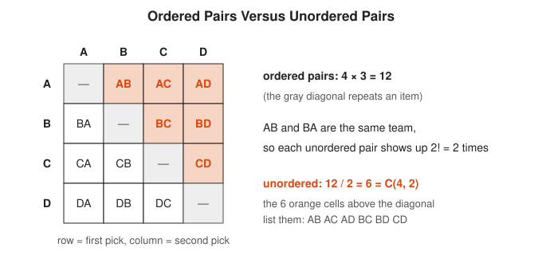

Each orange cell has a mirror image below the diagonal, and dividing by $2!$ removes those duplicates.

**In the course:** [501 Linear Algebra, Probability and Discrete Math](../../course/501/README.md) · **Go further:** [Combinatorics track](../combinatorics/README.md)

#### 10. The Pigeonhole Principle

Put more than $n$ pigeons into $n$ holes and some hole holds two. It sounds too obvious to be useful, yet it proves that any hash function from long strings to 64-bit values has collisions, that lossless compression cannot shrink every file, and that among 13 people two share a birth month.

**Key idea:** $N$ items in $k$ boxes force some box to hold at least $\lceil N/k \rceil$ items.

<!-- diagram: type=pigeonhole items=13 boxes=12 caption="13 people, 12 birth months" -->
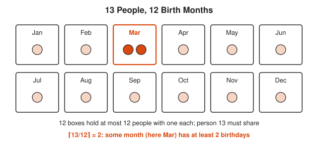

Fill one person per month first, and the thirteenth person has nowhere to go but a month that is already taken.

<!-- diagram: type=pigeonhole items=10 boxes=3 caption="10 items in 3 boxes force a box with 4" -->
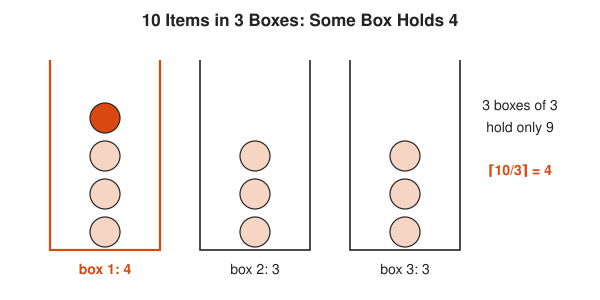

The orange item is the tenth one, and it pushes some box up to $\lceil 10/3 \rceil = 4$.

**In the course:** [501 Linear Algebra, Probability and Discrete Math](../../course/501/README.md)

#### 11. Graphs and Trees

A **graph** is a set of **vertices** (nodes) joined by **edges** (links). A **tree** is a connected graph with no cycles, and with $n$ vertices it always has exactly $n - 1$ edges. The **degree** of a vertex counts its edges. Graphs model networks, service dependencies, call graphs, and state spaces.

**Key idea:** handshake lemma $\sum_v \deg(v) = 2|E|$, since every edge has two ends.

<!-- diagram: type=graph vertices=A..E edges=AB,AC,BC,BD,CD,DE caption="Degrees add up to twice the number of edges" -->
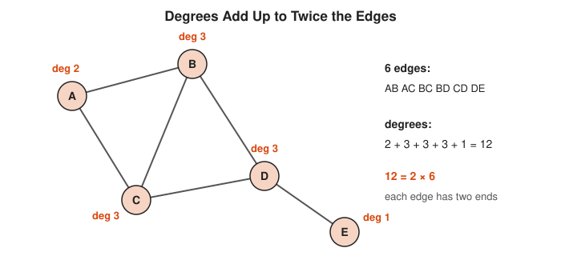

Each edge adds 1 to the degree at both of its ends, so the degree total is always even.

<!-- diagram: type=tree n=7 caption="A tree with 7 vertices has 6 edges" -->
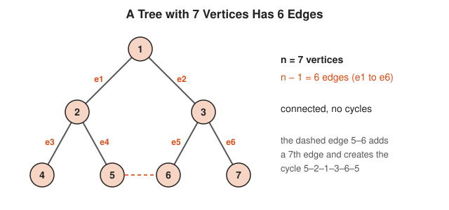

Count the orange edge labels: 7 vertices need exactly 6 edges, and any extra edge closes a loop.

**In the course:** [501 Linear Algebra, Probability and Discrete Math](../../course/501/README.md) · **Go further:** [Graph Theory track](../graph-theory/README.md)

#### 12. Big-O Growth

**Big-O** describes how a cost grows as the input grows, ignoring constant factors. $O(\log n)$ barely moves, $O(n)$ grows in step, $O(n^2)$ quadruples when $n$ doubles, and $O(2^n)$ doubles when $n$ goes up by one. Recurrences give these answers for recursive algorithms.

**Key idea:** $f(n) = O(g(n))$ means $f(n) \le c \cdot g(n)$ for some constant $c$ and all large $n$.

```txt
  n         log2 n    n log2 n       n^2              2^n
  10        3.3       33             100              1,024
  1,000     10        10,000         1,000,000        about 10^301
  10^6      20        2 x 10^7       10^12            forget it
```

<!-- diagram: type=plot x=1..20 y=0..100 curves=log2n,n,nlog2n,n^2,2^n caption="Growth of five cost functions" -->


Watch where each curve leaves the top of the box: $2^n$ is gone before $n$ reaches 7.

<!-- diagram: type=plot x=0..25 lines=3n+10,4n n0=10 caption="3n + 10 is O(n) with c = 4 and n0 = 10" -->
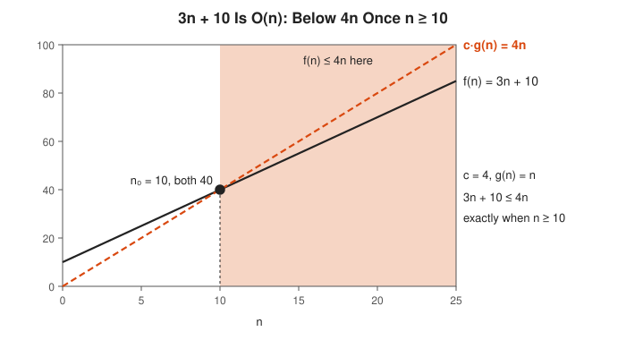

Right of the crossing at $n = 10$, the dashed line stays above the solid one, which is exactly what the Big-O definition asks for.

**In the course:** [501 Linear Algebra, Probability and Discrete Math](../../course/501/README.md)

### Advanced

#### 13. Solving Linear Recurrences

A linear recurrence like Fibonacci, $F_n = F_{n-1} + F_{n-2}$, has an exact formula. Guess $F_n = r^n$, get the **characteristic equation** $r^2 = r + 1$, and solve it. The two roots combine into **Binet's formula**. The golden ratio $\varphi \approx 1.618$ is the growth factor, which is why naive recursive Fibonacci runs in exponential time.

**Key idea:** $F_n = \dfrac{\varphi^n - \psi^n}{\sqrt{5}}$, where $\varphi = \dfrac{1 + \sqrt{5}}{2}$ and $\psi = \dfrac{1 - \sqrt{5}}{2}$.

<!-- diagram: type=fibonacci-squares sizes=1,1,2,3,5,8 caption="Fibonacci squares tile an 8 by 13 rectangle" -->


Each new square sits on the long side of the rectangle so far, which is the recurrence $F_n = F_{n-1} + F_{n-2}$ drawn as geometry.

<!-- diagram: type=plot n=1..10 values=F(n+1)/F(n) ref=phi caption="Fibonacci ratios settle at the golden ratio" -->
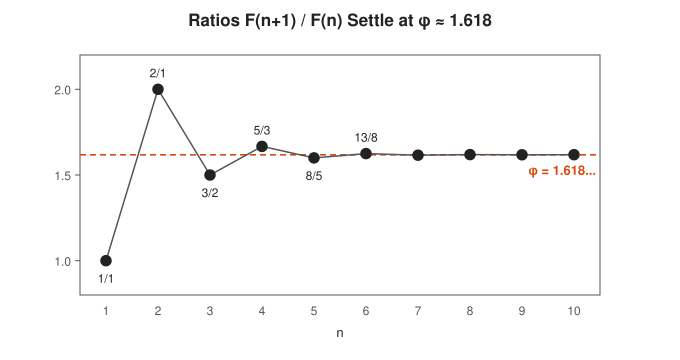

The zigzag shrinks fast because the $\psi^n$ term in Binet's formula shrinks toward 0.

**In the course:** [501 Linear Algebra, Probability and Discrete Math](../../course/501/README.md)

#### 14. Generating Functions

A **generating function** packs a whole sequence into one power series: the $n$-th term becomes the coefficient of $x^n$. Algebra on the series becomes counting on the sequence. It is a clothesline for hanging up a sequence, in Herbert Wilf's phrase.

**Key idea:** $\dfrac{1}{1 - x} = 1 + x + x^2 + x^3 + \cdots$ encodes the sequence $1, 1, 1, \ldots$

<!-- diagram: type=clothesline series=1/(1-x),x/(1-x-x^2) terms=0..6 caption="Generating functions as clotheslines" -->
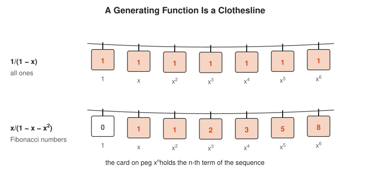

The peg gives the power of $x$, and the card on it is that term of the sequence.

**In the course:** [501 Linear Algebra, Probability and Discrete Math](../../course/501/README.md) · **Go further:** [Combinatorics track](../combinatorics/README.md)

#### 15. Discrete Probability

When every outcome is equally likely, probability is counting: favorable outcomes over total outcomes. **Expected value** is the weighted average outcome, and **linearity of expectation** lets you add expectations even when events depend on each other. This is the math behind randomized algorithms, load balancing and the birthday attack on hashes.

**Key idea:** $P(A) = \dfrac{|A|}{|\Omega|}$ and $E[X + Y] = E[X] + E[Y]$.

<!-- diagram: type=grid dice=2 highlight=sum7 caption="Two dice: 6 of the 36 outcomes sum to 7" -->
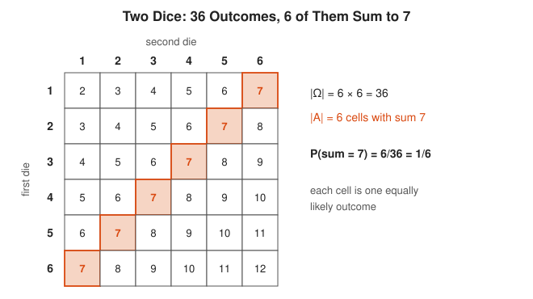

Count the orange cells and divide by all cells: that is all of probability when every outcome is equally likely.

<!-- diagram: type=histogram x=2..12 counts=1,2,3,4,5,6,5,4,3,2,1 caption="Sum of two dice with expected value 7" -->
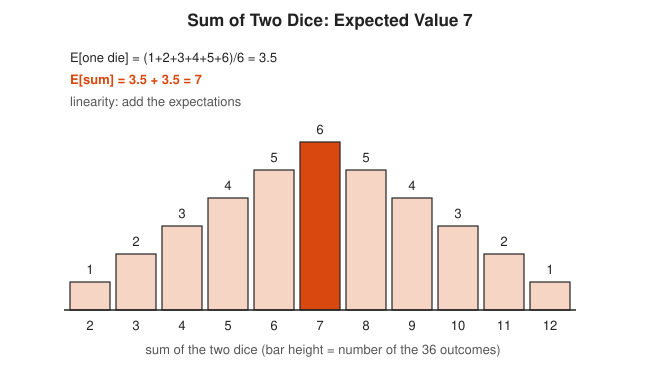

The tallest bar sits at 7, the same number that linearity gives without drawing any chart.

**In the course:** [501 Linear Algebra, Probability and Discrete Math](../../course/501/README.md) · **Go further:** [Probability track](../probability/README.md)

#### 16. State Machines and Formal Languages

A **finite state machine** has a fixed set of states and moves between them on each input. A circuit breaker is one: closed, open, half-open. The inputs a machine accepts form a **regular language**, which is exactly what a regular expression describes. More powerful machines (with a stack, or an unlimited tape) recognize larger classes of languages.

**Key idea:** regex $\equiv$ finite automaton. Neither can check balanced parentheses of any depth.

<!-- diagram: type=state-machine states=Closed,Open,HalfOpen caption="Circuit breaker as a state machine" -->


Trace a bad day: Closed to Open on failures, Open to Half-Open on the timeout, then Half-Open to Closed or Open on one trial call.

<!-- diagram: type=dfa states=Even,Odd accept=Even caption="DFA for strings with an even number of 1s" -->


Feed it 1001 with a finger on the states: each 1 flips the state and each 0 leaves it alone.

**In the course:** [501 Linear Algebra, Probability and Discrete Math](../../course/501/README.md)

#### 17. Computability and Complexity

A **Turing machine** is the simplest model of a general computer. **Computability** asks what any machine can compute at all. The **halting problem** is undecidable: no program can correctly answer "does this program halt on this input?" for every case. **Complexity** asks what can be computed efficiently. **P** is the class of problems solvable in polynomial time. **NP** is the class whose solutions can be checked in polynomial time.

**Key idea:** halting is undecidable, and $\text{P} \subseteq \text{NP}$ (whether they are equal is open).

<!-- diagram: type=diagonal size=5 caption="Diagonal argument for the halting problem" -->


Compare row D with the orange diagonal cell by cell: D disagrees with every program somewhere, so no table of all programs contains it.

<!-- diagram: type=nested-sets sets=P,NP,decidable,all caption="Problem classes as nested sets" -->


Each ring is a weaker promise: P solves fast, NP checks fast, decidable answers eventually, and the halting problem sits outside them all.

**In the course:** [601 Proof and Higher Math](../../course/601/README.md) · **Go further:** [Logic and Set Theory track](../logic-and-set-theory/README.md)

## Big Theorems You Should Know

* **Principle of mathematical induction:** a base case plus an inductive step prove $P(n)$ for all $n$.
* **Well-ordering principle:** every nonempty set of positive integers has a least element.
* **Pigeonhole principle:** $N$ items in $k$ boxes force a box with at least $\lceil N/k \rceil$ items.
* **Handshake lemma:** the degrees in any graph sum to twice the number of edges, so the number of odd-degree vertices is even.
* **Euler's path theorem:** a connected graph has a walk using every edge exactly once if and only if it has 0 or 2 odd-degree vertices.
* **Tree theorem:** a tree with $n$ vertices has exactly $n - 1$ edges.
* **Master theorem:** for $T(n) = aT(n/b) + O(n^d)$, the cost is $O(n^d)$, $O(n^d \log n)$, or $O(n^{\log_b a})$ depending on whether $d$ is bigger than, equal to, or smaller than $\log_b a$. Merge sort lands in the middle case: $O(n \log n)$.
* **Binet's formula:** $F_n = (\varphi^n - \psi^n)/\sqrt{5}$.
* **Undecidability of halting (Turing, 1936):** no algorithm decides halting for all programs.
* **Cook–Levin theorem (1971):** Boolean satisfiability (SAT) is NP-complete, so a fast algorithm for SAT gives a fast algorithm for every problem in NP.

## Open Problems and Fun Facts

* **P versus NP (open):** the most important open question in computer science. Most experts believe $\text{P} \ne \text{NP}$, and most of modern cryptography quietly depends on it. A proof earns a 1 million dollar Clay Millennium Prize.
* **The bridges of Königsberg:** in 1736, Euler proved that nobody could walk across all seven bridges of Königsberg exactly once. Every land mass had an odd number of bridges, and a walk can only start and end at odd ones. This proof founded graph theory.
* **The end of the world, by recurrence:** a legend says monks move 64 golden disks in a Towers of Hanoi puzzle and the world ends when they finish. At one move per second, $2^{64} - 1$ moves take about 585 billion years. The monks are fine.
* **Collatz (open):** the rule "halve if even, $3n + 1$ if odd" is a one-line recurrence. Every start tested reaches 1, and no one can prove that every start does.
* **The four color theorem (1976):** four colors suffice to color any map so neighbors differ. It was the first major theorem proved with heavy computer help, which annoyed many mathematicians at the time.
* **Fibonacci in sunflowers:** the spiral counts in sunflower heads and pine cones are usually consecutive Fibonacci numbers, such as 34 and 55.

## Starter Problem Set

1. Compute $1 + 2 + \cdots + 100$.
2. A sequence has $a_1 = 1$ and $a_n = 2a_{n-1} + 1$. Find $a_5$ and guess a closed form.
3. What is the smallest number of people that guarantees two share a birth month?
4. A graph has 6 vertices, each of degree 3. How many edges does it have?
5. Binary search runs on 1,000,000 sorted items. What is the maximum number of comparisons?

<details>
<summary>Answers</summary>

1. $5{,}050$, because $\frac{100 \cdot 101}{2} = 5050$.
2. $a_5 = 31$ (the terms are 1, 3, 7, 15, 31). Closed form $a_n = 2^n - 1$.
3. $13$. With 12 people, each could have a different month. With 13, pigeonhole forces a repeat.
4. $9$. The degrees sum to $6 \cdot 3 = 18 = 2|E|$.
5. $20$. $2^{20} = 1{,}048{,}576 \ge 1{,}000{,}001$, while $2^{19} = 524{,}288$ is too small.

</details>

### Challenge Problems

1. Prove by induction that $2^n > n$ for every whole number $n \ge 1$.
2. Prove by induction that $3$ divides $n^3 - n$ for every $n \ge 1$.
3. A circuit breaker has states Closed, Open and HalfOpen. Closed goes to Open on a failure threshold, Open goes to HalfOpen after a timeout, HalfOpen goes to Closed on success and to Open on failure. Draw it as a state machine and list its edges.
4. Find a closed form for $T(n) = T(n-1) + n$ with $T(0) = 0$.
5. How many edges does a complete graph on $n$ vertices have, and why?

<details>
<summary>Answers</summary>

1. Base: $2^1 = 2 > 1$. Step: assume $2^k > k$. Then $2^{k+1} = 2 \cdot 2^k > 2k = k + k \ge k + 1$ for $k \ge 1$.
2. Base: $1 - 1 = 0$, divisible by 3. Step: $(k+1)^3 - (k+1) = (k^3 - k) + 3k^2 + 3k$. The first part is divisible by 3 by hypothesis, and $3k^2 + 3k = 3(k^2 + k)$ is too.
3. Four edges: Closed to Open (failures over threshold), Open to HalfOpen (timeout), HalfOpen to Closed (success), HalfOpen to Open (failure).
4. $T(n) = \frac{n(n+1)}{2}$. Unrolling gives $1 + 2 + \cdots + n$.
5. $\binom{n}{2} = \frac{n(n-1)}{2}$. Each edge is a choice of 2 vertices from $n$. Check with the handshake lemma: each vertex has degree $n - 1$, so $n(n-1) = 2|E|$.

</details>

## Code Corner

The [code folder](code/README.md) holds one Go program, [main.go](code/main.go), that checks the sum formula, compares Hanoi and Fibonacci recurrences with their closed forms, counts binary search steps, and tests the Königsberg bridges.

```txt
sum formula holds for n = 1..1000: true | sum to 100 = 5050
hanoi(1) = 1, 2^1 - 1 = 1
hanoi(2) = 3, 2^2 - 1 = 3
hanoi(3) = 7, 2^3 - 1 = 7
hanoi(5) = 31, 2^5 - 1 = 31
hanoi(10) = 1023, 2^10 - 1 = 1023
F(0) = 0, Binet = 0
F(10) = 55, Binet = 55
F(20) = 6765, Binet = 6765
F(30) = 832040, Binet = 832040
binary search over 1000 items: at most 10 comparisons
binary search over 1000000 items: at most 20 comparisons
binary search over 1000000000 items: at most 30 comparisons
Konigsberg degrees map[A:5 B:3 C:3 D:3], sum 14 = 2 x 7 edges, odd vertices 4
Euler walk over every bridge exists: false
```

The recursive Hanoi function is the recurrence $T(n) = 2T(n-1) + 1$ written in Go, line for line:

```go
func hanoi(n int) int {
	if n == 0 {
		return 0 // base case
	}
	return 2*hanoi(n-1) + 1 // two smaller towers plus the big disk
}
```

## Go Deeper

* [MIT OpenCourseWare 6.042J Mathematics for Computer Science](https://ocw.mit.edu/courses/6-042j-mathematics-for-computer-science-fall-2010/): the standard course for this track, with free lecture videos and a full textbook.
* [Book of Proof by Richard Hammack](https://www.people.vcu.edu/~rhammack/BookOfProof/): plain, free chapters on induction, relations and functions.
* [Wolfram MathWorld: Discrete Mathematics](https://mathworld.wolfram.com/DiscreteMathematics.html): a reference hub with links to every topic.
* [Math Is Fun: Mathematical Induction](https://www.mathsisfun.com/algebra/mathematical-induction.html): a gentle illustrated introduction with dominoes.
* [MacTutor: Euler](https://mathshistory.st-andrews.ac.uk/Biographies/Euler/): the most productive mathematician in history, and the founder of graph theory.

## Related Tracks and Workshops

* Alongside: [Logic and Set Theory track](../logic-and-set-theory/README.md), [Number Theory track](../number-theory/README.md), [Combinatorics track](../combinatorics/README.md).
* Next: [Graph Theory track](../graph-theory/README.md) and [Probability track](../probability/README.md).
* Applied: [Graph Theory for Networks and Dependencies](../../workshops/graph-theory-for-networks-and-dependencies/README.md).
