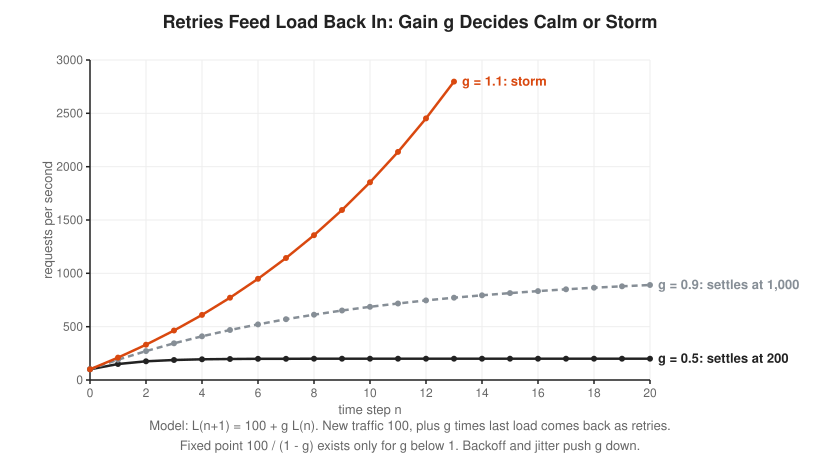
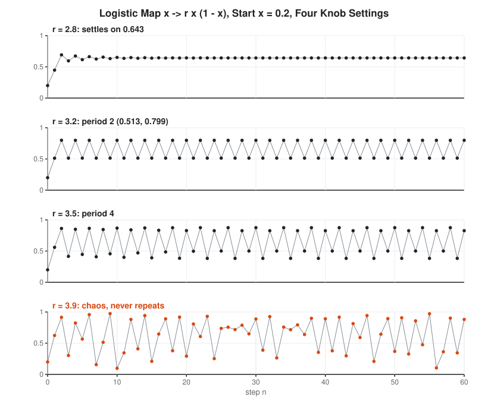

# Dynamical Systems and Chaos Track

**Track:** Dynamical Systems and Chaos · **Span:** beginner to advanced · **Course levels:** [201 Algebra I and Geometry](../../course/201/README.md) (graphs and slope), [301 Algebra II, Trig and Precalculus](../../course/301/README.md) (functions, sequences, logarithms, complex numbers), [401 Calculus](../../course/401/README.md) (the derivative as a slope)
**Prerequisites:** plugging a number into a function and reading a graph. The derivative shows up in rung 4, explained from scratch as the slope of a curve. The [Calculus Track](../calculus/README.md) and the [Differential Equations Track](../differential-equations/README.md) help with the advanced rungs, but you do not need them to start.
**Files:** this README, [cards.tsv](cards.tsv) for Anki, [code/main.go](code/main.go), and the diagrams in [img/](img/).

## What the Field Studies

A **dynamical system** is a rule that says how something changes, applied again and again. You have a state now. The rule gives the next state. Apply the rule to that, and you get the one after. The list of states is the history of the system.

The field asks plain questions about that history. Does it settle down? Does it repeat? Does it blow up? Does a tiny change at the start make a tiny change later, or a huge one? The surprise of the twentieth century was that very simple rules, such as one multiplication and one subtraction, produce histories that never repeat and cannot be forecast far ahead. That behavior is **chaos**. It is not randomness. Every step is exact. The future is fully determined and still out of reach.

## Why It Matters

Production systems are dynamical systems. Every control loop you run takes a reading, acts, and takes the next reading:

* **Feedback loops:** load causes latency, latency causes timeouts, timeouts cause retries, retries cause load. That loop has a gain. Above 1, it feeds on itself.
* **Retry storms and the thundering herd:** a brief blip makes every client retry at once. The retries become the outage. Exponential backoff with jitter is damping: it lowers the gain and spreads the herd out over time.
* **Oscillating autoscalers:** a scaler that reacts to old metrics and corrects too hard overshoots, then over-corrects the other way. Delay plus aggressive gain turns a thermostat into a pendulum.
* **Forecast horizons:** for a chaotic system, each extra digit of measurement buys only a fixed number of extra steps of forecast. Weather, markets and some capacity curves live here.
* **Fractals in the wild:** coastlines, network traffic bursts at many time scales, and the branching of service call graphs all show patterns that repeat as you zoom.

The workshop [Exponential Growth in Interest, Epidemics and Load](../../workshops/exponential-growth-in-interest-epidemics-and-load/README.md) covers the runaway case in depth. The workshop [Calculus of Rates in Physics and Queues](../../workshops/calculus-of-rates-in-physics-and-queues/README.md) covers rates of change in continuous time.

## Concept Map

<!-- diagram: type=concept-map tiers=beginner,intermediate,advanced nodes=12 caption="Dynamical systems and chaos concepts with prerequisite arrows" -->


Read the map top to bottom. An arrow from A to B means learn A first. Start at the orange box.

## Signature Diagram

<!-- diagram: type=bifurcation-diagram map="r*x*(1-x)" r=2.5..4 transient=1500 keep=400 marks=3,3.449,3.5699,3.828 caption="Bifurcation diagram of the logistic map" -->


This one picture holds most of the track. For each setting of the knob $r$, run the logistic map $x \to r x (1 - x)$ for a long time and plot where the orbit ends up. On the left, it settles on one value. Turn the knob and it alternates between two values, then four, then eight, each split arriving faster than the last. Past about 3.57 the orbit never settles at all. Inside the chaos, windows of order open and close, the widest at period 3. The same branching shape appears for many other maps, with the same speed of splitting. That speed is a new constant of nature, 4.669, found by Mitchell Feigenbaum in 1975 on a pocket calculator.

## The Concept Ladder

### Beginner

#### 1. Iterated Maps: Press the Same Button

Type 1 into a calculator in radian mode and press `cos`. Press `cos` again. Keep pressing. The display jumps around at first, then settles on 0.739085 and stays there. You just ran a dynamical system.

An **iterated map** is a function $f$ applied to its own output. Start at $x_0$. Then $x_1 = f(x_0)$, $x_2 = f(x_1)$, and in general:

$$x_{n+1} = f(x_n)$$

<!-- diagram: type=time-series map="cos(x)" x0=1 n=0..20 second="x/2" x0b=1000 caption="Iterating cos from 1 and halving a debt" -->


Halving a debt each month is the same idea with $f(x) = x/2$: 1,000, 500, 250, 125, closing in on 0. A token bucket refill, a moving average and a retry counter are all maps you apply once per tick.

In the course: [301 Sequences and Series](../../course/301/11-sequences-and-series/README.md), since the outputs form a sequence.

#### 2. Orbits and Fixed Points

The list $x_0, x_1, x_2, \ldots$ is the **orbit** of $x_0$: every place the point visits. A **fixed point** is a value the map leaves alone: $f(x^*) = x^*$. If the orbit ever lands on it, it stays forever.

$$\text{fixed point: } f(x^*) = x^*$$

<!-- diagram: type=function-plot-pair f1="x/2+1" f2="x^2" diagonal=true marks=2;0,1 caption="Fixed points as crossings with the diagonal" -->


To find fixed points, solve $f(x) = x$. On a graph, they sit where the curve $y = f(x)$ crosses the diagonal $y = x$, because there the output equals the input. For $f(x) = x/2 + 1$: $x = x/2 + 1$ gives $x^* = 2$. For $f(x) = x^2$: $x^2 = x$ gives $x^* = 0$ or $x^* = 1$. A healthy steady state of a system, such as a queue that stays at the same depth, is a fixed point.

In the course: [201 Solving Linear Equations](../../course/201/01-solving-linear-equations/README.md) and [201 Coordinate Plane and Functions](../../course/201/03-coordinate-plane-and-functions/README.md).

#### 3. Cobweb Plots

A **cobweb plot** draws an orbit on the graph of $f$ with two moves, repeated. From the current $x$, go straight up or down to the curve: the height is $f(x)$. Then go straight across to the diagonal: that turns the output into the next input. Each corner on the diagonal is the next point of the orbit.

$$\text{up to } y = f(x_n), \quad \text{across to } y = x \text{ at } x_{n+1}$$

<!-- diagram: type=cobweb-pair f1="x/2+1" x01=0 f2="cos(x)" x02=0 caption="Cobweb plots: staircase and spiral" -->


The shape tells you the story without any arithmetic. A curve that slopes upward gives a staircase: the orbit approaches from one side. A curve that slopes downward gives a spiral: the orbit jumps from one side of the fixed point to the other, like a pendulum. Whether the staircase or spiral closes in or flies out is the next rung.

#### 4. Stability and the Slope Test

A fixed point is **stable** (or attracting) when nearby orbits move toward it. It is **unstable** (or repelling) when nearby orbits move away. A pencil lying on a table is stable. A pencil balanced on its tip is a fixed point too, just not one you see for long.

The test needs one idea from calculus, the **derivative** $f'(x)$. Zoom in close to any smooth curve and it looks like a straight line. The slope of that line is $f'(x)$. It answers a plain question: if the input moves by a small step, how far does the output move? A slope of $0.5$ halves small distances. A slope of $2$ doubles them. A negative slope also flips the direction.

<!-- diagram: type=zoom f="cos(x)" at=0.739085 window=0.12 tangent=true caption="Derivative as the local stretch factor" -->


Near a fixed point $x^*$, the distance from $x^*$ gets multiplied by about $f'(x^*)$ at every step. If that number has size less than 1, the map shrinks distances and the gap dies away. If its size is more than 1, the map stretches distances and the gap grows.

$$|f'(x^*)| < 1 \implies \text{stable}, \qquad |f'(x^*)| > 1 \implies \text{unstable}$$

<!-- diagram: type=cobweb-grid slopes=0.5,-0.5,1.5,-1.5 fixed=0.5 caption="Slope test with four linear maps" -->


For $\cos$, the slope at 0.739085 is $-\sin(0.739085) = -0.674$. Its size is below 1, which is why the calculator settles. The minus sign is why the presses bounce above and below the answer.

In the course: [401 The Derivative](../../course/401/02-the-derivative/README.md) and [201 Slope and Lines](../../course/201/04-slope-and-lines/README.md).

### Intermediate

#### 5. Feedback Loops and Retry Storms

Many system loops are close to the simple map $L_{n+1} = b + g L_n$. Here $b$ is fresh traffic and $g$ is the **gain**: the share of the current load that comes back next tick as retries. Its fixed point is $L^* = b/(1 - g)$, and its slope is $g$. The slope test says it all.

$$L^* = \frac{b}{1 - g} \quad \text{exists and is stable only when } g < 1$$

<!-- diagram: type=time-series map="100+g*L" L0=100 g=0.5,0.9,1.1 n=0..20 caption="Retry storm: load under different feedback gains" -->


The gain is roughly the failure rate times the retries per failure. If 60% of calls fail and each failure is retried twice, $g = 1.2$, and the load has no steady state at all. Retries stacked in layers multiply: three layers that each make three attempts turn one user click into 27 calls at the bottom. Exponential backoff, jitter and retry budgets are all ways to push $g$ well below 1. Jitter also breaks up the **thundering herd**, where every client wakes at the same instant and hits the same service together.

Related: [Exponential Growth in Interest, Epidemics and Load](../../workshops/exponential-growth-in-interest-epidemics-and-load/README.md) for the $g > 1$ runaway in detail.

#### 6. The Logistic Map

The **logistic map** is the most famous one-line model in the field:

$$x_{n+1} = r\,x_n\,(1 - x_n), \qquad 0 \le x \le 1, \quad 0 \le r \le 4$$

Think of $x$ as a population as a fraction of the maximum. The factor $r x$ is growth. The factor $(1 - x)$ is crowding: near the maximum, growth stalls. The knob $r$ sets how hard the system pushes. Its fixed points solve $r x (1 - x) = x$, giving $x^* = 0$ and $x^* = 1 - 1/r$. The slope there is $f'(x^*) = 2 - r$.

<!-- diagram: type=time-series-stack map="r*x*(1-x)" x0=0.2 r=2.8,3.2,3.5,3.9 n=0..60 caption="Logistic map orbits for four values of r" -->


At $r = 2.8$ the slope is $-0.8$: a stable spiral into 0.643. At $r = 3.2$ the slope is $-1.2$: the fixed point is now unstable, and the orbit settles into a **2-cycle**, a pair of values it alternates between forever. At $r = 3.5$ it settles into a 4-cycle. At $r = 3.9$ it never settles. One parabola, four personalities.

In the course: [301 Polynomials and Complex Numbers](../../course/301/02-polynomials-and-complex-numbers/README.md) for the parabola.

#### 7. Period Doubling and the Bifurcation Diagram

A **bifurcation** is a knob setting where the long-run behavior changes kind. At $r = 3$ the fixed point loses stability (its slope passes $-1$) and a 2-cycle is born. At $r = 1 + \sqrt{6} \approx 3.449$ the 2-cycle loses stability and a 4-cycle is born. Then 8, 16, 32, each **period doubling** coming sooner. The doublings pile up at $r_\infty \approx 3.5699$, the onset of chaos.

$$\delta = \lim_{n \to \infty} \frac{r_n - r_{n-1}}{r_{n+1} - r_n} = 4.669201\ldots$$

<!-- diagram: type=cobweb-and-numberline f="3.2*x*(1-x)" x0=0.2 marks=3,3.449490,3.544090,3.564407,3.568759 caption="Period doubling: a 2-cycle cobweb and the shrinking gaps" -->


Each gap between doublings is about 4.669 times shorter than the one before. Feigenbaum found that the same 4.669 shows up for every smooth map with a single rounded hump, and later experiments with heated fluids found period doubling at close to the same rate. A number that does not care about the details of the system is called **universal**. The bifurcation diagram in the Signature Diagram section is all of these doublings drawn at once.

#### 8. Delay and Oscillating Autoscalers

A simple autoscaler adds replicas in proportion to the gap from target: $x_{n+1} = x_n + k(T - x_n)$. With no delay, the error gets multiplied by $1 - k$ each step, and the slope test says it settles for any $0 < k < 2$. Real metrics arrive late. If the scaler acts on a reading $d$ steps old, the rule becomes:

$$x_{n+1} = x_n + k\,(T - x_{n-d})$$

<!-- diagram: type=time-series-stack rule="x+k*(100-x[n-d])" floor=0 cases=k0.5d0,k0.6d2,k0.8d2 n=0..40 caption="Autoscaler oscillation from delay and over-correction" -->


Delay shrinks the safe range of $k$. With a 1-step delay, swings grow once $k > 1$. With a 2-step delay, the limit drops to $k > 0.618$. With 3 steps, $0.445$. The general limit is $2 \sin\!\big(\pi / (2(2d+1))\big)$. The fix is the same as with retries: smaller corrections, fresher metrics, and a cooldown that waits for the last change to show up before making the next one.

Related: [Differential Equations Track](../differential-equations/README.md) for continuous-time versions of the same loop.

### Advanced

#### 9. Sensitive Dependence and Lyapunov Exponents

In a chaotic system, two starts that differ by a hair drift apart at an exponential rate. This is **sensitive dependence on initial conditions**, the butterfly effect. The average rate of stretching per step is the **Lyapunov exponent** $\lambda$: the average of $\ln|f'(x_n)|$ along the orbit. Negative means nearby orbits converge. Positive means chaos.

$$\lambda = \lim_{n\to\infty} \frac{1}{n}\sum_{i=0}^{n-1} \ln\lvert f'(x_i)\rvert, \qquad \text{gap}_n \approx \text{gap}_0 \, e^{\lambda n}$$

<!-- diagram: type=two-orbits map="3.9*x*(1-x)" x0=0.2 eps=1e-10 n=0..60 logpanel=true caption="Two logistic orbits that start 1e-10 apart" -->


At $r = 3.9$, $\lambda \approx 0.498$, and the gap grows by a factor of $e^{0.498} \approx 1.65$ per step. The **Lyapunov time** $1/\lambda$ is the forecast horizon unit. The bad news is in the logarithm: measuring the start 10 times more precisely buys only $\ln 10 / \lambda \approx 4.6$ more steps of forecast. Precision is cheap to want and expensive to buy.

In the course: [301 Logarithms](../../course/301/05-logarithms/README.md) and [301 Exponential Functions](../../course/301/04-exponential-functions/README.md).

#### 10. The Lorenz Attractor

In 1963 Edward Lorenz cut a weather model down to three equations. The state is a point $(x, y, z)$ that moves continuously in time:

$$\frac{dx}{dt} = \sigma(y - x), \quad \frac{dy}{dt} = x(\rho - z) - y, \quad \frac{dz}{dt} = xy - \beta z$$

with $\sigma = 10$, $\rho = 28$, $\beta = 8/3$. A computer follows the motion by taking many tiny steps. The Runge-Kutta method (RK4) with step 0.01 is the standard choice.

<!-- diagram: type=trajectory-projection system=lorenz sigma=10 rho=28 beta=8/3 start=1,1,1 dt=0.01 t=0..50 plane=xz second="x(t) for starts 1 and 1+1e-8" caption="Lorenz attractor and two nearby trajectories" -->


The orbit loops around one wing, then the other, in an order that never repeats. It never leaves the butterfly and never crosses itself. A set like this, which pulls orbits in and then stretches and folds them forever, is a **strange attractor**. Its largest Lyapunov exponent is about 0.91 per time unit. In the run above, a start gap of $10^{-5}$ splits the forecasts at $t \approx 24$, $10^{-8}$ at $t \approx 32$, and $10^{-11}$ at $t \approx 40$. Every factor of 1,000 in precision buys about 7.5 time units. Continuous systems need at least three dimensions for this. In two dimensions, orbits have no room to pass each other.

Related: [Differential Equations Track](../differential-equations/README.md) and [Numerical Methods Track](../numerical-methods/README.md) for RK4. In the course: [401 Multivariable Intro](../../course/401/12-multivariable-intro/README.md).

#### 11. Fractals and Fractal Dimension

A **fractal** is a shape that holds smaller copies of itself at every zoom level. The **Koch curve** starts as a segment. Replace the middle third with two sides of a triangle: 4 segments, each 1/3 as long. Repeat on every segment, forever. Each level multiplies the length by 4/3, which means the finished curve has infinite length while fitting in a small box.

<!-- diagram: type=fractal-levels kind=koch levels=0..3 snowflake=4 caption="Koch curve levels 0 to 3 and the Koch snowflake" -->


Dimension answers: when you shrink a shape by a factor $s$, how many copies $N$ of the small one rebuild the big one? A segment cut in thirds gives 3 copies: dimension 1. A square cut in thirds gives 9 copies: dimension 2. The Koch curve cut in thirds gives 4 copies. The **similarity dimension** solves $N = (1/s)^D$:

$$D = \frac{\log N}{\log(1/s)}, \qquad D_{\text{Koch}} = \frac{\log 4}{\log 3} \approx 1.2619$$

<!-- diagram: type=dimension-compare shapes=line,square,koch numberline=0..2 marks=1,1.2619,1.585,2 caption="Similarity dimension from pieces and scale" -->


A dimension of 1.26 says the Koch curve is more than a line and less than a surface. For shapes without exact copies, such as a coastline or the Lorenz attractor, **box counting** does the same job: cover the shape with boxes of side $\varepsilon$, count the boxes $N(\varepsilon)$, and read the dimension as the slope of $\log N$ against $\log(1/\varepsilon)$.

In the course: [301 Logarithms](../../course/301/05-logarithms/README.md). Related: [Geometry Track](../geometry/README.md) and [Topology Track](../topology/README.md).

#### 12. The Mandelbrot Set

Run the simplest complex map, $z_{n+1} = z_n^2 + c$, from $z_0 = 0$. For each complex number $c$, ask one yes-or-no question: does the orbit stay bounded, or run off to infinity? The **Mandelbrot set** is every $c$ whose orbit stays bounded. Once $|z_n| > 2$, the orbit is certain to escape, which gives a simple test.

$$M = \{\, c \in \mathbb{C} : z_{n+1} = z_n^2 + c,\ z_0 = 0, \text{ stays bounded} \,\}$$

<!-- diagram: type=escape-time map="z^2+c" re=-2.25..0.75 im=-1.25..1.25 grid=300x250 maxiter=200 marks=-1,0.25,-2,i caption="The Mandelbrot set by escape time" -->


The real line inside $M$ is the logistic map in disguise: the main heart holds the $c$ values with an attracting fixed point, the big left bulb holds period 2, and the doubling cascade runs left toward $c \approx -1.401$, the same Feigenbaum 4.669 included. The boundary has endless detail. Zoom anywhere on it and you find new spirals and tiny copies of the whole set. The rule fits on one line. The picture does not fit in any finite number of zooms.

In the course: [301 Polynomials and Complex Numbers](../../course/301/02-polynomials-and-complex-numbers/README.md). Related: [Complex Analysis Track](../complex-analysis/README.md).

## Worked Examples

### Example 1: Fixed Points and Stability of the Logistic Map at r = 2.8

```txt
  f(x) = 2.8 x (1 - x)                                 the map
  2.8 x (1 - x) = x                                    fixed point: f(x) = x
  x (2.8 (1 - x) - 1) = 0                              move x over, factor out x
  x = 0   or   2.8 (1 - x) = 1                         a product is 0 when a factor is 0
  x* = 1 - 1/2.8 = 0.642857                            solve the second factor
  f'(x) = 2.8 (1 - 2x)                                 slope of the parabola
  f'(0) = 2.8                                          |2.8| > 1: x* = 0 is unstable
  f'(0.642857) = 2.8 x (1 - 1.285714) = -0.8           slope at the other fixed point
  |-0.8| < 1  -> stable, spiral in                     slope test; minus sign means spiral
```

Any start strictly between 0 and 1 ends at 0.642857. The orbit bounces above and below on the way in, losing 20% of its distance each step.

### Example 2: Check the 2-Cycle at r = 3.2

The Code Corner reports the orbit at $r = 3.2$ alternating between 0.513045 and 0.799455. Check it by hand and test its stability.

```txt
  f(0.513045) = 3.2 x 0.513045 x 0.486955              plug in the first value
              = 3.2 x 0.249830 = 0.799455              lands on the second value
  f(0.799455) = 3.2 x 0.799455 x 0.200545              plug in the second value
              = 3.2 x 0.160327 = 0.513045              back to the first: a 2-cycle
  f'(0.513045) = 3.2 x (1 - 1.026090) = -0.0835        slope at the first point
  f'(0.799455) = 3.2 x (1 - 1.598910) = -1.9165        slope at the second point
  product = (-0.0835) x (-1.9165) = 0.16               two steps multiply two slopes
  |0.16| < 1  -> the 2-cycle is stable                 slope test for the map applied twice
```

A cycle is a fixed point of the map applied $p$ times, and the chain rule turns its slope into the product of the slopes around the loop. The product hits $-1$ at $r = 1 + \sqrt 6 \approx 3.449$, where the 4-cycle takes over.

### Example 3: Defuse a Retry Storm

New traffic is 100 requests per second. During a partial outage 60% of calls fail, and every failure is retried twice.

```txt
  g = 0.6 x 2 = 1.2                                    failure rate x retries per failure
  L(n+1) = 100 + 1.2 L(n)                              the loop
  g > 1  -> no steady state, load grows each tick      slope test on a straight line
  add a retry budget: retries <= 10% of requests       client-side cap
  g = 0.1                                              new gain
  L* = 100 / (1 - 0.1) = 111.1 requests per second     fixed point b / (1 - g)
  |g| = 0.1 < 1  -> stable                             slope test
```

The outage itself did not change. Only the gain did, and that decided the difference between an 11% load bump and a meltdown.

### Example 4: In the Mandelbrot Set or Not

```txt
  c = -1:   0 -> -1 -> 0 -> -1 -> ...                  z^2 + c from z = 0
            bounded 2-cycle  -> c is in M              never leaves |z| <= 1
  c = 0.5:  0 -> 0.5 -> 0.75 -> 1.0625                 0.5^2+0.5, 0.75^2+0.5
            -> 1.6289 -> 3.1533                        1.0625^2+0.5, 1.6289^2+0.5
            |3.1533| > 2  -> escapes, c is not in M    escape test
  c = i:    0 -> i -> -1+i -> -i -> -1+i -> ...        i^2 = -1
            bounded 2-cycle after one step -> in M     on the edge of the set
```

## Big Theorems to Know

* **Contraction Mapping Theorem (Banach, 1922):** if a map shrinks every distance by at least a fixed factor below 1, it has exactly one fixed point, and every orbit converges to it.
* **Slope Test for Fixed Points:** a fixed point with $|f'(x^*)| < 1$ is attracting. With $|f'(x^*)| > 1$ it is repelling. For a $p$-cycle, use the product of slopes around the cycle.
* **Sharkovskii Theorem (1964):** orders the whole numbers $3, 5, 7, \ldots, 2\cdot 3, 2 \cdot 5, \ldots, 4, 2, 1$. A continuous map of an interval with a cycle of one period has cycles of every period later in that order.
* **Period Three Implies Chaos (Li and Yorke, 1975):** a continuous map of an interval with a 3-cycle has cycles of every period. The paper also gave the word "chaos" its mathematical meaning.
* **Feigenbaum Universality (1978):** period-doubling cascades in smooth one-hump maps share the ratio $\delta = 4.669201\ldots$, proved by Oscar Lanford in 1982 with computer help.
* **Poincare-Bendixson Theorem:** a bounded orbit of a smooth flow in the plane settles toward a fixed point, a closed loop, or a loop joined through fixed points. Chaos in continuous time needs at least three dimensions.
* **Tucker (2002):** the Lorenz attractor really exists and is strange, a computer-assisted proof that settled one of the problems on the list of Stephen Smale for the new century.
* **Douady and Hubbard (1982):** the Mandelbrot set is connected: it is one piece.
* **Shishikura (1998):** the boundary of the Mandelbrot set has dimension 2, as rough as a curve can get.

## Open Problems and Fun Facts

* **The rounding error that started it:** Lorenz restarted a simulation from a printout that showed 0.506 instead of the stored 0.506127. Within a couple of simulated months the weather had nothing in common with the first run. He later titled a 1972 talk with a question about a butterfly in Brazil and a tornado in Texas.
* **Poincare and the prize:** in 1889 Henri Poincare won a prize from the King of Sweden for work on the three-body problem. An error turned up after the award. Fixing it led him to the tangled orbits that are now seen as the first sighting of chaos.
* **The calculator constant:** Feigenbaum found 4.669 in 1975 on an HP-65 programmable calculator. The slowness of the machine helped: while he waited for each answer, he noticed the gaps shrinking by the same factor.
* **How long is the coast of Britain?** Benoit Mandelbrot asked that in a 1967 paper. The answer depends on the ruler. A shorter ruler follows more wiggles and measures a longer coast, the way the Koch curve gains length at each level.
* **Open problem (MLC):** is the Mandelbrot set locally connected? A yes settles much of the structure of the whole set. It is still open.
* **Open problem:** nobody has proved that the Feigenbaum constant $\delta$ is irrational, though everyone expects it to be transcendental.
* **Unknown area:** the area of the Mandelbrot set is about 1.5066, known from careful counting, with no formula in sight.

## Starter Problems

1. Iterate $f(x) = x/3 + 4$ from $x_0 = 0$ for three steps. Find the fixed point and decide whether it is stable.
2. Find both fixed points of $f(x) = x^2 - 2$ and test each one for stability.
3. For the logistic map at $r = 2.5$, find the nonzero fixed point and its slope. Does the orbit approach as a staircase or a spiral?
4. Fresh traffic is 200 requests per second. What largest gain $g$ keeps the steady load at or below 400 requests per second?
5. An autoscaler acts on metrics one step old: $x_{n+1} = x_n + k(T - x_{n-1})$. Which of $k = 0.8$ and $k = 1.2$ produces growing swings?
6. A chaotic map has Lyapunov exponent $\lambda = 0.5$ per step. A start is known to within $10^{-6}$. About how many steps until the error reaches 1? How many extra steps does measuring 100 times more precisely buy?
7. The middle-thirds Cantor set: start with a segment, delete the open middle third, repeat on what is left forever. Find its similarity dimension.

<details>
<summary>Answers</summary>

1. $x_1 = 4$, $x_2 = 5.333$, $x_3 = 5.778$. Fixed point: $x = x/3 + 4$ gives $x^* = 6$. The slope is $1/3$, below 1, which makes it stable: a staircase closing in on 6.
2. $x^2 - 2 = x$ gives $x^2 - x - 2 = 0$, which factors as $(x - 2)(x + 1) = 0$: $x^* = 2$ and $x^* = -1$. The slope is $f'(x) = 2x$: $f'(2) = 4$ and $f'(-1) = -2$. Both have size above 1. Both are unstable.
3. $x^* = 1 - 1/2.5 = 0.6$. Slope $2 - r = -0.5$. Its size is below 1: stable. The minus sign makes it a spiral.
4. $g = 0.5$. Solve $200/(1 - g) \le 400$: $1 - g \ge 0.5$.
5. $k = 1.2$. With a 1-step delay, swings grow once $k > 1$. The error obeys $e_{n+1} = e_n - k e_{n-1}$. Its two growth factors have the same size when they swing, and their product is $k$, which puts their size above 1 exactly when $k > 1$.
6. About 28 steps: $10^{-6} e^{0.5 n} = 1$ gives $n = \ln(10^6)/0.5 \approx 27.6$. Measuring 100 times better adds $\ln(100)/0.5 \approx 9.2$ steps.
7. $\log 2 / \log 3 \approx 0.6309$. Each level keeps 2 copies at scale 1/3. More than a scatter of points, less than a line.

</details>

## Code Corner

[code/main.go](code/main.go) presses `cos` 40 times, applies the slope test to the logistic map, detects periods, estimates the Feigenbaum constant, measures Lyapunov exponents, races two orbits that start $10^{-10}$ apart, runs a retry storm and an autoscaler, integrates the Lorenz system with RK4, draws the Mandelbrot set in ASCII, and grows the Koch curve. Run it with `go run main.go` inside `code/`.

```txt
== Press cos again and again, start 1 ==
n=1   x=0.540302
n=2   x=0.857553
n=3   x=0.654290
n=4   x=0.793480
n=5   x=0.701369
n=10  x=0.744237
n=20  x=0.739184
n=40  x=0.739085
slope at the fixed point: -sin(x*) = -0.6736, and |slope| < 1: stable

== Logistic map: fixed point x* = 1 - 1/r, slope 2 - r ==
r=2.8 x*=0.6429 slope -0.8 stable   | settles to 0.6429 0.6429 0.6429 0.6429 | period 1
r=3.2 x*=0.6875 slope -1.2 unstable | settles to 0.7995 0.5130 0.7995 0.5130 | period 2
r=3.5 x*=0.7143 slope -1.5 unstable | settles to 0.8269 0.5009 0.8750 0.3828 | period 4
r=3.9 x*=0.7436 slope -1.9 unstable | settles to 0.2687 0.7663 0.6984 0.8214 | period none up to 64

== Feigenbaum constant from superstable r values ==
period 4    r=3.4985617  gap ratio 4.7089
period 8    r=3.5546409  gap ratio 4.6808
period 16   r=3.5666674  gap ratio 4.6630
period 32   r=3.5692435  gap ratio 4.6684
period 64   r=3.5697953  gap ratio 4.6690
period 128  r=3.5699135  gap ratio 4.6692
period 256  r=3.5699388  gap ratio 4.6692

== Lyapunov exponents (positive = chaos) ==
r=2.8  lambda=-0.2231
r=3.2  lambda=-0.9163
r=3.5  lambda=-0.8725
r=3.9  lambda=+0.4980
r=4.0  lambda=+0.6932
ln 2 = 0.6931 (the exact value at r=4)

== Two orbits at r=3.9, starts 0.2 and 0.2+1e-10 ==
n=0  a=0.200000 b=0.200000 gap=1.00e-10
n=5  a=0.565661 b=0.565661 gap=2.84e-09
n=10 a=0.097966 b=0.097966 gap=5.71e-09
n=15 a=0.209975 b=0.209975 gap=1.57e-07
n=20 a=0.292551 b=0.292555 gap=3.82e-06
n=25 a=0.736720 b=0.736640 gap=8.00e-05
n=30 a=0.887619 b=0.888939 gap=1.32e-03
n=35 a=0.715820 b=0.671938 gap=4.39e-02
n=40 a=0.891241 b=0.374759 gap=5.16e-01
n=45 a=0.590161 b=0.965034 gap=3.75e-01

== Retry storm: L(n+1) = 100 + g L(n), start 100 ==
g=0.5  load after 20 steps     200  limit 200
g=0.9  load after 20 steps     891  limit 1000
g=1.1  load after 20 steps    6400  no limit, grows forever

== Autoscaler: x(n+1) = x(n) + k (100 - x(n-d)), floor 0 ==
k=0.5 d=0  steps 40-80 range  100.0 to  100.0
k=1.5 d=0  steps 40-80 range  100.0 to  100.0
k=0.5 d=2  steps 40-80 range   95.3 to  103.4
k=0.6 d=2  steps 40-80 range   58.8 to  142.6
k=0.8 d=2  steps 40-80 range    0.0 to  248.7
delay 0: swings grow once k > 2.000
delay 1: swings grow once k > 1.000
delay 2: swings grow once k > 0.618
delay 3: swings grow once k > 0.445

== Lorenz system, RK4, step 0.01, start (1,1,1) ==
t=  0.0  x=   1.000 y=   1.000 z=   1.000
t=  5.0  x=  -6.512 y=  -6.974 z=  23.924
t= 10.0  x=  -4.903 y=  -3.743 z=  24.692
t= 15.0  x=  -4.385 y=  -2.064 z=  25.904
t= 20.0  x=  13.473 y=  12.691 z=  34.392
start gap 1e-05 in x -> forecasts split (gap > 1) at t=24.38
start gap 1e-08 in x -> forecasts split (gap > 1) at t=31.89
start gap 1e-11 in x -> forecasts split (gap > 1) at t=39.51

== Mandelbrot set, re -2.1..0.6, im -1.1..1.1 ==
                                         .++...
                                       ....++++..
                                    .....+++#++....
                                 ........+#####+.......
                            .....++++++++++###++#++....+.
                      ...........++#################+#++..
                 .+............++#####################++...
              .....+++++++++++++########################+..
           ........++#######+++#########################+..
         ......+++++##########+########################+...
   ++++#++++#########################################++....
         ......+++++##########+########################+...
           ........++#######+++#########################+..
              .....+++++++++++++########################+..
                 .+............++#####################++...
                      ...........++#################+#++..
                            .....++++++++++###++#++....+.
                                 ........+#####+.......
                                    .....+++#++....
                                       ....++++..
                                         .++...

== Koch curve ==
level 0: segments    1, length 1.0000
level 1: segments    4, length 1.3333
level 2: segments   16, length 1.7778
level 3: segments   64, length 2.3704
level 4: segments  256, length 3.1605
level 5: segments 1024, length 4.2140
dimension log4/log3 = 1.2619
```

Three lines carry the track. The gap ratios close in on 4.6692, a constant nobody put into the program. The two logistic orbits agree to six decimals for 15 steps and share nothing by step 40. And the Lorenz forecasts split about 7.5 time units later for every factor of 1,000 in starting precision: the forecast horizon grows with the logarithm of your effort, which is a polite way to say slowly.

## Flashcards

[cards.tsv](cards.tsv) holds the key definitions and theorems for Anki import.

## Resources

* [MacTutor: Henri Poincare](https://mathshistory.st-andrews.ac.uk/Biographies/Poincare/): the mathematician who first saw chaos in the three-body problem.
* [MacTutor: Edward Lorenz](https://mathshistory.st-andrews.ac.uk/Biographies/Lorenz_Edward/): the meteorologist behind the butterfly effect and the Lorenz equations.
* [MacTutor: Benoit Mandelbrot](https://mathshistory.st-andrews.ac.uk/Biographies/Mandelbrot/): the life of the man who named fractals.
* [Wolfram MathWorld: Logistic Map](https://mathworld.wolfram.com/LogisticMap.html): formulas, bifurcation points and pictures, with links to the Feigenbaum constant.
* [Paul Bourke: Fractals, Chaos, Self Similarity](https://paulbourke.net/fractals/): a long-running collection of fractal and attractor pages with pictures and plain notes.
* [ChaosBook.org](https://chaosbook.org/): a free advanced textbook on chaos for the top rungs. For a gentler printed classic, read Nonlinear Dynamics and Chaos by Steven Strogatz.

## Where to Go Next

* [Differential Equations Track](../differential-equations/README.md) for continuous-time systems, phase portraits and the Lorenz equations in context.
* [Numerical Methods Track](../numerical-methods/README.md) for RK4, step size, and why floating point rounding matters more in chaotic systems.
* [Complex Analysis Track](../complex-analysis/README.md) for the complex plane behind the Mandelbrot and Julia sets.
* [Topology Track](../topology/README.md) for connectedness, the property Douady and Hubbard proved for the Mandelbrot set.
* [Exponential Growth in Interest, Epidemics and Load](../../workshops/exponential-growth-in-interest-epidemics-and-load/README.md) for the runaway feedback of rung 5 in practice.
