# Fourier Analysis Track

**Track:** Fourier Analysis · **Span:** beginner to advanced · **Course levels:** [301 Algebra II, Trig and Precalculus](../../course/301/README.md) (sine and cosine), [401 Calculus](../../course/401/README.md) (integrals), [501 Linear Algebra, Probability and Discrete Math](../../course/501/README.md) (vectors)
**Prerequisites:** the sine and cosine graphs and the idea of an integral as area. The [Trigonometry Track](../trigonometry/README.md) covers the waves. The [Calculus Track](../calculus/README.md) covers integrals. Complex numbers appear from rung 6. The [Complex Analysis Track](../complex-analysis/README.md) has a refresher.
**Files:** this README, [cards.tsv](cards.tsv) for Anki, [code/main.go](code/main.go), and the diagrams in [img/](img/).

## What the Field Studies

Fourier analysis splits a signal into waves. Any reasonable signal, such as a sound, a temperature record or a request-rate graph, is a sum of plain sine waves of different frequencies and sizes. Find those frequencies and sizes and you hold the same information in a new form: the **spectrum**.

The two views answer different questions. The time view says what happened when. The frequency view says which rhythms the signal contains and how strong each one is. Many hard problems in one view are easy in the other. Smoothing, filtering, compressing, and solving the heat equation all get simpler once you switch to frequencies.

## Why It Matters

* **Seasonality in metrics:** traffic has a daily cycle and a weekly cycle. A spectrum finds both in one pass, and a forecaster built on them predicts tomorrow at 9 a.m. better than a straight line does.
* **Compression:** JPEG stores the strongest cosine coefficients of each 8 by 8 block of pixels and drops the rest. MP3 and AAC do the same for sound. A smooth metric series compresses the same way.
* **Scrape intervals:** sampling a metric too slowly invents fake slow waves. The sampling theorem tells you how fast to scrape.
* **Smoothing and alerting:** a moving average on a dashboard is a convolution, which is a low-pass filter in disguise.
* **Everything wireless:** Wi-Fi, 4G and 5G send data on many frequencies at once with OFDM, built on the FFT.
* **Fast multiplication:** the FFT multiplies huge integers and polynomials far faster than schoolbook methods.

## Concept Map

<!-- diagram: type=concept-map tiers=beginner,intermediate,advanced nodes=12 caption="Fourier analysis concepts with prerequisite arrows" -->


Read the map top to bottom. An arrow from A to B means learn A first. Start at the orange box.

## Signature Diagram

<!-- diagram: type=time-and-spectrum f="sin(2pi 3t)+0.5sin(2pi 7t)" caption="The same signal in the time domain and the frequency domain" -->
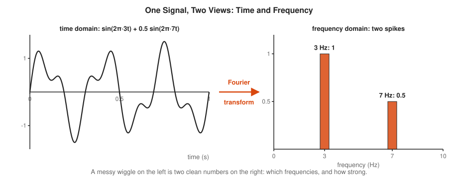

The left side looks messy. The right side says the same thing with four numbers: a 3 hertz wave of size 1 and a 7 hertz wave of size 0.5. The **Fourier transform** is the machine that turns the left picture into the right one, and its inverse turns it back with nothing lost. The rest of the track explains how the machine works and what you do with the right-hand picture.

## The Concept Ladder

### Beginner

#### 1. Waves and Frequencies

A **sine wave** has three settings. The **amplitude** $A$ is how tall it is. The **frequency** $f$ is how many full cycles it makes per second, measured in **hertz** (Hz). The **phase** $\varphi$ shifts it left or right. The **period** $T = 1/f$ is the time for one cycle.

$$y(t) = A \sin(2\pi f t + \varphi), \qquad T = \frac{1}{f}$$

<!-- diagram: type=function-plot f="1.5sin(2pi 2t)" shifted="1.5sin(2pi 2t+pi/2)" x=0..1 caption="A sine wave: amplitude, frequency, period and phase" -->
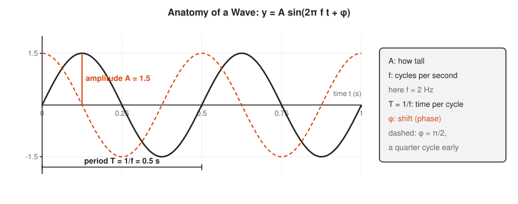

The $2\pi$ converts cycles to radians, because one full turn of a circle is $2\pi$ radians. A daily traffic cycle is a wave with a period of 24 hours. Its frequency is 1 cycle per day.

In the course: [301 Trig Graphs and Identities](../../course/301/08-trig-graphs-and-identities/README.md). Related: [Trigonometry Track](../trigonometry/README.md).

#### 2. Adding Waves

Add two waves by adding their heights at every moment. This is **superposition**. A slow wave plus a fast wave gives a shape that neither has alone. With the right mix of waves you build almost any shape.

$$y(t) = \sin(2\pi t) + \tfrac{1}{3}\sin(2\pi \cdot 3t)$$

<!-- diagram: type=stacked-waves waves="sin(2pi t)","(1/3)sin(2pi 3t)" caption="Two sine waves and their sum" -->
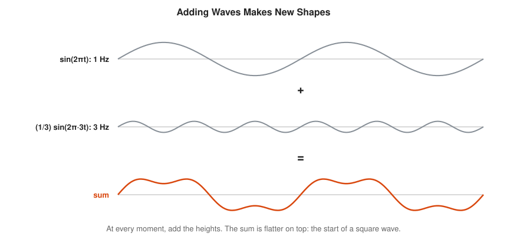

Sound works this way. A note on a guitar is a base frequency plus quieter waves at 2, 3 and 4 times that frequency. The mix is what makes a guitar sound different from a flute playing the same note.

Related: [Music and Frequencies](../../workshops/music-and-frequencies/README.md) workshop.

#### 3. Fourier Series

Joseph Fourier claimed in 1807 that any repeating signal is a sum of sines and cosines at whole-number multiples of its base frequency. These multiples are the **harmonics**. The sum is a **Fourier series**. A square wave, all sharp corners, is a sum of smooth sines.

$$f(t) = a_0 + \sum_{n=1}^{\infty} \big(a_n \cos nt + b_n \sin nt\big), \qquad \text{square}(t) = \frac{4}{\pi}\Big(\sin t + \frac{\sin 3t}{3} + \frac{\sin 5t}{5} + \cdots\Big)$$

<!-- diagram: type=function-plot f=square partial=1,3,10 caption="Fourier partial sums approaching a square wave, with the Gibbs overshoot" -->
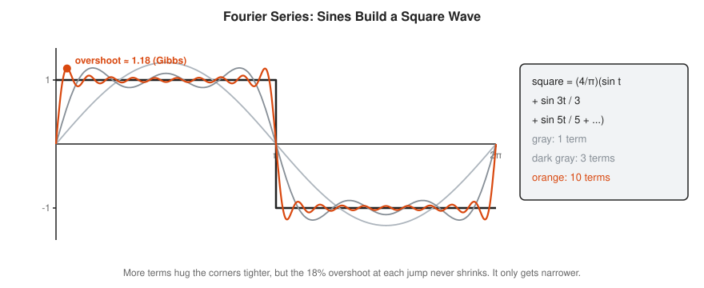

More terms fit the corners better. Near each jump the sum always overshoots by about 9% of the jump, which is 18% above the target here. Adding terms makes the overshoot narrower, never shorter. This is the **Gibbs phenomenon**, and it is why sharp edges in compressed images grow faint ripples.

In the course: [401 Sequences and Series](../../course/401/10-sequences-and-series/README.md).

#### 4. Finding Coefficients

How do you find how much of $\sin nt$ hides inside a signal? Multiply the signal by $\sin nt$ and find the area. Where the signal follows the test wave, the product stays positive and area piles up. Where it does not, positive and negative parts cancel. This works because different sines are **orthogonal**: their products average to zero.

$$b_n = \frac{1}{\pi}\int_0^{2\pi} f(t)\sin(nt)\,dt, \qquad a_n = \frac{1}{\pi}\int_0^{2\pi} f(t)\cos(nt)\,dt$$

<!-- diagram: type=product-area f=square tests="sin t","sin 2t" caption="Multiply the signal by a test wave and find the area to get each coefficient" -->


This is the dot product from linear algebra, with an integral in place of a sum. The sines are the axes, and each coefficient is the length of the signal along one axis. The [Functional Analysis Track](../functional-analysis/README.md) builds the whole field on that idea.

In the course: [401 Integration Techniques](../../course/401/08-integration-techniques/README.md).

#### 5. The Frequency Domain

List the coefficient sizes against frequency and you get the **spectrum**: a bar chart of which frequencies a signal holds. Smooth signals have spectra that die off fast. Sharp signals, with corners and jumps, need strong high frequencies.

$$|b_n| = \frac{4}{n\pi} \text{ for odd } n, \qquad b_n = 0 \text{ for even } n \quad \text{(square wave)}$$

<!-- diagram: type=bar-chart x=harmonic n=1..11 values=4/(n pi) caption="Spectrum of a square wave: odd harmonics with sizes 4 over n pi" -->
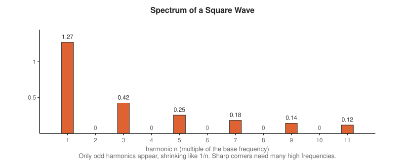

<!-- diagram: type=time-and-spectrum data=hourly-requests weeks=4 peaks=24h,168h caption="Four weeks of hourly request rates and their spectrum with daily and weekly peaks" -->


The second picture is the SRE version. Four weeks of request rates look like a noisy zigzag. The spectrum shows two clean spikes: a daily cycle of size about 300 and a weekly cycle of size about 100. That is seasonality, measured instead of guessed. Anomaly detection gets sharper once you subtract these two waves and watch what is left.

Related: [Statistics for Monitoring and Anomaly Detection](../../workshops/statistics-for-monitoring-and-anomaly-detection/README.md) workshop.

### Intermediate

#### 6. Complex Exponentials

Sines and cosines come as a pair. Complex numbers pack the pair into one object. The number $e^{i\theta}$ is the point at angle $\theta$ on the unit circle. Its horizontal shadow is $\cos\theta$ and its vertical shadow is $\sin\theta$. A wave of frequency $f$ is an arrow turning $f$ times per second.

$$e^{i\theta} = \cos\theta + i\sin\theta, \qquad f(t) = \sum_{n=-\infty}^{\infty} c_n\, e^{int}$$

<!-- diagram: type=phasor angle=50deg trace=sin,cos caption="A point turning on the unit circle; its shadows are cosine and sine" -->


Each complex coefficient $c_n$ stores two numbers at once: its size is the amplitude, and its angle is the phase. Multiplying complex exponentials adds their angles, which turns messy trig identities into plain algebra. Every FFT library works with complex numbers for this reason.

In the course: [301 Polynomials and Complex Numbers](../../course/301/02-polynomials-and-complex-numbers/README.md). Related: [Complex Analysis Track](../complex-analysis/README.md).

#### 7. The Fourier Transform

A signal that never repeats, such as a single click, has no base frequency. Its spectrum is not a list of harmonics but a continuous curve over all frequencies. The **Fourier transform** computes that curve, and the **inverse transform** rebuilds the signal from it.

$$\hat{f}(\xi) = \int_{-\infty}^{\infty} f(t)\, e^{-2\pi i \xi t}\, dt, \qquad f(t) = \int_{-\infty}^{\infty} \hat{f}(\xi)\, e^{2\pi i \xi t}\, d\xi$$

<!-- diagram: type=transform-pairs pulse-widths=0.5,2 caption="A narrow pulse has a wide spectrum and a wide pulse has a narrow spectrum" -->
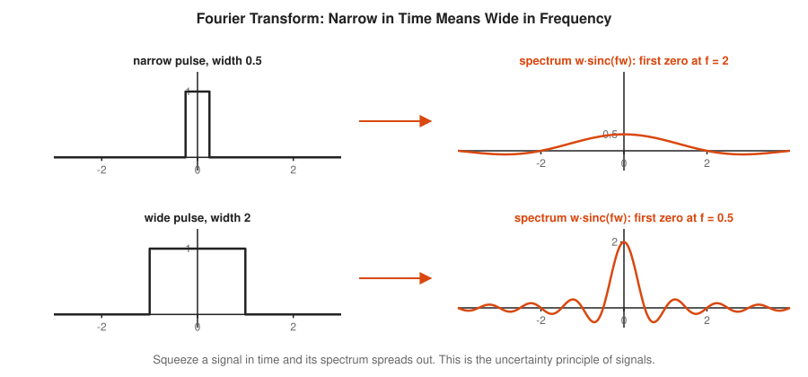

Squeeze a signal in time and its spectrum spreads out. Stretch it and the spectrum narrows. No signal is narrow in both. This is the **uncertainty principle** of signals, and the same mathematics gives Heisenberg's uncertainty principle in quantum mechanics. A short network burst occupies many frequencies, and a long steady tone occupies few.

In the course: [401 The Fundamental Theorem](../../course/401/07-fundamental-theorem/README.md).

#### 8. DFT and FFT

A computer holds $N$ samples, not a continuous signal. The **discrete Fourier transform** (DFT) turns $N$ samples into $N$ frequency bins. Done directly it takes about $N^2$ steps. The **fast Fourier transform** (FFT) gets the same answer in about $N \log_2 N$ steps by splitting the samples into even and odd halves, transforming each half, and combining.

$$X_k = \sum_{t=0}^{N-1} x_t\, e^{-2\pi i k t / N}, \qquad \text{direct: } N^2 \text{ steps}, \quad \text{FFT: } N \log_2 N \text{ steps}$$

<!-- diagram: type=roots-of-unity n=8 caption="The eight eighth roots of unity used by an 8-point DFT" -->


<!-- diagram: type=butterfly n=8 stages=3 caption="The FFT butterfly network for 8 points: three stages of pairwise combine steps" -->
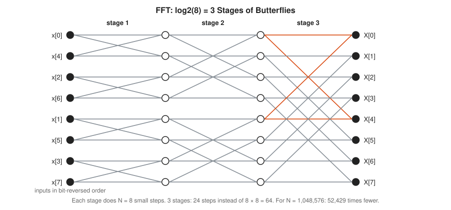

For a million samples the FFT does about 21 million steps instead of a trillion, roughly 52,000 times fewer. That speedup is why spectra, audio effects, image compression and fast polynomial multiplication are practical at all. Cooley and Tukey published the method in 1965. Gauss had used it around 1805 to track asteroids and never published it.

In the course: [301 Unit Circle and Radians](../../course/301/07-unit-circle-and-radians/README.md). Related: [Numerical Methods Track](../numerical-methods/README.md).

#### 9. Convolution

**Convolution** slides one signal across another and takes a weighted sum at each position. A moving average is a convolution with a box of equal weights. Blurring an image is a convolution with a small round bump. The **convolution theorem** is the payoff: convolution in time equals plain multiplication in frequency.

$$(x * h)[n] = \sum_k x[n - k]\, h[k], \qquad \widehat{x * h} = \hat{x} \cdot \hat{h}$$

<!-- diagram: type=series-smoothing window=9 caption="A moving average is a convolution that smooths a noisy series" -->
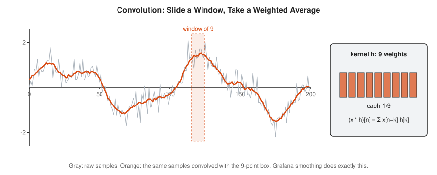

<!-- diagram: type=commutative-square caption="The convolution theorem: convolution in time equals multiplication in frequency" -->


The theorem also explains why smoothing works. A moving average has a spectrum that is large at low frequencies and small at high ones. Multiplying by it keeps the slow trend and shrinks the fast jitter.

Related: [Probability Track](../probability/README.md), where the distribution of a sum of independent variables is a convolution.

#### 10. Filtering

A **filter** changes the strength of each frequency. A **low-pass** filter keeps slow parts and removes fast ones. A **high-pass** filter does the opposite. A **band-pass** filter keeps a range. The cleanest way to see it: transform, set the unwanted bins to zero, transform back.

$$\hat{y}(\xi) = H(\xi)\,\hat{x}(\xi), \qquad H(\xi) = \begin{cases} 1 & |\xi| \le \xi_c \\ 0 & |\xi| > \xi_c \end{cases}$$

<!-- diagram: type=filter-demo signal=3Hz noise=40Hz cutoff=10Hz caption="A low-pass filter removes a 40 Hz hum from a 3 Hz signal" -->


Real filters avoid the hard cutoff because a sharp edge in frequency causes ripples in time, the Gibbs effect from rung 3 in the other direction. Engineers taper the edge instead. Noise-canceling headphones, audio equalizers and the anti-aliasing filter in every microphone input are filters of this kind.

Related: [Differential Equations Track](../differential-equations/README.md), where an RC circuit is a low-pass filter.

### Advanced

#### 11. Sampling Theorem and Aliasing

The **Nyquist-Shannon sampling theorem** says a signal with no frequency above $B$ is captured exactly by samples taken faster than $2B$ per second. The limit $f_s/2$ is the **Nyquist frequency**. Sample too slowly and high frequencies fold down and pose as low ones. That is **aliasing**.

$$f_s > 2B, \qquad f_{\text{alias}} = |f - k f_s| \text{ for the nearest whole number } k$$

<!-- diagram: type=function-plot f="sin(2pi 9t)" samples=10/s alias="-sin(2pi t)" caption="A 9 Hz wave sampled 10 times per second looks like a 1 Hz wave" -->
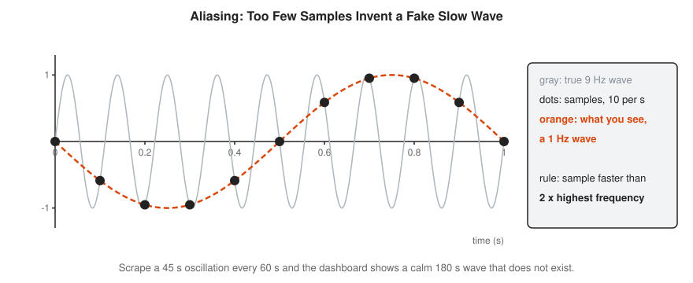

You have seen aliasing in films, where wagon wheels spin backward. In monitoring it is quieter and worse. A queue depth that swings every 45 seconds, scraped every 60 seconds, appears as a calm wave with a 180-second period. The dashboard shows a pattern that does not exist and hides the one that does. Scrape at least twice as fast as the fastest swing you care about, or summarize inside the scrape interval with a max or a histogram.

Related: [Information Theory Track](../information-theory/README.md), where Shannon also proved the channel capacity results.

#### 12. Wavelets

Fourier waves last forever, which makes them poor at saying when something happened. A **wavelet** is a short wiggle. Shift it to different times and stretch it to different scales, and you measure both when and how fast. The simplest is the **Haar wavelet**: replace pairs of numbers by their average and their half-difference, then repeat on the averages.

$$\text{average} = \frac{a + b}{2}, \qquad \text{detail} = \frac{a - b}{2}$$

<!-- diagram: type=haar-tree signal=4,6,10,12,8,6,5,5 caption="Haar wavelet transform of eight numbers into averages and details" -->
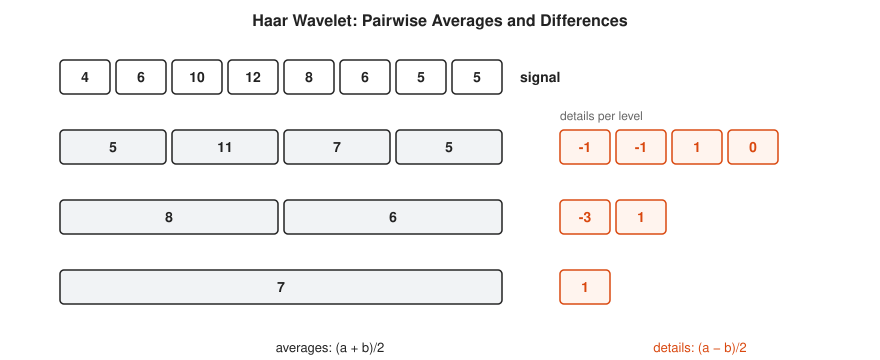

<!-- diagram: type=tilings panels=fourier,stft,wavelet caption="How Fourier, short-time Fourier and wavelets split time and frequency" -->
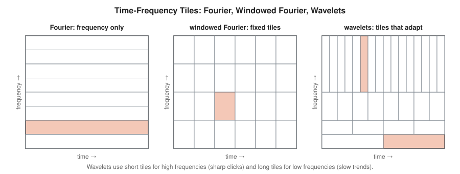

The details are small where the signal is smooth. Drop the small ones and you have compression that keeps sharp events sharp. JPEG 2000 and the FBI fingerprint archive use wavelets. For metrics, wavelets catch a short spike that a whole-day spectrum smears across every frequency.

Related: [Linear Algebra Track](../linear-algebra/README.md), since the Haar transform is a change of basis with an orthogonal matrix.

## Worked Examples

### Example 1: The First Square Wave Coefficient

The square wave is $+1$ on $(0, \pi)$ and $-1$ on $(\pi, 2\pi)$. Find $b_1$.

```txt
  b1 = (1/pi) int_0^{2pi} f(t) sin t dt                 coefficient formula
     = (1/pi) [ int_0^pi sin t dt - int_pi^{2pi} sin t dt ]   f = +1, then -1
  int_0^pi sin t dt = [-cos t]_0^pi = 1 + 1 = 2         antiderivative
  int_pi^{2pi} sin t dt = [-cos t]_pi^{2pi} = -1 - 1 = -2
  b1 = (1/pi) (2 - (-2)) = 4/pi                         combine
     = 1.2732                                           decimal
```

### Example 2: A DFT by Hand

Transform $x = [1, 0, -1, 0]$ with $N = 4$.

```txt
  X_k = sum_t x_t e^(-2 pi i k t / 4)                   definition
      = 1 x e^0 + (-1) x e^(-i pi k)                    only t = 0 and t = 2 are nonzero
      = 1 - (-1)^k                                      e^(-i pi k) = (-1)^k
  X_0 = 1 - 1 = 0                                       no constant part (mean is 0)
  X_1 = 1 + 1 = 2                                       one cycle per window
  X_2 = 1 - 1 = 0
  X_3 = 1 + 1 = 2                                       mirror of X_1 for real input
```

The signal is one cosine cycle, sampled four times. Bins 1 and 3 hold it, as a pair of mirror images.

### Example 3: Aliasing at Two Scales

```txt
  wave 9 Hz, sampling 10 Hz                             fs < 2 x 9 = 18: too slow
  alias = |9 - 1 x 10| = 1 Hz                           nearest multiple of 10 is 10
  oscillation every 45 s: f = 1/45 Hz                   frequency of the real swing
  scrape every 60 s: fs = 1/60 Hz                        sampling rate
  alias = |1/45 - 1 x 1/60| = 4/180 - 3/180 = 1/180 Hz  nearest multiple of fs is fs
  apparent period = 180 s                               a fake 3-minute wave
```

### Example 4: Convolve by Hand

Smooth $x = [1, 2, 3]$ with $h = [0.5, 0.5]$.

```txt
  y[0] = x[0] h[0]                 = 1 x 0.5           = 0.5    only overlap
  y[1] = x[1] h[0] + x[0] h[1]     = 1 + 0.5           = 1.5    average of 1 and 2
  y[2] = x[2] h[0] + x[1] h[1]     = 1.5 + 1           = 2.5    average of 2 and 3
  y[3] = x[2] h[1]                 = 3 x 0.5           = 1.5    only overlap
  y = [0.5, 1.5, 2.5, 1.5]                                       length 3 + 2 - 1 = 4
```

## Big Theorems to Know

* **Dirichlet Convergence Theorem:** the Fourier series of a piecewise smooth periodic function converges to it at every point of continuity and to the midpoint of each jump.
* **Gibbs Phenomenon:** at a jump, partial sums overshoot by about 9% of the jump size, no matter how many terms you take.
* **Parseval and Plancherel Theorems:** the energy of a signal equals the energy of its spectrum, $\int |f|^2 = \int |\hat{f}|^2$.
* **Fourier Inversion Theorem:** the inverse transform rebuilds the signal from its spectrum.
* **Convolution Theorem:** convolution in time is multiplication in frequency, and the other way around.
* **Uncertainty Principle:** the spread in time times the spread in frequency has a positive lower bound. No signal is sharp in both.
* **Nyquist-Shannon Sampling Theorem:** a signal limited to frequencies below $B$ is determined by samples taken faster than $2B$ per second.
* **Cooley-Tukey FFT:** the DFT of length $N$ takes $O(N \log N)$ steps instead of $O(N^2)$.
* **Carleson's Theorem (1966):** the Fourier series of every square-integrable function converges at almost every point. The question had been open for over 50 years.

## Open Problems and Fun Facts

* **A rough start:** Fourier presented his heat-flow paper with these series in 1807. Lagrange objected that sums of smooth sines cannot make a function with corners. Fourier was right in spirit. Making him right in detail took the rest of the century.
* **Gauss got there first:** Gauss wrote down a fast Fourier transform around 1805, before Fourier's paper, while computing asteroid orbits. It sat in his notes until long after his death.
* **Cold War FFT:** part of the push behind the 1965 Cooley-Tukey paper was detecting Soviet nuclear tests from seismometer readings.
* **Kolmogorov (1926):** he built an integrable function whose Fourier series diverges at every single point. Fourier series need conditions.
* **Open problem:** nobody has proven that $N \log N$ is the best possible speed for the DFT. No faster method is known either.
* **Open problem:** the Fourier restriction conjecture, about how the transform behaves on curved surfaces such as spheres, is open in dimensions 3 and up. It ties into the Kakeya problem from the [Measure Theory Track](../measure-theory/README.md).

## Starter Problems

1. Find the period of a 50 Hz wave.
2. Give the amplitude and frequency of $3\sin(2\pi \cdot 5t)$.
3. Find the coefficient $b_5$ of the square wave.
4. Human hearing reaches about 20 kHz. What sampling rate captures it? Why does CD audio use 44.1 kHz?
5. Prometheus scrapes a target every 15 seconds. What is the shortest period of oscillation it captures without aliasing?
6. For $N = 4,096$, how many times fewer steps does the FFT take than the direct DFT? Use $N^2$ and $N\log_2 N$.
7. Apply the Haar transform to $[2, 4, 6, 6]$: averages and details at each level.

<details>
<summary>Answers</summary>

1. $T = 1/50 = 0.02$ s, which is 20 ms.
2. Amplitude 3, frequency 5 Hz.
3. $b_5 = 4/(5\pi) \approx 0.255$.
4. More than $2 \times 20 = 40$ kHz. CD audio uses 44.1 kHz to leave room for a filter that removes everything above 20 kHz before sampling.
5. The sampling rate is $1/15$ Hz. The Nyquist frequency is $1/30$ Hz. Oscillations with periods shorter than 30 seconds alias.
6. $N^2 / (N \log_2 N) = N / \log_2 N = 4096 / 12 \approx 341$ times fewer.
7. Level 1: averages $[3, 6]$, details $[-1, 0]$. Level 2: average $4.5$, detail $-1.5$.

</details>

## Code Corner

[code/main.go](code/main.go) computes square wave coefficients and the Gibbs overshoot, does the DFT of $[1, 0, -1, 0]$, checks a radix-2 FFT against the direct DFT, finds the daily and weekly cycles in four weeks of synthetic request rates, compresses that series by keeping its largest frequencies, convolves two ways, filters out a hum, shows aliasing, and runs a Haar transform. Run it with `go run main.go` inside `code/`.

```txt
== Square wave: sine coefficients b_n ==
b1 = 1.2732   exact 1.2732
b2 = 0.0000   exact 0.0000
b3 = 0.4244   exact 0.4244
b4 = 0.0000   exact 0.0000
b5 = 0.2546   exact 0.2546
b6 = 0.0000   exact 0.0000
b7 = 0.1819   exact 0.1819

== Partial sums and the Gibbs overshoot ==
  1 odd terms: peak 1.2732 (target 1)
  3 odd terms: peak 1.1884 (target 1)
 10 odd terms: peak 1.1798 (target 1)
 50 odd terms: peak 1.1790 (target 1)
200 odd terms: peak 1.1790 (target 1)

== DFT of [1, 0, -1, 0] by hand ==
X[0] = +0.0 +0.0i
X[1] = +2.0 +0.0i
X[2] = +0.0 +0.0i
X[3] = +2.0 +0.0i

== FFT agrees with the direct DFT ==
N = 1024, largest difference 1.3e-11
N =    1024: direct N^2 = 1.05e+06 steps, FFT N log2 N = 1.02e+04 steps,    102x fewer
N = 1048576: direct N^2 = 1.10e+12 steps, FFT N log2 N = 2.10e+07 steps,  52429x fewer

== Seasonality: 4 weeks of hourly request rates ==
mean level 1000.8 requests per hour
bin  28: period   24.0 hours, amplitude  304.5
bin   4: period  168.0 hours, amplitude  105.8
bin 266: period    2.5 hours, amplitude    9.8

== Compression: keep only the largest coefficients ==
keep  1 of 336 frequencies:  85.3% of the variation explained
keep  2 of 336 frequencies:  95.6% of the variation explained
keep 10 of 336 frequencies:  96.1% of the variation explained
keep 50 of 336 frequencies:  97.5% of the variation explained

== Convolution: a moving average ==
[1 2 3] * [0.5 0.5] = [0.5 1.5 2.5 1.5]
via DFT: multiply spectra, invert: [0.5 1.5 2.5 1.5]

== Low-pass filter: 3 Hz signal plus 40 Hz hum, 256 samples per second ==
largest error before filter 0.500, after 7.8e-14

== Aliasing: a 9 Hz wave sampled 10 times per second ==
t = 0.0 s  sin(2 pi 9 t) = +0.0000   -sin(2 pi 1 t) = +0.0000
t = 0.1 s  sin(2 pi 9 t) = -0.5878   -sin(2 pi 1 t) = -0.5878
t = 0.2 s  sin(2 pi 9 t) = -0.9511   -sin(2 pi 1 t) = -0.9511
t = 0.3 s  sin(2 pi 9 t) = -0.9511   -sin(2 pi 1 t) = -0.9511
t = 0.4 s  sin(2 pi 9 t) = -0.5878   -sin(2 pi 1 t) = -0.5878
45 s oscillation scraped every 60 s looks like a 180 s oscillation

== Haar wavelet: averages and details ==
signal   [4 6 10 12 8 6 5 5]
averages [5 11 7 5]  details [-1 -1 1 0]
averages [8 6]  details [-3 1]
averages [7]  details [1]
```

The seasonality and compression sections are the SRE lesson. Two frequency bins out of 336 recover the daily and weekly cycles and explain about 96% of the variation. What remains is mostly noise, plus anything unusual, which is exactly what an anomaly detector wants to see. Keeping 10 or 50 bins adds little, because the rest is noise spread thin across every frequency.

## Flashcards

[cards.tsv](cards.tsv) holds the key definitions and theorems for Anki import.

## Resources

* [MacTutor: Joseph Fourier](https://mathshistory.st-andrews.ac.uk/Biographies/Fourier/): the life of the founder of the field, from the French Revolution to the heat equation.
* [Better Explained: An Interactive Guide to the Fourier Transform](https://betterexplained.com/articles/an-interactive-guide-to-the-fourier-transform/): plain-language intuition with the smoothie analogy.
* [Steven W. Smith: The Scientist and Engineer's Guide to Digital Signal Processing](https://www.dspguide.com/): a free practical book on the DFT, FFT, convolution and filters.
* [Stanford EE261: The Fourier Transform and Its Applications](https://see.stanford.edu/Course/EE261): Brad Osgood's full course with lecture notes and videos.
* [Wolfram MathWorld: Fourier Series](https://mathworld.wolfram.com/FourierSeries.html) and [Fast Fourier Transform](https://mathworld.wolfram.com/FastFourierTransform.html): formal definitions with links.
* [3Blue1Brown: Fourier Series](https://www.3blue1brown.com/lessons/fourier-series): the turning-arrows picture animated.

## Where to Go Next

* [Partial Differential Equations Track](../partial-differential-equations/README.md) for the heat equation, the problem Fourier invented his series to solve.
* [Functional Analysis Track](../functional-analysis/README.md) for the geometry behind orthogonal bases.
* [Music and Frequencies](../../workshops/music-and-frequencies/README.md) workshop for harmonics, sampling and a DFT that finds notes.
* [Statistics for Monitoring and Anomaly Detection](../../workshops/statistics-for-monitoring-and-anomaly-detection/README.md) workshop for using seasonality in alerting.
