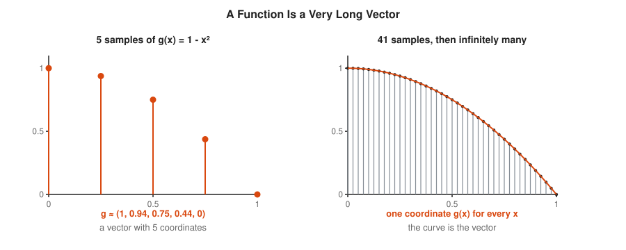
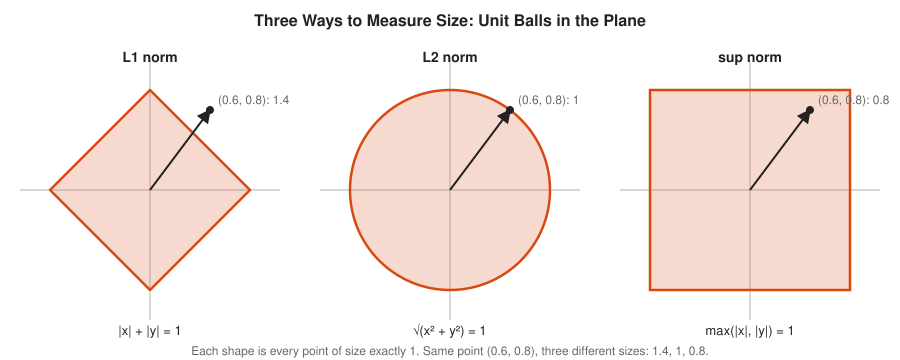
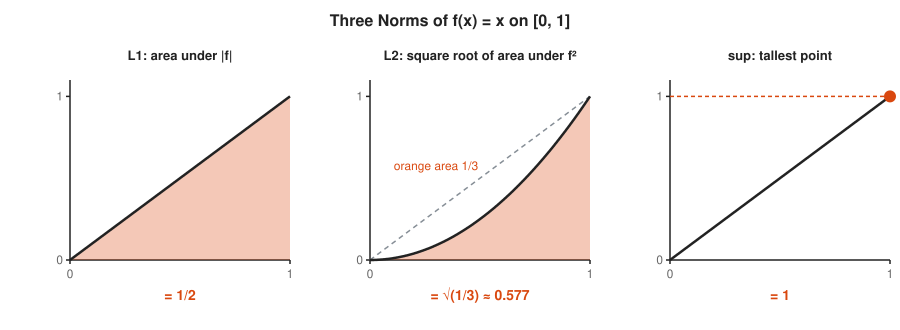
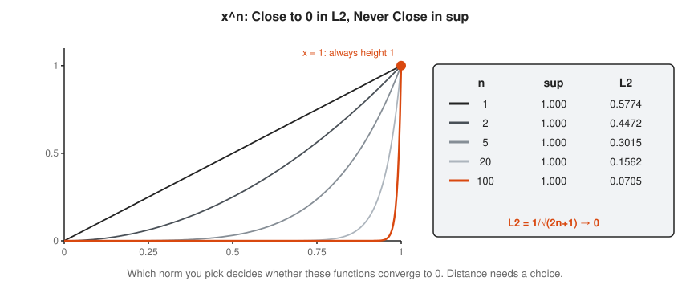
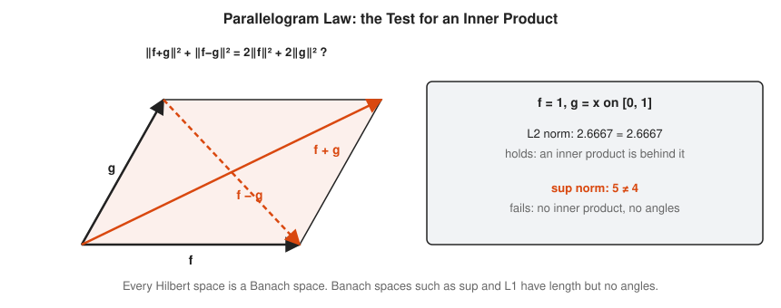
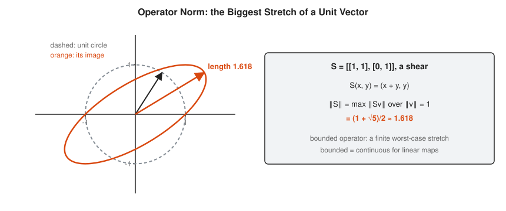
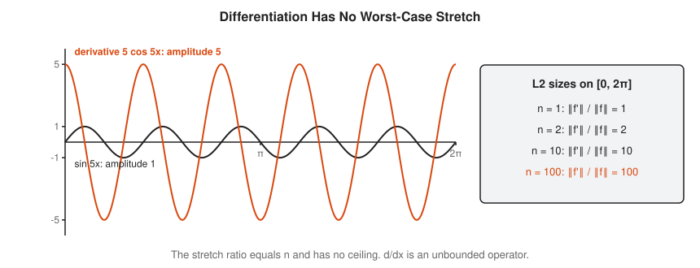
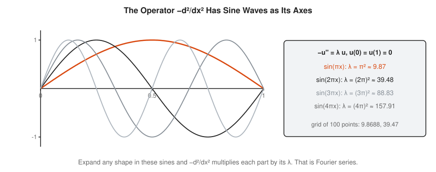

# Functional Analysis Track

**Track:** Functional Analysis · **Span:** beginner to advanced · **Course levels:** [501 Linear Algebra, Probability and Discrete Math](../../course/501/README.md) (vectors, matrices, eigenvalues), [401 Calculus](../../course/401/README.md) (integrals), [601 Proof and Higher Math](../../course/601/README.md) (completeness)
**Prerequisites:** vectors, the dot product, and integrals as area. The [Linear Algebra Track](../linear-algebra/README.md) covers vectors and eigenvalues. The [Calculus Track](../calculus/README.md) covers integrals. The [Real Analysis Track](../real-analysis/README.md) and the [Measure Theory Track](../measure-theory/README.md) help for the intermediate rungs.
**Files:** this README, [cards.tsv](cards.tsv) for Anki, [code/main.go](code/main.go), and the diagrams in [img/](img/).

## What the Field Studies

Functional analysis is linear algebra where the vectors are functions. A function such as $f(x) = x^2$ is a list of values, one for every $x$. That makes it a vector with infinitely many coordinates. You add functions, scale them, measure their size, and find the angle between two of them, the same way you do with arrows.

The field takes the tools of linear algebra, such as length, dot product, basis, matrix and eigenvalue, and makes them work in infinite dimensions. Most of them survive. A few break in instructive ways, and repairing them is the content of the field. The payoff is large: Fourier series, quantum mechanics, signal processing and kernel methods in machine learning all live here.

## Why It Matters

* **Error metrics are norms:** mean absolute error is an $L^1$ norm, root mean squared error is an $L^2$ norm, and worst-case latency is a sup norm. Picking an SLO metric is picking a norm, and the three disagree about what "close" means.
* **Similarity search:** embeddings for search and recommendation compare items by inner product and cosine similarity, the angle between two vectors.
* **Regression and compression:** least squares fitting is projection onto a subspace. JPEG and MP3 keep the largest coordinates in an orthogonal basis and drop the rest.
* **Ranking and stability:** PageRank and many stability checks find the largest eigenvalue of an operator by power iteration.
* **Machine learning kernels:** support vector machines and Gaussian processes compute inner products in a huge feature space without ever building it.
* **Quantum computing:** a qubit is a unit vector in a Hilbert space, and measurement is projection.

## Concept Map

<!-- diagram: type=concept-map tiers=beginner,intermediate,advanced nodes=12 caption="Functional analysis concepts with prerequisite arrows" -->


Read the map top to bottom. An arrow from A to B means learn A first. Start at the orange box.

## Signature Diagram

<!-- diagram: type=pair left=vector right=function v=3e1+2e2 f="3sin(x)+2sin(2x)" caption="A vector and a function, each split into coordinates along an orthogonal basis" -->


This picture is the whole field in miniature. On the left, an arrow is 3 steps along $e_1$ plus 2 steps along $e_2$. You find each number with a dot product. On the right, a function is 3 parts $\sin x$ plus 2 parts $\sin 2x$. You find each number with an inner product, which for functions is an integral. Same bookkeeping, more directions.

## The Concept Ladder

### Beginner

#### 1. Functions as Vectors

A vector in the plane is a list of two numbers. A vector in a computer is a list of $n$ numbers. A function on $[0, 1]$ gives one number for each $x$. Sample it at 5 points and you get a vector with 5 coordinates. Sample it at every point and you get a vector with infinitely many coordinates: the function itself.

$$g = (g(0), g(0.25), g(0.5), g(0.75), g(1)) \approx (1, 0.94, 0.75, 0.44, 0) \quad \text{for } g(x) = 1 - x^2$$

<!-- diagram: type=stem-plot f="1-x^2" samples=5,41 caption="A function sampled at a few points is a list of numbers, a vector" -->


A time series in your metrics store is exactly this: a function of time, stored as a long vector of samples. Functional analysis takes the limit where the samples never end.

In the course: [501 Vectors and the Dot Product](../../course/501/09-vectors-and-dot-product/README.md). Related: [Linear Algebra Track](../linear-algebra/README.md).

#### 2. Function Spaces

A **vector space** is any collection you can add and scale, with the usual rules: order of addition does not matter, a zero exists, and so on. Functions qualify. Add two functions point by point. Scale a function by multiplying every value. The zero vector is the function that is 0 everywhere. A collection of functions closed under these operations is a **function space**.

$$(f + g)(x) = f(x) + g(x), \qquad (c f)(x) = c\, f(x)$$

<!-- diagram: type=function-plot f="x" g="1-x^2" sum=true marks=0.25,0.5,0.75 caption="Functions add point by point, like vectors add coordinate by coordinate" -->


Examples: all polynomials, all continuous functions on $[0, 1]$, all functions with finite area under $|f|^2$. None of these spaces has a finite basis. The polynomials $1, x, x^2, x^3, \ldots$ are independent forever. That is what "infinite-dimensional" means.

In the course: [501 Matrices as Transformations](../../course/501/10-matrices-as-transformations/README.md).

#### 3. Norms: Measuring Size

A **norm** $\|v\|$ gives each vector a size. It must be positive except for the zero vector, scale correctly, $\|cv\| = |c|\,\|v\|$, and obey the **triangle inequality**, $\|u + v\| \le \|u\| + \|v\|$: a detour is never shorter. Different norms measure different things.

$$\|f\|_1 = \int |f|, \qquad \|f\|_2 = \sqrt{\int |f|^2}, \qquad \|f\|_\infty = \max |f|$$

<!-- diagram: type=unit-balls norms=L1,L2,sup point=0.6,0.8 caption="Unit balls of the L1, L2 and sup norms in the plane" -->


<!-- diagram: type=function-plot-triple f="x" norms=L1,L2,sup caption="Three norms of f(x) = x on 0 to 1" -->


The **unit ball** is every vector of size at most 1. Its shape tells you the norm at a glance. The $L^2$ norm is the usual length, the one Pythagoras gives. The names $L^1$ and $L^2$ come from the power inside the integral.

Related: [Statistics Track](../statistics/README.md), where mean absolute error and root mean squared error are these norms in disguise.

#### 4. Distance and Convergence

A norm gives a **distance**: $d(f, g) = \|f - g\|$. A sequence $f_n$ **converges** to $f$ when that distance shrinks to 0. In finite dimensions, all norms agree about which sequences converge. In infinite dimensions they do not, and you must say which norm you mean.

$$\|x^n\|_\infty = 1 \text{ for all } n, \qquad \|x^n\|_2 = \frac{1}{\sqrt{2n + 1}} \to 0$$

<!-- diagram: type=function-family f="x^n" n=1,2,5,20,100 caption="x to the n: the L2 norm shrinks to 0 while the sup norm stays 1" -->


The functions $x^n$ hug zero almost everywhere, which makes the $L^2$ distance to zero small. They still reach height 1 at $x = 1$, which keeps the sup distance at 1. An SRE knows this argument: the average latency improves while the worst request stays as slow as ever.

In the course: [601 Epsilon-Delta Limits](../../course/601/09-epsilon-delta-limits/README.md). Related: [Real Analysis Track](../real-analysis/README.md) for uniform convergence, which is convergence in the sup norm.

#### 5. Inner Products and Angles

An **inner product** $\langle f, g \rangle$ is the dot product for functions: multiply point by point, then add up with an integral. It gives length, $\|f\|_2 = \sqrt{\langle f, f \rangle}$, and it gives angles. Two functions are **orthogonal** when $\langle f, g \rangle = 0$: they point at right angles.

$$\langle f, g \rangle = \int_a^b f(x)\, g(x)\, dx, \qquad |\langle f, g \rangle| \le \|f\|\,\|g\|$$

<!-- diagram: type=function-plot f="sin(x)cos(x)" x=0..2pi shade=sign caption="The product sin x cos x has equal positive and negative area, and the inner product is 0" -->


The inequality on the right is **Cauchy-Schwarz**: an inner product is never bigger than the product of the lengths. It is the reason angles make sense, because it keeps $\cos\theta = \langle f, g \rangle / (\|f\|\,\|g\|)$ between $-1$ and $1$. Cosine similarity in a search engine is this formula.

In the course: [501 Vectors and the Dot Product](../../course/501/09-vectors-and-dot-product/README.md). Related: [Fourier Analysis Track](../fourier-analysis/README.md), which runs on these orthogonal sines and cosines.

### Intermediate

#### 6. Completeness and Hilbert Spaces

A **Cauchy sequence** is a sequence whose terms get closer and closer to each other. A space is **complete** when every Cauchy sequence converges to something inside the space. The rationals are not complete: they close in on $\sqrt{2}$, which is not a rational. Continuous functions under the $L^2$ distance have the same kind of hole.

$$\text{Hilbert space} = \text{inner product space that is complete}$$

<!-- diagram: type=function-family f=ramp slopes=2,4,8,32 limit=step caption="Continuous ramps converge in L2 to a step function that is not continuous" -->


A **Hilbert space** has an inner product and no holes. The main example is $L^2$, all functions with $\int |f|^2 < \infty$, where the integral is the Lebesgue integral. Completeness is what allows you to take limits safely, the same way it does on the real line. Hilbert spaces are the friendliest infinite-dimensional spaces: geometry from the plane works almost unchanged.

In the course: [601 Completeness and Sequences](../../course/601/10-completeness-and-sequences/README.md). Related: [Measure Theory Track](../measure-theory/README.md) for the Lebesgue integral that makes $L^2$ complete.

#### 7. Orthogonal Bases and Projection

An **orthonormal basis** is a set of unit vectors, all at right angles, that reach everything. In a Hilbert space, each vector is the sum of its coordinates times the basis vectors, and each coordinate is one inner product. Keep only some coordinates and you get the **projection**: the closest point in the smaller space.

$$f = \sum_n \langle f, e_n \rangle\, e_n, \qquad \|f\|^2 = \sum_n |\langle f, e_n \rangle|^2$$

<!-- diagram: type=pair left=projection-on-line right=fourier-partial-sums f=x terms=1,2,8 caption="Projection onto a line gives the closest point, and Fourier partial sums are projections" -->


The formula on the right is **Parseval's identity**: the squared length equals the sum of squared coordinates, Pythagoras with infinitely many sides. **Gram-Schmidt** turns any independent list into an orthonormal one. Applied to $1, x, x^2$ on $[-1, 1]$, it produces the Legendre polynomials $1$, $x$, $x^2 - 1/3$ (up to scaling).

In the course: [501 Vectors and the Dot Product](../../course/501/09-vectors-and-dot-product/README.md). Related: [Linear Algebra Track](../linear-algebra/README.md) for projection and least squares.

#### 8. Banach Spaces

A **Banach space** is a complete normed space. It has length and distance but not necessarily angles. $L^1$ and the continuous functions with the sup norm are Banach spaces that are not Hilbert spaces. The test is the **parallelogram law**: a norm comes from an inner product exactly when it holds.

$$\|f + g\|^2 + \|f - g\|^2 = 2\|f\|^2 + 2\|g\|^2$$

<!-- diagram: type=parallelogram vectors=f,g diagonals=f+g,f-g caption="The parallelogram law holds for the L2 norm and fails for the sup norm" -->


Every Hilbert space is a Banach space. The reverse fails. Banach spaces matter because many natural problems use $L^1$ or sup norms: total mass, worst-case error, total variation. You lose projection and angles. You keep limits, linear maps and most of the big theorems.

Related: [Real Analysis Track](../real-analysis/README.md) for metric spaces and completeness.

#### 9. Linear Operators

A **linear operator** $T$ maps vectors to vectors and respects addition and scaling: $T(af + bg) = aT(f) + bT(g)$. Matrices are linear operators. So are differentiation, integration, shifting a signal in time, and smoothing it. The **operator norm** is the biggest stretch $T$ applies to any unit vector. An operator is **bounded** when that stretch is finite.

$$\|T\| = \sup_{\|v\| = 1} \|Tv\|$$

<!-- diagram: type=unit-circle-map matrix=[[1,1],[0,1]] caption="A shear maps the unit circle to an ellipse; the operator norm is the longest stretch" -->


<!-- diagram: type=function-plot f="sin(5x)" g="5cos(5x)" x=0..2pi caption="sin(nx) keeps the same size while its derivative grows n times" -->


For a linear operator, bounded and continuous mean the same thing: small input changes give small output changes. Differentiation is not bounded. The wave $\sin(nx)$ keeps the same size for every $n$, but its derivative $n\cos(nx)$ grows without limit. That is why differentiating noisy data amplifies the noise, and why numerical derivatives of metrics look so jumpy.

In the course: [501 Matrices as Transformations](../../course/501/10-matrices-as-transformations/README.md).

#### 10. Dual Spaces and Riesz Representation

A **linear functional** is a linear operator that returns a single number. Examples: the average of a function over $[0, 1]$, its value at one point, a weighted sum of samples. The bounded linear functionals form the **dual space**. In a Hilbert space, each one is an inner product with one fixed vector $g$. That is the **Riesz representation theorem**.

$$\varphi(v) = \langle g, v \rangle \quad \text{for exactly one } g$$

<!-- diagram: type=level-sets functional=<g,v> g=1,0.6 levels=-2..2 caption="A linear functional's level sets are parallel lines perpendicular to one vector g" -->


The level sets of a functional are parallel lines, or parallel flat slices in higher dimensions. The vector $g$ points straight across them. Any weighted average you compute over a time window is an inner product with a weight function, and the weight function is its $g$.

In the course: [501 Vectors and the Dot Product](../../course/501/09-vectors-and-dot-product/README.md).

### Advanced

#### 11. Spectral Theorem

A **symmetric** matrix, one equal to its own transpose, has eigenvectors at right angles to each other. In those directions it does nothing but stretch. The **spectral theorem** says this and extends it to **self-adjoint** operators on Hilbert spaces, the infinite-dimensional version of symmetric. The set of stretch factors, the eigenvalues, is the **spectrum**.

$$A = \sum_n \lambda_n\, \langle \cdot, e_n \rangle\, e_n, \qquad A e_n = \lambda_n e_n$$

<!-- diagram: type=unit-circle-map matrix=[[2,1],[1,2]] eigen=true caption="A symmetric matrix stretches along perpendicular eigenvector axes" -->


<!-- diagram: type=function-family f="sin(k pi x)" k=1..4 caption="Eigenfunctions of minus the second derivative on 0 to 1 with fixed ends" -->


The operator $-d^2/dx^2$ on $[0, 1]$ with both ends held at zero is self-adjoint. Its eigenvectors are the sine waves $\sin(k\pi x)$, with eigenvalues $(k\pi)^2$. Write any shape as a sum of these sines and the operator multiplies each part by its own number. That is exactly how the [Partial Differential Equations Track](../partial-differential-equations/README.md) solves the heat and wave equations.

In the course: [501 Eigenvalues and Eigenvectors](../../course/501/13-eigenvalues-and-eigenvectors/README.md). Related: [Linear Algebra Track](../linear-algebra/README.md).

#### 12. Quantum Mechanics and ML Kernels

Two very different fields run on Hilbert spaces. In **quantum mechanics**, the state of a system is a unit vector $\psi$. A measurement corresponds to a self-adjoint operator. The possible results are its eigenvalues, and the probability of each is the squared length of the projection onto its eigenvector. In **machine learning**, a **kernel** $k(x, y)$ computes an inner product in a lifted feature space, $k(x, y) = \langle \varphi(x), \varphi(y) \rangle$, without ever building $\varphi$.

$$P(e_n) = |\langle e_n, \psi \rangle|^2, \qquad (xy + 1)^2 = \langle \varphi(x), \varphi(y) \rangle, \ \varphi(x) = (x^2, \sqrt{2}x, 1)$$

<!-- diagram: type=vector-projection state=0.6,0.8 caption="A quantum state as a unit vector; squared coordinates give measurement probabilities" -->


<!-- diagram: type=lift map="x->(x,x^2)" caption="Points on a line that one cut cannot separate become separable after lifting to x and x squared" -->


The kernel trick is the dual of the lift. Instead of computing $\varphi(x)$, which can have millions or infinitely many coordinates, compute $k(x, y)$ directly. The Gaussian kernel $e^{-\|x - y\|^2}$ corresponds to an infinite-dimensional $\varphi$, and the inner product still costs one exponential.

Related: [Probability Track](../probability/README.md) for the probabilities, [Linear Algebra Track](../linear-algebra/README.md) for the finite version.

## Worked Examples

### Example 1: Three Norms of One Function

Find the $L^1$, $L^2$ and sup norms of $f(x) = x$ on $[0, 1]$.

```txt
  L1  = int_0^1 |x| dx = [x^2/2]_0^1 = 1/2              area under |f|
  L2^2 = int_0^1 x^2 dx = [x^3/3]_0^1 = 1/3              area under f^2
  L2  = sqrt(1/3) = 0.5774                              take the square root
  sup = max of |x| on [0,1] = 1                          tallest point, at x = 1
  order: 0.5 <= 0.577 <= 1                              on [0,1]: L1 <= L2 <= sup
```

### Example 2: A Fourier Coefficient Is a Projection

Find the coefficient of $\sin x$ in $f(x) = x$ on $[-\pi, \pi]$.

```txt
  b1 = <f, sin> / <sin, sin>                            projection coefficient
  <sin, sin> = int_{-pi}^{pi} sin^2 x dx = pi           half of the 2 pi interval
  <f, sin> = int_{-pi}^{pi} x sin x dx                   multiply, then integrate
           = [-x cos x + sin x]_{-pi}^{pi}              integration by parts
           = (pi) - (-pi) = 2 pi                         cos(+-pi) = -1, sin(+-pi) = 0
  b1 = 2 pi / pi = 2                                    divide
  general: b_n = 2(-1)^(n+1)/n = 2, -1, 2/3, -1/2, ...   same steps with sin(nx)
```

### Example 3: Gram-Schmidt on 1, x, x²

Make $1, x, x^2$ orthogonal on $[-1, 1]$.

```txt
  e0 = 1                                                keep the first
  <x, 1> = int_{-1}^{1} x dx = 0                        odd function
  e1 = x                                                already orthogonal to e0
  <x^2, 1> = 2/3,  <1, 1> = 2                           integrate
  <x^2, x> = int x^3 dx = 0                             odd function
  e2 = x^2 - (<x^2,1>/<1,1>) 1 - (<x^2,x>/<x,x>) x       subtract both projections
     = x^2 - (1/3) 1 - 0 = x^2 - 1/3                    (2/3)/2 = 1/3
  check <e2, 1> = 2/3 - (1/3)(2) = 0                    orthogonal
```

### Example 4: Eigenvalues and Operator Norm of a Symmetric Matrix

```txt
  A = [[2, 1], [1, 2]]                                  symmetric
  det(A - L I) = (2 - L)^2 - 1 = 0                      characteristic equation
  2 - L = +-1  ->  L = 1 or L = 3                       solve
  L = 3: (A - 3I) v = 0 -> v = (1, 1)                   first eigenvector
  L = 1: (A - I) v = 0 -> v = (1, -1)                   second eigenvector
  (1, 1) . (1, -1) = 0                                  perpendicular, as promised
  ||A|| = largest |eigenvalue| = 3                       true for symmetric matrices
```

## Big Theorems to Know

* **Cauchy-Schwarz Inequality:** $|\langle f, g \rangle| \le \|f\|\,\|g\|$. Angles make sense in every inner product space.
* **Projection Theorem:** in a Hilbert space, every vector has exactly one closest point in a closed subspace, and the error is orthogonal to that subspace.
* **Riesz-Fischer Theorem:** $L^2$ is complete. Any square-summable list of coordinates is the coordinate list of some function.
* **Parseval's Identity:** $\|f\|^2 = \sum |\langle f, e_n \rangle|^2$ for an orthonormal basis.
* **Riesz Representation Theorem:** every bounded linear functional on a Hilbert space is an inner product with one fixed vector.
* **Hahn-Banach Theorem:** a bounded linear functional on a subspace extends to the whole space without growing its norm.
* **Uniform Boundedness Principle:** a family of bounded operators that is bounded at each point is bounded uniformly.
* **Open Mapping and Closed Graph Theorems:** in Banach spaces, a bounded linear bijection has a bounded inverse.
* **Spectral Theorem:** a compact self-adjoint operator has an orthonormal basis of eigenvectors with real eigenvalues shrinking to 0.
* **Classification of Hilbert Spaces:** every infinite-dimensional Hilbert space with a countable basis looks exactly like $\ell^2$, the space of square-summable sequences.

## Open Problems and Fun Facts

* **The Scottish Book:** Stefan Banach and friends wrote open problems in a notebook kept at the Scottish Café in Lwów in the 1930s. Stanislaw Mazur offered a live goose for one of them. Per Enflo solved it in 1972 and received the goose.
* **A word ahead of its time:** David Hilbert used the word spectrum for operators in the early 1900s. Two decades later quantum mechanics showed that the spectral lines of atoms are literally the spectrum of an operator.
* **Von Neumann (1932):** his book on the mathematical foundations of quantum mechanics set the theory in Hilbert spaces, where it still lives.
* **Open problem:** the invariant subspace problem asks whether every bounded operator on a Hilbert space has a closed subspace, other than zero and the whole space, that it maps into itself. Enflo built a counterexample in a Banach space. For Hilbert spaces the question is still open.
* **Fun fact:** the Gaussian kernel used in machine learning corresponds to a feature space of infinite dimension. Computers handle it every day at the cost of one exponential per pair of points.

## Starter Problems

1. Find the $L^1$, $L^2$ and sup norms of the vector $(3, -4)$.
2. Find the $L^2$ norm of $f(x) = 1$ on $[0, 4]$.
3. Are $f(x) = 1$ and $g(x) = x$ orthogonal on $[-1, 1]$? On $[0, 1]$?
4. Check Cauchy-Schwarz for $f = 1$ and $g = x$ on $[0, 1]$.
5. Is the operator $(Tf)(x) = x\,f(x)$ on $L^2[0, 1]$ bounded? Give a bound.
6. Find the eigenvalues and operator norm of $\begin{pmatrix} 4 & 0 \\ 0 & 1 \end{pmatrix}$.
7. With $k(x, y) = (xy + 1)^2$, compute $k(2, 3)$ directly and as $\varphi(2) \cdot \varphi(3)$ with $\varphi(x) = (x^2, \sqrt{2}x, 1)$.

<details>
<summary>Answers</summary>

1. $L^1$: $3 + 4 = 7$. $L^2$: $\sqrt{9 + 16} = 5$. Sup: $\max(3, 4) = 4$.
2. $\sqrt{\int_0^4 1\,dx} = \sqrt{4} = 2$.
3. On $[-1, 1]$: yes, $\int_{-1}^{1} x\,dx = 0$. On $[0, 1]$: no, $\int_0^1 x\,dx = 1/2$.
4. $\langle f, g \rangle = 1/2$. $\|f\| = 1$ and $\|g\| = 1/\sqrt{3} \approx 0.577$. Indeed $0.5 \le 0.577$.
5. Yes. On $[0, 1]$, $|x f(x)| \le |f(x)|$, which gives $\|Tf\| \le \|f\|$ and $\|T\| \le 1$. The norm equals 1, approached by functions bunched near $x = 1$.
6. Eigenvalues 4 and 1, with eigenvectors along the axes. Operator norm 4.
7. Directly: $(2 \cdot 3 + 1)^2 = 49$. Features: $(4, 2\sqrt{2}, 1) \cdot (9, 3\sqrt{2}, 1) = 36 + 12 + 1 = 49$.

</details>

## Code Corner

[code/main.go](code/main.go) treats functions as vectors, computes three norms, compares $L^2$ and sup convergence, checks orthogonality, projects $f(x) = x$ onto sines, runs Gram-Schmidt, tests the parallelogram law, finds an operator norm by power iteration, shows that differentiation is unbounded, computes eigenvalues of the second derivative on a grid, and checks the kernel trick. Run it with `go run main.go` inside `code/`.

```txt
== A function sampled at 5 points is a vector ==
x = 0.00  f = 0.0000  g = 1.0000  f+g = 1.0000  2f = 0.0000
x = 0.25  f = 0.2500  g = 0.9375  f+g = 1.1875  2f = 0.5000
x = 0.50  f = 0.5000  g = 0.7500  f+g = 1.2500  2f = 1.0000
x = 0.75  f = 0.7500  g = 0.4375  f+g = 1.1875  2f = 1.5000
x = 1.00  f = 1.0000  g = 0.0000  f+g = 1.0000  2f = 2.0000

== Three norms of f(x) = x on [0,1] ==
L1  (area under |f|)        0.500000   exact 1/2
L2  (root of area of f^2)   0.577350   exact 1/sqrt(3) = 0.577350
sup (tallest point)         1.000000   exact 1

== x^n: small in L2, never small in sup ==
n =   1  sup 1.0000  L2 0.5774  exact 1/sqrt(2n+1) = 0.5774
n =   5  sup 1.0000  L2 0.3015  exact 1/sqrt(2n+1) = 0.3015
n =  20  sup 1.0000  L2 0.1562  exact 1/sqrt(2n+1) = 0.1562
n = 100  sup 1.0000  L2 0.0705  exact 1/sqrt(2n+1) = 0.0705

== Inner products on [0, 2 pi] ==
<sin, cos>     = +0.000000
<sin, sin 2x>  = +0.000000
<sin, sin>     = +3.141593   exact pi = 3.141593

== Project f(x) = x on [-pi, pi] onto sin(nx) ==
b1 = +2.0000   exact 2(-1)^(n+1)/n = +2.0000
b2 = -1.0000   exact 2(-1)^(n+1)/n = -1.0000
b3 = +0.6667   exact 2(-1)^(n+1)/n = +0.6667
b4 = -0.5000   exact 2(-1)^(n+1)/n = -0.5000
terms 1  L2 error 2.8468
terms 2  L2 error 2.2278
terms 4  L2 error 1.6677
terms 8  L2 error 1.2152

== Gram-Schmidt on 1, x, x^2 over [-1, 1] ==
e0 = 1.0000
e1 = 1.0000 x
e2 = -0.3333 + 1.0000 x^2
<e0, e2> = 0.0000  <e1, e2> = 0.0000

== Parallelogram law with f = 1, g = x on [0,1] ==
L2 norm:  2.6667 vs 2.6667  holds: comes from an inner product
sup norm: 5.0000 vs 4.0000  fails: no inner product behind it

== Operator norm of A = [[2,1],[1,2]] by power iteration ==
step  1  stretch 2.236068  direction (0.8944, 0.4472)
step  5  stretch 2.999797  direction (0.7100, 0.7042)
step 20  stretch 3.000000  direction (0.7071, 0.7071)

== Differentiation is unbounded: f_n = sin(nx) on [0, 2 pi] ==
n =   1  ||f|| = 1.7725  ||f'|| =   1.7725  ratio    1.0
n =   2  ||f|| = 1.7725  ||f'|| =   3.5449  ratio    2.0
n =  10  ||f|| = 1.7725  ||f'|| =  17.7245  ratio   10.0
n = 100  ||f|| = 1.7725  ||f'|| = 177.2454  ratio  100.0

== Spectrum of -d^2/dx^2 on [0,1] with ends fixed (100 grid points) ==
mode 1  eigenvalue    9.8688  continuous (k pi)^2 =    9.8696
mode 2  eigenvalue   39.4657  continuous (k pi)^2 =   39.4784
mode 3  eigenvalue   88.7620  continuous (k pi)^2 =   88.8264
mode 4  eigenvalue  157.7101  continuous (k pi)^2 =  157.9137

== Kernel trick: (xy + 1)^2 equals phi(x).phi(y), phi(x) = (x^2, sqrt2 x, 1) ==
x = +1.0 y = +2.0  kernel  9.0000  feature dot  9.0000
x = -1.5 y = +0.5  kernel  0.0625  feature dot  0.0625
x = +3.0 y = -2.0  kernel 25.0000  feature dot 25.0000

== Measuring a quantum-style state psi = 0.6 e1 + 0.8 e2 ==
||psi||^2 = 1.00   P(e1) = 0.36   P(e2) = 0.64
```

Two sections carry the deepest points. The derivative section shows the stretch ratio growing as fast as $n$: no worst case exists. The grid eigenvalues sit close to $(k\pi)^2$ and drift away for higher modes, because a grid of 100 points draws fast wiggles badly. Every numerical method lives with that trade.

## Flashcards

[cards.tsv](cards.tsv) holds the key definitions and theorems for Anki import.

## Resources

* [MacTutor: David Hilbert](https://mathshistory.st-andrews.ac.uk/Biographies/Hilbert/) and [MacTutor: Stefan Banach](https://mathshistory.st-andrews.ac.uk/Biographies/Banach/): the two names on the main spaces of the field.
* [Wolfram MathWorld: Hilbert Space](https://mathworld.wolfram.com/HilbertSpace.html) and [Banach Space](https://mathworld.wolfram.com/BanachSpace.html): short formal definitions with links.
* [MIT OCW 18.102 Introduction to Functional Analysis](https://ocw.mit.edu/courses/18-102-introduction-to-functional-analysis-spring-2021/): full lecture notes and videos from a classic course.
* [Sheldon Axler: Measure, Integration and Real Analysis](https://measure.axler.net/): a free textbook whose later chapters cover Banach spaces, Hilbert spaces and the spectral theorem.

## Where to Go Next

* [Fourier Analysis Track](../fourier-analysis/README.md) for the most famous orthogonal basis in use.
* [Partial Differential Equations Track](../partial-differential-equations/README.md) for operators and eigenfunctions solving real physics.
* [Measure Theory Track](../measure-theory/README.md) for the integral that makes $L^2$ complete.
* [Linear Algebra Track](../linear-algebra/README.md) for the finite-dimensional ideas this track extends.
* [Linear Algebra for Graphics and ML](../../workshops/linear-algebra-for-graphics-and-ml/README.md) for the hands-on side of embeddings and projections.
