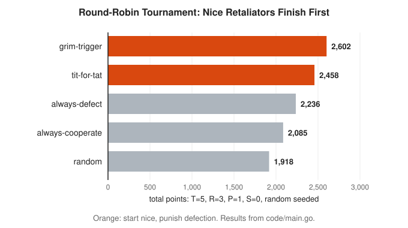

# Game Theory Track

**Track:** Game Theory · **Span:** beginner to advanced · **Course levels:** [101 Foundations](../../course/101/README.md) (arithmetic and fractions), [501 Linear Algebra, Probability and Discrete Math](../../course/501/README.md) (probability and expected value)
**Prerequisites:** reading a table, comparing two numbers, and simple fractions. The middle rungs use expected value from the [Probability Track](../probability/README.md). The last rung uses binary numbers. Nothing else.
**Files:** this README, [cards.tsv](cards.tsv) for Anki, [code/main.go](code/main.go), and the diagrams in [img/](img/).

## What the Field Studies

Game theory studies decisions where the result depends on what other people decide too. A **game** has three parts: **players** (who decides), **strategies** (the choices each player has), and **payoffs** (the number each player gets for each combination of choices). A higher payoff is better.

That is the whole setup. Chess is a game. So is a price war, an auction, a negotiation, and two services fighting over the same database connection pool. Game theory asks one question about all of them: if every player looks after its own interest, what happens?

This track covers strategic games between deciding players. Games of pure chance, such as dice and roulette, live in the sibling workshop [Games and Probability](../../workshops/games-and-probability/README.md). Here the dice are other people.

## Why It Matters

You already run games in production. The players are teams, clients and attackers:

* **Shared quotas:** every team that over-provisions on a shared cluster gains a little and costs everyone a little. Everyone over-provisions. That is the prisoner's dilemma.
* **Retry storms:** when a server recovers, every client wants to retry first. If all of them do, the server falls over again. Random jitter in backoff is a **mixed strategy**.
* **Security:** a defender with limited monitoring and an attacker who picks a target play a **zero-sum game**. The best defense is often unpredictable.
* **Routing:** load balancers, BGP and drivers with phone navigation each pick the fastest path for themselves. Selfish routing can make every path slower. That is **Braess paradox**.
* **Auctions:** search ads and older cloud spot markets sell capacity by auction. In a **second-price auction**, the best bid is your honest value.
* **On-call trades:** "I cover your shift if you cover mine" survives only when both sides expect to meet again. That is a **repeated game**, and **tit-for-tat** describes it well.

## Concept Map

<!-- diagram: type=concept-map tiers=beginner,intermediate,advanced nodes=13 caption="Game theory concepts with prerequisite arrows" -->


Read the map top to bottom. An arrow from A to B means learn A first. Start at the orange box.

## Signature Diagram

<!-- diagram: type=payoff-grid game=prisoners-dilemma payoffs=CC:3,3;CD:0,5;DC:5,0;DD:1,1 arrows=best-response caption="Prisoner's dilemma with best-response arrows" -->


Two players each choose Cooperate or Defect. Read each cell as (player 1 payoff, player 2 payoff). Now follow the arrows. Whatever player 2 does, player 1 earns more by defecting: 5 beats 3, and 1 beats 0. The same holds for player 2. Every arrow points to (Defect, Defect), and nothing points out of it. Both players end up with 1, while (Cooperate, Cooperate) pays both of them 3.

Each player is rational. The group result is poor. This one grid explains price wars, arms races, quota hoarding, and why the shared staging environment is always broken. Most of the field is an attempt to understand, and escape, this picture.

## The Concept Ladder

### Beginner

#### 1. Players, Choices and Payoffs

Two coffee shops sit on the same street. Each morning each shop picks a price: High or Low. Profit depends on both choices. Low steals customers from a High neighbor. Two Low shops split the street at thin margins.

Write the game as a grid. Shop A picks a row. Shop B picks a column. Each cell holds two numbers: first the payoff to the row player, then the payoff to the column player. Both players choose at the same time, without seeing the other choice.

$$\text{game} = (\text{players},\ \text{strategies},\ \text{payoffs})$$

<!-- diagram: type=payoff-grid rows=High,Low cols=High,Low payoffs=6,6;2,8;8,2;4,4 highlight=Low,High caption="A game as a grid: two coffee shops pick a price" -->


A **payoff** is any number that measures how much a player likes an outcome: dollars, minutes saved, points. Only the order matters at first: bigger is better. A grid like this is called a **payoff matrix**, or a **bimatrix** because each cell holds two numbers.

In the course: [101 Foundations](../../course/101/README.md) for reading tables and comparing numbers.

#### 2. Dominant Strategies

A strategy is **dominant** when it beats every other strategy of yours, no matter what the other player does. If you have one, the decision is over. You do not need to guess the other player at all.

Check it one column at a time. Fix what Shop B does, then compare the two rows for Shop A.

$$s \text{ dominates } t \iff \text{payoff}(s, x) > \text{payoff}(t, x) \text{ for every choice } x \text{ of the others}$$

<!-- diagram: type=payoff-grid-pair game=coffee arrows=row-compare,column-compare caption="Low strictly dominates High for both coffee shops" -->


Low is dominant for both shops. Both pick Low and earn 4 each. If both had picked High, both earn 6. Rational choices, worse result. Keep that thought for rung 4.

A weaker idea: if a strategy is never better and sometimes worse than another, cross it out. Repeat. This **iterated elimination of dominated strategies** solves many small games by hand.

#### 3. Nash Equilibrium

Most games have no dominant strategy. Your best move depends on the other player. A **best response** is your best choice given what the others do. A **Nash equilibrium** is a set of choices where every player is already playing a best response. Nobody gains by switching alone. Nobody regrets their move once they see the others.

$$s^* \text{ is a Nash equilibrium} \iff u_i(s_i^*, s_{-i}^*) \ge u_i(s_i, s_{-i}^*) \text{ for every player } i \text{ and every } s_i$$

Here $u_i$ is the payoff of player $i$, and $s_{-i}^*$ means "everyone else keeps their choice."

<!-- diagram: type=payoff-grid rows=JSON,Plain cols=JSON,Plain payoffs=3,3;0,0;0,0;2,2 arrows=best-response caption="Coordination game: two teams pick a log format" -->


To find equilibria by hand, draw the arrows. In each column, point from the worse row to the better row for the row player. In each row, point from the worse column to the better column for the column player. A cell that no arrow leaves is a pure Nash equilibrium. The log format game has two. One of them, (Plain, Plain), is worse for both teams and still stable. That is how bad standards survive: switching alone only hurts.

In the course: [501 Linear Algebra, Probability and Discrete Math](../../course/501/README.md).

#### 4. The Prisoner's Dilemma and the Commons

The story behind the name: two suspects sit in separate rooms. Each can stay silent (cooperate with the other) or testify (defect). The numbers do not matter. The shape does: defecting is dominant, and mutual defection is worse for both than mutual cooperation. The coffee shops from rung 1 were already playing one.

$$T > R > P > S \qquad \text{(temptation, reward, punishment, sucker)}$$

The signature diagram uses $T = 5$, $R = 3$, $P = 1$, $S = 0$.

With many players the same shape is called the **tragedy of the commons**. Five teams share one cluster. A team that hoards extra quota gains 3 for itself, and every hoarding team costs every team, itself included, 1 unit of slack.

<!-- diagram: type=line-plot x=other-hoarders(0..4) series="hoard:2-k,hold:-k" caption="Shared cluster: hoarding quota versus holding back" -->


Whatever the other teams do, hoarding pays 2 more. So every team hoards and every team gets -2, where restraint pays 0. The fix is never "ask nicely." The fix changes the payoffs: quotas with enforcement, chargeback, or a shared budget that someone owns.

Related: [Probability for On-Call Error Budgets and SLOs](../../workshops/probability-for-on-call-error-budgets-and-slos/README.md) for a shared budget that changes the incentives.

### Intermediate

#### 5. Coordination, Chicken and Retry Storms

Two families of games show up again and again:

* **Coordination games:** players want to match. Log formats, file encodings, which side of the road to drive on. Several equilibria, all stable, some better than others.
* **Chicken** (also called hawk-dove): players want to mismatch. Each wants the other to yield. Two equilibria, each favoring one player.

A server comes back after an outage. Two clients each choose to retry now or back off. If both retry, the server collapses again under the herd.

<!-- diagram: type=payoff-grid rows=Retry,BackOff cols=Retry,BackOff payoffs=0,0;3,1;1,3;2,2 arrows=best-response caption="Retry or back off: a game of chicken between two clients" -->


The two equilibria are "you go first" and "I go first." Both are fine. The trouble: the clients cannot talk, and each one prefers to be the one that goes first. Neither equilibrium tells a client what to do. Rung 6 gives the answer.

#### 6. Mixed Strategies

A **mixed strategy** chooses at random, with fixed chances. "Retry now with probability 1/2" is a mixed strategy. A strategy without randomness is called **pure**.

The key trick is **indifference**. In a mixed equilibrium, each player picks chances that leave the *other* player with no reason to prefer one move. If the other client retries with probability $q$, my expected payoffs are:

$$\text{retry: } 0 \cdot q + 3(1 - q) = 3 - 3q \qquad \text{back off: } 1 \cdot q + 2(1 - q) = 2 - q$$

Set them equal: $3 - 3q = 2 - q$. Then $q = 1/2$.

<!-- diagram: type=line-plot x=q(0..1) series="retry:3-3q,backoff:2-q" mark=0.5,1.5 caption="Mixed strategy: retry and back off pay the same at q = 1/2" -->


At the mixed equilibrium both clients retry half the time. They still collide a quarter of the time, and each expects 1.5, less than the 2 of polite mutual backoff. Randomness does not make the game nice. It makes it stable without a referee. **Jitter** in exponential backoff is this idea in code: spread the retries so that no fixed pattern makes the herd.

The **Nash existence theorem** (1950) says every game with finitely many players and choices has at least one equilibrium once mixed strategies are allowed.

#### 7. Zero-Sum Games and Minimax

In a **zero-sum game** one player gains exactly what the other loses. Write only the payoff of the row player. The row player wants it high. The column player wants it low. Chess, poker and attacker versus defender are zero-sum.

A defender can watch the login endpoint or the API. An attacker hits one of them. Defender payoffs: catching a login attack is worth 3, catching an API attack 2, missing an API attack costs 2, missing a login attack costs 1.

$$\max_{p} \min_{q} \; p^{\mathsf T} M q \;=\; \min_{q} \max_{p} \; p^{\mathsf T} M q \;=\; v$$

The left side is the best guarantee for the defender. The right side is the best guarantee for the attacker. The **minimax theorem** of John von Neumann (1928) says they are equal once mixing is allowed. The common number $v$ is the **value** of the game.

<!-- diagram: type=line-plot x=p(0..1) series="login:4p-1,api:2-4p" envelope=min peak=0.375,0.5 caption="Zero-sum defender game: the lower envelope peaks at p = 3/8" -->


For each mix $p$, the attacker picks the line that hurts the defender most. That is the orange lower edge. The defender picks the top of that edge: $p = 3/8$, value $0.5$. With pure strategies the defender only guarantees $-1$. A predictable defender gets exploited. Rotating on-call checks, randomized audits and random sampling of requests for inspection all apply this rung.

In the course: [501 Linear Algebra, Probability and Discrete Math](../../course/501/README.md). The general minimax solution is a linear program, see the [Linear Algebra Track](../linear-algebra/README.md).

#### 8. Repeated Games and Tit-for-Tat

Play the prisoner's dilemma once and defection wins. Play it again and again with the same partner and the future starts to matter. Today's defection earns tomorrow's punishment. Cooperation becomes a reasonable choice.

**Tit-for-tat** is the simplest good rule: cooperate first, then copy whatever the other player did last round.

$$\text{move}_1 = C, \qquad \text{move}_{t} = \text{opponent move}_{t-1}$$

<!-- diagram: type=timeline rounds=10 opponent=CCDCCCDDCC tft=CCCDCCCDDC caption="Tit-for-tat copies the last move of the other player" -->


In 1980 political scientist Robert Axelrod invited experts to submit programs for a computer tournament of the repeated prisoner's dilemma. Fourteen entries played each other, plus a random player. Tit-for-tat, sent by Anatol Rapoport and the shortest program entered, won. Axelrod ran a second tournament with 62 entries. Everyone knew the result of the first. Tit-for-tat won again.

<!-- diagram: type=bar-chart data=grim:2602,tft:2458,alld:2236,allc:2085,random:1918 caption="Round-robin iterated prisoner's dilemma scores, 200 rounds per match" -->


The [Code Corner](#code-corner) runs a small tournament. Notice a strange fact: tit-for-tat never beats any opponent head to head. At best it ties. It wins the tournament by doing well with everyone. Axelrod summed up the winning traits: be **nice** (never defect first), **retaliate** (punish defection), **forgive** (return to cooperation), and be **clear** (easy to read). That is also a decent policy for on-call swaps.

The **folk theorem** says that when players care enough about the future, many cooperative outcomes are equilibria of the repeated game.

Related: [Probability Track](../probability/README.md) for the expected values behind "care enough about the future."

### Advanced

#### 9. Selfish Routing and the Price of Anarchy

Each driver, packet or request picks the fastest route for itself. The result is an equilibrium, but not always a good one. The **price of anarchy** measures the damage:

$$\text{price of anarchy} = \frac{\text{total cost at the worst equilibrium}}{\text{lowest possible total cost}}$$

**Braess paradox** (1968) is the shocking case: adding a free road makes every trip slower.

<!-- diagram: type=network-pair nodes=S,A,B,E edges="SA:T/100,AE:45,SB:45,BE:T/100" added=AB:0 caption="Braess paradox: adding a free road slows every driver" -->


4,000 cars travel from S to E. Before the shortcut, traffic splits evenly and each trip takes 65 minutes. After the free road A to B opens, each driver sees a faster path and takes it. Soon everyone does, and each trip takes 80 minutes. No driver gains by leaving: either other route now costs $40 + 45 = 85$. Closing the shortcut helps everyone, yet no single driver chooses to avoid it.

For roads whose delay grows in a straight line with traffic, Roughgarden and Tardos proved in 2002 that the price of anarchy is at most $4/3$. Selfish routing is never worse than 33% above the best plan. The same math covers load balancers that send each request to the currently fastest backend.

Related: [Graph Theory Track](../graph-theory/README.md) for shortest paths and network flow, and [Graph Theory for Networks and Dependencies](../../workshops/graph-theory-for-networks-and-dependencies/README.md).

#### 10. Auctions

An auction is a game where the strategies are bids. In a **sealed-bid** auction everyone submits one bid in secret:

* **First-price:** the highest bid wins and pays its own bid. Bidding your full value wins nothing. Bidders **shade**: they bid below value.
* **Second-price** (also called **Vickrey**): the highest bid wins and pays the second-highest bid.

In a second-price auction, bidding your true value is a dominant strategy.

<!-- diagram: type=step-plot-pair value=70 rivals=50,90 caption="Second-price auction payoff for a bidder whose value is 70" -->


Why: your bid only decides *whether* you win. The *price* is the bid of someone else. If the rival bids below your value, you want to win, and bidding your value wins. If the rival bids above your value, you want to lose, and bidding your value loses. Shading never helps and sometimes loses a good deal. Overbidding never helps and sometimes wins a bad one.

Ad auctions run millions of times a second on variants of this rule. Older cloud spot markets also cleared spare capacity with bids.

#### 11. Mechanism Design

Game theory usually takes the rules as given and predicts behavior. **Mechanism design** runs it backward: pick the behavior you want, then design rules that produce it. It is sometimes called reverse game theory. Engineers do this daily. A rate limiter, a quota system and an on-call rotation are all rules written to make selfish players behave.

<!-- diagram: type=line-plot+bar-chart bids="second:b=v,first:b=v/2" revenue=33.33,33.33,41.67 caption="Auction design: bids and expected revenue" -->


Two results stand out:

* **Revenue equivalence:** with independent private values, first-price and second-price auctions earn the seller the same on average. Bidders shade in first-price exactly enough to cancel the difference. With two bidders and values uniform on 0 to 100, both earn $100/3 \approx 33.33$.
* **Reserve prices:** Roger Myerson showed in 1981 how to find the auction with the most expected revenue. Here it is a second-price auction with a minimum price of 50, earning $500/12 \approx 41.67$.

$$\text{expected revenue, } n \text{ bidders, values uniform on } [0, 100] = 100 \cdot \frac{n - 1}{n + 1}$$

The **revelation principle** says any outcome some mechanism reaches is also reachable by a mechanism where telling the truth is a best response. That is why designers hunt for truthful rules: they cost nothing in power and save players from strategizing.

#### 12. Nim and Combinatorial Games

**Nim:** a few heaps of tokens. Players take turns. On your turn, remove any number of tokens (at least one) from one heap. Whoever takes the last token wins. No chance, no hidden information. With perfect play, one side always wins from the start.

Charles Bouton solved it in 1901. Write the heap sizes in binary and XOR them. The result is the **nim-sum**. In Go it is `a ^ b ^ c`.

$$\text{nim-sum} = h_1 \oplus h_2 \oplus \cdots \oplus h_k, \qquad \text{player to move loses} \iff \text{nim-sum} = 0$$

<!-- diagram: type=nim-binary heaps=3,4,5 caption="Nim with heaps 3, 4, 5: nim-sum 2, take 2 from the first heap" -->


XOR counts 1 bits in each column and keeps the odd ones. From a nim-sum of 0, every move changes one heap. That flips at least one bit and leaves a nonzero sum. From a nonzero sum, some move always restores 0: find a heap $h$ with $h \oplus s < h$ and shrink it to $h \oplus s$. Keep handing your opponent a zero and you take the last token.

The **Sprague-Grundy theorem** (1935, 1939) says every game of this kind, where both players have the same moves and the last move wins, behaves like a single Nim heap of some size. Solve the small pieces, XOR the sizes, done. The parity checks in RAID and in Hamming codes use the same XOR.

Related: [Arithmetic and Number Sense Track](../arithmetic-and-number-sense/README.md) for binary numbers, and [Discrete Math Track](../discrete-math/README.md) for the induction proof.

## Worked Examples

### Example 1: Find the Pure Equilibria of the Retry Game

Payoffs (client 1, client 2): Retry/Retry 0,0. Retry/Back off 3,1. Back off/Retry 1,3. Back off/Back off 2,2.

```txt
  client 2 retries:  client 1 gets 0 (retry) or 1 (back off)    compare down column 1
                     best reply: back off
  client 2 waits:    client 1 gets 3 (retry) or 2 (back off)    compare down column 2
                     best reply: retry
  client 1 retries:  client 2 best reply is back off (1 > 0)    compare across row 1
  client 1 waits:    client 2 best reply is retry (3 > 2)       compare across row 2
  (Retry, Back off): both are best replies                      equilibrium
  (Back off, Retry): both are best replies                      equilibrium
  the other two cells: someone wants to switch                  not equilibria
```

### Example 2: Find the Mixed Equilibrium of the Retry Game

```txt
  let q = chance client 2 retries                       unknown
  client 1 retry pays    0q + 3(1 - q) = 3 - 3q         expected value
  client 1 back off pays 1q + 2(1 - q) = 2 - q          expected value
  3 - 3q = 2 - q                                        indifference
  1 = 2q                                                add 3q, subtract 2
  q = 1/2                                               divide by 2
  by symmetry client 1 also retries with p = 1/2        same payoffs
  expected payoff = 2 - 1/2 = 1.5 each                  plug q into either line
  collision chance = 1/2 x 1/2 = 1/4                    independent coin flips
```

### Example 3: Solve the Defender Game by Minimax

Defender rows: watch login, watch API. Attacker columns: login, API. Defender payoffs $\begin{pmatrix} 3 & -2 \\ -1 & 2 \end{pmatrix}$.

```txt
  pure guarantee: row 1 worst -2, row 2 worst -1        min of each row
  defender pure maximin = -1                            larger of the two
  attacker pure minimax = min(3, 2) = 2                 max of each column, then min
  -1 < 2: no saddle point, so mix                       guarantees disagree
  p = chance of watching login                          unknown
  vs login: 3p - 1(1 - p) = 4p - 1                      expected value
  vs API:  -2p + 2(1 - p) = 2 - 4p                      expected value
  4p - 1 = 2 - 4p                                       indifference
  p = 3/8                                               solve 8p = 3
  value v = 4(3/8) - 1 = 0.5                            plug p back in
```

### Example 4: Find the Winning Move in Nim

Heaps 7, 9, 12.

```txt
  7  = 0111                                             binary
  9  = 1001                                             binary
  12 = 1100                                             binary
  7 ^ 9 = 1110 = 14                                     XOR column by column
  14 ^ 12 = 0010 = 2                                    nim-sum s = 2, not 0: a win exists
  7 ^ 2 = 5, and 5 < 7                                  heap 1 shrinks, legal
  9 ^ 2 = 11, 12 ^ 2 = 14                               both grow, not legal
  move: heap 1 from 7 to 5                              take 2 tokens
  check: 5 ^ 9 ^ 12 = 0                                 opponent faces zero
```

## Big Theorems to Know

* **Zermelo (1913):** in a finite two-player game with perfect information and no chance, such as chess, one player has a winning strategy or both can force a draw.
* **Bouton (1901):** a Nim position is lost for the player to move exactly when the nim-sum is 0.
* **Von Neumann Minimax Theorem (1928):** every finite two-player zero-sum game has a value $v$, and mixed strategies that guarantee it for both sides.
* **Nash Existence Theorem (1950):** every finite game has at least one Nash equilibrium in mixed strategies.
* **Sprague-Grundy Theorem (1935, 1939):** every impartial game under the last-move-wins rule is equivalent to a single Nim heap.
* **Folk Theorem:** in an infinitely repeated game with patient players, any outcome that gives each player more than its punishment payoff is an equilibrium.
* **Vickrey (1961):** truthful bidding is a dominant strategy in a second-price sealed-bid auction.
* **Revenue Equivalence (Vickrey 1961, Myerson 1981):** under standard assumptions, the common auction formats earn the same expected revenue.
* **Roughgarden and Tardos (2002):** with linear delays, the price of anarchy of selfish routing is at most $4/3$.

## Open Problems and Fun Facts

* **A short thesis:** John Nash proved his existence theorem in a doctoral thesis of 28 pages. He shared the 1994 Nobel Prize in economics with John Harsanyi and Reinhard Selten.
* **Vickrey and the Nobel:** William Vickrey learned of his 1996 Nobel Prize and died three days later.
* **Hard to find, guaranteed to exist:** Nash proved an equilibrium always exists. In 2006 Daskalakis, Goldberg and Papadimitriou showed that finding one is PPAD-complete, which strongly suggests no fast general method exists. Existence and construction are different jobs.
* **Hex:** Nash also studied the board game Hex and proved by a strategy-stealing argument that the first player wins. The proof gives no hint of how. For large boards the winning strategy is still unknown.
* **Chess:** by Zermelo, chess has a value: white wins, black wins, or draw. Nobody knows which.
* **Open problem:** Grundy's game splits one heap into two unequal heaps. Its Sprague-Grundy values have been computed by machine for enormous heaps, and nobody has proved whether they eventually repeat.
* **The cartoon version:** the 1983 film *WarGames* ends with a computer learning that tic-tac-toe and nuclear war share a property: the only winning move is not to play. That is a game value of 0, delivered with more drama than usual.

## Starter Problems

1. In the coffee shop game, change the (Low, Low) payoffs from (4, 4) to (1, 1). Is Low still dominant for Shop A? Find all pure Nash equilibria.
2. **Stag hunt:** (Stag, Stag) pays 4, 4. (Stag, Hare) pays 0, 3. (Hare, Stag) pays 3, 0. (Hare, Hare) pays 3, 3. Find all pure Nash equilibria.
3. In the stag hunt, the other hunter chooses Stag with probability $q$. For which $q$ are you indifferent?
4. **Matching pennies:** each player shows heads or tails. If they match, the row player wins 1 from the column player. If not, the row player pays 1. Does a pure equilibrium exist? What is the mixed equilibrium and the value?
5. Solve the zero-sum game with row-player payoffs $\begin{pmatrix} 2 & -1 \\ -3 & 4 \end{pmatrix}$: find the row mix, the column mix and the value.
6. Nim with heaps 1, 2, 3. You move first. Do you win with perfect play?
7. A sealed-bid auction gets bids 120, 95 and 80. Who wins, and what is the price under first-price rules and under second-price rules?

<details>
<summary>Answers</summary>

1. No. Against a Low rival, High pays Shop A 2 and Low pays 1. High is better there. The pure equilibria are (Low, High) and (High, Low). The game became chicken.
2. (Stag, Stag) and (Hare, Hare). In each, a lone switch drops the switcher from 4 to 3, or from 3 to 0.
3. $q = 3/4$. Stag pays $4q$ and Hare pays 3 for sure. $4q = 3$.
4. No pure equilibrium: in every cell the loser wants to switch. Each player mixes heads and tails at 1/2 each. The value is 0.
5. Row plays row 1 with $p = 7/10$. Column plays column 1 with $q = 1/2$. The value is $1/2$. Check: $0.7 \cdot 2 + 0.3 \cdot (-3) = 0.5$ and $0.7 \cdot (-1) + 0.3 \cdot 4 = 0.5$.
6. No. $1 \oplus 2 \oplus 3 = 0$. The player to move loses against perfect play.
7. The 120 bidder wins both times. Under first-price rules the price is 120. Under second-price rules the price is 95.

</details>

## Code Corner

[code/main.go](code/main.go) searches for pure Nash equilibria by checking best responses, solves the mixed equilibrium of the retry game, solves the defender game by minimax, runs a seeded round-robin tournament of the repeated prisoner's dilemma, computes Braess paradox and the Pigou price of anarchy, simulates first-price and second-price auctions, and finds Nim moves with XOR, checked against brute force. Run it with `go run main.go` inside `code/`.

```txt
== Pure Nash equilibria (best-response search) ==
coffee shops:       (Low, Low) pays 4, 4; dominant: Low
prisoner's dilemma: (Defect, Defect) pays 1, 1; dominant: Defect
log format:         (JSON, JSON) pays 3, 3; (Plain, Plain) pays 2, 2;
retry or back off:  (Retry, Back off) pays 3, 1; (Back off, Retry) pays 1, 3;

== Mixed equilibrium of retry or back off ==
row retries with p = 0.50, column retries with q = 0.50
expected payoff: retry 1.50, back off 1.50 (equal, so no regret)
chance both retry and collide: 0.25

== Zero-sum: defender versus attacker ==
pure: defender guarantees -1, attacker holds defender to 2
mixed: defender watches login with p = 0.375
       attacker hits login with q = 0.500
value of the game = 0.500

== Iterated prisoner's dilemma, 200 rounds, round robin ==
  1. grim-trigger       2602 points
  2. tit-for-tat        2458 points
  3. always-defect      2236 points
  4. always-cooperate   2085 points
  5. random             1918 points
head to head, tit-for-tat 199 vs always-defect 204

== Braess paradox, 4,000 drivers ==
without shortcut: 2,000 per route, trip = 65 minutes
with shortcut:    all take it,   trip = 80 minutes
Pigou: selfish cost 1.00, best cost 0.75 at x = 0.50, price of anarchy 1.333

== Sealed-bid auctions, values uniform on 0 to 100 ==
2 bidders: first-price 33.38, second-price 33.43, theory 33.33
5 bidders: first-price 66.72, second-price 66.71, theory 66.67
2 bidders, second-price with reserve 50: 41.74, theory 41.67
second-price payoff for value 70:
  rival bids 50: bid 40 -> 0; bid 60 -> 20; bid 70 -> 20; bid 80 -> 20; bid 100 -> 20;
  rival bids 90: bid 40 -> 0; bid 60 -> 0; bid 70 -> 0; bid 80 -> 0; bid 100 -> -20;

== Nim ==
heaps [3 4 5]: nim-sum 2, win by cutting heap 1 from 3 to 1
heaps [1 4 5]: nim-sum 0, player to move loses
heaps [7 9 12]: nim-sum 2, win by cutting heap 1 from 7 to 5
brute force agrees with the XOR rule on 512 of 512 positions
```

Read the tournament lines together. Tit-for-tat loses its head-to-head match against always-defect, 199 to 204, and still finishes far ahead of it overall. Always-defect wins every fight and loses the war. In this small pool grim trigger edges out tit-for-tat, because it punishes the random player forever. Change the pool and the order changes. That was also the lesson of Axelrod: no strategy is best against every crowd.

The Pigou line is the smallest case of selfish routing. One road always takes 1 hour. The other takes $x$ hours when a fraction $x$ of traffic uses it. Everyone takes the second road and spends 1 hour. Splitting traffic in half gives an average of 0.75 hours. The ratio $1 / 0.75 = 4/3$ is the worst case for linear delays.

## Flashcards

[cards.tsv](cards.tsv) holds the key definitions and theorems for Anki import.

## Resources

* [Stanford Encyclopedia of Philosophy: Game Theory](https://plato.stanford.edu/entries/game-theory/): a careful, readable survey from dominance to evolutionary games.
* [Stanford Encyclopedia of Philosophy: Prisoner's Dilemma](https://plato.stanford.edu/entries/prisoner-dilemma/): the dilemma in all its variants, including the Axelrod tournaments.
* [MacTutor: John von Neumann](https://mathshistory.st-andrews.ac.uk/Biographies/Von_Neumann/): the life of the man behind the minimax theorem.
* [MacTutor: John Nash](https://mathshistory.st-andrews.ac.uk/Biographies/Nash/): the life of the man behind the equilibrium.
* [Open Yale Courses: ECON 159 Game Theory](https://oyc.yale.edu/economics/econ-159): the full lecture course by Ben Polak, free, with transcripts.
* [Thomas Ferguson: Combinatorial Games to Play](https://www.math.ucla.edu/~tom/Games/CONTENTS.html): playable Nim and its cousins from a UCLA game theory professor.

## Where to Go Next

* [Games and Probability](../../workshops/games-and-probability/README.md), the sibling workshop, for games against chance instead of against people.
* [Probability Track](../probability/README.md) for the expected values behind every mixed strategy.
* [Linear Algebra Track](../linear-algebra/README.md) for the linear programs that solve large zero-sum games.
* [Graph Theory Track](../graph-theory/README.md) for the networks where selfish routing happens.
* [Combinatorics Track](../combinatorics/README.md) for counting game positions and strategies.
