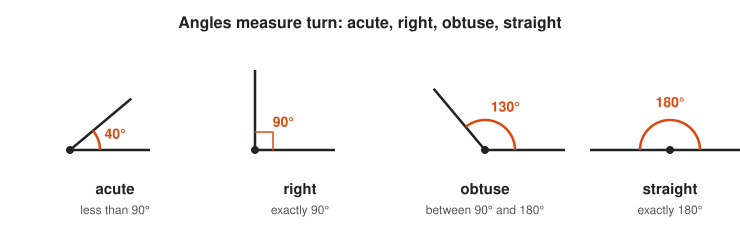
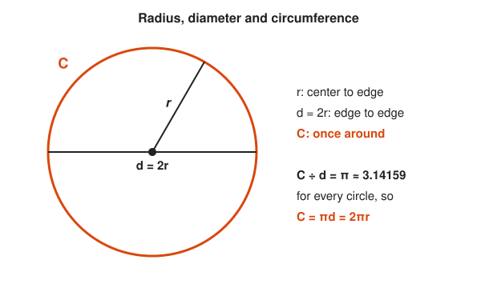
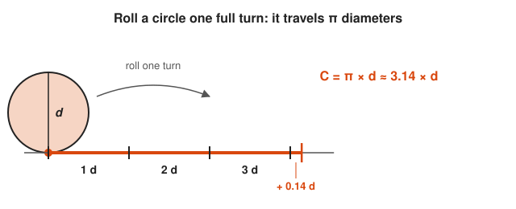
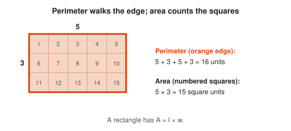
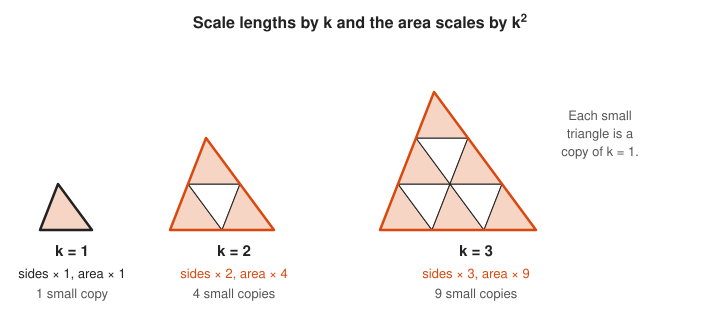
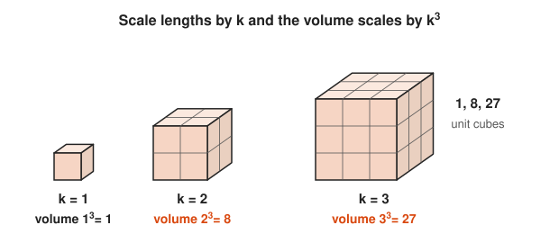
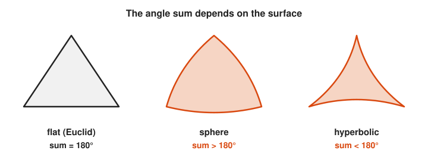

# Geometry

**Track:** Geometry · **Span:** points and angles to non-Euclidean space · **Main course level:** [201 Algebra I and Geometry](../../course/201/README.md)

## What This Field Studies

Geometry studies shape, size, position and distance. It asks how far apart two things are, how much space a shape covers or holds, and which properties survive when you slide, turn, flip or stretch a figure. It is also where mathematics first learned to prove things: around 300 BCE, Euclid built all of plane geometry from five short assumptions.

## Why It Matters

Geometry is the math of anything with a position. Map tiles, rack layouts, antenna coverage, the distance between two GPS fixes, the hit boxes in a game, and the nearest-neighbor search inside a vector database all run on geometry. The distance formula you learn here is the same formula that measures how similar two embeddings are. Proof in Euclid's style is also a mental model for building any system from a few well-stated invariants.

## Concept Map

<!-- diagram: type=concept-map bands=beginner,intermediate,advanced nodes=points-lines-angles,triangles,circles,area,congruence,pythagoras,volume,transformations,coordinate,proof,conics,non-euclidean,trigonometry caption="Geometry concepts with prerequisite arrows" -->
![Concept map of geometry in three bands. Beginner: points, lines and angles lead to triangles and polygons and to circles and pi. Intermediate: triangles and circles lead to perimeter and area. Triangles lead to congruence and similarity. Area and congruence lead to the Pythagorean theorem. Area leads to volume and surface area, and congruence leads to transformations. Advanced: Pythagoras and transformations lead to coordinate geometry, which leads to conic sections. Congruence leads to axioms and proof, which leads to non-Euclidean geometry. Pythagoras and coordinate geometry lead to trigonometry. The Pythagorean theorem and axioms and proof are highlighted as milestones.](img/concept-map.svg)

An arrow from A to B means learn A before B. The milestones are the Pythagorean theorem (the bridge from shapes to numbers) and axioms and proof (the bridge from geometry to all of higher math).

## Signature Diagram

<!-- diagram: type=pythagoras a=3 b=4 c=5 grid=unit caption="Squares on the sides of a 3-4-5 right triangle: 9 + 16 = 25" -->

Count the unit squares. The two small squares hold $9 + 16 = 25$ cells, and the big tilted square holds exactly 25. The Pythagorean theorem says this works for every right triangle, not only the 3-4-5 one. It is the most used theorem in all of geometry, because it turns a picture into a calculation: distance in the plane, distance in 3D, and distance in a 1,536-dimensional embedding space all come from it.

## The Concept Ladder

### Beginner

#### 1. Points, Lines and Angles

A **point** marks a location, a **line** runs straight forever in both directions, and an **angle** measures the turn between two rays from a shared point. A full turn is 360°, a straight angle is 180°, and a right angle is 90°. When two lines cross, the opposite (vertical) angles are equal.

**Key idea:** angles on a straight line add to $180°$.

<!-- diagram: type=angles values=40,90,130,180 caption="Acute, right, obtuse and straight angles" -->

Compare how far the second ray turns away from the first: the orange arc or square shows the amount of turn.

<!-- diagram: type=crossing-lines angle=60 caption="Two crossing lines make two pairs of equal vertical angles" -->

Pick any two neighboring angles: together they make a straight line, so they add to 180 degrees.

**In the course:** [201 Algebra I and Geometry](../../course/201/README.md)

#### 2. Triangles and Polygons

A **triangle** is the simplest rigid shape: fix three side lengths and the shape cannot flex, which is why bridges and roof trusses use triangles. The angles of any triangle add to 180°. Any polygon with $n$ sides splits into $n - 2$ triangles from one corner.

**Key idea:** interior angles of an $n$-gon add to $(n - 2) \cdot 180°$.

<!-- diagram: type=triangle angles=50,60,70 construct=parallel-through-apex caption="A line through C parallel to AB copies the base angles to the top" -->

Match the shading: each base angle has a twin at the top, and the three angles at C sit side by side on a straight line.

<!-- diagram: type=angle-assembly angles=50,70,60 caption="The three torn corners of a triangle fit together on a straight line" -->

See how the three wedges close up exactly with no gap and no overlap: that half turn is 180 degrees.

<!-- diagram: type=polygon-fan sides=5,6 caption="A pentagon splits into 3 triangles and a hexagon into 4" -->

Count the numbered triangles in each shape: every one of them adds 180 degrees to the total.

**In the course:** [201 Algebra I and Geometry](../../course/201/README.md)

#### 3. Circles and Pi

A **circle** is every point at a fixed distance $r$ from a center. For every circle, the circumference divided by the diameter is the same number, $\pi \approx 3.14159$. Pi is not a fraction, and its digits never repeat.

**Key idea:** $C = 2\pi r$

<!-- diagram: type=circle parts=r,d,C caption="A circle with its radius, diameter and circumference" -->

The radius reaches the edge once, the diameter reaches across twice, and the orange outline is the distance once around.

<!-- diagram: type=unroll diameter=100 length=pi*d caption="One turn of a circle covers a little more than 3 diameters" -->

Count the diameter marks along the orange segment: three whole ones and a small extra piece, which is why pi is a little more than 3.

**In the course:** [201 Algebra I and Geometry](../../course/201/README.md)

### Intermediate

#### 4. Perimeter and Area

**Perimeter** is the length around a shape. **Area** counts how many unit squares cover it. A triangle is half of a rectangle, and a circle can be cut into thin wedges that rearrange into a near-rectangle of width $\pi r$ and height $r$.

**Key idea:** rectangle $A = lw$, triangle $A = \frac{1}{2}bh$, circle $A = \pi r^2$

<!-- diagram: type=area-decomposition shape=triangle box=rectangle caption="A triangle fills exactly half of the rectangle around it" -->

Pair each gray corner piece with the orange piece that has the same number: they are equal, so the triangle takes exactly half.

<!-- diagram: type=area-rearrange shape=circle wedges=16 caption="Sixteen wedges of a circle rearranged into a near-rectangle of width pi r and height r" -->

Read the two sides of the near-rectangle: the height is the radius and the length is half the circumference, and their product is the area.

<!-- diagram: type=grid-rectangle w=5 h=3 caption="A 5 by 3 rectangle: perimeter 16 units, area 15 squares" -->

Trace the orange edge for the perimeter, then count the numbered squares for the area: two different questions about the same shape.

**In the course:** [201 Algebra I and Geometry](../../course/201/README.md)

#### 5. Congruence and Similarity

**Congruent** shapes are exact copies. **Similar** shapes have the same angles but are scaled, like a map and the land it shows. In similar figures, every length scales by the same factor $k$, every area by $k^2$, and every volume by $k^3$.

**Key idea:** scale lengths by $k$, and area scales by $k^2$.

<!-- diagram: type=similar-triangles k=1,2,3 subdivide=true caption="Triangles scaled by 1, 2 and 3 hold 1, 4 and 9 copies of the original" -->

Count the small triangles inside each big one: doubling the sides gives 4 copies and tripling gives 9.

<!-- diagram: type=similar-cubes k=1,2,3 caption="Cubes with sides 1, 2 and 3 hold 1, 8 and 27 unit cubes" -->

Count along one edge, then think in layers: a cube twice as long holds 2 times 2 times 2 equals 8 unit cubes.

**In the course:** [201 Algebra I and Geometry](../../course/201/README.md)

#### 6. The Pythagorean Theorem

In a right triangle with legs $a$ and $b$ and hypotenuse $c$, the square on the hypotenuse equals the sum of the squares on the legs. The converse holds too: if the three sides satisfy the equation, the triangle has a right angle. Builders use 3-4-5 rope triangles to lay out square corners.

**Key idea:** $a^2 + b^2 = c^2$

<!-- diagram: type=rearrangement-proof a=3 b=4 caption="Two arrangements of four right triangles in a 7 by 7 square" -->

Both big squares are the same size and both hold the same four gray triangles, so the orange leftovers must have the same total area.

<!-- diagram: type=triangle sides=3,4,5 knots=12 caption="A knotted rope pulled into a 3-4-5 triangle gives a right angle" -->

Count the knot spaces on each side: 3, 4 and 5 satisfy the theorem, so the converse guarantees the orange corner is square.

**In the course:** [201 Algebra I and Geometry](../../course/201/README.md)

#### 7. Volume and Surface Area

**Volume** counts unit cubes inside a solid. **Surface area** counts unit squares on its skin. A prism or cylinder has volume equal to base area times height. A cone or pyramid has exactly one third of that.

**Key idea:** cylinder $V = \pi r^2 h$, sphere $V = \frac{4}{3}\pi r^3$, sphere surface $S = 4\pi r^2$

<!-- diagram: type=solids shapes=cylinder,cone r=1 h=2.5 caption="A cylinder and a cone with the same base and height" -->

Compare the two solids with the same base and height: the cone tapers to a point and holds exactly one third as much.

<!-- diagram: type=solids shapes=sphere-in-cylinder r=1 caption="A sphere of radius r inside a cylinder of radius r and height 2r" -->

Compare the two numbers on the right: the sphere takes two thirds of the cylinder volume, and its skin matches the cylinder side exactly.

**In the course:** [201 Algebra I and Geometry](../../course/201/README.md)

#### 8. Transformations

A **transformation** moves every point of a figure by one rule: translate (slide), rotate (turn), reflect (flip), or dilate (scale). The first three keep lengths and angles, and they are called **rigid motions**. Graphics engines and robot arms describe every motion as a chain of these.

**Key idea:** rotating $(x, y)$ by $90°$ about the origin gives $(-y, x)$.

<!-- diagram: type=transform-panels shape="(1,1),(4,1),(1,3)" ops=translate:2,2;rotate:90;reflect:y;dilate:2 caption="One triangle under a translation, a rotation, a reflection and a dilation" -->
![Four grid panels, each with the gray dashed triangle with corners (1, 1), (4, 1) and (1, 3) and its orange image. Translate by (2, 2) slides it to (3, 3), (6, 3), (3, 5). Rotate 90 degrees about the origin turns it to (minus 1, 1), (minus 1, 4), (minus 3, 1). Reflect across the y-axis flips it to (minus 1, 1), (minus 4, 1), (minus 1, 3). Dilate by 2 from the origin enlarges it to (2, 2), (8, 2), (2, 6). The first three are labeled rigid, lengths kept, and the dilation is labeled not rigid, lengths times 2](img/rung-08-transformations.svg)

Compare each orange image with the gray original: three panels keep the size and shape, and only the dilation changes the size.

<!-- diagram: type=rotation point=4,2 angle=90 image=-2,4 caption="Rotating (4, 2) by 90 degrees about the origin gives (-2, 4)" -->

Compare the dashed drops to the x-axis: the run and rise of 4 and 2 trade places and one changes sign, which is the rule (x, y) to (minus y, x).

**In the course:** [201 Algebra I and Geometry](../../course/201/README.md)

### Advanced

#### 9. Coordinate Geometry

Descartes put a grid on the plane and turned every point into a pair of numbers. Now shapes become equations and geometry questions become algebra questions. The distance formula is the Pythagorean theorem applied to the horizontal and vertical gaps.

**Key idea:** $d = \sqrt{(x_2 - x_1)^2 + (y_2 - y_1)^2}$

<!-- diagram: type=coordinate-triangle a=1,2 b=7,10 caption="The distance from (1, 2) to (7, 10) as the hypotenuse of a 6-8-10 right triangle" -->

Read the two dark legs as the x gap and the y gap, then apply the Pythagorean theorem to get the orange distance.

<!-- diagram: type=function-plot shape=circle r=5 marks=3,4;-4,3;0,-5;-3,-4;4,-3 caption="The circle of radius 5 is the set of points with x^2 + y^2 = 25" -->

Pick any orange point and square its two coordinates: they always add to 25, because the distance formula says each point is 5 from the center.

**In the course:** [201 Algebra I and Geometry](../../course/201/README.md)

#### 10. Axioms and Proof

Euclid started from five **postulates** (for example: a straight line can join any two points) and derived hundreds of theorems by pure logic. A **proof** is a chain of steps where each step follows from the axioms or from earlier results. This style, small trusted base plus careful derivation, is the model for all of modern mathematics.

**Key idea:** every theorem traces back to the axioms through valid steps.

<!-- diagram: type=panels items=5 subject=euclid-postulates caption="Pictures of Euclid five postulates" -->

Read the five panels as the whole trusted base: every theorem in Euclid is built from these pictures and nothing else.

<!-- diagram: type=dependency-graph nodes=postulates1-4,postulate5,alternate-angles,triangle-sum,polygon-sum caption="The angle-sum theorems traced back to the postulates" -->

Follow the arrows backward from any box: the trail always ends at the postulates on the left.

**In the course:** [201 Algebra I and Geometry](../../course/201/README.md) and [601 Proof and Higher Math](../../course/601/README.md)

#### 11. Conic Sections

Slice a double cone with a plane and you get a circle, an ellipse, a parabola or a hyperbola. Each has a clean equation in coordinates. Planets move on ellipses, satellite dishes are parabolas, and the old LORAN radio navigation system used hyperbolas.

**Key idea:** ellipse $\dfrac{x^2}{a^2} + \dfrac{y^2}{b^2} = 1$, parabola $y = ax^2$

<!-- diagram: type=function-plot-panels curves="x^2+y^2=4;x^2/9+y^2/4=1;y=x^2/2;x^2/4-y^2=1" caption="Circle, ellipse, parabola and hyperbola on coordinate grids" -->

Compare the four equations under the curves: plus signs close the curve, a minus sign splits it into two branches, and a missing square opens it into a bowl.

<!-- diagram: type=cone-sections view=side cuts=flat,tilted,parallel,steep caption="Side views of a double cone cut four ways" -->

Compare the tilt of each orange cut with the tilt of the cone side: that one comparison decides which curve you get.

**In the course:** [301 Algebra II, Trig and Precalculus](../../course/301/README.md)

#### 12. Non-Euclidean Geometry

Euclid's fifth postulate says that through a point off a line there is exactly one parallel line. Drop it, and you get new, perfectly consistent geometries. On a sphere there are no parallels and triangle angles add to more than 180°. In hyperbolic geometry there are infinitely many parallels and triangle angles add to less than 180°. General relativity describes gravity as curved, non-Euclidean spacetime.

**Key idea:** on a sphere, a triangle with three right angles exists (north pole plus two points on the equator a quarter-turn apart).

<!-- diagram: type=sphere-triangle vertices="N;0,0;0,90" caption="A triangle on a sphere from the north pole to two equator points a quarter turn apart" -->

Check each orange corner: both meridians meet the equator square on, and they meet each other at the pole at 90 degrees too.

<!-- diagram: type=panels shapes=flat,spherical,hyperbolic-triangle caption="Straight, bulging and pinched triangles for flat, spherical and hyperbolic geometry" -->

Look at the corners: bulging sides open the corners wider than flat ones, and pinched sides squeeze them narrower.

**In the course:** [601 Proof and Higher Math](../../course/601/README.md) · **Go further:** [Topology track](../topology/README.md)

#### 13. Next Stop: Trigonometry

Similar right triangles have equal side ratios, and those ratios depend only on the angle. Naming them (sine, cosine, tangent) turns geometry into a toolkit for any triangle and any rotation. That is the next track.

**Key idea:** $\sin \theta = \dfrac{\text{opposite}}{\text{hypotenuse}}$

<!-- diagram: type=similar-triangles sides=3-4-5 k=1,2,3 shared-angle=theta caption="Nested 3-4-5, 6-8-10 and 9-12-15 right triangles sharing the angle theta" -->

Divide the opposite side by the hypotenuse in each triangle: the size changes, but the ratio stays 0.6 because the angle stays the same.

<!-- diagram: type=unit-circle theta=36.87 point=0.8,0.6 caption="The point at angle theta on the unit circle is (cos theta, sin theta)" -->

With the hypotenuse fixed at 1, the two orange legs are the cosine and the sine themselves, which is the bridge into the trigonometry track.

**In the course:** [301 Algebra II, Trig and Precalculus](../../course/301/README.md) · **Go further:** [Trigonometry track](../trigonometry/README.md)

## Big Theorems You Should Know

* **Triangle angle sum:** the angles of a triangle add to $180°$ (in Euclidean geometry).
* **Pythagorean theorem:** $a^2 + b^2 = c^2$ in a right triangle, and the converse.
* **Triangle inequality:** any side of a triangle is shorter than the sum of the other two.
* **Thales' theorem:** an angle inscribed in a semicircle is a right angle.
* **Inscribed angle theorem:** an inscribed angle is half the central angle on the same arc.
* **Similarity scaling:** scale lengths by $k$, and areas scale by $k^2$ and volumes by $k^3$.
* **Euler's polyhedron formula:** for any convex polyhedron, $V - E + F = 2$. A cube has $8 - 12 + 6 = 2$.
* **Isoperimetric inequality:** of all closed curves with a fixed length, the circle encloses the most area.

## Open Problems and Fun Facts

* **More than 370 proofs:** the Pythagorean theorem has more published proofs than any other theorem. James Garfield published one in 1876, five years before he became U.S. president.
* **Squaring the circle is impossible:** with only a compass and straightedge, you cannot build a square with the same area as a given circle. Lindemann proved it in 1882 by showing $\pi$ is transcendental.
* **The parallel postulate saga:** for 2,000 years, mathematicians tried to prove the fifth postulate from the other four. In the 1820s, Lobachevsky and Bolyai showed that it is independent by building hyperbolic geometry.
* **Kepler's orange stack is optimal:** the grocer's pyramid packing of spheres fills about 74% of space, and no packing does better. Thomas Hales proved this in 1998, and a computer-checked formal proof followed in 2014.
* **Open problem (square peg problem):** does every closed loop drawn without crossing itself contain four points that form a square? Proven for smooth curves and many other cases, but still open in general since Toeplitz asked in 1911.

## Starter Problem Set

1. A triangle has angles 50° and 60°. Find the third angle.
2. A right triangle has legs 5 and 12. Find the hypotenuse.
3. Find the area and circumference of a circle with radius 3, exactly and to two decimal places.
4. Find the distance between $(1, 2)$ and $(7, 10)$.
5. You scale every edge of a cube by a factor of 3. By what factor does the surface area grow, and by what factor does the volume grow?

Answers

1. $70°$, because $180 - 50 - 60 = 70$.
2. $13$, because $25 + 144 = 169 = 13^2$.
3. Area $9\pi \approx 28.27$. Circumference $6\pi \approx 18.85$.
4. $10$, because $\sqrt{6^2 + 8^2} = \sqrt{100}$.
5. Surface area grows by $3^2 = 9$. Volume grows by $3^3 = 27$.

## Go Deeper

* [Euclid's Elements, edited by David Joyce](https://aleph0.clarku.edu/~djoyce/elements/elements.html): the original proofs with interactive figures, on a plain classic site.
* [Math Is Fun: Geometry](https://www.mathsisfun.com/geometry/index.html): illustrated, short pages for every shape and formula.
* [Khan Academy: Geometry](https://www.khanacademy.org/math/geometry): videos and practice for the beginner and intermediate rungs.
* [Wolfram MathWorld: Pythagorean Theorem](https://mathworld.wolfram.com/PythagoreanTheorem.html): a dense reference with many proofs and generalizations.
* [MacTutor: Euclid](https://mathshistory.st-andrews.ac.uk/Biographies/Euclid/): what is known about the author of the most influential math book ever written.

## Related Tracks and Workshops

* Before: [Arithmetic and Number Sense track](../arithmetic-and-number-sense/README.md) and [Algebra track](../algebra/README.md).
* Next: [Trigonometry track](../trigonometry/README.md), [Linear Algebra track](../linear-algebra/README.md), [Topology track](../topology/README.md).
* Applied: [Linear Algebra for Graphics and ML](../../workshops/linear-algebra-for-graphics-and-ml/README.md).
