# Graph Theory Track

**Track:** Graph Theory · **Span:** beginner to advanced · **Course levels:** [501 Linear Algebra, Probability and Discrete Math](../../course/501/README.md)
**Prerequisites:** counting and simple addition. Nothing else. The advanced rungs borrow from the [Linear Algebra Track](../linear-algebra/README.md) and the proof habits of [601](../../course/601/README.md).
**Files:** this README, [cards.tsv](cards.tsv) for Anki, [code/main.go](code/main.go), and the diagrams in [img/](img/).

## What the Field Studies

A **graph** is a set of dots joined by lines. The dots are **vertices** (one is a vertex). The lines are **edges**. That is the whole definition.

Graph theory ignores where the dots sit and how long the lines are. It asks one question: who connects to whom. Strip a problem down to that question and a surprising number of hard problems become simple.

## Why It Matters

You already run graphs for a living:

* Services are vertices. A call from service A to service B is an edge with an arrow.
* A deploy order that respects dependencies is a **topological sort**.
* A circular dependency is a **cycle**. The sort fails exactly when one exists.
* The blast radius of a failed database is every service that can reach it. Breadth-first search finds it.
* Routing protocols such as OSPF run a shortest-path algorithm on the network graph.
* The most traffic a network carries between two sites equals the capacity of its narrowest cut.

The workshop [Graph Theory for Networks and Dependencies](../../workshops/graph-theory-for-networks-and-dependencies/README.md) turns this track into practice.

## Concept Map

<!-- diagram: type=concept-map tiers=beginner,intermediate,advanced nodes=12 caption="Graph theory concepts with prerequisite arrows" -->


Read the map top to bottom. An arrow from A to B means learn A first. Start at the orange box.

## Signature Diagram

<!-- diagram: type=graph vertices=A,B,C,D edges=AC,AC,BC,BC,AD,BD,CD caption="Seven bridges of Konigsberg as a multigraph with degrees 3,3,5,3" -->
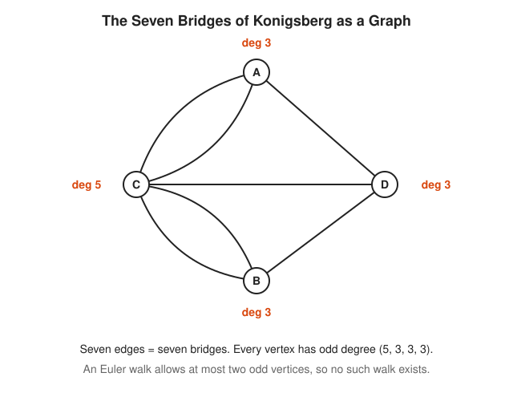

In 1736 the city of Konigsberg had four land masses and seven bridges. People asked whether one walk crosses every bridge exactly once. Leonhard Euler drew each land mass as a dot and each bridge as a line. Then he noticed something plain: every time a walk passes through a place, it uses one bridge in and one bridge out. Bridges at a middle stop come in pairs. Only the start and the end are allowed an odd count. Here all four land masses have an odd count. No such walk exists.

The residents had been testing routes on Sunday strolls for years. Euler settled it without leaving his desk. That is the spirit of the whole field.

## The Concept Ladder

### Beginner

#### 1. Vertices and Edges

A graph $G = (V, E)$ is a set of vertices $V$ and a set of edges $E$. Each edge joins two vertices. Position and length mean nothing. Two drawings are the same graph when the same pairs connect.

$$G = (V, E), \quad V = \{A, B, C, D\}, \quad E = \{AB, BC, CD, DA\}$$

<!-- diagram: type=graph-pair layout=square,bowtie edges=AB,BC,CD,DA caption="Same graph drawn two ways" -->
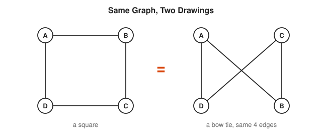

The bow tie has a crossing, the square does not. The crossing is a feature of the drawing, not of the graph. A crossing is not a vertex.

Course link: [501 Linear Algebra, Probability and Discrete Math](../../course/501/README.md).

#### 2. Degree and the Handshake Lemma

The **degree** of a vertex is the number of edges that touch it. Every edge has two ends. Add up all the degrees and you count every edge twice. The sum of degrees is always even.

$$\sum_{v \in V} \deg(v) = 2|E|$$

<!-- diagram: type=graph vertices=5 edges=6 labels=degrees caption="Degrees add to twice the edge count" -->
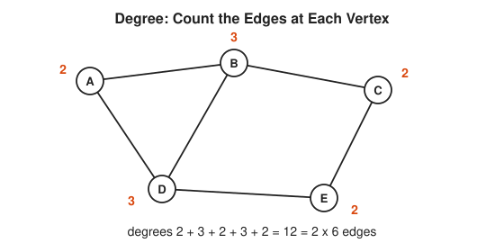

A consequence that sounds like a riddle: the number of people at a party who shook an odd number of hands is always even.

#### 3. Paths, Cycles and Connectivity

A **path** walks along edges without visiting any vertex twice. A **cycle** is a path that comes back to its start. A graph is **connected** when a path joins every pair of vertices. A **component** is one connected piece.

<!-- diagram: type=graph-pair highlight=path,cycle caption="A path and a cycle in the same graph" -->
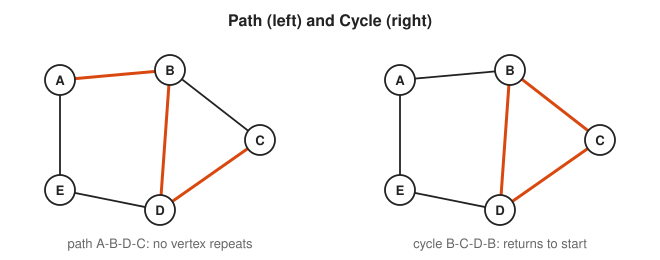

In a service mesh, a component is a group of services that can reach each other. If your graph has two components, some request somewhere is going to have a bad day.

#### 4. Trees

A **tree** is a connected graph with no cycles. A tree is the leanest way to connect things: remove any edge and it splits in two, add any edge and a cycle appears. A tree on $n$ vertices always has exactly $n - 1$ edges.

$$\text{tree on } n \text{ vertices} \iff \text{connected and } |E| = n - 1$$

<!-- diagram: type=tree root=/ children=etc,usr,var caption="A file system is a tree" -->
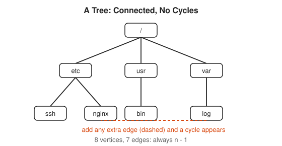

File systems, DNS, org charts and the spanning tree protocol in Ethernet switches are all trees. A symbolic link that points back up the tree is how you get a cycle, and why `find -L` reports a file system loop.

### Intermediate

#### 5. Euler and Hamilton Paths

An **Euler path** uses every edge exactly once. A **Hamilton path** visits every vertex exactly once. The names are close, the difficulty is not. Euler paths have a one-line test: count the odd-degree vertices. Hamilton paths have no known fast test at all.

$$\text{Euler circuit exists} \iff \text{connected and every degree is even}$$

$$\text{Euler path exists} \iff \text{connected and exactly 0 or 2 odd-degree vertices}$$

<!-- diagram: type=euler-path figure=house-envelope order=1..8 caption="Euler path on the house envelope" -->
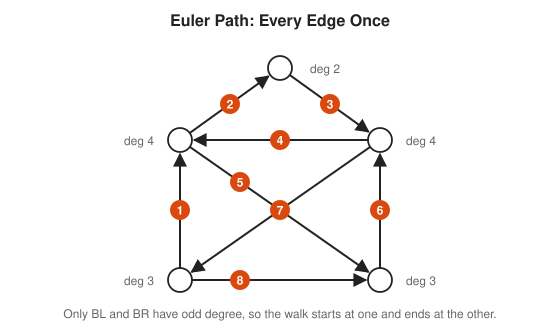

This is the childhood puzzle of drawing the house without lifting the pen. The two bottom corners have odd degree, and those are the only legal places to start and finish.

#### 6. Adjacency Matrix

Store a graph on $n$ vertices as an $n \times n$ table $A$. Put a 1 in row $i$, column $j$ when an edge joins $i$ and $j$. Row sums give degrees. The powers of the matrix count walks: $(A^k)_{ij}$ is the number of walks of length $k$ from $i$ to $j$.

$$(A^2)_{ij} = \sum_k A_{ik} A_{kj} = \text{number of 2-step walks from } i \text{ to } j$$

<!-- diagram: type=graph+matrix vertices=4 edges=12,23,34,13 caption="A graph and its adjacency matrix" -->
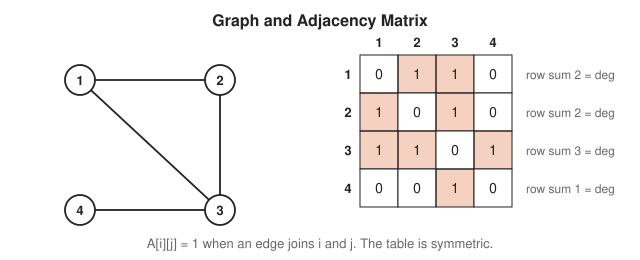

An adjacency matrix costs $n^2$ cells. For a sparse graph, such as a network of 10,000 hosts with a few links each, store a list of neighbors per vertex instead. Same graph, far less memory.

#### 7. Directed Graphs and DAGs

In a **directed graph** each edge is an arrow. A **DAG** (directed acyclic graph) has no cycle that follows the arrows. Every DAG has a **topological order**: a list where every arrow points forward. Build systems, Terraform plans, Airflow pipelines and package managers all compute one.

<!-- diagram: type=dag nodes=fetch,build,test,approve,deploy caption="Deploy pipeline DAG" -->
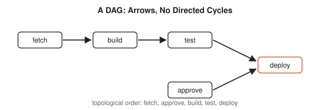

**Kahn's algorithm** finds the order: repeatedly remove a vertex with no incoming arrows. If you get stuck with vertices left over, those leftovers contain a cycle. The [Code Corner](#code-corner) runs it.

#### 8. Shortest Paths

**Breadth-first search** (BFS) explores a graph in rings: first the neighbors, then their neighbors. It finds the fewest-hop path. **Dijkstra's algorithm** handles weights that are never negative, such as latency. It always settles the closest unsettled vertex next.

$$d(v) = \min_{u \to v} \big( d(u) + w(u, v) \big)$$

<!-- diagram: type=weighted-graph algorithm=dijkstra source=S target=T caption="Shortest path by latency" -->
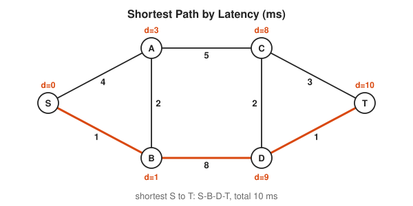

Note that A has distance 3, not 4. The direct link S to A costs 4, but the detour through B costs $1 + 2 = 3$. Fewest hops and lowest latency are different questions with different answers.

### Advanced

#### 9. Planar Graphs

A graph is **planar** when you can draw it on paper with no edges crossing. Every connected planar drawing obeys Euler's formula, where $F$ counts the faces, including the outside region. The complete graph $K_5$ and the "three utilities" graph $K_{3,3}$ are the two smallest non-planar graphs.

$$V - E + F = 2$$

<!-- diagram: type=graph-redraw graph=K4 caption="K4 redrawn without a crossing" -->
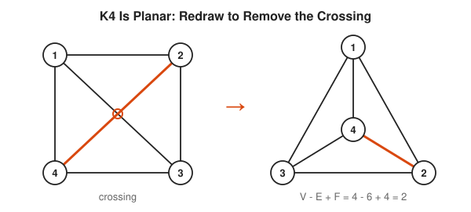

Circuit board designers care about planarity. Every crossing costs a via or a second layer.

#### 10. Graph Coloring

Color the vertices so that no edge joins two vertices of the same color. The fewest colors needed is the **chromatic number** $\chi(G)$. Scheduling maps onto coloring: jobs are vertices, conflicts are edges, colors are time slots.

$$\chi(G) \le \Delta(G) + 1 \quad (\Delta = \text{largest degree})$$

<!-- diagram: type=graph-coloring graph=C5 colors=3 caption="An odd cycle needs three colors" -->
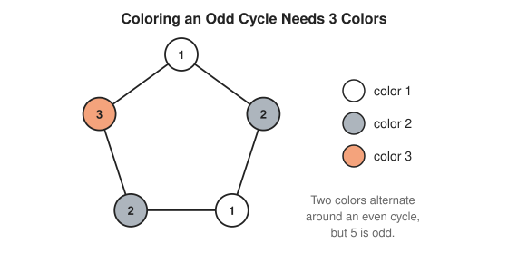

Two colors work exactly when the graph has no odd cycle. Such graphs are **bipartite**. Deciding whether three colors suffice is NP-complete, which is the formal way of saying nobody has a fast method.

#### 11. Spectral Graph Theory

Build the **Laplacian** $L = D - A$, where $D$ holds the degrees on its diagonal. The eigenvalues of $L$ describe the shape of the graph. The number of zero eigenvalues equals the number of components. The second-smallest eigenvalue $\lambda_2$ measures how hard the graph is to cut in two. Its eigenvector, the **Fiedler vector**, shows where to cut.

$$L = D - A, \qquad \#\{\lambda = 0\} = \#\text{components}$$

<!-- diagram: type=spectral-cut graph=two-triangles-bridge caption="Fiedler vector signs split two clusters" -->


The signs split the graph at the single bridge. Spectral clustering uses this trick to find communities in social networks and groups of chatty microservices.

#### 12. Network Flow

Give each arrow a **capacity**. A **flow** pushes material from a source $s$ to a sink $t$ without exceeding any capacity, and whatever enters a middle vertex must leave it. The largest flow equals the smallest total capacity of a **cut**, a set of arrows whose removal separates $s$ from $t$.

$$\max \text{flow}(s, t) = \min \text{cut}(s, t)$$

<!-- diagram: type=flow-network source=s sink=t caption="Max flow 5 equals min cut 5" -->
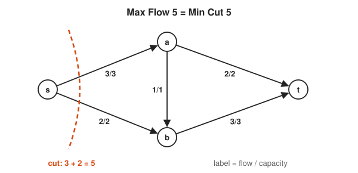

The bottleneck is the cut, never the average link. To raise capacity between two data centers, find the minimum cut and widen it. Upgrading any other link changes nothing.

## Worked Examples

### Example 1: Count Edges from Degrees

A graph has degrees 4, 3, 3, 2, 2. How many edges?

```txt
  sum of degrees = 4 + 3 + 3 + 2 + 2      add every degree
                 = 14
  2|E|           = 14                      handshake lemma
  |E|            = 7                       divide by 2
```

### Example 2: Test for an Euler Path

Does the Konigsberg graph have an Euler path?

```txt
  degrees: A 3, B 3, C 5, D 3              count edges at each vertex
  odd-degree vertices: A, B, C, D          all four are odd
  Euler path needs 0 or 2 odd vertices     Euler's theorem
  4 is neither 0 nor 2                     compare
  no Euler path exists                     conclusion
```

### Example 3: Dijkstra by Hand

Find the shortest latency from S to every vertex in the shortest-path diagram.

```txt
  settle S = 0                             start
  update A = 4, B = 1                      edges out of S
  settle B = 1                             smallest unsettled
  update A = min(4, 1 + 2) = 3, D = 9      edges out of B
  settle A = 3                             smallest unsettled
  update C = 3 + 5 = 8                     edge A-C
  settle C = 8                             smallest unsettled
  update T = 8 + 3 = 11, D = min(9, 10)    edges out of C
  settle D = 9                             smallest unsettled
  update T = min(11, 9 + 1) = 10           edge D-T
  settle T = 10                            done
```

### Example 4: Check Euler's Formula on a Cube

```txt
  V = 8                                    corners
  E = 12                                   edges
  F = 6                                    faces
  V - E + F = 8 - 12 + 6 = 2               matches the formula
```

## Big Theorems to Know

* **Handshake Lemma:** the degrees add up to twice the number of edges.
* **Euler (1736):** a connected graph has an Euler circuit exactly when every vertex has even degree.
* **Tree Theorem:** a connected graph on $n$ vertices is a tree exactly when it has $n - 1$ edges.
* **Cayley Formula (1889):** there are $n^{n-2}$ labeled trees on $n$ vertices.
* **Konig Bipartite Theorem (1936):** a graph is bipartite exactly when it has no odd cycle.
* **Euler Formula:** a connected planar graph has $V - E + F = 2$.
* **Kuratowski (1930):** a graph is planar exactly when it contains no subdivision of $K_5$ or $K_{3,3}$.
* **Four Color Theorem (1976):** every planar map needs at most four colors.
* **Max-Flow Min-Cut (1956):** the largest flow equals the smallest cut.
* **Dirac (1952):** if $n \ge 3$ and every degree is at least $n/2$, a Hamilton cycle exists.

## Open Problems and Fun Facts

* **Four colors and a computer:** Appel and Haken proved the Four Color Theorem in 1976 with a computer checking nearly 2,000 cases. Some mathematicians refused to accept a proof no human was able to read in full. The proof has since been checked by a formal proof assistant.
* **Hamilton cycles and P versus NP:** deciding whether a Hamilton cycle exists is NP-complete. A fast algorithm for it solves the P versus NP problem, a one-million-dollar Millennium Prize problem.
* **Graph isomorphism:** nobody knows a polynomial-time test for whether two graphs are the same graph. In 2015 Laszlo Babai found a quasi-polynomial algorithm, a large step.
* **Hadwiger conjecture:** every graph that needs $k$ colors contains $K_k$ as a minor. It is open for $k \ge 7$.
* **Erdos numbers:** mathematicians track their collaboration distance to Paul Erdos, who wrote papers with over 500 coauthors. It is BFS, applied to vanity.

## Starter Problems

1. A graph has vertex degrees 3, 3, 2, 2, 2. How many edges does it have?
2. Can a graph have exactly three vertices, each of degree 3? Explain.
3. A tree has 12 vertices. How many edges does it have?
4. Does the complete graph $K_4$ (four vertices, every pair joined) have an Euler circuit?
5. Tasks: `build` needs `fetch`. `test` needs `build`. `deploy` needs `test` and `approve`. Give one valid topological order.
6. Is a cycle on 6 vertices bipartite? What about a cycle on 7 vertices?
7. A connected planar graph has 10 vertices and 15 edges. How many faces does a planar drawing have?

<details>
<summary>Answers</summary>

1. 6 edges. The degree sum is 12, and $12 / 2 = 6$.
2. No. The degree sum is 9, which is odd. The handshake lemma requires an even sum. (Also, with three vertices, the most any vertex connects to is two.)
3. 11 edges. A tree on $n$ vertices has $n - 1$ edges.
4. No. Every vertex of $K_4$ has degree 3, which is odd.
5. One valid order: `fetch, approve, build, test, deploy`. Any order with `fetch` before `build` before `test` before `deploy`, and `approve` before `deploy`, works.
6. The 6-cycle is bipartite: alternate two colors. The 7-cycle is not, because it is an odd cycle.
7. 7 faces. $F = 2 - V + E = 2 - 10 + 15 = 7$.

</details>

## Code Corner

[code/main.go](code/main.go) checks the handshake lemma, runs Kahn's topological sort (and catches a circular dependency), then runs BFS and Dijkstra on the graph from the shortest-path diagram. Run it with `go run main.go` inside `code/`.

```txt
handshake: degree sum 16 = 2 x 8 edges
deploy order: [approve fetch build test deploy] acyclic: true
after adding fetch -> deploy, acyclic: false
S: 0 hops,  0 ms
A: 1 hops,  3 ms
B: 1 hops,  1 ms
C: 2 hops,  8 ms
D: 2 hops,  9 ms
T: 3 hops, 10 ms
fastest route: [S B D T]
```

Note the gap between hops and milliseconds. A is one hop away but 3 ms away. T is three hops either way, but only one three-hop route costs 10 ms.

## Flashcards

[cards.tsv](cards.tsv) holds the key definitions and theorems for Anki import.

## Resources

* [Wolfram MathWorld: Graph Theory](https://mathworld.wolfram.com/GraphTheory.html): compact definitions with links to every named graph.
* [Wolfram MathWorld: Konigsberg Bridge Problem](https://mathworld.wolfram.com/KoenigsbergBridgeProblem.html): the original puzzle with the historic map.
* [MacTutor: Leonhard Euler](https://mathshistory.st-andrews.ac.uk/Biographies/Euler/): the life of the founder of the field.
* [MIT OCW 6.042J Mathematics for Computer Science](https://ocw.mit.edu/courses/6-042j-mathematics-for-computer-science-fall-2010/): free lectures and notes with strong graph units.
* [Reinhard Diestel: Graph Theory](https://diestel-graph-theory.com/): the standard graduate text, with a free electronic edition.

## Where to Go Next

* [Graph Theory for Networks and Dependencies](../../workshops/graph-theory-for-networks-and-dependencies/README.md) to apply all of this to real systems.
* [Combinatorics Track](../combinatorics/README.md) for counting trees, matchings and colorings.
* [Linear Algebra Track](../linear-algebra/README.md) for the matrix side of graphs.
* [Discrete Math Track](../discrete-math/README.md) for the logic and proof habits behind the theorems.
