# Information Theory Track

**Track:** Information Theory · **Span:** beginner to advanced · **Course levels:** [301 Algebra II, Trig and Precalculus](../../course/301/README.md) (logarithms), [501 Linear Algebra, Probability and Discrete Math](../../course/501/README.md) (probability)
**Prerequisites:** fractions, powers of 2, and the idea of a probability. Logarithms appear early. A refresher: $\log_2 8 = 3$ because $2^3 = 8$. That is all of it you need to start.
**Files:** this README, [cards.tsv](cards.tsv) for Anki, [code/main.go](code/main.go), and the diagrams in [img/](img/).

## What the Field Studies

Information theory measures information the way a ruler measures length. The unit is the **bit**: the information in the answer to one fair yes-or-no question.

From that one unit, the field answers practical questions. How small can a file get before compression must lose something? How fast can data cross a noisy wire without errors? How much does a wrong guess about the data cost you? Claude Shannon answered all three in a single paper in 1948. The answers still hold.

## Why It Matters

Every layer of your stack runs on this track:

* **Compression:** gzip, zstd and every log shipper squeeze out predictable bytes. Entropy says how far they can go.
* **Error correction:** RAID 6, erasure-coded object storage, ECC memory, QR codes and every Wi-Fi frame add clever redundancy that repairs damage.
* **Security:** password strength and key strength are measured in bits of entropy.
* **Machine learning:** the cross-entropy loss that trains classifiers and language models is a formula from this track.
* **Monitoring:** a sudden change in the entropy of a log field, such as source IPs or user agents, often signals an attack or a misbehaving client.

## Concept Map

<!-- diagram: type=concept-map tiers=beginner,intermediate,advanced nodes=11 caption="Information theory concepts with prerequisite arrows" -->


Read the map top to bottom. An arrow from A to B means learn A first. Start at the orange box.

## Signature Diagram

<!-- diagram: type=function-plot f="-p*log2(p)-(1-p)*log2(1-p)" x=0..1 marks=0.1,0.5 caption="Binary entropy function" -->
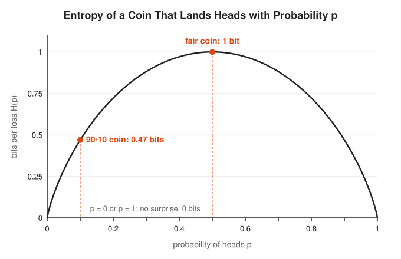

This one curve holds the core idea. A fair coin is as unpredictable as a coin gets, and each toss carries 1 full bit. A coin that lands heads 90% of the time is mostly boring. Each toss carries only 0.47 bits, because you already guess the outcome right most of the time. A two-headed coin carries 0 bits. You learn nothing by watching it, which is also true of most status meetings.

## The Concept Ladder

### Beginner

#### 1. Bits and Yes/No Questions

A **bit** is the information in one answer to a fair yes-or-no question. Each answer cuts the possibilities in half. To pick one item out of $N$ equally likely items, you need $\log_2 N$ questions.

$$\text{bits needed} = \log_2 N$$

<!-- diagram: type=binary-tree range=1..8 target=6 caption="Three yes/no questions find one of eight numbers" -->
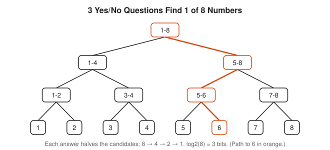

Binary search, a 3-bit field holding 8 states, and the game of twenty questions are the same idea. Twenty fair questions distinguish $2^{20} = 1,048,576$ things.

Course link: [301 Algebra II, Trig and Precalculus](../../course/301/README.md) for logarithms.

#### 2. Surprise

An event with probability $p$ carries $-\log_2 p$ bits of **surprise** (also called self-information). Likely events carry little. Rare events carry many bits. An event with probability $1/8$ carries 3 bits, the same as a fair choice among 8 options.

$$I(p) = -\log_2 p = \log_2 \frac{1}{p}$$

<!-- diagram: type=function-plot f="-log2(p)" x=0..1 marks=1/64,1/8,1/2 caption="Surprise in bits versus probability" -->
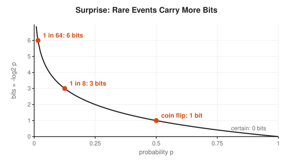

Why a logarithm? Because surprise needs to add up for independent events. Two fair coins have probability $1/4$ together. Their surprises add: $1 + 1 = 2$ bits. A logarithm turns the product of probabilities into a sum of bits.

#### 3. Entropy

**Entropy** is the average surprise of a source. Weight each outcome's surprise by how often it happens and add. Entropy is highest when all outcomes are equally likely and drops as the source gets predictable.

$$H(X) = -\sum_x p(x)\,\log_2 p(x)$$

<!-- diagram: type=bar-chart-pair dists=uniform4,skewed4 caption="Entropy of a uniform and a skewed distribution" -->
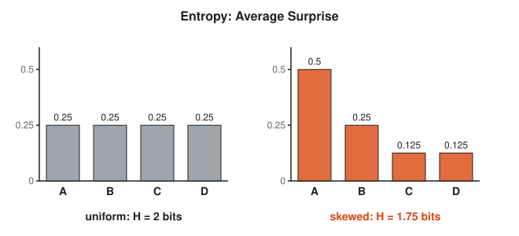

The skewed source is more predictable, and it costs fewer bits per symbol on average. That gap is the room compression works in.

#### 4. Passwords and Real Data

When each character of a password is chosen uniformly at random from $C$ choices, a password of length $L$ has $L \log_2 C$ bits of entropy. Each extra bit doubles the work for an attacker. The formula only holds for random choices. A human-chosen "Password1!" has far less entropy than its length suggests.

$$H = L \cdot \log_2 C$$

<!-- diagram: type=bar-chart-horizontal items=4 caption="Password entropy for four styles" -->
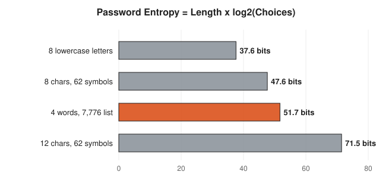

Four random words from a 7,776-word list beat eight random mixed characters, and they are easier to type at 3 a.m. during an incident.

### Intermediate

#### 5. Compression and Huffman Codes

**Shannon's source coding theorem** says you cannot losslessly compress a source below $H$ bits per symbol on average, and you get as close to $H$ as you like. **Huffman coding** builds a good code: repeatedly merge the two least likely symbols into one node. Frequent symbols end up with short codes.

$$H(X) \le \bar{L} < H(X) + 1$$

<!-- diagram: type=huffman-tree symbols=A:0.5,B:0.25,C:0.125,D:0.125 caption="Huffman tree with codes 0, 10, 110, 111" -->
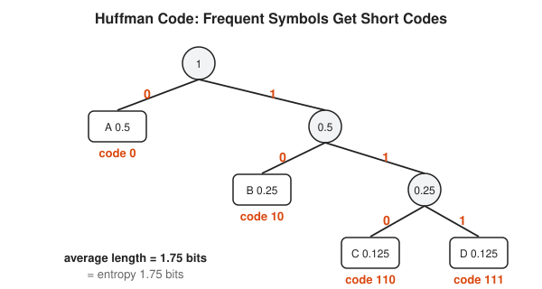

No code is a prefix of another, which means a decoder never needs separators. Morse code had the same instinct: E, the most common English letter, is a single dot.

#### 6. Cross-Entropy and KL Divergence

Suppose the data really follows $p$, but you built your code for a model $q$. You pay the **cross-entropy** $H(p, q)$ bits per symbol instead of $H(p)$. The waste is the **Kullback-Leibler divergence**. It is never negative, and it is zero only when the model matches reality.

$$H(p, q) = -\sum_x p(x)\log_2 q(x), \qquad D_{KL}(p \,\|\, q) = H(p, q) - H(p) \ge 0$$

<!-- diagram: type=bar-chart-overlay p=0.5,0.25,0.125,0.125 q=0.25,0.25,0.25,0.25 caption="True p versus model q with KL divergence" -->
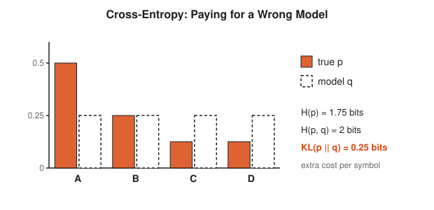

Training a classifier with cross-entropy loss is exactly this: adjust the model $q$ until it stops paying extra for the true labels $p$.

#### 7. Mutual Information

**Mutual information** $I(X; Y)$ measures how much knowing $Y$ reduces your uncertainty about $X$. It is zero for independent variables and equals $H(X)$ when $Y$ determines $X$ completely.

$$I(X; Y) = H(X) - H(X \mid Y) = H(X) + H(Y) - H(X, Y)$$

<!-- diagram: type=venn sets=H(X),H(Y) overlap=I(X;Y) caption="Entropy Venn diagram" -->
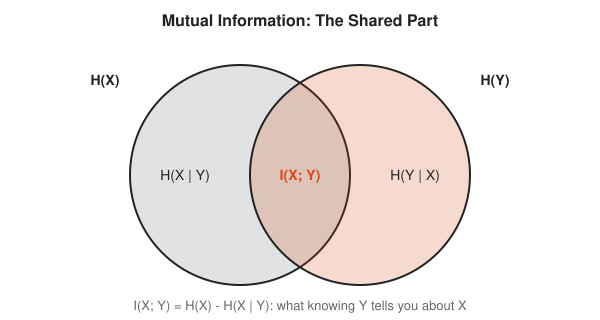

Unlike correlation, mutual information catches any dependence, not only straight-line relationships. Feature selection and some anomaly detectors use it to ask which log fields actually predict an outage.

#### 8. Noisy Channels and Capacity

A **channel** takes an input and delivers an output, sometimes wrong. The **binary symmetric channel** flips each bit with probability $f$. Its **capacity** is the most information per use that gets through reliably.

$$C = \max_{p(x)} I(X; Y), \qquad C_{\text{BSC}} = 1 - H(f)$$

<!-- diagram: type=channel-diagram kind=binary-symmetric caption="Binary symmetric channel with flip probability f" -->


At $f = 0.5$ the output is a coin toss unrelated to the input, and the capacity is zero. The channel is then a very expensive random number generator.

### Advanced

#### 9. Error-Correcting Codes

Add redundancy in a structured way and the receiver repairs errors on its own. The **Hamming (7,4) code** sends 4 data bits with 3 parity bits. Each parity bit makes one circle hold an even number of 1s. A single flipped bit breaks a unique set of circles, which points straight at it.

$$\text{rate} = \frac{k}{n} = \frac{4}{7}, \qquad \text{corrects any 1 error in 7 bits}$$

<!-- diagram: type=venn3 code=hamming74 caption="Hamming (7,4) as three parity circles" -->
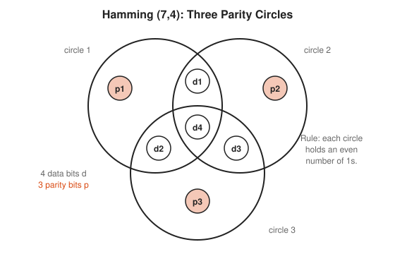

Modern systems use stronger codes on the same principle. Reed-Solomon codes protect CDs, QR codes, RAID 6 and erasure-coded storage. LDPC codes protect Wi-Fi, 5G and SSDs.

#### 10. The Channel Coding Theorem

Shannon's most surprising result: below capacity, you get an error rate as small as you like, without slowing to a crawl. Above capacity, reliable communication is impossible no matter how clever the code. Before 1948, engineers assumed that less noise always required slower sending.

$$R < C \implies \text{error probability} \to 0 \text{ is achievable}$$

<!-- diagram: type=function-plot f="1-H(f)" x=0..0.5 shade=below caption="Capacity of the binary symmetric channel" -->
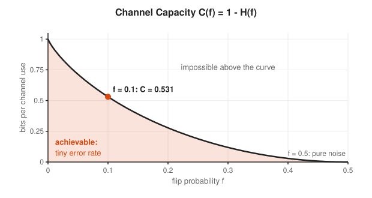

Shannon proved good codes exist by picking codes at random and showing that a random code is good on average. Finding practical codes that come close took until the 1990s, with turbo codes and the rediscovery of LDPC codes.

#### 11. Kolmogorov Complexity

Entropy measures a random source. **Kolmogorov complexity** measures a single string: the length of the shortest program that prints it. A patterned string has a short program. A string of coin flips has no program shorter than itself, up to a small constant.

$$K(x) = \min\{\, |p| : U(p) = x \,\}$$

<!-- diagram: type=compare-strings count=2 length=64 caption="Two strings with different shortest descriptions" -->
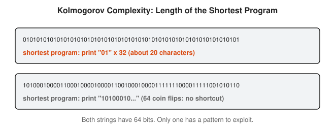

No program computes $K(x)$ for every string. If one did, it also solves the halting problem, which Turing proved impossible. Compressors such as gzip give a practical upper bound, which is why "how well does it compress" is a decent test for randomness.

## Worked Examples

### Example 1: Entropy of a Skewed Source

A service returns status 200 with probability 1/2, 404 with probability 1/4, and 500 or 503 each with probability 1/8. Find the entropy.

```txt
  H = -sum p log2 p                                    definition
    = 1/2 x 1 + 1/4 x 2 + 1/8 x 3 + 1/8 x 3            -log2(1/2)=1, -log2(1/4)=2, -log2(1/8)=3
    = 0.5 + 0.5 + 0.375 + 0.375                        multiply
    = 1.75 bits per status code                        add
```

### Example 2: Build the Huffman Code

```txt
  start: A 0.5, B 0.25, C 0.125, D 0.125               list probabilities
  merge C + D -> CD 0.25                               two smallest
  merge B + CD -> BCD 0.5                              two smallest
  merge A + BCD -> root 1.0                            two smallest
  codes: A 0, B 10, C 110, D 111                       left = 0, right = 1
  average = 0.5x1 + 0.25x2 + 0.125x3 + 0.125x3         weight by probability
          = 1.75 bits                                  equals the entropy
```

### Example 3: Fix One Flipped Bit with Hamming (7,4)

Positions 1 to 7 hold `p1 p2 d1 p3 d2 d3 d4`. Send data `1011`.

```txt
  d1 d2 d3 d4 = 1 0 1 1                                data
  p1 = d1 xor d2 xor d4 = 1 xor 0 xor 1 = 0            circle 1 even
  p2 = d1 xor d3 xor d4 = 1 xor 1 xor 1 = 1            circle 2 even
  p3 = d2 xor d3 xor d4 = 0 xor 1 xor 1 = 0            circle 3 even
  codeword = 0 1 1 0 0 1 1                             positions 1..7
  received = 0 1 1 0 1 1 1                             noise flips position 5
  check 1 (pos 1,3,5,7): 0+1+1+1 = odd -> 1            circle 1 broken
  check 2 (pos 2,3,6,7): 1+1+1+1 = even -> 0           circle 2 fine
  check 3 (pos 4,5,6,7): 0+1+1+1 = odd -> 1            circle 3 broken
  error position = 1x1 + 2x0 + 4x1 = 5                 read checks as binary
  flip position 5 -> 0 1 1 0 0 1 1                     repaired
```

### Example 4: Capacity of a Noisy Link

A link flips 1 bit in 10. What is its capacity?

```txt
  H(0.1) = -0.1 log2 0.1 - 0.9 log2 0.9                binary entropy
         = 0.332 + 0.137                               evaluate each term
         = 0.469 bits                                  add
  C = 1 - H(0.1) = 0.531 bits per use                  BSC capacity
```

Even with 10% of bits flipped, about 53% of the raw rate gets through with an error rate as close to zero as you want. You pay in redundancy, not in reliability.

## Big Theorems to Know

* **Additivity of Surprise:** for independent events, bits of surprise add.
* **Maximum Entropy:** among $N$ outcomes, entropy is at most $\log_2 N$, reached only by the uniform distribution.
* **Source Coding Theorem (Shannon, 1948):** a source cannot be losslessly compressed below its entropy on average, and you get arbitrarily close.
* **Kraft Inequality:** a prefix code with lengths $\ell_i$ exists exactly when $\sum 2^{-\ell_i} \le 1$.
* **Gibbs Inequality:** $D_{KL}(p \| q) \ge 0$, with equality only when $p = q$.
* **Data Processing Inequality:** processing data never increases the information it holds about the source.
* **Channel Coding Theorem (Shannon, 1948):** every rate below capacity is achievable with vanishing error, and no rate above it is.
* **Shannon-Hartley Theorem:** a channel with bandwidth $B$ and signal-to-noise ratio $S/N$ has capacity $C = B \log_2(1 + S/N)$.
* **Incomputability of $K(x)$:** no algorithm computes Kolmogorov complexity in general.

## Open Problems and Fun Facts

* **One paper:** Shannon's 1948 "A Mathematical Theory of Communication" founded the field, defined the bit as the unit, and proved the main theorems. He credited John Tukey with the word "bit".
* **Why entropy:** according to a well-known story, John von Neumann suggested the name because the formula matched entropy in physics, and because nobody really knows what entropy is, which wins arguments.
* **QR codes** use Reed-Solomon codes. At the highest level, a QR code survives about 30% damage, which is why logos printed in the middle still scan.
* **Deep space:** Voyager probes send data across billions of kilometers with error-correcting codes, from a transmitter of about 20 watts.
* **Open problem:** the zero-error capacity of a channel whose confusions form a 7-cycle is unknown. Laszlo Lovasz settled the 5-cycle in 1979 with the value $\sqrt{5}$.
* **Open problem:** the capacity of the general relay channel, a sender, a helper and a receiver, is still unknown after 50 years.

## Starter Problems

1. How many fair yes-or-no questions do you need to identify one of 64 equally likely servers?
2. An alert fires with probability 1/1,024 in a given minute. How many bits of surprise does a firing carry?
3. Find the entropy of a fair six-sided die. Give three decimals.
4. A password uses 10 characters chosen uniformly from 94 printable symbols. How many bits of entropy does it have?
5. Is the code A=0, B=01, C=11 a prefix code? Why does it matter?
6. A channel flips bits with probability 0.01. Find its capacity.
7. In the Hamming (7,4) code, the three checks come out 0, 1, 1 (check 1 even, checks 2 and 3 odd). Which position is wrong?

<details>
<summary>Answers</summary>

1. 6 questions. $\log_2 64 = 6$.
2. 10 bits. $-\log_2(1/1024) = 10$.
3. $\log_2 6 \approx 2.585$ bits. A uniform source with 6 outcomes.
4. About 65.5 bits. $10 \times \log_2 94 \approx 10 \times 6.555$.
5. No. The code for A, `0`, is a prefix of the code for B, `01`. A decoder reading `0` cannot tell whether A ended or B is starting without looking ahead.
6. About 0.919 bits per use. $H(0.01) \approx 0.081$, and $1 - 0.081 = 0.919$.
7. Position 6. Read the checks as binary: $1 \cdot 0 + 2 \cdot 1 + 4 \cdot 1 = 6$.

</details>

## Code Corner

[code/main.go](code/main.go) computes entropies, builds the Huffman code, measures KL divergence and channel capacity, encodes and repairs a Hamming (7,4) codeword, and compresses a repetitive log next to random bytes. Run it with `go run main.go` inside `code/`.

```txt
== Entropy ==
fair coin           1.000 bits
90/10 coin          0.469 bits
fair 8-sided die    3.000 bits
skewed A,B,C,D      1.750 bits

== Huffman code for A 0.5, B 0.25, C 0.125, D 0.125 ==
A -> 0
B -> 10
C -> 110
D -> 111
average length 1.750 bits = entropy 1.750 bits

== Cross-entropy and KL divergence ==
H(p, q) = 2.000 bits, KL(p||q) = 0.250 bits

== Binary symmetric channel ==
flip 0.00 -> capacity 1.000 bits per use
flip 0.01 -> capacity 0.919 bits per use
flip 0.10 -> capacity 0.531 bits per use
flip 0.50 -> capacity 0.000 bits per use

== Hamming (7,4) ==
data    [1 0 1 1] -> codeword [0 1 1 0 0 1 1]
noisy   [0 1 1 0 1 1 1]
fixed   [0 1 1 0 0 1 1] repaired position 5

== Compression versus entropy ==
health-check log: 10500 bytes ->   73 bytes deflated
random bytes:     10500 bytes -> 10507 bytes deflated
letter entropy of "mississippi": 1.823 bits per char

== Password entropy ==
8 lowercase        37.6 bits
8 mixed+digits     47.6 bits
4 diceware words   51.7 bits
12 mixed+digits    71.5 bits
```

The compression lines are the whole track in two rows. A health-check log repeats itself, has almost no entropy, and shrinks over 100 times. Random bytes have maximum entropy, and deflate makes them slightly bigger. Nothing compresses noise.

## Flashcards

[cards.tsv](cards.tsv) holds the key definitions and theorems for Anki import.

## Resources

* [MacTutor: Claude Shannon](https://mathshistory.st-andrews.ac.uk/Biographies/Shannon/): the life of the founder of the field.
* [David MacKay: Information Theory, Inference, and Learning Algorithms](https://www.inference.org.uk/mackay/itila/): a free classic textbook, clear and full of pictures.
* [Khan Academy: Journey into Information Theory](https://www.khanacademy.org/computing/computer-science/informationtheory): gentle videos from alphabets to entropy.
* [Wolfram MathWorld: Entropy](https://mathworld.wolfram.com/Entropy.html): the formal definition with related links.
* [MIT OCW 6.441 Information Theory](https://ocw.mit.edu/courses/6-441-information-theory-spring-2016/): graduate lecture notes for the advanced rungs.

## Where to Go Next

* [Probability Track](../probability/README.md) for the distributions every formula here averages over.
* [Abstract Algebra Track](../abstract-algebra/README.md) for the finite fields inside Reed-Solomon codes.
* [Number Theory for Cryptography](../../workshops/number-theory-for-cryptography/README.md) for where entropy meets keys.
* [Statistics Track](../statistics/README.md) for likelihood, which is cross-entropy wearing a different hat.
