# Knot Theory Track

**Track:** Knot Theory · **Span:** beginner to advanced · **Course levels:** [501 Linear Algebra, Probability and Discrete Math](../../course/501/README.md) (counting, graphs), [601 Proof and Higher Math](../../course/601/README.md) (invariants, modular arithmetic)
**Prerequisites:** a piece of string. Polynomials from the [Algebra Track](../algebra/README.md) help at rung 11. Modular arithmetic from the [Number Theory Track](../number-theory/README.md) helps at rung 5. The [Topology Track](../topology/README.md) and [Algebraic Topology Track](../algebraic-topology/README.md) supply the bigger picture.
**Files:** this README, [cards.tsv](cards.tsv) for Anki, [code/main.go](code/main.go), and the diagrams in [img/](img/).

## What the Field Studies

A **knot** is a closed loop of string in 3D space. Take a shoelace, tie any tangle you like, then glue the two ends together. You can now move, stretch and twist the loop, but never cut it or pass it through itself.

Knot theory asks one question: can this tangle be untangled into a plain circle, and if not, is it the same as that other tangle? The question is easy to ask and hard to answer. The field grew a large toolkit of **invariants**, numbers and polynomials that stay the same however you move the string, to answer it.

## Why It Matters

Knots are not only a puzzle:

* **DNA** gets knotted and tangled inside cells. Enzymes called topoisomerases cut and reseal it to undo knots. Biologists measure the knot type of DNA in a gel to learn what the enzyme did.
* **Physics:** Lord Kelvin proposed in 1867 that atoms are knotted vortices in the ether. The theory was wrong, but it launched the first knot tables. Today knot polynomials appear in quantum field theory and in proposals for fault-tolerant quantum computers.
* **Chemistry:** chemists synthesize knotted molecules, and some proteins fold into knots.
* **Everyday engineering:** cables, ropes, fishing lines and earbud wires. A tangled cable is a knot problem with a deadline.
* **Computation:** deciding whether a diagram is the unknot is a famous algorithmic problem. It is in NP, and in 2021 Marc Lackenby announced a quasi-polynomial-time algorithm.

## Concept Map

<!-- diagram: type=concept-map tiers=beginner,intermediate,advanced nodes=13 caption="Knot theory concepts with prerequisite arrows" -->
![Concept map of knot theory. What Is a Knot leads to Knot Diagrams and Links. Knot Diagrams lead to Reidemeister Moves and Crossing Signs and Writhe. Reidemeister Moves lead to Invariants, which lead to Tricolorability and Crossing Number. Links and Crossing Signs lead to Linking Number. Crossing Number leads to Knot Sums and to Unknotting Number. Crossing Signs lead to the Jones Polynomial. Unknotting Number and Jones Polynomial lead to DNA and Physics. Invariants and Jones Polynomial are the milestones.](img/concept-map.svg)

Read the map top to bottom. An arrow from A to B means learn A first. Orange boxes mark the milestones.

## Signature Diagram

<!-- diagram: type=knot-row knots=unknot,trefoil,figure-eight caption="The first three knots" -->
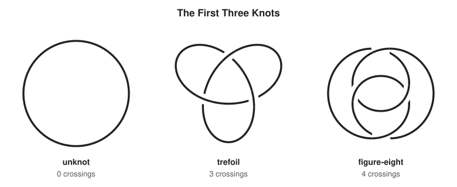

These are the three simplest knots. The unknot is a plain circle. The trefoil is an overhand knot with its ends joined. The figure-eight is the knot sailors tie as a stopper, with its ends joined. Nobody can turn one of these into another without scissors. Proving that takes the whole track.

## The Concept Ladder

### Beginner

#### 1. What Is a Knot

A **knot** is a closed loop in 3D space that does not cross itself. Two knots are the same when you can move one into the shape of the other without cutting. The **unknot** is the plain circle. A tangle on an open string is not a knot: you can always slide it off the end. Gluing the ends traps it.

$$\text{knot} = \text{closed loop in } \mathbb{R}^3, \qquad \text{same knot} = \text{deform without cutting}$$

<!-- diagram: type=knot-construction from=overhand to=trefoil caption="Tie a knot, then glue the ends" -->
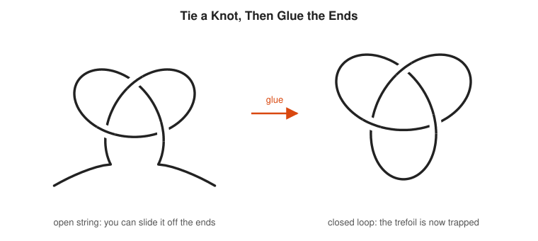

The gluing matters. Every tangle on an open rope is trivial in this sense, because you can pull the end back through. That is why mathematicians study closed loops and why sailors care about friction instead.

In the course: [601 Topology Taster](../../course/601/12-topology-taster/README.md).

#### 2. Knot Diagrams

To work on paper, flatten the knot: draw its shadow, and at each **crossing** break the lower strand with a small gap. The unbroken strand is the **over-strand**. The broken one is the **under-strand**. The pieces of string between gaps are **arcs**.

$$\text{diagram} = \text{shadow} + \text{over/under information at each crossing}$$

<!-- diagram: type=crossing panels=shadow,diagram caption="A shadow loses information, a diagram keeps it" -->
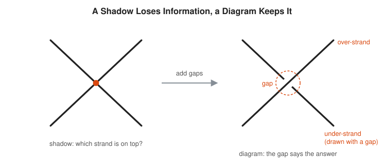

A shadow alone is ambiguous: the same shadow fits the trefoil and the unknot, depending on the crossings. The gap carries one bit of information per crossing, and every bit matters.

#### 3. Reidemeister Moves

Kurt Reidemeister proved in 1927 that three local moves are enough. Two diagrams show the same knot exactly when a sequence of these moves turns one into the other: **R1** adds or removes a twist, **R2** slides one strand over another, **R3** slides a strand across a crossing.

$$K_1 = K_2 \iff \text{diagram}_1 \xrightarrow{\ \text{R1, R2, R3}\ } \text{diagram}_2$$

<!-- diagram: type=reidemeister moves=R1,R2,R3 caption="The three Reidemeister moves" -->


This turns a 3D question into a game on paper. The catch: the theorem says a sequence exists, not how long it is. A messy unknot can need many moves, and some need the diagram to get worse before it gets better.

#### 4. Invariants

A crossing count of a drawing is not a property of the knot: the same unknot can be drawn with 0, 1 or 2 crossings. An **invariant** is a number or object that every Reidemeister move leaves unchanged. Equal knots have equal invariants. Different invariants prove different knots.

$$I(\text{diagram}) = I(\text{diagram after R1, R2 or R3}) \implies I \text{ is a knot invariant}$$

<!-- diagram: type=knot-row knots=unknot-2-crossings,unknot-1-crossing,circle caption="Three diagrams of the same unknot" -->
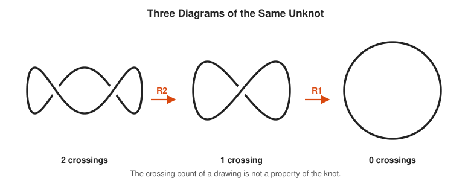

An invariant works like a checksum. If two files have different checksums, they differ. If the checksums match, they might still differ. Knot theory has many checksums, and nobody has found a fast one that never collides.

### Intermediate

#### 5. Tricolorability

Color each arc of a diagram with one of three colors. The rules: at every crossing, the three arc ends that meet are all the same color or all different, and the whole diagram uses at least two colors. A knot that admits such a coloring is **tricolorable**. Each Reidemeister move preserves the property, which makes it an invariant.

$$\text{at each crossing: } 2 \cdot \text{over} \equiv \text{under}_1 + \text{under}_2 \pmod 3$$

<!-- diagram: type=knot-coloring knot=trefoil colors=3 caption="The trefoil is tricolorable" -->
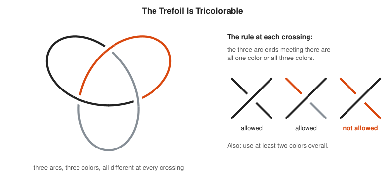

The unknot has one arc, which allows only one color: not tricolorable. The trefoil is. That settles it: the trefoil is not the unknot. The figure-eight knot is not tricolorable either, and the Code Corner checks all three by brute force.

In the course: [601 Modular Arithmetic and Fermat](../../course/601/08-modular-arithmetic-and-fermat/README.md).

#### 6. Crossing Number

The **crossing number** of a knot is the fewest crossings in any diagram of it. Knot tables are sorted by it. The trefoil has crossing number 3, the figure-eight 4. The counts grow fast.

$$c(\text{unknot}) = 0, \quad c(\text{trefoil}) = 3, \quad c(\text{figure-eight}) = 4$$

<!-- diagram: type=bar-chart x=crossing-number y=prime-knots data=3:1,4:1,5:2,6:3,7:7,8:21,9:49,10:165 caption="Prime knots by crossing number" -->
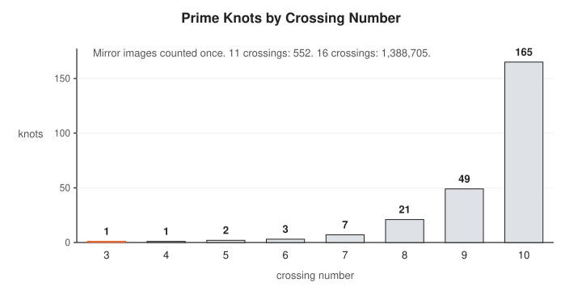

The crossing number is easy to define and hard to compute: you must rule out every possible diagram. For **alternating** knots, whose crossings go over, under, over, under all the way around, any reduced alternating diagram already has the minimum. That was one of Tait's 1880s conjectures, proved in 1987 with the Jones polynomial.

#### 7. Crossing Signs and Writhe

Give the knot a direction, shown by arrows. Turn each crossing until both strands point up. If the over-strand runs up and to the right, the crossing is **positive** ($+1$). Up and to the left: **negative** ($-1$). The **writhe** is the sum of the signs in a diagram.

$$w(D) = \sum_{\text{crossings}} \operatorname{sign}(c)$$

<!-- diagram: type=oriented-crossings signs=+1,-1 caption="Positive and negative crossings" -->
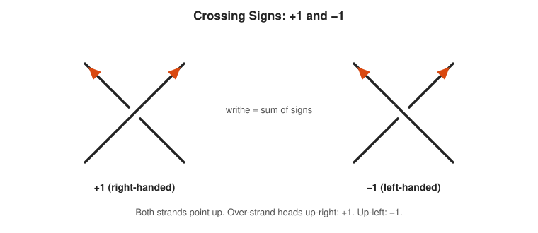

Writhe alone is not an invariant: an R1 twist changes it by $\pm 1$. It is still useful. It measures handedness and it is the correction factor that turns the Kauffman bracket into the Jones polynomial in rung 11.

#### 8. Links and Linking Number

A **link** is several loops tangled together. The **linking number** of two loops is half the sum of the signs of the crossings between them. It counts how many times one loop winds around the other, and it is an invariant.

$$\operatorname{lk}(K_1, K_2) = \frac{1}{2}\sum_{c \in K_1 \cap K_2} \operatorname{sign}(c)$$

<!-- diagram: type=link-row links=hopf,unlink,borromean caption="Three links" -->
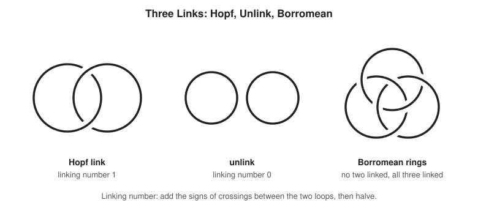

The Borromean rings are a warning: every pair has linking number 0, yet the three are linked. Pairwise checks miss global structure, a lesson every distributed-systems engineer learns the hard way.

### Advanced

#### 9. Knot Sums and Prime Knots

Cut two knots open at one point each and join the loose ends with two parallel strands. The result is the **connected sum** $K_1 \# K_2$. A knot that is not a sum of two non-trivial knots is **prime**. Every knot splits into primes in exactly one way, like whole numbers.

$$K = P_1 \# P_2 \# \cdots \# P_k \quad \text{(unique up to order)}$$

<!-- diagram: type=knot-sum panels=granny,square caption="Granny knot and square knot" -->
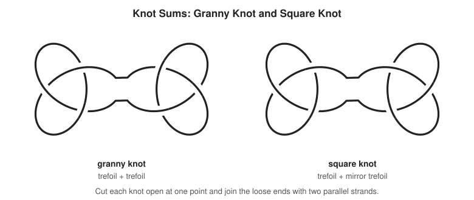

The granny knot and the square knot look alike and behave differently: sailors trust the square knot and distrust the granny. Their Jones polynomials differ, which proves they are different knots. The Code Corner prints both.

#### 10. Unknotting Number

Allow one cheat: let the string pass through itself at one crossing, switching over and under. The **unknotting number** $u(K)$ is the fewest such switches that turn $K$ into the unknot, minimized over all diagrams.

$$u(\text{trefoil}) = 1, \qquad u(\text{figure-eight}) = 1, \qquad u(5_1) = 2$$

<!-- diagram: type=crossing-change knot=trefoil switch=top caption="Switch one crossing and the trefoil falls apart" -->
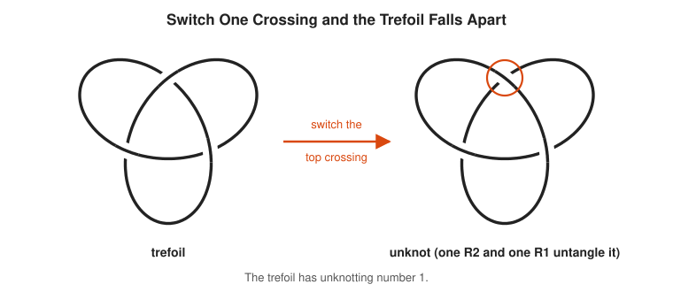

The definition looks simple and hides hard problems. Whether the unknotting number of a sum equals the sum of the unknotting numbers was open for decades. In 2025 Brittenham and Hermiller found a counterexample with computer help.

#### 11. The Jones Polynomial

In 1984 Vaughan Jones found a polynomial invariant that detects far more than earlier ones. The quickest route is Kauffman's bracket: smooth every crossing in both possible ways, count the loops, and add weights. Then correct with the writhe.

$$\langle \text{crossing} \rangle = A\,\langle\, \text{A-smoothing} \,\rangle + A^{-1}\langle\, \text{B-smoothing} \,\rangle, \qquad \langle O \cup K \rangle = (-A^2 - A^{-2})\langle K \rangle$$

$$V(t) = \left(-A^{3}\right)^{-w}\langle K \rangle \Big|_{A = t^{-1/4}}$$

<!-- diagram: type=kauffman-bracket caption="Two ways to smooth a crossing" -->
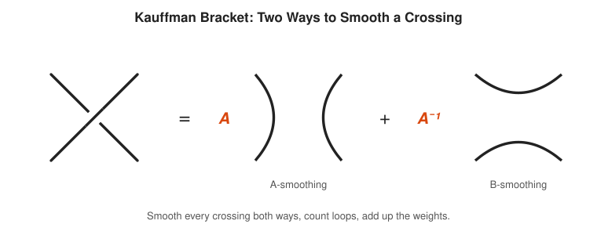

For the trefoil drawn in this track (all crossings negative) the result is $V(t) = -t^{-4} + t^{-3} + t^{-1}$. Its mirror image gives $t + t^3 - t^4$. Different polynomials: the trefoil is not its own mirror image. Earlier invariants missed that. Jones won the Fields Medal in 1990.

In the course: [301 Polynomials and Complex Numbers](../../course/301/02-polynomials-and-complex-numbers/README.md).

#### 12. Knots in DNA and Physics

Inside a cell, DNA is meters long and packed into a nucleus a few micrometers wide. Copying it tangles it. **Type II topoisomerase** enzymes cut one double strand, pass another strand through the gap, and reseal: a crossing change, the move from rung 10. Biologists read off what the enzyme did from the knot types it leaves behind.

$$\text{one strand passage} = \text{one crossing change} \implies \text{knot type changes by an unknotting step}$$

<!-- diagram: type=strand-passage panels=cross,cut-pass,reseal caption="How an enzyme changes a crossing in DNA" -->
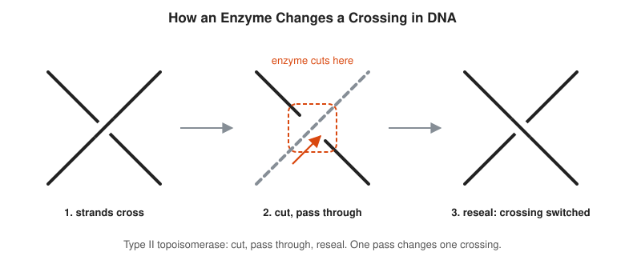

Knotted DNA runs at different speeds through a gel by knot type, which lets labs sort and identify knots. In physics the Jones polynomial reappeared in Witten's quantum field theory, and topological quantum computing proposals store information in how particle paths braid around each other. Kelvin was wrong about atoms and right that knots matter.

Related track: [Algebraic Topology Track](../algebraic-topology/README.md).

## Worked Examples

### Example 1: Prove the Trefoil Is Knotted

```txt
  the trefoil diagram has 3 arcs and 3 crossings     count arcs between gaps
  color the arcs 1, 2, 3                             one color per arc
  each crossing meets all three arcs                 the trefoil is symmetric
  all three colors differ at every crossing          rule satisfied
  at least two colors are used                       rule satisfied
  trefoil is tricolorable                            conclusion
  the unknot has 1 arc: only one color possible      not tricolorable
  tricolorability is an invariant                    survives R1, R2, R3
  trefoil is not the unknot                          different invariant values
```

### Example 2: Linking Number of the Hopf Link

Orient both loops of the Hopf link. It has two crossings between the loops, both positive.

```txt
  crossing 1 sign = +1                     over-strand points up-right
  crossing 2 sign = +1                     same check
  sum of signs    = 2                      add
  lk = 2 / 2      = 1                      half the sum
```

Reverse the direction of one loop and both signs flip: $\operatorname{lk} = -1$. The size $|\operatorname{lk}| = 1$ does not depend on the choice.

### Example 3: Kauffman Bracket of a One-Crossing Unknot

Take the figure-eight-shaped unknot diagram with one crossing (an R1 twist).

```txt
  smooth the crossing one way: 2 loops     two separate circles
  smooth it the other way:     1 loop      one circle
  <D> = A^(+1) d^(2-1) + A^(-1) d^(1-1)    weights times d^(loops - 1)
      = A(-A^2 - A^-2) + A^-1              d = -A^2 - A^-2
      = -A^3 - A^-1 + A^-1
      = -A^3                               the bracket alone changed
  writhe w = +1 for this twist             one positive crossing
  V = (-A^3)^(-1) * (-A^3) = 1             the writhe correction fixes it
```

Which smoothing gives two loops depends on the twist direction. For this twist, the A-smoothing does. The bracket alone is not an invariant: it changed under R1. The writhe factor repairs exactly that, and $V = 1$ is the Jones polynomial of the unknot.

## Big Theorems to Know

* **Reidemeister (1927):** two diagrams show the same knot exactly when R1, R2 and R3 connect them.
* **Prime Decomposition (Schubert, 1949):** every knot is a connected sum of prime knots in exactly one way.
* **Tait Conjectures (proved 1987 to 1991):** a reduced alternating diagram has the fewest crossings, and two such diagrams of one knot share their writhe.
* **Jones (1984):** the Jones polynomial is a knot invariant, and it distinguishes the trefoil from its mirror image.
* **Gordon-Luecke (1989):** a knot is determined by its complement, the space around it.
* **Unknot Recognition:** deciding whether a diagram is the unknot is in NP (Hass, Lagarias and Pippenger, 1999) and in co-NP (Lackenby).
* **Alexander (1923):** every knot or link is the closure of a braid.

## Open Problems and Fun Facts

* **Does the Jones polynomial detect the unknot?** Every non-trivial knot checked so far has $V(t) \ne 1$, through knots with more than 20 crossings. Nobody knows if this holds for all knots.
* **The Perko pair:** two entries in the 1899 Little knot table, both with 10 crossings, were listed as different for 75 years. In 1974 Kenneth Perko, a lawyer, showed by hand that they are the same knot.
* **Kelvin's atoms:** the vortex atom theory inspired Peter Guthrie Tait to build the first knot tables in the 1870s and 1880s, by hand, without a computer.
* **Unknotting number of sums:** additivity failed in 2025, after being widely believed for nearly 90 years.
* **Knots in 4D:** in four dimensions every knotted circle unties. A circle needs exactly three dimensions to stay knotted.

## Starter Problems

1. Is a tangle on an open shoelace a knot in the sense of this track? Why or why not?
2. Which Reidemeister move removes a single twist loop?
3. A diagram has crossings with signs $+1, +1, -1, +1$. What is its writhe?
4. Two loops cross each other at 4 crossings with signs $+1, +1, +1, +1$. What is their linking number?
5. The unknot is not tricolorable. Explain in one sentence.
6. The Jones polynomial of a knot is $t + t^3 - t^4$. Is the knot the same as its mirror image?
7. What is the Jones polynomial of the granny knot in terms of the trefoil polynomial $V(t)$?

<details>
<summary>Answers</summary>

1. No. The ends are free, and every tangle slides off the end. Knots are closed loops.
2. R1.
3. $+1 + 1 - 1 + 1 = 2$.
4. $\operatorname{lk} = 4/2 = 2$. The loops wind around each other twice.
5. Its standard diagram has one arc, and a single arc allows only one color, which breaks the at-least-two-colors rule.
6. No. The mirror has $V(t^{-1}) = t^{-1} + t^{-3} - t^{-4}$, a different polynomial. This is the right-handed trefoil.
7. $V(t)^2$. The Jones polynomial of a connected sum is the product of the polynomials.

</details>

## Code Corner

[code/main.go](code/main.go) reads planar diagram (PD) codes, a standard text format for knot diagrams that lists the four edge labels at each crossing. It computes the writhe, the Kauffman bracket by summing over all smoothing states, the Jones polynomial, and the number of Fox 3- and 5-colorings. Run it with `go run main.go` inside `code/`.

```txt
== Left-handed trefoil 3_1 ==
crossings 3, writhe -3
Kauffman bracket: -A^-5 - A^3 + A^7
Jones polynomial: -t^-4 + t^-3 + t^-1
3-colorings: 9 (tricolorable), 5-colorings: 5

== Right-handed trefoil (mirror) ==
crossings 3, writhe 3
Kauffman bracket: A^-7 - A^-3 - A^5
Jones polynomial: t + t^3 - t^4
3-colorings: 9 (tricolorable), 5-colorings: 5

== Figure-eight knot 4_1 ==
crossings 4, writhe 0
Kauffman bracket: A^-8 - A^-4 + 1 - A^4 + A^8
Jones polynomial: t^-2 - t^-1 + 1 - t + t^2
3-colorings: 3 (not tricolorable), 5-colorings: 25

== Knot sums: the Jones polynomial multiplies ==
granny = trefoil + trefoil: t^-8 - 2t^-7 + t^-6 - 2t^-5 + 2t^-4 + t^-2
square = trefoil + mirror:  -t^-3 + t^-2 - t^-1 + 3 - t + t^2 - t^3
```

A coloring count of 3 means only the three one-color colorings exist. Anything above 3 means a real coloring. The figure-eight fails mod 3 and passes mod 5, the trefoil the other way round. The figure-eight polynomial is symmetric in $t$ and $t^{-1}$: it is its own mirror image. The state sum doubles in cost with each crossing, the classic exponential blowup. Real knot software uses smarter algorithms past about 20 crossings.

## Flashcards

[cards.tsv](cards.tsv) holds the key definitions and theorems for Anki import.

## Resources

* [The Knot Atlas](https://katlas.org/wiki/Main_Page): a free wiki with a page, diagram, PD code and polynomials for every small knot.
* [Wolfram MathWorld: Knot](https://mathworld.wolfram.com/Knot.html): definitions, tables and links to every invariant.
* [Wolfram MathWorld: Reidemeister Moves](https://mathworld.wolfram.com/ReidemeisterMoves.html): pictures of the three moves.
* [Wolfram MathWorld: Jones Polynomial](https://mathworld.wolfram.com/JonesPolynomial.html): the definition and values for small knots.
* [MacTutor: Peter Guthrie Tait](https://mathshistory.st-andrews.ac.uk/Biographies/Tait/): the physicist who made the first knot tables by hand.
* [MacTutor: Vaughan Jones](https://mathshistory.st-andrews.ac.uk/Biographies/Jones_Vaughan/): the discoverer of the Jones polynomial.

## Where to Go Next

* [Algebraic Topology Track](../algebraic-topology/README.md) for the fundamental group, which turns a knot complement into algebra.
* [Abstract Algebra Track](../abstract-algebra/README.md) for groups, including the braid groups behind every knot.
* [Graph Theory Track](../graph-theory/README.md): a knot diagram is a 4-regular planar graph with extra over/under data.
* [Differential Geometry Track](../differential-geometry/README.md) for curvature and torsion of a knotted curve in space.
