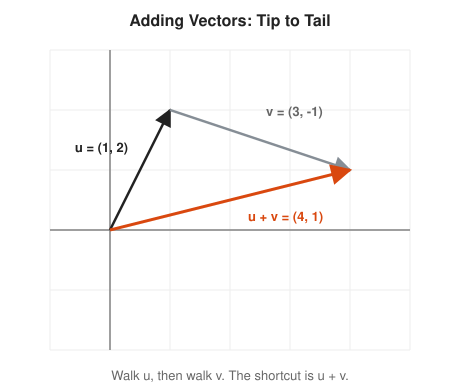
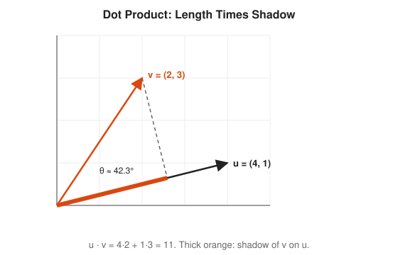
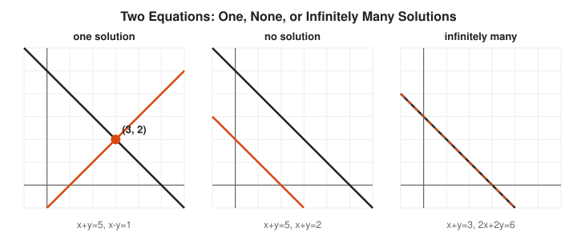
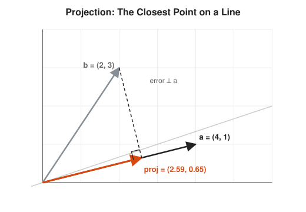
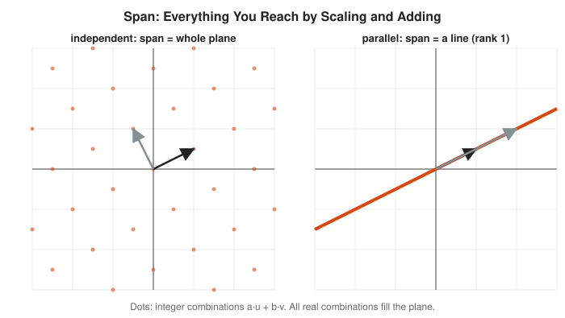
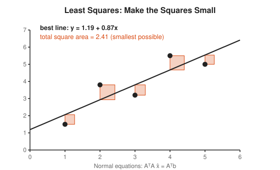
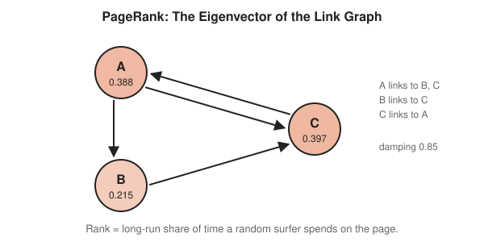

# Linear Algebra Track

**Track:** Linear Algebra · **Span:** beginner to advanced · **Course levels:** [501 Linear Algebra, Probability and Discrete Math](../../course/501/README.md)
**Prerequisites:** the coordinate plane and linear equations from [201](../../course/201/README.md). If "plot the point (3, 2)" feels comfortable, you are ready.
**Files:** this README, [cards.tsv](cards.tsv) for Anki, [code/main.go](code/main.go), and the diagrams in [img/](img/).

## What the Field Studies

Linear algebra studies **vectors** (arrows, or lists of numbers) and **linear maps** (rules that move every vector at once while keeping grid lines straight, parallel and evenly spaced). A **matrix** is the table of numbers that records a linear map.

The subject sounds abstract, but its core picture is concrete: a matrix grabs the whole plane and stretches, rotates, shears or flattens it. Almost every question in the field asks what that motion does.

## Why It Matters

Linear algebra is the most used branch of math in computing:

* Graphics engines move every vertex of a 3D scene with $4 \times 4$ matrices.
* Machine learning stores data as vectors and models as matrices. An embedding search is a pile of dot products.
* PageRank, the original Google ranking, is an eigenvector of the web link matrix.
* Capacity forecasting with many inputs is a least squares problem.
* Compression, recommendation systems and noise removal use the singular value decomposition.

The workshop [Linear Algebra for Graphics and ML](../../workshops/linear-algebra-for-graphics-and-ml/README.md) builds on this track.

## Concept Map

<!-- diagram: type=concept-map tiers=beginner,intermediate,advanced nodes=11 caption="Linear algebra concepts with prerequisite arrows" -->


Read the map top to bottom. An arrow from A to B means learn A first. Start at the orange box.

## Signature Diagram

<!-- diagram: type=matrix-transform matrix=[[2,1],[1,2]] show=unit-square,basis,eigenvector caption="Unit square and grid before and after the matrix A" -->
![Two panels. Left: a square grid with the unit square, basis vectors e1 and e2, and the diagonal vector (1,1). Right: after applying A = [[2,1],[1,2]] the grid becomes slanted, the unit square becomes a parallelogram of area 3, e1 lands on (2,1), e2 lands on (1,2), and (1,1) lands on (3,3) on the same line.](img/matrix-transform-grid.svg)

The matrix $A = \begin{pmatrix} 2 & 1 \\ 1 & 2 \end{pmatrix}$ sends $e_1 = (1, 0)$ to its first column $(2, 1)$ and $e_2 = (0, 1)$ to its second column $(1, 2)$. The rest of the grid follows. Three facts jump out of the picture. The columns of a matrix are where the basis vectors land. The unit square becomes a parallelogram of area $\det A = 2 \cdot 2 - 1 \cdot 1 = 3$. And the diagonal $(1, 1)$ stays on its own line, stretched by 3: it is an **eigenvector** with **eigenvalue** 3. The rest of the track explains those three facts.

## The Concept Ladder

### Beginner

#### 1. Vectors

A **vector** is an arrow with a length and a direction, or equally a list of numbers. Add vectors tip to tail. Scale a vector by stretching it. A request described by (CPU ms, bytes, latency) is already a vector in three dimensions, even if nobody drew the arrow.

$$\begin{pmatrix} 1 \\ 2 \end{pmatrix} + \begin{pmatrix} 3 \\ -1 \end{pmatrix} = \begin{pmatrix} 4 \\ 1 \end{pmatrix}, \qquad 3 \begin{pmatrix} 1 \\ 2 \end{pmatrix} = \begin{pmatrix} 3 \\ 6 \end{pmatrix}$$

<!-- diagram: type=vector-sum u=(1,2) v=(3,-1) caption="Tip-to-tail vector addition" -->


Course link: [501 Linear Algebra, Probability and Discrete Math](../../course/501/README.md).

#### 2. Dot Product and Length

The **dot product** multiplies matching entries and adds. It measures how much two vectors point the same way: it equals the length of one times the length of the shadow the other casts on it. A dot product of zero means the vectors are perpendicular. Cosine similarity in search engines is the dot product of two vectors scaled to length 1.

$$u \cdot v = \sum_i u_i v_i = \|u\|\,\|v\| \cos\theta, \qquad \|v\| = \sqrt{v \cdot v}$$

<!-- diagram: type=vector-projection u=(4,1) v=(2,3) caption="Dot product as length times shadow" -->


#### 3. Matrices as Transformations

A matrix times a vector gives a new vector. Think of the matrix as a machine that moves every point of space at once. Multiplying two matrices chains two machines: $AB$ means do $B$ first, then $A$. Order matters, the same way "rotate then stretch" differs from "stretch then rotate".

$$\begin{pmatrix} a & b \\ c & d \end{pmatrix} \begin{pmatrix} x \\ y \end{pmatrix} = \begin{pmatrix} ax + by \\ cx + dy \end{pmatrix}$$

<!-- diagram: type=shape-transform shape=F matrix=[[0,-1],[1,0]] caption="Rotation matrix turns a letter F" -->
![A gray letter F in the first quadrant and its orange image after the rotation matrix [[0, -1], [1, 0]], which turns it 90 degrees counterclockwise into the second quadrant. Rule: (x, y) goes to (-y, x).](img/rotate-letter-f.svg)

An asymmetric shape like F shows whether a map flips the picture over. A circle hides that.

#### 4. Linear Systems and Elimination

A set of linear equations is one matrix equation $Ax = b$. **Gaussian elimination** subtracts multiples of one row from another until the system is triangular, then solves from the bottom up. In two dimensions each equation is a line, and the solution is where the lines meet.

$$Ax = b$$

<!-- diagram: type=line-pairs cases=one,none,infinite caption="Two equations: one, none, or infinitely many solutions" -->


### Intermediate

#### 5. Orthogonality and Projection

Two vectors are **orthogonal** when their dot product is zero, which is the general word for perpendicular. The **projection** of $b$ onto $a$ is the shadow of $b$ on the line through $a$: the closest point on that line. The leftover error is orthogonal to $a$. That right angle is the whole idea behind least squares.

$$\operatorname{proj}_a b = \frac{a \cdot b}{a \cdot a}\, a$$

<!-- diagram: type=projection a=(4,1) b=(2,3) caption="Projection with the right angle" -->


#### 6. Span, Basis and Rank

The **span** of some vectors is everything you reach by scaling and adding them. A **basis** is a smallest set that spans a space. Its size is the **dimension**. The **rank** of a matrix is the dimension of its column span: how many truly independent directions its output covers.

$$\operatorname{rank}(A) + \operatorname{nullity}(A) = n \quad (n = \text{number of columns})$$

<!-- diagram: type=span-pair independent=(1,0.5),(-0.5,1) parallel=(1,0.5),(2,1) caption="Span of independent versus parallel vectors" -->


Rank answers a practical question: how many of your 50 dashboard metrics actually carry independent information? Often far fewer than 50.

#### 7. Determinant

The **determinant** is the factor by which a matrix scales area (in 2D) or volume (in 3D). A negative sign means the map flips orientation, like a mirror. A determinant of zero means the map squashes space flat, and no inverse can un-squash it.

$$\det \begin{pmatrix} a & b \\ c & d \end{pmatrix} = ad - bc$$

<!-- diagram: type=parallelogram columns=(3,1),(1,2) caption="Determinant as area" -->
![The unit square of area 1 and the orange parallelogram spanned by columns (3, 1) and (1, 2), area 5. det [[3, 1], [1, 2]] = 3·2 - 1·1 = 5.](img/determinant-area.svg)

#### 8. Eigenvalues and Eigenvectors

An **eigenvector** is a direction the matrix does not turn: it only stretches it by a factor, the **eigenvalue** $\lambda$ (lambda). To find eigenvalues, ask when $A - \lambda I$ squashes space flat, that is, when its determinant is zero. Eigenvectors are the natural axes of a transformation.

$$A v = \lambda v, \qquad \det(A - \lambda I) = 0$$

<!-- diagram: type=circle-image matrix=[[2,1],[1,2]] eigen=true caption="Unit circle mapped to an ellipse along eigenvectors" -->
![The dashed unit circle and its image under A = [[2, 1], [1, 2]], an ellipse tilted 45 degrees. Thin gray lines join points to their images. Orange arrows mark the eigen-directions: stretch 3 along (1, 1) and stretch 1 along (1, -1).](img/eigen-circle-to-ellipse.svg)

The ellipse axes line up with the eigenvectors. Everything else gets turned. If you only remember one picture from linear algebra, make it this one.

### Advanced

#### 9. Least Squares

When $Ax = b$ has no exact solution, as with any pile of noisy measurements, find the $x$ that makes $Ax$ as close to $b$ as possible. "Close" means the sum of squared errors is smallest. The error must be orthogonal to the columns of $A$, which gives the **normal equations**.

$$A^{\mathsf T} A\, \hat{x} = A^{\mathsf T} b$$

<!-- diagram: type=scatter-fit points=5 squares=true caption="Least squares as smallest total square area" -->


#### 10. Diagonalization and PageRank

When a matrix has a full set of eigenvectors, write it as $A = PDP^{-1}$, with eigenvectors in $P$ and eigenvalues on the diagonal of $D$. Powers become easy: $A^k = PD^kP^{-1}$. Repeated multiplication pulls any starting vector toward the eigenvector with the largest eigenvalue. That is **power iteration**, and it computes PageRank.

$$A^k = P D^k P^{-1}$$

<!-- diagram: type=graph-rank pages=A,B,C links=AB,AC,BC,CA damping=0.85 caption="PageRank of three pages" -->


C ranks highest because both other pages link to it. A ranks nearly as high because the top page links to it. Being endorsed by important pages counts more than being endorsed by many.

#### 11. Singular Value Decomposition

Every matrix, square or not, is a rotation, then a stretch along the axes, then another rotation. The stretch factors are the **singular values**. Keeping only the largest few gives the best low-rank approximation, which powers compression, recommendation and principal component analysis.

$$A = U \Sigma V^{\mathsf T}$$

<!-- diagram: type=svd-stages matrix=[[1.5,0],[2,2.5]] caption="SVD as rotate, stretch, rotate" -->


## Worked Examples

### Example 1: Multiply a Matrix by a Vector

```txt
  [2 1] [1]   [2·1 + 1·1]   [3]          row times vector, each row
  [1 2] [1] = [1·1 + 2·1] = [3]          arithmetic
  A(1,1) = (3,3) = 3·(1,1)               same direction, 3 times longer
```

### Example 2: Solve by Elimination

Solve $x + y = 5$ and $x - y = 1$.

```txt
  x + y = 5                              row 1
  x - y = 1                              row 2
  -2y = -4                               row 2 minus row 1
  y = 2                                  divide by -2
  x + 2 = 5                              substitute into row 1
  x = 3                                  subtract 2
```

### Example 3: Find Eigenvalues

Find the eigenvalues of $A = \begin{pmatrix} 2 & 1 \\ 1 & 2 \end{pmatrix}$.

```txt
  det(A - λI) = (2-λ)(2-λ) - 1·1          determinant of [[2-λ, 1], [1, 2-λ]]
              = λ² - 4λ + 3               expand
              = (λ - 3)(λ - 1)            factor
  λ = 3 or λ = 1                          set to zero
  λ = 3: (A - 3I)v = 0 -> v = (1, 1)      -x + y = 0
  λ = 1: (A - I)v = 0  -> v = (1, -1)     x + y = 0
```

## Big Theorems to Know

* **Rank-Nullity Theorem:** for an $m \times n$ matrix, rank plus nullity equals $n$.
* **Invertible Matrix Theorem:** for a square matrix, "invertible", "$\det A \ne 0$", "full rank" and "only $x = 0$ solves $Ax = 0$" are all the same statement.
* **Product Rule for Determinants:** $\det(AB) = \det A \cdot \det B$.
* **Cayley-Hamilton Theorem:** every square matrix satisfies its own characteristic polynomial.
* **Spectral Theorem:** a real symmetric matrix has real eigenvalues and an orthonormal basis of eigenvectors.
* **SVD Theorem:** every real matrix factors as $U \Sigma V^{\mathsf T}$.
* **Perron-Frobenius Theorem:** a matrix with positive entries has a largest positive eigenvalue with a positive eigenvector, which guarantees PageRank exists.

## Open Problems and Fun Facts

* **Matrix multiplication speed:** the school method multiplies two $n \times n$ matrices with about $n^3$ steps. Strassen cut it to about $n^{2.81}$ in 1969. The best known exponent is now a little under 2.372, and nobody knows whether the true answer is 2.
* **Old elimination:** the Chinese text *The Nine Chapters on the Mathematical Art*, nearly 2,000 years old, solves linear systems with the method now called Gaussian elimination. Gauss arrived late to his own method.
* **The $25 billion eigenvector:** a 2006 paper by Bryan and Leise used that title to explain how PageRank is linear algebra.
* **Netflix Prize:** the 2009 winning team leaned heavily on matrix factorization, a close cousin of the SVD.

## Starter Problems

1. Compute $(1, 2) + (3, -1)$ and $3 \cdot (1, 2)$.
2. Compute the dot product $(1, 2, 3) \cdot (4, -5, 6)$.
3. Are $(1, 2)$ and $(-4, 2)$ perpendicular?
4. By what factor does $\begin{pmatrix} 3 & 1 \\ 2 & 4 \end{pmatrix}$ scale area?
5. Find the eigenvalues and eigenvectors of $\begin{pmatrix} 2 & 1 \\ 1 & 2 \end{pmatrix}$.
6. Where does the rotation matrix $\begin{pmatrix} 0 & -1 \\ 1 & 0 \end{pmatrix}$ send $(3, 1)$?
7. Do $(1, 2)$ and $(2, 4)$ span the plane? What is the rank of the matrix with those columns?

<details>
<summary>Answers</summary>

1. $(4, 1)$ and $(3, 6)$.
2. $4 - 10 + 18 = 12$.
3. Yes. The dot product is $-4 + 4 = 0$.
4. By 10. The determinant is $3 \cdot 4 - 1 \cdot 2 = 10$.
5. $\lambda = 3$ with eigenvector $(1, 1)$, and $\lambda = 1$ with eigenvector $(1, -1)$. See Worked Example 3.
6. $(-1, 3)$. The rule is $(x, y) \to (-y, x)$.
7. No. $(2, 4) = 2 \cdot (1, 2)$, which means both lie on one line. The rank is 1 and the determinant is $1 \cdot 4 - 2 \cdot 2 = 0$.

</details>

## Code Corner

[code/main.go](code/main.go) adds vectors, measures angles and projections, applies matrices, computes determinants, solves systems by Gaussian elimination, finds the top eigenvalue by power iteration, ranks three web pages and fits a least squares line. Run it with `go run main.go` inside `code/`.

```txt
== Vectors ==
u + v = [4 1]
(4,1)·(2,3) = 11, angle 42.3 degrees
projection of (2,3) onto (4,1) = (2.588, 0.647)

== Matrix as a machine ==
rotate 90: [1 0] -> [0 1] , [0 1] -> [-1 0]
A(1,1) = [3 3]  A(1,-1) = [1 -1]
det A = 3  det [[3,1],[1,2]] = 5

== Solve x + y = 5, x - y = 1 ==
x, y = [3 2]
3x3 example: [1 1 2]

== Power iteration on A ==
largest eigenvalue 3.000000, direction (0.7071, 0.7071)

== PageRank: A->B, A->C, B->C, C->A, damping 0.85 ==
A 0.388  B 0.215  C 0.397

== Least squares line through 5 points ==
y = 1.19 + 0.87 x
```

The direction $(0.7071, 0.7071)$ is $(1, 1)$ scaled to length 1. Power iteration found the eigenvector from the signature diagram by multiplying 40 times, with no algebra at all.

## Flashcards

[cards.tsv](cards.tsv) holds the key definitions and theorems for Anki import.

## Resources

* [MIT OCW 18.06 Linear Algebra (Gilbert Strang)](https://ocw.mit.edu/courses/18-06-linear-algebra-spring-2010/): the classic lecture series, clear and geometric.
* [Better Explained: An Intuitive Guide to Linear Algebra](https://betterexplained.com/articles/an-intuitive-guide-to-linear-algebra/): matrices as spreadsheets of operations, in plain words.
* [Paul's Online Notes: Linear Algebra](https://tutorial.math.lamar.edu/Classes/LinAlg/LinAlg.aspx): step-by-step worked examples.
* [Immersive Linear Algebra](http://immersivemath.com/ila/index.html): a free book with interactive figures.
* [Khan Academy: Linear Algebra](https://www.khanacademy.org/math/linear-algebra): short videos for every intermediate rung.
* [Wolfram MathWorld: Eigenvalue](https://mathworld.wolfram.com/Eigenvalue.html): compact reference with links to related theorems.

## Where to Go Next

* [Differential Equations Track](../differential-equations/README.md) where eigenvalues decide whether systems settle or explode.
* [Statistics Track](../statistics/README.md) for regression and principal components.
* [Graph Theory Track](../graph-theory/README.md) for adjacency matrices and spectral clustering.
