# Logic and Set Theory

**Track:** Logic and Set Theory · **Span:** true and false to Gödel's incompleteness · **Main course levels:** [501 Linear Algebra, Probability and Discrete Math](../../course/501/README.md), [601 Proof and Higher Math](../../course/601/README.md)

## What This Field Studies

**Logic** studies valid reasoning: which conclusions follow from which assumptions, no matter what the sentences are about. **Set theory** studies collections: what is in them, how to combine them, and how to compare their sizes, including the sizes of infinite collections. Together they are the foundation layer of mathematics. Every definition in every other track is, underneath, a set. Every proof is, underneath, a chain of logic.

They are two views of one thing. "$x$ is in $A$ AND $x$ is in $B$" is the logic. "$x$ is in $A \cap B$" is the set. The signature diagram below shows this side by side.

## Why It Matters

This is the most directly useful math track for an engineer:

* **Code:** every `if`, `&&`, `||` and `!` is propositional logic. De Morgan's laws are how you safely rewrite `!(a && b)`.
* **Queries:** SQL `WHERE`, `JOIN`, `UNION`, `INTERSECT` and `EXCEPT` are set operations. Label selectors in Kubernetes and Prometheus are set filters.
* **Access control:** an IAM policy is a logical formula over principals, actions and resources. "Deny wins" is a rule of inference.
* **Correctness:** an alert rule that is supposed to fire "for every host where some disk is over 90%" uses quantifiers, and getting the negation right is the difference between a quiet pager and a missed outage.
* **Limits of computing:** the halting problem, which says no program can decide whether every program halts, is Cantor's diagonal argument wearing a hoodie.

## Concept Map

<!-- diagram: type=concept-map bands=beginner,intermediate,advanced nodes=statements,sets,connectives,venn,implication,de-morgan,subsets,quantifiers,relations,proof,cardinality,boolean,zfc,godel caption="Logic and set theory concepts with prerequisite arrows" -->
![Concept map of logic and set theory in three bands. Beginner: statements and truth values lead to connectives and truth tables. Sets and membership lead to Venn diagrams. Intermediate: connectives lead to implication and contrapositive and to De Morgan's laws. Venn diagrams lead to De Morgan's laws and to subsets and power sets. Implication leads to quantifiers. Subsets lead to relations and functions. Advanced: quantifiers and implication lead to proof techniques. Relations and subsets lead to cardinality and countability. De Morgan leads to Boolean algebra. Cardinality and proof techniques lead to the ZFC axioms, and proof techniques lead to Gödel's incompleteness. Connectives and truth tables and cardinality are highlighted as milestones.](img/concept-map.svg)

An arrow from A to B means learn A before B. The left column is mostly logic and the right column is mostly sets, and they keep crossing. The milestones are truth tables (the complete method for checking any statement built from AND, OR and NOT) and cardinality (the first place where infinity behaves strangely).

## Signature Diagram

<!-- diagram: type=venn sets=A,B shade=A-and-B labels=logic,set caption="Two-set Venn diagram with each region named in logic and in set notation" -->


A two-set Venn diagram has exactly four regions, and a two-variable truth table has exactly four rows. That is not a coincidence. Each region is one row: a host is either in $A$ or not, and either in $B$ or not. Any statement you can build from $A$, $B$, AND, OR and NOT is a choice of which regions to shade. With $2^4 = 16$ ways to shade four regions, there are exactly 16 different two-variable logical operations.

## The Concept Ladder

### Beginner

#### 1. Statements and Truth Values

A **statement** (or **proposition**) is a sentence that is either true or false, not both. "The disk is full" is a statement. "Fix the disk" is not; it is an order. Logic does not care what the statement means, only its truth value, which is why we name statements with letters like $p$ and $q$.

**Key idea:** each statement has exactly one value: T or F.

<!-- diagram: type=switches statements=p,q,r values=T,F,T caption="each statement has exactly one value" -->
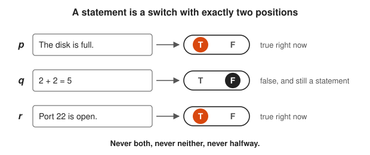

Look at the knob on each switch: it rests on exactly one side.

<!-- diagram: type=sort-bins left=statements right=non-statements caption="what counts as a statement" -->
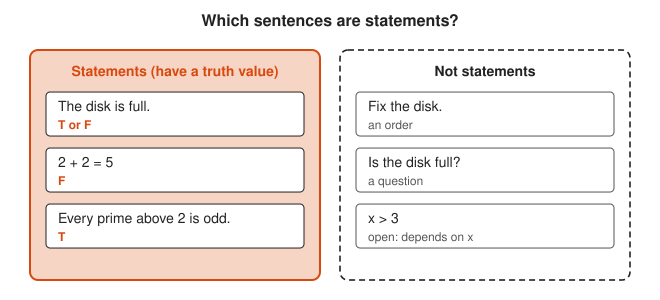

Compare the two bins: each sentence on the left has a T or an F, and none on the right does.

**In the course:** [501 Linear Algebra, Probability and Discrete Math](../../course/501/README.md)

#### 2. Connectives: AND, OR, NOT

Build bigger statements from smaller ones. $p \land q$ (AND) is true only when both are true. $p \lor q$ (OR) is true when at least one is true; logic uses this **inclusive** OR. $\lnot p$ (NOT) flips the value. These are exactly `&&`, `||` and `!` in Go.

**Key idea:** $p \land q$, $p \lor q$, $\lnot p$

<!-- diagram: type=gates set=AND,OR,NOT caption="connectives as gates with Go operators" -->
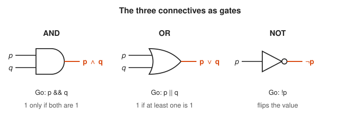

Match each gate shape to its symbol on the orange output wire and to its Go operator.

<!-- diagram: type=circuit series=p,q parallel=p,q caption="series is AND, parallel is OR" -->
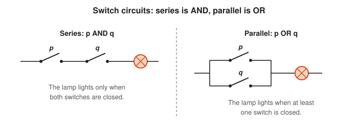

Trace a path for the current: in series it needs both switches, in parallel it needs either one.

**In the course:** [501 Linear Algebra, Probability and Discrete Math](../../course/501/README.md)

#### 3. Truth Tables

A **truth table** lists every combination of inputs and the output for each. With $n$ variables there are $2^n$ rows. A truth table is a brute-force proof: check every row, and you have checked every case. A statement true on every row is a **tautology**. One false on every row is a **contradiction**.

**Key idea:**

```txt
  p  q | p AND q | p OR q | NOT p
  T  T |    T    |   T    |   F
  T  F |    F    |   T    |   F
  F  T |    F    |   T    |   T
  F  F |    F    |   F    |   T
```

<!-- diagram: type=truth-table vars=p,q cols="p AND q,p OR q,NOT p" caption="T cells shaded" -->
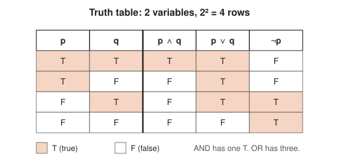

Count the shaded cells in each output column to see how strict each connective is.

<!-- diagram: type=tree vars=p,q,r branch=T,F caption="n variables give 2^n rows" -->
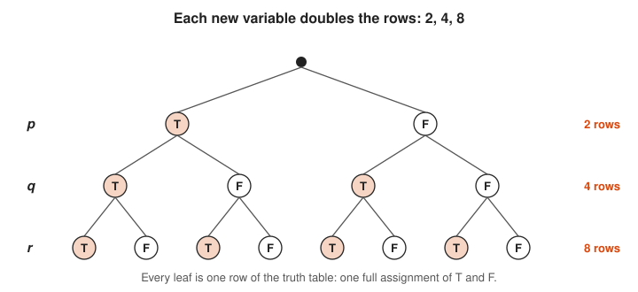

Count the circles on each level: 2, then 4, then 8.

**In the course:** [501 Linear Algebra, Probability and Discrete Math](../../course/501/README.md)

#### 4. Sets and Membership

A **set** is a collection of distinct things, called **elements**, with no order and no duplicates. Write $x \in A$ for "$x$ is in $A$." List small sets in braces, $\{1, 2, 3\}$, or describe them with a rule, $\{x \mid x \text{ is even}\}$. The **empty set** $\varnothing$ has no elements. A Go `map[string]struct{}` is a set.

**Key idea:** $\{1, 2, 2, 3\} = \{3, 2, 1\}$: order and repeats do not matter.

<!-- diagram: type=set-bag A=1,2,3 outside=5 empty=true caption="membership and the empty set" -->
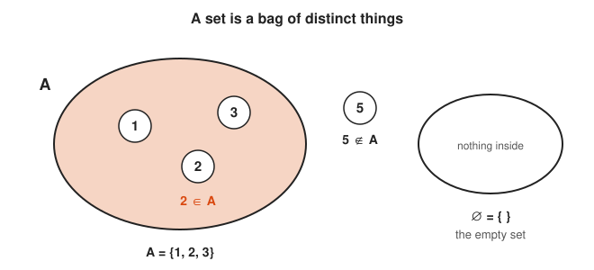

Check where each number sits: inside the bag means member, outside means not.

<!-- diagram: type=list-vs-set list=1,2,2,3 set=1,2,3 caption="order and repeats do not matter in a set" -->
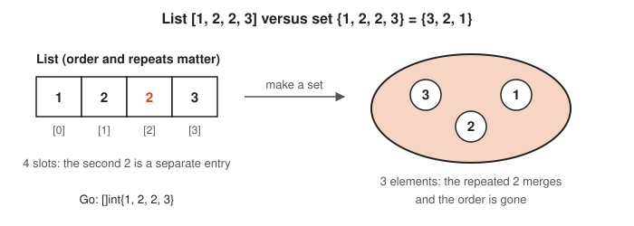

Compare the four slots on the left with the three elements in the bag on the right.

**In the course:** [501 Linear Algebra, Probability and Discrete Math](../../course/501/README.md)

#### 5. Set Operations and Venn Diagrams

**Union** $A \cup B$ holds everything in either set. **Intersection** $A \cap B$ holds what is in both. **Difference** $A \setminus B$ holds what is in $A$ but not $B$. The **complement** $A^c$ holds everything not in $A$. Each matches a connective: union is OR, intersection is AND, complement is NOT.

**Key idea:** $x \in A \cap B \iff (x \in A) \land (x \in B)$

```txt
  A = {1, 2, 3, 4}, B = {3, 4, 5}
  A ∪ B = {1, 2, 3, 4, 5}      in A or in B
  A ∩ B = {3, 4}               in A and in B
  A \ B = {1, 2}               in A, not in B
  |A ∪ B| = |A| + |B| - |A ∩ B| = 4 + 3 - 2 = 5     do not count 3, 4 twice
```

<!-- diagram: type=venn-grid ops=union,intersection,difference,complement caption="union, intersection, difference, complement" -->


Read the label under each picture as a rule, then check which regions obey it.

<!-- diagram: type=venn A=1,2,3,4 B=3,4,5 caption="elements placed in regions" -->
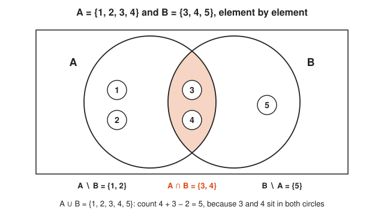

Notice that 3 and 4 sit in the overlap, which is why the count subtracts 2.

**In the course:** [501 Linear Algebra, Probability and Discrete Math](../../course/501/README.md)

### Intermediate

#### 6. Implication and the Contrapositive

$p \to q$ means "if $p$, then $q$." It is false in exactly one case: $p$ true and $q$ false. When $p$ is false, the implication is **vacuously true**: a promise about rainy days is not broken on a sunny day. The **contrapositive** $\lnot q \to \lnot p$ always has the same truth value. The **converse** $q \to p$ does not, and confusing the two is the most common reasoning bug in the world.

**Key idea:** $p \to q \equiv \lnot q \to \lnot p$, but $p \to q \not\equiv q \to p$.

```txt
  p  q | p -> q | not q -> not p | q -> p (converse)
  T  T |   T    |       T        |   T
  T  F |   F    |       F        |   T
  F  T |   T    |       T        |   F      the converse differs here
  F  F |   T    |       T        |   T
```

<!-- diagram: type=truth-grid-2x2 forms="p->q,~q->~p,q->p" caption="implication, contrapositive, converse" -->
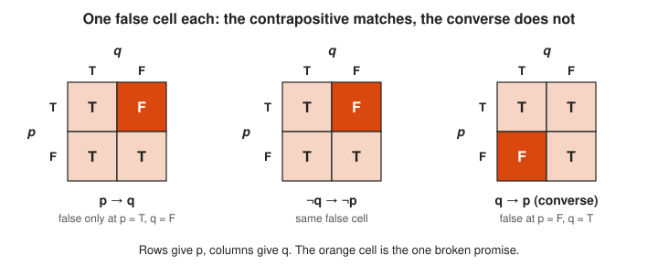

Compare where the orange cell sits in each grid: the first two match and the third moves.

<!-- diagram: type=euler inner=p outer=q caption="p implies q means p sits inside q" -->
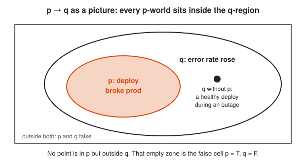

Find the dot: q can be true without p, and that does not break the rule.

"If the deploy broke prod, the error rate rose" does not mean "if the error rate rose, the deploy broke prod." Ask anyone who has rolled back a healthy deploy.

**In the course:** [501 Linear Algebra, Probability and Discrete Math](../../course/501/README.md)

#### 7. Logical Equivalence and De Morgan's Laws

Two statements are **logically equivalent** ($\equiv$) when they have the same truth table. The most useful equivalences are **De Morgan's laws**: to negate an AND, negate each part and switch to OR, and the reverse. They hold for sets too, which you can check by shading a Venn diagram.

**Key idea:** $\lnot(p \land q) \equiv \lnot p \lor \lnot q$ and $\lnot(p \lor q) \equiv \lnot p \land \lnot q$

```txt
  Rewrite: if !(healthy && ready) { restart() }
  !(healthy && ready)
  = !healthy || !ready          De Morgan: NOT over AND becomes OR of NOTs
  Restart when the pod is unhealthy OR not ready.
```

<!-- diagram: type=venn-equation laws="~(A&B)=~A|~B,~(A|B)=~A&~B" caption="De Morgan laws by shading" -->


Compare the first and last picture in each row: the shaded areas match exactly.

<!-- diagram: type=gate-equivalence left=NAND right="OR with inverted inputs" caption="De Morgan as gates" -->
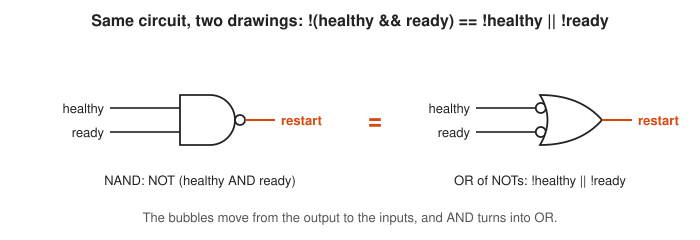

Watch the bubbles: moving them from the output to the inputs turns AND into OR.

**In the course:** [501 Linear Algebra, Probability and Discrete Math](../../course/501/README.md)

#### 8. Quantifiers

**Quantifiers** say how many things a statement covers. $\forall x$ (for all $x$) claims something about every element. $\exists x$ (there exists an $x$) claims it for at least one. To negate a quantified statement, flip the quantifier and negate the inside. Order matters: "every service has an owner" is not "some owner owns every service."

**Key idea:** $\lnot \forall x\, P(x) \equiv \exists x\, \lnot P(x)$ and $\lnot \exists x\, P(x) \equiv \forall x\, \lnot P(x)$

```txt
  Statement: every server responds within 200 ms.
  ∀s  R(s)                     R(s): s responds within 200 ms
  Negation: ¬∀s R(s)
          = ∃s ¬R(s)           flip the quantifier, negate the inside
  Some server does not respond within 200 ms.
  (Not: no server responds within 200 ms.)
```

<!-- diagram: type=dot-panels n=6 panels="forall,exists,not-forall,not-exists" caption="quantifiers and their negations" -->
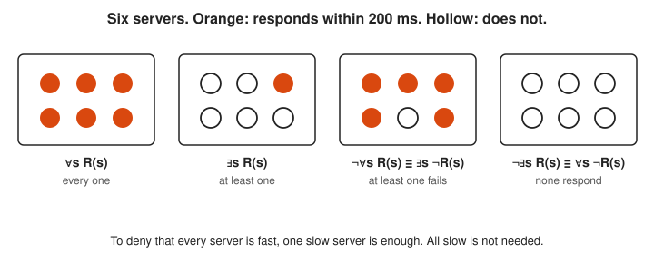

Compare the third box with the fourth: one hollow dot is enough to negate for all.

<!-- diagram: type=arrow-diagrams left="forall s exists o" right="exists o forall s" caption="order of quantifiers matters" -->
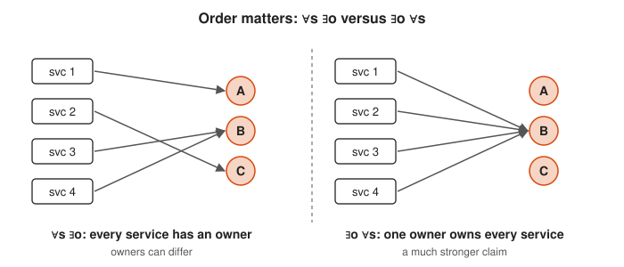

Look at where the arrows land: spread out on the left, all on one owner on the right.

**In the course:** [501 Linear Algebra, Probability and Discrete Math](../../course/501/README.md)

#### 9. Subsets and Power Sets

$A \subseteq B$ means every element of $A$ is also in $B$. Two sets are equal exactly when each is a subset of the other, which is how most set equalities get proved. The **power set** $\mathcal{P}(A)$ is the set of all subsets of $A$. Each element is either in or out of a subset, so a set with $n$ elements has $2^n$ subsets, one for each $n$-bit mask.

**Key idea:** $|\mathcal{P}(A)| = 2^{|A|}$, so $\mathcal{P}(\{a, b\}) = \{\varnothing, \{a\}, \{b\}, \{a, b\}\}$.

<!-- diagram: type=hasse set=a,b,c highlight="subsets of {a,b}" caption="power set of {a, b, c}" -->
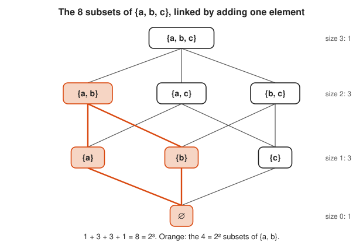

Count the boxes on each level: 1, 3, 3 and 1 add up to 8.

<!-- diagram: type=bitmask-table set=a,b caption="subsets as bitmasks" -->
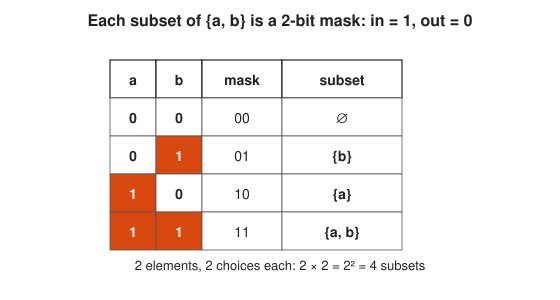

Read each row as a bitmask: a 1 under an element means it is in the subset.

**In the course:** [501 Linear Algebra, Probability and Discrete Math](../../course/501/README.md)

#### 10. Relations and Functions

A **relation** from $A$ to $B$ is any set of pairs $(a, b)$: a table with two columns. A **function** is a relation where each input appears exactly once. A function is **injective** (one-to-one) if no two inputs share an output, **surjective** (onto) if every possible output is hit, and **bijective** if both, which means it pairs the sets up perfectly. An **equivalence relation** (reflexive, symmetric, transitive) splits a set into non-overlapping groups, like hosts grouped by availability zone.

**Key idea:** a bijection $A \to B$ exists exactly when $A$ and $B$ have the same size.

<!-- diagram: type=arrow-diagrams kinds=not-function,injective,surjective,bijective caption="kinds of functions" -->


Check each diagram for two things: shared outputs and outputs that nothing hits.

<!-- diagram: type=partition groups="h1,h2,h3|h4,h5|h6,h7,h8" caption="equivalence classes" -->
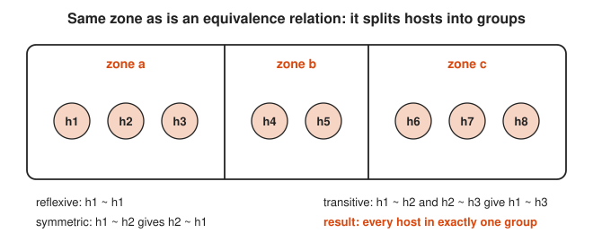

See that the walls never cut through a host: every host lands in exactly one zone.

**In the course:** [501 Linear Algebra, Probability and Discrete Math](../../course/501/README.md) and [601 Proof and Higher Math](../../course/601/README.md)

#### 11. Proof Techniques

A **proof** is a chain of statements where each one follows from earlier ones by a valid rule. Four patterns cover most proofs. **Direct:** assume $p$, derive $q$. **Contrapositive:** assume $\lnot q$, derive $\lnot p$. **Contradiction:** assume the opposite of what you want and derive nonsense. **Induction:** prove a base case and a step that pushes truth from $n$ to $n + 1$.

**Key idea:** proof by contradiction that $\sqrt{2}$ is irrational:

```txt
  Suppose √2 = a/b in lowest terms        assume the opposite
  2 = a²/b², so a² = 2b²                  square both sides
  a² is even, so a is even: a = 2k        odd squared is odd
  4k² = 2b², so b² = 2k²                  substitute
  b² is even, so b is even                same reason as for a
  a and b are both even                   contradicts lowest terms
  Therefore √2 is not a fraction.         the assumption was false
```

<!-- diagram: type=flow lanes=direct,contrapositive,contradiction,induction caption="four proof techniques" -->


Read each row left to right: the first box is what you assume and the orange box is where you land.

<!-- diagram: type=dominoes n=8 fallen=4 caption="induction as dominoes" -->
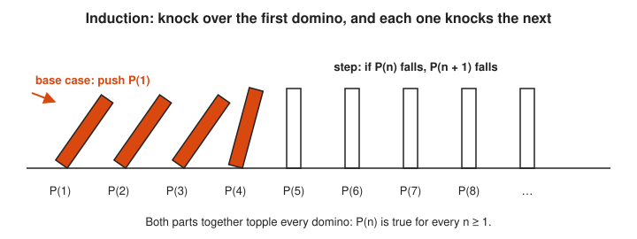

Follow the orange dominoes: the push at P(1) and the step rule are all you need.

<!-- diagram: type=flow steps=6 loop=contradiction caption="square root of 2 is irrational" -->


Follow the chain down and then the orange arrow back up to the crossed-out assumption.

**In the course:** [601 Proof and Higher Math](../../course/601/README.md)

### Advanced

#### 12. Boolean Algebra and Circuits

George Boole turned logic into algebra: true is 1, false is 0, AND is multiplication, OR is a kind of addition. In 1937, Claude Shannon showed that this algebra describes switching circuits. Every CPU is built from gates that compute AND, OR and NOT, and a NAND gate alone can build all the others.

**Key idea:** $x \cdot (y + z) = xy + xz$, and also $x + yz = (x + y)(x + z)$ (both distributive laws hold).

<!-- diagram: type=gates build=NOT,AND,OR from=NAND caption="NAND is universal" -->
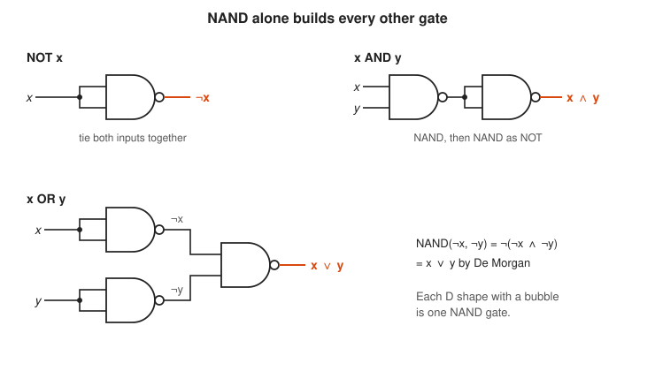

Count the NAND gates in each circuit: one for NOT, two for AND, three for OR.

<!-- diagram: type=venn3-equation laws="x(y+z)=xy+xz,x+yz=(x+y)(x+z)" caption="both distributive laws" -->
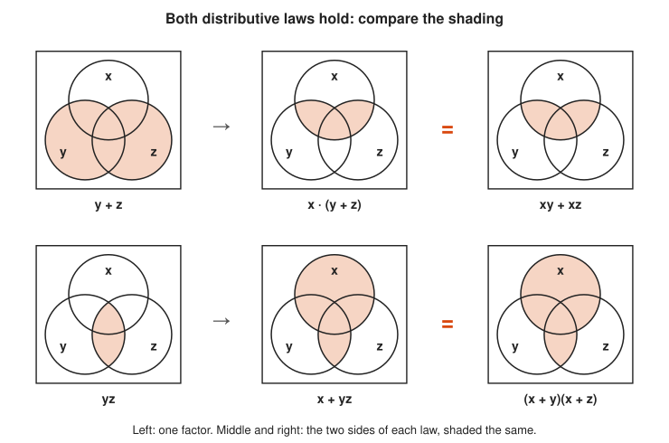

Compare the middle and right pictures in each row: the shading matches region for region.

**In the course:** [501 Linear Algebra, Probability and Discrete Math](../../course/501/README.md)

#### 13. Cardinality and Countability

Two sets have the same **cardinality** (size) when a bijection pairs them up. For infinite sets, this gives strange results. The even numbers have the same size as all whole numbers: pair $n$ with $2n$. A set is **countable** if you can list it as a first, second, third element, and so on. The integers and even the fractions are countable.

**Key idea:** the integers are countable: $0, 1, -1, 2, -2, 3, -3, \ldots$

```txt
  Hilbert's Hotel: infinitely many rooms, all full. A guest arrives.
  move guest in room n to room n + 1     every guest still has a room
  room 1 is now empty                    the new guest checks in
  Infinitely many new guests? Move n to 2n, freeing every odd room.
```

<!-- diagram: type=rooms n=9 shifts="n->n+1,n->2n" caption="Hilbert hotel" -->


Follow the arrows: nobody leaves the hotel, and the orange rooms still open up.

<!-- diagram: type=number-line range=-4..4 order=0,1,-1,2,-2,3,-3,4,-4 caption="integers are countable" -->
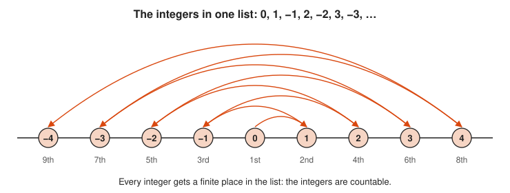

Follow the zigzag: it swings wider each time and reaches every integer.

<!-- diagram: type=pairing top=1..8 bottom=2..16 caption="n paired with 2n" -->
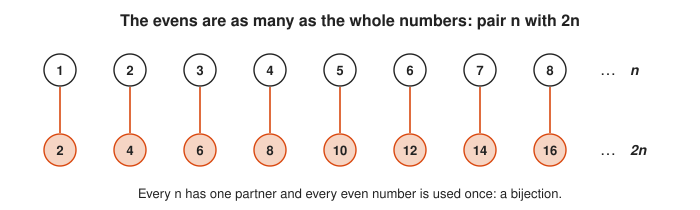

See that no line crosses or doubles up: each number has exactly one partner.

**In the course:** [601 Proof and Higher Math](../../course/601/README.md)

#### 14. Cantor's Diagonal Argument

Not every infinite set is countable. Suppose someone hands you a complete list of all infinite binary strings. Build a new string whose $n$-th bit is the opposite of the $n$-th bit of the $n$-th string. It differs from every string on the list in at least one place, so the list was not complete. The real numbers are **uncountable**: a strictly bigger infinity than the whole numbers.

**Key idea:**

```txt
  s1 = 0 1 1 0 ...
  s2 = 1 0 1 0 ...
  s3 = 0 0 1 1 ...
  s4 = 1 1 1 1 ...
  diagonal bits:  0 0 1 1
  flip each:      1 1 0 0     differs from s_n at position n, for every n
```

<!-- diagram: type=diagonal-grid rows=0110,1010,0011,1111 caption="Cantor diagonal" -->
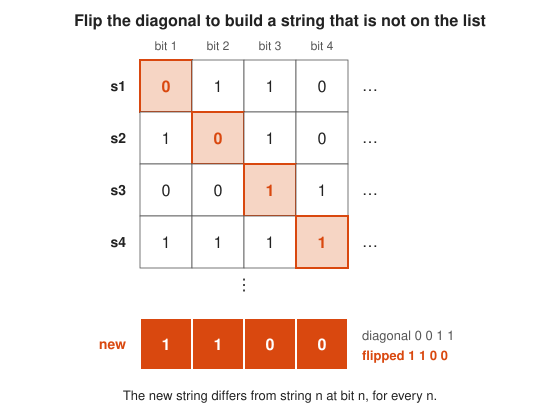

Compare the new row with each listed string at the outlined diagonal cell: they always differ there.

<!-- diagram: type=table A=1,2,3 f="1->{1,2},2->{3},3->{1,3}" D=2 caption="Cantor theorem on a small set" -->
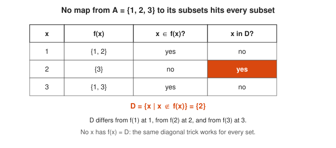

Read the last column top to bottom to build D, then check that no row has f(x) = D.

**Cantor's theorem** generalizes it: $|\mathcal{P}(A)| > |A|$ for every set, so there is no largest infinity.

**In the course:** [601 Proof and Higher Math](../../course/601/README.md)

#### 15. Russell's Paradox and the ZFC Axioms

Early set theory let any rule define a set. Russell asked about the set of all sets that do not contain themselves. If it contains itself, it does not, and if it does not, it does. The fix was a careful list of **axioms**, called **ZFC** (Zermelo-Fraenkel with Choice), that says which sets exist. Nearly all of mathematics is built on ZFC.

**Key idea:** $R = \{x \mid x \notin x\}$ gives $R \in R \iff R \notin R$, so unrestricted set building is banned.

<!-- diagram: type=loop states="R in R,R not in R" caption="Russell paradox" -->
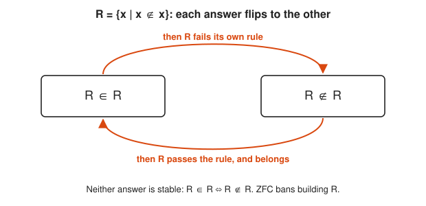

Follow the arrows around: the loop never settles on one box.

<!-- diagram: type=bins left="contain themselves" right="do not" item=R caption="R fits in neither bin" -->


Try each arrow from R: whichever bin you pick, the rule pushes R into the other one.

**In the course:** [601 Proof and Higher Math](../../course/601/README.md)

#### 16. Gödel's Incompleteness and Computability

In 1931, Kurt Gödel proved that any consistent set of axioms strong enough to do arithmetic contains true statements it cannot prove. He also proved that such a system cannot prove its own consistency. In 1936, Turing used a diagonal argument to show that no program can decide, for every program and input, whether it halts. Mathematics and computing both have hard limits, and the limits are provable.

**Key idea:** consistent + strong enough for arithmetic $\Rightarrow$ incomplete.

<!-- diagram: type=diagonal-grid rows=P1..P4 cols=P1..P4 values=H,L caption="halting problem diagonal" -->
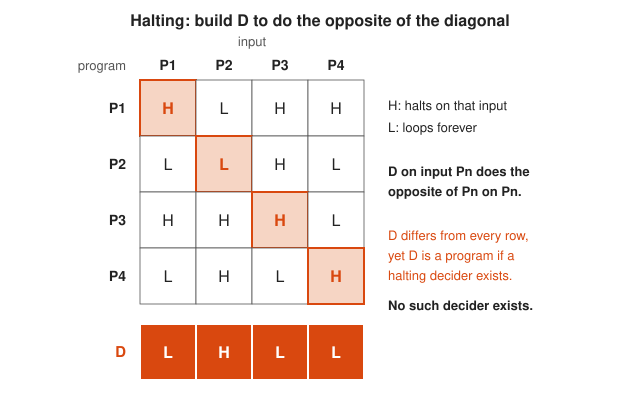

Compare row D with the shaded diagonal: D flips every entry, which means no row equals D.

<!-- diagram: type=euler outer=true inner=provable point=G caption="Godel incompleteness" -->
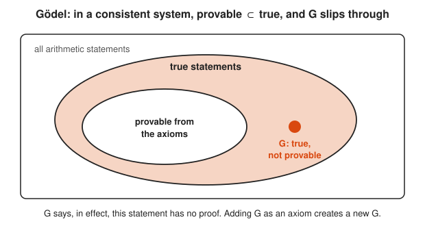

Find the orange dot: it is inside true but outside provable.

**In the course:** [601 Proof and Higher Math](../../course/601/README.md) · **Go further:** [Discrete Math track](../discrete-math/README.md) (computability)

## Big Theorems You Should Know

* **De Morgan's laws:** $\lnot(p \land q) \equiv \lnot p \lor \lnot q$ and $\lnot(p \lor q) \equiv \lnot p \land \lnot q$, and the same for sets with $\cap$, $\cup$ and complement.
* **Contrapositive equivalence:** $p \to q \equiv \lnot q \to \lnot p$.
* **Inclusion-exclusion for two sets:** $|A \cup B| = |A| + |B| - |A \cap B|$.
* **Power set size:** a set with $n$ elements has $2^n$ subsets.
* **Cantor's theorem:** $|\mathcal{P}(A)| > |A|$ for every set $A$.
* **Uncountability of the reals:** there is no list of all real numbers.
* **Schröder–Bernstein theorem:** if $A$ fits one-to-one into $B$ and $B$ fits one-to-one into $A$, then $|A| = |B|$.
* **Russell's paradox:** the set of all sets that do not contain themselves cannot exist.
* **Gödel's completeness theorem (1929):** in first-order logic, every statement true in all models has a proof.
* **Gödel's incompleteness theorems (1931):** arithmetic has true but unprovable statements, and cannot prove its own consistency.
* **Undecidability of the halting problem (Turing, 1936):** no algorithm decides whether every program halts.

## Open Problems and Fun Facts

* **The continuum hypothesis is neither true nor false (in ZFC):** Cantor asked whether some infinity sits strictly between the whole numbers and the reals. Gödel (1940) showed ZFC cannot disprove that none does. Cohen (1963) showed ZFC cannot prove it either. It is **independent**, and Cohen won a Fields Medal for the method.
* **P versus NP (open):** if a solution is fast to check, is it also fast to find? Deciding whether a Boolean formula can be made true (SAT) is the original hard problem. A proof either way earns a 1 million dollar Clay Millennium Prize.
* **The barber:** a barber shaves everyone who does not shave themselves. Who shaves the barber? That is Russell's paradox in a village.
* **Vacuous truth runs in production:** in Go, a loop over an empty slice that checks "all items are valid" returns true. So does Python's `all([])`. Mathematically, all elements of the empty set are purple.
* **Principia Mathematica:** Russell and Whitehead needed hundreds of pages of groundwork before they could prove $1 + 1 = 2$. They remarked that the proposition is occasionally useful.
* **The axiom of choice:** it lets you pick one element from each of infinitely many nonempty sets. It is harmless in most of math, yet it implies the Banach–Tarski paradox: a solid ball can be cut into five pieces and reassembled into two balls of the same size.

## Starter Problem Set

1. A rule says: "If the deploy passes tests, then it ships." In which single situation is the rule broken?
2. Negate: "Every server responds within 200 ms."
3. Let $A = \{1, 2, 3, 4\}$ and $B = \{3, 4, 5\}$. Find $A \cup B$, $A \cap B$, and $A \setminus B$.
4. How many subsets does $\{a, b, c, d\}$ have?
5. Write the contrapositive of: "If $n^2$ is even, then $n$ is even."

<details>
<summary>Answers</summary>

1. The deploy passes tests and does not ship. That is the only row where $p \to q$ is false.
2. "Some server does not respond within 200 ms." Flip $\forall$ to $\exists$ and negate the inside.
3. $A \cup B = \{1, 2, 3, 4, 5\}$, $A \cap B = \{3, 4\}$, $A \setminus B = \{1, 2\}$.
4. $2^4 = 16$.
5. "If $n$ is odd, then $n^2$ is odd." Negate both parts and swap them.

</details>

### Challenge Problems

1. Show with a truth table that $p \to q \equiv \lnot p \lor q$.
2. Negate: "For every alert, there exists an engineer who acknowledges it." Then say which statement is the scarier one.
3. Prove that $A \cap (B \cup C) = (A \cap B) \cup (A \cap C)$ by showing each side is a subset of the other.
4. Is the function $f(n) = 2n$ from the integers to the integers injective? Surjective?
5. Show that the set of all finite strings over the alphabet $\{a, b\}$ is countable.

<details>
<summary>Answers</summary>

1. Rows (T,T), (T,F), (F,T), (F,F) give $p \to q$ = T, F, T, T and $\lnot p \lor q$ = T, F, T, T. Same column, so equivalent. This is also how Go code often encodes an implication: `!p || q`.
2. "There exists an alert such that no engineer acknowledges it." In symbols, $\lnot \forall a\, \exists e\, K(e, a) \equiv \exists a\, \forall e\, \lnot K(e, a)$. The negation is the scary one.
3. If $x$ is in the left side, $x \in A$ and $x \in B$ or $x \in C$. In the first case $x \in A \cap B$, in the second $x \in A \cap C$, so $x$ is in the right side. Conversely, if $x \in A \cap B$ or $x \in A \cap C$, then $x \in A$ and $x$ is in $B$ or $C$, so $x$ is in the left side.
4. Injective, because $2m = 2n$ forces $m = n$. Not surjective, because no integer maps to 1.
5. List strings by length, and within a length in alphabetical order: $\varepsilon, a, b, aa, ab, ba, bb, aaa, \ldots$ Each length has finitely many strings ($2^k$), so every string appears at some finite position.

</details>

## Code Corner

The [code folder](code/README.md) holds one Go program, [main.go](code/main.go), that prints the implication truth table, checks De Morgan, lists a power set with bitmasks, and runs the diagonal trick.

```txt
p q | p->q | !q->!p
T T |  T   |   T
T F |  F   |   F
F T |  T   |   T
F F |  T   |   T
De Morgan holds on all 4 rows: true
power set has 8 subsets: {} {a} {b} {a,b} {c} {a,c} {b,c} {a,b,c}
diagonal-flipped string 1100 is in the list: false
```

The power set uses the bitmask picture from rung 9 directly. Bit $i$ of `mask` answers the question "is element $i$ in this subset?":

```go
for mask := 0; mask < 1<<len(elems); mask++ {
	var parts []string
	for i, e := range elems {
		if mask&(1<<i) != 0 {
			parts = append(parts, e)
		}
	}
	subsets = append(subsets, "{"+strings.Join(parts, ",")+"}")
}
```

## Go Deeper

* [Book of Proof by Richard Hammack](https://www.people.vcu.edu/~rhammack/BookOfProof/): a free, plain textbook on sets, logic and proof techniques. The best single resource for this track.
* [Math Is Fun: Sets](https://www.mathsisfun.com/sets/index.html): illustrated pages on sets, Venn diagrams and set notation.
* [MIT OpenCourseWare 6.042J Mathematics for Computer Science](https://ocw.mit.edu/courses/6-042j-mathematics-for-computer-science-fall-2010/): logic, proofs, sets and infinity, aimed at engineers.
* [Wolfram MathWorld: De Morgan's Laws](https://mathworld.wolfram.com/deMorgansLaws.html): a compact reference with the set and logic forms.
* [MacTutor: Cantor](https://mathshistory.st-andrews.ac.uk/Biographies/Cantor/): the founder of set theory and the man who measured infinity.
* [MacTutor: Boole](https://mathshistory.st-andrews.ac.uk/Biographies/Boole/): the self-taught mathematician whose algebra of logic runs every computer.

## Related Tracks and Workshops

* Alongside: [Discrete Math track](../discrete-math/README.md) and [Number Theory track](../number-theory/README.md).
* Next: [Real Analysis track](../real-analysis/README.md), [Abstract Algebra track](../abstract-algebra/README.md), [Topology track](../topology/README.md): all three are written in the language of sets and proofs.
* Applied: [Probability for On-Call Error Budgets and SLOs](../../workshops/probability-for-on-call-error-budgets-and-slos/README.md) (events are sets).
