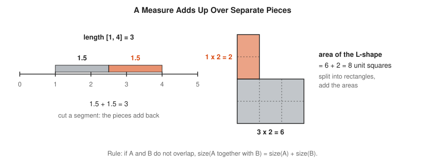
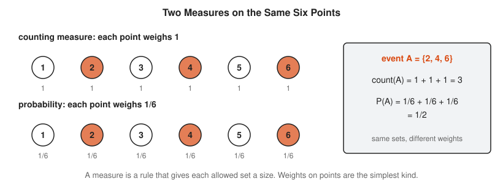
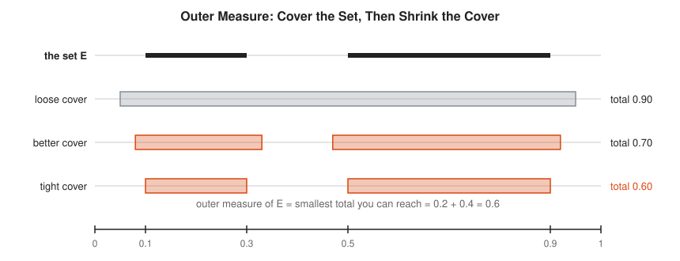
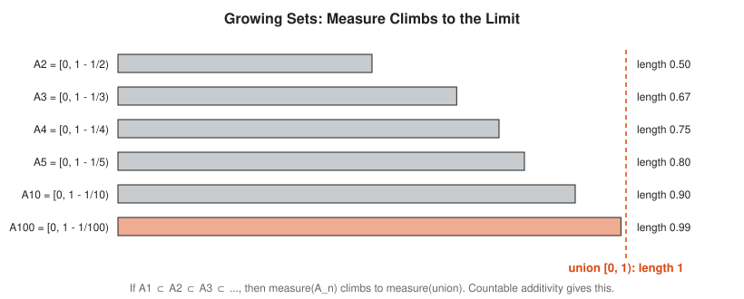
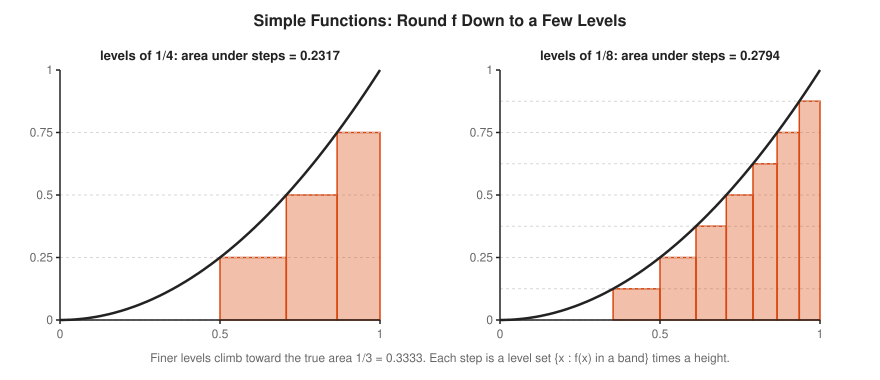
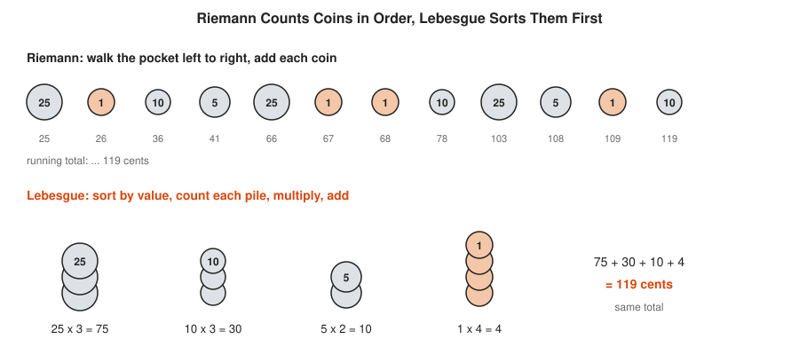

# Measure Theory Track

**Track:** Measure Theory · **Span:** beginner to advanced · **Course levels:** [401 Calculus](../../course/401/README.md) (integrals), [501 Linear Algebra, Probability and Discrete Math](../../course/501/README.md) (probability), [601 Proof and Higher Math](../../course/601/README.md) (sets and real analysis)
**Prerequisites:** length, area and the idea of an integral as area under a curve. The [Calculus Track](../calculus/README.md) covers integrals. The [Logic and Set Theory Track](../logic-and-set-theory/README.md) covers sets, unions and countable sets. The [Real Analysis Track](../real-analysis/README.md) helps for the advanced rungs but is not needed to start.
**Files:** this README, [cards.tsv](cards.tsv) for Anki, [code/main.go](code/main.go), and the diagrams in [img/](img/).

## What the Field Studies

Measure theory asks one plain question: how big is a set? For a segment, big means length. For a shape, area. For a pile of points, a count. For an event, probability. A **measure** is a rule that gives a size to sets and obeys one law: when pieces do not overlap, their sizes add.

That sounds too simple to fill a field. The trouble starts with strange sets, such as all the fractions between 0 and 1, or a dust of points left after removing middle thirds forever. Measure theory gives these sets a size that makes sense. It then builds a better integral on top, the **Lebesgue integral**, and it gives probability theory its foundation.

## Why It Matters

* **Probability:** every probability is a measure with total size 1. Kolmogorov wrote the axioms of probability in the language of this track in 1933. Your SLO math rests on them.
* **Histograms:** a Prometheus histogram sorts observations by value into buckets and counts each bucket. That is a Lebesgue sum: slice by value, measure each slice.
* **Mean latency:** the average of a latency equals the area under the curve of "fraction of requests slower than $t$". That formula, $E[X] = \int_0^\infty P(X > t)\,dt$, is a measure theory result.
* **Monte Carlo:** throwing random darts to estimate an area works because probability is area.
* **Signal processing and machine learning:** the spaces $L^1$ and $L^2$ in the [Functional Analysis Track](../functional-analysis/README.md) and the [Fourier Analysis Track](../fourier-analysis/README.md) are built from the Lebesgue integral.

## Concept Map

<!-- diagram: type=concept-map tiers=beginner,intermediate,advanced nodes=12 caption="Measure theory concepts with prerequisite arrows" -->


Read the map top to bottom. An arrow from A to B means learn A first. Start at the orange box.

## Signature Diagram

<!-- diagram: type=function-plot-pair f="0.5+0.32sin(2pi x)+0.12sin(6pi x+0.6)" slices=vertical,horizontal n=10 caption="Riemann slices vertically, Lebesgue slices horizontally" -->


This is the whole track in one picture. Riemann cuts the x-axis into strips and asks each strip how tall the function is. Lebesgue cuts the y-axis into layers and asks each layer how wide the set is where the function rises above it. The answer is the same area. The Lebesgue way only needs one tool: a way to measure the width of a set, even a messy one. Building that tool is the first half of the track.

## The Concept Ladder

### Beginner

#### 1. Length, Area and Volume

You already own three measures: length on a line, area in the plane, volume in space. Each one gives a size to a set and obeys the **additivity rule**: if two pieces do not overlap, the size of both together is the sum of the sizes. The empty set has size 0.

$$\text{size}(A \cup B) = \text{size}(A) + \text{size}(B) \quad \text{when } A \cap B = \varnothing$$

<!-- diagram: type=number-line-and-area interval=1..4 split=2.5 shape=L-shape caption="Length and area add over pieces that do not overlap" -->


Every area formula you learned in school comes from this rule: cut the shape into rectangles or triangles, then add. Measure theory keeps the rule and asks how far it stretches.

In the course: [201 Area, Perimeter and Circles](../../course/201/11-area-perimeter-and-circles/README.md). Related: [Geometry Track](../geometry/README.md).

#### 2. Counting and Weights

Size does not have to mean length. The **counting measure** gives each point weight 1, and the size of a set is how many points it holds. Give each point a weight instead, such as $1/6$ for each face of a die, and the size of a set is the sum of its weights. That is a probability.

$$\mu(A) = \sum_{x \in A} w(x)$$

<!-- diagram: type=dots count=6 weights=1,1/6 highlight=2,4,6 caption="Counting measure and probability weights on the faces of a die" -->


The Greek letter $\mu$ (mu) is the usual name for a measure. Same sets, different rule for size. Measure theory treats all these rules with one set of tools.

In the course: [501 Probability Basics](../../course/501/04-probability-basics/README.md). Related: [Probability Track](../probability/README.md).

#### 3. Sets of Size Zero

A single point has length 0. Finitely many points also have length 0. Less obvious: every fraction between 0 and 1 together still has length 0. List the fractions one after another. Cover the first with an interval of length $\varepsilon/2$, the second with $\varepsilon/4$, the third with $\varepsilon/8$, and so on. The total length is at most $\varepsilon$, and $\varepsilon$ is any small number you like.

$$\frac{\varepsilon}{2} + \frac{\varepsilon}{4} + \frac{\varepsilon}{8} + \cdots = \varepsilon$$

<!-- diagram: type=interval-cover points=0,1,1/2,1/3,2/3,1/4,3/4,1/5,2/5 widths=eps/2^k caption="Covering the rationals in 0 to 1 with intervals of shrinking length" -->


A set with measure 0 is called a **null set**. The trick works for any set you can list, which mathematicians call a **countable** set. The fractions are everywhere on the line, yet they take up no room. Mathematics is full of crowded rooms with no people in them.

In the course: [601 Sets and Cardinality](../../course/601/06-sets-and-cardinality/README.md).

#### 4. Outer Measure: Cover and Shrink

How do you measure a messy set $E$? Cover it with intervals, add up their lengths, and then make the cover as tight as possible. The smallest total you can approach is the **Lebesgue outer measure**. The word "outer" means you measure from the outside, with covers.

$$m^*(E) = \inf \Big\{ \sum_k \text{length}(I_k) : E \subseteq \bigcup_k I_k \Big\}$$

<!-- diagram: type=interval-cover set=[0.1,0.3]+[0.5,0.9] covers=loose,better,tight caption="Outer measure as the smallest total length of a cover" -->


The symbol $\inf$ (infimum) means the greatest lower bound: the smallest value you approach, even when no single cover reaches it. Outer measure works for every set. The catch comes next.

Related: [Real Analysis Track](../real-analysis/README.md) for infimum and completeness.

### Intermediate

#### 5. Not Every Set Is Measurable

Here is the surprise. No rule gives every subset of the line a length that is additive and unchanged by sliding. The classic example is the **Vitali set**. On a circle of length 1, call two points relatives when they differ by a rational turn. Pick one point from each family of relatives and call the pick $V$. Turn $V$ by every rational amount. The copies do not overlap and they fill the circle. All copies have the same length $L$, and there are countably many of them.

$$1 = L + L + L + \cdots$$

<!-- diagram: type=circle-copies copies=8 caption="Rotated copies of a Vitali set fill the circle" -->


If $L = 0$ the sum is 0. If $L > 0$ the sum is infinite. Neither equals 1. The set $V$ has no sensible length. Building $V$ needs the axiom of choice, the rule that allows you to pick one item from each of infinitely many groups. The famous Banach-Tarski paradox, which cuts a ball into five pieces and reassembles two balls, uses the same kind of unmeasurable pieces. Intuition only here: you never meet such sets in practice, and you need not.

Related: [Logic and Set Theory Track](../logic-and-set-theory/README.md) for the axiom of choice.

#### 6. Sigma-Algebras

The fix is modest: measure only the well-behaved sets. A **sigma-algebra** is a collection of sets, the **measurable sets**, with three rules. It contains the whole space $\Omega$. It contains the complement of each of its sets. It contains the union of any countable list of its sets. Intersections and differences then come for free.

$$A \in \mathcal{F} \Rightarrow A^c \in \mathcal{F}, \qquad A_1, A_2, \ldots \in \mathcal{F} \Rightarrow \bigcup_k A_k \in \mathcal{F}$$

<!-- diagram: type=panels items=complement,union,partition-3 caption="Sigma-algebra rules: complements, countable unions, and the sets a partition generates" -->


"Sigma" signals the word countable, the way the sigma in $\sum$ signals a sum. The smallest sigma-algebra that contains every interval is the **Borel sigma-algebra**. It holds every set you are likely to write down: open sets, closed sets, countable sets, the Cantor set, and far more.

In the course: [501 Sets and Functions](../../course/501/02-sets-and-functions/README.md).

#### 7. The Rules of a Measure

A **measure** $\mu$ on a sigma-algebra gives each measurable set a size from 0 to infinity, with two rules. The empty set has size 0. Sizes add over any countable list of sets that do not overlap. This is **countable additivity**, the engine of the whole field.

$$\mu(\varnothing) = 0, \qquad \mu\Big(\bigcup_k A_k\Big) = \sum_k \mu(A_k) \text{ for disjoint } A_k$$

<!-- diagram: type=nested-bars sets=[0,1-1/n) n=2,3,4,5,10,100 caption="Growing nested intervals have lengths that climb to the length of their union" -->


Useful consequences follow at once. A bigger set has a bigger measure (**monotone**). A union is at most the sum of the parts (**subadditive**). For growing sets, the measure climbs to the measure of the union (**continuity from below**). The picture shows that last one.

Related: [Probability Track](../probability/README.md), where the same rules are the axioms of probability.

#### 8. Lebesgue Measure

**Lebesgue measure** $m$ is the measure on the line that gives every interval its length and does not change when you slide a set. It extends length from intervals to every Borel set and more. In the plane it extends area, and in space it extends volume.

$$m([a, b]) = b - a, \qquad m(A + c) = m(A)$$

<!-- diagram: type=cantor levels=6 caption="Cantor set construction removing middle thirds" -->


The **Cantor set** shows how strange measure 0 gets. Remove the middle third of $[0, 1]$, then the middle third of each piece, forever. The removed lengths add to 1. What remains has measure 0. Yet what remains is uncountable: it has as many points as the whole line. Size by counting and size by length are different questions with different answers.

In the course: [601 Completeness and Sequences](../../course/601/10-completeness-and-sequences/README.md). Related: [Topology Track](../topology/README.md).

#### 9. Measurable and Simple Functions

A function $f$ is **measurable** when every set of the form $\{x : f(x) > t\}$ is measurable. In words: you measure the region where $f$ sits above any level. A **simple function** takes only finitely many values, each on a measurable set. Its integral is easy: value times measure, added up.

$$\int \Big(\sum_k c_k \mathbf{1}_{A_k}\Big)\, d\mu = \sum_k c_k\, \mu(A_k)$$

<!-- diagram: type=staircase f="x^2" levels=1/4,1/8 caption="Simple functions approximate x squared from below" -->


The symbol $\mathbf{1}_A$ is the **indicator** of $A$: it equals 1 on $A$ and 0 elsewhere. Round any non-negative measurable function down to finer and finer levels, and you get simple functions climbing up to it. The integral of $f$ is the limit of their integrals.

In the course: [401 Riemann Sums and Area](../../course/401/06-riemann-sums-and-area/README.md).

### Advanced

#### 10. Lebesgue Versus Riemann

Lebesgue himself explained the difference with coins. To count the money in your pocket, Riemann takes the coins out one by one and keeps a running total. Lebesgue first sorts the coins into piles by value, counts each pile, multiplies, and adds. Same total, different bookkeeping. Sorting by value is what makes the Lebesgue integral handle wild functions.

$$\int f\, dm = \int_0^\infty m(\{x : f(x) > t\})\, dt \qquad (f \ge 0)$$

<!-- diagram: type=coins pocket=25,1,10,5,25,1,1,10,25,5,1,10 caption="Counting coins one by one versus sorting them into piles by value" -->


<!-- diagram: type=function-plot f=dirichlet x=0..1 caption="The Dirichlet function: 1 on rationals and 0 on irrationals" -->


The **Dirichlet function** is 1 on rationals and 0 on irrationals. Every Riemann strip contains both kinds of points. The strip heights never settle, and the Riemann integral does not exist. Lebesgue sorts by value: the value 1 sits on a set of measure 0, the value 0 sits on a set of measure 1, and the integral is $1 \cdot 0 + 0 \cdot 1 = 0$. Every function Riemann integrates, Lebesgue integrates too, with the same answer.

In the course: [401 The Fundamental Theorem](../../course/401/07-fundamental-theorem/README.md). Related: [Calculus Track](../calculus/README.md).

#### 11. Convergence Theorems

When does the limit of integrals equal the integral of the limit? Not always. The bump $f_n$ of height $n$ on $(0, 1/n)$ has area 1 for every $n$, yet at each point it eventually drops to 0. The mass escapes up a thin spike. Three theorems say when the swap is safe.

$$\lim_{n \to \infty} \int f_n\, d\mu = \int \lim_{n \to \infty} f_n\, d\mu \quad \text{when } 0 \le f_1 \le f_2 \le \cdots \text{ or } |f_n| \le g, \ \int g < \infty$$

<!-- diagram: type=rectangles heights=1,2,4,8 widths=1,1/2,1/4,1/8 caption="Tall thin bumps with area 1 that converge to zero pointwise" -->


* **Monotone convergence:** if non-negative functions grow upward to $f$, their integrals grow to the integral of $f$.
* **Dominated convergence:** if every $|f_n|$ sits under one function $g$ with finite integral, the swap is safe.
* **Fatou's lemma:** for non-negative functions, mass can vanish in the limit but never appear: $\int \liminf f_n \le \liminf \int f_n$.

The escaping bump breaks dominated convergence because any $g$ above every bump has infinite area. These theorems are the reason analysts prefer Lebesgue: limits behave.

Related: [Real Analysis Track](../real-analysis/README.md) for uniform convergence, the older and stricter tool.

#### 12. Probability as Measure

A **probability space** is a measure space with total size 1: a sample space $\Omega$, a sigma-algebra $\mathcal{F}$ of events, and a measure $P$ with $P(\Omega) = 1$. A **random variable** is a measurable function on $\Omega$. Its expected value is its integral.

$$P(\Omega) = 1, \qquad E[X] = \int_\Omega X\, dP$$

<!-- diagram: type=unit-square event="x+y<1" darts=160 caption="Probability as area in the unit square" -->


This one frame covers coin tosses, dice, continuous latencies and mixtures of both. It also answers an old puzzle: a dart lands somewhere, yet the chance of hitting any one exact point is 0. A point has measure 0. Probability 0 does not mean impossible. It means the set is too thin to have size.

In the course: [501 Random Variables, Expectation and Variance](../../course/501/06-random-variables-expectation-variance/README.md). Related: [Probability Track](../probability/README.md), [Statistics Track](../statistics/README.md).

## Worked Examples

### Example 1: The Rationals Have Length 0

Show that the fractions in $[0, 1]$ have total length less than 0.01.

```txt
  list the fractions: r1 = 0, r2 = 1, r3 = 1/2, r4 = 1/3, ...    countable: one long list
  cover rk with an interval of length 0.01 / 2^k                 eps = 0.01
  total <= 0.01/2 + 0.01/4 + 0.01/8 + ...                        add all covers
        = 0.01 x (1/2 + 1/4 + 1/8 + ...)                         factor out eps
        = 0.01 x 1 = 0.01                                        geometric series sums to 1
  the same works for eps = 0.001, 0.0001, ...                    any eps > 0
  so m(rationals in [0,1]) = 0                                   only 0 is below every eps
```

### Example 2: The Cantor Set Has Length 0

```txt
  step 1 removes 1 piece of length 1/3                  middle third of [0,1]
  step 2 removes 2 pieces of length 1/9 = 2/9           middle of each piece
  step 3 removes 4 pieces of length 1/27 = 4/27         pieces double, length thirds
  total removed = 1/3 + 2/9 + 4/27 + ...                add all steps
                = (1/3) x (1 + 2/3 + 4/9 + ...)         factor out 1/3
                = (1/3) x 1 / (1 - 2/3)                 geometric series, ratio 2/3
                = (1/3) x 3 = 1                         simplify
  length left = 1 - 1 = 0                               complement in [0,1]
```

### Example 3: Integrate x² by Horizontal Layers

Compute $\int_0^1 x^2\,dx$ the Lebesgue way, by layers.

```txt
  layer at height t, for 0 <= t <= 1                    slice the y-axis
  set where x^2 > t is (sqrt t, 1]                      solve x^2 > t on [0,1]
  width of that set = 1 - sqrt t                        Lebesgue measure of an interval
  integral = int_0^1 (1 - sqrt t) dt                    add widths over all layers
           = [t - (2/3) t^(3/2)]_0^1                    antiderivative
           = 1 - 2/3 = 1/3                              evaluate
  Riemann by vertical strips: [x^3/3]_0^1 = 1/3         same answer
```

### Example 4: Mean Latency as an Area

Latency $X$ is uniform between 0 and 1 second. Find $E[X]$ with the layer formula.

```txt
  P(X > t) = 1 - t  for 0 <= t <= 1                     fraction of requests slower than t
  E[X] = int_0^1 P(X > t) dt                            layer formula for X >= 0
       = int_0^1 (1 - t) dt                             substitute
       = [t - t^2/2]_0^1 = 1/2 second                   evaluate
  check: average of uniform [0,1] is the midpoint 1/2   agrees
```

The same formula works on real latency data: the mean is the area under the "fraction slower than $t$" curve. A long tail adds area, which is why one slow dependency moves the mean more than the median.

## Big Theorems to Know

* **Countable Additivity:** the defining rule of a measure. Disjoint countable unions add.
* **Carathéodory Extension Theorem:** a size rule that is countably additive on simple building blocks, such as intervals, extends to a full measure on a sigma-algebra.
* **Uniqueness of Lebesgue Measure:** it is the only measure on the Borel sets that gives intervals their length. Sliding-invariance comes with it.
* **Vitali Theorem:** with the axiom of choice, some subsets of the line are not Lebesgue measurable.
* **Lebesgue Criterion:** a bounded function on $[a, b]$ is Riemann integrable exactly when its points of discontinuity form a set of measure 0.
* **Monotone Convergence Theorem:** integrals of non-negative functions growing upward converge to the integral of the limit.
* **Dominated Convergence Theorem:** a single integrable bound makes limits and integrals swap.
* **Fatou's Lemma:** $\int \liminf f_n \le \liminf \int f_n$ for non-negative $f_n$.
* **Fubini-Tonelli Theorem:** a double integral equals either iterated integral under mild conditions. Area by rows equals area by columns.
* **Radon-Nikodym Theorem:** when one measure gives size 0 wherever another does, the first has a density with respect to the second. Probability density functions come from here.

## Open Problems and Fun Facts

* **Coins:** Lebesgue really did explain his integral with the coin-sorting picture, in a talk on the development of the integral.
* **One thesis:** Henri Lebesgue introduced his measure and integral in his 1902 doctoral thesis. Analysis has used them ever since.
* **Banach-Tarski (1924):** a solid ball splits into five pieces that reassemble, by sliding and turning only, into two balls of the same size. The pieces are unmeasurable, which is why volume is not conserved.
* **Kolmogorov (1933):** his short book on the foundations of probability made probability a branch of measure theory.
* **Solovay (1970):** if you drop the full axiom of choice, a consistent version of set theory exists where every subset of the line is measurable, assuming a certain large set exists.
* **Open problem:** the Kakeya conjecture asks how small a set can be that holds a unit needle pointing in every direction. In 2025 Hong Wang and Joshua Zahl announced a proof in three dimensions. Higher dimensions remain open.
* **Open problem:** Lebesgue's universal covering problem asks for the smallest area of a convex shape that covers every shape of diameter 1. The exact answer is still unknown after more than a century.

## Starter Problems

1. Find the length of $[2, 5] \cup [7, 8]$.
2. Find the Lebesgue measure of the set $\{1, 1/2, 1/3, 1/4, \ldots\}$.
3. On the set $\{1, 2, \ldots, 10\}$, find the counting measure and the probability (each point weighs $1/10$) of the even numbers.
4. What total length of the Cantor construction remains after 4 steps?
5. A simple function equals 3 on $[0, 2]$, equals 5 on $(2, 2.5]$ and is 0 elsewhere. Find its Lebesgue integral.
6. A dart lands uniformly in the unit square. Find $P(x < 0.3)$ and $P(x = y)$.
7. The block $f_n$ equals 1 on $[n, n + 1]$ and 0 elsewhere on the real line. Each integral is 1 and the pointwise limit is 0. Why does dominated convergence not apply?

<details>
<summary>Answers</summary>

1. 4. The pieces do not overlap: $3 + 1 = 4$.
2. 0. The set is countable, and every countable set has measure 0.
3. Counting measure 5. Probability $5 \times 1/10 = 1/2$.
4. $(2/3)^4 = 16/81 \approx 0.198$.
5. $3 \times 2 + 5 \times 0.5 = 8.5$. Value times measure, added.
6. $P(x < 0.3) = 0.3$, the area of a strip 0.3 wide and 1 tall. $P(x = y) = 0$, because a line segment has area 0.
7. Any $g$ with $g \ge f_n$ for all $n$ must be at least 1 on all of $[1, \infty)$, which has infinite area. No integrable bound exists. The mass slides off to infinity instead of up a spike.

</details>

## Code Corner

[code/main.go](code/main.go) sorts coins, compares vertical and horizontal slicing for $\int_0^1 x^2\,dx$, climbs simple functions up to the integral, covers the rationals, builds the Cantor set, shows the escaping bump next to a dominated sequence, and estimates probabilities by throwing darts. Run it with `go run main.go` inside `code/`.

```txt
== Coin sorting ==
Riemann (one coin at a time): total 119 cents
Lebesgue (sort by value):    25x3 + 10x3 + 5x2 + 1x4 = 119 cents

== Integral of x^2 on [0,1], exact 1/3 = 0.333333 ==
n =    4  vertical strips 0.328125  horizontal layers 0.327023
n =   10  vertical strips 0.332500  horizontal layers 0.331616
n =  100  vertical strips 0.333325  horizontal layers 0.333275
n = 1000  vertical strips 0.333333  horizontal layers 0.333331

== Simple functions climb to the integral (monotone convergence) ==
levels 1/2     integral 0.146447
levels 1/4     integral 0.231717
levels 1/8     integral 0.279370
levels 1/16    integral 0.305169
levels 1/64    integral 0.325917
levels 1/256   integral 0.331430
levels 1/4096  integral 0.333212

== Covering the rationals in [0,1] ==
rationals with denominator <= 20: 129
interval k has length eps/2^k, eps = 0.01
total length of all 129 intervals: 0.010000, never more than eps

== Cantor set ==
step  0:        1 pieces, length left 1.000000, removed 0.000000
step  1:        2 pieces, length left 0.666667, removed 0.333333
step  2:        4 pieces, length left 0.444444, removed 0.555556
step  3:        8 pieces, length left 0.296296, removed 0.703704
step  5:       32 pieces, length left 0.131687, removed 0.868313
step 10:     1024 pieces, length left 0.017342, removed 0.982658
step 20:  1048576 pieces, length left 0.000301, removed 0.999699

== Escaping bump f_n = n on (0, 1/n) ==
n =   1  integral 1.0  f_n(0.3) = 1
n =   2  integral 1.0  f_n(0.3) = 2
n =   3  integral 1.0  f_n(0.3) = 3
n =   4  integral 1.0  f_n(0.3) = 0
n =  10  integral 1.0  f_n(0.3) = 0
n = 100  integral 1.0  f_n(0.3) = 0
limit function is 0 everywhere, integral 0, yet every integral is 1

== Dominated convergence: x^n on [0,1] ==
n =   1  integral 0.500000  exact 1/(n+1) = 0.500000
n =   2  integral 0.333333  exact 1/(n+1) = 0.333333
n =   5  integral 0.166667  exact 1/(n+1) = 0.166667
n =  10  integral 0.090909  exact 1/(n+1) = 0.090909
n = 100  integral 0.009901  exact 1/(n+1) = 0.009901

== Probability as area (100000 darts in the unit square) ==
P(x + y < 1)      ~ 0.4982   exact area 0.5
P(x^2 + y^2 < 1)  ~ 0.7841   exact area pi/4 = 0.7854
P(x = 0.5 exactly) ~ 0 hits in 100000 darts: a point has measure 0
```

Two lines carry the main lessons. The total cover length stays at 0.01 no matter how many rationals you add: countable sets are thin. The escaping bump keeps area 1 while the function dies at every point, and $x^n$, held under the constant 1, allows the integrals to follow the limit down to 0.

## Flashcards

[cards.tsv](cards.tsv) holds the key definitions and theorems for Anki import.

## Resources

* [MacTutor: Henri Lebesgue](https://mathshistory.st-andrews.ac.uk/Biographies/Lebesgue/): the life of the founder of the field.
* [Sheldon Axler: Measure, Integration and Real Analysis](https://measure.axler.net/): a free modern textbook that starts gently and explains its motives.
* [Terence Tao: An Introduction to Measure Theory](https://terrytao.files.wordpress.com/2012/12/gsm-126-tao5-measure-book.pdf): a free textbook that builds Lebesgue measure step by step from boxes.
* [Wolfram MathWorld: Lebesgue Measure](https://mathworld.wolfram.com/LebesgueMeasure.html) and [Lebesgue Integral](https://mathworld.wolfram.com/LebesgueIntegral.html): short formal definitions with links.
* [MIT OCW 18.125 Measure and Integration](https://ocw.mit.edu/courses/18-125-measure-and-integration-fall-2003/): graduate lecture material for the advanced rungs.

## Where to Go Next

* [Functional Analysis Track](../functional-analysis/README.md) for the spaces $L^1$ and $L^2$ built on the Lebesgue integral.
* [Fourier Analysis Track](../fourier-analysis/README.md) for the place where Lebesgue integration first proved its worth.
* [Probability Track](../probability/README.md) for the probability side of this track in practice.
* [Real Analysis Track](../real-analysis/README.md) for the limits and completeness arguments underneath every rung.
