# Number Theory

**Track:** Number Theory · **Span:** divisibility to RSA and the Riemann hypothesis · **Main course levels:** [101 Foundations](../../course/101/README.md), [601 Proof and Higher Math](../../course/601/README.md)

## What This Field Studies

Number theory studies the whole numbers: 1, 2, 3, and so on. It asks plain questions. Which numbers divide which? Which numbers cannot be split at all? What is left over after a division? Those questions are easy to ask and sometimes impossible to answer. Gauss called number theory the queen of mathematics. For two thousand years it was also the most useless branch, which is how mathematicians liked it.

Then computers arrived. Today number theory guards every TLS handshake, every SSH key, and every signed package you install.

## Why It Matters

You use number theory every day without seeing it:

* **Hashing:** `hash(key) mod N` picks a bucket, a shard or a partition. That is modular arithmetic.
* **Cryptography:** RSA, Diffie-Hellman and elliptic-curve keys are built from primes, modular powers and modular inverses.
* **Checksums:** ISBN, credit-card Luhn digits and CRC codes catch typos with remainders.
* **Scheduling:** two cron jobs every 6 and every 10 minutes collide every $\text{lcm}(6, 10) = 30$ minutes.
* **Random numbers:** linear congruential generators are one line of modular arithmetic.

## Concept Map

<!-- diagram: type=concept-map bands=beginner,intermediate,advanced nodes=divisibility,primes,factorization,gcd-lcm,euclid,modular,bezout,fermat,crt,pnt,totient,reciprocity,zeta,rsa caption="Number theory concepts with prerequisite arrows" -->
![Concept map of number theory in three bands. Beginner: divisibility leads to primes, GCD and LCM, and modular arithmetic. Primes lead to prime factorization, which leads to GCD and LCM. Intermediate: GCD leads to the Euclidean algorithm, which leads to Bezout and Diophantine equations. Modular arithmetic and primes lead to Fermat's little theorem. Modular arithmetic and Bezout lead to the Chinese remainder theorem. Advanced: primes lead to the prime number theorem, which leads to the Riemann zeta function. Fermat leads to Euler's totient, which leads to RSA cryptography. Modular arithmetic leads to quadratic reciprocity. Modular arithmetic and RSA are highlighted as milestones.](img/concept-map.svg)

An arrow from A to B means learn A before B. The milestones are modular arithmetic (the clock that runs most of the field) and RSA (where three centuries of pure math became the lock on the internet).

## Signature Diagram

<!-- diagram: type=sieve n=100 cols=10 highlight=primes caption="Sieve of Eratosthenes on 1 to 100: the 25 primes are highlighted" -->


The **Sieve of Eratosthenes** is about 2,200 years old and still a fast way to list small primes. Write the numbers 2 to 100. Circle 2 and cross out every multiple of 2. Circle the next number left standing, 3, and cross out its multiples. Repeat. Whatever survives is prime. You only need to sieve with primes up to $\sqrt{100} = 10$, because any composite number up to 100 has a factor no bigger than 10.

Look at the columns. Except for 2 and 5, every prime sits in the columns ending in 1, 3, 7 or 9. That is the first hint that primes have patterns, and the first hint that the patterns are not simple.

## The Concept Ladder

### Beginner

#### 1. Divisibility

$a$ **divides** $b$, written $a \mid b$, when $b = a \cdot k$ for some whole number $k$. So $3 \mid 12$ but $5 \nmid 12$. Quick divisibility tests come from place value: a number is divisible by 3 when its digit sum is, and by 4 when its last two digits are.

**Key idea:** if $d \mid a$ and $d \mid b$, then $d \mid (a + b)$ and $d \mid (a - b)$.

```txt
  Is 7,416 divisible by 3, 4 and 9?
  digit sum: 7 + 4 + 1 + 6 = 18     18 is divisible by 3 and by 9
  last two digits: 16                16 is divisible by 4
  7,416 = 3 x 2,472 = 4 x 1,854 = 9 x 824    check by multiplying
```

<!-- diagram: type=number-line range=0..15 jumps=3,5 target=12 caption="3 divides 12, 5 does not" -->
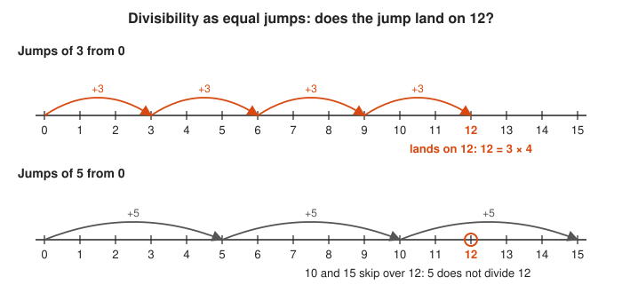

Follow the arcs: jumps of 3 hit 12 exactly, and jumps of 5 step over it.

<!-- diagram: type=block-bars d=3 a=12 b=9 caption="d divides a + b and a - b" -->
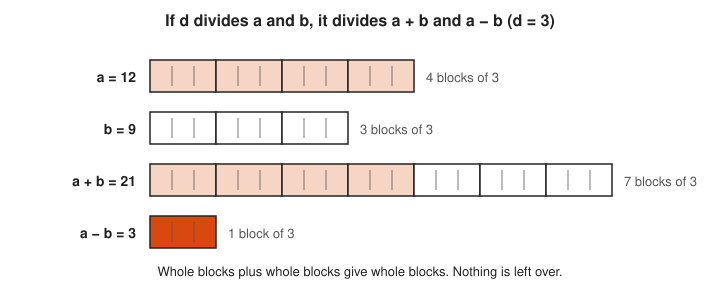

Count the blocks in each bar: every bar is a whole number of blocks of 3.

**In the course:** [101 Foundations](../../course/101/README.md)

#### 2. Primes

A **prime** is a whole number greater than 1 with exactly two divisors: 1 and itself. A number above 1 that is not prime is **composite**. The number 1 is neither, by agreement, so that factorizations stay unique. Primes are the atoms of multiplication.

**Key idea:** the primes below 30 are 2, 3, 5, 7, 11, 13, 17, 19, 23, 29. Only one of them is even.

<!-- diagram: type=number-grid range=1..30 cols=15 highlight=2,3,5,7,11,13,17,19,23,29 caption="the primes below 30" -->
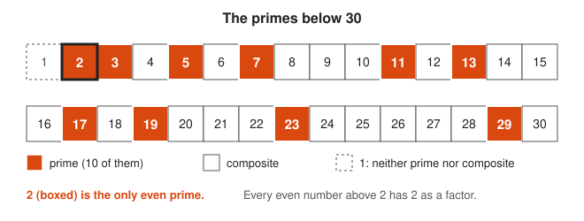

Scan the orange cells: after 2, every prime is odd.

<!-- diagram: type=dot-arrays n=12,7 shapes=1x12,2x6,3x4,1x7 caption="composites make rectangles" -->
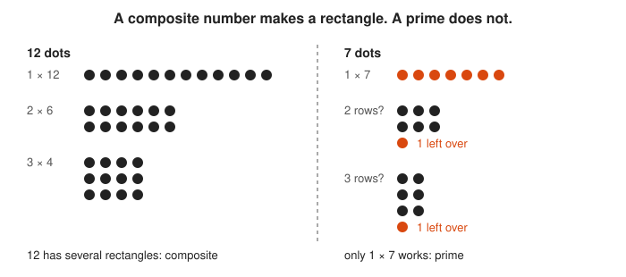

Try to make each number into a rectangle: 12 has three shapes and 7 has only the single line.

**In the course:** [101 Foundations](../../course/101/README.md)

#### 3. Prime Factorization

Every whole number above 1 breaks into primes in exactly one way, up to order. This is the **fundamental theorem of arithmetic**. Find the factorization with a factor tree: split off any factor, then keep splitting until every leaf is prime.

**Key idea:** $360 = 2^3 \cdot 3^2 \cdot 5$

```txt
  360
  = 2 x 180          360 is even
  = 2 x 2 x 90       180 is even
  = 2 x 2 x 2 x 45   90 is even
  = 2^3 x 3 x 15     45 = 3 x 15
  = 2^3 x 3^2 x 5    15 = 3 x 5, all factors prime
```

<!-- diagram: type=factor-tree n=360 splits=2,2,2,3,3 caption="360 = 2^3 x 3^2 x 5" -->
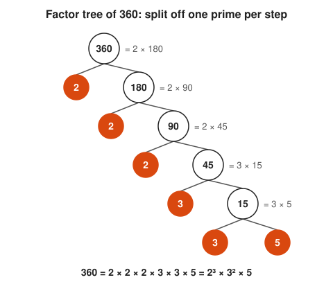

Read the orange leaves from top to bottom to get 2, 2, 2, 3, 3, 5.

<!-- diagram: type=factor-tree n=360 splits=36x10,6x6,2x3,2x5 caption="same primes from a different first split" -->
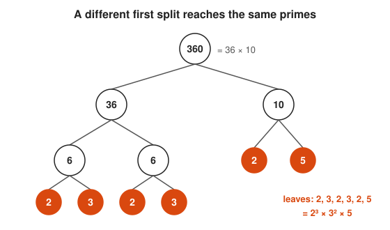

Compare the leaves with the first tree: the split order changes, and the primes do not.

**In the course:** [101 Foundations](../../course/101/README.md) and [601 Proof and Higher Math](../../course/601/README.md)

#### 4. GCD and LCM

The **greatest common divisor** $\gcd(a, b)$ is the largest number dividing both. The **least common multiple** $\text{lcm}(a, b)$ is the smallest number both divide. From factorizations, the gcd takes the smaller power of each prime and the lcm takes the larger. Two jobs that run every 6 and every 10 minutes meet every 30.

**Key idea:** $\gcd(a, b) \cdot \text{lcm}(a, b) = a \cdot b$. Example: $\gcd(6, 10) = 2$, $\text{lcm}(6, 10) = 30$, and $2 \cdot 30 = 60 = 6 \cdot 10$.

<!-- diagram: type=venn left="6=2x3" right="10=2x5" overlap=2 caption="gcd is the overlap, lcm is the union" -->
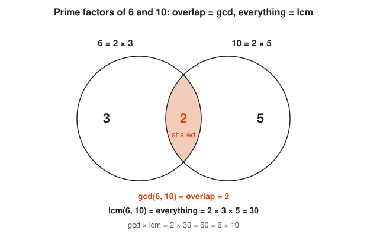

Look at the shaded overlap for the gcd, and multiply every prime in the picture for the lcm.

<!-- diagram: type=timeline range=0..60 periods=6,10 meet=0,30,60 caption="two jobs meet every lcm minutes" -->
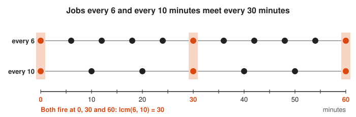

Find the shaded columns where both rows have a dot: they are 30 minutes apart.

**In the course:** [101 Foundations](../../course/101/README.md)

### Intermediate

#### 5. The Euclidean Algorithm

Factoring big numbers is slow, but finding a gcd is fast. Euclid noticed that $\gcd(a, b) = \gcd(b, a \bmod b)$, because anything dividing $a$ and $b$ also divides the remainder. Repeat until the remainder is 0. The last nonzero remainder is the gcd. It runs in a number of steps proportional to the number of digits, which is why it still runs inside every crypto library.

**Key idea:** $\gcd(a, b) = \gcd(b, a \bmod b)$ and $\gcd(a, 0) = a$.

```txt
  gcd(240, 46)
  240 = 5 x 46 + 10      remainder 10
   46 = 4 x 10 + 6       remainder 6
   10 = 1 x 6  + 4       remainder 4
    6 = 1 x 4  + 2       remainder 2
    4 = 2 x 2  + 0       remainder 0, stop
  gcd(240, 46) = 2       last nonzero remainder
```

<!-- diagram: type=square-tiling w=240 h=46 caption="Euclid fills a rectangle with the largest squares" -->
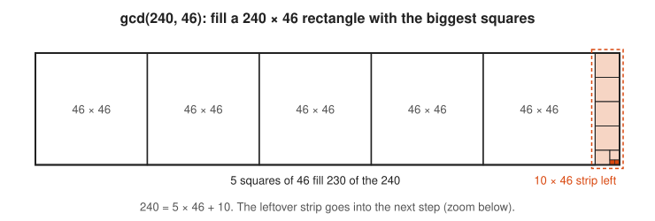

Notice that the leftover strip is exactly the remainder 10, and the next step works on it.

<!-- diagram: type=square-tiling w=46 h=10 caption="the remainder strip tiled by 10, 6, 4 and 2 squares" -->
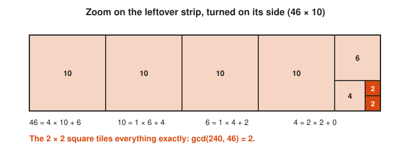

Watch the squares shrink from 10 to 6 to 4 to 2: the smallest square that tiles the rest is the gcd.

<!-- diagram: type=flow steps="gcd(240,46)->gcd(46,10)->gcd(10,6)->gcd(6,4)->gcd(4,2)->gcd(2,0)" caption="each step keeps the gcd" -->
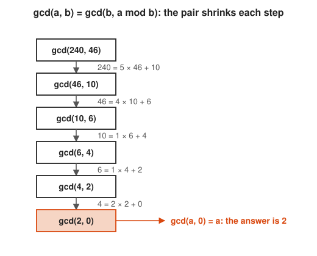

Read down the boxes: each pair is the old second number and the remainder.

**In the course:** [601 Proof and Higher Math](../../course/601/README.md)

#### 6. Modular Arithmetic

**Modular arithmetic** is clock arithmetic. Write $a \equiv b \pmod{n}$ (read: $a$ is **congruent** to $b$ mod $n$) when $a$ and $b$ leave the same remainder after division by $n$. Nine hours after 8 o'clock is 5 o'clock because $8 + 9 = 17 \equiv 5 \pmod{12}$. You can add, subtract and multiply first and reduce later, or reduce first and save work. Division is the one operation that needs care.

**Key idea:** if $a \equiv b$ and $c \equiv d \pmod n$, then $a + c \equiv b + d$ and $ac \equiv bd \pmod n$.

```txt
  Last digit of 7^4:
  7^2 = 49 ≡ 9 (mod 10)       keep only the last digit
  7^4 = (7^2)^2 ≡ 9^2 = 81    square the reduced value
      ≡ 1 (mod 10)            last digit is 1 (7^4 = 2,401)
```

<!-- diagram: type=clock n=12 start=8 add=9 result=5 caption="8 + 9 = 17 = 5 mod 12" -->
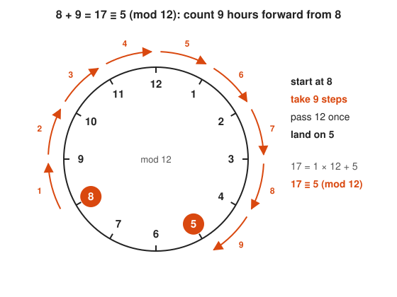

Count the nine numbered steps around the outside of the clock from 8 to 5.

<!-- diagram: type=clock n=10 cycle=7,9,3,1 caption="last digits of powers of 7" -->
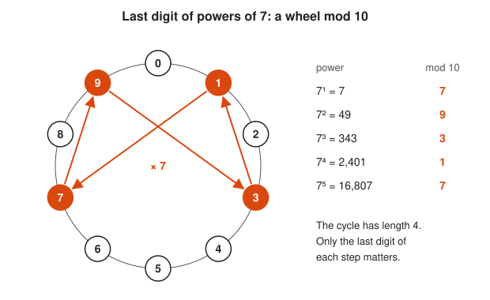

Follow the orange loop: every fourth power of 7 ends in 1.

<!-- diagram: type=commuting-square a=17 b=23 n=10 caption="multiply then reduce equals reduce then multiply" -->
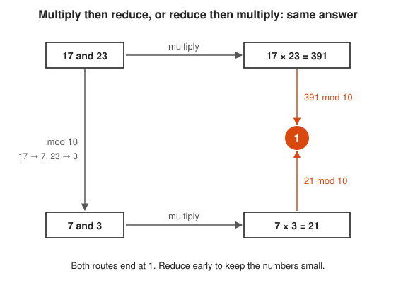

Trace both routes to the orange 1 in the middle of the right side.

**In the course:** [501 Linear Algebra, Probability and Discrete Math](../../course/501/README.md) and [601 Proof and Higher Math](../../course/601/README.md)

#### 7. Bezout and Linear Diophantine Equations

A **Diophantine equation** asks for whole-number solutions only. **Bezout's identity** says that $\gcd(a, b)$ is always a combination $ax + by$ with integers $x, y$. Run Euclid backward (the **extended Euclidean algorithm**) to find $x$ and $y$. As a bonus, $ax + by = c$ has integer solutions exactly when $\gcd(a, b) \mid c$, which settles every puzzle of the form "can you measure 4 liters with a 9-liter and a 6-liter jug?" (No: $\gcd(9, 6) = 3$ does not divide 4.)

**Key idea:** $240 \cdot (-9) + 46 \cdot 47 = 2 = \gcd(240, 46)$

<!-- diagram: type=number-line range=0..19 marks=0,3,6,9,12,15,18 cross=4 caption="9x + 6y hits only multiples of 3" -->
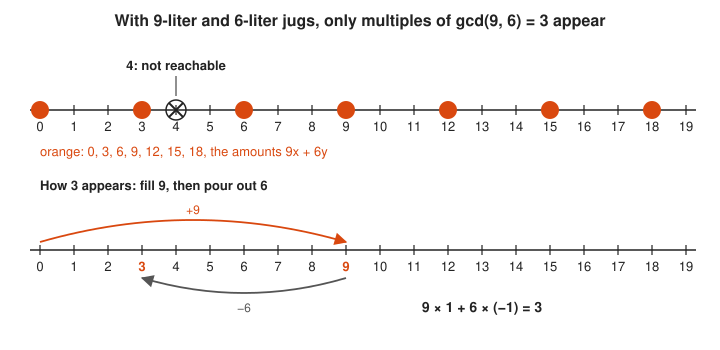

Notice that the orange dots sit exactly 3 apart, and 4 falls between them.

<!-- diagram: type=table rows=240,46,10,6,4,2 caption="extended Euclid back-substitution" -->
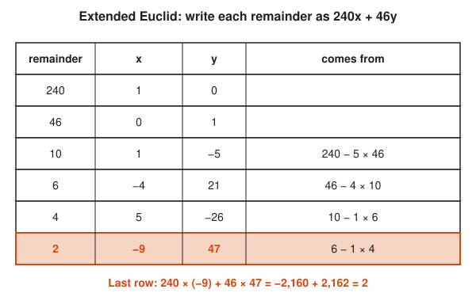

Read each row as remainder = 240x + 46y and check the highlighted last row.

**In the course:** [601 Proof and Higher Math](../../course/601/README.md)

#### 8. Modular Inverses

Division mod $n$ means multiplying by an **inverse**: a number $a^{-1}$ with $a \cdot a^{-1} \equiv 1 \pmod n$. The inverse exists exactly when $\gcd(a, n) = 1$, and Bezout hands it to you: if $ax + ny = 1$, then $x$ is the inverse. When $n$ is prime, every nonzero number has an inverse, and arithmetic mod $p$ behaves like ordinary fractions.

**Key idea:** $3 \cdot 5 = 15 \equiv 1 \pmod 7$, so $3^{-1} \equiv 5 \pmod 7$.

<!-- diagram: type=mult-table n=7 highlight=1 box=3x5 caption="inverse pairs mod 7" -->
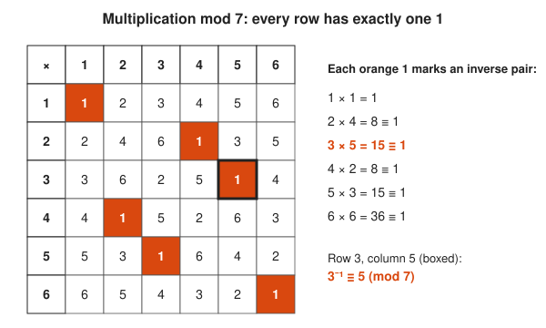

Find the single orange 1 in each row: its column is the inverse of the row number.

<!-- diagram: type=mult-table n=6 highlight=1 dim=2,3,4 caption="no inverse when gcd(a, n) > 1" -->
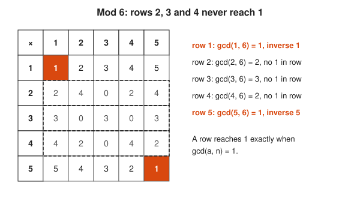

Compare the dashed rows with the rows that contain an orange 1.

**In the course:** [601 Proof and Higher Math](../../course/601/README.md)

#### 9. Fermat's Little Theorem

If $p$ is prime and $p \nmid a$, then $a^{p-1} \equiv 1 \pmod p$. Powers mod a prime cycle with a length that divides $p - 1$. This makes huge powers easy and gives a fast test that catches almost all composite numbers.

**Key idea:** $a^{p-1} \equiv 1 \pmod p$

```txt
  7^100 mod 5
  7 ≡ 2 (mod 5)              reduce the base
  2^4 ≡ 1 (mod 5)            Fermat with p = 5
  2^100 = (2^4)^25           100 = 4 x 25
        ≡ 1^25 = 1 (mod 5)   so 7^100 ≡ 1 (mod 5)
```

<!-- diagram: type=cycle n=7 base=3 seq=3,2,6,4,5,1 caption="3^6 = 1 mod 7" -->
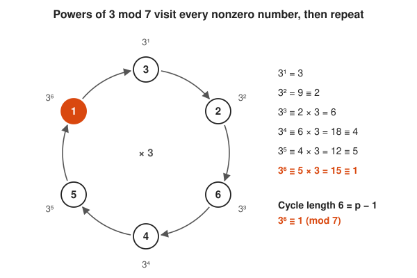

Go once around the loop: six steps of times 3 bring you back to 1.

<!-- diagram: type=cycle seqs="2,4,3,1 mod 5; 2,4,1 mod 7" caption="cycle lengths divide p - 1" -->
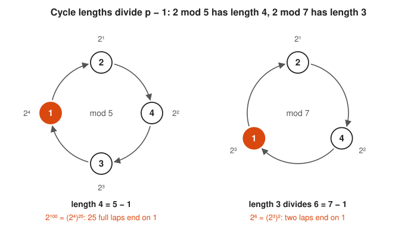

Compare the loop lengths with p minus 1: 4 equals 5 minus 1, and 3 divides 6.

**In the course:** [601 Proof and Higher Math](../../course/601/README.md)

#### 10. The Chinese Remainder Theorem

If the moduli share no common factor, a set of remainders pins down exactly one number modulo their product. A 3rd-century Chinese text asks for a number that leaves 2 when counted by threes, 3 by fives, and 2 by sevens. The answer, 23, is unique modulo $3 \cdot 5 \cdot 7 = 105$. Computers use this to split one big modular calculation into several small ones, and RSA uses it to decrypt about four times faster.

**Key idea:** $x \equiv 2 \pmod 3$, $x \equiv 3 \pmod 5$, $x \equiv 2 \pmod 7$ gives $x \equiv 23 \pmod{105}$.

```txt
  x ≡ 2 (mod 3), x ≡ 3 (mod 5)
  candidates ≡ 3 mod 5: 3, 8, 13, 18      list one condition
  8 mod 3 = 2                             first one passing the other
  x ≡ 8 (mod 15)                          unique modulo 3 x 5
```

<!-- diagram: type=residue-grid m=3,5 highlight=8 caption="15 numbers fill 15 cells exactly once" -->
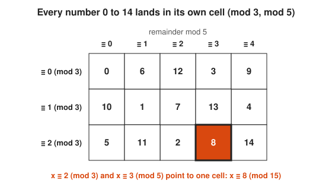

Pick a row and a column: their crossing cell holds the one number with both remainders.

<!-- diagram: type=residue-strips range=0..104 conds="2 mod 3,3 mod 5,2 mod 7" hit=23 caption="23 is the only match below 105" -->
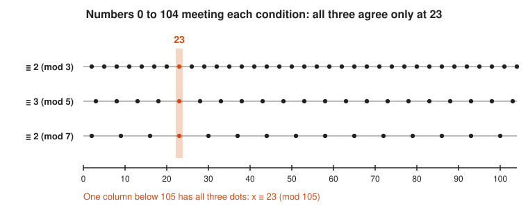

Slide your eye along the rows until all three dots stack in one column at 23.

**In the course:** [601 Proof and Higher Math](../../course/601/README.md)

### Advanced

#### 11. Euler's Totient Function

$\varphi(n)$ counts the numbers from 1 to $n$ that share no factor with $n$. For a prime $p$, $\varphi(p) = p - 1$. For two different primes, $\varphi(pq) = (p - 1)(q - 1)$. **Euler's theorem** generalizes Fermat to any modulus.

**Key idea:** $\gcd(a, n) = 1 \Rightarrow a^{\varphi(n)} \equiv 1 \pmod n$, and $\varphi(n) = n \prod_{p \mid n} \left(1 - \frac{1}{p}\right)$.

<!-- diagram: type=residue-grid m=3,5 shade=coprime caption="phi(15) = (3-1)(5-1) = 8" -->


See how the orange cells form a 2 by 4 block: that block is (3 minus 1) times (5 minus 1).

<!-- diagram: type=sieve-rows n=12 primes=2,3 caption="phi(12) = 12 x (1-1/2) x (1-1/3) = 4" -->
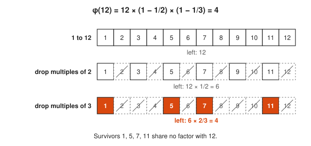

Watch each prime factor remove its share: half go at 2, a third of the rest go at 3.

**In the course:** [601 Proof and Higher Math](../../course/601/README.md)

#### 12. RSA Cryptography

Pick two large primes $p$ and $q$ and publish $n = pq$ and an exponent $e$. Keep $d$, the inverse of $e$ modulo $\varphi(n)$, secret. Anyone can encrypt with $c = m^e \bmod n$. Only the holder of $d$ can decrypt with $m = c^d \bmod n$, and Euler's theorem is the proof that it works. The security rests on one bet: multiplying two primes is fast, and factoring the product is not.

**Key idea:** $ed \equiv 1 \pmod{\varphi(n)} \Rightarrow (m^e)^d \equiv m \pmod n$

```txt
  Toy RSA (real keys use primes with hundreds of digits)
  p = 61, q = 53
  n = 61 x 53 = 3,233                public modulus
  φ(n) = 60 x 52 = 3,120             (p - 1)(q - 1)
  e = 17                             gcd(17, 3,120) = 1
  d = 2,753                          17 x 2,753 = 46,801 = 15 x 3,120 + 1
  m = 65 -> c = 65^17 mod 3,233 = 2,790        encrypt
  c = 2,790 -> 2,790^2,753 mod 3,233 = 65      decrypt
```

<!-- diagram: type=flow p=61 q=53 n=3233 phi=3120 e=17 d=2753 caption="RSA key generation" -->


Notice which boxes are shaded: everything shaded stays secret, and only n and e are published.

<!-- diagram: type=flow m=65 c=2790 n=3233 e=17 d=2753 caption="encrypt then decrypt returns m" -->
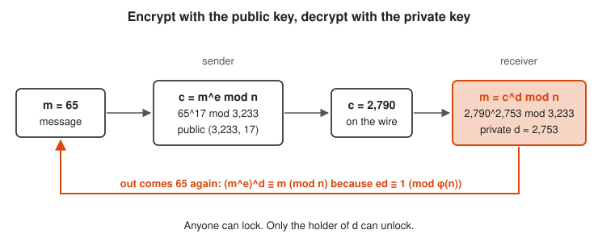

Follow the arrows left to right and then along the orange return path to 65.

**In the course:** [601 Proof and Higher Math](../../course/601/README.md) · **Go further:** [Number Theory for Cryptography workshop](../../workshops/number-theory-for-cryptography/README.md)

#### 13. Quadratic Residues and Reciprocity

A **quadratic residue** mod $p$ is a number that is a perfect square mod $p$. Mod 7, the squares are $1, 4, 2$ (from $1^2, 2^2, 3^2$), so 3, 5 and 6 are not squares. **Quadratic reciprocity**, which Gauss proved eight different ways, links "is $p$ a square mod $q$?" to "is $q$ a square mod $p$?" in a surprising, symmetric way.

**Key idea:** for odd primes $p \ne q$, $\left(\frac{p}{q}\right)\left(\frac{q}{p}\right) = (-1)^{\frac{p-1}{2}\cdot\frac{q-1}{2}}$

<!-- diagram: type=mapping domain=1..6 f="x^2 mod 7" caption="the squares mod 7 are 1, 2, 4" -->
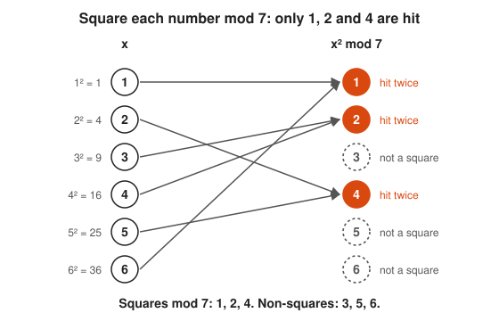

Count the arrows into each target: 1, 2 and 4 get two each, and 3, 5 and 6 get none.

<!-- diagram: type=clock n=7 chords=1-6,2-5,3-4 caption="x and -x have the same square" -->
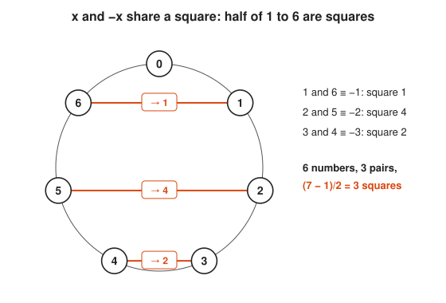

Each chord joins a number to its negative, and both ends square to the same value.

<!-- diagram: type=sign-table primes=3,5,7,11,13 f=legendre caption="quadratic reciprocity sign flips" -->


Compare each cell with its mirror across the diagonal: only the shaded pairs disagree.

**In the course:** [601 Proof and Higher Math](../../course/601/README.md)

#### 14. The Prime Number Theorem

Primes thin out, but in a predictable way. Near a number $x$, roughly one number in $\ln x$ is prime. Count the primes up to $x$, call the count $\pi(x)$, and it grows like $\frac{x}{\ln x}$. Below 100 there are 25 primes. Below 1,000,000 there are 78,498, where $\frac{x}{\ln x}$ predicts about 72,382.

**Key idea:** $\pi(x) \sim \dfrac{x}{\ln x}$

<!-- diagram: type=step-plot f=pi range=0..100 compare="x/ln x" caption="pi(x) against x / ln x" -->
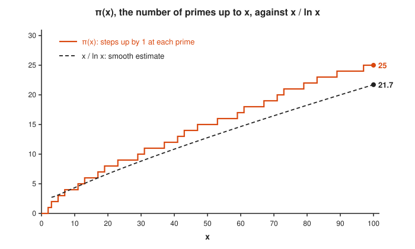

Compare the orange steps with the dashed curve: the curve tracks the shape and runs a little low.

<!-- diagram: type=bar-chart blocks=10 counts=4,4,2,2,3,2,2,3,2,1 compare="10/ln x" caption="prime density falls slowly" -->
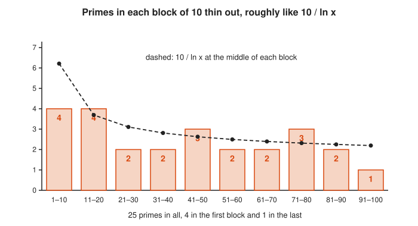

Follow the dashed line down: it predicts the slow thinning that the bars show.

**In the course:** [601 Proof and Higher Math](../../course/601/README.md)

#### 15. The Riemann Zeta Function

Euler found that a sum over all whole numbers equals a product over all primes. Riemann extended that sum to complex numbers and showed that the exact error in the prime number theorem is controlled by the zeros of this one function. Where those zeros lie is the most famous open question in mathematics.

**Key idea:** $\zeta(s) = \sum_{n=1}^{\infty} \dfrac{1}{n^s} = \prod_{p \text{ prime}} \dfrac{1}{1 - p^{-s}}$

<!-- diagram: type=complex-plane strip=0..1 line=0.5 zeros=14.13,21.02,25.01 trivial=-2,-4,-6 caption="zeros of zeta" -->


Look at the orange dots: each one sits exactly on the dashed line at real part 1/2.

<!-- diagram: type=line-plot s=2 terms=10 series="sum 1/n^2, product over primes" caption="sum and product meet at pi^2/6" -->


Watch both rows of dots climb toward the same dashed line from below.

**In the course:** [601 Proof and Higher Math](../../course/601/README.md) · **Go further:** [Complex Analysis track](../complex-analysis/README.md)

## Big Theorems You Should Know

* **Euclid's theorem:** there are infinitely many primes. If $p_1, \ldots, p_k$ were all of them, $p_1 \cdots p_k + 1$ has a prime factor not on the list.
* **Fundamental theorem of arithmetic:** every integer above 1 factors into primes in exactly one way, up to order.
* **Division algorithm:** $a = qb + r$ with $0 \le r < b$, for exactly one pair $q, r$.
* **Bezout's identity:** $\gcd(a, b) = ax + by$ for some integers $x, y$.
* **Fermat's little theorem:** $a^{p-1} \equiv 1 \pmod p$ for prime $p \nmid a$.
* **Euler's theorem:** $a^{\varphi(n)} \equiv 1 \pmod n$ when $\gcd(a, n) = 1$.
* **Wilson's theorem:** $p$ is prime exactly when $(p - 1)! \equiv -1 \pmod p$.
* **Chinese remainder theorem:** congruences with pairwise coprime moduli have one solution modulo the product.
* **Quadratic reciprocity:** the Legendre symbols $\left(\frac{p}{q}\right)$ and $\left(\frac{q}{p}\right)$ agree unless both primes are $\equiv 3 \pmod 4$.
* **Prime number theorem:** $\pi(x) \sim x / \ln x$ (Hadamard and de la Vallée Poussin, 1896).
* **Fermat's last theorem:** $x^n + y^n = z^n$ has no positive integer solutions for $n \ge 3$. Fermat claimed a proof in a margin in 1637. Andrew Wiles supplied one in 1994, about 130 pages long.

## Open Problems and Fun Facts

The field is famous for questions a child can ask and nobody can answer:

* **Twin prime conjecture (open):** are there infinitely many prime pairs like 11 and 13 that differ by 2? In 2013, Yitang Zhang proved that some gap below 70 million repeats forever. Collaborative work has since pushed that bound down to 246.
* **Goldbach's conjecture (open, 1742):** every even number above 2 is a sum of two primes, for example $28 = 5 + 23$. Checked by computer up to $4 \times 10^{18}$, unproven in general.
* **Riemann hypothesis (open, 1859):** all nontrivial zeros of $\zeta(s)$ have real part $\frac{1}{2}$. A Clay Millennium Prize of 1 million dollars awaits a proof.
* **Collatz conjecture (open):** halve even numbers, map odd $n$ to $3n + 1$, repeat. Every start seems to reach 1. Paul Erdős said mathematics is not yet ready for such problems.
* **Largest known prime:** as of late 2024, the record is the Mersenne prime $2^{136{,}279{,}841} - 1$, with over 41 million digits, found by a volunteer using cloud GPUs.
* **Hardy's taxicab:** $1729 = 1^3 + 12^3 = 9^3 + 10^3$ is the smallest number that is a sum of two cubes in two ways. Ramanujan spotted this from a hospital bed when Hardy called the number dull.
* **Primes cannot be dodged:** there is always a prime between $n$ and $2n$ for $n \ge 1$ (Bertrand's postulate, proved by Chebyshev in 1852).

## Starter Problem Set

1. Find the prime factorization of 360.
2. Use the Euclidean algorithm to find $\gcd(84, 36)$.
3. Compute $7^{100} \bmod 5$.
4. Find the smallest positive $x$ with $x \equiv 2 \pmod 3$ and $x \equiv 3 \pmod 5$.
5. Compute $\varphi(36)$.

<details>
<summary>Answers</summary>

1. $2^3 \cdot 3^2 \cdot 5$. Check: $8 \cdot 9 \cdot 5 = 360$.
2. $12$. $84 = 2 \cdot 36 + 12$, then $36 = 3 \cdot 12 + 0$.
3. $1$. $7 \equiv 2$, $2^4 \equiv 1 \pmod 5$, and $2^{100} = (2^4)^{25} \equiv 1$.
4. $8$. Numbers $\equiv 3 \pmod 5$ are 3, 8, 13, and 8 is the first with remainder 2 mod 3.
5. $12$. $36 = 2^2 \cdot 3^2$, so $\varphi(36) = 36 \cdot \frac{1}{2} \cdot \frac{2}{3} = 12$.

</details>

### Challenge Problems

1. Prove that $n^2 - n$ is even for every whole number $n$.
2. Find the inverse of 7 modulo 26. (This is the key step in an affine cipher.)
3. Show that no perfect square ends in the digit 7.
4. What day of the week is it 1,000 days after a Monday?
5. Using $\varphi$, compute the last two digits of $3^{2024}$.

<details>
<summary>Answers</summary>

1. $n^2 - n = n(n - 1)$ is a product of two consecutive integers, and one of them is even.
2. $15$, because $7 \cdot 15 = 105 = 4 \cdot 26 + 1$. Extended Euclid: $26 = 3 \cdot 7 + 5$, $7 = 1 \cdot 5 + 2$, $5 = 2 \cdot 2 + 1$, then back-substitute to get $1 = 3 \cdot 26 - 11 \cdot 7$, and $-11 \equiv 15 \pmod{26}$.
3. The last digit of $n^2$ depends only on the last digit of $n$. Squaring 0 through 9 gives last digits 0, 1, 4, 9, 6, 5, 6, 9, 4, 1. No 7.
4. Sunday. $1000 = 142 \cdot 7 + 6$, so 1,000 days is 142 full weeks plus 6 days, and Monday plus 6 days is Sunday.
5. $81$. $\varphi(100) = 40$ and $2024 = 50 \cdot 40 + 24$, so $3^{2024} \equiv 3^{24} \pmod{100}$. Square repeatedly: $3^4 = 81$, $3^8 \equiv 81^2 = 6561 \equiv 61$, $3^{16} \equiv 61^2 = 3721 \equiv 21$. Then $3^{24} = 3^{16} \cdot 3^8 \equiv 21 \cdot 61 = 1281 \equiv 81 \pmod{100}$.

</details>

## Code Corner

The [code folder](code/README.md) holds one Go program, [main.go](code/main.go), that runs the sieve, Euclid, extended Euclid, fast modular powers and the toy RSA example above.

```txt
primes up to 100 (25): [2 3 5 7 11 13 17 19 23 29 31 37 41 43 47 53 59 61 67 71 73 79 83 89 97]
gcd(84, 36) = 12
Bezout: 240*(-9) + 46*(47) = 2
7^100 mod 5 = 1
Fermat check 3^12 mod 13 = 1
RSA: n=3233 phi=3120 e=17 d=2753
RSA: message 65 -> ciphertext 2790 -> decrypted 65
```

The heart of it is fast modular exponentiation. It squares the base and halves the exponent at each step, so $a^{1{,}000{,}000}$ takes about 20 multiplications, not a million:

```go
func powMod(base, exp, m int) int {
	result := 1
	base %= m
	for exp > 0 {
		if exp&1 == 1 {
			result = result * base % m
		}
		base = base * base % m
		exp >>= 1
	}
	return result
}
```

## Go Deeper

* [MacTutor: Gauss](https://mathshistory.st-andrews.ac.uk/Biographies/Gauss/): the life of the person who organized modern number theory in *Disquisitiones Arithmeticae*.
* [Wolfram MathWorld: Prime Number](https://mathworld.wolfram.com/PrimeNumber.html): a dense reference with links to every famous prime topic.
* [Math Is Fun: Prime and Composite Numbers](https://www.mathsisfun.com/prime-composite-number.html): a gentle illustrated start.
* [Khan Academy: Cryptography](https://www.khanacademy.org/computing/computer-science/cryptography): clock pictures and the road to RSA.
* [MIT OpenCourseWare 6.042J Mathematics for Computer Science](https://ocw.mit.edu/courses/6-042j-mathematics-for-computer-science-fall-2010/): the number theory unit covers gcd, modular arithmetic and RSA with proofs.
* [Euclid's Elements, Book VII](https://aleph0.clarku.edu/~djoyce/elements/bookVII/bookVII.html): the original Euclidean algorithm, from about 300 BCE.

## Related Tracks and Workshops

* Before: [Arithmetic and Number Sense track](../arithmetic-and-number-sense/README.md).
* Alongside: [Discrete Math track](../discrete-math/README.md) and [Logic and Set Theory track](../logic-and-set-theory/README.md) for proof skills.
* Next: [Abstract Algebra track](../abstract-algebra/README.md) (groups mod $n$) and [Complex Analysis track](../complex-analysis/README.md) (the zeta function).
* Applied: [Number Theory for Cryptography workshop](../../workshops/number-theory-for-cryptography/README.md).
