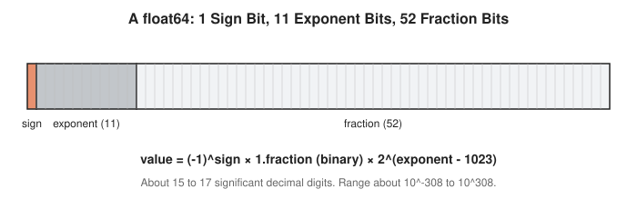
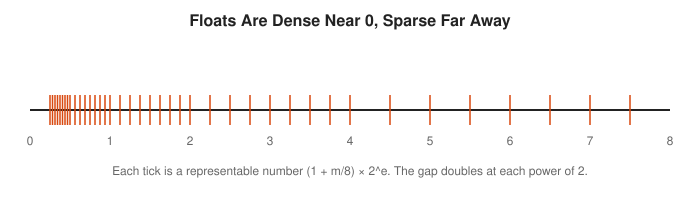
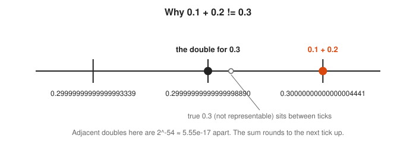
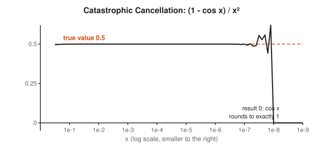
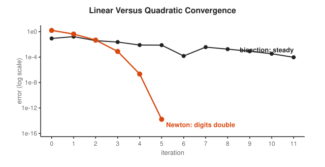
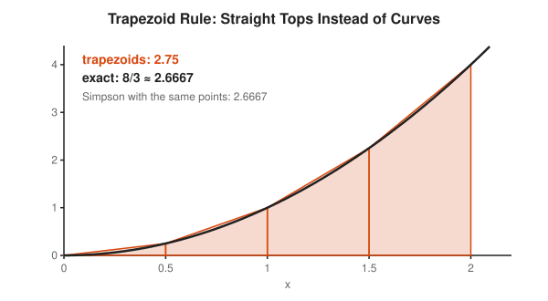
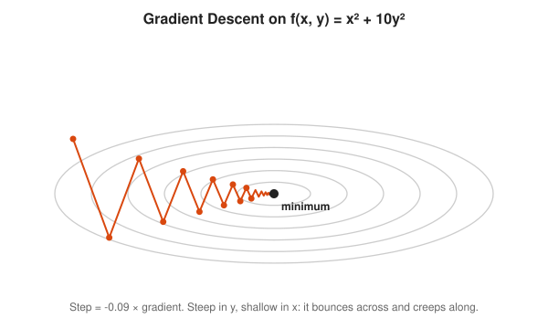
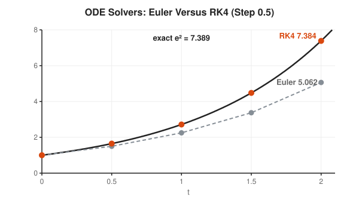
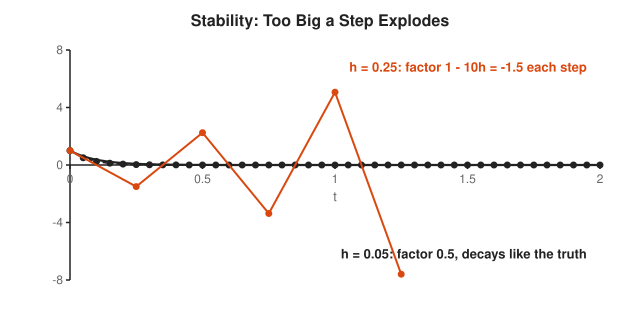

# Numerical Methods Track

**Track:** Numerical Methods · **Span:** beginner to advanced · **Course levels:** [401 Calculus](../../course/401/README.md) (derivatives, integrals), [501 Linear Algebra, Probability and Discrete Math](../../course/501/README.md) (linear systems)
**Prerequisites:** decimals and scientific notation from [101](../../course/101/README.md), plus some programming. The intermediate rungs use derivatives and integrals from the [Calculus Track](../calculus/README.md).
**Files:** this README, [cards.tsv](cards.tsv) for Anki, [code/main.go](code/main.go), and the diagrams in [img/](img/).

## What the Field Studies

Pure math works with exact numbers and infinite processes. Computers work with finite numbers and finite time. **Numerical methods** is the craft of getting answers you can trust anyway: how numbers are stored, how errors creep in and grow, and which algorithms reach a good answer fast without falling apart.

Every rung asks the same two questions: how close is the answer, and how much work did it cost?

## Why It Matters

This is the math closest to production code:

* `0.1 + 0.2 != 0.3` in Go, Python, JavaScript and every language that uses IEEE 754 doubles. Money stored as floats loses cents. Use integers of cents or a decimal type.
* A `float32` counter stops increasing at 16,777,216. A metrics pipeline that sums many small values in float loses precision silently.
* Averages, variances and percentiles over billions of samples need careful summation, or the error grows with the data.
* `math.Sqrt`, the solver in your capacity model, every physics engine and every machine learning optimizer are numerical methods: Newton's method, Runge-Kutta, gradient descent.
* Choosing a step size too large makes a simulation explode, the same way an autoscaler with too much gain oscillates.

## Concept Map

<!-- diagram: type=concept-map tiers=beginner,intermediate,advanced nodes=10 caption="Numerical methods concepts with prerequisite arrows" -->


Read the map top to bottom. An arrow from A to B means learn A first. Start at the orange box.

## Signature Diagram

<!-- diagram: type=newton-iteration f="x^2-2" x0=3 steps=3 caption="Newton method on x^2 - 2" -->


**Newton's method** captures the spirit of the field. You cannot solve $x^2 = 2$ exactly in finite arithmetic, but you can guess, replace the curve by its tangent line, solve the easy straight-line problem, and repeat. Each step roughly doubles the number of correct digits. Three steps from a poor guess of 3 give 1.4149998. Two more give every digit a double can hold. Your CPU's square root instruction uses a close relative of this loop.

## The Concept Ladder

### Beginner

#### 1. Floating-Point Numbers

A **float64** (a "double") stores a number like scientific notation in base 2: a sign, an exponent, and 52 bits of fraction. That gives about 16 significant decimal digits over an enormous range. Most decimals, including 0.1, have no exact binary form, in the same way that 1/3 has no exact decimal form.

$$x = (-1)^s \times 1.f_2 \times 2^{e - 1023}$$

<!-- diagram: type=bit-layout fields=sign:1,exponent:11,fraction:52 caption="Layout of a float64" -->


<!-- diagram: type=number-line ticks=toy-floats mantissa_bits=3 range=0..8 caption="Toy floats get sparser as they grow" -->


Course link: [401 Calculus](../../course/401/README.md).

#### 2. Rounding Error and Machine Epsilon

Every arithmetic result is rounded to the nearest representable number. **Machine epsilon** is the gap between 1 and the next double: $2^{-52} \approx 2.2 \times 10^{-16}$. Each operation can introduce a **relative error** up to half of that. Compare floats with a tolerance, never with `==`.

$$\varepsilon_{\text{mach}} = 2^{-52} \approx 2.22 \times 10^{-16}, \qquad \text{relative error} = \frac{|\hat{x} - x|}{|x|}$$

<!-- diagram: type=number-line-zoom center=0.3 ticks=3 caption="Doubles near 0.3" -->


#### 3. Cancellation and Conditioning

Subtracting two nearly equal numbers wipes out their shared leading digits, leaving mostly rounding noise. This is **catastrophic cancellation**. The cure is algebra: rewrite the formula to avoid the subtraction. A problem is **ill-conditioned** when tiny input changes cause large output changes. No algorithm rescues an ill-conditioned problem.

$$1 - \cos x = 2\sin^2(x/2)$$

<!-- diagram: type=function-plot f="(1-cos x)/x^2" x=1e-0.5..1e-9 scale=log caption="Cancellation in a naive formula" -->


### Intermediate

#### 4. Bisection

If a continuous function is negative at one end of an interval and positive at the other, a root lies between. Check the midpoint and keep the half where the sign changes. Each step halves the interval, which gains one bit of accuracy per step. Slow, but it never fails. `git bisect` is the same algorithm applied to commits.

$$\text{error after } n \text{ steps} \le \frac{b - a}{2^{n}}$$

<!-- diagram: type=interval-stack f="x^2-2" interval=1..2 steps=6 caption="Bisection steps" -->
![Six stacked intervals closing in on root 2: [1, 2], [1, 1.5], [1.25, 1.5], [1.375, 1.5], [1.375, 1.4375], [1.4062, 1.4375]. A dashed orange line marks 1.41421.](img/bisection-steps.svg)

#### 5. Newton Method

Replace the function by its tangent line and jump to where the tangent crosses zero. Near a simple root, the error squares at every step: **quadratic convergence**. The price: it needs the derivative and a reasonable starting guess, and it can fly off when the tangent is nearly flat.

$$x_{n+1} = x_n - \frac{f(x_n)}{f'(x_n)}$$

<!-- diagram: type=log-error methods=bisection,newton target=sqrt2 caption="Error per iteration" -->


Production root finders combine both: bisection for safety, Newton for speed. Brent's method is the classic blend.

#### 6. Numerical Integration

Most integrals have no formula. Chop the interval into strips and approximate each piece. The **trapezoid rule** uses straight tops. **Simpson's rule** uses parabolas and is exact for cubics. Halving the strip width cuts trapezoid error by 4 and Simpson error by 16.

$$\int_a^b f\,dx \approx \frac{h}{2}\big(f_0 + 2f_1 + \cdots + 2f_{n-1} + f_n\big)$$

<!-- diagram: type=trapezoids f=x^2 interval=0..2 strips=4 caption="Trapezoid rule" -->


#### 7. Linear Systems: LU and Pivoting

Gaussian elimination, done by computer, is recorded as $A = LU$: a lower triangle of multipliers times an upper triangle. Factor once, then solve for many right-hand sides cheaply. **Partial pivoting** (swapping rows to divide by the largest available number) keeps rounding errors from blowing up.

$$A = LU, \qquad Ax = b \iff Ly = b, \; Ux = y$$

<!-- diagram: type=matrix-product A=[[2,1,1],[4,-6,0],[-2,7,2]] L=[[1,0,0],[2,1,0],[-1,-1,1]] U=[[2,1,1],[0,-8,-2],[0,0,1]] caption="LU factorization" -->
![Three 3 by 3 matrices: A = [[2, 1, 1], [4, -6, 0], [-2, 7, 2]] equals L = [[1, 0, 0], [2, 1, 0], [-1, -1, 1]] times U = [[2, 1, 1], [0, -8, -2], [0, 0, 1]]. The multipliers below the diagonal of L and the zeros below the diagonal of U are shaded.](img/lu-factorization.svg)

### Advanced

#### 8. Optimization: Gradient Descent

To find the bottom of a valley, step downhill: move against the **gradient**, the direction of steepest increase. The step size, called the **learning rate**, is the whole game. Too small crawls. Too large overshoots and bounces. Long narrow valleys make plain gradient descent zigzag, which is why momentum and Adam exist.

$$\mathbf{x}_{k+1} = \mathbf{x}_k - \eta\, \nabla f(\mathbf{x}_k)$$

<!-- diagram: type=contour-path f="x^2+10y^2" lr=0.09 start=(-5.5,1.5) caption="Gradient descent zigzag" -->


#### 9. ODE Solvers: Euler and Runge-Kutta

The Euler method follows the slope at the start of each step. **Runge-Kutta 4** (RK4) samples the slope four times per step and blends them. Euler's error shrinks in proportion to the step size $h$. RK4's error shrinks like $h^4$: halve the step and the error drops 16 times.

$$y_{n+1} = y_n + \frac{h}{6}\,(k_1 + 2k_2 + 2k_3 + k_4)$$

<!-- diagram: type=solver-compare ode="y'=y" h=0.5 methods=euler,rk4 caption="Euler versus RK4" -->


#### 10. Stability and Iterative Solvers

An algorithm is **stable** when errors stay bounded instead of feeding on themselves. For Euler on $y' = -\lambda y$, each step multiplies by $1 - h\lambda$. When that factor exceeds 1 in size, the answer grows and flips sign every step, while the true solution decays. Huge sparse systems are solved by iterative methods (Jacobi, conjugate gradient) whose convergence depends on the same kind of factor.

$$|1 - h\lambda| < 1 \iff h < \frac{2}{\lambda}$$

<!-- diagram: type=function-plot ode="y'=-10y" steps=0.05,0.25 caption="Stable and unstable Euler steps" -->


## Worked Examples

### Example 1: Newton Steps for the Square Root of 2

```txt
  f(x) = x² - 2, f'(x) = 2x                     function and derivative
  x0 = 3                                       starting guess
  x1 = 3 - (9 - 2)/6 = 3 - 7/6 = 1.833333      Newton step
  x2 = 1.833333 - (3.361111 - 2)/3.666667      Newton step
     = 1.833333 - 0.371212 = 1.462121
  x3 = 1.462121 - (2.137799 - 2)/2.924242      Newton step
     = 1.462121 - 0.047123 = 1.414998
  error: 1.59, 0.42, 0.048, 0.00078            roughly squares each step
```

### Example 2: Bisection Step Count

How many bisection steps shrink $[1, 2]$ below $10^{-6}$?

```txt
  width after n steps = 1 / 2^n                 halve each time
  need 1 / 2^n < 10^-6                          target
  2^n > 10^6                                    flip
  n > log2(10^6) ≈ 19.93                        take log base 2
  n = 20 steps                                  round up
```

### Example 3: Trapezoid Rule by Hand

$\int_0^2 x^2\,dx$ with 4 strips, $h = 0.5$.

```txt
  f at 0, 0.5, 1, 1.5, 2: 0, 0.25, 1, 2.25, 4      sample the function
  sum = 0 + 2(0.25) + 2(1) + 2(2.25) + 4           ends once, middles twice
      = 0 + 0.5 + 2 + 4.5 + 4 = 11
  integral ≈ (0.5 / 2) × 11 = 2.75                h/2 times the sum
  exact 8/3 ≈ 2.6667, error ≈ 0.083                curve bends up: trapezoids overshoot
```

## Big Theorems to Know

* **IEEE 754 Correct Rounding:** basic operations (+, -, ×, /, square root) return the exactly rounded true result.
* **Intermediate Value Theorem:** the guarantee behind bisection.
* **Newton Convergence:** near a simple root with a good start, the error satisfies $e_{n+1} \approx C e_n^2$.
* **Taylor's Theorem:** the error of a finite approximation is controlled by a higher derivative. It explains every error formula above.
* **Error Bounds for Quadrature:** trapezoid error is $O(h^2)$, Simpson error is $O(h^4)$.
* **Lax Equivalence Theorem:** for linear problems, a consistent method converges exactly when it is stable.
* **Condition Number Rule of Thumb:** solving $Ax = b$ loses about $\log_{10} \kappa(A)$ digits of accuracy.

## Open Problems and Fun Facts

* **The Patriot missile failure (1991):** a battery tracked time in tenths of a second with a 24-bit fixed-point value. 0.1 has no exact binary form, and after 100 hours the clock had drifted about 0.34 seconds, enough to miss an incoming missile.
* **Ariane 5 (1996):** a 64-bit float converted into a 16-bit integer overflowed 37 seconds after launch, and the rocket destroyed itself.
* **Fast inverse square root:** Quake III computed $1/\sqrt{x}$ with a bit-level hack on the float's representation and one Newton step, with the magic constant `0x5f3759df`.
* **Kahan summation:** William Kahan, chief architect of IEEE 754, invented compensated summation. The Code Corner shows it repair a sum of ten million values.
* **Open puzzle:** Gaussian elimination with partial pivoting has a worst case where errors grow like $2^{n-1}$, yet on real matrices it almost never happens. A full explanation of why it works so well in practice is still missing.

## Starter Problems

1. Why does `0.1 + 0.2 == 0.3` return false? What test works instead?
2. What is machine epsilon for float64, roughly?
3. How many bisection steps reduce an interval of width 1 below $10^{-9}$?
4. Do two Newton steps for $\sqrt{10}$ from $x_0 = 3$.
5. Use the trapezoid rule with 2 strips on $\int_0^1 x^2\,dx$.
6. For Euler on $y' = -4y$, what step size keeps the method stable?
7. Rewrite $\sqrt{x + 1} - \sqrt{x}$ to avoid cancellation for large $x$.

<details>
<summary>Answers</summary>

1. 0.1, 0.2 and 0.3 are all rounded to nearby binary values, and the rounded sum lands one tick above the rounded 0.3. Use `math.Abs(a - b) <= tol * math.Max(math.Abs(a), math.Abs(b))` with a tolerance such as `1e-9`.
2. About $2.2 \times 10^{-16}$, which is $2^{-52}$.
3. 30 steps. $2^{30} \approx 1.07 \times 10^9 > 10^9$, and $2^{29} \approx 5.4 \times 10^8$ is not enough.
4. $x_1 = 3 - (9 - 10)/6 = 3.166667$. $x_2 = 3.166667 - (10.027778 - 10)/6.333333 \approx 3.162281$. The true value is $3.162278$.
5. $h = 0.5$: $\frac{0.5}{2}(0 + 2 \cdot 0.25 + 1) = 0.375$. The exact value is $1/3$.
6. $h < 2/4 = 0.5$. For no oscillation at all, $h < 0.25$.
7. Multiply by the conjugate: $\sqrt{x+1} - \sqrt{x} = \dfrac{1}{\sqrt{x+1} + \sqrt{x}}$.

</details>

## Code Corner

[code/main.go](code/main.go) shows the classic float surprises, measures machine epsilon, repairs a long sum with Kahan summation, fixes a cancellation by rewriting the formula, races bisection against Newton, integrates with trapezoids and Simpson, and finds the step size where Euler explodes. Run it with `go run main.go` inside `code/`.

```txt
== Floating-point surprises ==
0.1 + 0.2 == 0.3 ? false
0.1 + 0.2 = 0.30000000000000004441
0.3       = 0.29999999999999998890
float32: 16777216 + 1 = 1.6777216e+07 (counter stuck)
float64 integers are exact up to 2^53 = 9007199254740992

== Machine epsilon ==
smallest eps with 1 + eps > 1: 2.220446049250313e-16 (2^-52)
gap between doubles near 1e16: 2

== Adding 0.1 ten million times (true answer 1,000,000) ==
naive sum: 999999.999839
Kahan sum: 1000000.000000

== Cancellation: (1 - cos x) / x^2, true value near 0.5 ==
x = 0.01   naive 0.4999958333   rewritten 0.4999958333
x = 0.0001 naive 0.4999999970   rewritten 0.4999999996
x = 1e-06  naive 0.5000444503   rewritten 0.5000000000
x = 1e-08  naive 0.0000000000   rewritten 0.5000000000

== Root of x^2 - 2: iterations to reach 1e-12 ==
bisection: 40 steps -> 1.414213562373
  newton step 1: 1.833333333333333
  newton step 2: 1.462121212121212
  newton step 3: 1.414998429894803
  newton step 4: 1.414213780047198
  newton step 5: 1.414213562373112
newton:    5 steps -> 1.414213562373

== Integrate x^2 on [0, 2] (exact 8/3 = 2.666667) ==
 4 strips: trapezoid 2.750000  Simpson 2.666667
40 strips: trapezoid 2.667500  Simpson 2.666667

== Euler on y' = -10y, y(0) = 1: value at t = 2 (exact 2.06e-09) ==
h = 0.25  factor -1.50 per step -> 25.62890625
h = 0.2   factor -1.00 per step -> 1
h = 0.05  factor +0.50 per step -> 9.094947017729282e-13
h = 0.01  factor +0.90 per step -> 7.055079108655365e-10
```

Two lines to remember. The naive sum of ten million dimes is off by 0.00016 dollars, which looks harmless until it is a billion transactions. And at $h = 0.2$, Euler neither decays nor grows: it bounces between $+1$ and $-1$ forever, perfectly balanced on the edge of stability.

## Flashcards

[cards.tsv](cards.tsv) holds the key definitions and theorems for Anki import.

## Resources

* [David Goldberg: What Every Computer Scientist Should Know About Floating-Point Arithmetic](https://docs.oracle.com/cd/E19957-01/806-3568/ncg_goldberg.html): the classic reference, in plain HTML.
* [The Floating-Point Guide](https://floating-point-gui.de/): short, practical answers to "why do my numbers not add up".
* [Paul's Online Notes: Newton's Method](https://tutorial.math.lamar.edu/Classes/CalcI/NewtonsMethod.aspx): worked examples of the signature algorithm.
* [Wolfram MathWorld: Newton's Method](https://mathworld.wolfram.com/NewtonsMethod.html): convergence facts and history.
* [MIT OCW 18.335J Introduction to Numerical Methods](https://ocw.mit.edu/courses/18-335j-introduction-to-numerical-methods-spring-2019/): graduate notes on stability, linear algebra and conditioning.

## Where to Go Next

* [Differential Equations Track](../differential-equations/README.md) for the equations that ODE solvers step through.
* [Linear Algebra Track](../linear-algebra/README.md) for the systems that LU and iterative solvers handle.
* [Real Analysis Track](../real-analysis/README.md) for the convergence proofs behind every error bound.
