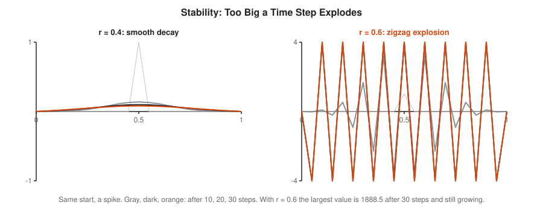
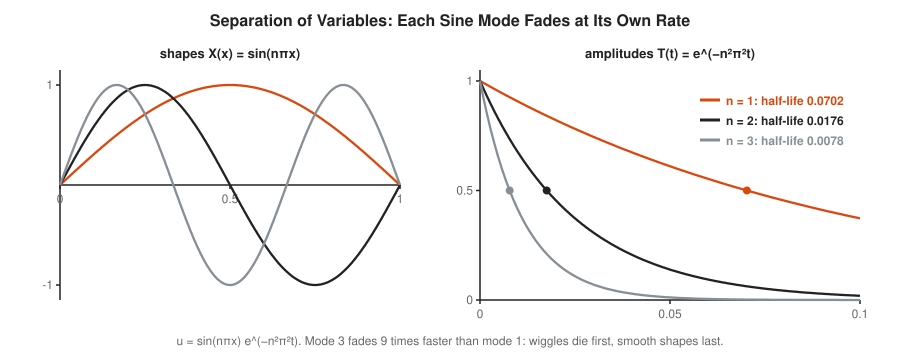
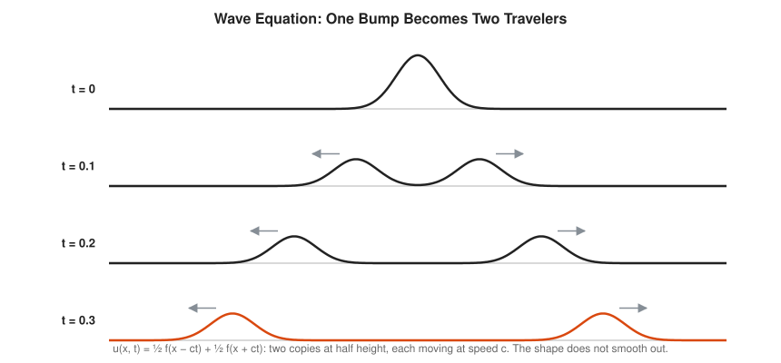

# Partial Differential Equations Track

**Track:** Partial Differential Equations · **Span:** beginner to advanced · **Course levels:** [401 Calculus](../../course/401/README.md) (derivatives, partial derivatives), [501 Linear Algebra, Probability and Discrete Math](../../course/501/README.md) (eigenvalues, random walks)
**Prerequisites:** derivatives as slopes and the idea of a differential equation. The [Calculus Track](../calculus/README.md) covers derivatives. The [Differential Equations Track](../differential-equations/README.md) covers equations in one variable, such as exponential decay. The [Fourier Analysis Track](../fourier-analysis/README.md) helps from rung 6 on.
**Files:** this README, [cards.tsv](cards.tsv) for Anki, [code/main.go](code/main.go), and the diagrams in [img/](img/).

## What the Field Studies

An ordinary differential equation describes one quantity changing in time, such as the charge on a capacitor. A **partial differential equation** (PDE) describes a quantity spread out in space and changing in time, such as the temperature at every point along a metal rod. The unknown is a function of several variables, $u(x, t)$, and the equation ties together its rates of change in different directions.

Three equations cover a surprising share of physics and engineering. The **heat equation** spreads things out: heat, ink in water, rumors of load across a cluster. The **wave equation** carries shapes along: sound, light, a plucked string. The **Laplace equation** describes the settled state when nothing changes any more. This track draws all three, solves them by hand where possible, and solves them in Go where not.

## Why It Matters

* **Load balancing by diffusion:** if each server hands a fixed fraction of its extra load to each neighbor, the load obeys the heat equation on the graph of servers. It evens out fastest along well-connected paths, and the speed is set by an eigenvalue of the graph Laplacian.
* **Thermal design:** the temperature of a CPU die, a heat sink or a hot aisle in a data center follows the heat equation. So does the cooling time of anything.
* **Image processing:** Gaussian blur is exactly the heat equation run for a short time on the pixel grid.
* **Simulation everywhere:** weather forecasts, crash tests, chip design and game physics all step PDEs forward on a grid, the same loop you write in rung 5.
* **Finance:** the Black-Scholes equation for option prices turns into the heat equation after a change of variables.
* **Step sizes:** the stability rule for time steps in rung 5 is the same lesson as choosing a scrape or control-loop interval: step too far and the system oscillates or explodes.

## Concept Map

<!-- diagram: type=concept-map tiers=beginner,intermediate,advanced nodes=12 caption="Partial differential equations concepts with prerequisite arrows" -->


Read the map top to bottom. An arrow from A to B means learn A first. Start at the orange box.

## Signature Diagram

<!-- diagram: type=function-family-and-heatmap equation=heat start=pulse[0.25,0.75] times=0,0.002,0.01,0.03,0.1 caption="A hot slab in a cold rod spreads out and fades over time" -->


This picture holds the heat equation in one glance. Sharp edges melt first. The hump spreads out, sinks, and drains through the cold ends. Nothing in the curve ever gets sharper. Every PDE has a personality like this, and learning to read it from the equation is most of the skill.

## The Concept Ladder

### Beginner

#### 1. What a PDE Is

A function $u(x, t)$ gives a value, such as temperature, for every position $x$ and time $t$. A **partial derivative** is an ordinary slope taken in one direction while the other variable stays frozen. $\partial u / \partial x$ is the slope along the rod at one instant. $\partial u / \partial t$ is how fast one spot heats or cools. A PDE is an equation that links these slopes.

$$u_x = \frac{\partial u}{\partial x}, \qquad u_t = \frac{\partial u}{\partial t}, \qquad u_{xx} = \frac{\partial^2 u}{\partial x^2}$$

<!-- diagram: type=heatmap-with-slices f=heat-pulse slices=t=0.02,x=0.28 caption="A function of position and time with one slice at fixed time and one at fixed position" -->


Subscripts are shorthand: $u_t$ is the rate of change in time, $u_{xx}$ is the second derivative in space. A metric dashboard with one panel per host is a function of two variables, host and time. Reading one panel is a slice at fixed host. Comparing all hosts at 14:00 is a slice at fixed time.

In the course: [401 Multivariable Intro](../../course/401/12-multivariable-intro/README.md). Related: [Calculus Track](../calculus/README.md).

#### 2. Random Walkers and Diffusion

Put a crowd of walkers at one spot. Each second, each walker flips a coin and steps left or right. The crowd spreads out. The spread does not grow like time. It grows like the square root of time: four times as long gives twice the spread. A drop of ink in water, heat in a rod and gossip in a cluster all spread this way.

$$\text{spread after } t \text{ steps} = \sqrt{t}, \qquad \text{spread} \approx \sqrt{2 \alpha t} \text{ in the heat equation}$$

<!-- diagram: type=distribution-family dist=binomial-walk t=25,100,400 caption="Distribution of random walkers after 25, 100 and 400 steps" -->


The square root is why diffusion is fast over short distances and hopelessly slow over long ones. Heat crosses a thin CPU die in a blink and takes hours to cross a room. The crowd as a whole obeys the heat equation, even though no single walker knows any calculus.

In the course: [501 Common Distributions](../../course/501/07-common-distributions/README.md). Related: [Probability Track](../probability/README.md).

#### 3. The Heat Equation

The **heat equation** says the rate of heating at a point is proportional to the curvature of the temperature there. A peak bends down, has negative $u_{xx}$, and cools. A valley bends up and warms. On a grid this says: each point moves toward the average of its neighbors. The constant $\alpha$ is the **diffusivity**, how fast the material spreads heat.

$$u_t = \alpha\, u_{xx}$$

<!-- diagram: type=function-plot f="0.5+0.3sin(2pi x)+0.15sin(6pi x)" arrows=curvature caption="Peaks cool and valleys warm: the heat equation moves temperature toward the neighbor average" -->


That neighbor-average rule is also a load balancer. If every node passes a fraction of its excess to each neighbor every tick, the load follows the heat equation and flattens out. The second derivative on a grid, $u_{i+1} - 2u_i + u_{i-1}$, measures how far a point sits above or below its neighbors.

In the course: [401 The Derivative](../../course/401/02-the-derivative/README.md). Related: [Differential Equations Track](../differential-equations/README.md).

#### 4. Boundary and Initial Conditions

The equation alone does not pick one answer. You also need the **initial condition**, the temperature everywhere at the start, and **boundary conditions**, what happens at the ends. A **Dirichlet** condition fixes the value, such as an end held in ice at 0. A **Neumann** condition fixes the slope, such as an insulated end where no heat flows, $u_x = 0$.

$$u(x, 0) = f(x), \qquad \text{Dirichlet: } u(0, t) = 0, \qquad \text{Neumann: } u_x(1, t) = 0$$

<!-- diagram: type=function-family-pair bc=dirichlet,neumann start=pulse[0.5,0.9] caption="The same rod with both ends held cold, and with the right end insulated" -->


The boundary decides the long-run answer. With cold ends, everything drains to 0. With an insulated end, heat can only leave through the cold end, slowly. A system with no exit at all keeps its total heat forever and flattens to the average. Same equation, three fates.

Related: [Differential Equations Track](../differential-equations/README.md) for initial value problems in one variable.

#### 5. Finite Differences in Go

To solve the heat equation on a computer, chop the rod into points $dx$ apart and time into steps $dt$. Replace each derivative by a difference. The result is the **explicit scheme**: the new value at a point is the old value plus $r$ times how far it sits below its neighbors. It is a three-line loop.

$$u_i^{\text{new}} = u_i + r\,(u_{i+1} - 2u_i + u_{i-1}), \qquad r = \frac{\alpha\, dt}{dx^2} \le \frac{1}{2}$$

<!-- diagram: type=stencil grid=space-time points=3to1 caption="The explicit finite-difference stencil on a space-time grid" -->


<!-- diagram: type=function-family-pair r=0.4,0.6 start=spike steps=10,20,30 caption="Finite differences with r = 0.4 stay smooth and with r = 0.6 blow up" -->


The loop in Go:

```go
for i := 1; i < len(u)-1; i++ {
	next[i] = u[i] + r*(u[i+1]-2*u[i]+u[i-1])
}
```

Keep $r \le 1/2$ or the scheme blows up. With $r$ too large, each point overshoots its neighbor average, the error flips sign every step, and it grows. Halve $dx$ for more detail and you must quarter $dt$. That is the price of the explicit method, and the reason implicit methods exist.

In the course: [401 Taylor Series](../../course/401/11-taylor-series/README.md) for why differences approximate derivatives. Related: [Numerical Methods Track](../numerical-methods/README.md).

#### 6. Separation of Variables

Guess that the answer is a shape times a fading amplitude: $u = X(x)\,T(t)$. Put the guess in the heat equation and the variables split into two ordinary equations. On a rod of length 1 with cold ends, the shapes are sine waves $\sin(n\pi x)$ and the amplitudes decay like $e^{-\alpha n^2 \pi^2 t}$.

$$u_n(x, t) = \sin(n\pi x)\, e^{-\alpha n^2 \pi^2 t}$$

<!-- diagram: type=pair left="sin(n pi x) n=1..3" right="exp(-n^2 pi^2 t) n=1..3" caption="Sine modes of the heat equation and how fast each one decays" -->


The decay rate grows with $n^2$. Mode 3 fades 9 times faster than mode 1. Wiggly shapes die first and smooth shapes last, which is why the signature diagram rounds off so fast and then sinks so slowly. These shapes are the eigenfunctions of $-d^2/dx^2$ from the [Functional Analysis Track](../functional-analysis/README.md).

In the course: [501 Eigenvalues and Eigenvectors](../../course/501/13-eigenvalues-and-eigenvectors/README.md).

### Intermediate

#### 7. The Wave Equation

The **wave equation** sets the acceleration of each point, not its velocity, to the curvature. A taut string pulled into a bump snaps back, overshoots and sends ripples both ways. The constant $c$ is the wave speed. **D'Alembert's formula** says any start with zero velocity splits into two half-size copies that travel left and right at speed $c$.

$$u_{tt} = c^2 u_{xx}, \qquad u(x, t) = \tfrac{1}{2} f(x - ct) + \tfrac{1}{2} f(x + ct)$$

<!-- diagram: type=snapshots equation=wave start=bump times=0,0.1,0.2,0.3 caption="A bump on a string splits into two half-size bumps moving apart" -->


Unlike heat, waves do not smooth out. The shape travels intact, corners and all. Waves also have a finite speed: nothing at distance $d$ notices the bump before time $d/c$. The heat equation, by contrast, sends a tiny amount of heat everywhere at once.

Related: [Trigonometry Track](../trigonometry/README.md) for the sine waves that make up any travelling shape.

#### 8. Standing Waves and Strings

Pin a string at both ends and only certain shapes can vibrate in place: the **standing waves**, or **modes**. Mode $n$ has $n$ humps and vibrates at $n$ times the base frequency. The points that never move are **nodes**. A guitar note is a mix of these modes, which is why it has harmonics.

$$u_n(x, t) = \sin\Big(\frac{n\pi x}{L}\Big)\cos\Big(\frac{n\pi c\, t}{L}\Big), \qquad f_n = \frac{n\,c}{2L}$$

<!-- diagram: type=standing-waves modes=1..4 L=0.65 c=143 caption="Standing waves on a string fixed at both ends: the first four modes" -->


Press a guitar string at the twelfth fret and you halve $L$, which doubles every frequency: one octave up. Touch the string lightly at the middle instead and you kill every mode without a node there, leaving only the even modes: a harmonic.

Related: [Music and Frequencies](../../workshops/music-and-frequencies/README.md) workshop, [Fourier Analysis Track](../fourier-analysis/README.md).

#### 9. Laplace Equation and Steady State

Run the heat equation long enough with fixed boundaries and the temperature stops changing. Then $u_t = 0$, and in two dimensions what remains is the **Laplace equation**. Its solutions are **harmonic functions**. On a grid the rule is plain: every point equals the average of its four neighbors.

$$u_{xx} + u_{yy} = 0, \qquad u_{i,j} = \frac{u_{i-1,j} + u_{i+1,j} + u_{i,j-1} + u_{i,j+1}}{4}$$

<!-- diagram: type=heatmap equation=laplace grid=30 top=100 others=0 caption="Steady temperature in a square plate with the top edge at 100 and other edges at 0" -->


The averaging rule has a strong consequence, the **maximum principle**: no interior point is hotter than every neighbor. The hottest and coldest points lie on the boundary. **Jacobi iteration** solves the grid by applying the averaging rule over and over until nothing changes. It is simple, and slow on big grids, which is why faster methods such as multigrid exist.

Related: [Complex Analysis Track](../complex-analysis/README.md), where the real and imaginary parts of every nice complex function are harmonic.

#### 10. Three Families Compared

Second-order PDEs fall into three families, named after conic sections. **Parabolic** equations, like heat, smooth and forget, and only run forward in time. **Hyperbolic** equations, like waves, carry information at a finite speed and keep sharp shapes. **Elliptic** equations, like Laplace, have no time at all: every point depends on the whole boundary at once.

$$\text{parabolic: } u_t = u_{xx}, \qquad \text{hyperbolic: } u_{tt} = u_{xx}, \qquad \text{elliptic: } u_{xx} + u_{yy} = 0$$

<!-- diagram: type=panels items=heat,wave,laplace caption="The heat, wave and Laplace equations side by side" -->


The family tells you what data to give and what numerics to use. Parabolic and hyperbolic problems step forward in time from a start. Elliptic problems are solved all at once, as one big linear system. Asking the wrong question, such as running heat backward in time, gives an answer that explodes at the slightest noise.

Related: [Conic sections in 301](../../course/301/10-conic-sections/README.md), the source of the three names.

### Advanced

#### 11. Fourier Series Solve Them

Separation of variables gives one solution per mode. The heat equation is linear: sums of solutions are solutions. Write the starting temperature as a Fourier sine series, let each term fade at its own rate, and add them back up. That is exactly why Fourier invented his series.

$$u(x, 0) = \sum_{n=1}^{\infty} b_n \sin(n\pi x) \quad \Longrightarrow \quad u(x, t) = \sum_{n=1}^{\infty} b_n \sin(n\pi x)\, e^{-n^2 \pi^2 t}$$

<!-- diagram: type=pair left="square pulse with sine partial sums 1,3,15" right="series at t=0.01" caption="A square pulse built from sine modes, and the same sum after a short time" -->


For the pulse on $[0.25, 0.75]$ the coefficients are $b_n = \frac{2}{n\pi}\big(\cos\frac{n\pi}{4} - \cos\frac{3n\pi}{4}\big)$. By $t = 0.01$ the high modes have all but vanished. The Go program checks the series against the finite-difference grid and they agree to four decimals.

Related: [Fourier Analysis Track](../fourier-analysis/README.md), [Functional Analysis Track](../functional-analysis/README.md).

#### 12. Well-Posedness and Stability

Jacques Hadamard called a problem **well-posed** when a solution exists, it is unique, and it depends continuously on the data: small changes in the input give small changes in the answer. The heat equation forward in time is well-posed. Backward in time it is not. Numerical schemes have a matching rule, the **CFL condition**: in one time step, the grid stencil must reach at least as far as the true solution travels.

$$\text{wave equation, explicit scheme: } \frac{c\, dt}{dx} \le 1$$

<!-- diagram: type=domain-of-dependence ratios=0.6,1.6 caption="The numerical domain of dependence must contain the physical one: the CFL condition" -->


The **Lax equivalence theorem** ties the threads together: for a linear problem, a consistent scheme converges exactly when it is stable. In practice this is the main way simulations go wrong. Pick a time step too long for the grid and the results are not slightly off. They are garbage.

Related: [Numerical Methods Track](../numerical-methods/README.md) for stability of iterative methods.

## Worked Examples

### Example 1: One Heat Step by Hand

Rod values $u = [0, 0, 100, 0, 0]$, ends held at 0, $r = 0.25$.

```txt
  rule: new u_i = u_i + r (u_{i+1} - 2 u_i + u_{i-1})   explicit scheme
  i = 1: 0 + 0.25 (100 - 0 + 0)   = 25                  hot neighbor on the right
  i = 2: 100 + 0.25 (0 - 200 + 0) = 100 - 50 = 50       peak loses half
  i = 3: 0 + 0.25 (0 - 0 + 100)   = 25                  hot neighbor on the left
  ends stay 0                                           Dirichlet boundary
  new u = [0, 25, 50, 25, 0]                            total heat 100 kept so far
```

### Example 2: Check a Separated Solution

Show $u = \sin(\pi x)\,e^{-\pi^2 t}$ solves $u_t = u_{xx}$ and find its half-life.

```txt
  u_t  = sin(pi x) x (-pi^2) e^(-pi^2 t) = -pi^2 u      differentiate in t
  u_x  = pi cos(pi x) e^(-pi^2 t)                       differentiate in x
  u_xx = -pi^2 sin(pi x) e^(-pi^2 t) = -pi^2 u          once more
  u_t = u_xx                                            both equal -pi^2 u
  ends: sin(0) = sin(pi) = 0                            boundary holds
  half-life: e^(-pi^2 t) = 1/2 -> t = ln 2 / pi^2       solve
           = 0.6931 / 9.8696 = 0.0702                   decimal
  at t = 0.1: e^(-0.98696) = 0.3727; Go grid gives 0.3716   close match
```

### Example 3: Tune a Guitar String

A string of length 0.65 m plays 110 Hz. Find the wave speed and the next harmonics.

```txt
  f1 = c / (2L)                                         base frequency of a string
  c = 2 L f1 = 2 x 0.65 x 110 = 143 m/s                 solve for c
  f2 = 2 c / (2L) = 220 Hz                              second mode
  f3 = 3 x 110 = 330 Hz                                 third mode
  press at the middle: L = 0.325 m -> f1 = 220 Hz       half length, one octave up
```

### Example 4: Center of a Hot-Topped Plate

A square plate has its top edge at 100 and the other three edges at 0. Find the steady temperature at the center.

```txt
  call the answer for "top hot" u_top(center) = a       unknown
  turn the plate 90, 180, 270 degrees                   same shape, other edge hot
  by symmetry each turned problem gives a at the center  center does not move
  add the four problems: every edge is at 100           Laplace equation is linear
  solution of "all edges 100" is u = 100 everywhere     constant is harmonic
  4a = 100 -> a = 25                                    center value
  Go: Jacobi on 3x3, 9x9 and 49x49 grids gives 25.0000  confirms
```

## Big Theorems to Know

* **Maximum Principle:** for the heat and Laplace equations, the largest and smallest values sit on the boundary or at the start, never strictly inside.
* **Mean Value Property:** a harmonic function equals its average over any circle around a point.
* **Heat Kernel:** starting from a single hot point, the heat equation gives a Gaussian whose variance grows like $2\alpha t$. Every other solution is a blend of these.
* **D'Alembert's Formula:** every solution of the 1D wave equation is a sum of a left-moving and a right-moving shape.
* **Superposition:** for linear PDEs, sums and multiples of solutions are solutions. Fourier series rest on this.
* **Uniqueness by Energy:** the heat and wave equations with given start and boundary data have only one solution.
* **Hadamard Well-Posedness:** a good problem has a solution, only one, and it depends continuously on the data.
* **CFL Condition (Courant, Friedrichs, Lewy, 1928):** an explicit scheme must see at least as far per step as the true solution travels.
* **Lax Equivalence Theorem:** for linear problems, consistency plus stability equals convergence.

## Open Problems and Fun Facts

* **Million-dollar PDE:** whether smooth solutions of the 3D Navier-Stokes equations, which govern water and air, can blow up in finite time is a Clay Millennium Prize problem. Turbulence is in your kitchen sink and still not understood.
* **Fourier and heat:** Fourier invented his series in 1807 to solve the heat equation. His 1822 book on heat is one of the most influential books in applied mathematics.
* **Infinite speed:** the heat equation sends a tiny amount of heat to every point instantly. Physically wrong, numerically negligible, and a classic surprise for students.
* **Hearing the shape of a drum:** in 1966 Mark Kac asked whether the frequencies of a drum determine its shape. In 1992 Gordon, Webb and Wolpert found two different drums with exactly the same frequencies.
* **Black-Scholes:** the option-pricing equation that earned a Nobel prize in economics is the heat equation after a change of variables.
* **Open problem:** for most nonlinear PDEs, including the equations of general relativity and of fluid flow, nobody knows in general whether solutions stay smooth forever.

## Starter Problems

1. Name the family and the constant: $u_t = 3u_{xx}$, $u_{tt} = 4u_{xx}$, $u_{xx} + u_{yy} = 0$.
2. Random walkers take 900 steps. What is their spread?
3. With $dx = 0.1$ and $\alpha = 1$, what is the largest stable time step for the explicit heat scheme?
4. Do one heat step with $r = 0.5$ on $u = [0, 10, 20, 10, 0]$, ends fixed.
5. How many times faster does the mode $\sin(2\pi x)$ decay than $\sin(\pi x)$ in the heat equation?
6. A string plays 196 Hz. You press it at the exact middle. What note frequency do you hear?
7. Check that $u = x^2 - y^2$ solves the Laplace equation.

<details>
<summary>Answers</summary>

1. Heat (parabolic) with $\alpha = 3$. Wave (hyperbolic) with $c = 2$, since $c^2 = 4$. Laplace (elliptic).
2. $\sqrt{900} = 30$.
3. $r = dt/dx^2 \le 1/2$ gives $dt \le 0.5 \times 0.01 = 0.005$.
4. $i = 1$: $10 + 0.5(20 - 20 + 0) = 10$. $i = 2$: $20 + 0.5(10 - 40 + 10) = 10$. $i = 3$: $10$. New $u = [0, 10, 10, 10, 0]$.
5. 4 times. The rate is $n^2\pi^2$: $4\pi^2$ against $\pi^2$.
6. 392 Hz. Half the length doubles the frequency: one octave up.
7. $u_{xx} = 2$ and $u_{yy} = -2$. The sum is 0.

</details>

## Code Corner

[code/main.go](code/main.go) releases 20,000 random walkers, does one heat step by hand, solves the heat equation on a grid and compares with the exact answer, tests the stability limit, lists mode half-lives, checks a Fourier series solution against finite differences, splits a wave into two travellers, tunes a guitar string, and solves the Laplace equation by Jacobi iteration. Run it with `go run main.go` inside `code/`.

```txt
== Random walkers: spread grows like sqrt(time) ==
after  25 steps: spread 4.99   sqrt(steps) = 5
after 100 steps: spread 9.96   sqrt(steps) = 10
after 400 steps: spread 20.00   sqrt(steps) = 20

== One heat step by hand, r = 0.25 ==
before [0 0 100 0 0]
after  [0 25 50 25 0]

== Heat equation on [0,1], start sin(pi x), ends at 0 ==
dx = 0.05, dt = 0.0010, 100 steps to t = 0.1
u(0.5, 0.1): grid 0.3716   exact e^(-pi^2 t) = 0.3727

== Stability: r = dt/dx^2 must stay at or below 1/2 ==
r = 0.4: largest |u| after 200 steps = 0.0138
r = 0.5: largest |u| after 200 steps = 0.0168
r = 0.6: largest |u| after 200 steps = 2.01e+27

== Modes decay at different speeds (alpha = 1, L = 1) ==
mode sin(1 pi x): decay rate    9.87, half-life 0.0702
mode sin(2 pi x): decay rate   39.48, half-life 0.0176
mode sin(3 pi x): decay rate   88.83, half-life 0.0078
mode sin(4 pi x): decay rate  157.91, half-life 0.0044

== Square pulse: Fourier series versus finite differences ==
t = 0.001  u(0.5): series 1.0000  grid 1.0000   u(0.25): series 0.5000  grid 0.5000
t = 0.010  u(0.5): series 0.9229  grid 0.9229   u(0.25): series 0.4996  grid 0.4996
t = 0.050  u(0.5): series 0.5532  grid 0.5532   u(0.25): series 0.3862  grid 0.3861

== Wave equation: a bump splits into two halves ==
start: one bump at x = 0.50, height 1.000
t = 0.25: bumps at x = 0.25 and x = 0.75, heights 0.500 and 0.500

== Guitar string: L = 0.65 m, base note 110 Hz ==
wave speed c = 2 L f1 = 143 m/s
harmonic 1: 110 Hz, wavelength 1.300 m
harmonic 2: 220 Hz, wavelength 0.650 m
harmonic 3: 330 Hz, wavelength 0.433 m
harmonic 4: 440 Hz, wavelength 0.325 m

== Laplace equation: plate with top edge at 100, other edges at 0 ==
 3x3  interior: center 25.0000 after    62 Jacobi sweeps
 9x9  interior: center 25.0000 after   382 Jacobi sweeps
49x49 interior: center 25.0000 after  8048 Jacobi sweeps
```

Two lines deserve a second look. With $r = 0.6$ a harmless spike grows to $10^{27}$ in 200 steps: an unstable scheme does not drift, it detonates. And Jacobi needs about 130 times as many sweeps for the 49 by 49 grid as for the 3 by 3 one. Information crawls one cell per sweep, which is why serious solvers use multigrid or conjugate gradients.

## Flashcards

[cards.tsv](cards.tsv) holds the key definitions and theorems for Anki import.

## Resources

* [Paul's Online Math Notes: Partial Differential Equations](https://tutorial.math.lamar.edu/Classes/DE/IntroPDE.aspx): plain worked chapters on [the heat equation](https://tutorial.math.lamar.edu/Classes/DE/TheHeatEquation.aspx), [separation of variables](https://tutorial.math.lamar.edu/Classes/DE/SeparationofVariables.aspx), [the wave equation](https://tutorial.math.lamar.edu/Classes/DE/TheWaveEquation.aspx) and [the Laplace equation](https://tutorial.math.lamar.edu/Classes/DE/LaplacesEqn.aspx).
* [3Blue1Brown: Solving the Heat Equation](https://www.3blue1brown.com/lessons/heat-equation): the curvature picture animated.
* [MIT OCW 18.303 Linear Partial Differential Equations: Analysis and Numerics](https://ocw.mit.edu/courses/18-303-linear-partial-differential-equations-analysis-and-numerics-fall-2014/): lecture notes that pair the theory with finite differences.
* [Wolfram MathWorld: Heat Conduction Equation](https://mathworld.wolfram.com/HeatConductionEquation.html), [Wave Equation](https://mathworld.wolfram.com/WaveEquation.html) and [Laplace's Equation](https://mathworld.wolfram.com/LaplacesEquation.html): formal definitions with links.
* [Clay Mathematics Institute: Navier-Stokes Equation](https://www.claymath.org/millennium/navier-stokes-equation/): the official statement of the million-dollar problem.
* [MacTutor: Jean d'Alembert](https://mathshistory.st-andrews.ac.uk/Biographies/DAlembert/) and [MacTutor: Richard Courant](https://mathshistory.st-andrews.ac.uk/Biographies/Courant/): the wave formula and the CFL condition, with the people behind them.

## Where to Go Next

* [Fourier Analysis Track](../fourier-analysis/README.md) for the series and transforms that solve linear PDEs.
* [Functional Analysis Track](../functional-analysis/README.md) for operators, eigenfunctions and the spaces solutions live in.
* [Numerical Methods Track](../numerical-methods/README.md) for stable time stepping and fast linear solvers.
* [Calculus of Rates in Physics and Queues](../../workshops/calculus-of-rates-in-physics-and-queues/README.md) workshop for rates of change in systems you run.
