# Probability Track

**Track:** Probability · **Span:** beginner to advanced · **Course levels:** [501 Linear Algebra, Probability and Discrete Math](../../course/501/README.md)
**Prerequisites:** fractions and percentages from [101](../../course/101/README.md). Calculus from [401](../../course/401/README.md) helps for continuous distributions, but the first eight rungs need none.
**Files:** this README, [cards.tsv](cards.tsv) for Anki, [code/main.go](code/main.go), and the diagrams in [img/](img/).

## What the Field Studies

Probability puts a number on uncertainty. The number runs from 0 to 1. A probability of 0 means it never happens. A probability of 1 means it always happens. A probability of 0.25 means it happens about one time in four, over many tries.

Probability starts with dice and coins because they are honest about being random. Its real subject is any process with chance in it: arrivals at a load balancer, disk failures, packet loss, the order in which pods start.

## Why It Matters

An SRE works with probability daily, often under other names:

* An SLO of 99.9% says a request succeeds with probability 0.999.
* Redundancy works because independent failures multiply: two replicas that each fail 1% of the time both fail only 0.01% of the time.
* Retries, timeouts and backoff are random processes with an expected cost.
* An alert is evidence, not proof. Bayes theorem says how much to believe it.
* Request arrivals often behave like a Poisson process, which drives queueing and capacity planning.

The workshop [Probability for On-Call, Error Budgets and SLOs](../../workshops/probability-for-on-call-error-budgets-and-slos/README.md) turns this track into practice.

## Concept Map

<!-- diagram: type=concept-map tiers=beginner,intermediate,advanced nodes=11 caption="Probability concepts with prerequisite arrows" -->


Read the map top to bottom. An arrow from A to B means learn A first. Start at the orange box.

## Signature Diagram

<!-- diagram: type=bar-chart x=2..12 y=1,2,3,4,5,6,5,4,3,2,1 highlight=7 caption="Distribution of the sum of two fair dice" -->
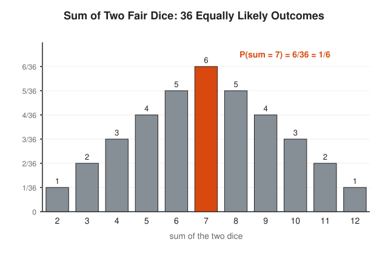

Roll two dice. There are $6 \times 6 = 36$ equally likely outcomes. Only one outcome makes a sum of 2, but six outcomes make a sum of 7. The triangle comes from pure counting. Add more dice and the triangle rounds off into the bell curve of the [Statistics Track](../statistics/README.md). That rounding is the Central Limit Theorem at work, and it is why the bell curve shows up everywhere.

## The Concept Ladder

### Beginner

#### 1. Outcomes and Events

The **sample space** $S$ lists every possible outcome. An **event** is the set of outcomes you care about. When all outcomes are equally likely, the probability of an event is a ratio of counts.

$$P(E) = \frac{|E|}{|S|} = \frac{\text{outcomes in } E}{\text{all outcomes}}$$

<!-- diagram: type=sample-space outcomes=HH,HT,TH,TT event="at least one head" caption="Sample space and an event" -->
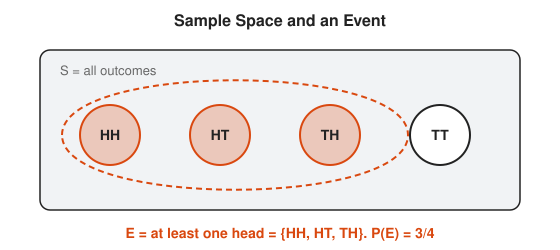

Course link: [501 Linear Algebra, Probability and Discrete Math](../../course/501/README.md).

#### 2. Counting Equally Likely Outcomes

Most beginner probability is counting in disguise. Each independent step multiplies the number of outcomes. A **tree diagram** draws this: one branch per choice, one leaf per outcome. The [Combinatorics Track](../combinatorics/README.md) goes deeper.

$$\text{outcomes} = n_1 \times n_2 \times \cdots, \qquad \binom{n}{k} = \frac{n!}{k!\,(n-k)!}$$

<!-- diagram: type=tree levels=3 branches=H,T caption="Tree diagram of three coin flips" -->
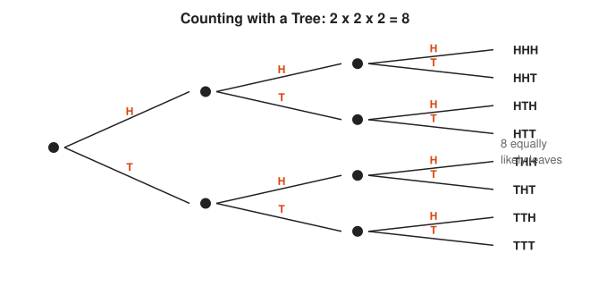

#### 3. Complement, OR and AND Rules

Three rules cover most cases. The **complement** rule: compute the chance it does not happen, then subtract from 1. The **addition** rule handles OR, minus the overlap you counted twice. The **multiplication** rule handles AND, and for **independent** events, events that do not affect each other, it is a plain product.

$$P(\text{not } A) = 1 - P(A), \qquad P(A \text{ or } B) = P(A) + P(B) - P(A \text{ and } B)$$

$$P(A \text{ and } B) = P(A)\,P(B) \quad \text{when } A, B \text{ are independent}$$

<!-- diagram: type=venn sets=A,B caption="Venn diagram for the addition rule" -->
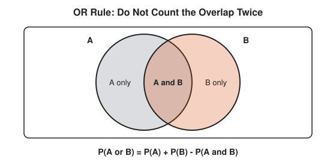

The complement rule is the lazy path and often the best one. "At least one failure in 100 requests" is hard to count directly. "Zero failures" is one product.

#### 4. Conditional Probability

$P(A \mid B)$, read "A given B", is the probability of $A$ once you know $B$ happened. Knowing $B$ throws away every outcome outside $B$. Then ask what fraction of what is left is also in $A$.

$$P(A \mid B) = \frac{P(A \text{ and } B)}{P(B)}$$

<!-- diagram: type=grid rows=6 cols=6 condition="first die = 6" event="sum >= 10" caption="Conditioning on a two-dice grid" -->
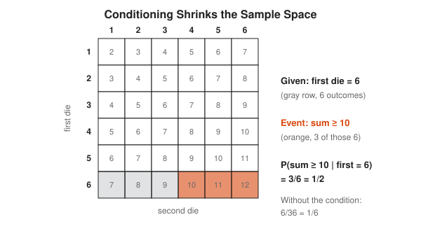

### Intermediate

#### 5. Bayes Theorem

Bayes theorem flips a conditional around. You usually know how often an alert fires during a real incident. You want the reverse: how often a real incident is behind an alert. When incidents are rare, even a good alert produces mostly false alarms.

$$P(H \mid E) = \frac{P(E \mid H)\,P(H)}{P(E)}$$

<!-- diagram: type=frequency-tree total=10000 split=1%,99% rates=99%,5% caption="Bayes with natural frequencies" -->
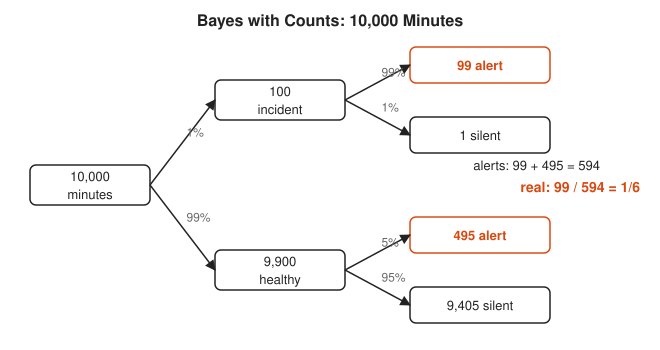

The trick that makes Bayes easy: replace percentages with counts of an imaginary crowd. Doctors, juries and on-call engineers all get this right far more often with counts than with formulas.

#### 6. Random Variables

A **random variable** attaches a number to each outcome: the number of heads, the sum of two dice, the latency of a request. Its **distribution** lists each value with its probability. Despite the name, a random variable is not random and not a variable. It is a function. Mathematicians are not good at naming things either.

$$\sum_x P(X = x) = 1$$

<!-- diagram: type=function-map from=HH,HT,TH,TT to=0,1,2 caption="A random variable maps outcomes to numbers" -->
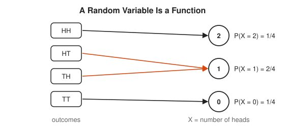

#### 7. Expected Value and Variance

The **expected value** is the long-run average: each value times its probability, all added. Picture the distribution as weights on a seesaw: the expected value is where it balances. The **variance** measures spread: the average squared distance from that balance point.

$$E[X] = \sum_x x\,P(X = x), \qquad \operatorname{Var}(X) = E\big[(X - E[X])^2\big]$$

<!-- diagram: type=balance-bars values=0,1,2,3 probs=1/8,3/8,3/8,1/8 caption="Expected value as a balance point" -->
![Bars for the number of heads in 3 flips: 1/8, 3/8, 3/8, 1/8 at 0, 1, 2, 3, resting on a beam. An orange fulcrum at 1.5 balances it. E[X] = 1.5 and Var(X) = 0.75.](img/expected-value-balance.svg)

Expected value is linear: $E[X + Y] = E[X] + E[Y]$, even when $X$ and $Y$ depend on each other. This one fact solves a surprising number of puzzles.

#### 8. Classic Distributions

A handful of shapes cover most real situations. **Binomial**: successes in $n$ tries. **Geometric**: tries until the first success. **Poisson**: count of rare events in an interval. **Normal**: sums of many small effects. **Exponential**: the wait between Poisson events.

$$P(N = k) = \frac{\lambda^k e^{-\lambda}}{k!} \quad \text{(Poisson with rate } \lambda)$$

<!-- diagram: type=small-multiples dists=binomial,geometric,poisson,normal caption="Four classic distributions" -->
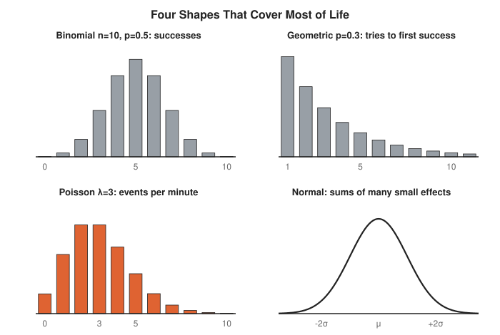

### Advanced

#### 9. Law of Large Numbers and Central Limit Theorem

Average many independent copies of a random variable. The **Law of Large Numbers** says the average settles at the expected value. The **Central Limit Theorem** says the leftover error is normal and shrinks like $1/\sqrt{n}$. To halve the error, you need four times the data.

$$\bar{X}_n \approx \mathcal{N}\!\left(\mu, \frac{\sigma^2}{n}\right)$$

<!-- diagram: type=running-average trials=1000 p=0.5 scale=log caption="Running fraction of heads settles near 0.5" -->
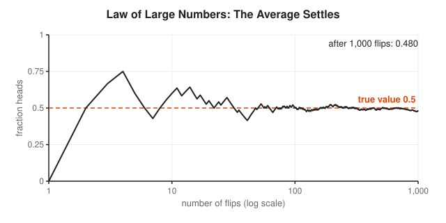

This is why a 5-minute error rate is noisy and a 30-day error rate is not. It is also why one bad canary pod tells you less than you want it to.

#### 10. Markov Chains

A **Markov chain** hops between states. The next hop depends only on the current state, not on the history. A table of hop probabilities, the **transition matrix** $P$, holds everything. Many chains settle into a **stationary distribution** $\pi$, the long-run share of time in each state.

$$\pi P = \pi$$

<!-- diagram: type=state-machine states=UP,DOWN p=0.99,0.01,0.5,0.5 caption="Two-state Markov chain" -->
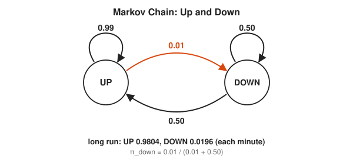

A service that fails 1% of minutes and recovers half the time each minute is down about 2% of the time. That number comes straight from $\pi$, and it is your availability. PageRank uses the same idea on the web link graph.

#### 11. Poisson Processes and Queues

A **Poisson process** models arrivals that happen independently at a steady average rate $\lambda$. Counts per interval are Poisson. Gaps between arrivals are exponential. Queueing theory builds on it and gives **Little's Law**, which ties the average number in the system $L$, the arrival rate $\lambda$ and the average time in the system $W$.

$$L = \lambda W$$

<!-- diagram: type=timeline process=poisson rate=2 duration=10 caption="Poisson arrivals on a timeline" -->
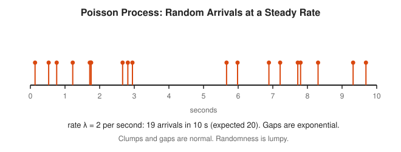

Random arrivals clump. A system sized for the average rate spends much of its life behind. Little's Law holds for nearly any stable queue, which makes it the most useful one-line formula in capacity planning.

## Worked Examples

### Example 1: At Least One Failure

A request fails with probability 0.001. What is the chance of at least one failure in 1,000 independent requests?

```txt
  P(one succeeds)      = 1 - 0.001 = 0.999       complement rule
  P(all 1,000 succeed) = 0.999^1000              independence: multiply
                       = 0.3677                  calculator
  P(at least one fail) = 1 - 0.3677 = 0.6323     complement rule again
```

A one-in-a-thousand failure is more likely than not to show up in a thousand tries.

### Example 2: Bayes for an Alert

Incidents occur in 1% of minutes. The alert fires in 99% of incident minutes and 5% of healthy minutes. The alert fires.

```txt
  imagine 10,000 minutes                          counts beat percentages
  incident minutes = 1% of 10,000 = 100           base rate
  alerts from incidents = 99% of 100 = 99         hit rate
  healthy minutes = 9,900                         the rest
  false alerts = 5% of 9,900 = 495                false-alarm rate
  all alerts = 99 + 495 = 594                     add both sources
  P(incident | alert) = 99 / 594 = 1/6            fraction of alerts that are real
```

### Example 3: Expected Number of Heads

```txt
  E[X] = 0 x 1/8 + 1 x 3/8 + 2 x 3/8 + 3 x 1/8   value times probability
       = 0 + 3/8 + 6/8 + 3/8                     multiply
       = 12/8 = 1.5                              add
```

## Big Theorems to Know

* **Kolmogorov Axioms (1933):** probabilities are non-negative, the whole space has probability 1, and probabilities of disjoint events add.
* **Bayes Theorem:** $P(H \mid E) = P(E \mid H)\,P(H) / P(E)$.
* **Linearity of Expectation:** $E[X + Y] = E[X] + E[Y]$, always.
* **Chebyshev Inequality:** at most $1/k^2$ of the probability lies more than $k$ standard deviations from the mean, for any distribution.
* **Law of Large Numbers:** sample averages converge to the expected value.
* **Central Limit Theorem:** sums of many independent pieces look normal.
* **Markov Chain Convergence:** a finite chain that reaches every state and does not cycle in lockstep converges to a unique stationary distribution.
* **Little's Law:** $L = \lambda W$ for any stable queue.

## Open Problems and Fun Facts

* **Birthday problem:** with 23 people in a room, the chance that two share a birthday is about 50.7%. Hash collisions follow the same math, which is why a 32-bit hash reaches a 50% chance of a collision at only about 77,000 keys.
* **Monty Hall:** switching doors wins 2/3 of the time. When Marilyn vos Savant published this in 1990, thousands of readers, including mathematicians, wrote to tell her she was wrong. She was right.
* **Buffon needle:** dropping needles on a floor of parallel lines estimates $\pi$. It is one of the oldest Monte Carlo methods, from the 1700s.
* **Origins:** probability began in 1654 with letters between Pascal and Fermat about how to split the pot of an unfinished gambling game.
* **Open problem:** for percolation on the three-dimensional grid, nobody has proved that the phase transition is continuous, even though every simulation suggests it.

## Starter Problems

1. Flip a fair coin three times. What is the probability of at least one head?
2. Roll two fair dice. What is the probability that the sum is 8?
3. Three independent replicas are each down with probability 0.01. What is the probability that all three are down at once?
4. Incidents occur in 2% of minutes. An alert fires in 90% of incident minutes and in 10% of healthy minutes. The alert fires. What is the probability of a real incident?
5. A request fails with probability 0.2, independently on each try, and you retry until it succeeds. What is the expected number of attempts?
6. A die is rolled once. Find $E[X]$ and $\operatorname{Var}(X)$.
7. Requests arrive at 50 per second and each spends 0.2 seconds in the system. On average, how many requests are in the system?

<details>
<summary>Answers</summary>

1. $7/8$. The complement, no heads at all, has probability $(1/2)^3 = 1/8$.
2. $5/36$. The pairs are (2,6), (3,5), (4,4), (5,3), (6,2).
3. $0.01^3 = 10^{-6}$, one in a million.
4. About $0.155$. In 10,000 minutes: 200 incidents give 180 alerts, and 9,800 healthy minutes give 980 false alerts. Then $180 / (180 + 980) = 180 / 1160 \approx 0.155$.
5. $1.25$ attempts. The number of attempts is geometric with success chance $p = 0.8$, and $E = 1/p = 1.25$.
6. $E[X] = 21/6 = 3.5$. $E[X^2] = 91/6$, and $\operatorname{Var}(X) = 91/6 - 3.5^2 = 35/12 \approx 2.917$.
7. 10 requests. Little's Law: $L = \lambda W = 50 \times 0.2 = 10$.

</details>

## Code Corner

[code/main.go](code/main.go) puts exact answers next to simulations: dice, Monty Hall, the birthday problem, Bayes, redundancy, retries, the UP/DOWN Markov chain and Poisson arrivals. The random seed is fixed, which makes the output repeatable. Run it with `go run main.go` inside `code/`.

```txt
== Two dice: P(sum = 7) ==
exact 6/36 = 0.1667

== Monty Hall, 100,000 games each ==
stay   0.334  (exact 1/3)
switch 0.665  (exact 2/3)

== Birthday problem ==
10 people: 0.117
23 people: 0.507
50 people: 0.970

== Bayes: alert fires, is it real? ==
P(alert) = 0.0594, P(incident | alert) = 0.1667

== Redundancy: replicas down with p = 0.01 each ==
1 replicas all down: 1e-02
2 replicas all down: 1e-04
3 replicas all down: 1e-06

== Retries: attempts until success, p(success) = 0.8 ==
average 1.249 attempts (exact 1/0.8 = 1.25)

== Markov chain UP/DOWN, stepped 200 minutes ==
UP 0.9804, DOWN 0.0196 (exact DOWN = 0.01/0.51 = 0.0196)

== Poisson arrivals at 2 per second for 1 hour ==
7335 arrivals (expected 7200, give or take about 85)
```

The redundancy lines assume independent failures. Replicas that share a rack, a region or a bad config push are not independent, and then the products lie. Most real outages live in that gap.

## Flashcards

[cards.tsv](cards.tsv) holds the key definitions and theorems for Anki import.

## Resources

* [Math Is Fun: Probability](https://www.mathsisfun.com/data/probability.html): the gentlest possible start, with pictures.
* [Seeing Theory](https://seeing-theory.brown.edu/): interactive visual chapters on probability from Brown University.
* [Grinstead and Snell: Introduction to Probability](https://math.dartmouth.edu/~prob/prob/prob.pdf): a free classic textbook from Dartmouth.
* [Better Explained: Bayes Theorem](https://betterexplained.com/articles/an-intuitive-and-short-explanation-of-bayes-theorem/): plain-language Bayes with the medical test example.
* [MIT OCW 6.041 Probabilistic Systems Analysis](https://ocw.mit.edu/courses/6-041-probabilistic-systems-analysis-and-applied-probability-fall-2010/): full lectures for the advanced rungs.
* [MacTutor: Andrey Kolmogorov](https://mathshistory.st-andrews.ac.uk/Biographies/Kolmogorov/): the mathematician who put probability on axioms.

## Where to Go Next

* [Statistics Track](../statistics/README.md) to run probability backwards, from data to conclusions.
* [Information Theory Track](../information-theory/README.md) to measure uncertainty in bits.
* [Combinatorics Track](../combinatorics/README.md) for sharper counting tools.
