# Real Analysis Track

**Track:** Real Analysis · **Span:** beginner to advanced · **Course levels:** [601 Proof and Higher Math](../../course/601/README.md) (real analysis), [401 Calculus](../../course/401/README.md) (prerequisite)
**Prerequisites:** a first pass through calculus, and some comfort reading a proof. The [Logic and Set Theory Track](../logic-and-set-theory/README.md) covers the quantifiers "for every" and "there exists", which this track uses on every page.
**Files:** this README, [cards.tsv](cards.tsv) for Anki, [code/main.go](code/main.go), and the diagrams in [img/](img/).

## What the Field Studies

Calculus is a set of powerful tools. Real analysis is the inspection report that proves the tools are safe to use.

Calculus says "as $x$ gets close to $a$" and "add up infinitely many tiny pieces". Real analysis asks what those phrases mean, exactly, and when they fail. The answers rest on one property of the real number line: it has no gaps. Everything else, limits, continuity, derivatives and integrals, is built carefully on top of that one fact.

## Why It Matters

* **Algorithms that converge:** every iterative method, from Newton's method to gradient descent to PageRank, comes with a question: does it actually settle, and how fast? Real analysis supplies the tools to answer.
* **Error bounds:** "within $\varepsilon$ after $N$ steps" is the analyst's sentence and also the shape of an SLO: within 300 ms for 99% of requests.
* **Swapping limits:** moving a limit inside a sum or an integral is how many engineering formulas are derived. Sometimes it is legal and sometimes it gives nonsense. Uniform convergence tells you which.
* **Probability and machine learning:** expected values, densities and convergence of training are built on the Lebesgue integral.

## Concept Map

<!-- diagram: type=concept-map tiers=beginner,intermediate,advanced nodes=10 caption="Real analysis concepts with prerequisite arrows" -->


Read the map top to bottom. An arrow from A to B means learn A first. Start at the orange box.

## Signature Diagram

<!-- diagram: type=sequence-plot a_n="1+(-1)^n/n" n=1..20 epsilon=0.15 N=7 caption="Sequence entering an epsilon band" -->
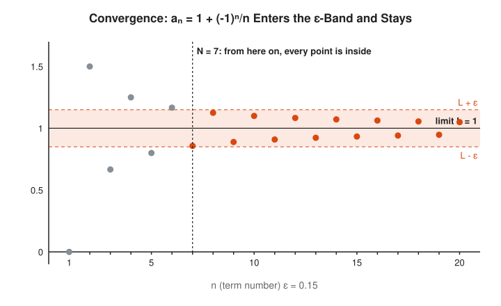

This is the picture behind the word "limit". Pick any band width $\varepsilon$ around the target, however thin. If you can always find a point $N$ after which every term stays in the band, the sequence converges. A thinner band needs a later $N$, and that is fine. What matters is that some $N$ always exists. Here, for $\varepsilon = 0.15$, the answer is $N = 7$.

## The Concept Ladder

### Beginner

#### 1. Real Numbers and Completeness

The rational numbers (fractions) have gaps: the number whose square is 2 is not a fraction. The real numbers fill every gap. The precise statement is the **least upper bound property**: every non-empty set of reals with an upper bound has a smallest upper bound, called the **supremum**.

$$S = \{x \in \mathbb{Q} : x^2 < 2\} \implies \sup S = \sqrt{2} \notin \mathbb{Q}$$

<!-- diagram: type=number-line range=0.9..1.6 marks=1,1.4,1.41,1.414,1.4142 open=sqrt2 caption="Rationals approaching the square root of 2" -->
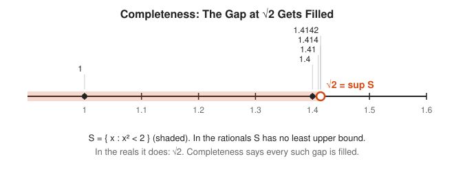

Course link: [601 Proof and Higher Math](../../course/601/README.md).

#### 2. Sequences and Limits

A sequence $a_1, a_2, a_3, \ldots$ **converges** to $L$ when, for every tolerance $\varepsilon > 0$, there is a point $N$ such that every term after $N$ is within $\varepsilon$ of $L$. The order of the quantifiers matters: $\varepsilon$ comes first, and $N$ is allowed to depend on it.

$$\forall \varepsilon > 0 \;\; \exists N \;\; \forall n > N: \; |a_n - L| < \varepsilon$$

<!-- diagram: type=number-line sequence=1/n n=1..60 epsilon=0.1 caption="Terms of 1/n crowding toward 0" -->
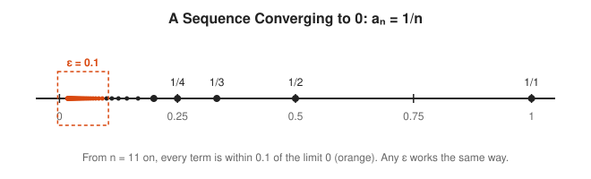

Read the symbols aloud: "for every epsilon greater than zero, there exists an N, such that for all n beyond N, the distance from $a_n$ to $L$ is less than epsilon." It is a contract. You name the tolerance, I name the deadline.

#### 3. Series and Convergence

A **series** adds the terms of a sequence. It converges when its partial sums converge. Some series converge (the geometric series), some creep off to infinity even though their terms shrink to zero (the harmonic series). Tests such as comparison and ratio sort them out.

$$\sum_{n=1}^{\infty} \frac{1}{2^n} = 1, \qquad \sum_{n=1}^{\infty} \frac{1}{n} = \infty$$

<!-- diagram: type=area-split shape=square pieces=1/2,1/4,1/8,... caption="Geometric series filling a square" -->
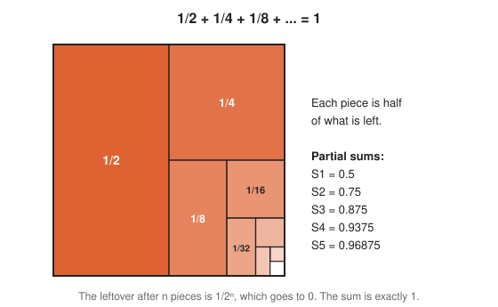

Terms shrinking to zero is necessary but not enough. The harmonic series is the standard warning: after a million terms it has only reached about 14.4, but it never stops growing.

### Intermediate

#### 4. Continuity

A function is **continuous** at $a$ when small changes in $x$ near $a$ produce small changes in $f(x)$. Formally: for every output tolerance $\varepsilon$ there is an input tolerance $\delta$ that keeps $f(x)$ within $\varepsilon$ of $f(a)$. Continuous functions on closed intervals behave well: they hit every value in between (**Intermediate Value Theorem**) and reach a maximum and a minimum (**Extreme Value Theorem**).

$$\forall \varepsilon > 0 \;\; \exists \delta > 0: \; |x - a| < \delta \implies |f(x) - f(a)| < \varepsilon$$

<!-- diagram: type=epsilon-delta f="x^2/4+1/2" a=2 epsilon=0.6 caption="Epsilon-delta box for continuity" -->
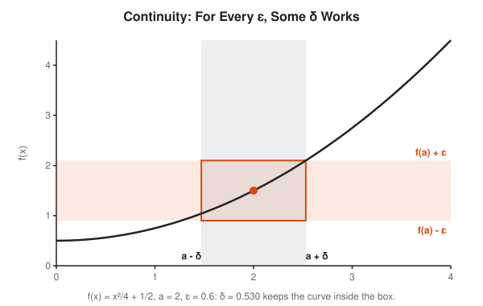

#### 5. Derivatives and the Mean Value Theorem

The derivative is a limit of slopes. Its most useful theorem is the **Mean Value Theorem**: on any smooth stretch, the instantaneous rate somewhere equals the average rate over the whole stretch. If you averaged 100 km/h on a trip, your speedometer read exactly 100 at some moment.

$$f'(c) = \frac{f(b) - f(a)}{b - a} \quad \text{for some } c \in (a, b)$$

<!-- diagram: type=mvt f="x^3-x" interval=0..2 caption="Mean value theorem tangent parallel to secant" -->
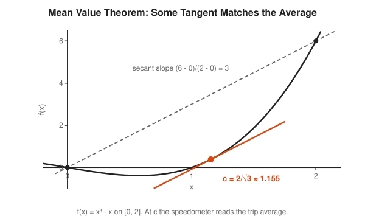

#### 6. The Riemann Integral

Cover the area under a curve with thin rectangles. Rectangles that sit below the curve give a **lower sum**. Rectangles that poke above give an **upper sum**. When the two can be squeezed together by using thinner strips, the function is **integrable**, and the common value is the integral.

$$L(f, P) \le \int_a^b f(x)\,dx \le U(f, P)$$

<!-- diagram: type=riemann-sums f=x^2 interval=0..1 strips=5 caption="Lower and upper Riemann sums" -->
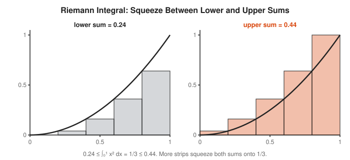

#### 7. Uniform Convergence

A sequence of functions can converge at every point and still misbehave. **Pointwise** convergence allows each point to have its own deadline. **Uniform** convergence demands one deadline that works for every point at once. Only uniform convergence guarantees that a limit of continuous functions is continuous and that limits and integrals can swap.

$$\sup_x |f_n(x) - f(x)| \to 0$$

<!-- diagram: type=function-family f="x^n" n=1,2,5,10,30 caption="x^n converges pointwise but not uniformly" -->
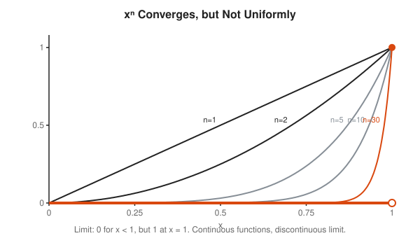

Each curve is continuous. Their limit has a jump. Pointwise convergence let that happen, and uniform convergence forbids it. This is the classic trap behind many wrong "proofs".

### Advanced

#### 8. Metric Spaces and Compactness

A **metric** is any distance function that is never negative, symmetric, and obeys the triangle inequality. Limits and continuity then work in any space with a metric: spaces of functions, strings (edit distance) or graphs. **Compact** sets, the generalization of closed bounded intervals, are where every sequence has a convergent subsequence.

$$d(x, z) \le d(x, y) + d(y, z)$$

<!-- diagram: type=unit-balls metrics=taxicab,euclidean,max caption="Unit balls in three metrics" -->
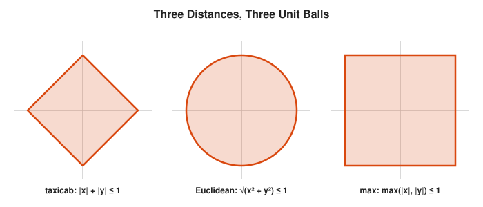

The "unit ball" depends on how you measure. A taxi in Manhattan sees a diamond. A chess king sees a square.

#### 9. Lebesgue Measure and Integral

The Riemann integral slices the $x$-axis into strips. The **Lebesgue integral** slices the $y$-axis into layers and asks how large the set of $x$ values reaching each height is. That set needs a size, a **measure**, even when it is scattered. The payoff: far more functions are integrable, and limits pass through integrals under mild conditions.

$$\int f \, d\mu = \int_0^\infty \mu\big(\{x : f(x) > t\}\big)\, dt \quad (f \ge 0)$$

<!-- diagram: type=slicing-compare methods=riemann,lebesgue caption="Riemann columns versus Lebesgue layers" -->
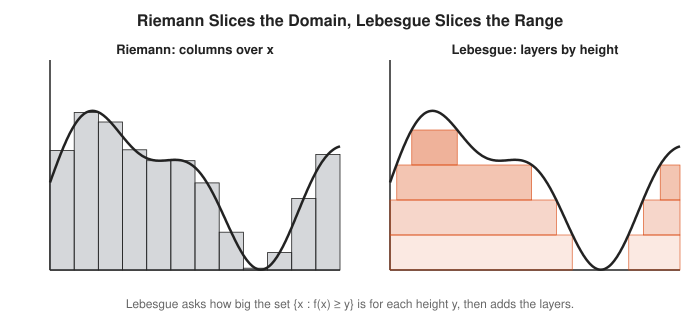

Lebesgue offered a shopkeeper analogy: Riemann counts coins in the order they come out of the pocket. Lebesgue sorts them by value first, then counts each pile.

#### 10. Fourier and Functional Analysis

Treat functions as points in an infinite-dimensional space with a distance. Then sines and cosines act like perpendicular axes, and a **Fourier series** writes a function in those coordinates. **Functional analysis** studies such spaces and the linear maps between them. It is the setting for quantum mechanics, signal processing and much of machine learning theory.

$$f(x) = \frac{a_0}{2} + \sum_{n=1}^{\infty} \big(a_n \cos nx + b_n \sin nx\big)$$

<!-- diagram: type=fourier-partial-sums target=square-wave terms=1,3,15 caption="Fourier partial sums approaching a square wave" -->
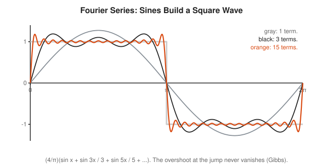

## Worked Examples

### Example 1: Prove a Limit with Epsilon and N

Prove that $1/n \to 0$.

```txt
  goal: for every ε > 0 find N with 1/n < ε for all n > N
  let ε > 0 be given                        the challenger picks ε
  choose N = ceiling(1/ε)                   our answer depends on ε
  take any n > N                            the contract covers all later n
  then n > 1/ε                              since N ≥ 1/ε
  so 1/n < ε                                flip both sides (all positive)
  |1/n - 0| < ε                             this is the definition
```

### Example 2: Find δ for a Given ε

For $f(x) = 3x + 1$ at $a = 2$, find $\delta$ that works for $\varepsilon = 0.6$.

```txt
  |f(x) - f(2)| = |3x + 1 - 7|              f(2) = 7
                = |3x - 6| = 3|x - 2|       factor
  want 3|x - 2| < 0.6                       target tolerance ε
  so |x - 2| < 0.2                          divide by 3
  δ = 0.2 works (any smaller δ also works)  in general δ = ε/3
```

### Example 3: A Geometric Series

```txt
  S = 1/2 + 1/4 + 1/8 + ...                 the series
  S/2 = 1/4 + 1/8 + ...                     halve every term
  S - S/2 = 1/2                             subtract: all but the first cancel
  S/2 = 1/2                                 simplify
  S = 1                                     multiply by 2
```

The subtraction trick is legal only because the series converges. Try it on $1 + 2 + 4 + \cdots$ and you "prove" the sum is $-1$. Analysis exists to stop exactly this kind of accident.

## Big Theorems to Know

* **Least Upper Bound Property:** every non-empty set of reals bounded above has a supremum.
* **Monotone Convergence Theorem:** a sequence that only goes up and stays bounded converges.
* **Bolzano-Weierstrass Theorem:** every bounded sequence of reals has a convergent subsequence.
* **Intermediate Value Theorem:** a continuous function on $[a, b]$ takes every value between $f(a)$ and $f(b)$.
* **Extreme Value Theorem:** a continuous function on $[a, b]$ attains a maximum and a minimum.
* **Mean Value Theorem:** somewhere the instantaneous rate equals the average rate.
* **Fundamental Theorem of Calculus:** integration and differentiation undo each other.
* **Heine-Borel Theorem:** a subset of $\mathbb{R}^n$ is compact exactly when it is closed and bounded.
* **Dominated Convergence Theorem:** under a common integrable bound, limits pass through Lebesgue integrals.

## Open Problems and Fun Facts

* **Monsters:** Weierstrass built a function in 1872 that is continuous everywhere and differentiable nowhere. It looks like a coastline at every zoom level. Poincare called such functions an outrage against common sense.
* **Rearranging a series:** the alternating harmonic series $1 - 1/2 + 1/3 - \cdots$ sums to $\ln 2$. Rearrange the same terms and the Riemann rearrangement theorem says you get any sum you like.
* **Some infinities are bigger:** Cantor proved in 1891 that the real numbers cannot be listed, even though the rationals can. The [Logic and Set Theory Track](../logic-and-set-theory/README.md) shows the diagonal argument.
* **Open problem:** is $\zeta(5) = \sum 1/n^5$ irrational? Apery proved $\zeta(3)$ irrational in 1978. For $\zeta(5)$ nobody knows.
* **Open problem:** is $e + \pi$ irrational? Almost certainly, and still unproved.

## Starter Problems

1. Find $\sup\{1 - 1/n : n = 1, 2, 3, \ldots\}$. Is it in the set?
2. For $a_n = 1/n^2$ and $\varepsilon = 0.01$, find an $N$ that works.
3. Does $\sum 1/2^n$ converge? Does $\sum 1/\sqrt{n}$?
4. For $f(x) = 5x$ at $a = 1$ and $\varepsilon = 0.1$, find a $\delta$.
5. A function is continuous on $[0, 1]$ with $f(0) = -2$ and $f(1) = 3$. What does the Intermediate Value Theorem promise?
6. For $f(x) = x^2$ on $[0, 2]$, find the $c$ promised by the Mean Value Theorem.
7. Compute the lower and upper Riemann sums for $f(x) = x$ on $[0, 1]$ with 4 equal strips.

<details>
<summary>Answers</summary>

1. The supremum is 1. It is not in the set, because $1 - 1/n < 1$ for every $n$.
2. $N = 10$. For $n > 10$, $n^2 > 100$ and $1/n^2 < 0.01$.
3. Yes: it sums to 1. No: $1/\sqrt{n} \ge 1/n$, and the harmonic series already diverges.
4. $\delta = 0.02$. $|5x - 5| = 5|x - 1| < 0.1$ when $|x - 1| < 0.02$.
5. Some $c$ in $(0, 1)$ has $f(c) = 0$, because 0 lies between $-2$ and $3$.
6. $c = 1$. The average slope is $(4 - 0)/2 = 2$, and $f'(c) = 2c = 2$.
7. Lower: $\frac{1}{4}(0 + 0.25 + 0.5 + 0.75) = 0.375$. Upper: $\frac{1}{4}(0.25 + 0.5 + 0.75 + 1) = 0.625$. The integral $0.5$ sits between.

</details>

## Code Corner

[code/main.go](code/main.go) finds $N$ for several values of $\varepsilon$, compares a convergent and a divergent series, closes in on $\sqrt{2}$ with nested intervals, squeezes Riemann sums onto $1/3$, and shows why $x^n$ fails to converge uniformly. Run it with `go run main.go` inside `code/`.

```txt
== Epsilon-N for a_n = 1 + (-1)^n / n ==
eps = 0.15   N = 7     check |a_N - 1| = 0.142857
eps = 0.01   N = 101   check |a_N - 1| = 0.009901
eps = 0.001  N = 1001  check |a_N - 1| = 0.000999

== Partial sums ==
n = 10       1/2+1/4+... = 0.999023   1+1/2+1/3+... =   2.9290   1-1/2+1/3-... = 0.645635
n = 1000     1/2+1/4+... = 1.000000   1+1/2+1/3+... =   7.4855   1-1/2+1/3-... = 0.692647
n = 1000000  1/2+1/4+... = 1.000000   1+1/2+1/3+... =  14.3927   1-1/2+1/3-... = 0.693147
limits:      geometric -> 1, harmonic -> infinity (like ln n = 13.8155), alternating -> ln 2 = 0.693147

== Nested intervals close in on sqrt(2) ==
step  6: [1.4062500000, 1.4218750000] width 1.6e-02
step 12: [1.4140625000, 1.4143066406] width 2.4e-04
step 18: [1.4142112732, 1.4142150879] width 3.8e-06
step 24: [1.4142135382, 1.4142135978] width 6.0e-08
step 30: [1.4142135615, 1.4142135624] width 9.3e-10

== Riemann sums for x^2 on [0, 1] (exact 1/3) ==
n = 5     lower 0.240000  upper 0.440000  gap 0.200000
n = 50    lower 0.323400  upper 0.343400  gap 0.020000
n = 500   lower 0.332334  upper 0.334334  gap 0.002000
n = 5000  lower 0.333233  upper 0.333433  gap 0.000200

== x^n on [0, 1): pointwise to 0, but not uniformly ==
n = 1     x^n is still 0.5 at x = 0.500000
n = 10    x^n is still 0.5 at x = 0.933033
n = 100   x^n is still 0.5 at x = 0.993092
n = 1000  x^n is still 0.5 at x = 0.999307
For every n some x < 1 has x^n = 0.5: the worst-case error never shrinks.
```

The harmonic column is the lesson in patience: a million terms, and it has crawled to 14.4. It diverges anyway. Computers cannot prove divergence by waiting, which is why analysis uses proofs instead.

## Flashcards

[cards.tsv](cards.tsv) holds the key definitions and theorems for Anki import.

## Resources

* [Jiri Lebl: Basic Analysis](https://www.jirka.org/ra/): a free, clear introductory real analysis textbook.
* [MIT OCW 18.100A Real Analysis](https://ocw.mit.edu/courses/18-100a-real-analysis-fall-2020/): full lecture videos and notes.
* [Richard Hammack: Book of Proof](https://www.people.vcu.edu/~rhammack/BookOfProof/): free, gentle preparation in proof writing and quantifiers.
* [Paul's Online Notes: Calculus II](https://tutorial.math.lamar.edu/Classes/CalcII/CalcII.aspx): sequences and series chapters give computational background for rungs 2 and 3.
* [MacTutor: Karl Weierstrass](https://mathshistory.st-andrews.ac.uk/Biographies/Weierstrass/): the mathematician who made epsilon-delta the standard.

## Where to Go Next

* [Topology Track](../topology/README.md) to strip continuity down to open sets.
* [Complex Analysis Track](../complex-analysis/README.md) for calculus where derivatives are far more powerful.
* [Numerical Methods Track](../numerical-methods/README.md) for convergence with real deadlines.
