# Statistics Track

**Track:** Statistics · **Span:** beginner to advanced · **Course levels:** [501 Linear Algebra, Probability and Discrete Math](../../course/501/README.md)
**Prerequisites:** averages and percentages from [101](../../course/101/README.md). The [Probability Track](../probability/README.md) supplies the theory behind the intermediate rungs. Statistics is a good place to start even with rusty math: the first four rungs need only arithmetic.
**Files:** this README, [cards.tsv](cards.tsv) for Anki, [code/main.go](code/main.go), and the diagrams in [img/](img/).

## What the Field Studies

Probability starts with a known process and predicts the data. Statistics runs the other way. It starts with data and works backward to the process that made it.

Statistics answers three kinds of questions. What does this data look like? That is **description**. How sure am I about a number I estimated? That is **inference**. Is this difference real or noise? That is **testing**.

## Why It Matters

Monitoring is applied statistics:

* A dashboard shows p50, p95 and p99 latency. Those are **percentiles**, and the slow tail they reveal is invisible in the mean.
* An anomaly detector flags a point that sits too many standard deviations from a moving baseline.
* A canary deploy compares error rates between two groups. Deciding whether the gap is real is a **hypothesis test**.
* A capacity forecast fits a line or a curve through history. That is **regression**.

The workshop [Statistics for Monitoring and Anomaly Detection](../../workshops/statistics-for-monitoring-and-anomaly-detection/README.md) builds on this track.

## Concept Map

<!-- diagram: type=concept-map tiers=beginner,intermediate,advanced nodes=12 caption="Statistics concepts with prerequisite arrows" -->


Read the map top to bottom. An arrow from A to B means learn A first. Start at the orange box.

## Signature Diagram

<!-- diagram: type=normal-curve bands=1,2,3 labels="68.3%,95.4%,99.7%" caption="Normal curve with sigma bands" -->
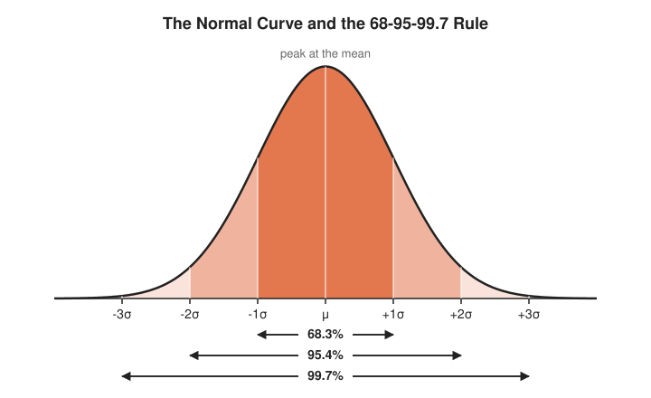

The **normal curve** is the most famous picture in statistics. Its center is the mean, written $\mu$ (the Greek letter mu). Its width is the standard deviation, written $\sigma$ (sigma). Read the bands as a rule of thumb: about 68% of values land within one $\sigma$ of the mean, 95% within two, and 99.7% within three. A value beyond three $\sigma$ happens about three times in 1,000, which is why many alerting rules use it as a threshold.

## The Concept Ladder

### Beginner

#### 1. Center: Mean, Median and Mode

The **mean** adds everything and divides by the count. The **median** is the middle value after sorting. The **mode** is the most common value. The mean chases outliers. The median ignores them.

$$\bar{x} = \frac{1}{n} \sum_{i=1}^{n} x_i = \frac{x_1 + x_2 + \cdots + x_n}{n}$$

<!-- diagram: type=dot-plot data=12,15,11,90,12 marks=mean,median caption="Mean versus median with one outlier" -->
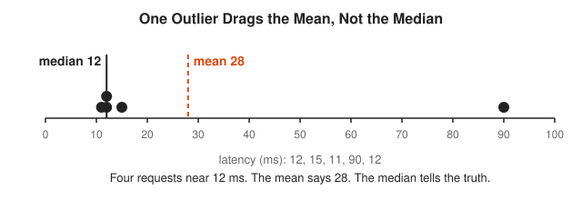

The symbol $\sum$ (capital sigma) means "add up". $\sum_{i=1}^{n} x_i$ reads "add $x_i$ for $i$ from 1 to $n$". It is a `for` loop written by people who did not have keyboards.

Course link: [501 Linear Algebra, Probability and Discrete Math](../../course/501/README.md).

#### 2. Histograms and Percentiles

A **histogram** sorts values into bins and draws one bar per bin. It shows shape: one hump or two, symmetric or with a long tail. The **p-th percentile** is the value with p% of the data at or below it. The p99 latency is the time that 99% of requests beat.

<!-- diagram: type=histogram data=lognormal n=5000 marks=p50,p99 caption="Latency histogram with p50 and p99" -->
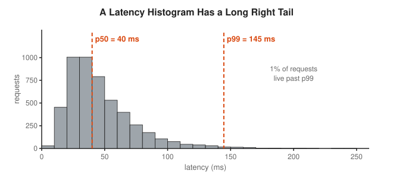

Latency is almost never symmetric. It has a floor (the network is never faster than light) and no ceiling (a garbage collection pause has opinions). That is why SLOs use percentiles.

#### 3. Spread: Variance and Standard Deviation

Two data sets can share a mean and look nothing alike. The **variance** averages the squared distances from the mean. The **standard deviation** is its square root, back in the same units as the data. Dividing by $n - 1$ instead of $n$ corrects a small bias when you work from a sample.

$$s = \sqrt{\frac{1}{n-1} \sum_{i=1}^{n} (x_i - \bar{x})^2}$$

<!-- diagram: type=dot-plot-pair A=48..52 B=30..70 caption="Same mean, different spread" -->
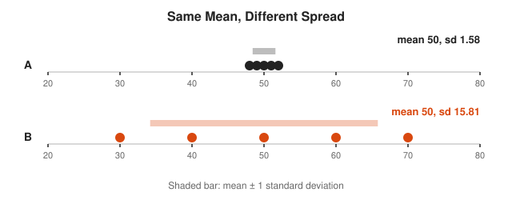

#### 4. The Normal Curve and z-Scores

The **z-score** says how many standard deviations a value sits from the mean. It puts any data on one common ruler. A z-score of 3 is unusual whether the unit is milliseconds, dollars or degrees.

$$z = \frac{x - \mu}{\sigma}$$

<!-- diagram: type=dual-ruler mean=200 sd=20 caption="Converting latency to z-scores" -->
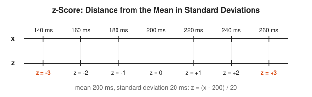

### Intermediate

#### 5. Sampling and the Central Limit Theorem

You almost never see the whole population. You see a sample. The **Central Limit Theorem** says that sample means pile up in a bell shape around the true mean. Their spread is the **standard error**. It shrinks as the sample grows, but only with the square root: four times the data buys half the error.

$$SE = \frac{\sigma}{\sqrt{n}}$$

<!-- diagram: type=distribution-series n=1,2,5 source=die caption="Means of dice become a bell" -->
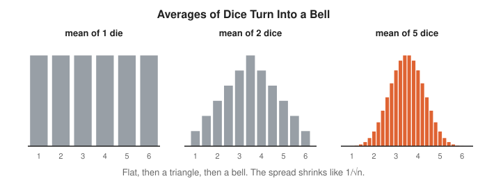

#### 6. Confidence Intervals

A **confidence interval** wraps an estimate in a margin of error. "95% confidence" describes the method, not one interval: repeat the whole study many times, and 95% of the intervals catch the true value. Any single interval either caught it or did not.

$$\bar{x} \pm 1.96 \cdot \frac{s}{\sqrt{n}}$$

<!-- diagram: type=interval-stack count=20 level=0.95 caption="Twenty confidence intervals around a true mean" -->
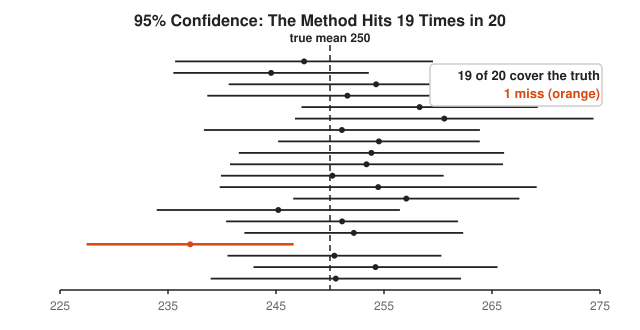

#### 7. Hypothesis Tests and p-Values

Start from a **null hypothesis** $H_0$, a boring default such as "the canary and the baseline have the same error rate". The **p-value** is the chance of data at least this extreme if $H_0$ is true. A small p-value is evidence against $H_0$. It is not the probability that $H_0$ is true, a mistake so common it has its own literature.

$$p = P(\text{data this extreme} \mid H_0)$$

<!-- diagram: type=normal-tail z=2.1 sides=1 caption="p-value as tail area" -->
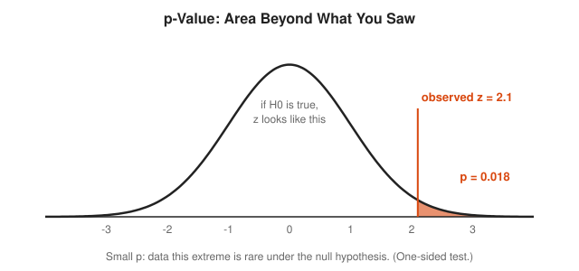

#### 8. Correlation and Regression

The **correlation** $r$ runs from $-1$ to $1$ and measures how well a straight line fits a scatter plot. **Linear regression** finds the line that makes the squared vertical misses, the **residuals**, as small as possible in total. Correlation does not prove causation: CPU and request count rise together because traffic drives both.

$$\hat{y} = a + bx, \qquad b = r \cdot \frac{s_y}{s_x}, \qquad a = \bar{y} - b\bar{x}$$

<!-- diagram: type=scatter-fit points=8 residuals=true caption="Least squares line with residuals" -->
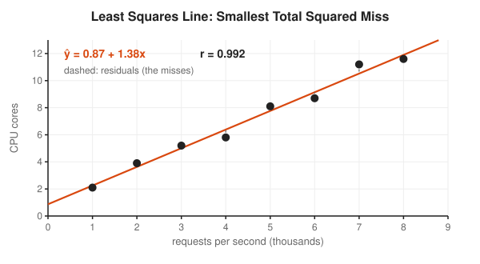

### Advanced

#### 9. Time Series and Anomaly Detection

Metrics arrive in time order, and neighboring points are not independent. Time-series methods model **trend**, **seasonality** (the daily traffic wave) and noise. An **exponentially weighted moving average** (EWMA) gives a cheap baseline: each new point nudges it by a fraction $\alpha$, and old data fades smoothly.

$$m_t = \alpha x_t + (1 - \alpha)\, m_{t-1}$$

<!-- diagram: type=time-series wave=daily baseline=ewma alpha=0.3 caption="EWMA baseline with one anomaly" -->
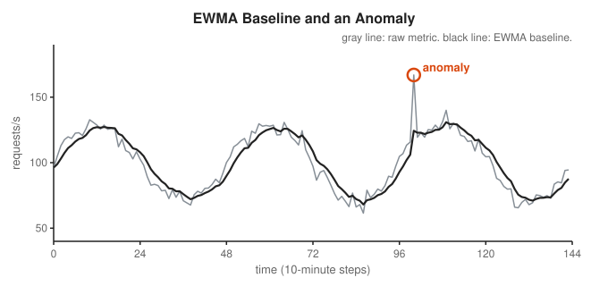

A static threshold fires every afternoon at peak and sleeps through a 3 a.m. spike. A baseline that follows the wave catches both cases correctly.

#### 10. Bootstrap and Resampling

The **bootstrap** estimates uncertainty with computing power instead of formulas. Resample your own data with replacement thousands of times, recompute the statistic each time, and look at the spread. It works for awkward statistics such as p99, where no tidy formula exists.

<!-- diagram: type=flow steps=sample,resample,statistic,histogram caption="Bootstrap resampling" -->
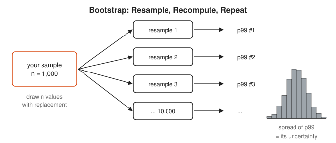

#### 11. Bayesian Inference

Bayesian statistics treats unknown quantities as uncertain and describes them with distributions. Start with a **prior** belief, multiply by the **likelihood** of the data, and rescale to get the **posterior**. It answers the question people actually ask: how likely is this, given what I saw.

$$\text{posterior} \propto \text{likelihood} \times \text{prior}$$

<!-- diagram: type=density-curves prior=beta(2,2) likelihood=beta(8,4) posterior=beta(9,5) caption="Bayesian update for a success rate" -->
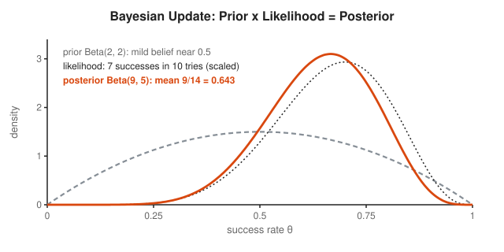

The posterior sits between the prior and the data, and leans toward whichever carries more information. Ten observations already outweigh a mild prior.

#### 12. Experiments and A/B Testing

Randomization turns correlation into causation: assign users to groups by coin flip, and any systematic difference comes from the treatment. Real experiments fix the sample size in advance and correct for **multiple comparisons**. Test 20 metrics at the 5% level and one false alarm is the expected result, not a discovery.

$$\text{expected false positives} = m \cdot \alpha = 20 \times 0.05 = 1$$

<!-- diagram: type=strip-plot pvalues=20 threshold=0.05 caption="Twenty p-values with one fluke" -->
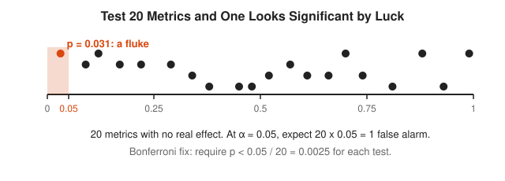

## Worked Examples

### Example 1: Mean, Median and Standard Deviation

Data: 2, 4, 4, 4, 5, 5, 7, 9 (treat it as the whole population).

```txt
  sum = 2+4+4+4+5+5+7+9 = 40                     add the values
  mean = 40 / 8 = 5                              divide by the count
  median = (4 + 5) / 2 = 4.5                     middle two of 8 sorted values
  deviations: -3,-1,-1,-1,0,0,2,4                subtract the mean
  squares: 9,1,1,1,0,0,4,16 -> sum 32            square and add
  population variance = 32 / 8 = 4               divide by n
  population sd = sqrt(4) = 2                    square root
```

### Example 2: A Confidence Interval

A sample of 100 requests has mean 250 ms and standard deviation 30 ms.

```txt
  SE = 30 / sqrt(100) = 30 / 10 = 3              standard error
  margin = 1.96 x 3 = 5.88                       95% multiplier
  interval = 250 - 5.88 to 250 + 5.88            mean plus or minus margin
           = 244.12 to 255.88 ms                 arithmetic
```

### Example 3: Is This Latency Unusual?

Normal latency has mean 200 ms and standard deviation 20 ms. A request takes 260 ms.

```txt
  z = (260 - 200) / 20                           z-score formula
    = 60 / 20 = 3                                arithmetic
  beyond 3 sd: about 0.3% of values              68-95-99.7 rule
  unusual: worth a look                          conclusion
```

## Big Theorems to Know

* **Law of Large Numbers:** sample means converge to the population mean.
* **Central Limit Theorem:** sample means are approximately normal with standard error $\sigma / \sqrt{n}$.
* **Chebyshev Inequality:** for any distribution, at least $1 - 1/k^2$ of values lie within $k$ standard deviations of the mean. At $k = 3$ that is at least 88.9%, even for ugly data.
* **Gauss-Markov Theorem:** under standard assumptions, least squares gives the best linear unbiased estimates.
* **Neyman-Pearson Lemma:** the likelihood ratio test is the most powerful test at a fixed false-alarm rate.
* **Bayes Theorem:** posterior is proportional to likelihood times prior.

## Open Problems and Fun Facts

* **Guinness and the t-test:** William Gosset invented the t-distribution in 1908 to judge small batches at the Guinness brewery. He published as "Student" because Guinness did not allow employees to publish.
* **Anscombe quartet:** four data sets share the same mean, variance, correlation and regression line, yet their scatter plots look completely different. Always plot your data.
* **Simpson paradox:** a trend can reverse when you split data into groups. A famous case is the 1973 Berkeley graduate admissions data.
* **Florence Nightingale** used her rose diagrams in the 1850s to show that disease, not battle, killed most soldiers, and changed hospital policy.
* **Behrens-Fisher problem:** testing whether two normal populations with unknown, unequal variances share a mean has no exact classical solution. Welch's approximation is what everyone uses.

## Starter Problems

1. Five request latencies are 12, 15, 11, 90 and 12 ms. Find the mean and the median. Which describes a typical request better?
2. Find the population standard deviation of 2, 4, 4, 4, 5, 5, 7, 9.
3. Latency is normal with mean 200 ms and standard deviation 20 ms. About what fraction of requests take longer than 240 ms?
4. A sample of 100 requests has mean 250 ms and standard deviation 30 ms. Give an approximate 95% confidence interval for the true mean.
5. With mean 200 ms and standard deviation 20 ms, a request takes 260 ms. What is its z-score, and is it unusual?
6. You want to halve the width of a confidence interval. How much more data do you need?
7. An A/B test checks 40 metrics at $\alpha = 0.05$ and nothing really changed. How many false alarms do you expect?

<details>
<summary>Answers</summary>

1. Mean $= 140 / 5 = 28$ ms. Median $= 12$ ms. The median is the better typical value because the single 90 ms outlier drags the mean up.
2. $\sigma = 2$. See Worked Example 1.
3. About 2.5%. 240 ms is two standard deviations above the mean. About 95% lies within two, leaving 5% split between the two tails.
4. About 244.1 ms to 255.9 ms. The standard error is $30 / \sqrt{100} = 3$, and $250 \pm 1.96 \times 3 = 250 \pm 5.88$.
5. $z = (260 - 200) / 20 = 3$. Yes. Only about 0.3% of values lie more than three standard deviations from the mean.
6. Four times as much. The width scales like $1/\sqrt{n}$, and $\sqrt{4} = 2$.
7. Two. $40 \times 0.05 = 2$.

</details>

## Code Corner

[code/main.go](code/main.go) computes center and spread, percentiles of 5,000 simulated latencies, z-scores, a confidence interval, the regression line from the diagram, an EWMA anomaly detector, and a bootstrap interval for p99. Run it with `go run main.go` inside `code/`.

```txt
== Center ==
latencies [12 15 11 90 12]
mean 28.0 ms, median 12.0 ms

== Spread ==
A: mean 50, sd 1.58
B: mean 50, sd 15.81

== Percentiles of 5,000 simulated latencies ==
p50     39.9 ms
p90     80.4 ms
p99    149.5 ms
p99.9  213.6 ms
mean    46.5 ms (pulled up by the tail)

== z-scores (mean 200, sd 20) ==
180 ms -> z = -1.0
240 ms -> z = +2.0
260 ms -> z = +3.0

== 95% confidence interval ==
mean 250, sd 30, n 100 -> 244.12 to 255.88

== Least squares line ==
y = 0.871 + 1.379 x, r = 0.992

== EWMA anomaly detector ==
t=8 value 160 vs baseline 99.5: ANOMALY

== Bootstrap interval for p99 ==
p99 of sample 150.4 ms, bootstrap 95% interval 128.9 to 165.3 ms
```

The last line deserves a second look. A p99 from 1,000 requests is only good to roughly plus or minus 20 ms. Ten requests make up that tail. Before you page someone over a p99 change, ask how many requests sit behind it.

## Flashcards

[cards.tsv](cards.tsv) holds the key definitions and theorems for Anki import.

## Resources

* [NIST/SEMATECH e-Handbook of Statistical Methods](https://www.itl.nist.gov/div898/handbook/): an engineer's statistics reference in plain HTML.
* [OpenStax: Introductory Statistics 2e](https://openstax.org/details/books/introductory-statistics-2e): a free, complete first course.
* [Math Is Fun: Standard Normal Distribution](https://www.mathsisfun.com/data/standard-normal-distribution.html): z-scores and the bell curve with pictures.
* [Khan Academy: Statistics and Probability](https://www.khanacademy.org/math/statistics-probability): short videos and practice for every beginner rung.
* [MIT OCW 18.05 Introduction to Probability and Statistics](https://ocw.mit.edu/courses/18-05-introduction-to-probability-and-statistics-spring-2022/): covers both frequentist and Bayesian methods.
* [MacTutor: William Gosset](https://mathshistory.st-andrews.ac.uk/Biographies/Gosset/): the brewer behind the t-test.

## Where to Go Next

* [Probability Track](../probability/README.md) for the theory under every statistical method.
* [Linear Algebra Track](../linear-algebra/README.md) for regression with many variables.
* [Information Theory Track](../information-theory/README.md) for entropy-based measures of surprise.
