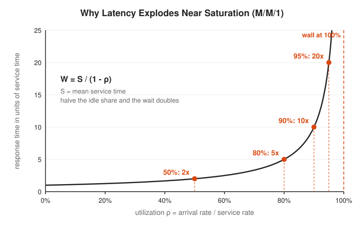
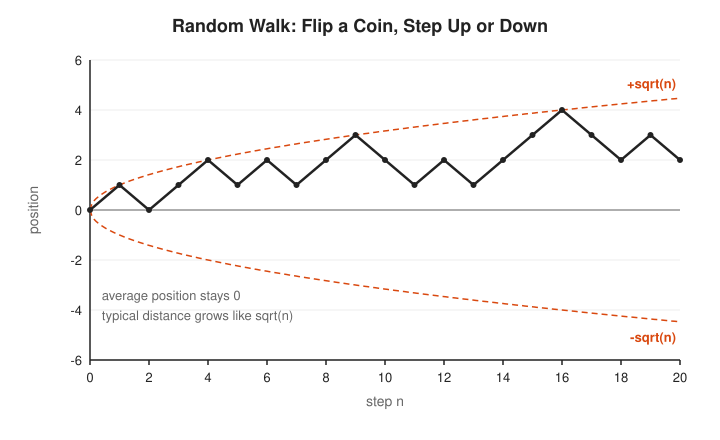
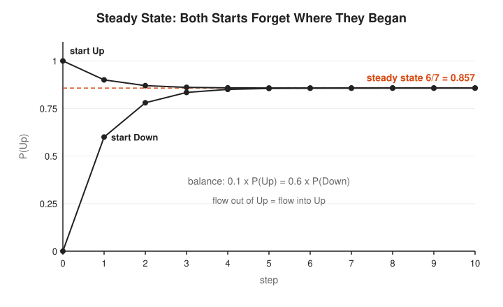
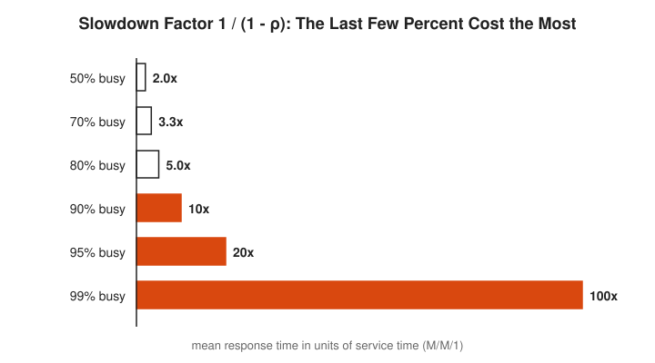
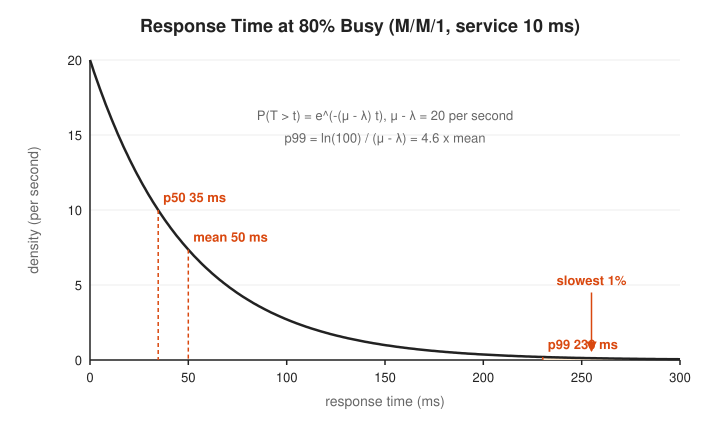
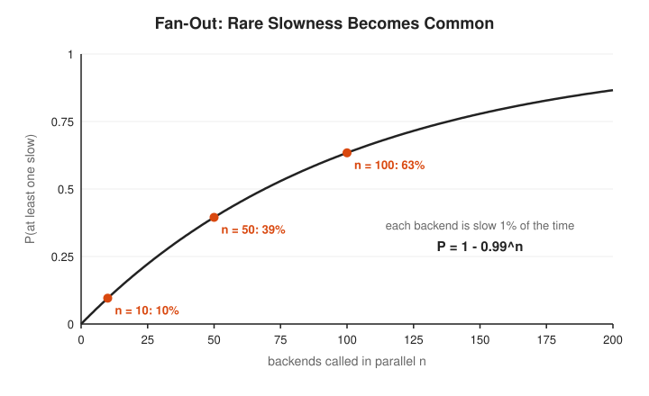

# Stochastic Processes and Queueing Track

**Track:** Stochastic Processes and Queueing · **Span:** beginner to advanced · **Course levels:** [301 Algebra II, Trig and Precalculus](../../course/301/README.md) (exponentials, geometric series), [401 Calculus](../../course/401/README.md) (the number $e$, limits), [501 Linear Algebra, Probability and Discrete Math](../../course/501/README.md) (probability, matrices)
**Prerequisites:** fractions, percentages and the idea of a probability. The [Probability Track](../probability/README.md) covers everything needed, and the [Linear Algebra Track](../linear-algebra/README.md) helps with the matrix view of Markov chains. Nothing here needs more than a calculator.
**Files:** this README, [cards.tsv](cards.tsv) for Anki, [code/main.go](code/main.go), and the diagrams in [img/](img/).

## What the Field Studies

A **stochastic process** is a quantity that changes over time by chance. The position of a coin-flipping walker, the number of requests in a server, and the up-or-down state of a disk are all stochastic processes. The field asks what such a process does on average, how far it strays, and where it settles in the long run.

**Queueing theory** is the branch that studies waiting lines. Work arrives at random, servers take a random time to finish it, and a line forms when work arrives faster than it leaves for a while. Queueing theory turns three numbers, the arrival rate, the service rate and the number of servers, into predictions of wait time, line length and tail latency. Agner Erlang started it in 1909 to size Copenhagen telephone exchanges. The same math sizes your thread pools today.

## Why It Matters

This is the math behind most capacity conversations an SRE has:

* **Latency near saturation:** a server at 90% busy has a mean response time ten times its service time. At 95% it is twenty times. The [signature diagram](#signature-diagram) shows why.
* **Capacity planning:** Erlang C tells you how many workers, pods or call-center agents keep the wait under a target.
* **Little's law:** in-flight requests, queue depth and latency are tied by one equation. Know two and you know the third.
* **Tail latency:** a request that fans out to 100 backends sees some backend's p99 most of the time.
* **Reliability:** Markov chains model components that fail and get repaired, which gives availability numbers for SLOs.
* **Load balancing:** one shared queue beats many separate queues at the same total load. This is why a single work queue with many consumers outperforms round-robin to private queues.

## Concept Map

<!-- diagram: type=concept-map tiers=beginner,intermediate,advanced nodes=12 caption="Stochastic processes and queueing concepts with prerequisite arrows" -->
![Concept map. Beginner tier: Random Walks leads to Poisson Process and Markov Chains. Poisson Process leads to Queues and Kendall Notation, which leads to Little's Law. Markov Chains leads to Steady State. Intermediate tier: Markov Chains and Steady State lead to Birth-Death Chains, which leads to M/M/1. Little's Law also leads to M/M/1. M/M/1 leads to Saturation. Advanced tier: Birth-Death Chains leads to M/M/c and Erlang C, M/M/1 leads to Kingman and Variability, and both Saturation and Kingman lead to Tail Latency and Capacity Planning.](img/concept-map.svg)

Read the map top to bottom. An arrow from A to B means learn A first. Start at the orange box.

## Signature Diagram

<!-- diagram: type=function-plot f="1/(1-rho)" x=0..0.96 marks=0.5,0.8,0.9,0.95 asymptote=1 caption="M/M/1 response time versus utilization" -->


This is the hockey stick. The x-axis is how busy the server is. The y-axis is how long a request takes, counted in service times. Waiting comes from the idle share $1 - \rho$. At 80% busy the idle share is 20%. At 90% it is 10%, half as much, and the wait doubles. At 95% it halves again and the wait doubles again. The last few percent of utilization cost the most latency. A dashboard that reads 90% CPU is not a server with 10% to spare. It is a server already ten times slower than when idle.

## The Concept Ladder

### Beginner

#### 1. Random Walks

Stand at 0. Flip a fair coin. Heads, step up 1. Tails, step down 1. Repeat. That is a **random walk**, the simplest stochastic process. After $n$ steps the average position is still 0, because up and down are equally likely. The typical distance from 0, however, grows like $\sqrt{n}$.

$$S_n = X_1 + X_2 + \cdots + X_n, \qquad E[S_n] = 0, \qquad \sqrt{E[S_n^2]} = \sqrt{n}$$

<!-- diagram: type=line-plot data=walk20 envelope=sqrt caption="A 20-step random walk with the square-root envelope" -->


Why $\sqrt{n}$? Each step has squared size 1, and independent steps add their variances. After $n$ steps the variance is $n$, and the typical distance is its square root. One hundred steps put the walker about 10 away, not 100. A counter that drifts up and down at random, such as the difference between two equal-rate request streams, wanders the same way.

In the course: [501 probability](../../course/501/README.md). Related: [Probability Track](../probability/README.md).

#### 2. Markov Chains

A **Markov chain** is a process that hops between a list of states. The chance of the next state depends only on the current state, not on how it got there. This property is called **memoryless**. A **transition matrix** $P$ lists the chances: row $i$, column $j$ holds the probability of moving from state $i$ to state $j$. Each row adds to 1.

$$P = \begin{pmatrix} 0.9 & 0.1 \\ 0.6 & 0.4 \end{pmatrix}, \qquad \pi_{t+1} = \pi_t P$$

<!-- diagram: type=state-diagram states=Up,Down edges=Up-Down:0.1,Down-Up:0.6,Up-Up:0.9,Down-Down:0.4 caption="Two-state Markov chain for a server" -->


Each minute a healthy server fails with probability 0.1. A failed server comes back with probability 0.6. To step the chain forward, multiply the current row of probabilities by $P$. A random walk is also a Markov chain: its states are the integers.

In the course: [501 matrices and probability](../../course/501/README.md). Related: [Linear Algebra Track](../linear-algebra/README.md), [Graph Theory Track](../graph-theory/README.md) (a chain is a weighted directed graph).

#### 3. Steady State

Run a well-behaved Markov chain long enough and the probabilities stop changing. The final row $\pi$ is the **steady state** (also called the stationary distribution). It satisfies $\pi = \pi P$. It is also the long-run fraction of time spent in each state. For two states, balance the flows: the flow out of Up equals the flow into Up.

$$0.1\,\pi_{\text{Up}} = 0.6\,\pi_{\text{Down}}, \qquad \pi_{\text{Up}} = \frac{0.6}{0.1 + 0.6} = \frac{6}{7} \approx 0.857$$

<!-- diagram: type=line-plot series=startUp,startDown steps=0..10 asymptote=6/7 caption="Convergence to the steady state from two starts" -->


The chain forgets where it started. Whether the server begins up or down, after a few minutes it is up 85.7% of the time. That number is its availability. Google PageRank is the steady state of a Markov chain on web pages.

In the course: [501 eigenvalues](../../course/501/README.md) ($\pi$ is a left eigenvector of $P$ with eigenvalue 1). Related: [Linear Algebra Track](../linear-algebra/README.md).

#### 4. The Poisson Process

Requests from many independent users arrive at random moments, at a steady average rate $\lambda$ per second. The standard model is the **Poisson process**. The count of arrivals in a window of length $t$ follows the Poisson distribution, and the gaps between arrivals follow the **exponential distribution** with mean $1/\lambda$.

$$P(k \text{ arrivals in time } t) = e^{-\lambda t}\frac{(\lambda t)^k}{k!}, \qquad P(\text{gap} > s) = e^{-\lambda s}$$

<!-- diagram: type=timeline-plus-bars rate=5 window=4 counts=0..12 caption="Poisson arrivals on a timeline and the distribution of counts per second" -->


Random does not mean evenly spaced. Poisson arrivals clump, and the clumps are what build queues. The exponential gap is memoryless: having waited 1 second for the next request tells you nothing about how much longer to wait. Merge several independent Poisson streams and the result is again Poisson, with the rates added.

In the course: [301 exponentials](../../course/301/README.md), [401 the number e](../../course/401/README.md). Related: [Probability Track](../probability/README.md), [Exponential Growth Workshop](../../workshops/exponential-growth-in-interest-epidemics-and-load/README.md).

### Intermediate

#### 5. Queues and Kendall Notation

A **queue** has three parts: arrivals at rate $\lambda$, a waiting line, and $c$ servers that each finish work at rate $\mu$ (mean service time $S = 1/\mu$). **Utilization** $\rho$ is the fraction of time the servers are busy. **Kendall notation** names a queue as A/S/c: arrival pattern, service pattern, number of servers. The letter M (for Markov) means random, exponential times. G means general, any distribution. D means deterministic, fixed times.

$$\rho = \frac{\lambda}{c\,\mu}, \qquad \text{a queue is stable only when } \rho < 1$$

<!-- diagram: type=queue-schematic servers=3 caption="Anatomy of a queue" -->


If $\rho \ge 1$, work arrives faster than it leaves, and the line grows without limit. Every incident with an unbounded queue, such as a Kafka consumer lag that only climbs, is a queue with $\rho \ge 1$.

In the course: [201 functions and ratios](../../course/201/README.md). Related: [Calculus of Rates in Physics and Queues Workshop](../../workshops/calculus-of-rates-in-physics-and-queues/README.md).

#### 6. Little's Law

**Little's law** links three averages for any stable system: $L$, the mean number of items inside; $\lambda$, the arrival rate; and $W$, the mean time each item spends inside. It holds for any arrival pattern, any service pattern and any scheduling order.

$$L = \lambda\,W$$

<!-- diagram: type=gantt-plus-step requests=6 window=10 caption="Little's law as one area counted two ways" -->


Why it is true: the shaded area under the count-in-system curve is the total time all requests spend inside. Divide the area by the length of the window and you get $L$. Divide it by the number of requests and you get $W$. The number of requests divided by the window is $\lambda$. The same area, counted two ways, gives $L = \lambda W$. A service at 200 requests per second with 50 ms mean latency has $200 \times 0.05 = 10$ requests in flight on average. No fancy tooling needed.

In the course: [101 ratios and rates](../../course/101/README.md). Related: [Calculus Track](../calculus/README.md) (area under a curve).

#### 7. Birth-Death Chains

A **birth-death chain** is a Markov chain on the states $0, 1, 2, \dots$ that only moves one step at a time: up by one (a birth, an arrival) or down by one (a death, a departure). For a queue, the state is the number of requests in the system. In steady state, the flow across any cut between two neighboring states balances.

$$\pi_n\,\lambda = \pi_{n+1}\,\mu \quad\Longrightarrow\quad \pi_n = \pi_0 \left(\frac{\lambda}{\mu}\right)^n = \pi_0\,\rho^n$$

<!-- diagram: type=chain states=0..4 up=lambda down=mu cut=2|3 caption="Birth-death chain with a balance cut" -->


The cut argument turns an infinite system of equations into one line. Each state is $\rho$ times as likely as the one before, which makes the queue length a geometric distribution. Adding the probabilities up to 1 gives $\pi_0 = 1 - \rho$, the chance the system is empty.

In the course: [301 geometric series](../../course/301/README.md). Related: [Discrete Math Track](../discrete-math/README.md).

#### 8. The M/M/1 Queue

The **M/M/1 queue** has Poisson arrivals, exponential service and one server. It is the hydrogen atom of queueing theory: simple enough to solve fully, rich enough to teach the main lesson. From the birth-death chain:

$$P(n) = (1-\rho)\rho^n, \quad L = \frac{\rho}{1-\rho}, \quad W = \frac{1}{\mu - \lambda} = \frac{S}{1-\rho}, \quad W_q = \frac{\rho\,S}{1-\rho}$$

Here $W$ is the full response time and $W_q$ is the part spent waiting in line, before service starts.

<!-- diagram: type=bar-chart-pair rho=0.5,0.9 n=0..14 caption="M/M/1 queue length distributions at 50% and 90% utilization" -->


At 50% busy the system is empty half the time and rarely holds more than three requests. At 90% busy it is empty only 10% of the time, holds 9 on average, and long lines are common. Same server, same code, different traffic.

In the course: [301 geometric series](../../course/301/README.md), [501 probability](../../course/501/README.md). Related: [Probability Track](../probability/README.md).

### Advanced

#### 9. Why Latency Explodes Near Saturation

The **slowdown factor** $1/(1-\rho)$ is the ratio of response time to service time in M/M/1. It is gentle at low load and violent near 100%. The slope of the curve is $1/(1-\rho)^2$, which means a small rise in traffic at high load causes a large rise in latency.

$$\frac{W}{S} = \frac{1}{1-\rho}, \qquad \frac{d}{d\rho}\left(\frac{1}{1-\rho}\right) = \frac{1}{(1-\rho)^2}$$

<!-- diagram: type=bar-chart-horizontal items=6 values=2,3.3,5,10,20,100 caption="Slowdown factor at six utilizations" -->


Two lessons for capacity planning. First, a server at 90% has no 10% to spare: a 5% traffic bump to 94.5% nearly doubles its latency. Second, autoscaling on CPU at 90% triggers too late. By the time the alarm fires, the queue is already long. A common rule of thumb for latency-sensitive services is to stay well below 70% to 80% busy and to spend the headroom on burst absorption.

In the course: [401 derivatives](../../course/401/README.md). Related: [Calculus Track](../calculus/README.md), [Probability for On-Call, Error Budgets and SLOs Workshop](../../workshops/probability-for-on-call-error-budgets-and-slos/README.md).

#### 10. M/M/c, Erlang C and Pooling

The **M/M/c queue** has $c$ servers sharing one line. **Erlang C** is the probability that an arriving request finds every server busy and waits. With offered load $a = \lambda/\mu$ (the average number of busy servers) and $\rho = a/c$:

$$C(c, a) = \frac{\dfrac{a^c}{c!}\dfrac{1}{1-\rho}}{\displaystyle\sum_{k=0}^{c-1}\frac{a^k}{k!} + \frac{a^c}{c!}\frac{1}{1-\rho}}, \qquad W_q = \frac{C(c,a)}{c\mu - \lambda}$$

<!-- diagram: type=queue-compare designs=split,shared,fast load=8 caption="Two separate lines versus one shared line versus one fast server" -->


<!-- diagram: type=function-plot f="ErlangC(c,rho*c)" c=1,2,4,8,16 x=0..1 caption="Erlang C probability of waiting versus utilization" -->


**Pooling** means one shared line instead of many private lines. With private lines, one server sits idle while the other has a queue. A shared line never wastes a free server. At the same 80% utilization, pooling cuts the mean response time from 1 second to 0.556 seconds. Larger pools also tolerate higher utilization: 16 servers at 80% make only 31% of requests wait. This is why a big shared worker pool runs hotter than many tiny ones, and why one queue with many consumers beats round-robin to private queues.

In the course: [501 combinatorics](../../course/501/README.md) (the factorials). Related: [Combinatorics Track](../combinatorics/README.md).

#### 11. Kingman's Formula and Variability

Real traffic is not exactly Poisson, and real service times are not exactly exponential. **Kingman's formula** approximates the mean wait in a G/G/1 queue, any arrival and service pattern, using the **coefficient of variation**: the standard deviation divided by the mean. Write $c_a^2$ for arrivals and $c_s^2$ for service. Exponential times have $c^2 = 1$. Fixed times have $c^2 = 0$.

$$W_q \approx \underbrace{\frac{\rho}{1-\rho}}_{\text{utilization}} \times \underbrace{\frac{c_a^2 + c_s^2}{2}}_{\text{variability}} \times \underbrace{S}_{\text{service time}}$$

<!-- diagram: type=function-plot f="rho/(1-rho)*(1+cs2)/2*10" cs2=0,1,4 x=0..1 caption="Kingman mean wait versus utilization for three service variabilities" -->


The formula separates three knobs: how busy, how variable, how slow. Halve the variability and you halve the wait, without buying a single server. Smoothing bursty traffic with rate limits, splitting slow requests from fast ones into separate pools, and cutting garbage-collection pauses all lower $c_s^2$ or $c_a^2$. For M/G/1 with Poisson arrivals, Kingman matches the exact **Pollaczek-Khinchine formula**.

In the course: [501 variance](../../course/501/README.md). Related: [Statistics Track](../statistics/README.md), [Statistics for Monitoring and Anomaly Detection Workshop](../../workshops/statistics-for-monitoring-and-anomaly-detection/README.md).

#### 12. Tail Latency and Capacity Planning

Means hide pain. In M/M/1 the response time itself is exponential with rate $\mu - \lambda$, which gives every percentile in closed form. The p99 is about 4.6 times the mean. Then **fan-out** multiplies the damage: a request that calls $n$ backends in parallel waits for the slowest one.

$$P(T > t) = e^{-(\mu-\lambda)t}, \qquad t_{99} = \frac{\ln 100}{\mu - \lambda}, \qquad P(\text{some backend slow}) = 1 - 0.99^{\,n}$$

<!-- diagram: type=density-plot dist=exponential rate=20 marks=p50,mean,p99 caption="M/M/1 response time distribution at 80% utilization" -->


<!-- diagram: type=function-plot f="1-0.99^n" x=0..200 marks=10,50,100 caption="Fan-out turns a rare slow backend into a common slow request" -->


A capacity plan puts the track together: estimate $\lambda$ from traffic, measure $S$ and its variability, choose $c$ with Erlang C or Kingman to meet a percentile target, then add headroom for bursts and for losing a zone. Against fan-out tails, the standard defenses are hedged requests (send a backup request after the p95 time), smaller fan-out, and keeping each backend far from saturation.

In the course: [301 logarithms](../../course/301/README.md), [501 probability](../../course/501/README.md). Related: [Probability for On-Call, Error Budgets and SLOs Workshop](../../workshops/probability-for-on-call-error-budgets-and-slos/README.md).

## Worked Examples

### Example 1: Little's Law Three Ways

An API serves 200 requests per second with 50 ms mean latency. A message queue holds 300 messages on average and consumers drain 50 messages per second. A connection pool holds 40 connections, all busy, at 800 queries per second.

```txt
  API in flight:  L = lambda W = 200 x 0.050 = 10 requests        Little's law
  queue wait:     W = L / lambda = 300 / 50  = 6 seconds          solve for W
  query time:     W = L / lambda = 40 / 800  = 0.05 s = 50 ms     solve for W
```

Each line uses two measured numbers to find the third. The second line is a free latency estimate from a queue-depth gauge.

### Example 2: An M/M/1 Server at 80% Busy

Requests arrive at 80 per second. The server finishes 100 per second (mean service 10 ms).

```txt
  rho  = lambda / mu = 80 / 100       = 0.8                utilization
  L    = rho / (1 - rho) = 0.8 / 0.2  = 4 requests         mean in system
  W    = 1 / (mu - lambda) = 1 / 20 s = 50 ms              mean response
  W_q  = W - S = 50 - 10              = 40 ms              time in line
  check L = lambda W = 80 x 0.050     = 4                  Little's law agrees
  p99  = ln(100) / 20 s = 4.605 / 20  = 230 ms             exponential tail
```

Service takes 10 ms. The mean request takes 50 ms. One request in a hundred takes over 230 ms. The simulation in the [Code Corner](#code-corner) measures 49.6 ms and 233.5 ms.

### Example 3: Pooling with Erlang C

Total traffic is 8 requests per second. Each server handles 5 per second. Compare two private lines (each with 4 per second) against one shared line with two servers.

```txt
  private lines:  rho = 4 / 5 = 0.8 each                   M/M/1 per line
                  W = 1 / (5 - 4) = 1.000 s                M/M/1 response
  shared line:    a = lambda / mu = 8 / 5 = 1.6            offered load
                  rho = a / c = 1.6 / 2 = 0.8              same utilization
                  top = a^2/2! x 1/(1 - rho)               Erlang C numerator
                      = 1.28 x 5 = 6.4
                  sum = 1 + 1.6 = 2.6                      k = 0 and k = 1 terms
                  C = 6.4 / (2.6 + 6.4) = 0.711            P(wait)
                  W_q = C / (c mu - lambda) = 0.711 / 2    mean wait in line
                      = 0.356 s
                  W = W_q + 1/mu = 0.356 + 0.200 = 0.556 s add service time
```

Same servers, same load, 44% less response time. The only change is one line instead of two.

### Example 4: Size a Worker Pool

Traffic is 90 requests per second. Each worker handles 10 per second. The target is a mean wait under 10 ms.

```txt
  a = 90 / 10 = 9 busy workers on average          offered load
  c = 9   -> rho = 1.00                            unstable, line grows forever
  c = 10  -> rho = 0.90, P(wait) 0.669, W_q 66.9 ms   too slow
  c = 11  -> rho = 0.82, P(wait) 0.430, W_q 21.5 ms   too slow
  c = 12  -> rho = 0.75, P(wait) 0.266, W_q  8.9 ms   meets target
  answer: 12 workers, 3 more than the bare minimum
```

The bare-minimum ten workers keep up on average, yet every request waits 67 ms. Two more workers cut that by a factor of seven.

## Big Theorems to Know

* **Square-Root Law of Random Walks:** after $n$ fair steps, the typical distance from the start is $\sqrt{n}$.
* **Polya Recurrence Theorem (1921):** a simple random walk in one or two dimensions returns to its start with probability 1. In three dimensions it does not.
* **Ergodic Theorem for Markov Chains:** a finite chain that reaches every state and does not cycle with a fixed period has exactly one steady state, and it reaches that steady state from any start.
* **Poisson Superposition:** merging independent Poisson streams gives a Poisson stream whose rate is the sum.
* **PASTA (Poisson Arrivals See Time Averages):** a Poisson arrival sees the system in its long-run average state.
* **Little's Law (John Little, 1961):** $L = \lambda W$ for any stable system.
* **M/M/1 Formulas:** $L = \rho/(1-\rho)$ and $W = S/(1-\rho)$.
* **Burke's Theorem (1956):** the departures from a stable M/M/1 queue form a Poisson process, which makes chains of such queues solvable.
* **Erlang C Formula (Erlang, 1917):** the probability of waiting in an M/M/c queue.
* **Pollaczek-Khinchine Formula:** for M/G/1, $W_q = \dfrac{\rho}{1-\rho} \cdot \dfrac{1 + c_s^2}{2} \cdot S$.
* **Kingman's Formula (1961):** the G/G/1 approximation above, which becomes exact in the limit $\rho \to 1$.

## Open Problems and Fun Facts

* **The erlang:** the unit of traffic load, one server busy all the time, is named after Agner Erlang, who worked for the Copenhagen Telephone Company.
* **Markov's first chain:** in 1913 Andrey Markov counted vowels and consonants in the first 20,000 letters of Pushkin's *Eugene Onegin* to show that a dependent sequence still obeys a law of large numbers.
* **The drunk and the bird:** by Polya's theorem a drunk walking a city grid always finds the way home. A drunk bird flying in three dimensions returns with probability only about 0.34.
* **Supermarket lesson:** the single serpentine line at a bank or airport is Erlang C pooling in practice. It also feels fairer: nobody picks the wrong line.
* **Open problem:** there is no exact closed formula for the mean wait in a general G/G/c queue. Kingman-style approximations are the working tools.
* **Open problem:** the number of self-avoiding random walks of length $n$ grows like $\mu^n$. The constant $\mu$ is known exactly only for the hexagonal lattice, $\sqrt{2+\sqrt{2}}$, proved by Duminil-Copin and Smirnov in 2010. For the square grid it is known only numerically, about 2.638.

## Starter Problems

1. A service handles 500 requests per second with a mean latency of 20 ms. How many requests are in flight on average?
2. A disk fails with probability 0.02 per hour and is repaired with probability 0.5 per hour. What fraction of the time is it up?
3. Alerts arrive as a Poisson process at 3 per hour. What is the chance of a quiet hour with no alerts?
4. An M/M/1 server finishes 50 requests per second and receives 40. Find $\rho$, $L$ and $W$.
5. Traffic to the server in problem 4 grows from 40 to 45 per second, 12.5% more. What happens to $W$?
6. A G/G/1 queue runs at $\rho = 0.75$ with mean service 20 ms and random arrivals ($c_a^2 = 1$). Find the Kingman wait for exponential service ($c_s^2 = 1$) and for constant service ($c_s^2 = 0$).
7. A page fans out to 20 backends, each slow 1% of the time, independently. What fraction of page loads see at least one slow backend?

<details>
<summary>Answers</summary>

1. 10 requests. $L = \lambda W = 500 \times 0.02 = 10$.
2. About 96.2%. $\pi_{\text{Up}} = 0.5 / (0.02 + 0.5) = 0.5 / 0.52 \approx 0.9615$.
3. About 5%. $P(0) = e^{-3} \approx 0.0498$.
4. $\rho = 40/50 = 0.8$, $L = 0.8/0.2 = 4$, $W = 1/(50 - 40) = 0.1$ s, that is 100 ms.
5. $W = 1/(50 - 45) = 0.2$ s. Latency doubles, from 100 ms to 200 ms, for 12.5% more traffic. That is the hockey stick.
6. $\rho/(1-\rho) = 3$. Exponential: $3 \times (1+1)/2 \times 20 = 60$ ms. Constant: $3 \times (1+0)/2 \times 20 = 30$ ms. Removing service variability halves the wait.
7. About 18.2%. $1 - 0.99^{20} \approx 0.182$.

</details>

## Code Corner

[code/main.go](code/main.go) simulates random walks, steps a Markov chain to its steady state, generates Poisson arrivals, tabulates M/M/1 formulas, simulates one million requests through an M/M/1 queue with the Lindley recursion, computes Erlang C for pooling and capacity planning, and evaluates Kingman and fan-out. The random seed is fixed, which makes the output repeatable. Run it with `go run main.go` inside `code/`.

```txt
== Random walk: +1 or -1 per step ==
one 20-step walk: [0 1 0 1 2 1 2 1 2 3 2 1 2 1 2 3 4 3 2 3 2]
10000 walks of 100 steps: mean end -0.07, typical distance (RMS) 10.02, sqrt(n) = 10.00

== Markov chain: server Up/Down, fail 0.1, repair 0.6 ==
step 0: P(Up) = 1.0000
step 1: P(Up) = 0.9000
step 2: P(Up) = 0.8700
step 3: P(Up) = 0.8610
step 4: P(Up) = 0.8583
step 5: P(Up) = 0.8575
step 6: P(Up) = 0.8572
step 7: P(Up) = 0.8572
step 8: P(Up) = 0.8572
steady state P(Up) = 0.6 / (0.1 + 0.6) = 0.8571

== Poisson arrivals, rate 5 per second ==
mean gap 0.1997 s (theory 0.2000), P(gap > 0.4 s) 0.1348 (theory e^-2 = 0.1353)
P( 0 arrivals in 1 s) = 0.0067
P( 1 arrivals in 1 s) = 0.0337
P( 2 arrivals in 1 s) = 0.0842
P( 3 arrivals in 1 s) = 0.1404
P( 4 arrivals in 1 s) = 0.1755
P( 5 arrivals in 1 s) = 0.1755
P( 6 arrivals in 1 s) = 0.1462
P( 7 arrivals in 1 s) = 0.1044
P( 8 arrivals in 1 s) = 0.0653
P( 9 arrivals in 1 s) = 0.0363
P(10 arrivals in 1 s) = 0.0181

== M/M/1 with service rate 100 per second (mean service 10 ms) ==
  rho   L (in system)   W mean (ms)   p99 (ms)   slowdown 1/(1-rho)
  0.50        1.00          20.0       92.1        2.0
  0.70        2.33          33.3      153.5        3.3
  0.80        4.00          50.0      230.3        5.0
  0.90        9.00         100.0      460.5       10.0
  0.95       19.00         200.0      921.0       20.0
  0.99       99.00        1000.0     4605.2      100.0
queue length P(n) = (1 - rho) rho^n:
  rho 0.5: 0.500 0.250 0.125 0.062 0.031 0.016 0.008 0.004 0.002 0.001
  rho 0.9: 0.100 0.090 0.081 0.073 0.066 0.059 0.053 0.048 0.043 0.039

== M/M/1 simulation: arrivals 80/s, service 100/s, 1,000,000 requests ==
mean response 49.6 ms (theory 50.0), p99 233.5 ms (theory 230.3)
Little: L = lambda W = 80 x 0.0496 = 3.97 requests in system (theory 4.00)

== Pooling: total load 8 per second ==
two separate queues, 1 server each (mu 5): P(wait) 0.800, Wq 0.800 s, W 1.000 s
one shared queue, 2 servers (mu 5):       P(wait) 0.711, Wq 0.356 s, W 0.556 s
one queue, 1 fast server (mu 10):          P(wait) 0.800, Wq 0.400 s, W 0.500 s

== Erlang C capacity plan: 90 req/s, each worker 10 req/s ==
c = 10  rho 0.900  P(wait) 0.669  mean wait   66.9 ms
c = 11  rho 0.818  P(wait) 0.430  mean wait   21.5 ms
c = 12  rho 0.750  P(wait) 0.266  mean wait    8.9 ms
c = 13  rho 0.692  P(wait) 0.158  mean wait    3.9 ms
c = 14  rho 0.643  P(wait) 0.089  mean wait    1.8 ms
P(wait) versus rho at the same utilization:
  c =  1:  rho 0.5 -> 0.500  rho 0.8 -> 0.800  rho 0.9 -> 0.900
  c =  2:  rho 0.5 -> 0.333  rho 0.8 -> 0.711  rho 0.9 -> 0.853
  c =  4:  rho 0.5 -> 0.174  rho 0.8 -> 0.596  rho 0.9 -> 0.788
  c =  8:  rho 0.5 -> 0.059  rho 0.8 -> 0.458  rho 0.9 -> 0.702
  c = 16:  rho 0.5 -> 0.009  rho 0.8 -> 0.305  rho 0.9 -> 0.591

== Kingman G/G/1 wait: rho 0.9, mean service 10 ms, ca^2 = 1 ==
service cs^2 = 0.00 -> mean wait 45.0 ms
service cs^2 = 0.25 -> mean wait 56.3 ms
service cs^2 = 1.00 -> mean wait 90.0 ms
service cs^2 = 4.00 -> mean wait 225.0 ms

== Fan-out: each backend is slow 1% of the time ==
fan-out   1 -> P(request sees a slow backend) 0.010
fan-out  10 -> P(request sees a slow backend) 0.096
fan-out  50 -> P(request sees a slow backend) 0.395
fan-out 100 -> P(request sees a slow backend) 0.634
fan-out 200 -> P(request sees a slow backend) 0.866
```

Read the M/M/1 table from top to bottom. Each row adds a little traffic. The last column shows what it costs. The simulation lands within 1% of the formulas, which is the reassuring part: the math is not a toy. The pooling block holds a quiet surprise. One fast server beats two slow servers on total response time, yet the two-server pool waits less in line. Speed wins on service time. Pooling wins on waiting.

## Flashcards

[cards.tsv](cards.tsv) holds the key definitions and formulas for Anki import.

## Resources

* [Mor Harchol-Balter: Performance Modeling and Design of Computer Systems](https://www.cs.cmu.edu/~harchol/PerformanceModeling/book.html): the queueing textbook written for computer systems people, from Carnegie Mellon.
* [Grinstead and Snell: Introduction to Probability](https://math.dartmouth.edu/~prob/prob/prob.pdf): a free classic text from Dartmouth. Chapter 11 covers Markov chains and Chapter 12 covers random walks.
* [Markov Chains: Explained Visually](https://setosa.io/ev/markov-chains/): interactive pictures of states, transitions and steady states.
* [MIT OCW 6.262 Discrete Stochastic Processes](https://ocw.mit.edu/courses/6-262-discrete-stochastic-processes-spring-2011/): Robert Gallager's lecture notes and videos for the advanced rungs.
* [MacTutor: Agner Krarup Erlang](https://mathshistory.st-andrews.ac.uk/Biographies/Erlang/): the life of the telephone engineer who founded queueing theory.

## Where to Go Next

* [Probability Track](../probability/README.md) for the distributions behind every formula here.
* [Calculus of Rates in Physics and Queues Workshop](../../workshops/calculus-of-rates-in-physics-and-queues/README.md) for rates of change applied to queues.
* [Probability for On-Call, Error Budgets and SLOs Workshop](../../workshops/probability-for-on-call-error-budgets-and-slos/README.md) for turning tail percentiles into SLOs.
* [Optimization Track](../optimization/README.md) for choosing the cheapest capacity that meets a latency target.
* [Linear Algebra Track](../linear-algebra/README.md) for steady states as eigenvectors.
