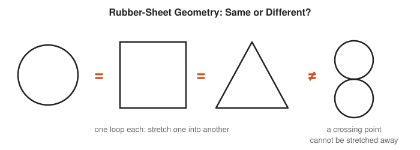
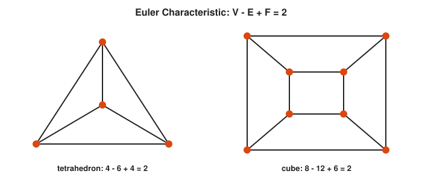
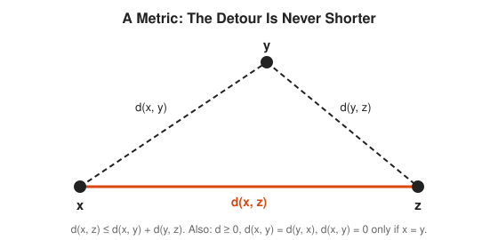
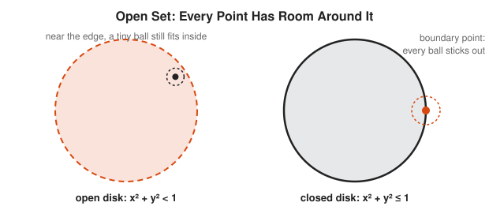
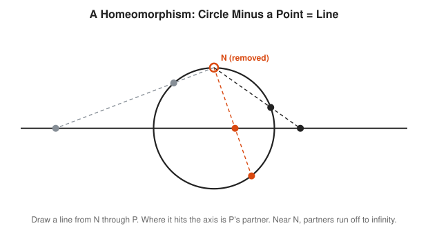
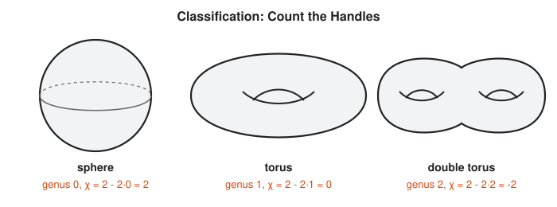
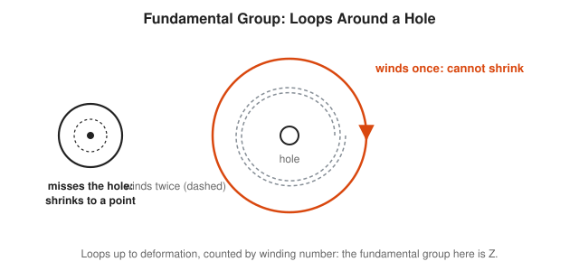
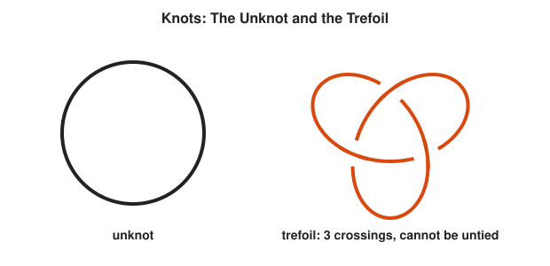
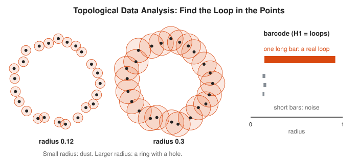

# Topology Track

**Track:** Topology · **Span:** beginner to advanced · **Course levels:** [601 Proof and Higher Math](../../course/601/README.md) (topology taster), [201 Algebra I and Geometry](../../course/201/README.md) (shapes)
**Prerequisites:** none for the first three rungs, which are about pictures. The intermediate rungs use the language of sets from the [Logic and Set Theory Track](../logic-and-set-theory/README.md) and the limits of the [Real Analysis Track](../real-analysis/README.md).
**Files:** this README, [cards.tsv](cards.tsv) for Anki, [code/main.go](code/main.go), and the diagrams in [img/](img/).

## What the Field Studies

Geometry cares about lengths and angles. Topology throws those away and keeps only what survives stretching, bending and squeezing, without tearing or gluing. A topologist sees no difference between a circle and a square, or between a coffee mug and a donut. Both have one hole. That is the classic joke: a topologist cannot tell their coffee mug from their breakfast.

What survives such rough handling? The number of pieces, the number of holes, whether a loop can shrink to a point, whether a surface has two sides. Those properties turn out to be surprisingly powerful, because they do not depend on any measurement being exact.

## Why It Matters

* **Network topology:** the shape of who connects to whom matters more than cable lengths. Whether a network stays connected after a link fails is a topological question.
* **Robotics and motion planning:** the space of all positions of a robot arm has holes. A path planner has to know which way around them to go.
* **Topological data analysis:** find loops and clusters in high-dimensional data, such as metrics from 1,000 hosts, without choosing a scale in advance.
* **Maps and GIS:** a polygon with a hole (a lake inside a park) and point-in-polygon tests use winding numbers.
* **Physics:** the 2016 Nobel Prize in Physics went to topological phases of matter.

## Concept Map

<!-- diagram: type=concept-map tiers=beginner,intermediate,advanced nodes=11 caption="Topology concepts with prerequisite arrows" -->


Read the map top to bottom. An arrow from A to B means learn A first. Start at the orange box.

## Signature Diagram

<!-- diagram: type=shape-classes holes=0,1,2 letters=true caption="Shapes and letters grouped by number of holes" -->


Stretch and bend freely, but never tear or glue. Under those rules the number of holes never changes. It is a **topological invariant**: a number that stays the same under every allowed deformation. Much of topology is the search for invariants, because two shapes with different invariants can never be deformed into each other. (A careful note: grouping by holes is coarser than full equivalence. The letters X and I both have zero holes, but X has a crossing point and I does not. Topology has finer invariants for that.)

## The Concept Ladder

### Beginner

#### 1. Rubber-Sheet Intuition

Imagine shapes made of perfect rubber. Two shapes are the same to a topologist when one can be deformed into the other without tearing, gluing or passing through itself. A circle, a square and a triangle are all the same loop. A figure eight is not, because its crossing point is special and no stretching removes it.

<!-- diagram: type=shape-compare shapes=circle,square,triangle,figure8 caption="Same or different under deformation" -->


Course link: [601 Proof and Higher Math](../../course/601/README.md).

#### 2. Euler Characteristic

Count the vertices $V$, edges $E$ and faces $F$ of a polyhedron. The combination $V - E + F$ is always 2 for any shape that is a deformed sphere, no matter how many faces it has. For a donut-shaped surface the answer is 0. The number, written $\chi$ (chi), detects the shape.

$$\chi = V - E + F$$

<!-- diagram: type=planar-graphs solids=tetrahedron,cube caption="Euler characteristic of two solids" -->


The same formula appears in the [Graph Theory Track](../graph-theory/README.md) as Euler's formula for planar graphs. It is the oldest topological invariant, found by Euler in 1752.

#### 3. Surfaces and Orientability

Build surfaces by gluing the edges of a square. Glue one pair of edges and you get a cylinder. Glue them with a half twist and you get a **Mobius strip**, a surface with only one side. Glue both pairs straight and you get a **torus**. A surface with two consistent sides is **orientable**.

<!-- diagram: type=gluing-squares surfaces=cylinder,mobius,torus caption="Gluing diagrams for three surfaces" -->


Make a Mobius strip from a paper strip and tape. Draw a line down the middle without lifting the pen. You return to the start having covered "both sides", because there is only one. Cut along the line and it does not fall into two pieces.

#### 4. Metric Spaces

A **metric** measures distance. It must be zero only between a point and itself, symmetric, and obey the **triangle inequality**: a detour is never shorter than the direct route. A metric is the bridge from geometry to topology: it defines which points are "near", and nearness is all topology needs.

$$d(x, z) \le d(x, y) + d(y, z)$$

<!-- diagram: type=triangle points=x,y,z caption="Triangle inequality" -->


Latency between data centers is not always a metric: routing quirks sometimes make the detour through a third site faster. That breaks the triangle inequality, and some algorithms that assume it.

### Intermediate

#### 5. Open Sets and Topologies

An **open set** is a set where every point has some breathing room: a small ball around it stays inside the set. Topology keeps only the list of open sets and forgets the distances. A **topology** on a set is any collection of subsets that includes the empty set and the whole set, and is closed under unions and finite intersections.

$$U \text{ open} \iff \forall x \in U \;\; \exists r > 0: \; B(x, r) \subseteq U$$

<!-- diagram: type=disk-pair kinds=open,closed caption="Open versus closed disk" -->


#### 6. Continuity and Homeomorphism

A function is **continuous** when the preimage of every open set is open, which is the epsilon-delta idea with the numbers removed. A **homeomorphism** is a continuous map with a continuous inverse: the formal version of "deform without tearing or gluing". Homeomorphic spaces are the same space to a topologist.

$$f^{-1}(V) \text{ open for every open } V$$

<!-- diagram: type=stereographic caption="Circle minus a point is homeomorphic to a line" -->


Remove one point from a circle and the rest straightens into an infinite line. This **stereographic projection** also maps the sphere minus one point onto the plane, which is how many map projections and the Riemann sphere of complex analysis work.

#### 7. Connectedness and Compactness

A space is **connected** when it does not split into two separate open pieces. It is **compact** when every sequence has a subsequence that converges inside the space. In ordinary space, compact means closed and bounded. Continuous maps preserve both properties, which is the root of the Intermediate and Extreme Value Theorems.

<!-- diagram: type=compare items=connected,disconnected,compact,not-compact caption="Connected and compact examples" -->
![Top: one blob labeled connected and two separate disks labeled disconnected. Bottom: the closed interval [0, 1], compact, and the half-open interval (0, 1], where the points 1/n slide toward the missing endpoint 0.](img/connected-and-compact.svg)

### Advanced

#### 8. Classification of Surfaces

Every closed, orientable surface is a sphere with some number $g$ of handles, called the **genus**. The Euler characteristic pins it down: $\chi = 2 - 2g$. A coffee mug and a donut both have genus 1. Non-orientable surfaces have a similar list built from Mobius-like pieces.

$$\chi = 2 - 2g$$

<!-- diagram: type=surfaces genus=0,1,2 caption="Sphere, torus, double torus" -->


#### 9. The Fundamental Group

Consider loops that start and end at one point. Two loops count as the same when one deforms into the other. These loop classes form a group, the **fundamental group** $\pi_1$. In the plane with one hole, a loop is classified by how many times it winds around the hole, which gives the integers.

$$\pi_1(\text{circle}) \cong \mathbb{Z}, \qquad \pi_1(\text{sphere}) = 0$$

<!-- diagram: type=loops space=punctured-plane caption="Loops around a hole" -->


This is where topology meets the [Abstract Algebra Track](../abstract-algebra/README.md): shapes produce groups, and the groups tell the shapes apart. A point-in-polygon test in graphics or GIS is a winding number calculation.

#### 10. Knot Theory

A **knot** is a closed loop in 3D space. Two knots are the same when one can be moved into the other without cutting. The **unknot** is a plain circle. The **trefoil** is the simplest real knot. Knot **invariants**, such as the number of ways to color the strands or the Jones polynomial, prove that knots differ.

<!-- diagram: type=knots knots=unknot,trefoil caption="Unknot and trefoil" -->


#### 11. Topological Data Analysis

Data points have no holes, but the shape they sample often does. Grow a ball around each point and watch how the union changes as the radius grows. Features that persist across many radii, such as a loop, are real. Features that flicker in and out are noise. A **persistence barcode** records the lifetime of each feature.

<!-- diagram: type=persistence points=24 shape=circle radii=0.12,0.3 caption="Finding a loop in point data" -->


## Worked Examples

### Example 1: Euler Characteristic of an Octahedron

```txt
  V = 6                                  top, bottom, and 4 around the middle
  F = 8                                  4 triangles on top, 4 below
  E = 8 x 3 / 2 = 12                     each triangle has 3 edges, each edge shared by 2 faces
  χ = V - E + F = 6 - 12 + 8 = 2         a deformed sphere
```

### Example 2: Genus from the Euler Characteristic

A closed orientable surface is cut into faces with $V = 16$, $E = 32$, $F = 12$.

```txt
  χ = 16 - 32 + 12 = -4                  count
  χ = 2 - 2g                             classification formula
  -4 = 2 - 2g                            substitute
  2g = 6                                 rearrange
  g = 3                                  a surface with 3 handles
```

### Example 3: Is the Letter P Homeomorphic to the Letter O?

```txt
  O: one loop, no special points          remove any point: stays connected
  P: one loop plus a tail                 the junction point is special
  remove the junction from P: 2 pieces    loop part and tail part
  removing any one point from O: 1 piece  O has no such point
  invariant differs -> not homeomorphic   homeomorphisms preserve this count
```

Both have one hole. Holes alone do not decide everything, which is why topologists collect many invariants.

## Big Theorems to Know

* **Euler Formula:** a convex polyhedron has $V - E + F = 2$.
* **Classification of Surfaces:** every closed surface is a sphere, a connected sum of tori, or a connected sum of projective planes.
* **Invariance of Euler Characteristic:** homeomorphic surfaces have the same $\chi$, however they are cut into faces.
* **Brouwer Fixed Point Theorem:** every continuous map from a disk to itself leaves some point fixed. Stir a cup of coffee, and some point ends where it started.
* **Hairy Ball Theorem:** you cannot comb a hairy sphere flat without a cowlick. At any moment, somewhere on Earth the horizontal wind speed is zero.
* **Borsuk-Ulam Theorem:** at any moment, two opposite points on Earth have the same temperature and the same pressure.
* **Jordan Curve Theorem:** a simple closed curve splits the plane into exactly one inside and one outside.
* **Poincare Conjecture (proved 2003):** every simply connected, closed 3-dimensional space is a 3-sphere.

## Open Problems and Fun Facts

* **Poincare Conjecture:** Grigori Perelman proved it in 2002 and 2003, posting his papers online. He declined the Fields Medal in 2006 and the one-million-dollar Millennium Prize in 2010. It remains the only Millennium Problem solved.
* **The Konigsberg bridges** (1736) are often called the first topology problem, since only connections mattered. See the [Graph Theory Track](../graph-theory/README.md).
* **Unknotting is hard to judge:** deciding whether a tangled loop is secretly the unknot is known to be in NP, but nobody knows a polynomial-time algorithm.
* **Open problem:** the smooth 4-dimensional Poincare conjecture is still open. Dimension 4 is the strangest dimension in topology: $\mathbb{R}^4$ alone has uncountably many different smooth structures.

## Starter Problems

1. Group these capital letters by number of holes: D, E, B, O, T, P.
2. A soccer ball has 12 pentagons and 20 hexagons. Find $V$, $E$, $F$ and check $V - E + F$.
3. Is a cylinder (a tube without lids) orientable? Is a Mobius strip?
4. Which of these are compact: $[0, 5]$, $(0, 5)$, $[0, \infty)$?
5. A closed orientable surface has $\chi = -6$. What is its genus?
6. What is the winding number of a loop that goes twice counterclockwise around a hole?
7. Is a coffee mug with two handles homeomorphic to a donut?

<details>
<summary>Answers</summary>

1. 0 holes: E, T. 1 hole: D, O, P. 2 holes: B.
2. $F = 32$. $E = (12 \cdot 5 + 20 \cdot 6)/2 = 90$. Each vertex touches 3 faces: $V = (12 \cdot 5 + 20 \cdot 6)/3 = 60$. Then $60 - 90 + 32 = 2$.
3. The cylinder is orientable (it has an inside and an outside). The Mobius strip is not.
4. Only $[0, 5]$. $(0, 5)$ is not closed, and $[0, \infty)$ is not bounded.
5. Genus 4. $-6 = 2 - 2g$ gives $g = 4$.
6. 2.
7. No. It has genus 2, and a donut has genus 1. It is homeomorphic to a double torus.

</details>

## Code Corner

[code/main.go](code/main.go) computes $V - E + F$ from face lists (including a torus glued from a 3 by 3 grid), measures winding numbers, counts holes in letter bitmaps with a flood fill, and watches noisy circle points merge into one ring as the radius grows. Run it with `go run main.go` inside `code/`.

```txt
== Euler characteristic V - E + F ==
tetrahedron       V= 4 E= 6 F= 4  chi=2
cube              V= 8 E=12 F= 6  chi=2
octahedron        V= 6 E=12 F= 8  chi=2
torus (3x3 grid)  V= 9 E=18 F= 9  chi=0

== Winding number around the origin ==
square around 0: 1
square away from 0: 0
circle traced twice: 2

== Holes in letters ==
C: 0 hole(s)
O: 1 hole(s)
B: 2 hole(s)

== 24 noisy points on a circle: clusters as balls grow ==
radius 0.05: 24 piece(s)
radius 0.10: 20 piece(s)
radius 0.13: 16 piece(s)
radius 0.16:  4 piece(s)
radius 0.30:  1 piece(s)
one piece around an empty middle = one loop, the circle
```

The hole counter is the same flood fill that paint programs use for the bucket tool. Topology hides in ordinary code more often than its name suggests.

## Flashcards

[cards.tsv](cards.tsv) holds the key definitions and theorems for Anki import.

## Resources

* [Wolfram MathWorld: Topology](https://mathworld.wolfram.com/Topology.html): definitions with links to every named space.
* [Wolfram MathWorld: Euler Characteristic](https://mathworld.wolfram.com/EulerCharacteristic.html): the invariant with tables for many surfaces.
* [Sidney Morris: Topology Without Tears](https://www.topologywithouttears.net/): a free, gentle textbook for the intermediate rungs.
* [MIT OCW 18.901 Introduction to Topology](https://ocw.mit.edu/courses/18-901-introduction-to-topology-fall-2004/): lecture notes and problem sets.
* [MacTutor: Henri Poincare](https://mathshistory.st-andrews.ac.uk/Biographies/Poincare/): the founder of algebraic topology.

## Where to Go Next

* [Real Analysis Track](../real-analysis/README.md) for metric spaces and compactness with full proofs.
* [Abstract Algebra Track](../abstract-algebra/README.md) for the groups that the fundamental group produces.
* [Graph Theory Track](../graph-theory/README.md) for Euler's formula and planarity.
