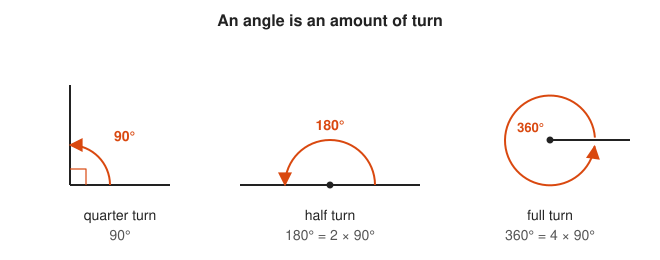
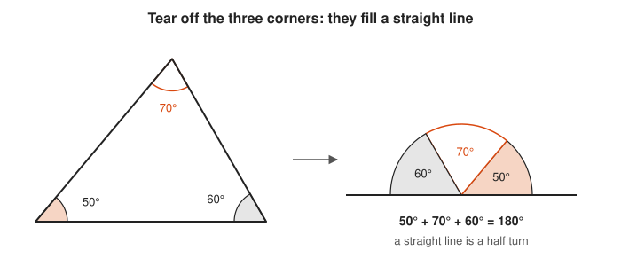
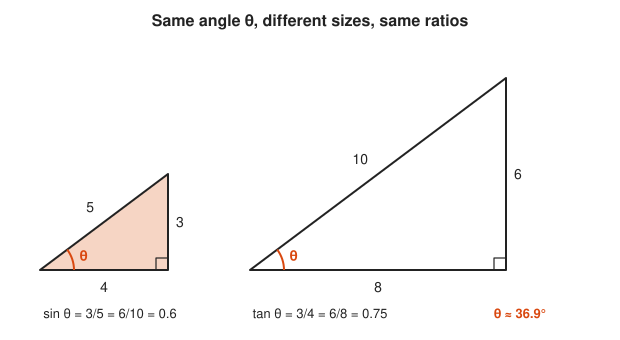
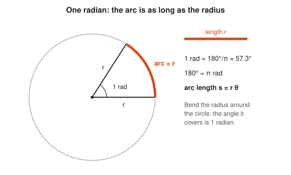
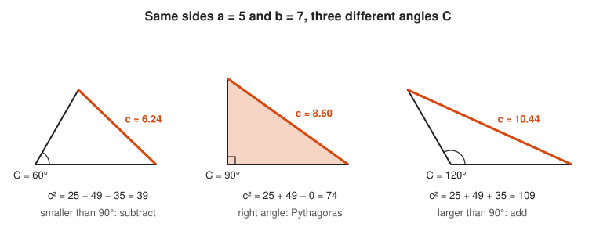
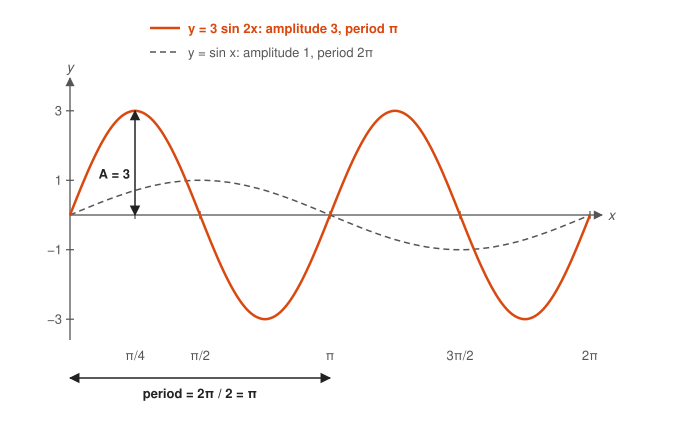
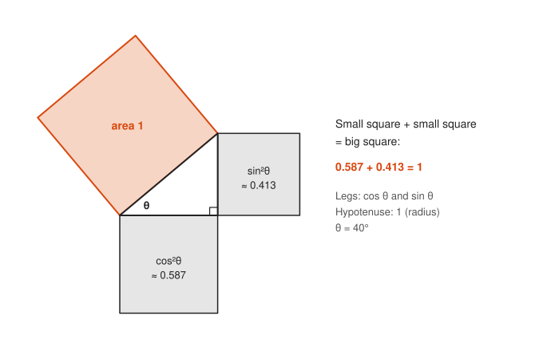
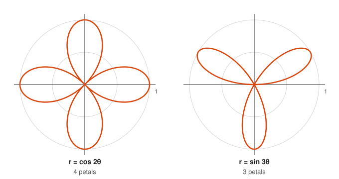
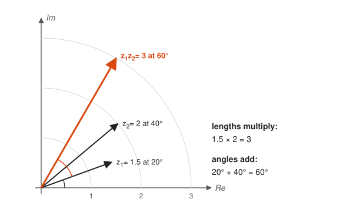
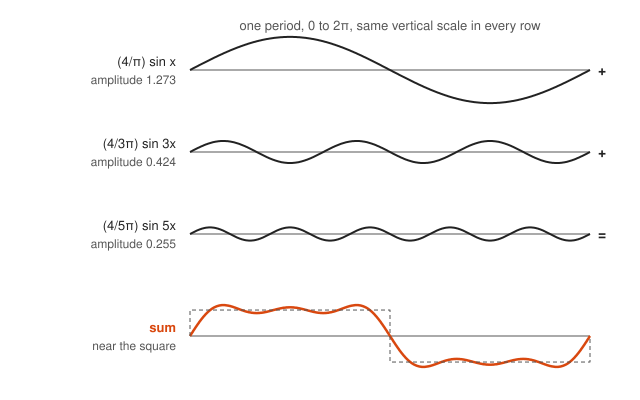

# Trigonometry

**Track:** Trigonometry · **Span:** right-triangle ratios to Euler's formula and Fourier series · **Main course level:** [301 Algebra II, Trig and Precalculus](../../course/301/README.md)

## What This Field Studies

Trigonometry studies the link between angles and lengths. It starts with one observation: in right triangles with the same angle, the ratios of the sides are always the same, no matter how big the triangle is. Name those ratios sine, cosine and tangent, and you can find any distance you cannot measure directly. Then wrap the triangle around a circle, and the same ratios describe everything that rotates or repeats: wheels, waves, seasons, alternating current, and daily traffic cycles.

## Why It Matters

Surveyors, pilots, and GPS receivers use trigonometry to turn angles and known distances into positions. Every rotation in a game engine or a robot arm is a sine and a cosine. Any signal that repeats, from sound to the 24-hour sawtooth of request volume on a dashboard, is a sum of sine waves, and the Fourier transform that finds them sits under audio compression, JPEG images, and seasonality detection in monitoring tools.

## Concept Map

<!-- diagram: type=concept-map bands=beginner,intermediate,advanced nodes=angles,radians,sohcahtoa,special-triangles,unit-circle,laws,graphs,identity,inverse,addition,polar,fourier,euler caption="Trigonometry concepts with prerequisite arrows" -->
![Concept map of trigonometry in three bands. Beginner: angles and degrees lead to radians, SOH CAH TOA, and special triangles. Intermediate: radians, SOH CAH TOA and special triangles lead to the unit circle. SOH CAH TOA also leads to the laws of sines and cosines and to inverse trig. The unit circle leads to sine and cosine graphs and the Pythagorean identity. Advanced: graphs and the identity lead to addition formulas. The unit circle leads to polar coordinates. Graphs and addition formulas lead to Fourier series. Addition formulas and polar coordinates lead to Euler's formula. The unit circle and Euler's formula are highlighted as milestones.](img/concept-map.svg)

An arrow from A to B means learn A before B. The milestones are the unit circle (where trig stops being about triangles and starts being about rotation) and Euler's formula (where trig, exponentials and complex numbers turn out to be one idea).

## Signature Diagram

<!-- diagram: type=unit-circle angles=0,30,45,60,90,120,135,150,180,210,225,240,270,300,315,330 highlight=30 table=quadrant1 caption="Unit circle with standard angles in degrees and radians" -->

The **unit circle** has radius 1 and sits at the origin. Walk counterclockwise from the positive $x$-axis through an angle $\theta$, and the point you land on has coordinates $(\cos \theta, \sin \theta)$. That is the definition of sine and cosine for every angle, not just the acute angles of a triangle. The orange triangle shows why the old SOH CAH TOA ratios still hold: the hypotenuse is 1, so opposite over hypotenuse is just the height.

## The Concept Ladder

### Beginner

#### 1. Angles and Degrees

An angle measures an amount of turn. A full turn is 360°, a half turn is 180°, and a quarter turn is 90°. The number 360 likely comes from Babylonian astronomy, and it divides evenly by 2, 3, 4, 5, 6, 8, 9, 10 and 12.

**Key idea:** angles in a triangle add to $180°$.

<!-- diagram: type=angle-turns angles=90,180,360 caption="Quarter, half and full turns" -->

Read each orange arrow as an amount of turn, and notice that 180° is two quarter turns and 360° is four.

<!-- diagram: type=triangle-angle-sum angles=50,60,70 caption="The three corners of a triangle fill a straight line" -->

Follow the arrow: the three corners fit exactly onto a straight line, which is a half turn.

**In the course:** [201 Algebra I and Geometry](../../course/201/README.md)

#### 2. SOH CAH TOA

In a right triangle, label the sides relative to an angle $\theta$: **opposite**, **adjacent**, and the **hypotenuse** across from the right angle. The three basic ratios are named by the mnemonic SOH CAH TOA. Knowing one angle and one side gives you every other side.

**Key idea:** $\sin \theta = \dfrac{O}{H}$, $\cos \theta = \dfrac{A}{H}$, $\tan \theta = \dfrac{O}{A}$

<!-- diagram: type=right-triangle sides=3,4,5 theta=36.87 caption="SOH CAH TOA on a 3-4-5 triangle" -->

Stand at the angle θ: the opposite side faces you, the adjacent side touches you, and the hypotenuse is the long slanted side.

<!-- diagram: type=similar-triangles sides=3,4,5;6,8,10 caption="Similar triangles share the same ratios" -->

Compare the two triangles: the sizes double, but every ratio stays the same, so each ratio depends only on the angle.

**In the course:** [301 Algebra II, Trig and Precalculus](../../course/301/README.md)

#### 3. Special Triangles

Two triangles have exact values worth memorizing. Half of a square gives a 45-45-90 triangle with sides $1, 1, \sqrt{2}$. Half of an equilateral triangle gives a 30-60-90 triangle with sides $1, \sqrt{3}, 2$. Every value in the unit circle table comes from these two shapes.

**Key idea:** $\sin 30° = \frac{1}{2}$, $\sin 45° = \frac{\sqrt{2}}{2}$, $\sin 60° = \frac{\sqrt{3}}{2}$

<!-- diagram: type=special-triangles shapes=half-square,half-equilateral caption="The 45-45-90 and 30-60-90 triangles" -->

Look at the shaded halves: each one is a special right triangle with sides you read straight off the parent shape.

**In the course:** [301 Algebra II, Trig and Precalculus](../../course/301/README.md)

### Intermediate

#### 4. Radians

A **radian** measures an angle by the arc it cuts on a circle of radius 1. A full turn is $2\pi$ radians because the circumference is $2\pi$. Radians are the natural unit for calculus, because with them the derivative of $\sin x$ is exactly $\cos x$ with no conversion factor.

**Key idea:** $180° = \pi$ rad, so 1 rad $\approx 57.3°$, and arc length $s = r\theta$.

<!-- diagram: type=radian-arc angle=1rad caption="One radian: the arc equals the radius" -->

Compare the orange arc with the orange bar: they have the same length, and the angle they make is one radian.

<!-- diagram: type=radians-around count=6.28 caption="About 6.28 radii fit around a circle" -->

Count the numbered arcs: six full radii and a small leftover make one full turn, so a full turn is $2\pi$ radians.

**In the course:** [301 Algebra II, Trig and Precalculus](../../course/301/README.md)

#### 5. The Unit Circle

Define $\cos \theta$ and $\sin \theta$ as the $x$ and $y$ coordinates of the point at angle $\theta$ on the unit circle. Now angles past 90°, negative angles, and angles past 360° all make sense. The sign of each function in each quadrant comes straight from the signs of $x$ and $y$.

**Key idea:** point at angle $\theta$ is $(\cos \theta, \sin \theta)$, and $\tan \theta = \dfrac{\sin \theta}{\cos \theta}$.

<!-- diagram: type=unit-circle point=150 quadrant-signs=true caption="Unit circle point at 150 degrees and the quadrant signs" -->

Find P in quadrant II: its x is negative and its y is positive, and those are exactly the signs of cos and sin there.

**In the course:** [301 Algebra II, Trig and Precalculus](../../course/301/README.md)

#### 6. Laws of Sines and Cosines

SOH CAH TOA needs a right angle. The **law of sines** and the **law of cosines** work for any triangle. The law of cosines is the Pythagorean theorem with a correction term for angles that are not 90°.

**Key idea:** $\dfrac{a}{\sin A} = \dfrac{b}{\sin B} = \dfrac{c}{\sin C}$ and $c^2 = a^2 + b^2 - 2ab\cos C$

<!-- diagram: type=general-triangle a=5 b=7 C=60 caption="Law of sines and law of cosines on one triangle" -->

Check the side panel: each side divided by the sine of its opposite angle gives the same number, 7.21.

<!-- diagram: type=law-of-cosines a=5 b=7 C=60,90,120 caption="The cosine term corrects Pythagoras" -->

Watch the orange side grow as C opens: below 90° the correction subtracts, at 90° it vanishes, and above 90° it adds.

**In the course:** [301 Algebra II, Trig and Precalculus](../../course/301/README.md)

#### 7. Sine and Cosine Graphs

Plot the height of the unit-circle point as the angle grows, and you get the sine wave. The general wave $y = A \sin(Bx + C) + D$ has amplitude $|A|$, period $\frac{2\pi}{B}$, a phase shift, and a vertical offset. That is the exact shape of a model for daily traffic: a baseline, a swing, and a 24-hour period.

**Key idea:** $y = A\sin(Bx)$ has amplitude $|A|$ and period $\dfrac{2\pi}{|B|}$.

<!-- diagram: type=unwrap-sine samples=12 highlight=60 caption="Unwrapping the unit circle into the sine wave" -->

Follow the dashed line: the height of the point on the circle becomes the height of the wave at the same angle.

<!-- diagram: type=sine-wave A=3 B=2 range=0..2pi caption="Amplitude and period of y = 3 sin 2x" -->

Compare the two waves: the 3 makes the orange wave three times taller, and the 2 squeezes two full waves into the space of one.

**In the course:** [301 Algebra II, Trig and Precalculus](../../course/301/README.md)

#### 8. The Pythagorean Identity

The point $(\cos \theta, \sin \theta)$ is at distance 1 from the origin. Apply the Pythagorean theorem and you get the most used identity in trigonometry. Divide it by $\cos^2 \theta$ or $\sin^2 \theta$ to get two more for free.

**Key idea:** $\sin^2 \theta + \cos^2 \theta = 1$

<!-- diagram: type=unit-circle-triangle theta=40 caption="cos and sin are the legs of a triangle with hypotenuse 1" -->

Read the triangle with Pythagoras: leg squared plus leg squared equals the hypotenuse squared, and the hypotenuse is 1.

<!-- diagram: type=pythagoras-squares theta=40 caption="Squares on cos and sin add up to the unit square" -->

Add the two gray areas: together they fill exactly the orange square of area 1.

**In the course:** [301 Algebra II, Trig and Precalculus](../../course/301/README.md)

#### 9. Inverse Trig Functions

Inverse functions answer the reverse question: which angle has this sine? Because sine repeats, the answer is restricted to one standard range so the inverse is a true function. $\arctan$ is how you turn a slope (rise over run) into an angle, and `math.atan2(y, x)` in Python or Go picks the correct quadrant.

**Key idea:** $\arcsin\left(\frac{1}{2}\right) = \frac{\pi}{6}$, and $\arctan$ returns angles in $\left(-\frac{\pi}{2}, \frac{\pi}{2}\right)$.

<!-- diagram: type=sine-branch range=-2pi..2pi line=0.5 caption="arcsin picks one angle from the allowed range" -->

Look along the dashed line: many angles have sine 1/2, but only the orange dot lies inside the shaded allowed range.

<!-- diagram: type=inverse-mirror f=sin domain=-pi/2..pi/2 caption="arcsin is sine mirrored across y = x" -->

Fold the picture along the dashed line: the black curve lands on the orange one, because an inverse swaps x and y.

**In the course:** [301 Algebra II, Trig and Precalculus](../../course/301/README.md)

### Advanced

#### 10. Addition Formulas

The sine and cosine of a sum of angles break into products of the parts. Every other identity (double angle, half angle, product to sum) falls out of these two. They are also the algebra behind rotation matrices.

**Key idea:** $\sin(a + b) = \sin a \cos b + \cos a \sin b$ and $\cos(a + b) = \cos a \cos b - \sin a \sin b$

<!-- diagram: type=addition-rectangle a=30 b=35 caption="Rectangle proof of the angle addition formulas" -->

Compare opposite sides of the rectangle: left equals right gives the sine formula, and top equals bottom gives the cosine formula.

**In the course:** [301 Algebra II, Trig and Precalculus](../../course/301/README.md)

#### 11. Polar Coordinates

Instead of $(x, y)$, describe a point by its distance $r$ from the origin and its angle $\theta$. Circles, spirals and rose curves have short polar equations. Radar screens and antenna patterns use polar plots.

**Key idea:** $x = r\cos\theta$, $y = r\sin\theta$, $r = \sqrt{x^2 + y^2}$

<!-- diagram: type=polar-grid point=3,60 caption="A point in polar coordinates" -->

Find the point by walking out 3 rings along the 60° ray, then read its x and y from the dashed lines.

<!-- diagram: type=rose-curves curves=cos2t,sin3t caption="Two rose curves" -->

Count the petals: a one-line polar equation draws a shape that is hard to write with x and y.

**In the course:** [301 Algebra II, Trig and Precalculus](../../course/301/README.md)

#### 12. Euler's Formula

Raise $e$ to an imaginary power and you get a point on the unit circle. Multiplying complex numbers then means multiplying lengths and adding angles, and the addition formulas become a one-line consequence. Set $\theta = \pi$ and you get the famous identity that links five key constants.

**Key idea:** $e^{i\theta} = \cos\theta + i\sin\theta$, so $e^{i\pi} + 1 = 0$

<!-- diagram: type=complex-unit-circle theta=50 caption="e to the i theta on the unit circle" -->

Slide θ around the circle: at θ = π the arrow points to −1, which is the famous identity.

<!-- diagram: type=complex-multiply z1=1.5@20 z2=2@40 caption="Multiplying complex numbers" -->

Compare the orange arrow with the black ones: its length is the product of their lengths and its angle is the sum of their angles.

**In the course:** [401 Calculus](../../course/401/README.md) · **Go further:** [Complex Analysis track](../complex-analysis/README.md)

#### 13. Fourier Series

Any reasonable repeating signal is a sum of sine and cosine waves with frequencies that are whole-number multiples of a base frequency. Finding the amount of each wave is the **Fourier transform**. It powers MP3 audio, JPEG images, and the seasonality decomposition behind anomaly detection.

**Key idea:** $f(x) = a_0 + \sum_{n=1}^{\infty} \left(a_n \cos nx + b_n \sin nx\right)$

<!-- diagram: type=fourier-partial-sums wave=square harmonics=1,3,5 caption="A square wave built from odd harmonics" -->

Watch the curves flatten as harmonics are added: each new odd harmonic fills in more of the square corners.

<!-- diagram: type=fourier-components harmonics=1,3,5 caption="The three sine waves inside the sum" -->

Read down the rows: faster waves get smaller, and the sum of all three already looks close to a square.

**In the course:** [401 Calculus](../../course/401/README.md) · **Go further:** [Differential Equations track](../differential-equations/README.md)

## Big Theorems to Know

* **Pythagorean identity:** $\sin^2\theta + \cos^2\theta = 1$.
* **Law of sines:** $\frac{a}{\sin A} = \frac{b}{\sin B} = \frac{c}{\sin C}$.
* **Law of cosines:** $c^2 = a^2 + b^2 - 2ab\cos C$.
* **Angle addition:** $\sin(a + b) = \sin a\cos b + \cos a\sin b$ and $\cos(a + b) = \cos a\cos b - \sin a\sin b$.
* **Double angle:** $\sin 2\theta = 2\sin\theta\cos\theta$ and $\cos 2\theta = \cos^2\theta - \sin^2\theta$.
* **Euler's formula:** $e^{i\theta} = \cos\theta + i\sin\theta$.
* **Fourier's theorem:** a periodic function with mild smoothness equals the sum of its Fourier series.

## Open Problems and Fun Facts

* **Measuring the Earth with a shadow:** around 240 BCE, Eratosthenes compared the angle of the noon sun in two Egyptian cities and estimated the circumference of the Earth. His result was within a few percent of the modern value by most readings.
* **Sine comes from a mistranslation:** the Sanskrit word for half-chord, *jya*, became Arabic *jiba*, which was misread as *jaib* (fold or pocket) and translated into Latin as *sinus*.
* **Niven's theorem:** if $\theta$ is a rational number of degrees and $\sin\theta$ is rational, then $\sin\theta$ is one of $0, \pm\frac{1}{2}, \pm 1$. The table you memorize is the complete list.
* **One radian is about 57.2958°:** it is the angle where the arc equals the radius.
* **Fourier was doubted:** in 1807, Lagrange objected that a sum of smooth waves cannot produce a function with corners. Fourier was right, and making his claim precise drove a century of work on real analysis.

## Starter Problem Set

1. A right triangle has a 30° angle and a hypotenuse of 10. Find the opposite and adjacent sides.
2. Convert 135° to radians.
3. Give the exact values of $\sin 60°$ and $\cos 225°$.
4. State the amplitude and period of $y = 3\sin(2x)$.
5. A triangle has sides $a = 5$ and $b = 7$ with angle $C = 60°$ between them. Find side $c$.

Answers

1. Opposite $= 10\sin 30° = 5$. Adjacent $= 10\cos 30° = 5\sqrt{3} \approx 8.66$.
2. $\frac{3\pi}{4}$, because $135 \cdot \frac{\pi}{180} = \frac{3\pi}{4}$.
3. $\sin 60° = \frac{\sqrt{3}}{2}$. $\cos 225° = -\frac{\sqrt{2}}{2}$, because 225° is in quadrant III where cosine is negative, with reference angle 45°.
4. Amplitude 3. Period $\frac{2\pi}{2} = \pi$.
5. $c = \sqrt{39} \approx 6.24$, because $c^2 = 25 + 49 - 2 \cdot 5 \cdot 7 \cdot \frac{1}{2} = 39$.

## Go Deeper

* [Dave's Short Trig Course](https://aleph0.clarku.edu/~djoyce/trig/): a plain, classic, self-paced course from Clark University.
* [Better Explained: Intuitive Trigonometry](https://betterexplained.com/articles/intuitive-trigonometry/): the dome, wall and ceiling picture of the six trig functions.
* [Math Is Fun: Trigonometry](https://www.mathsisfun.com/algebra/trigonometry-index.html): short illustrated pages, including an interactive unit circle.
* [OpenStax Algebra and Trigonometry 2e](https://openstax.org/details/books/algebra-and-trigonometry-2e): a free full textbook.
* [Better Explained: Euler's Formula](https://betterexplained.com/articles/intuitive-understanding-of-eulers-formula/): rotation-first intuition for $e^{i\theta}$.

## Related Tracks and Workshops

* Before: [Geometry track](../geometry/README.md) and [Algebra track](../algebra/README.md).
* Next: [Calculus track](../calculus/README.md), [Complex Analysis track](../complex-analysis/README.md), [Differential Equations track](../differential-equations/README.md).
* Applied: [Statistics for Monitoring and Anomaly Detection](../../workshops/statistics-for-monitoring-and-anomaly-detection/README.md) and [Linear Algebra for Graphics and ML](../../workshops/linear-algebra-for-graphics-and-ml/README.md).
