# Calculus of Rates in Physics and Queues

**Math used:** difference quotients, derivatives as limits, Riemann sums, the Fundamental Theorem of Calculus, Euler integration, Little's law, the M/M/1 queue · **Level needed:** 401 (Little's law and the queue parts need only 201) · **Time:** 2 to 3 hours
**Run it:** `go run ./code/counter-rate`

## The Real Problem

Prometheus scrapes `http_requests_total` every 15 seconds. The raw number only goes up (until the process restarts), and on its own it says almost nothing. What you graph and alert on is `rate(http_requests_total[1m])`: requests per second. Under the hood that is a slope, and slope is what calculus calls the derivative. When you ask for the number of requests in the last hour, you use `increase()`, which adds rates back up. That is an integral. Calculus is the math of turning totals into rates and rates back into totals. You already do both every on-call shift.

The same two moves describe a falling object. Acceleration is how fast velocity changes. Velocity is how fast height changes. Adding up small steps of each tells you where the object is. That stepping is how simulations and game engines move things, and the step size controls the error.

Queues close the loop. Requests arrive at some rate. A server finishes them at some rate. The gap between the two rates decides latency. Little's law and the M/M/1 formula explain why a service at 90% CPU is slow and at 99% is on fire, even though 99% is "only" nine points more.

## The Math You Need

* [401 Calculus](../../course/401/README.md): limits, the derivative as a limit of slopes, the integral as a limit of sums of rectangles, and the Fundamental Theorem of Calculus.
* [Calculus Track](../../tracks/calculus/README.md): slope, area, and the link between them, at whatever pace you need.
* [Differential Equations Track](../../tracks/differential-equations/README.md): "acceleration is always -9.8" is the simplest differential equation, and Euler stepping is the simplest way to solve one with a computer.
* [Probability Track](../../tracks/probability/README.md): random arrival and service times, and the average of a random quantity, for the M/M/1 part.
* [201 Algebra I and Geometry](../../course/201/README.md): Little's law $L = \lambda W$ and the M/M/1 formulas are multiplication and division. You do not need calculus for those sections.

Words used below, in plain terms:

* **Rate**: how much something changes per unit of time. Requests per second. Meters per second.
* **Slope**: rise over run on a graph. The slope of a total-versus-time line is the rate.
* **Limit**: the value a calculation settles on as you make some quantity smaller and smaller.
* **Derivative**: the slope at a single instant. The limit of slopes over shrinking windows.
* **Integral**: the area under a rate curve. The total that the rate adds up to.

## Picture It

<!-- diagram: type=step-plot x=0..180 step=15 y=counter secant=60..120 caption="Counter staircase with secant slope" -->
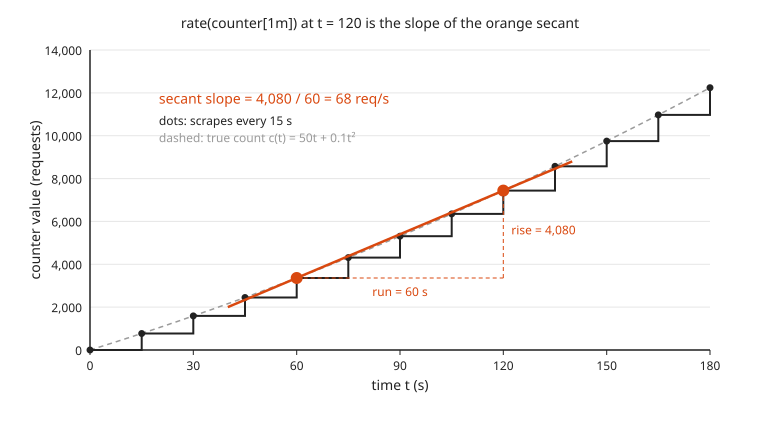

The scraper sees only the dots. Between scrapes the counter looks flat, which is why the plot is a staircase. `rate(x[1m])` at $t = 120$ draws a straight line from the sample one minute ago to the latest sample and reports its slope: rise over run, $4{,}080 / 60 = 68$ requests per second. A straight line through two points of a curve is called a **secant**.

<!-- diagram: type=area-under-curve f="50+0.2t" x=0..300 rects=left n=20 caption="Area under the rate curve" -->
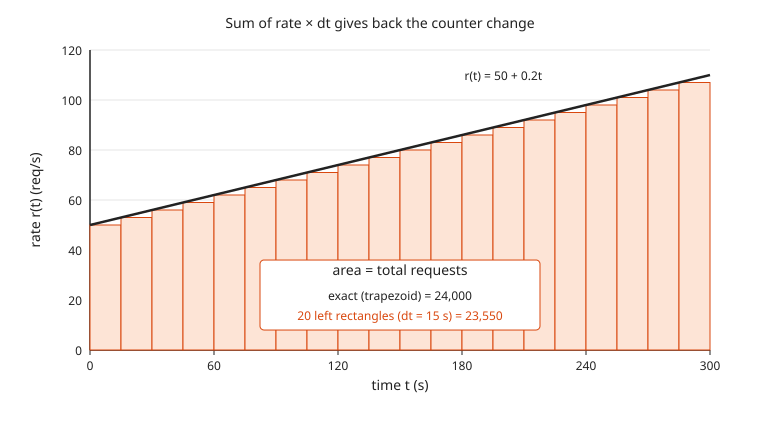

Flip the question. If you know the rate at every moment, the total number of requests is the area under the rate curve. Each rectangle is rate times 15 seconds: the requests in that slice. The rectangles miss the thin triangles under the slanted line. That is why the rectangle total is 450 short of the exact 24,000.

<!-- diagram: type=two-panel left="h(t)=100-4.9t^2 with Euler dots dt=0.5" right="v(t)=-9.8t with shaded area 0..2" caption="Height and velocity of a falling object" -->
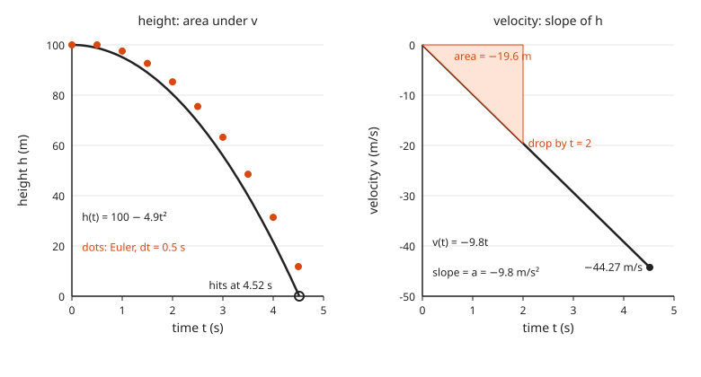

The right panel is velocity: a straight line whose slope is the acceleration, $-9.8$ m/s². The shaded triangle from 0 to 2 seconds has area $\tfrac{1}{2} \times 2 \times (-19.6) = -19.6$. That is exactly how far the object has dropped by $t = 2$: from 100 m to 80.4 m on the left panel. Slope of the left picture gives the right picture. Area under the right picture gives the change in the left one.

<!-- diagram: type=function-plot f="1000/(100-100*rho)" x=0..0.98 marks=0.5,0.8,0.9,0.95 caption="Latency versus utilization hockey stick" -->
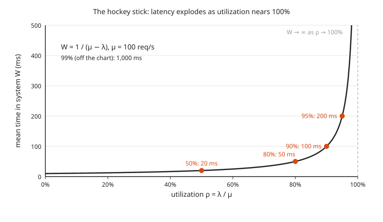

This is the hockey stick every SRE learns the hard way. With a server that finishes 100 requests per second, mean latency is $1 / (\mu - \lambda)$. It barely moves from 0% to 70% busy, then climbs, and it heads to infinity as the server approaches 100% busy. The last few points of utilization cost more latency than the first fifty.

## Guided Build

All three programs live in their own folder under `code/`. Run them from the workshop folder:

```txt
go run ./code/counter-rate
go run ./code/falling-object
go run ./code/queue-sim
```

### Step 1: The Derivative Is the Limit of a Slope

Use a counter whose true value is $c(t) = 50t + 0.1t^2$ requests after $t$ seconds. Traffic is ramping up. The average rate over a window of $h$ seconds starting at $t$ is rise over run. Calculus calls this the **difference quotient**:

$$\frac{c(t + h) - c(t)}{h}$$

Make the window smaller and smaller. The value it settles on is the **derivative**, written $c'(t)$ and read "c prime of t":

$$c'(t) = \lim_{h \to 0} \frac{c(t + h) - c(t)}{h} = 50 + 0.2t$$

Here the algebra works out exactly. Expand $c(t+h)$, subtract $c(t)$, divide by $h$, and the difference quotient is $50 + 0.2t + 0.1h$. The error is $0.1h$. It vanishes as $h$ shrinks to zero.

<!-- diagram: type=secant-family f="50t+0.1t^2" at=60 h=60,15,5 tangent=62 caption="Secants turn into the tangent" -->
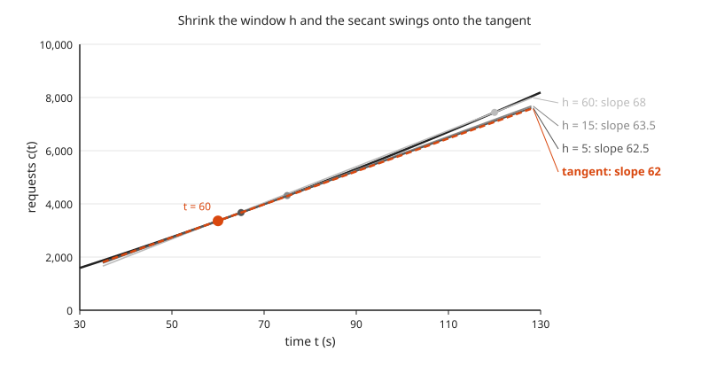

The four lines nearly overlap, and that is the point. Over short windows a smooth curve looks almost straight. Each shorter window gives a line closer to the dashed **tangent**, the line that just touches the curve at $t = 60$. The tangent slope, 62, is the derivative.

```go
func c(t float64) float64 { return 50*t + 0.1*t*t }

for _, h := range []float64{60, 15, 5, 1, 0.1, 0.01} {
	q := (c(t+h) - c(t)) / h
	fmt.Printf("%8g  %22.4f  %8.4f\n", h, q, q-r(t))
}
```

Run `go run ./code/counter-rate`:

```txt
=== Part 1: the derivative is the limit of the difference quotient ===
c(t) = 50t + 0.1t^2, exact c'(60) = 50 + 0.2*60 = 62 req/s
   h (s)     [c(t+h) - c(t)] / h     error
      60                 68.0000    6.0000
      15                 63.5000    1.5000
       5                 62.5000    0.5000
       1                 62.1000    0.1000
     0.1                 62.0100    0.0100
    0.01                 62.0010    0.0010
```

Prometheus never takes the limit. The smallest possible window is one scrape interval, and `rate()` always reports a secant slope. That is fine. An average over a window is what you want for alerting anyway: a one-millisecond rate is mostly noise.

### Step 2: Scrape a Counter and Handle a Reset

The scraper records `floor(c(t))` (the whole-number part) every 15 seconds. At $t = 200$ the process restarts and the counter starts again from zero. The change between two scrapes is the difference of the samples:

$$\Delta_k = v_k - v_{k-1}$$

The symbol $\Delta$ (delta) means "change in". A counter only goes up. A negative $\Delta_k$ means a reset. The simplified rule Prometheus follows: if $v_k < v_{k-1}$, assume the counter restarted from 0 and use $\Delta_k = v_k$.

```go
raw := v - vals[i-1]
d := raw
if raw < 0 { // counter went down: assume it restarted from 0
	d = v
}
```

```txt
=== Part 2: scrape every 15 s, per-interval rate, reset handling ===
   t   value  raw delta  fixed delta  rate/s  bar (1 # = 5 req/s)
   0       0
  15     772        772          772   51.47  ##########
  30    1590        818          818   54.53  ###########
  45    2452        862          862   57.47  ###########
  60    3360        908          908   60.53  ############
  75    4312        952          952   63.47  #############
  90    5310        998          998   66.53  #############
 105    6352       1042         1042   69.47  ##############
 120    7440       1088         1088   72.53  ###############
 135    8572       1132         1132   75.47  ###############
 150    9750       1178         1178   78.53  ################
 165   10972       1222         1222   81.47  ################
 180   12240       1268         1268   84.53  #################
 195   13552       1312         1312   87.47  #################
 210     910     -12642          910   60.67  ############  <- reset detected
 225    2312       1402         1402   93.47  ###################
 240    3760       1448         1448   96.53  ###################
 255    5252       1492         1492   99.47  ####################
 270    6790       1538         1538  102.53  #####################
 285    8372       1582         1582  105.47  #####################
 300   10000       1628         1628  108.53  ######################
```

<!-- diagram: type=line-plot x=150..300 series=raw,reset-aware,true caption="Counter reset and the reset-aware total" -->
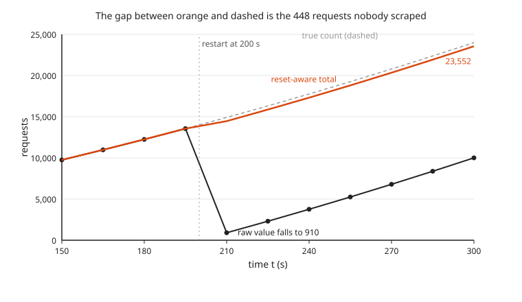

Without the fix, the row at $t = 210$ shows a rate of $-12{,}642 / 15 \approx -843$ requests per second: nonsense that wrecks every graph and pages nobody useful. With the fix the rate dips to 60.67 instead of the true 90.5. The dip is real data loss. The 448 requests counted between the scrape at 195 and the restart at 200 lived only in the old process, and no scrape ever saw them. They are gone. Accept it and move on.

### Step 3: rate() as a Secant Over a Window

`rate(x[1m])` at time $t$ is the total increase over the last 60 seconds divided by 60:

$$\text{rate}(t) = \frac{\text{sum of } \Delta_k \text{ in the window}}{60}$$

```txt
=== Part 3: rate(counter[1m]) = slope of the secant over the last 60 s ===
window [60, 120]: increase = 4,080, rate = 4,080/60 = 68.00 req/s
    true average slope = 68.00, c'(90) at the midpoint = 68, c'(120) at the end = 74
window [180, 240]: increase = 5,072, rate = 5,072/60 = 84.53 req/s
    true average slope = 92.00, c'(210) at the midpoint = 92, c'(240) at the end = 98
```

Two lessons hide in these four lines.

* The secant over $[60, 120]$ equals the true derivative at the **midpoint**, $t = 90$, not at the end. This is the Mean Value Theorem at work: somewhere inside the window, the instant rate equals the average rate. A `rate()` graph lags live traffic by about half the window.
* The window containing the reset reports 84.53 instead of 92. The 448 lost requests divided by 60 is the 7.47 gap.

Real Prometheus `rate()` also stretches the result to the window edges when the first and last samples do not sit exactly on them. The idea is the same: increase over time.

### Step 4: Integrate the Rate Back to a Total

The **Fundamental Theorem of Calculus** says: add up a rate over an interval and you get the change in the total. The long S sign $\int$ means "add up the area":

$$\int_a^b c'(t)\,dt = c(b) - c(a)$$

With samples, the sum of the differences **telescopes**: every middle term cancels, like a collapsing spyglass.

$$\bigl(c_1 - c_0\bigr) + \bigl(c_2 - c_1\bigr) + \cdots + \bigl(c_n - c_{n-1}\bigr) = c_n - c_0$$

<!-- diagram: type=staircase-stack x=0..300 step=60 rises=3360,4080,4800,5520,6240 caption="Telescoping sum" -->
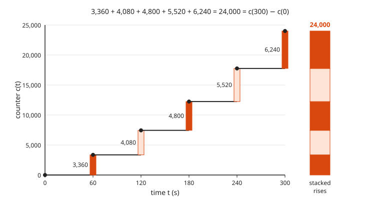

Stack every rise on top of the last and you reach the final value. That is all `increase()` does: add up the fixed deltas.

When you only have rate samples, approximate the area with rectangles. This is a **Riemann sum**: width $\Delta t$ times height $r(t_k)$, added up. The **trapezoid rule** uses a slanted top instead of a flat one by averaging the two ends of each slice:

$$\int_a^b r(t)\,dt \approx \sum_k \frac{r(t_k) + r(t_{k+1})}{2}\,\Delta t$$

<!-- diagram: type=riemann-compare f="50+0.2t" x=0..300 n=5 methods=left,right,trapezoid caption="Left, right and trapezoid sums" -->
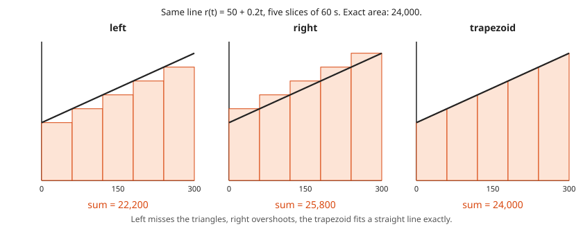

With wide 60-second slices the difference is easy to see. Left rectangles undershoot by 1,800. Right rectangles overshoot by 1,800. Trapezoids hit 24,000 on the nose.

```go
for t := 0.0; t < end; t += step {
	left += r(t) * step
	right += r(t+step) * step
	trap += (r(t) + r(t+step)) / 2 * step
	tel += c(t+step) - c(t)
}
```

```txt
=== Part 4: integrate the rate back to a total (Fundamental Theorem of Calculus) ===
true total requests c(300) - c(0)            = 24,000
increase() = sum of fixed deltas             = 23,552
requests lost between scrape at 195 and restart at 200 = 448

Riemann sums of the true rate r(t) = 50 + 0.2t over [0, 300] with dt = 15 s
  left  endpoints :  23,550.0
  right endpoints :  24,450.0
  trapezoid       :  24,000.0
  exact integral  :  24,000.0

Telescoping check without a reset: sum of (c(t_k) - c(t_k-1)) = c(300) - c(0)
  sum of 20 deltas = 24,000.0, c(300) - c(0) = 24,000.0
```

With 15-second slices the left and right errors shrink to 450 each. Thinner slices, smaller error. The trapezoid is exact here because the rate is a straight line. For a curved rate it is close but not exact.

### Step 5: The Falling Object, Exactly

Drop an object from rest at 100 m. Gravity gives a constant acceleration $a(t) = -9.8$ m/s² (negative means downward). Velocity is the area under acceleration, and height is the area under velocity. Start from $v(0) = 0$ and $h(0) = 100$:

$$v(t) = -9.8t \qquad h(t) = 100 - 4.9t^2$$

The $4.9$ is half of $9.8$: the area of the triangle under the velocity line is $\tfrac{1}{2} \times t \times 9.8t$. The object hits the ground when $h(t) = 0$:

$$t = \sqrt{100 / 4.9} \approx 4.5175 \text{ s}, \qquad \text{speed} = 9.8 \times 4.5175 \approx 44.27 \text{ m/s}$$

```go
func exact(t float64) (h, v float64) {
	return h0 + 0.5*g*t*t, g*t + 0.0 // + 0.0 turns -0 into 0
}
```

Run `go run ./code/falling-object`:

```txt
=== Exact motion: h(t) = 100 - 4.9 t^2, v(t) = -9.8 t ===
 t (s)    h (m)   v (m/s)  height bar (1 # = 4 m)
   0.0   100.00      0.00  #########################
   0.5    98.78     -4.90  #########################
   1.0    95.10     -9.80  ########################
   1.5    88.97    -14.70  ######################
   2.0    80.40    -19.60  ####################
   2.5    69.38    -24.50  #################
   3.0    55.90    -29.40  ##############
   3.5    39.97    -34.30  ##########
   4.0    21.60    -39.20  #####
   4.5     0.77    -44.10  
impact: t = sqrt(100 / 4.9) = 4.5175 s, speed = 9.8 * t = 44.27 m/s
```

The height bars shrink faster and faster. The velocity column grows more negative by the same 4.9 every half second: constant acceleration, a straight velocity line.

### Step 6: Euler Integration and Its Error

Most real systems have no tidy formula. **Euler integration** (Leonhard Euler, 1768) steps forward using the current rates:

$$h_{\text{next}} = h + v\,\Delta t \qquad v_{\text{next}} = v + a\,\Delta t$$

Each step pretends velocity stays fixed for $\Delta t$ seconds. That is a left Riemann sum in disguise.

<!-- diagram: type=euler-vs-exact f="100-4.9t^2" dt=1 steps=5 caption="Euler steps lag the true curve" -->
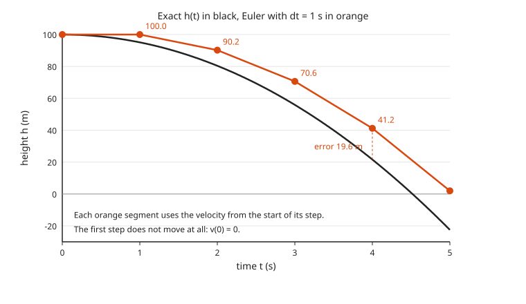

The first step does not move at all, because the velocity at the start is zero. Every later step uses the velocity from the start of the step, which is always a little too slow. The orange line falls behind and never catches up.

Add up the steps and you get a formula to check against. After $n$ steps, $t = n\,\Delta t$ and

$$h_n = 100 - 4.9\,t\,(t - \Delta t) \quad\Rightarrow\quad \text{error} = h_n - h(t) = 4.9\,t\,\Delta t$$

The error is proportional to $\Delta t$. Euler is a **first-order** method.

```go
// euler moves with the old velocity, then updates the velocity.
func euler(dt, tEnd float64) (h, v float64) {
	h, v = h0, 0.0
	n := int(math.Round(tEnd / dt))
	for i := 0; i < n; i++ {
		h += v * dt
		v += g * dt
	}
	return h, v
}
```

```txt
=== Euler integration vs exact at t = 4 s (exact h = 21.6 m) ===
  dt (s)  steps    Euler h  error (m)  error / dt
       1      4    41.2000    19.6000      19.600
     0.5      8    31.4000     9.8000      19.600
     0.1     40    23.5600     1.9600      19.600
    0.01    400    21.7960     0.1960      19.600
   0.001   4000    21.6196     0.0196      19.600
error / dt stays at 19.6: halve dt and the error halves (first-order method)

=== Impact time found by stepping until h <= 0 ===
dt = 0.5    first step with h <= 0 at t = 5.0000 s (exact 4.5175)
dt = 0.1    first step with h <= 0 at t = 4.6000 s (exact 4.5175)
dt = 0.01   first step with h <= 0 at t = 4.5300 s (exact 4.5175)
dt = 0.001  first step with h <= 0 at t = 4.5190 s (exact 4.5175)
```

<!-- diagram: type=scatter x=dt y=error points=1:19.6,0.5:9.8,0.1:1.96,0.01:0.196,0.001:0.0196 line="19.6*dt" caption="Euler error is a straight line in dt" -->
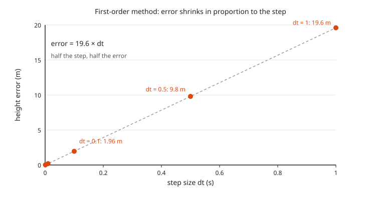

The error column matches $4.9 \times 4 \times \Delta t = 19.6\,\Delta t$ exactly, and the points sit on a straight line through zero. Ten times more steps buys ten times less error. Game engines run this same loop every frame. When the frame time gets too long, objects pass through floors. Players call it a bug. It is a step size.

### Step 7: Little's Law

For any stable system (a service, a queue, a supermarket checkout), averaged over a long period:

$$L = \lambda W$$

* $L$: average number of items inside the system (requests in flight).
* $\lambda$ (lambda): average arrival rate (requests per second).
* $W$: average time each item spends inside (latency, in seconds).

**Stable** means work does not pile up forever: on average, things leave as fast as they arrive.

<!-- diagram: type=gantt-and-count requests=6 window=0..10 caption="Little's law: one area counted two ways" -->
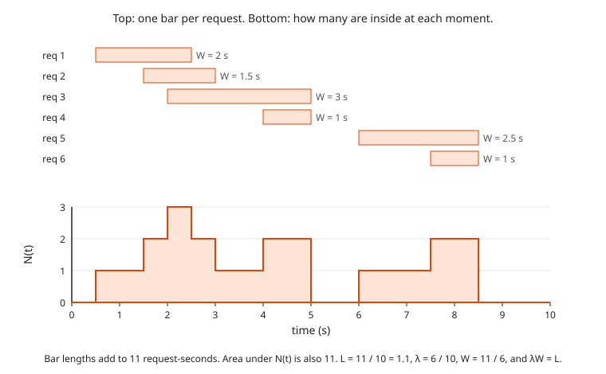

Why it is true, in one picture. The top shows one bar per request, as long as its time inside. The bottom shows how many requests are inside at each moment. Both pictures cover the same request-seconds: 11. Divide by the 10-second window and you get $L = 1.1$. Six requests in 10 seconds gives $\lambda = 0.6$ per second. The average bar is $W = 11 / 6$ seconds. And $0.6 \times 11/6 = 1.1$. No assumption about randomness is needed.

```go
for _, k := range cases {
	fmt.Printf("%-30s lambda = %5s req/s, W = %4.0f ms -> L = %g\n", k.name, k.lam, k.w*1000, math.Round(k.l*k.w*1e9)/1e9)
}
```

Run `go run ./code/queue-sim`:

```txt
=== Little's law: L = lambda * W ===
requests in flight at an API   lambda =   200 req/s, W =  250 ms -> L = 50
busy worker threads            lambda = 1,200 req/s, W =   80 ms -> L = 96
```

Each request holds one thread for its whole life. The second line says 96 threads are busy on average. A pool of 64 threads cannot keep up, no matter how fast the CPU is.

### Step 8: The M/M/1 Queue

Now add a model of randomness. The **M/M/1** queue has random arrivals at average rate $\lambda$, random service times with average rate $\mu$ (mu), one server, and first-come first-served order. The two M letters mean the arrival gaps and service times follow the exponential distribution: many short ones, a few long ones, and no memory of the past.

<!-- diagram: type=queue-schematic arrival=lambda server=mu caption="An M/M/1 queue" -->
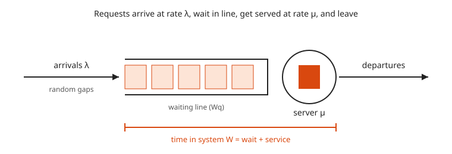

Define **utilization**, the fraction of time the server is busy:

$$\rho = \frac{\lambda}{\mu} \quad (\rho \text{ is "rho"; it has to stay below } 1)$$

Queueing theory gives:

$$W = \frac{1}{\mu - \lambda} \qquad L = \frac{\rho}{1 - \rho} \qquad W_q = \frac{\rho}{\mu - \lambda}$$

where $W_q$ is time spent waiting before service starts. Check Little: $\lambda W = \lambda / (\mu - \lambda) = \rho / (1 - \rho) = L$. As $\rho$ gets close to 1, the bottom of each fraction gets close to 0, and $L$ and $W$ blow up.

```go
for _, rho := range []float64{0.5, 0.8, 0.9, 0.95, 0.99} {
	lam := rho * mu
	w := 1 / (mu - lam)
	wq := rho / (mu - lam)
	l := rho / (1 - rho)
	...
}
```

```txt
=== M/M/1 formulas with mu = 100 req/s ===
  rho  lambda   W (ms)  Wq (ms)      L  W bar (1 # = 20 ms)
 0.50      50       20       10      1  #
 0.80      80       50       40      4  ###
 0.90      90      100       90      9  #####
 0.95      95      200      190     19  ##########
 0.99      99     1000      990     99  ##################################################
```

Going from 50% to 90% utilization multiplies latency by five. Going from 90% to 99% multiplies it by ten more. At 99%, 990 ms of the 1,000 ms average latency is time spent standing in line. The work itself takes 10 ms. The line is the job now.

### Step 9: Simulate It and Check the Formula

A **discrete-event simulation** jumps from event to event instead of ticking a clock. With one server there are only two kinds of event: the next arrival and the next departure. Between events the number inside is constant. Its area over time is a sum of rectangles, the same Riemann sum idea as Step 4.

```go
for done < n {
	t := math.Min(nextArrival, nextDeparture)
	area += float64(len(waiting)) * (t - clock)
	clock = t
	if nextArrival <= nextDeparture {
		waiting = append(waiting, clock)
		if len(waiting) == 1 {
			nextDeparture = clock + exp(mu)
		}
		nextArrival = clock + exp(lam)
	} else {
		arrived := waiting[0]
		waiting = waiting[1:]
		totalW += clock - arrived
		done++
		...
	}
}
```

```txt
=== Discrete-event simulation, 200,000 requests per run, seed 42 ===
  rho  W formula    W sim  L formula   L sim  lambda*W sim
 0.50     20.0ms   20.2ms       1.00    1.01          1.01
 0.80     50.0ms   49.5ms       4.00    3.97          3.97
 0.90    100.0ms  103.7ms       9.00    9.36          9.36
```

The simulation lands within 4% of the formula. The last column multiplies the observed arrival rate by the simulated $W$, and it matches the measured $L$ to two decimals: Little's law holds on the simulated data itself. At $\rho = 0.9$ the estimate is the noisiest. Long busy stretches make neighboring requests share the same bad luck, and 200,000 requests carry less independent information than at $\rho = 0.5$.

## Worked Numbers

### Example 1: rate() Across a Reset

Samples every 15 s: 900, 1,020, 30, 150.

```txt
delta 1 = 1,020 - 900 = 120                 counter went up: normal
delta 2 = 30 - 1,020 = -990 -> use 30       negative: reset, assume restart from 0
delta 3 = 150 - 30 = 120                    normal again
increase = 120 + 30 + 120 = 270             sum of fixed deltas
rate = 270 / 45 = 6 req/s                   three intervals of 15 s = 45 s
```

### Example 2: The Falling Object at t = 3 s

```txt
v(3) = -9.8 * 3 = -29.4 m/s                 velocity grows by -9.8 each second
h(3) = 100 - 4.9 * 3^2 = 100 - 44.1         drop is the triangle area 4.9 t^2
     = 55.9 m                               matches the table row t = 3.0
Euler h with dt = 0.5 at t = 3:             n = 6 steps
     = 100 - 4.9 * 3 * (3 - 0.5)            closed form for Euler
     = 100 - 36.75 = 63.25 m                Euler lags behind
error = 63.25 - 55.9 = 7.35 = 4.9 * 3 * 0.5 error = 4.9 t dt
```

### Example 3: Sizing a Thread Pool With Little's Law

Traffic is 1,200 requests per second, each request holds a thread for 80 ms, and the team wants the pool at most 70% busy.

```txt
L = lambda * W = 1,200 * 0.080 = 96         average busy threads
pool = 96 / 0.70 = 137.14...                keep 30% headroom
pool = 138 threads                          round up: you cannot run 0.14 of a thread
```

### Example 4: M/M/1 at 90% Utilization

A service finishes 100 requests per second (10 ms each) and receives 90 per second.

```txt
rho = 90 / 100 = 0.9                        utilization
W   = 1 / (100 - 90) = 0.1 s = 100 ms       average time in system
Wq  = 0.9 / (100 - 90) = 0.09 s = 90 ms     average wait before service
L   = 0.9 / (1 - 0.9) = 9                   average requests in system
check: lambda * W = 90 * 0.1 = 9            Little's law agrees
```

The request needs 10 ms of real work and spends 90 ms waiting in line.

## Common Mistakes

* Graphing a raw counter: the line only goes up and hides everything. Graph `rate()` or `increase()`.
* Taking `rate()` of a gauge: a gauge (memory in use, queue depth) already is a level, and any drop looks like a counter reset. Use `deriv()` or `delta()` for gauges.
* Choosing a `rate()` window shorter than two scrape intervals: with one sample or none in the window, there is no slope to compute. Use at least four times the scrape interval.
* Reading `rate()` as the current rate: it is the average over the window, centered about half a window in the past.
* Forgetting the starting values when integrating: the area under acceleration gives the change in velocity, not the velocity. Add the starting velocity, and for height add the 100 m.
* Assuming Euler is exact with a small enough step: the error shrinks in proportion to $\Delta t$ but never reaches zero, and it grows with the length of the run.
* Mixing units in Little's law: requests per second times milliseconds gives a number 1,000 times too large. Convert $W$ to seconds first.
* Planning capacity for 95% to 100% utilization: by the M/M/1 formula, latency at 95% is 20 times the bare service time. Real systems with bursty traffic do worse.

## Try It

1. A counter reads 1,200 at $t = 0$ and 1,560 at $t = 60$ s, with no reset. What does `rate()` over that minute report?
2. For $c(t) = 3t^2$, compute the difference quotient at $t = 2$ with $h = 0.1$, and the exact derivative.
3. A counter has samples 500, 650, 40, 190 every 15 s. What is the increase over the 45 s, with reset handling?
4. A service handles a steady 40 requests per second for five minutes. How many requests does `increase()` report over those five minutes?
5. An object drops from rest at 45 m. When does it hit the ground, and how fast is it moving?
6. Using the Euler error formula from Step 6, what is the height error at $t = 4$ s with $\Delta t = 0.25$ s?
7. A batch API receives 50 requests per second, and each takes 2 seconds. How many requests are in flight on average?
8. An M/M/1 server finishes 200 requests per second and receives 180 per second. Find $\rho$, $W$ and $L$.
9. With $\mu = 100$ requests per second, what is the highest arrival rate that keeps the M/M/1 average latency at or below 25 ms?
10. Traffic doubles from 45 to 90 requests per second on a server with $\mu = 100$. By what factor does average latency grow?

<details><summary>Answers</summary>

1. 6 req/s: $(1{,}560 - 1{,}200) / 60 = 360 / 60$.
2. 12.3 and 12: $(3 \times 2.1^2 - 12) / 0.1 = (13.23 - 12) / 0.1$, and $c'(t) = 6t = 12$.
3. 340: deltas are 150, then 40 (reset: use the new value), then 150.
4. 12,000: $40 \times 300$, the area of a rectangle under a flat rate.
5. About 3.03 s and 29.70 m/s: $t = \sqrt{45 / 4.9} \approx 3.0305$, speed $= 9.8t \approx 29.70$.
6. 4.9 m: $4.9 \times 4 \times 0.25$.
7. 100: $L = \lambda W = 50 \times 2$.
8. $\rho = 0.9$, $W = 1 / 20$ s $= 50$ ms, $L = 0.9 / 0.1 = 9$.
9. 60 requests per second: $1 / (100 - \lambda) \le 0.025$ gives $100 - \lambda \ge 40$.
10. 5.5 times: $W$ goes from $1/55 \approx 18.2$ ms to $1/10 = 100$ ms.

</details>

## Where This Shows Up at Work

* **Monitoring:** every Prometheus `rate()`, `irate()`, `increase()` and `deriv()` is a difference quotient or a sum of differences. Grafana panels showing requests per second, error rate and bytes per second are all derivatives of counters.
* **SLO burn rate:** the error budget is the area under the error rate. Burn-rate alerts compare how fast the budget is being used with the speed that uses it up exactly at the end of the SLO window.
* **Capacity planning:** Little's law sizes connection pools, thread pools, Kafka consumer counts and database connection limits from throughput and latency alone.
* **Autoscaling:** autoscalers often target 60% to 70% utilization because the hockey stick makes latency explode beyond that.
* **Load balancing and queue design:** the M/M/1 blow-up explains why a single hot shard or one slow consumer dominates tail latency, and why adding servers or shedding load helps sharply near saturation.
* **Simulation and games:** physics engines, orbital mechanics, robot controllers and ML training (gradient descent is an Euler step downhill on a loss surface) all step a rate equation forward in time.
* **Finance:** an interest rate is the derivative of a balance, and accumulated interest is its integral.

## Go Deeper

* [Prometheus query functions](https://prometheus.io/docs/prometheus/latest/querying/functions/): the official definitions of `rate()`, `irate()`, `increase()` and `deriv()`, including counter reset handling.
* [Paul's Online Math Notes: Calculus I](https://tutorial.math.lamar.edu/Classes/CalcI/CalcI.aspx): derivatives as limits, Riemann sums and the Fundamental Theorem, in plain worked examples.
* [Paul's Online Math Notes: Euler's Method](https://tutorial.math.lamar.edu/Classes/DE/EulersMethod.aspx): the stepping method from Step 6, with error discussion.
* [Better Explained](https://betterexplained.com/): intuition-first articles on calculus, slope and area.
* [Little's law on Wikipedia](https://en.wikipedia.org/wiki/Little%27s_law): the statement, the conditions it needs, and its history.
* [401 Calculus](../../course/401/README.md), [Differential Equations Track](../../tracks/differential-equations/README.md) and [Probability Track](../../tracks/probability/README.md): the theory behind each part of this workshop.
