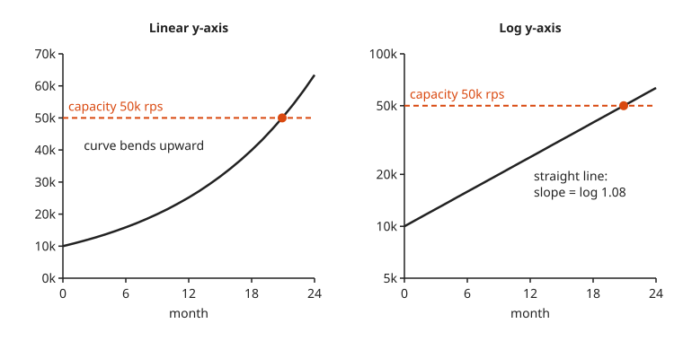
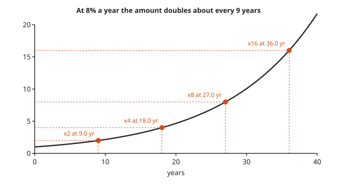
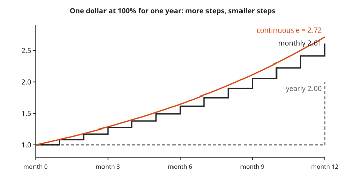
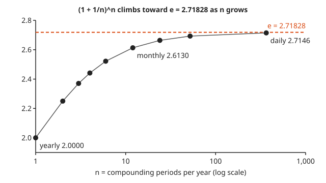
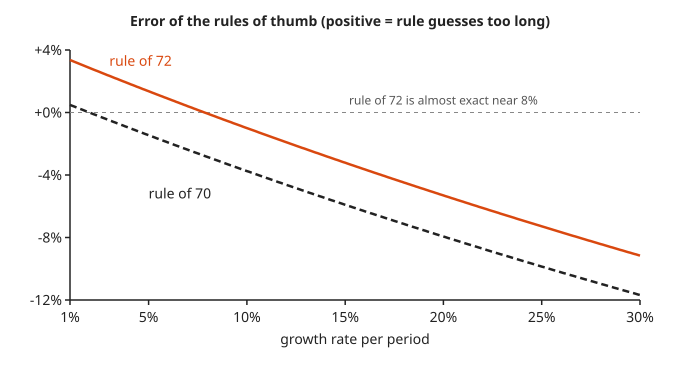
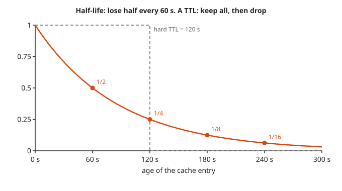
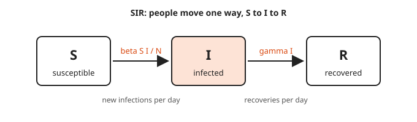
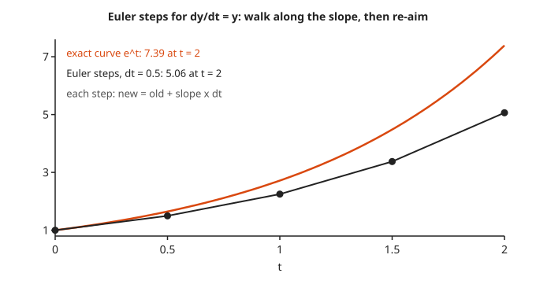
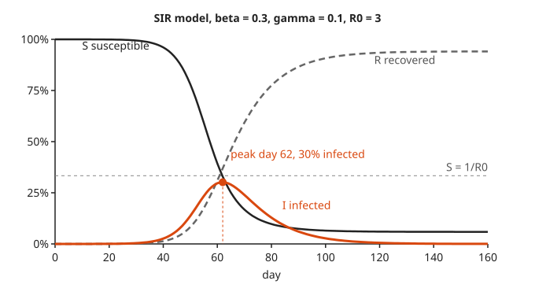
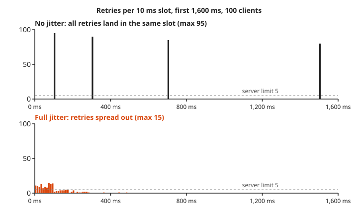

# Exponential Growth in Interest, Epidemics, and Load

**Math used:** exponentials, logarithms, the number $e$, Euler steps for differential equations · **Level needed:** 301 (exponentials and logs; 401 for the SIR derivative view) · **Time:** 2 hours
**Run it:** `go run ./code/compound` from this folder, then `./code/capacity`, `./code/sir`, and `./code/backoff`

## The Real Problem

A dashboard shows 10,000 requests per second (rps) today. Last quarter it showed about 8,000. The fleet tops out at 50,000 rps. The planning meeting asks one question: how many months until capacity runs out? A straight-line guess says years. The real answer is under two years, because the traffic grows by a percentage each month, not by a fixed amount.

The same shape shows up in many places. A savings account earns interest on its interest. A sick person infects a few others, and each of them infects a few more. A retry loop doubles its wait after each failure. In every case the amount changes in proportion to itself. That is all **exponential** means: the bigger it is, the faster it grows.

This workshop builds all four from one idea. You compute compound interest and watch the number $e$ appear. You find doubling times with logs and check the rule of 72. You plan capacity for growing load, simulate an epidemic, and watch jitter turn a retry storm into a trickle. Nothing here needs more than a calculator and patience. The calculator is Go.

## The Math You Need

* Exponents and exponential functions $a \cdot b^t$: [301 Algebra II, Trig and Precalculus](../../course/301/README.md) and the [Algebra track](../../tracks/algebra/README.md). You need two rules: $b^{x+y} = b^x \cdot b^y$ and $(b^x)^y = b^{xy}$.
* Logarithms: [301 Algebra II, Trig and Precalculus](../../course/301/README.md). A **logarithm** answers "what power do I need?" If $1.08^t = 2$, then $t = \ln 2 / \ln 1.08$. That one line answers every "when does it double" question here.
* The number $e$ as a limit: [401 Calculus](../../course/401/README.md) and the [Calculus track](../../tracks/calculus/README.md). Only the idea matters: a value that a sequence creeps toward and never passes.
* Rates of change and Euler steps: [401 Calculus](../../course/401/README.md) and the [Differential Equations track](../../tracks/differential-equations/README.md). A **rate of change** says how fast something moves right now. The SIR model is three such rates, and Euler steps turn them into a plain loop.

## Picture It

Two pictures carry the whole workshop. The rest live next to the step that uses them.

<!-- diagram: type=side-by-side-line-charts left=linear right=log10 series=10000*1.08^t t=0..24 reference=50000 caption="Same curve, linear axis versus log axis" -->


The left panel is how growth feels: flat for a year, then suddenly steep. The right panel plots the same numbers on a **log axis**, where each factor of ten takes the same height. On that axis, steady percentage growth is a straight line. If you remember one thing, remember this one.

<!-- diagram: type=line-chart x=years y=amount series=1.08^t marks=doublings caption="Constant doubling time at 8 percent" -->


At 8% a year the amount doubles every nine years, again and again. The first doubling looks small and the fourth looks huge, but each one takes the same time. Exponential growth is a fixed doubling time wearing a disguise.

## Guided Build

All programs live in `code/<name>/main.go`, use only the Go standard library, and run from this folder with `go run ./code/<name>`.

### Step 1: Compound Interest and the Number e

Put $P$ dollars in an account at yearly rate $r$. If the bank adds interest $n$ times per year, each time it multiplies the balance by $(1 + r/n)$. After $t$ years that happens $nt$ times:

$$A = P\left(1 + \frac{r}{n}\right)^{nt}$$

Adding interest more often helps, but each extra step helps less. Push $n$ toward infinity and you get **continuous compounding**:

$$A = P e^{rt}, \qquad e = \lim_{n \to \infty}\left(1 + \frac{1}{n}\right)^n \approx 2.71828$$

<!-- diagram: type=step-chart x=months y=balance series=yearly,monthly,continuous rate=100% caption="More frequent compounding, smaller steps" -->


The staircase shows why. Yearly compounding waits all year and jumps once. Monthly compounding takes 12 small steps, and each step earns interest on the steps before it. Continuous compounding takes infinitely many tiny steps and ends at $e$.

<!-- diagram: type=line-chart x=log(n) y=(1+1/n)^n points=1,2,3,4,6,12,24,52,365 reference=e caption="(1 + 1/n)^n approaches e" -->


```go
func compound(principal, rate float64, n, years float64) float64 {
	return principal * math.Pow(1+rate/n, n*years)
}

func continuous(principal, rate, years float64) float64 {
	return principal * math.Exp(rate*years)
}
```

Output of `go run ./code/compound`, sections 1 and 2:

```txt
================================================================
1. Compound interest: $10,000 at 5% for 10 years
================================================================
compounding        n       balance    gain vs yearly
yearly             1     16,288.95              0.00
monthly           12     16,470.09            181.15
daily            365     16,486.65            197.70
continuous       inf     16,487.21            198.27

================================================================
2. (1 + 1/n)^n approaches e
================================================================
           n  (1 + 1/n)^n       gap to e
           1  2.00000000      0.71828183
           2  2.25000000      0.46828183
           4  2.44140625      0.27687558
          12  2.61303529      0.10524654
          52  2.69259695      0.02568487
         365  2.71456748      0.00371435
       8,760  2.71812669      0.00015514
   1,000,000  2.71828047      0.00000136
           e  2.71828183
```

Yearly to monthly adds 181.15 dollars. Daily to continuous adds 0.56 dollars. A bank that compounds every second is not making you rich; it is making a point.

### Step 2: Doubling Time, Exactly and by Rule of Thumb

When does $P(1 + r)^t$ reach $2P$? Divide by $P$ and take the natural log of both sides:

$$(1 + r)^t = 2 \quad\Longrightarrow\quad t \cdot \ln(1 + r) = \ln 2 \quad\Longrightarrow\quad t = \frac{\ln 2}{\ln(1 + r)}$$

For small $r$, $\ln(1 + r)$ is close to $r$, and $\ln 2 = 0.693$. That gives the **rule of 70** (or 69.3): doubling time is about 70 divided by the rate in percent. The **rule of 72** swaps in 72 because 72 divides evenly by 2, 3, 4, 6, 8, 9, and 12, and it happens to be closer near 8%.

<!-- diagram: type=line-chart x=rate%=1..30 y=percent-error series=rule72,rule70 reference=0 caption="Rule of thumb error versus exact doubling time" -->


```go
exact := math.Ln2 / math.Log(1+r)
r72, r70, r693 := 72/pct, 70/pct, 69.3/pct
```

```txt
================================================================
3. Doubling time: exact versus rules of thumb (years)
================================================================
  rate    exact    72/r    70/r  69.3/r   err 72   err 70
    1%    69.66   72.00   70.00   69.30    +3.4%    +0.5%
    2%    35.00   36.00   35.00   34.65    +2.8%    -0.0%
    3%    23.45   24.00   23.33   23.10    +2.3%    -0.5%
    5%    14.21   14.40   14.00   13.86    +1.4%    -1.5%
    8%     9.01    9.00    8.75    8.66    -0.1%    -2.8%
   10%     7.27    7.20    7.00    6.93    -1.0%    -3.7%
   12%     6.12    6.00    5.83    5.77    -1.9%    -4.6%
   15%     4.96    4.80    4.67    4.62    -3.2%    -5.9%
   20%     3.80    3.60    3.50    3.46    -5.3%    -7.9%
   30%     2.64    2.40    2.33    2.31    -9.2%   -11.7%
continuous growth doubles in exactly ln 2 / r = 69.3 / (rate in %)
```

The rule of 70 wins below about 4%. The rule of 72 wins from about 5% to 15%. Above 20% both drift, and the exact formula costs one line of code.

### Step 3: Half-Life, the Mirror Image

Decay is growth run backwards. A **half-life** $h$ is the time it takes to lose half. After one half-life you have $1/2$, after two you have $1/4$, and so on:

$$N(t) = N_0 \cdot 2^{-t/h} = N_0 e^{-kt}, \qquad k = \frac{\ln 2}{h}$$

Carbon-14 has a half-life of 5,730 years. A cache that scores entries by age with a 60 s half-life uses the same curve.

<!-- diagram: type=line-chart x=age-seconds y=weight series=0.5^(t/60),ttl-step marks=60,120,180,240 caption="Half-life decay versus a hard TTL" -->


A hard **TTL** (time to live) is a cliff: the entry is perfect until it expires, then it is gone. A half-life is a slope: the entry fades.

```go
k = math.Ln2 / 60
w := math.Exp(-k * t)
```

```txt
================================================================
4. Half-life: the mirror image of doubling
================================================================
carbon-14: half-life 5,730 years, decay constant k = 1.210e-04 per year
  t =      0 yr  remaining 100.0%  ########################################
  t =  5,730 yr  remaining  50.0%  ####################
  t = 11,460 yr  remaining  25.0%  ##########
  t = 17,190 yr  remaining  12.5%  #####
  t = 22,920 yr  remaining   6.2%  ###

cache hit weight with a 60 s half-life (score = e^(-kt))
  age   0 s  weight 1.000  ########################################
  age  30 s  weight 0.707  ############################
  age  60 s  weight 0.500  ####################
  age 120 s  weight 0.250  ##########
  age 180 s  weight 0.125  #####
  age 300 s  weight 0.031  #
```

At 30 s the weight is $2^{-1/2} = 0.707$, not 0.75. Halfway through a half-life is not halfway down.

### Step 4: Capacity Planning for Growing Load

Load that grows 8% month over month follows $L(t) = 10{,}000 \cdot 1.08^t$. To find the month that hits a target $L^*$, divide and take logs, as in Step 2:

$$t = \frac{\ln(L^* / L_0)}{\ln(1 + g)}$$

<!-- diagram: type=side-by-side-line-charts left=linear right=log10 series=10000*1.08^t t=0..24 reference=50000 caption="Capacity line on both axes" -->


```go
func monthsUntil(target, start, g float64) float64 {
	return math.Log(target/start) / math.Log(1+g)
}
```

Output of `go run ./code/capacity`, sections 1 and 2:

```txt
Load model: L(t) = 10,000 * (1 + 0.08)^t   (t in months)
Capacity: 50,000 rps

1. Month by month (# = 1,000 rps, | = capacity)
  month  0    10,000 rps  ##########                                        |
  month  2    11,664 rps  ############                                      |
  month  4    13,605 rps  ##############                                    |
  month  6    15,869 rps  ################                                  |
  month  8    18,509 rps  ###################                               |
  month 10    21,589 rps  ######################                            |
  month 12    25,182 rps  #########################                         |
  month 14    29,372 rps  #############################                     |
  month 16    34,259 rps  ##################################                |
  month 18    39,960 rps  ########################################          |
  month 20    46,610 rps  ###############################################   |
  month 22    54,365 rps  ######################################################  OVER
  month 24    63,412 rps  ###############################################################  OVER

2. Exact answers with logs
  doubles (20,000 rps):       t = ln 2 / ln 1.08   =  9.01 months
  70% of capacity (35,000):   t = ln 3.5 / ln 1.08 = 16.28 months
  full capacity (50,000):     t = ln 5 / ln 1.08   = 20.91 months
  rule of 72 check: 72 / 8 = 9.00 months to double
```

Five times the load needs only $\log_2 5 \approx 2.32$ doublings, about 21 months. If hardware takes four months to arrive, the order goes out by month 16.9 at the latest. At that point the load reads about 36,700 rps and the chart still looks calm. Calm charts are how capacity incidents get scheduled.

The same program answers the question for other growth rates and recovers the rate from two dashboard readings:

```txt
3. Months from 10,000 rps at other growth rates
  growth/month   double  70% cap  capacity
            2%     35.0     63.3      81.3
            4%     17.7     31.9      41.0
            5%     14.2     25.7      33.0
            8%      9.0     16.3      20.9
           10%      7.3     13.1      16.9
           15%      5.0      9.0      11.5
...
5. Recover the growth rate from two dashboard readings
  January 12,400 rps, July 19,700 rps, 6 months apart
  g = (19,700 / 12,400)^(1/6) - 1 = 8.02% per month
  months from July to 50,000 rps: 12.1
```

### Step 5: Why the Log Axis Straightens the Curve

Take $\log_{10}$ of $L(t) = L_0 (1 + g)^t$. A log turns multiplication into addition:

$$\log_{10} L(t) = \log_{10} L_0 + t \cdot \log_{10}(1 + g)$$

That is $y = b + m t$, a straight line. Its slope $m = \log_{10}(1 + g)$ is the growth rate in disguise. The right panel of the capacity picture in Step 4 is this line. The program prints the equal steps:

```txt
4. Log scale: log10(load) climbs by the same amount every month
  log10(1.08) = 0.03342 per month
  month 0  load  10,000.0  log10 4.00000
  month 1  load  10,800.0  log10 4.03342  +0.03342
  month 2  load  11,664.0  log10 4.06685  +0.03342
  month 3  load  12,597.1  log10 4.10027  +0.03342
  month 4  load  13,604.9  log10 4.13370  +0.03342
  month 5  load  14,693.3  log10 4.16712  +0.03342
  month 6  load  15,868.7  log10 4.20054  +0.03342
```

On a Grafana panel with a log y-axis, read growth by eye. A straight line means steady percentage growth. A line that bends up means growth is speeding up. A line that flattens means growth is slowing.

### Step 6: The SIR Epidemic Model With Euler Steps

Split a population of $N$ people into three boxes: **S**usceptible (can catch it), **I**nfected (has it and spreads it), and **R**ecovered (had it, now immune). People only move one way.

<!-- diagram: type=flow boxes=S,I,R arrows="beta S I / N","gamma I" caption="SIR compartments" -->


Each day, an infected person passes it on at rate $\beta$ (beta) to the share of people still susceptible, and recovers at rate $\gamma$ (gamma). Written as rates of change:

$$\frac{dS}{dt} = -\beta \frac{S I}{N}, \qquad \frac{dI}{dt} = \beta \frac{S I}{N} - \gamma I, \qquad \frac{dR}{dt} = \gamma I$$

Read $dS/dt$ as "how fast $S$ changes per day." The **basic reproduction number** $R_0 = \beta / \gamma$ is how many people one sick person infects when everyone else is susceptible. Early on, $S \approx N$ and $dI/dt \approx (\beta - \gamma) I$, which is plain exponential growth.

These equations have no simple formula for the answer. An **Euler step** gets around that: take the current rates, walk forward a small time $\Delta t$, recompute the rates, repeat. New value = old value + rate times $\Delta t$.

<!-- diagram: type=line-chart series=exp(t),euler(dt=0.5) t=0..2 caption="Euler steps follow the slope" -->


The picture uses the simplest growth equation, $dy/dt = y$. Big steps fall behind the true curve because each step uses the slope from its start. Smaller steps fix that. The SIR program uses $\Delta t = 0.1$ day.

```go
newInf := beta * s * i / popN * dt
newRec := gamma * i * dt
s -= newInf
i += newInf - newRec
r += newRec
```

Output of `go run ./code/sir` (table trimmed):

```txt
SIR model, Euler steps
  N = 1,000,000  I0 = 10  beta = 0.3/day  gamma = 0.1/day  dt = 0.1 day
  R0 = beta / gamma = 3.00
  mean infectious period = 1 / gamma = 10 days
  herd-immunity threshold = 1 - 1/R0 = 66.7%
  early growth rate beta - gamma = 0.20/day, doubling time ln 2 / 0.20 = 3.5 days

  day           S           I           R
    0     999,990          10           0
   10     999,896          72          31
   20     999,218         524         257
   30     994,341       3,771       1,888
   40     960,668      25,962      13,369
   50     780,532     136,968      82,500
   60     393,854     296,462     309,685
   70     167,973     239,496     592,531
   80      97,174     128,376     774,451
...
  160      58,958         196     940,847

peak: day 62, 301,609 infected at once (30.2%), S at peak = 32.9% of N
final: 94.1% of the population was ever infected

fraction of population
1.00 |SSSSSSSSSSSSSSSSSSS
     |                   SSS                                RRRRRRRRRRRRRRRRRRRRRRRRRR
     |                      SS                      RRRRRRRR
     |                        S                 RRRR
0.79 |                         S              RR
     |                          S           RR
     |                                     R
     |                           S        R
0.58 |                                   R
     |                            S     R
     |                             S   R
     |                                R
0.37 |                              SR
     |                              III
     |                            II  SIII
     |                           IR    SS II
0.16 |                         IIR       SS II
     |                        IRR          SSSIIII
     |                     IIIR                   IIIIIIISSSSSSSSSSSSSSSSSSSSSSSSSSSSS
0.00 |IIIIIIIIIIIIIIIIIIIIIR                             IIIIIIIIIIIIIIIIIIIIIIIIIIIII
     +--------------------------------------------------------------------------------
  day 0         20        40        60        80        100       120       140
  S = susceptible, I = infected, R = recovered (one column = 2 days)
```

<!-- diagram: type=line-chart series=S,I,R model=SIR beta=0.3 gamma=0.1 days=0..160 marker=peak reference=1/R0 caption="SIR epidemic curves" -->


Two facts fall out of $dI/dt = I(\beta S/N - \gamma)$. Infections grow while $S/N$ is above $1/R_0$ and shrink once it drops below. The peak sits where $S/N = 1/R_0 = 33.3\%$; the daily sample reads 32.9% because the true peak falls between day 62 and day 63. The **herd-immunity threshold** $1 - 1/R_0$ is the immune share that keeps $S/N$ below $1/R_0$ from the start.

The last table varies $R_0$ with $\gamma$ fixed:

```txt
Effect of R0 (gamma fixed at 0.1/day)
   R0   beta  peak day  peak I %  ever infected  herd thr.
  1.5   0.15       207      6.3%          58.3%      33.3%
  2.0   0.20       114     15.4%          79.7%      50.0%
  2.5   0.25        80     23.4%          89.3%      60.0%
  3.0   0.30        62     30.2%          94.1%      66.7%
  4.0   0.40        43     40.5%          98.1%      75.0%
```

The outbreak overshoots. With $R_0 = 3$, 94.1% end up infected, far past the 66.7% threshold, because people who are already sick keep spreading it after the threshold passes. Momentum is not only a physics word.

### Step 7: Exponential Backoff With Jitter

A client that retries a failed call waits longer after each failure. **Backoff** doubles the wait each time, up to a cap:

$$\text{sleep}_k = \min(\text{cap},\ \text{base} \cdot 2^k)$$

That alone does not stop a **retry storm**. If 100 clients fail at the same moment, they all compute the same sleep and come back at the same moment. The AWS Architecture Blog post "Exponential Backoff And Jitter" recommends **full jitter**: pick the sleep at random between zero and the ceiling. **Jitter** just means deliberate randomness.

$$\text{sleep}_k = \text{uniform}\big(0,\ \min(\text{cap},\ \text{base} \cdot 2^k)\big)$$

<!-- diagram: type=bar-chart x=attempt=0..7 y=ms base=100 cap=5000 bands=full-jitter,equal-jitter caption="Backoff ceiling and jitter ranges" -->


```go
func noJitter(attempt int, _ *rand.Rand) float64 { return ceiling(attempt) }

func fullJitter(attempt int, rng *rand.Rand) float64 {
	return rng.Float64() * ceiling(attempt)
}

func equalJitter(attempt int, rng *rand.Rand) float64 {
	half := ceiling(attempt) / 2
	return half + rng.Float64()*half
}
```

The simulation sends 100 clients at a server that completes five requests per 10 ms slot. The rest fail and retry. The random source is seeded, which keeps every run identical. Output of `go run ./code/backoff` (equal jitter histogram trimmed):

```txt
Backoff ceiling per retry: min(cap, base * 2^attempt)
  base = 100 ms, cap = 5,000 ms
  attempt: 0:100  1:200  2:400  3:800  4:1600  5:3200  6:5000  7:5000  8:5000  9:5000

100 clients, server completes 5 requests per 10 ms slot

--- no jitter ---
  total calls 1,000, most retries in one 10 ms slot 95, last success at 51,300 ms, gave up 20
  retries per 100 ms window (# = 2 retries), first 1.6 s:
      0-100   ms    0
    100-200   ms   95 ################################################
    200-300   ms    0
    300-400   ms   90 #############################################
    400-500   ms    0
    500-600   ms    0
    600-700   ms    0
    700-800   ms   85 ###########################################
    800-900   ms    0
    900-1000  ms    0
   1000-1100  ms    0
   1100-1200  ms    0
   1200-1300  ms    0
   1300-1400  ms    0
   1400-1500  ms    0
   1500-1600  ms   80 ########################################

--- full jitter ---
  total calls 259, most retries in one 10 ms slot 15, last success at 487 ms, gave up 0
  retries per 100 ms window (# = 2 retries), first 1.6 s:
      0-100   ms  109 #######################################################
    100-200   ms   32 ################
    200-300   ms   15 ########
    300-400   ms    1 #
    400-500   ms    2 #
    500-600   ms    0
...
Summary
  strategy         calls  retries/slot  done at ms  gave up
  no jitter        1,000            95      51,300       20
  full jitter        259            15         487        0
  equal jitter       284            21         619        0
```

<!-- diagram: type=bar-chart-pair x=10ms-slots y=retries left="no jitter" right="full jitter" clients=100 limit=5 caption="Retry storm versus jittered retries" -->


Without jitter, every wave lands in one 10 ms slot. Five succeed, the rest fail, and the failures all come back together next time. After 16 waves, 20 clients give up and the last success arrives after 51.3 s. Full jitter cuts total calls from 1,000 to 259 and the worst slot from 95 retries to 15, and everyone finishes in under half a second. The clients did not get smarter. They just stopped arriving in lockstep.

## Worked Numbers

### Example 1: Monthly Compounding Versus Continuous

```txt
P = 10,000, r = 0.05, t = 10                   given
monthly: A = 10,000 * (1 + 0.05/12)^(12*10)    A = P(1 + r/n)^(nt), n = 12
         A = 10,000 * 1.0041667^120            simplify
         A = 16,470.09                         compute
continuous: A = 10,000 * e^(0.05*10)           A = P e^(rt)
            A = 10,000 * e^0.5                 0.05 * 10 = 0.5
            A = 16,487.21                      e^0.5 = 1.648721
difference = 17.12                             continuous is the ceiling
```

### Example 2: When Does the Service Hit Capacity

```txt
10,000 * 1.08^t = 50,000                       load model meets capacity
1.08^t = 5                                     divide both sides by 10,000
t * ln 1.08 = ln 5                             take ln of both sides
t = 1.6094 / 0.07696                           ln 5 = 1.6094, ln 1.08 = 0.07696
t = 20.91 months                               divide
lead time 4 months -> order by month 16.9      subtract hardware lead time
```

### Example 3: Doubling Time at 5%, Three Ways

```txt
exact:    ln 2 / ln 1.05 = 0.6931 / 0.04879    solve 1.05^t = 2
                         = 14.21 years
rule 72:  72 / 5         = 14.40 years         +1.4% error
rule 70:  70 / 5         = 14.00 years         -1.5% error
```

### Example 4: Herd Immunity and Early Doubling for R0 = 3

```txt
beta = 0.3, gamma = 0.1                        given
R0 = 0.3 / 0.1 = 3                             R0 = beta / gamma
threshold = 1 - 1/3 = 0.667                    immune share that stops growth
early rate = 0.3 - 0.1 = 0.2 per day           dI/dt ~ (beta - gamma) I when S ~ N
doubling = ln 2 / 0.2 = 3.47 days              continuous doubling time ln 2 / r
```

## Common Mistakes

* Treating percentage growth as linear: 8% a month is not 96% a year. It is $1.08^{12} - 1 = 151.8\%$ a year.
* Using the rule of 72 at high rates: at 30% it is off by 9.2%. Use $\ln 2 / \ln(1 + r)$ when the answer matters.
* Mixing up $\ln(1 + r)$ and $r$: they agree only for small $r$. Continuous growth uses $e^{rt}$; growth in steps uses $(1 + r)^t$.
* Assuming halfway through a half-life leaves 75%: it leaves $2^{-1/2} = 70.7\%$.
* Picking an Euler step that is too large: a big $\Delta t$ falls behind the true curve and can even push $S$ or $I$ below zero. Halve $\Delta t$ and check that the answer barely moves.
* Reading the herd-immunity threshold as the final infected share: with $R_0 = 3$ the threshold is 66.7%, but the outbreak infects 94.1% because it overshoots.
* Adding backoff without jitter: synchronized clients stay synchronized. Doubling the wait only spaces out the waves; jitter breaks them up.
* Forgetting a cap on backoff: $100 \cdot 2^{20}$ ms is more than 29 hours.

## Try It

1. Put 5,000 dollars at 6% compounded monthly for three years. What is the balance?
2. Find the exact doubling time at 6% per year and compare it with the rule of 72.
3. A recency score has a 10 min half-life. What weight does a 25 min old entry get?
4. A disease has $R_0 = 2.5$. What is the herd-immunity threshold?
5. A service runs at 4,000 rps, grows 5% per month, and saturates at 12,000 rps. How many months until saturation?
6. Backoff uses base 100 ms and cap 10 s. What are the ceilings for attempts 6 and 7?
7. With full jitter, what is the average sleep for an attempt whose ceiling is 800 ms?
8. On a log10 y-axis, load grows 8% per month. How many months does one full factor of ten take?
9. What continuous rate $r$ doubles a quantity in exactly five years?
10. A 1,000 GB disk holds 600 GB and usage grows 3% per week. How many weeks until it is full?

<details>
<summary>Answers</summary>

1. 5,983.40 dollars: $5{,}000 \cdot 1.005^{36}$.
2. 11.90 years exact versus 12.00 by the rule of 72: $\ln 2 / \ln 1.06 = 11.896$.
3. 0.177: $2^{-25/10} = 2^{-2.5} = 0.1768$.
4. 60%: $1 - 1/2.5 = 0.6$.
5. 22.5 months: $\ln 3 / \ln 1.05 = 22.52$.
6. 6,400 ms and 10,000 ms: $100 \cdot 2^6 = 6{,}400$, and $100 \cdot 2^7 = 12{,}800$ hits the 10,000 ms cap.
7. 400 ms: a uniform pick between 0 and 800 averages half the ceiling.
8. 29.9 months: $\ln 10 / \ln 1.08 = 29.92$, or $1 / 0.03342$ in log10 units.
9. 13.86% per year: $r = \ln 2 / 5 = 0.1386$.
10. 17.3 weeks: $\ln(1{,}000/600) / \ln 1.03 = 17.28$.

</details>

## Where This Shows Up at Work

* Capacity planning: fit a growth rate from two readings with $(L_2/L_1)^{1/\Delta t} - 1$, solve for the month that crosses an alert threshold, and subtract the procurement lead time.
* Disk-full and quota forecasts: the Prometheus `predict_linear` function assumes straight-line growth. For percentage growth, fit a line to the log of the series instead.
* Retry policy in SDKs and service meshes: AWS SDKs, gRPC, and Envoy all use capped exponential backoff with jitter, for the reason the simulation shows.
* Cache scoring and rate estimates: exponentially weighted moving averages and decaying counters use a half-life to forget old data smoothly.
* Cascading failures: an overloaded service that knocks over one dependency, which knocks over two more, behaves like an epidemic with $R_0 > 1$. Circuit breakers and load shedding push the effective $R_0$ below 1.
* Personal finance: compound savings, inflation eating a fixed salary, and doubling times all reuse Step 2.
* Machine learning: learning-rate schedules decay exponentially, and loss curves are read on a log y-axis for the same reason as Step 5.

## Go Deeper

* [An Intuitive Guide to Exponential Functions and e](https://betterexplained.com/articles/an-intuitive-guide-to-exponential-functions-e/): Better Explained builds $e$ from compound growth with plain pictures.
* [Exponential Backoff And Jitter](https://aws.amazon.com/blogs/architecture/exponential-backoff-and-jitter/): the AWS Architecture Blog post that compares no jitter, full jitter, equal jitter, and decorrelated jitter with simulations.
* [Exponential Functions](https://tutorial.math.lamar.edu/Classes/Alg/ExpFunctions.aspx) and [Logarithm Functions](https://tutorial.math.lamar.edu/Classes/Alg/LogFunctions.aspx): from Paul's Online Math Notes, short and old-school.
* Related workshop: [Calculus of Rates in Physics and Queues](../calculus-of-rates-in-physics-and-queues/README.md) for more on rates and differential equations.
* Flashcards for this workshop: [cards.tsv](cards.tsv), ready to import into Anki.
