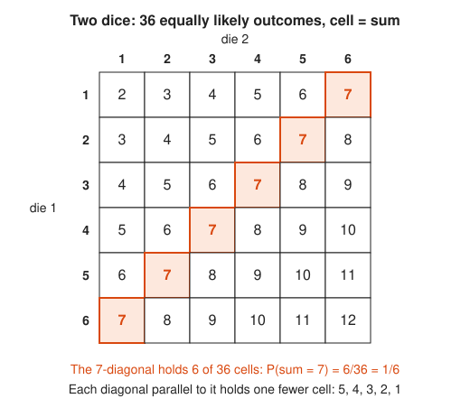
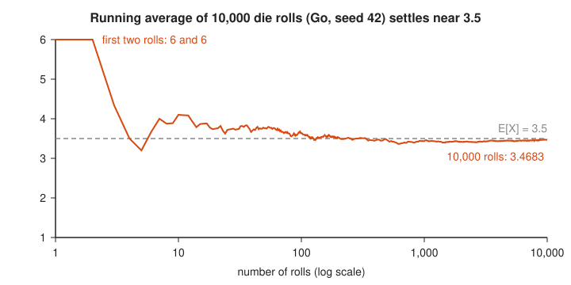
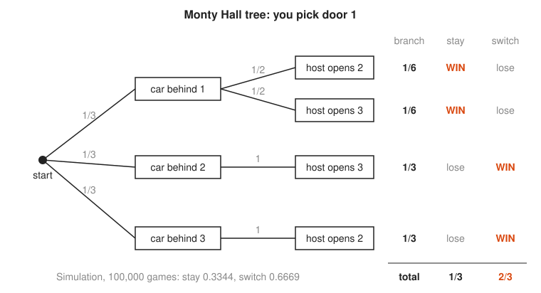
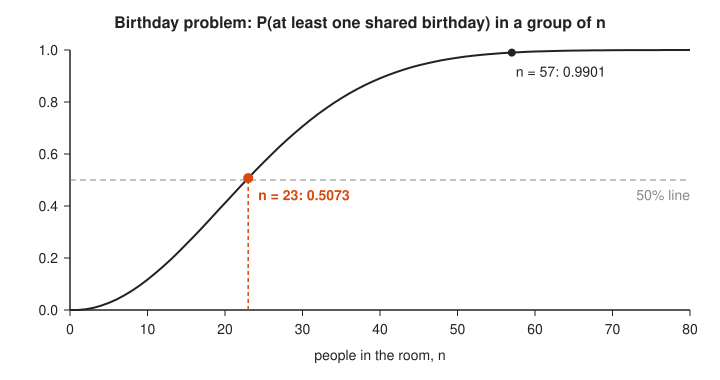

# Games and Probability

**Math used:** sample spaces, counting, expected value, law of large numbers, conditional probability, complement rule · **Level needed:** 501 (the probability unit; 101 arithmetic is enough to start) · **Time:** 90 minutes to 2 hours
**Run it:** `go run ./code/dice` (from this folder)

## The Real Problem

Casinos, lotteries, and carnival booths run on one idea: every single bet is uncertain, but the average over millions of bets is not. The house knows its expected value to four decimal places and lets the law of large numbers collect it. Players lose because they reason about one bet at a time.

The same math runs production systems. A retry budget, a cache hit rate, the chance that two random request IDs collide, and the chance that a doubling backoff exhausts its budget are all dice problems in work clothes. The birthday problem, in particular, decides how many bits a random ID or a hash needs before collisions show up.

This workshop builds the toolkit from dice up: count a sample space, compute an expected value, watch an average converge, settle the Monty Hall argument with a tree and 100,000 simulated games, find the 23-person birthday surprise and its hash-collision twin, and watch the martingale betting system go broke.

## The Math You Need

* [101 Foundations](../../course/101/README.md): fractions and decimals. Every probability here is a fraction like 6/36.
* [501 Linear Algebra, Probability and Discrete Math](../../course/501/README.md): the probability unit defines sample spaces, events, conditional probability, expected value, and the law of large numbers.
* [Probability track](../../tracks/probability/README.md): the same ideas with more examples, including independence and the complement rule $P(\text{not } A) = 1 - P(A)$.
* [Combinatorics track](../../tracks/combinatorics/README.md): counting outcomes with $\binom{n}{k}$, which the lottery and birthday sections use.

## Picture It

<!-- diagram: type=grid rows=6 cols=6 cell=sum highlight=7 caption="Two dice, 36 outcomes, the 7-diagonal" -->


Two dice give 36 equally likely ordered outcomes, one per cell. Sums are constant along diagonals. The longest diagonal holds all six ways to make 7, so 7 is the most common sum at $6/36 = 1/6$. Each diagonal further out loses one cell, which is why 2 and 12 have only one way each.

<!-- diagram: type=line-chart x=rolls(log,1..10000) y=average(1..6) reference=3.5 seed=42 caption="Running average of die rolls" -->


The law of large numbers in one picture. The first two rolls are both 6, so the average starts at 6. Early on the line swings wildly. By a few thousand rolls it hugs the dashed line at 3.5, the expected value. The x axis is logarithmic. Each tick is ten times more rolls, and each tenfold increase shrinks the typical wobble by about $\sqrt{10} \approx 3.2$ times.

<!-- diagram: type=tree root=pick-door-1 level1=car(1,2,3) level2=host-opens caption="Monty Hall probability tree" -->


You pick door 1. Multiply along each path to get the branch probability. Stay wins only on the top two branches, worth $1/6 + 1/6 = 1/3$. Switch wins on the bottom two, worth $1/3 + 1/3 = 2/3$. The host is not random: when the car hides behind door 2 or 3, his move is forced, and that forced move points straight at the car.

<!-- diagram: type=line-chart x=n(0..80) y=P(shared)(0..1) mark=23,57 reference=0.5 caption="Birthday problem curve" -->


The chance of a shared birthday climbs fast. It passes 50% at 23 people and 99% at 57. The reason: 23 people form 253 pairs, and every pair is a chance to match.

## Guided Build

### Step 1: Count the Sample Space

**The idea:** the **sample space** lists every possible outcome. When all outcomes are equally likely, a probability is a count:

$$P(A) = \frac{\text{outcomes in } A}{\text{total outcomes}}$$

Two dice give $6 \times 6 = 36$ ordered pairs. Order matters: (1, 6) and (6, 1) are different cells.

```go
for a := 1; a <= 6; a++ {
	for b := 1; b <= 6; b++ {
		counts[a+b]++ // one cell of the 6 x 6 grid
	}
}
```

```txt
==============================================================
1. Two dice: 36 equally likely outcomes (cell = sum)
==============================================================
       die 2:   1   2   3   4   5   6
  die 1 = 1:    2   3   4   5   6 [7]
  die 1 = 2:    3   4   5   6 [7]   8
  die 1 = 3:    4   5   6 [7]   8   9
  die 1 = 4:    5   6 [7]   8   9  10
  die 1 = 5:    6 [7]   8   9  10  11
  die 1 = 6:  [7]   8   9  10  11  12
  [7] marks the six cells on the 7-diagonal

==============================================================
2. Distribution of the sum of two dice
==============================================================
  sum  2: 1/36 = 0.028  ####
  sum  3: 2/36 = 0.056  ########
  sum  4: 3/36 = 0.083  ############
  sum  5: 4/36 = 0.111  ################
  sum  6: 5/36 = 0.139  ####################
  sum  7: 6/36 = 0.167  ########################
  sum  8: 5/36 = 0.139  ####################
  sum  9: 4/36 = 0.111  ################
  sum 10: 3/36 = 0.083  ############
  sum 11: 2/36 = 0.056  ########
  sum 12: 1/36 = 0.028  ####
  most likely sum: 7 with probability 6/36 = 1/6
```

The bar chart is a triangle: the diagonals of the grid, tipped on their side.

### Step 2: Expected Value

**The idea:** the **expected value** is the probability-weighted average of the payoffs. It is the long-run average per play.

$$E[X] = \sum_{\text{outcomes } x} x \cdot P(X = x)$$

A positive $E[\text{net}]$ means the game pays you over time. A negative one means it pays the house. A carnival game and a lottery both come out negative. The lottery counts its winning tickets with $\binom{6}{k}\binom{43}{6-k}$: choose $k$ of your six numbers to match and $6 - k$ from the 43 losing numbers.

```go
win := 10.0 / 6 // E[prize] of the carnival game
for _, k := range []int64{6, 5, 4, 3} {
	ways := comb(6, k) * comb(43, 6-k)
	p := float64(ways) / float64(total)
	ePrize += p * prizes[k]
}
```

```txt
==============================================================
3. Expected value
==============================================================
  one fair die: (1+2+3+4+5+6)/6 = 21/6 = 3.5

  Carnival game: pay $2, roll one die, a 6 pays a $10 prize
    E[prize] = (1/6)(10) + (5/6)(0) = 10/6 = $1.6667
    E[net]   = 10/6 - 2 = -2/6 = -$0.3333 per play

  Lottery: pay $2, pick 6 of 49 numbers
    total tickets C(49,6) = 13,983,816
    match       ways    probability        prize  contribution
        6          1     0.00000007    5,000,000        0.3576
        5        258     0.00001845        1,000        0.0184
        4     13,545     0.00096862          100        0.0969
        3    246,820     0.01765040           10        0.1765
    E[prize] = $0.6494
    E[net]   = -$1.3506 per $2 ticket (-67.5% of the stake)
```

No single roll of a die shows 3.5. The expected value is an average, not an outcome. The \$5 million jackpot adds only about 36 cents to the value of a ticket because it comes once in 13,983,816 tries.

### Step 3: The Law of Large Numbers

**The idea:** the running average $\bar{X}_n = (X_1 + \dots + X_n)/n$ of independent rolls approaches $E[X]$ as $n$ grows. The typical gap shrinks like $\sigma/\sqrt{n}$, where $\sigma \approx 1.71$ for one die. At 100 rolls the typical gap is about 0.17. At 10,000 rolls it is about 0.017.

$$\bar{X}_n \to E[X] = 3.5 \quad \text{as } n \to \infty$$

The law does not say that luck evens out. After a run of sixes the dice do not owe you low numbers. The early streak simply gets diluted by the thousands of rolls that follow.

```go
rng := rand.New(rand.NewPCG(seed, 0)) // fixed seed: same rolls every run
total := 0
for n := 1; n <= rolls; n++ {
	total += rng.IntN(6) + 1
	avg := float64(total) / float64(n)
	// print avg at the checkpoints 1, 2, 5, 10, ...
}
```

```txt
==============================================================
4. Law of large numbers: 10,000 rolls, seed 42
==============================================================
    rolls  average  gap from 3.5
        1   6.0000       +2.5000
        2   6.0000       +2.5000
        5   3.2000       -0.3000
       10   4.1000       +0.6000
       20   3.7500       +0.2500
       50   3.7600       +0.2600
      100   3.6300       +0.1300
      200   3.5300       +0.0300
      500   3.4600       -0.0400
    1,000   3.4370       -0.0630
    2,000   3.4200       -0.0800
    5,000   3.4488       -0.0512
   10,000   3.4683       -0.0317

  ASCII plot: running average (each row = one checkpoint)
          2.5                 3.5               4.5
        1                     |                   >
        2                     |                   >
        5               *     |                    
       10                     |           *        
       20                     |    *               
       50                     |    *               
      100                     |  *                 
      200                     |*                   
      500                    *|                    
    1,000                    *|                    
    2,000                   * |                    
    5,000                    *|                    
   10,000                    *|                    
  (* = running average, | = 3.5, > = off the chart)
```

The gap does not shrink at every checkpoint (compare 1,000 and 2,000 rolls). Convergence is a trend, not a promise about each step.

### Step 4: Monty Hall

**The idea:** you pick one of three doors. The host, who knows where the car is, opens another door with a goat and offers a switch. Conditional probability says switch.

Your first pick is right with probability $1/3$, and nothing the host does changes that. The remaining $2/3$ sits on the other two doors. The host removes the goat from that pair, so the whole $2/3$ now rests on the single closed door.

$$P(\text{win} \mid \text{stay}) = \tfrac{1}{3}, \qquad P(\text{win} \mid \text{switch}) = 1 - \tfrac{1}{3} = \tfrac{2}{3}$$

Run it: `go run ./code/montyhall`

```go
func play(rng *rand.Rand, switchDoor bool, doors int) bool {
	car := rng.IntN(doors)
	pick := rng.IntN(doors)
	if !switchDoor {
		return pick == car
	}
	// The host opens every other door except one, never the car.
	// Switching wins exactly when the first pick was wrong.
	return pick != car
}
```

```txt
==============================================================
1. Exact probability tree (you always pick door 1)
==============================================================
   car  host opens  P(branch)   stay  switch
     1           2        1/6    WIN    lose
     1           3        1/6    WIN    lose
     2           3        1/3   lose     WIN
     3           2        1/3   lose     WIN
  P(win | stay)   = 1/3
  P(win | switch) = 2/3

==============================================================
2. Simulation: 100,000 games each, seed 42
==============================================================
  stay    wins 33,441 / 100,000 = 0.3344  #################
  switch  wins 66,689 / 100,000 = 0.6669  #################################
  theory: stay 1/3 = 0.3333, switch 2/3 = 0.6667

  Running win rate for switch (fresh run, seed 42):
    after     10 games: 0.5000
    after    100 games: 0.6400
    after  1,000 games: 0.6540
    after 10,000 games: 0.6658

==============================================================
3. Same game with 100 doors (host opens 98 goat doors)
==============================================================
  stay   win rate: 0.0104  (theory 1/100 = 0.0100)
  switch win rate: 0.9905  (theory 99/100 = 0.9900)
```

The 100-door version makes the argument obvious. You pick one door out of 100. The host opens 98 goat doors and leaves exactly one other door shut. That door is the car 99 times out of 100.

### Step 5: The Birthday Problem

**The idea:** finding at least one match is hard to count directly. Count the complement, all birthdays different, and subtract from 1. Person one takes any day, person two avoids one day, person three avoids two days, and so on:

$$P(\text{shared}) = 1 - \frac{365}{365} \cdot \frac{364}{365} \cdots \frac{365 - n + 1}{365} \approx 1 - e^{-n(n-1)/(2 \cdot 365)}$$

The approximation counts pairs: $n$ people form $\binom{n}{2}$ pairs, and each pair matches with probability $1/365$.

The same formula answers a systems question. Replace 365 days with $2^b$ hash values. A 50% chance of at least one collision arrives at about $1.1774\sqrt{2^b}$ keys, the **square-root rule**: a 32-bit hash collides after only about 77,000 keys, not four billion.

Run it: `go run ./code/birthday`

```go
func pShared(n, d int) float64 {
	pDistinct := 1.0
	for k := 0; k < n; k++ {
		pDistinct *= float64(d-k) / float64(d)
	}
	return 1 - pDistinct
}
```

```txt
==============================================================
1. Exact: P(shared) = 1 - (365/365)(364/365)...((365-n+1)/365)
==============================================================
  n =  5: 0.0271  #
  n = 10: 0.1169  ######
  n = 15: 0.2529  #############
  n = 20: 0.4114  #####################
  n = 23: 0.5073  #########################
  n = 30: 0.7063  ###################################
  n = 40: 0.8912  #############################################
  n = 50: 0.9704  #################################################
  n = 57: 0.9901  ##################################################
  n = 70: 0.9992  ##################################################

==============================================================
2. Smallest group with at least a 50% chance
==============================================================
  n = 22: 0.4757
  n = 23: 0.5073  <- first n at or above 0.5
  pairs among 23 people: C(23,2) = 253
  approximation 1 - exp(-n(n-1)/(2*365)) = 0.5000

==============================================================
3. Simulation: 20,000 random groups per n, seed 42
==============================================================
    n  simulated    exact
   10     0.1173   0.1169
   23     0.5119   0.5073
   30     0.7089   0.7063
   50     0.9721   0.9704

==============================================================
4. Hash collisions: the birthday problem with 2^b slots
==============================================================
  keys for a 50% collision chance ~ 1.1774 * sqrt(2^b)
   16-bit hash: about 301 keys
   32-bit hash: about 77,162 keys
   64-bit hash: about 5,056,894,494 keys
  128-bit hash: about 2.17e+19 keys

  16-bit simulation, 2,000 runs: keys inserted until the first collision
    mean   = 319.7   (theory sqrt(pi/2 * 2^16) = 320.8)
    median = 298     (theory about 1.1774 * 256 = 301)
    exact P(collision) with 302 keys in 2^16 slots = 0.5007
```

The constant $1.1774$ is $\sqrt{2 \ln 2}$: set $e^{-n^2/(2N)} = 1/2$ and solve for $n$.

### Step 6: Why the Martingale Fails

**The idea:** the **martingale** system bets \$1 on red and doubles after every loss. The first win recovers every loss plus \$1. It feels safe, but the bankroll is finite. With \$255 you survive eight losses in a row ($1 + 2 + \dots + 128 = 255$) and the ninth bet of \$256 is out of reach.

Each cycle wins \$1 almost always and loses \$255 rarely:

$$E[\text{cycle}] = (1 - q^8)(+1) + q^8(-255), \qquad q = \tfrac{20}{38}$$

That comes out to about -\$0.51 per cycle. Doubling only reshapes the losses into many small wins and a few huge losses. It cannot change the sign of the expected value, because every individual spin has negative expected value.

The **gambler's ruin** formula gives the chance of reaching a goal $N$ before going broke, starting from $i$ with \$1 bets, win probability $p$, and $r = q/p$:

$$P(\text{reach } N) = \frac{1 - r^i}{1 - r^N} \quad (p \ne \tfrac{1}{2}), \qquad P(\text{reach } N) = \frac{i}{N} \quad (p = \tfrac{1}{2})$$

Run it: `go run ./code/martingale`

```go
for money < goal {
	if bet > money {
		break // cannot cover the next doubled bet
	}
	if rng.Float64() < pRed {
		money += bet
		bet = 1
	} else {
		money -= bet
		bet *= 2
	}
}
```

```txt
==============================================================
1. The doubling ladder with a $255 bankroll
==============================================================
  loss #   bet  lost so far
       1     1            1
       2     2            3
       3     4            7
       4     8           15
       5    16           31
       6    32           63
       7    64          127
       8   128          255
  next bet is $256, but only $0 is left -> bust

==============================================================
2. Exact math (p = P(red) = 18/38)
==============================================================
  P(lose 8 in a row) = (20/38)^8 = 0.005888
  one cycle: win $1 with prob 0.994112, lose $255 with prob 0.005888
  E[one cycle] = 0.994112*1 - 0.005888*255 = -0.5073 dollars
  P(win all 100 cycles, +$100) = 0.5540
  P(bust first)                = 0.4460

==============================================================
3. Simulation: 10,000 sessions, seed 42
==============================================================
  sessions ending +$100: 5,558 (55.6%)
  sessions ending in a loss: 4,442 (44.4%)
  average result per session: -37.50 dollars

  histogram of session results (each # = 100 sessions):
    -255 to -206:  2,505  #########################
    -205 to -156:  1,937  ###################
     -155 to +99:      0  
            +100:  5,558  ########################################################

==============================================================
4. Gambler's ruin: start $50, stop at $100 or $0, bet $1
==============================================================
  fair coin  p = 0.5000: exact 0.5000, simulated 0.4940 (1,000 trials)
  roulette red p = 0.4737: exact 0.0051, simulated 0.0045 (2,000 trials)
  p is only 0.0263 below 1/2, yet the chance drops to 1 in 195.
```

More than half the sessions walk away happy with \$100. The rest lose between \$156 and \$255. The average session still loses about \$38. The histogram has nothing in the middle: martingale trades frequent small wins for rare large losses.

## Worked Numbers

### Example 1: Sums of Two Dice by Counting

```txt
  total outcomes = 6 * 6 = 36                  each die independent, order matters
  sum = 8: (2,6) (3,5) (4,4) (5,3) (6,2)       list the cells on the 8-diagonal
  P(sum = 8) = 5/36 = 0.1389                   favorable / total
  sum >= 10: 3 ways for 10, 2 for 11, 1 for 12 read the last three diagonals
  P(sum >= 10) = (3 + 2 + 1)/36 = 6/36 = 1/6   add disjoint events
  P(sum < 10) = 1 - 1/6 = 5/6                  complement rule
```

### Example 2: Expected Value of the Lottery Ticket

```txt
  C(49,6) = 13,983,816                          all equally likely tickets
  match 6: 1 way, 1 * 5,000,000 / 13,983,816    = 0.3576 dollars
  match 5: C(6,5)*C(43,1) = 6*43 = 258 ways     choose 5 winners, 1 loser
           258 * 1,000 / 13,983,816             = 0.0184 dollars
  match 4: C(6,4)*C(43,2) = 15*903 = 13,545     choose 4 winners, 2 losers
           13,545 * 100 / 13,983,816            = 0.0969 dollars
  match 3: C(6,3)*C(43,3) = 20*12,341 = 246,820 choose 3 winners, 3 losers
           246,820 * 10 / 13,983,816            = 0.1765 dollars
  E[prize] = 0.3576 + 0.0184 + 0.0969 + 0.1765  = 0.6494 dollars (sum of contributions)
  E[net] = 0.6494 - 2 = -1.3506 dollars         subtract the ticket price
```

### Example 3: Why 23 People Is Enough

```txt
  pairs = C(23,2) = 23*22/2 = 253              every pair is one chance to match
  P(one pair differs) = 364/365                the second birthday avoids the first
  P(all pairs differ) ~ (364/365)^253          treat pairs as nearly independent
                      ~ e^(-253/365)           (1 - 1/365)^k ~ e^(-k/365)
                      = e^(-0.6932) = 0.5000   253/365 = 0.6932, close to ln 2
  P(shared) ~ 1 - 0.5000 = 0.5000              complement rule
  exact product gives 0.5073                   the approximation is close
```

### Example 4: The Martingale Cycle

```txt
  q = P(not red) = 20/38 = 0.5263              18 black + 2 green pockets
  P(8 losses in a row) = q^8 = 0.005888        independent spins multiply
  P(cycle wins $1) = 1 - 0.005888 = 0.994112   complement rule
  E[cycle] = 0.994112*(+1) + 0.005888*(-255)   weight each payoff by its probability
           = 0.994112 - 1.501440               multiply out
           = -0.5073 dollars                   negative: the house wins on average
  P(100 cycles in a row) = 0.994112^100        need 100 good cycles for +$100
                         = 0.5540              about 55% of sessions succeed
```

## Common Mistakes

* Treating sums as equally likely: 2 through 12 are eleven sums, but they come from 36 equally likely cells. P(7) is 6/36, not 1/11.
* Ignoring order: (1, 6) and (6, 1) are different outcomes. Counting them once undercounts.
* Gambler fallacy: after five reds, black is not due. Spins are independent. The law of large numbers dilutes streaks. It does not correct them.
* Reading expected value as a likely outcome: no die shows 3.5, and no lottery player wins exactly 65 cents.
* Assuming the Monty Hall host acts at random: the 2/3 answer depends on a host who knows where the car is and always opens a goat door.
* Estimating collisions linearly: a 32-bit ID space does not stay collision-free until four billion IDs. It hits 50% at about 77,000. Use the square-root rule.
* Believing that doubling beats a negative edge: a betting system rearranges outcomes. It never changes the expected value of each bet.

## Try It

1. What is the probability that two dice show doubles?
2. What is the probability that the sum of two dice is 8?
3. A game costs \$1. Roll two dice. A sum of 7 pays \$5. Find the expected net per play.
4. What entry price makes the carnival game (a 6 pays \$10) exactly fair?
5. A Monty Hall variant has four doors. The host opens one goat door, and you switch at random to one of the two other closed doors. What is your win probability?
6. Find the exact probability of a shared birthday among three people.
7. A service generates one million random 32-bit request IDs. About how many colliding pairs do you expect?
8. With a \$1,023 bankroll, how many losses in a row does a \$1 martingale survive, and what is the chance of a fatal streak in one cycle on roulette red?
9. A fair-coin gambler starts with \$30 and stops at \$100 or \$0. What is the chance of reaching \$100?
10. Why does the running average in Step 3 end at 3.4683 after 10,000 rolls, a gap of -0.0317, instead of exactly 3.5?

<details>
<summary>Answers</summary>

1. $6/36 = 1/6$: the main diagonal (1,1) through (6,6) holds six cells.
2. $5/36 \approx 0.1389$: five cells on the 8-diagonal.
3. $5 \cdot 6/36 - 1 = 5/6 - 1 = -1/6 \approx -0.17$ dollars per play.
4. $10/6 \approx 1.67$ dollars: set $E[\text{net}] = 10/6 - \text{price} = 0$.
5. $3/8$: the first pick misses with probability $3/4$, and then the random switch finds the car with probability $1/2$.
6. $1 - (364/365)(363/365) \approx 0.0082$.
7. About 116: $\binom{10^6}{2} / 2^{32} \approx 116.4$ expected colliding pairs.
8. Ten losses ($1 + 2 + \dots + 512 = 1{,}023$). A fatal streak of ten has probability $(20/38)^{10} \approx 0.0016$.
9. $30/100 = 0.3$: for a fair game, $P(\text{reach } N) = i/N$.
10. The law of large numbers promises convergence, not exactness. The typical gap at $n = 10{,}000$ is about $1.71/\sqrt{10{,}000} \approx 0.017$, so a gap of 0.03 (about two typical gaps) is an ordinary fluctuation, not a broken die.

</details>

## Where This Shows Up at Work

* ID and key design: UUIDv4 has 122 random bits, so collisions need about $2^{61}$ IDs. Short 32-bit IDs, truncated hashes, and short Git SHA prefixes collide far sooner than intuition says.
* Hash tables and sharding: bucket collisions follow the birthday curve. Load factor and hash width set the collision rate.
* Load testing and benchmarks: a run of ten requests says little. The law of large numbers is why you collect thousands of samples before trusting a p50.
* Retry and backoff budgets: doubling backoff with a cap is a martingale ladder. A long failure streak exhausts the budget, and the rare large loss dominates the cost.
* A/B tests and feature flags: expected value per user, not the single best user story, decides whether a change pays.
* Games and gambling platforms: house edge, payout tables, and loot-box drop rates are expected-value design.
* Risk and finance: the martingale lesson applies to strategies that win small and often while hiding a rare catastrophic loss.

## Go Deeper

* [501 Linear Algebra, Probability and Discrete Math](../../course/501/README.md): the probability unit in full.
* [Probability track](../../tracks/probability/README.md): conditional probability, independence, and expected value step by step.
* [Combinatorics track](../../tracks/combinatorics/README.md): counting with $\binom{n}{k}$ for lotteries and card hands.
* [101 Foundations](../../course/101/README.md): fractions and decimals refresher.
* [Number Theory for Cryptography](../number-theory-for-cryptography/README.md): the companion workshop, where `hash % N` and consistent hashing pick up the hashing thread.
* [Probability on Math Is Fun](https://www.mathsisfun.com/data/probability.html): a plain, picture-first introduction.
* [Monty Hall Problem on Wolfram MathWorld](https://mathworld.wolfram.com/MontyHallProblem.html): the history and the exact conditions.
* [Birthday Problem on Wolfram MathWorld](https://mathworld.wolfram.com/BirthdayProblem.html): exact values and approximations.
